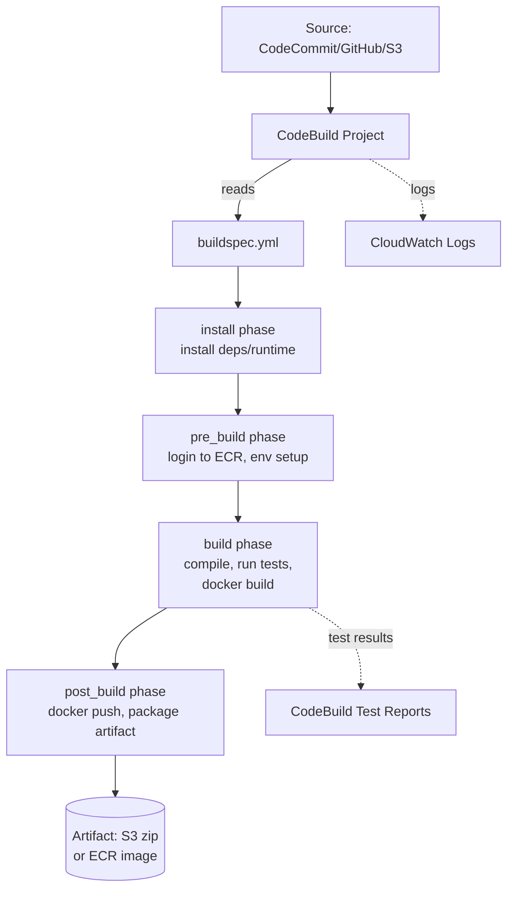
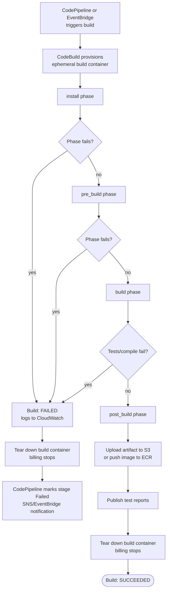
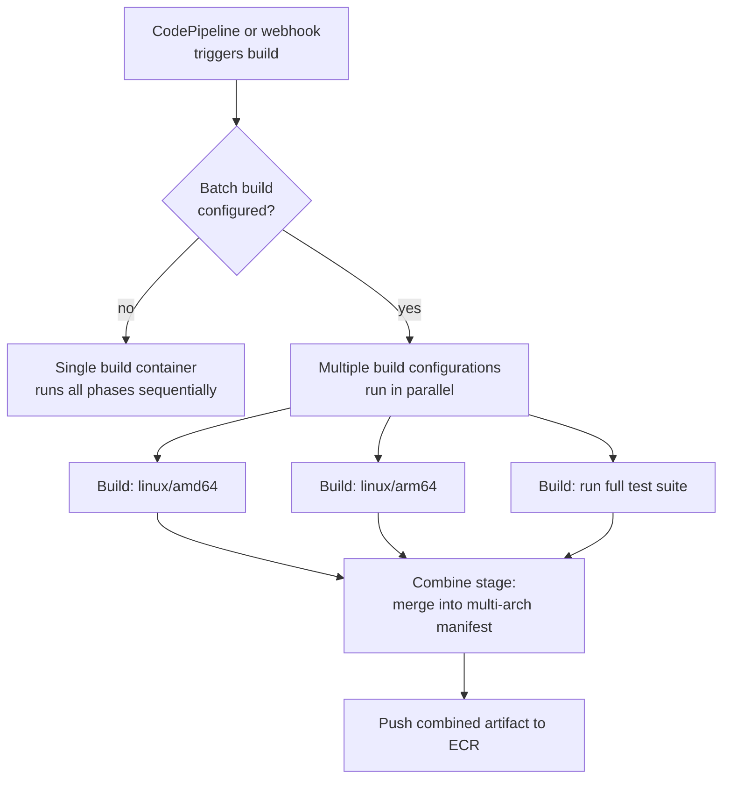
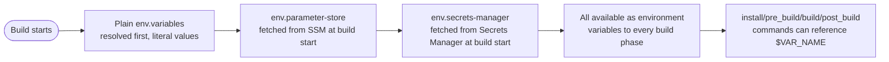

# AWS CodeBuild

> **Appears in:** [DVA-C03](../../certifications/dva-c03/README.md)


<!-- AWS Architecture Icons, Developer Tools category; see diagrams/README.md for the convention -->

## Definition

AWS CodeBuild is a fully managed build service: it compiles your source code, runs your automated
tests, and produces deployable artifacts (a zip, a container image, a compiled binary) — without
you having to provision, patch, or scale your own build servers.

## Purpose

Before managed build services, teams ran their own Jenkins servers (or similar) — which meant
patching the build server's OS, scaling it up during busy release weeks, and securing it, all as
pure overhead unrelated to actually shipping software. CodeBuild exists to make "run my build/test
commands" a pay-per-build-minute API call instead of a piece of infrastructure you own, while
staying flexible enough to run arbitrary shell commands via a simple YAML spec.

CodeBuild's design deliberately mirrors the shape of a Jenkins/Travis/CircleCI build job (phases of
shell commands against a checked-out source tree) rather than inventing a new programming model —
the learning curve for a team already familiar with any CI tool is mostly "learn the buildspec
syntax," not "rethink how CI works."

## How It Works

Plain explanation: CodeBuild reads a `buildspec.yml` file (checked into your repo, or defined
inline in the project config) describing phases of commands to run. It spins up an ephemeral,
isolated build container, checks out your source, runs each phase, and uploads the resulting
artifact — then tears the container down. You're billed only for the build's actual duration.



Step by step:
1. CodeBuild pulls source from **CodeCommit, GitHub/GitLab/Bitbucket (via CodeConnections), S3,
   or CodePipeline's artifact store**.
2. It launches a fresh, isolated, ephemeral build environment (a managed Docker container with
   your chosen runtime image, or your own custom image).
3. It executes the phases defined in `buildspec.yml` in order: `install` (set up
   runtimes/dependencies), `pre_build` (e.g., `aws ecr get-login-password` to authenticate to
   ECR), `build` (the actual compile/test/`docker build` commands), `post_build` (e.g.,
   `docker push`, packaging the final artifact).
4. Test results can be published as structured **Test Reports** visible in the console.
5. The final artifact (a zip in S3, a Docker image pushed to ECR, etc.) is handed off — either
   directly, or as the input to the next stage of a **CodePipeline**.
6. All build output streams to **CloudWatch Logs** for debugging failed builds.

### Real-World Reference Architecture


*Figure: The official "how CodeBuild works" diagram — a build project supplies source location,
build environment, and commands; CodeBuild creates the build environment, pulls source, runs the
buildspec, uploads output to S3, and streams status/logs to CodeBuild and CloudWatch Logs
throughout. Source:
[AWS CodeBuild User Guide — "AWS CodeBuild concepts"](https://docs.aws.amazon.com/codebuild/latest/userguide/concepts.html), © Amazon Web Services.*


*Figure: CodeBuild added as a build/test action within a CodePipeline stage — illustrating that
CodeBuild is usually not invoked standalone in production, but as one action inside a larger
pipeline that CodePipeline orchestrates end-to-end. Source:
[AWS CodeBuild User Guide — "What is AWS CodeBuild?"](https://docs.aws.amazon.com/codebuild/latest/userguide/welcome.html), © Amazon Web Services.*

## Worked Example: A Production buildspec.yml (Build and Push a Container Image)

```yaml
version: 0.2

env:
  variables:
    IMAGE_REPO_NAME: "orders-api"
  parameter-store:
    DB_URL: "/orders-api/db-url"
  secrets-manager:
    NPM_TOKEN: "ci/npm-token:token"

phases:
  install:
    runtime-versions:
      nodejs: 20
    commands:
      - echo "Installing dependencies"
      - npm ci

  pre_build:
    commands:
      - echo "Logging in to Amazon ECR"
      - aws ecr get-login-password --region $AWS_DEFAULT_REGION | docker login --username AWS --password-stdin $AWS_ACCOUNT_ID.dkr.ecr.$AWS_DEFAULT_REGION.amazonaws.com
      - COMMIT_HASH=$(echo $CODEBUILD_RESOLVED_SOURCE_VERSION | cut -c 1-7)
      - IMAGE_TAG=${COMMIT_HASH:-latest}

  build:
    commands:
      - echo "Running unit tests"
      - npm test -- --ci --reporters=default --reporters=jest-junit
      - echo "Building Docker image"
      - docker build -t $IMAGE_REPO_NAME:$IMAGE_TAG .
      - docker tag $IMAGE_REPO_NAME:$IMAGE_TAG $AWS_ACCOUNT_ID.dkr.ecr.$AWS_DEFAULT_REGION.amazonaws.com/$IMAGE_REPO_NAME:$IMAGE_TAG

  post_build:
    commands:
      - echo "Pushing image to ECR"
      - docker push $AWS_ACCOUNT_ID.dkr.ecr.$AWS_DEFAULT_REGION.amazonaws.com/$IMAGE_REPO_NAME:$IMAGE_TAG
      - printf '[{"name":"orders-api","imageUri":"%s"}]' $AWS_ACCOUNT_ID.dkr.ecr.$AWS_DEFAULT_REGION.amazonaws.com/$IMAGE_REPO_NAME:$IMAGE_TAG > imagedefinitions.json

reports:
  jest-reports:
    files:
      - "junit.xml"
    file-format: "JUNITXML"

artifacts:
  files:
    - imagedefinitions.json
  discard-paths: yes

cache:
  paths:
    - "node_modules/**/*"
```

What matters here for both the exam and real debugging:
- **`env.parameter-store` and `env.secrets-manager`** inject values from SSM Parameter Store and
  Secrets Manager directly as environment variables at build start — this is the correct,
  exam-tested way to keep secrets out of the buildspec file itself (which is often checked into
  source control and therefore not a safe place for literal secret values).
- **`CODEBUILD_RESOLVED_SOURCE_VERSION`** is one of several CodeBuild-provided built-in environment
  variables (others include `CODEBUILD_BUILD_ID`, `AWS_DEFAULT_REGION`); using the resolved commit
  hash as an image tag (rather than `:latest`) gives every build a unique, traceable artifact tag.
- **`reports`** publishes structured test results (JUnit XML here) to the CodeBuild console's Test
  Reports feature — distinct from `artifacts`, which is the actual deployable output.
- **`imagedefinitions.json`** is the specific file format the **ECS deploy action in CodePipeline**
  expects when it needs to know which container/image pair to update in a task definition — this
  exact filename and structure is a commonly tested, easy-to-miss detail.
- **`cache.paths`** caches `node_modules` across builds in S3, meaningfully speeding up repeat
  builds — a direct, practical cost/time optimization most buildspecs in production actually use.

## Full Build Lifecycle with Failure and Retry



Walkthrough: any phase failing (a non-zero exit code from any command, unless explicitly marked
with `|| true`) stops the build immediately — later phases never run, and no artifact is uploaded.
This is a frequent source of confusion: a `post_build` command failing *after* tests already
passed still marks the overall build as `FAILED`, and CodePipeline (if this build is a pipeline
stage) will show that stage as failed even though the actual compile/test work succeeded. The fix
pattern commonly tested: isolate risky post-build steps, or use `finally` blocks within a phase to
ensure cleanup commands run even if an earlier command in the same phase fails.

## Build Compute Scaling and Batch Builds



Walkthrough: CodeBuild provisions a brand-new, isolated build container for every single build
(no shared state between builds except what you explicitly cache to S3) — this is what makes
batch builds safe to run in parallel with no cross-contamination, and is also why a build that
"worked yesterday" can fail today if an upstream dependency changed, since nothing is implicitly
cached unless you configure it.

## Secrets and Environment Variable Resolution Order



Walkthrough: all three environment variable sources are resolved **before any phase runs** and
are then available identically to every phase — there's no "only available in pre_build" scoping;
once resolved, a secret pulled via `env.secrets-manager` is just as visible to the `build` phase
as to `pre_build`, which is precisely why accidentally `echo`-ing one anywhere in the buildspec
leaks it to CloudWatch Logs regardless of which phase the stray command sits in.

## Key Features / Components

- **buildspec.yml** — the YAML file defining build phases (install/pre_build/build/post_build)
  and artifact locations; can live in the repo or be defined inline.
- **Managed build images** — AWS-provided images for common runtimes (Node, Python, Java, Go,
  .NET, Docker-in-Docker) or bring your own custom image.
- **Build compute options** — from small general-purpose instances up to GPU-backed or
  high-memory compute for heavier builds.
- **Caching** — local or S3-backed dependency caching to speed up repeat builds (e.g., cache
  `node_modules` or Maven `.m2`).
- **VPC connectivity** — builds can run inside your VPC to reach private resources (an internal
  artifact repo, a private database for integration tests).
- **Batch builds** — run multiple build configurations (matrix builds) from one trigger.
- **Test Reports** — structured surfacing of JUnit/Cucumber/etc. test results in the console.
- **`env.parameter-store` / `env.secrets-manager`** — native, secretless injection of
  configuration/secrets as build-time environment variables.
- **Build badges** — a status badge (passing/failing) embeddable in a repo README, reflecting the
  latest build result for a branch.

## Use Cases — When to Use It

Each scenario names the situation, why CodeBuild fits, and the tradeoff accepted versus an
alternative.

1. **Container image build-and-push CI step.** Situation: a Docker image must be built, tested,
   and pushed to ECR as part of deployment. Why CodeBuild fits: buildspec phases map directly onto
   install/test/`docker build`/`docker push`. Tradeoff: a separate deploy action (CodeDeploy, ECS
   deploy) is still needed — CodeBuild only produces the artifact, never releases it.
2. **Replacing self-hosted Jenkins.** Situation: a team is tired of patching and scaling Jenkins
   build agents. Why CodeBuild fits: pay-per-build-minute with zero agent fleet to manage.
   Tradeoff: a smaller plugin ecosystem than Jenkins' long-established marketplace.
3. **Monorepo CI with multiple CodeBuild projects.** Situation: a monorepo with many services, each
   needing its own build. Why CodeBuild fits: separate projects per service/path keep builds
   isolated and independently cacheable. Tradeoff: project sprawl needs governance (naming
   conventions, shared buildspec templates) as service count grows.
4. **VPC-connected integration testing.** Situation: tests need to reach a private RDS instance with
   no public endpoint. Why CodeBuild fits: a project can be explicitly configured with VPC
   connectivity (subnets, security groups). Tradeoff: adds NAT Gateway/security-group setup that a
   public-only build doesn't need, and this is not the default configuration.
5. **Security-gated builds (SAST/dependency scanning).** Situation: a shift-left security
   requirement must block risky images before they reach ECR. Why CodeBuild fits: a dedicated
   buildspec phase can fail the build when findings exceed a severity threshold. Tradeoff: adds
   latency to every single build, even low-risk changes that would have passed anyway.
6. **Matrix/batch builds for multi-architecture images.** Situation: both amd64 and Graviton/arm64
   image variants are needed. Why CodeBuild fits: batch builds fan out in parallel, then a combine
   stage merges into a multi-arch manifest. Tradeoff: meaningfully more complex buildspec/project
   configuration than a single-architecture build.
7. **Hotfix emergency builds.** Situation: a critical patch must be built and validated fast. Why
   CodeBuild fits: it spins up an ephemeral build container in seconds, with no agent queue to wait
   on. Tradeoff: the build cache (`node_modules`, Docker layers) may be cold if it's been a while
   since the last build on that project, partially offsetting the "fast" hotfix turnaround.
8. **ML custom training/inference container builds.** Situation: an MLA-C02-relevant pipeline needs
   a custom image with a specific ML framework version. Why CodeBuild fits: `cache.paths` avoids
   re-downloading large ML dependencies on every build. Tradeoff: large ML images still take
   meaningfully longer to build and push than lightweight application images, even with caching.
9. **Blue/green release artifact preparation.** Situation: the pipeline needs a uniquely-tagged,
   traceable image per release for a downstream CodeDeploy blue/green action. Why CodeBuild fits:
   tagging with `CODEBUILD_RESOLVED_SOURCE_VERSION` (the commit SHA) gives an unambiguous artifact
   reference. Tradeoff: requires pipeline discipline to never fall back to a mutable `:latest` tag
   under release-day time pressure.
10. **Secretless handling of third-party registry/API credentials.** Situation: a build needs a
    private npm/PyPI registry token during the `install` phase. Why CodeBuild fits:
    `env.secrets-manager` injects the value without it ever touching the buildspec file in source
    control. Tradeoff: a stray `echo` of that variable anywhere in the buildspec still leaks it to
    CloudWatch Logs — CodeBuild does not redact arbitrary command output automatically.

## When NOT to Use It / Alternatives

- **You need deep, mature plugin ecosystems, complex multi-team shared pipelines, or on-prem
  build agents** → **Jenkins** (self-hosted) still has a broader plugin ecosystem, at the cost of
  operating the infrastructure yourself.
- **Your team already standardizes on GitHub for everything and wants build/test/deploy defined
  as code right next to the repo with zero AWS console config** → **GitHub Actions** is often
  simpler to adopt for GitHub-hosted repos and has a generous free tier for public/small private
  repos.
- **You need extremely long-running builds (many hours) at predictable, constant volume** → a
  self-managed build fleet (e.g., self-hosted GitHub Actions runners on EC2) might be cheaper at
  very large constant scale, though CodeBuild has removed most practical duration limits for
  typical use.

## Common Architectures

**1. Build-once, deploy-many promotion pipeline**
A single CodeBuild project builds and pushes one immutable, commit-hash-tagged image; subsequent
pipeline stages (dev → staging → prod) only ever *deploy* that same image reference, never
rebuilding it — avoiding "works in staging, broke in prod" bugs introduced by rebuilding at each
stage.

**2. Matrix/batch builds for multi-platform artifacts**
A single CodeBuild trigger fans out into parallel batch builds (e.g., one per target architecture:
amd64 and arm64), each producing its own artifact, which are then combined into a multi-arch
manifest pushed to ECR — common for teams supporting both standard and Graviton-based Fargate/EC2
deployments.

**3. Security-gated build with SAST and dependency scanning**
The `build` phase runs unit tests, then a dedicated phase runs a static application security
testing (SAST) tool and a dependency vulnerability scanner; the buildspec explicitly fails (exit
non-zero) if findings exceed a severity threshold, blocking the pipeline before an image is ever
pushed to ECR — "shift left" security enforced at the build layer.

**4. VPC-connected integration test builds**
A buildspec's `build` phase runs integration tests against a private RDS instance or internal
service, requiring the CodeBuild project to be configured with VPC connectivity (subnets, security
groups) — a frequently tested detail, since CodeBuild projects are *not* VPC-connected by default.

**5. Self-hosted alternative using GitHub Actions + CodeBuild hybrid**
A GitHub Actions workflow handles lightweight linting/formatting checks (fast feedback, free tier),
while a CodeBuild project (triggered via CodeConnections/webhook) handles the heavier
compile/test/container-build work — splitting CI load between a free, fast tool and a managed,
AWS-integrated one based on what each step actually needs.

## Why It's Important

**Real-world weight:** The build step is where "my code" becomes "a deployable thing" — a broken,
insecure, or slow build process directly delays every release and is a common place for secrets
to leak (e.g., hardcoded credentials in buildspecs) if not configured carefully with Secrets
Manager/Parameter Store.

**Exam weight — exact mapping:**
- **DVA-C03 Domain 3, Task 3.1** ("Prepare application artifacts for deployment") and **Task
  3.3** ("Deploy code via CI/CD") — CodeBuild is the canonical build-stage service in both task
  statements.
- **DVA-C03 Domain 3, Task 3.2** ("Implement and automate application testing") — CodeBuild is
  where automated test execution (including AI-assisted test generation output) actually runs.
- **SAA-C03 Domain 2, Task 2.1** — CodeBuild supports the automated, loosely-coupled deployment
  architecture pattern.
- **MLA-C02 Domain 3, Task 3.3** — "CI/CD for ML (CodePipeline/CodeBuild/CodeDeploy...)" is
  explicitly named for building custom training/inference containers and running pipeline tests.

### Expanded Exam Scenarios

**DVA-C03 Domain 3 scenario:** "A buildspec needs to authenticate to a third-party npm registry
during the install phase, without the token ever appearing in the buildspec.yml file checked into
source control." → Answer: `env.secrets-manager` mapping, pulling the token from Secrets Manager
at build start — never a hardcoded value, even a "temporary" one for testing.

**DVA-C03 Domain 3 scenario:** "A CodeBuild project needs to run integration tests against a
private RDS instance that has no public endpoint." → Answer: configure the CodeBuild project with
**VPC connectivity** (subnet IDs, security groups) — CodeBuild projects run outside any customer
VPC by default and need this explicit configuration to reach private resources at all.

**DVA-C03 Domain 3 scenario:** "A CodePipeline ECS deploy action needs to know which container
image was just built." → Answer: the buildspec's `post_build` phase must produce an
**`imagedefinitions.json`** file listing container name/image URI pairs, included in the
`artifacts` section — this exact file format is what the ECS deploy action consumes.

**MLA-C02 Domain 3 scenario:** "A CI pipeline needs to build a custom Docker image containing a
specific ML framework version, with build caching to avoid re-downloading large dependencies on
every build." → Answer: a CodeBuild project with a `cache.paths` configuration (or Docker layer
caching) pointed at the dependency directory, paired with a `pre_build` ECR login and `build`
phase `docker build`/`docker push`.

## Limits & Quotas

Current defaults (verify against the
[official CodeBuild quotas page](https://docs.aws.amazon.com/codebuild/latest/userguide/limits.html)):

| Quota | Default | Adjustable? |
|---|---|---|
| Concurrently running builds per account (per Region) | 60 (varies by compute type) | Yes |
| Build timeout (max) | 8 hours | Configurable up to this ceiling |
| buildspec file size | 100 KB (inline) / larger via file reference | — |
| Environment variables per build | 100 | — |
| Cache size (S3-backed) | No hard cap (billed as S3 storage) | — |
| Build projects per account | 5,000 | Yes |

**Exam-relevant takeaway:** the 8-hour build timeout ceiling is occasionally used to distinguish
CodeBuild from "unbounded duration" claims — a question describing a multi-day build process is
signaling a design problem (the build should be decomposed), not a CodeBuild configuration fix.

## Troubleshooting / Common Issues

- **Build fails at `pre_build` with an ECR authentication error** — the CodeBuild service role
  lacks `ecr:GetAuthorizationToken`, or the account/region in the login command doesn't match the
  actual ECR repository's account/region.
- **Build succeeds locally but fails in CodeBuild** — almost always an environment difference:
  missing `runtime-versions` pinning (CodeBuild's managed images update over time), or a
  dependency that assumes network access CodeBuild's build environment doesn't have (e.g., no VPC
  connectivity configured for a private resource).
- **Cache doesn't seem to speed up subsequent builds** — confirm the `cache` type is set correctly
  in the CodeBuild project configuration (`LOCAL` vs `S3`), not just declared in the buildspec;
  both the project-level setting and the buildspec's `cache.paths` must agree.
- **Secrets appear in plaintext in build logs** — a command that echoes an environment variable
  containing a secret (e.g., `echo $NPM_TOKEN` for debugging) will leak it into CloudWatch Logs;
  CodeBuild does not automatically redact secret values from arbitrary command output, only from
  specific known patterns.
- **`imagedefinitions.json` not found by the downstream ECS deploy action** — check the `artifacts`
  section explicitly lists the file and that `post_build` actually created it at the project's
  working directory root (a nested subdirectory path mismatch is a frequent cause).
- **Build hangs and eventually times out** — check for a command waiting on interactive input
  (CodeBuild has no interactive terminal) or a network call to an unreachable private resource
  because VPC connectivity wasn't configured.

## Pricing Model (summary)

- Billed **per build minute**, by compute type (general1.small up through GPU-backed instances) —
  no charge when not actively building.
- A modest free tier exists for new accounts (build minutes per month on small compute).
- Caching and VPC connectivity don't add direct CodeBuild charges but can incur S3/NAT Gateway
  costs respectively.
- Official pricing: https://aws.amazon.com/codebuild/pricing/

## Hands-on Lab (Floci)

**CodeBuild is not emulated by Floci** — it's a managed build-orchestration control plane with no
meaningful local-Docker equivalent inside the emulator's supported service list. **Use GitHub
Actions as the free alternative to practice the exact same CI concept** (buildspec phases map
almost 1:1 onto a GitHub Actions job's steps):

```yaml
# .github/workflows/build.yml — mirrors a CodeBuild buildspec's phases
name: build
on: [push]
jobs:
  build:
    runs-on: ubuntu-latest
    steps:
      - uses: actions/checkout@v4          # equivalent to CodeBuild's source pull
      - name: install                       # install phase
        run: pip install -r requirements.txt
      - name: pre_build                     # pre_build phase (e.g. ECR login equivalent)
        run: echo "auth/setup steps here"
      - name: build                         # build phase
        run: pytest && python -m py_compile app.py
      - name: post_build                    # post_build phase
        run: echo "package/push artifact here"
```

You can still use Floci + `awslocal` *inside* a GitHub Actions job to practice pushing a built
image to a local ECR-equivalent as a combined exercise:

```bash
# Inside the post_build-equivalent step, push to a local Floci ECR endpoint
awslocal ecr create-repository --repository-name demo-app || true
awslocal ecr get-login-password | docker login --username AWS --password-stdin localhost:4566
docker build -t localhost:4566/demo-app:$GITHUB_SHA .
docker push localhost:4566/demo-app:$GITHUB_SHA
```

Just don't expect to spin up a real CodeBuild Project against `localhost:4566` directly.

## Exam Tips

- Keywords pointing to CodeBuild specifically: "buildspec.yml," "compile and test," "build Docker
  image," "no build server to manage."
- Don't confuse CodeBuild (compiles/tests/packages) with **CodeDeploy** (installs/releases the
  already-built artifact onto compute) or **CodePipeline** (orchestrates the whole sequence).
- A buildspec with a `docker build` + `docker push` in the `build`/`post_build` phases, paired
  with an ECR login in `pre_build`, is the textbook pattern for "build and publish a container
  image" questions.
- `imagedefinitions.json` is a specific, named artifact format the ECS CodePipeline deploy action
  expects — a question about "pipeline doesn't know which image to deploy" often hinges on this
  file being missing or malformed.
- CodeBuild projects are **not VPC-connected by default** — a question about reaching a private
  database during tests requires explicitly configuring VPC settings on the project.
- Appears heavily in DVA-C03 Domain 3, and is named directly in MLA-C02 Domain 3's CI/CD-for-ML
  task.

## Further Reading

- [What is AWS CodeBuild?](https://docs.aws.amazon.com/codebuild/latest/userguide/welcome.html) — official overview and architecture diagrams used above
- [Buildspec reference](https://docs.aws.amazon.com/codebuild/latest/userguide/build-spec-ref.html) — the complete buildspec.yml syntax reference
- [Build environment reference](https://docs.aws.amazon.com/codebuild/latest/userguide/build-env-ref.html) — managed image list and compute type options
- [CodeBuild VPC support](https://docs.aws.amazon.com/codebuild/latest/userguide/vpc-support.html) — official guide to connecting builds to private resources

## Related Terms

- [`codecommit.md`](codecommit.md), [`codepipeline.md`](codepipeline.md),
  [`codedeploy.md`](codedeploy.md) — the other stages of a full CI/CD pipeline
- `../containers/ecr.md` — typical destination for images CodeBuild produces
- [`sam.md`](sam.md) — SAM/CDK builds are often invoked as a CodeBuild `build` phase step
