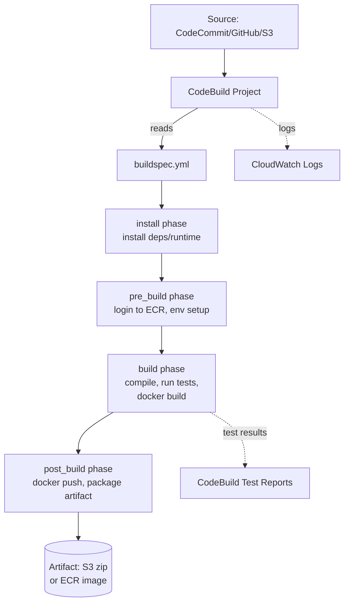

# AWS CodeBuild


<!-- AWS Architecture Icons, Developer Tools category; see diagrams/README.md for the convention -->

## Definition

AWS CodeBuild is a fully managed build service: it compiles your source code, runs your automated
tests, and produces deployable artifacts (a zip, a container image, a compiled binary) — without
you having to provision, patch, or scale your own build servers.

## Purpose

Before managed build services, teams ran their own Jenkins servers (or similar) — which meant
patching the build server's OS, scaling it up during busy release weeks, and securing it, all as
pure overhead unrelated to actually shipping software. CodeBuild exists to make "run my build/test
commands" a pay-per-build-minute API call instead of a piece of infrastructure you own, while
staying flexible enough to run arbitrary shell commands via a simple YAML spec.

## How It Works

Plain explanation: CodeBuild reads a `buildspec.yml` file (checked into your repo, or defined
inline in the project config) describing phases of commands to run. It spins up an ephemeral,
isolated build container, checks out your source, runs each phase, and uploads the resulting
artifact — then tears the container down. You're billed only for the build's actual duration.



Step by step:
1. CodeBuild pulls source from **CodeCommit, GitHub/GitLab/Bitbucket (via CodeConnections), S3,
   or CodePipeline's artifact store**.
2. It launches a fresh, isolated, ephemeral build environment (a managed Docker container with
   your chosen runtime image, or your own custom image).
3. It executes the phases defined in `buildspec.yml` in order: `install` (set up
   runtimes/dependencies), `pre_build` (e.g., `aws ecr get-login-password` to authenticate to
   ECR), `build` (the actual compile/test/`docker build` commands), `post_build` (e.g.,
   `docker push`, packaging the final artifact).
4. Test results can be published as structured **Test Reports** visible in the console.
5. The final artifact (a zip in S3, a Docker image pushed to ECR, etc.) is handed off — either
   directly, or as the input to the next stage of a **CodePipeline**.
6. All build output streams to **CloudWatch Logs** for debugging failed builds.

## Key Features / Components

- **buildspec.yml** — the YAML file defining build phases (install/pre_build/build/post_build)
  and artifact locations; can live in the repo or be defined inline.
- **Managed build images** — AWS-provided images for common runtimes (Node, Python, Java, Go,
  .NET, Docker-in-Docker) or bring your own custom image.
- **Build compute options** — from small general-purpose instances up to GPU-backed or
  high-memory compute for heavier builds.
- **Caching** — local or S3-backed dependency caching to speed up repeat builds (e.g., cache
  `node_modules` or Maven `.m2`).
- **VPC connectivity** — builds can run inside your VPC to reach private resources (an internal
  artifact repo, a private database for integration tests).
- **Batch builds** — run multiple build configurations (matrix builds) from one trigger.
- **Test Reports** — structured surfacing of JUnit/Cucumber/etc. test results in the console.

## Use Cases — When to Use It

- Any CI step that needs to compile code, run a test suite, or build a container image as part of
  a pipeline.
- Teams wanting to avoid maintaining Jenkins (or similar) build server infrastructure — no agents
  to patch, no queue capacity to plan.
- Building and pushing Docker images to ECR as part of a container deployment pipeline (DVA-C03
  Domain 3's "ECR image build/tag/lifecycle" is literally this).
- ML pipelines that need to build a custom training/inference container (MLA-C02 Domain 3).

## When NOT to Use It / Alternatives

- **You need deep, mature plugin ecosystems, complex multi-team shared pipelines, or on-prem
  build agents** → **Jenkins** (self-hosted) still has a broader plugin ecosystem, at the cost of
  operating the infrastructure yourself.
- **Your team already standardizes on GitHub for everything and wants build/test/deploy defined
  as code right next to the repo with zero AWS console config** → **GitHub Actions** is often
  simpler to adopt for GitHub-hosted repos and has a generous free tier for public/small private
  repos.
- **You need extremely long-running builds (many hours) at predictable, constant volume** → a
  self-managed build fleet (e.g., self-hosted GitHub Actions runners on EC2) might be cheaper at
  very large constant scale, though CodeBuild has removed most practical duration limits for
  typical use.

## Why It's Important

**Real-world weight:** The build step is where "my code" becomes "a deployable thing" — a broken,
insecure, or slow build process directly delays every release and is a common place for secrets
to leak (e.g., hardcoded credentials in buildspecs) if not configured carefully with Secrets
Manager/Parameter Store.

**Exam weight — exact mapping:**
- **DVA-C03 Domain 3, Task 3.1** ("Prepare application artifacts for deployment") and **Task
  3.3** ("Deploy code via CI/CD") — CodeBuild is the canonical build-stage service in both task
  statements.
- **DVA-C03 Domain 3, Task 3.2** ("Implement and automate application testing") — CodeBuild is
  where automated test execution (including AI-assisted test generation output) actually runs.
- **SAA-C03 Domain 2, Task 2.1** — CodeBuild supports the automated, loosely-coupled deployment
  architecture pattern.
- **MLA-C02 Domain 3, Task 3.3** — "CI/CD for ML (CodePipeline/CodeBuild/CodeDeploy...)" is
  explicitly named for building custom training/inference containers and running pipeline tests.

## Pricing Model (summary)

- Billed **per build minute**, by compute type (general1.small up through GPU-backed instances) —
  no charge when not actively building.
- A modest free tier exists for new accounts (build minutes per month on small compute).
- Caching and VPC connectivity don't add direct CodeBuild charges but can incur S3/NAT Gateway
  costs respectively.
- Official pricing: https://aws.amazon.com/codebuild/pricing/

## Hands-on Lab (Floci)

**CodeBuild is not emulated by Floci** — it's a managed build-orchestration control plane with no
meaningful local-Docker equivalent inside the emulator's supported service list. **Use GitHub
Actions as the free alternative to practice the exact same CI concept** (buildspec phases map
almost 1:1 onto a GitHub Actions job's steps):

```yaml
# .github/workflows/build.yml — mirrors a CodeBuild buildspec's phases
name: build
on: [push]
jobs:
  build:
    runs-on: ubuntu-latest
    steps:
      - uses: actions/checkout@v4          # equivalent to CodeBuild's source pull
      - name: install                       # install phase
        run: pip install -r requirements.txt
      - name: pre_build                     # pre_build phase (e.g. ECR login equivalent)
        run: echo "auth/setup steps here"
      - name: build                         # build phase
        run: pytest && python -m py_compile app.py
      - name: post_build                    # post_build phase
        run: echo "package/push artifact here"
```

You can still use Floci + `awslocal` *inside* a GitHub Actions job to practice pushing a built
image to a local ECR-equivalent as a combined exercise — just don't expect to spin up a
CodeBuild Project against `localhost:4566` directly.

## Exam Tips

- Keywords pointing to CodeBuild specifically: "buildspec.yml," "compile and test," "build Docker
  image," "no build server to manage."
- Don't confuse CodeBuild (compiles/tests/packages) with **CodeDeploy** (installs/releases the
  already-built artifact onto compute) or **CodePipeline** (orchestrates the whole sequence).
- A buildspec with a `docker build` + `docker push` in the `build`/`post_build` phases, paired
  with an ECR login in `pre_build`, is the textbook pattern for "build and publish a container
  image" questions.
- Appears heavily in DVA-C03 Domain 3, and is named directly in MLA-C02 Domain 3's CI/CD-for-ML
  task.

## Related Terms

- [`codecommit.md`](codecommit.md), [`codepipeline.md`](codepipeline.md),
  [`codedeploy.md`](codedeploy.md) — the other stages of a full CI/CD pipeline
- `../containers/ecr.md` — typical destination for images CodeBuild produces
- [`sam.md`](sam.md) — SAM/CDK builds are often invoked as a CodeBuild `build` phase step
