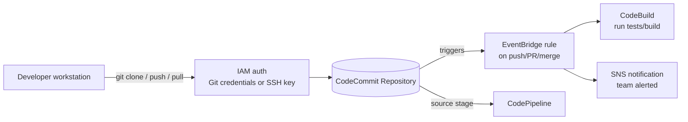

# AWS CodeCommit


<!-- AWS Architecture Icons, Developer Tools category; see diagrams/README.md for the convention -->

## Definition

AWS CodeCommit was a fully managed, private **Git** source control service — a place to host your
code repositories on AWS instead of (or alongside) GitHub/GitLab/Bitbucket, secured by IAM instead
of a separate login system.

> **Status note:** AWS stopped onboarding new CodeCommit customers in mid-2024 and has been
> steering customers toward GitHub, GitLab, or Bitbucket for source control, with CodeConnections
> (formerly CodeStar Connections) as the integration point into CodePipeline/CodeBuild. Existing
> CodeCommit repositories continue to run, but it's no longer AWS's forward-looking source control
> recommendation. It's documented here because (a) it still appears in exam material and existing
> AWS environments, and (b) understanding its role clarifies what CodeConnections replaced it with.

## Purpose

Before CodeCommit (and still true today without it), using Git on AWS meant hosting your own Git
server or depending on a third-party SaaS with its own separate authentication, billing, and
compliance model. CodeCommit let organizations keep source code inside their AWS account
boundary — same IAM users/roles, same encryption-at-rest via KMS, same VPC-endpoint-based network
isolation as every other AWS resource — removing a third-party dependency from the software
supply chain for security- or compliance-sensitive teams.

## How It Works

Plain explanation: CodeCommit repositories work exactly like any Git remote — `git clone`,
`git push`, `git pull` — except authentication is through IAM (via HTTPS Git credentials, SSH
keys registered to an IAM user, or temporary STS-based credential helper) instead of a GitHub-
style personal access token.



Step by step:
1. A developer authenticates to AWS (IAM user/role) and uses the **git-remote-codecommit** helper
   or standard Git-over-HTTPS/SSH with IAM-issued credentials — no separate CodeCommit-specific
   password.
2. Code is pushed/pulled exactly like any Git remote; branching, pull requests, merge
   approvals, and commit history all work the standard Git way.
3. **EventBridge rules** can react to repository events (push to a branch, pull request state
   change) to trigger automation — most commonly, kicking off a **CodeBuild** run or starting a
   **CodePipeline** execution.
4. Notifications (via SNS or AWS Chatbot into Slack/Chime) can alert a team on pushes or PR
   activity.
5. CodePipeline typically uses a CodeCommit repository as its **Source stage** — a push to the
   tracked branch triggers the whole downstream build/test/deploy pipeline.

## Key Features / Components

- **Private Git repositories** — standard Git semantics, no size/user limits typical of free SaaS
  tiers.
- **IAM-based access control** — repo-level permissions are regular IAM policies; no separate
  user directory to manage.
- **Encryption at rest** — repository data encrypted via KMS by default.
- **Pull requests & approval rules** — code review workflow comparable to GitHub PRs, with
  configurable required-approver rules.
- **Triggers** — SNS notifications or Lambda invocations on repository events (legacy mechanism;
  EventBridge is the modern recommended path).
- **VPC endpoint support** — repositories can be reached entirely over private networking, never
  touching the public internet.

## Use Cases — When to Use It

- Historically: organizations with strict compliance/data-residency requirements wanting source
  code to never leave the AWS account boundary, or teams wanting one IAM identity for both infra
  access and source control.
- Today, realistically: maintaining/operating **existing** CodeCommit repositories inherited from
  before mid-2024, since AWS still runs them — not a recommended starting point for new projects.
- Still useful as an exam topic: understanding how it wired into CodeBuild/CodePipeline tells you
  how *any* Git source (now typically GitHub via CodeConnections) wires into AWS CI/CD.

## When NOT to Use It / Alternatives

- **Starting a new project today** → use **GitHub**, **GitLab**, or **Bitbucket**, connected to
  AWS CI/CD tooling via **CodeConnections** (formerly CodeStar Connections) — this is AWS's own
  current guidance, not just a market-share observation.
- **You want the richest ecosystem of code review tooling, bots, and integrations** → GitHub's
  ecosystem (GitHub Actions, Dependabot, CODEOWNERS, third-party app marketplace) is far larger
  than CodeCommit ever had.
- **You need a fully offline, air-gapped Git server** → self-hosted Git (e.g., GitLab self-managed
  or Gitea) on EC2 gives more control than a managed SaaS-style service in a disconnected
  environment.

## Why It's Important

**Real-world weight:** Understanding CodeCommit's role (and its deprecation path toward
CodeConnections) matters for anyone maintaining legacy AWS CI/CD pipelines, and it's a clean,
simple example of "IAM governs everything" — a recurring AWS security pattern.

**Exam weight — exact mapping:**
- **DVA-C03 Domain 1, Task 1.1** — source control as part of the general "develop code for
  applications hosted on AWS" workflow.
- **DVA-C03 Domain 3, Task 3.3** ("Deploy code via CI/CD") — CodeCommit (or its GitHub/
  CodeConnections replacement) is the Source stage that kicks off CodePipeline.
- **SAA-C03 Domain 2, Task 2.1** — CI/CD source control is a supporting concept for
  loosely-coupled, automated deployment architectures.
- **MLA-C02 Domain 3, Task 3.3** — ML CI/CD pipelines still need a Source stage; conceptually
  identical whether it's CodeCommit, GitHub, or GitLab behind it.

## Pricing Model (summary)

- CodeCommit itself had a free tier (5 active users/month, 50 GB storage, 10,000 Git requests/
  month) with per-user/per-GB charges beyond that for existing repositories.
- Since mid-2024, AWS isn't onboarding new customers, so plan pricing around **GitHub/GitLab**
  (their own plans) plus **CodeConnections** (free to connect; you pay for CodeBuild/CodePipeline
  usage downstream, not for the connection itself).
- Official pricing (legacy): https://aws.amazon.com/codecommit/pricing/

## Hands-on Lab (Floci)

Floci's AWS API emulation does not list CodeCommit among its supported services (and AWS itself
has stopped onboarding new CodeCommit customers), so there's no meaningful Floci lab here.
**Practice the equivalent, forward-looking workflow for free with GitHub instead:**

```bash
# 1. Create a GitHub repo and push code (free, no AWS account needed)
git init demo-app && cd demo-app
echo "print('hello ci/cd')" > app.py
git add . && git commit -m "init"
git branch -M main
git remote add origin https://github.com/<you>/demo-app.git
git push -u origin main

# 2. Add a GitHub Actions workflow that mimics a CodeBuild step
mkdir -p .github/workflows
cat > .github/workflows/ci.yml << 'EOF'
name: CI
on: [push]
jobs:
  build:
    runs-on: ubuntu-latest
    steps:
      - uses: actions/checkout@v4
      - run: python app.py
EOF
git add . && git commit -m "add CI" && git push
```

This gives you the real "push triggers automated build" muscle memory that CodeCommit→CodeBuild
would have provided, using a genuinely free, currently-recommended tool instead.

## Exam Tips

- If a question describes source control fully inside AWS's IAM boundary, with compliance/data
  residency language, CodeCommit is likely the intended (if dated) answer — but newer exam
  content increasingly assumes GitHub/GitLab via CodeConnections as the Source stage.
- Don't confuse CodeCommit (source control) with **CodeArtifact** (package/dependency artifact
  repository, e.g., for npm/Maven/PyPI packages) — different layer of the pipeline entirely.
- Appears in DVA-C03 Domain 1 & 3, and indirectly in SAA-C03 Domain 2 and MLA-C02 Domain 3 as the
  Source stage of any CI/CD pipeline diagram.

## Related Terms

- [`codepipeline.md`](codepipeline.md) — typically consumes CodeCommit (or GitHub via
  CodeConnections) as its Source stage
- [`codebuild.md`](codebuild.md) — triggered by CodeCommit push events
- `../containers/ecr.md` — where a CodeBuild step triggered from CodeCommit often pushes a built
  image
