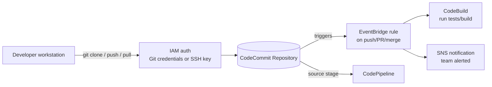
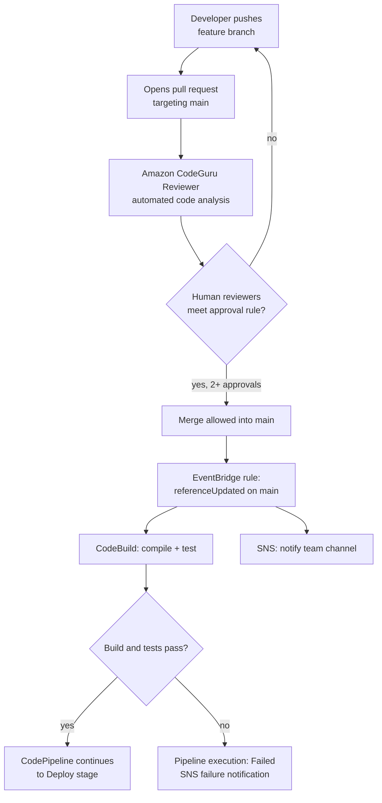
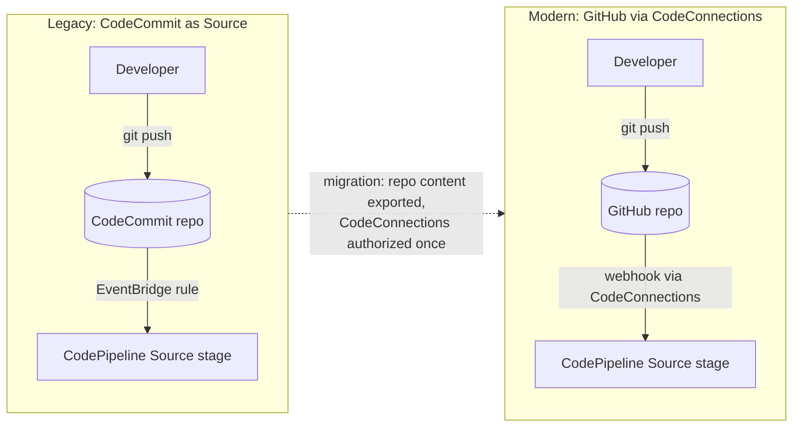
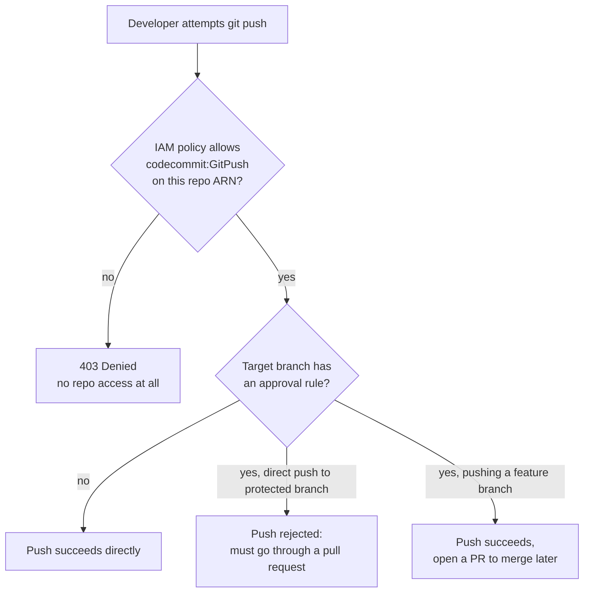

# AWS CodeCommit

> **Appears in:** [DVA-C03](../../certifications/dva-c03/README.md)


<!-- AWS Architecture Icons, Developer Tools category; see diagrams/README.md for the convention -->

## Definition

AWS CodeCommit was a fully managed, private **Git** source control service — a place to host your
code repositories on AWS instead of (or alongside) GitHub/GitLab/Bitbucket, secured by IAM instead
of a separate login system.

> **Status note:** AWS stopped onboarding new CodeCommit customers in mid-2024 and has been
> steering customers toward GitHub, GitLab, or Bitbucket for source control, with CodeConnections
> (formerly CodeStar Connections) as the integration point into CodePipeline/CodeBuild. Existing
> CodeCommit repositories continue to run, but it's no longer AWS's forward-looking source control
> recommendation. It's documented here because (a) it still appears in exam material and existing
> AWS environments, and (b) understanding its role clarifies what CodeConnections replaced it with.

## Purpose

Before CodeCommit (and still true today without it), using Git on AWS meant hosting your own Git
server or depending on a third-party SaaS with its own separate authentication, billing, and
compliance model. CodeCommit let organizations keep source code inside their AWS account
boundary — same IAM users/roles, same encryption-at-rest via KMS, same VPC-endpoint-based network
isolation as every other AWS resource — removing a third-party dependency from the software
supply chain for security- or compliance-sensitive teams.

The underlying design goal was never "better Git hosting than GitHub" — it was "Git hosting that
inherits your existing AWS security posture for free." Many regulated industries (financial
services, government, healthcare) historically preferred this model because an auditor reviewing
"who can access our source code" only needed to review IAM policies and CloudTrail, rather than a
second, separate identity and audit system belonging to a third-party SaaS vendor.

## How It Works

Plain explanation: CodeCommit repositories work exactly like any Git remote — `git clone`,
`git push`, `git pull` — except authentication is through IAM (via HTTPS Git credentials, SSH
keys registered to an IAM user, or temporary STS-based credential helper) instead of a GitHub-
style personal access token.



Step by step:
1. A developer authenticates to AWS (IAM user/role) and uses the **git-remote-codecommit** helper
   or standard Git-over-HTTPS/SSH with IAM-issued credentials — no separate CodeCommit-specific
   password.
2. Code is pushed/pulled exactly like any Git remote; branching, pull requests, merge
   approvals, and commit history all work the standard Git way.
3. **EventBridge rules** can react to repository events (push to a branch, pull request state
   change) to trigger automation — most commonly, kicking off a **CodeBuild** run or starting a
   **CodePipeline** execution.
4. Notifications (via SNS or AWS Chatbot into Slack/Chime) can alert a team on pushes or PR
   activity.
5. CodePipeline typically uses a CodeCommit repository as its **Source stage** — a push to the
   tracked branch triggers the whole downstream build/test/deploy pipeline.

### Real-World Reference Architecture


*Figure: A development-workflow reference architecture in which a developer commits application
and database code to **AWS CodeCommit**, which enforces code review through approval rules,
triggers **Amazon CodeGuru Reviewer** for automated code analysis, and then initiates **AWS
CodePipeline** to check out the code and run it through Source and Build actions — the canonical
shape of "CodeCommit as the Source stage" referenced throughout this document. Source:
[AWS Reference Architecture Diagrams — "Database DevOps on AWS"](https://docs.aws.amazon.com/reference-architecture-diagrams/latest/database-devops/database-devops-development.md), © Amazon Web Services.*

This diagram also illustrates a detail the exam likes to test: CodeCommit's **approval rules**
aren't just a courtesy code-review gate — they can be a hard *merge blocker*, meaning a pull
request literally cannot be merged into the tracked branch (and therefore cannot trigger the
downstream pipeline) until the required number/type of approvals exist, giving you a
policy-enforced "nothing reaches production without review" guarantee at the source-control layer
itself, before CodeBuild or CodeDeploy ever run.

## Worked Example: Approval Rule Template (requiring 2 reviewers before merge)

```json
{
  "approvalRuleTemplateName": "require-two-approvals",
  "approvalRuleTemplateDescription": "Require 2 approvals from the backend-team pool before merge",
  "approvalRuleTemplateContent": "{\"Version\": \"2018-11-08\", \"DestinationReferences\": [\"refs/heads/main\"], \"Statements\": [{\"Type\": \"Approvers\", \"NumberOfApprovalsNeeded\": 2, \"ApprovalPoolMembers\": [\"arn:aws:sts::123456789012:assumed-role/backend-team-role/*\"]}]}"
}
```

Applied via:
```bash
aws codecommit create-approval-rule-template \
  --cli-input-json file://approval-rule.json

aws codecommit associate-approval-rule-template-with-repository \
  --approval-rule-template-name require-two-approvals \
  --repository-name orders-api
```

What matters here: the `DestinationReferences` field scopes the rule to a specific branch
(`refs/heads/main`), so feature branches can merge freely among themselves while the protected
`main` branch enforces the approval gate — the same mental model as GitHub's branch protection
rules, just expressed as an AWS resource governed by IAM rather than a repository setting.

## Worked Example: EventBridge Rule Triggering CodeBuild on Push

```json
{
  "Name": "trigger-build-on-push-to-main",
  "EventPattern": {
    "source": ["aws.codecommit"],
    "detail-type": ["CodeCommit Repository State Change"],
    "resources": ["arn:aws:codecommit:us-east-1:123456789012:orders-api"],
    "detail": {
      "event": ["referenceCreated", "referenceUpdated"],
      "referenceName": ["main"]
    }
  },
  "Targets": [
    {
      "Id": "TriggerCodeBuild",
      "Arn": "arn:aws:codebuild:us-east-1:123456789012:project/orders-api-build"
    }
  ]
}
```

This is the modern (EventBridge-based) replacement for CodeCommit's older, repository-level
"Triggers" feature — functionally similar, but EventBridge rules are more flexible (can fan out to
multiple targets: CodeBuild, SNS, Lambda, Step Functions, simultaneously) and give a single,
centralized place to see every automation hooked to repository activity across an account.

## Full Source-to-Notification Flow with Approval Gate



Walkthrough: note that the approval-rule gate sits *before* the automated pipeline even starts —
this is different from a typical "pipeline runs, then someone approves a deploy stage" pattern
(which also exists, see `codepipeline.md`'s manual approval action). CodeCommit's approval rules
gate the **merge itself**, meaning untested, unreviewed code never reaches the branch the pipeline
watches in the first place — a stronger, earlier control than a deploy-time approval gate alone.

## CodeConnections Migration Flow (CodeCommit's Modern Replacement)



Walkthrough: migrating off CodeCommit is mostly a one-time, per-repository operation — export the
Git history (a standard `git clone --mirror` / `git push` to the new remote works, since it's just
Git underneath), authorize a **CodeConnections** connection to the new GitHub/GitLab/Bitbucket
organization once per AWS account, and repoint each CodePipeline's Source stage at the new
provider. The downstream Build/Test/Deploy stages require **no changes at all** — CodePipeline's
stage model doesn't care which source provider fed the pipeline its first artifact.

## Repository Access Control Flow



Walkthrough: IAM governs whether you can interact with the repository *at all*, while approval
rules govern whether a *specific branch* can be pushed to directly versus requiring a reviewed
pull request — these are two independent, stacked layers of control, and a question testing
"why can't I push directly to main even though my IAM policy allows `codecommit:GitPush`" is
testing whether you understand this separation.

## Key Features / Components

- **Private Git repositories** — standard Git semantics, no size/user limits typical of free SaaS
  tiers.
- **IAM-based access control** — repo-level permissions are regular IAM policies; no separate
  user directory to manage.
- **Encryption at rest** — repository data encrypted via KMS by default.
- **Pull requests & approval rules** — code review workflow comparable to GitHub PRs, with
  configurable required-approver rules that can act as hard merge blockers.
- **Approval rule templates** — reusable approval policies that can be associated with multiple
  repositories at once, rather than configured per-repo.
- **Triggers** — SNS notifications or Lambda invocations on repository events (legacy mechanism;
  EventBridge is the modern recommended path).
- **VPC endpoint support** — repositories can be reached entirely over private networking, never
  touching the public internet.
- **CodeGuru Reviewer integration** — automated, ML-based code review comments surfaced directly
  on pull requests, catching common bugs/security issues before a human reviewer even looks.

## Use Cases — When to Use It

- Historically: organizations with strict compliance/data-residency requirements wanting source
  code to never leave the AWS account boundary, or teams wanting one IAM identity for both infra
  access and source control.
- Today, realistically: maintaining/operating **existing** CodeCommit repositories inherited from
  before mid-2024, since AWS still runs them — not a recommended starting point for new projects.
- Still useful as an exam topic: understanding how it wired into CodeBuild/CodePipeline tells you
  how *any* Git source (now typically GitHub via CodeConnections) wires into AWS CI/CD.
- Fully air-gapped or VPC-only environments where even GitHub/GitLab's SaaS endpoints aren't
  reachable, but a private, VPC-endpoint-only Git remote is still needed.

## When NOT to Use It / Alternatives

- **Starting a new project today** → use **GitHub**, **GitLab**, or **Bitbucket**, connected to
  AWS CI/CD tooling via **CodeConnections** (formerly CodeStar Connections) — this is AWS's own
  current guidance, not just a market-share observation.
- **You want the richest ecosystem of code review tooling, bots, and integrations** → GitHub's
  ecosystem (GitHub Actions, Dependabot, CODEOWNERS, third-party app marketplace) is far larger
  than CodeCommit ever had.
- **You need a fully offline, air-gapped Git server** → self-hosted Git (e.g., GitLab self-managed
  or Gitea) on EC2 gives more control than a managed SaaS-style service in a disconnected
  environment.

## Common Architectures

**1. CodeConnections as CodeCommit's modern replacement**
A GitHub repository is connected to AWS CI/CD tooling via a **CodeConnections** connection (a
one-time OAuth-style authorization), after which CodePipeline's Source stage references the
GitHub repo exactly as it would have referenced a CodeCommit repo — the downstream pipeline shape
(Build → Test → Deploy) is unchanged regardless of which source provider feeds it.

**2. Monorepo with path-based pipeline triggers**
A single CodeCommit (or GitHub) repository containing multiple services triggers *different*
CodePipeline pipelines depending on which subdirectory changed, using EventBridge rules filtered
on file path patterns — avoiding a full rebuild of every service on every commit.

**3. Cross-account repository access via IAM role assumption**
A central "tooling" account hosts the CodeCommit repository; developers and CI systems in other
accounts assume a cross-account IAM role scoped to `codecommit:GitPull`/`GitPush` rather than each
account hosting its own copy — centralizing source control governance across a multi-account
organization.

**4. CodeGuru-gated pull requests**
Every pull request automatically receives CodeGuru Reviewer comments (potential bugs, security
issues, resource leaks) before a human reviewer looks at it, reducing the human review burden to
confirming/dismissing automated findings and reviewing business logic, rather than catching every
class of mechanical bug manually.

## Why It's Important

**Real-world weight:** Understanding CodeCommit's role (and its deprecation path toward
CodeConnections) matters for anyone maintaining legacy AWS CI/CD pipelines, and it's a clean,
simple example of "IAM governs everything" — a recurring AWS security pattern. The approval-rule
mechanism is also a direct, concrete example of "shift security left" — enforcing review *before*
code can even merge, rather than relying on a later deployment gate to catch problems.

**Exam weight — exact mapping:**
- **DVA-C03 Domain 1, Task 1.1** — source control as part of the general "develop code for
  applications hosted on AWS" workflow.
- **DVA-C03 Domain 3, Task 3.3** ("Deploy code via CI/CD") — CodeCommit (or its GitHub/
  CodeConnections replacement) is the Source stage that kicks off CodePipeline.
- **SAA-C03 Domain 2, Task 2.1** — CI/CD source control is a supporting concept for
  loosely-coupled, automated deployment architectures.
- **MLA-C02 Domain 3, Task 3.3** — ML CI/CD pipelines still need a Source stage; conceptually
  identical whether it's CodeCommit, GitHub, or GitLab behind it.

### Expanded Exam Scenarios

**DVA-C03 Domain 3 scenario:** "A security team requires that no code can be merged to the
production branch without at least two independent approvals, enforced automatically, not by
process alone." → Answer: a CodeCommit (or equivalent GitHub branch protection) **approval rule**
configured as a hard merge blocker — a Slack reminder or team policy document is not a technical
control and is the wrong-answer distractor here.

**DVA-C03 Domain 1 scenario:** "A developer needs to push code to a CodeCommit repository from an
EC2 instance without storing any static Git credentials on that instance." → Answer: attach an IAM
role to the instance with `codecommit:GitPull`/`GitPush` permissions, and use the
`git-remote-codecommit` helper (or the IAM-based HTTPS credential helper) — the instance role's
temporary credentials authenticate transparently, no static password ever touches disk.

**SAA-C03 Domain 2 scenario:** "A fully private VPC with no internet gateway must still support
developers pushing and pulling from a company Git repository." → Answer: a **VPC endpoint** for
CodeCommit (`com.amazonaws.<region>.codecommit` and `codecommit-git`), avoiding any need for
public internet egress to reach the repository.

## Limits & Quotas

Current defaults for existing CodeCommit repositories (verify against the
[official CodeCommit limits page](https://docs.aws.amazon.com/codecommit/latest/userguide/limits.html)):

| Quota | Default | Notes |
|---|---|---|
| Repositories per Region | 1,000 | Soft limit, adjustable |
| Repository size | 10 GiB recommended practical ceiling | Not a hard API limit, but a performance guidance |
| File size per commit | 2 GiB | Hard limit |
| Approval rule templates per account | 1,000 | Adjustable |
| Branches per repository | No documented hard cap | Practical Git performance limits apply |

**Exam-relevant takeaway:** the exam is far more interested in the *architectural* facts (IAM
governs access, approval rules can block merges, EventBridge is the modern trigger mechanism) than
in memorizing these specific numbers — but knowing CodeCommit has **practical size limits unlike a
dedicated Git host** is occasionally used to justify "large binary assets belong in S3/Git LFS, not
directly in the repository."

## Troubleshooting / Common Issues

- **`git clone` fails with authentication errors** — the most common cause is using the wrong
  credential helper; `git-remote-codecommit` requires the `codecommit::` URL prefix and valid AWS
  CLI credentials configured locally, while HTTPS Git credentials require generating a
  CodeCommit-specific username/password pair in IAM first.
- **Pull request stuck, cannot merge despite apparent approvals** — check that approvers are
  actually members of the `ApprovalPoolMembers` referenced in the approval rule (a common mistake
  is approving with an identity not covered by the configured pool, which CodeCommit silently
  doesn't count toward the requirement).
- **EventBridge rule doesn't trigger on push** — verify the rule's `detail.referenceName` filter
  matches the actual branch name pushed to, and that the `resources` ARN matches the exact
  repository — a common error is leaving a stale repository ARN after a repo rename.
- **CodeGuru Reviewer comments don't appear on new pull requests** — the repository association
  with CodeGuru Reviewer must be explicitly created and in an `Associated` state; a newly created
  repository isn't automatically covered.
- **Large binary file rejected on push** — CodeCommit enforces a per-file size limit; large
  binaries belong in S3 (referenced from the repo) or a Git LFS-compatible workflow, not committed
  directly.

## Pricing Model (summary)

- CodeCommit itself had a free tier (5 active users/month, 50 GB storage, 10,000 Git requests/
  month) with per-user/per-GB charges beyond that for existing repositories.
- Since mid-2024, AWS isn't onboarding new customers, so plan pricing around **GitHub/GitLab**
  (their own plans) plus **CodeConnections** (free to connect; you pay for CodeBuild/CodePipeline
  usage downstream, not for the connection itself).
- Official pricing (legacy): https://aws.amazon.com/codecommit/pricing/

## Hands-on Lab (Floci)

Floci's AWS API emulation does not list CodeCommit among its supported services (and AWS itself
has stopped onboarding new CodeCommit customers), so there's no meaningful Floci lab here.
**Practice the equivalent, forward-looking workflow for free with GitHub instead:**

```bash
# 1. Create a GitHub repo and push code (free, no AWS account needed)
git init demo-app && cd demo-app
echo "print('hello ci/cd')" > app.py
git add . && git commit -m "init"
git branch -M main
git remote add origin https://github.com/<you>/demo-app.git
git push -u origin main

# 2. Add a GitHub Actions workflow that mimics a CodeBuild step
mkdir -p .github/workflows
cat > .github/workflows/ci.yml << 'EOF'
name: CI
on: [push]
jobs:
  build:
    runs-on: ubuntu-latest
    steps:
      - uses: actions/checkout@v4
      - run: python app.py
EOF
git add . && git commit -m "add CI" && git push

# 3. Add branch protection (GitHub's equivalent of a CodeCommit approval rule)
# via the GitHub UI: Settings → Branches → Branch protection rules →
# "Require a pull request before merging" + "Require approvals: 2"
```

This gives you the real "push triggers automated build" and "merge requires approval" muscle
memory that CodeCommit→CodeBuild would have provided, using a genuinely free, currently-recommended
tool instead.

## Exam Tips

- If a question describes source control fully inside AWS's IAM boundary, with compliance/data
  residency language, CodeCommit is likely the intended (if dated) answer — but newer exam
  content increasingly assumes GitHub/GitLab via CodeConnections as the Source stage.
- Don't confuse CodeCommit (source control) with **CodeArtifact** (package/dependency artifact
  repository, e.g., for npm/Maven/PyPI packages) — different layer of the pipeline entirely.
- Approval rules are a **merge-time** control, distinct from a **deploy-time** manual approval
  action in CodePipeline — a question emphasizing "before code can be merged" points to the former;
  "before code is released to production" points to the latter.
- Appears in DVA-C03 Domain 1 & 3, and indirectly in SAA-C03 Domain 2 and MLA-C02 Domain 3 as the
  Source stage of any CI/CD pipeline diagram.

## Further Reading

- [What is AWS CodeCommit?](https://docs.aws.amazon.com/codecommit/latest/userguide/welcome.html) — official overview, including the status/deprecation notice
- [AWS CodeConnections documentation](https://docs.aws.amazon.com/dtconsole/latest/userguide/welcome.html) — the modern GitHub/GitLab/Bitbucket integration point
- [Database DevOps on AWS](https://docs.aws.amazon.com/reference-architecture-diagrams/latest/database-devops/database-devops-development.md) — the reference architecture used above
- [Amazon CodeGuru Reviewer](https://docs.aws.amazon.com/codeguru/latest/reviewer-ug/welcome.html) — automated code review integration referenced above

## Related Terms

- [`codepipeline.md`](codepipeline.md) — typically consumes CodeCommit (or GitHub via
  CodeConnections) as its Source stage
- [`codebuild.md`](codebuild.md) — triggered by CodeCommit push events
- `../containers/ecr.md` — where a CodeBuild step triggered from CodeCommit often pushes a built
  image
