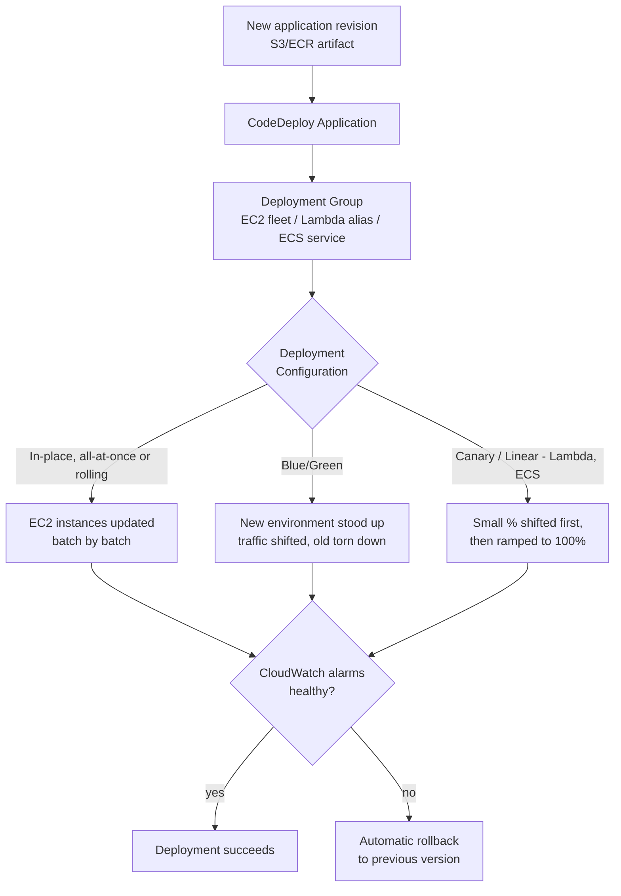
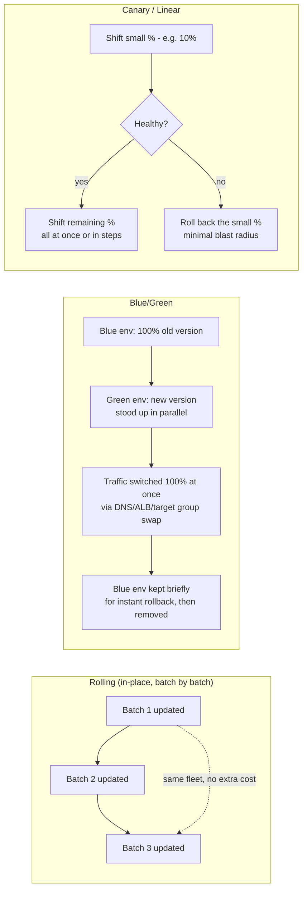
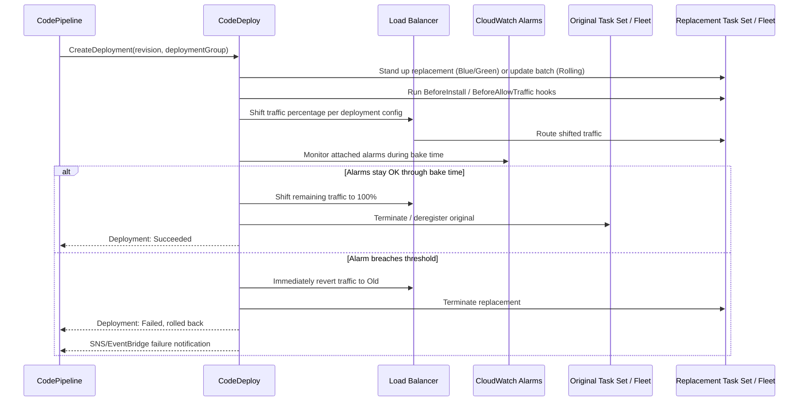

# AWS CodeDeploy

> **Appears in:** [DVA-C03](../../certifications/dva-c03/README.md)


<!-- AWS Architecture Icons, Developer Tools category; see diagrams/README.md for the convention -->

## Definition

AWS CodeDeploy is a fully managed deployment service that automates releasing new application
versions onto EC2 instances, on-premises servers, Lambda functions, or ECS services —
specifically handling the *how do we roll this out safely* problem: in what order, how fast, and
what happens if something breaks.

## Purpose

Deploying new code is one of the riskiest moments in a system's life — it's when most real-world
outages happen. Manually copying files to servers one by one (or worse, all at once) has no
consistency guarantees and no automatic rollback. CodeDeploy exists to make releases
**repeatable, automated, and safe**: it defines exactly how traffic/instances move from the old
version to the new one, and it can automatically detect failure (via CloudWatch alarms) and roll
back before most users ever notice.

CodeDeploy deliberately supports three very different compute platforms (EC2/on-premises, Lambda,
ECS) with the *same* conceptual model (Application, Deployment Group, Deployment Configuration,
AppSpec) even though the underlying mechanics differ enormously — an EC2 deployment is literally
copying files and running shell scripts on a server; an ECS deployment is swapping which task set
a load balancer points traffic at; a Lambda deployment is shifting traffic weight between function
aliases. Recognizing which compute platform a scenario describes is the first step to getting any
CodeDeploy exam question right.

## How It Works

Plain explanation: CodeDeploy needs an **application** (a logical container for deployment
config), a **deployment group** (which instances/Lambda aliases/ECS service it targets), a
**deployment configuration** (the rollout strategy — how much/how fast), and an **AppSpec file**
(for EC2/on-prem and Lambda, the exact lifecycle hooks to run during deployment). It then executes
the rollout according to the chosen strategy, watching health checks the whole way.



Step by step:
1. A new application revision (a zip in S3 with an `AppSpec.yml` for EC2, or a new container
   image/task definition for ECS, or a new Lambda version) is registered with the CodeDeploy
   **Application**.
2. The **Deployment Group** defines the target: which EC2 instances (by tag or Auto Scaling
   Group), which Lambda function alias, or which ECS service.
3. The chosen **Deployment Configuration** (rollout strategy — see the strategies section
   below) determines pacing: all-at-once, rolling in batches, blue/green, or canary/linear traffic
   shifting.
4. CodeDeploy executes the rollout, running AppSpec lifecycle hooks (`BeforeInstall`,
   `AfterInstall`, `ApplicationStart`, `ValidateService`, etc. for EC2/Lambda) at each step.
5. **CloudWatch alarms** attached to the deployment group are continuously checked; if a threshold
   is breached (error rate spike, latency spike) during the rollout window, CodeDeploy
   automatically **rolls back** to the last known-good revision.
6. On success, the deployment completes and the new revision is now live for 100% of traffic/
   instances.

### Real-World Reference Architecture


*Figure: The official EC2/on-premises CodeDeploy deployment workflow — create an application,
create a deployment group (instances, tags, or an Auto Scaling group), upload a revision, and
deploy; CodeDeploy pulls the revision onto each targeted instance and runs the AppSpec file's
lifecycle events in the documented order. Source:
[AWS CodeDeploy User Guide — "Deployments on an EC2/On-Premises Compute Platform"](https://docs.aws.amazon.com/codedeploy/latest/userguide/deployment-steps-server.html), © Amazon Web Services.*


*Figure: The ECS-specific CodeDeploy deployment workflow — a replacement task set is created
alongside the original, a test listener optionally validates it, and CodeDeploy reroutes
production traffic from the original task set's target group to the replacement's target group,
keeping the original warm briefly for instant rollback before terminating it. Source:
[AWS CodeDeploy User Guide — "Deployments on an Amazon ECS Compute Platform"](https://docs.aws.amazon.com/codedeploy/latest/userguide/deployment-steps-ecs.html), © Amazon Web Services.*

Notice the structural difference between the two diagrams: the EC2 workflow is fundamentally about
**installing files and running scripts on existing/new instances**, while the ECS workflow is
fundamentally about **traffic rerouting between two already-running task sets** — there's no
"installation" step in the ECS case at all, because the new version is already a fully-running
task set before any traffic reaches it.

## Worked Example: AppSpec File for EC2/On-Premises

```yaml
version: 0.0
os: linux
files:
  - source: /
    destination: /var/www/orders-api
permissions:
  - object: /var/www/orders-api
    owner: www-data
    group: www-data
    mode: "755"
hooks:
  BeforeInstall:
    - location: scripts/stop_server.sh
      timeout: 60
  AfterInstall:
    - location: scripts/install_dependencies.sh
      timeout: 180
  ApplicationStart:
    - location: scripts/start_server.sh
      timeout: 60
  ValidateService:
    - location: scripts/health_check.sh
      timeout: 120
```

Lifecycle hook order for EC2/on-premises deployments (memorize this order — it's directly tested):
`ApplicationStop` → `DownloadBundle` → `BeforeInstall` → `Install` → `AfterInstall` →
`ApplicationStart` → `ValidateService`. `DownloadBundle` and `Install` are CodeDeploy-reserved
hooks (you can't attach your own scripts to them); every other hook is yours to populate.
`ValidateService` is the last hook and the one most commonly used to run a smoke test / health
check that determines whether the deployment is actually considered successful.

## Worked Example: AppSpec File for ECS (Blue/Green Traffic Shift)

```yaml
version: 0.0
Resources:
  - TargetService:
      Type: AWS::ECS::Service
      Properties:
        TaskDefinition: "arn:aws:ecs:us-east-1:123456789012:task-definition/orders-api:15"
        LoadBalancerInfo:
          ContainerName: "orders-api"
          ContainerPort: 8080
Hooks:
  - BeforeInstall: "arn:aws:lambda:us-east-1:123456789012:function:pre-traffic-checks"
  - AfterAllowTestTraffic: "arn:aws:lambda:us-east-1:123456789012:function:run-smoke-tests"
  - AfterAllowTraffic: "arn:aws:lambda:us-east-1:123456789012:function:post-traffic-checks"
```

The ECS AppSpec is structurally different from the EC2 one — there's no file-copy section at all
(nothing is being installed onto a server); instead it declares which task definition/container
the replacement task set should run, and wires Lambda functions as validation hooks at specific
points in the traffic-shifting lifecycle: `BeforeInstall` (before the replacement task set is even
created), `AfterAllowTestTraffic` (after the optional test listener sends traffic to the
replacement, but before production traffic does), and `AfterAllowTraffic` (after production
traffic has fully shifted) — giving you three distinct validation checkpoints across the rollout.

## Deployment Strategies — Blue/Green vs. Canary vs. Rolling

These three strategies all answer "how do we move traffic from the old version to the new one,"
but they trade off **speed, blast radius, and infrastructure cost** differently.



- **Rolling** — updates the *same* fleet of instances in batches (e.g., one at a time, or half at
  a time). No duplicate infrastructure is created, so it's the cheapest option, but a bad
  deployment affects whichever batch is mid-update, and rollback means re-deploying the old
  version batch by batch (slower to fully revert than blue/green). Good for EC2 in-place
  deployments where cost matters more than instant rollback.
- **Blue/Green** — stands up a complete *second* environment ("green") running the new version
  alongside the fully running old one ("blue"), then switches all traffic at once (DNS, ALB
  target group reassignment, or ECS service task set swap). Rollback is nearly instant — just
  switch traffic back to blue, which is still warm. Costs more because you briefly run double the
  infrastructure. Best when you need a fast, safe, all-or-nothing cutover and can absorb the
  temporary doubled cost.
- **Canary (and its cousin, Linear)** — shifts a *small percentage* of traffic to the new version
  first (e.g., 10%), watches health/error metrics, then either proceeds to shift the rest (all at
  once for "canary," or in further small steps for "linear") or rolls back the small percentage if
  something looks wrong. This gives the smallest blast radius for catching a bad deployment before
  it affects everyone, at the cost of a slower full rollout. Most associated with **Lambda alias
  traffic shifting** and **ECS blue/green with CodeDeploy**, less commonly with raw EC2.

## Full Deployment Flow with Automatic Alarm-Triggered Rollback



Walkthrough: the "bake time" (how long CodeDeploy watches alarms before considering the deployment
final) is configurable per deployment group — too short and a slow-building problem won't trigger
rollback in time; too long and you delay confirming a successful release unnecessarily. This
alarm-driven rollback is **distinct from ECS's own deployment circuit breaker** (see `ecs.md`):
the circuit breaker reacts to ECS-level health check failures with no alarm configuration required
at all, while CodeDeploy's rollback reacts specifically to **CloudWatch alarms you explicitly
attach** to the deployment group — a scenario naming specific metrics/alarm thresholds is pointing
at CodeDeploy, not the ECS-native circuit breaker.

## Key Features / Components

- **Application** — the named container grouping a service's deployment configuration.
- **Deployment Group** — the actual target compute (EC2/ASG tags, Lambda alias, ECS service).
- **AppSpec file** — defines lifecycle hooks and, for EC2, file copy locations; for Lambda/ECS it
  defines the traffic-shifting hooks and target revision.
- **Deployment Configuration** — the named rollout strategy (AllAtOnce, HalfAtATime, OneAtATime
  for EC2; Canary10Percent5Minutes, Linear10PercentEvery1Minute, AllAtOnce for Lambda/ECS) — or a
  custom one you define.
- **Automatic rollback** — tied to CloudWatch alarms or deployment failure, reverts to the
  previous healthy revision with no manual intervention.
- **Lifecycle event hooks** — `BeforeInstall`, `AfterInstall`, `ApplicationStart`,
  `ValidateService` (EC2); `BeforeAllowTraffic`, `AfterAllowTraffic` (Lambda/ECS) for running
  custom validation (e.g., smoke tests) at precise points in the rollout.
- **Deployment groups with multiple environments** — a single Application can have multiple
  Deployment Groups (e.g., `staging`, `production`), each with its own target compute and rollout
  strategy, letting one Application definition serve an entire promotion pipeline.
- **CloudWatch alarm integration** — attach existing alarms to a deployment group so rollback
  triggers automatically without custom scripting.

## Use Cases — When to Use It

Each scenario names the situation, why CodeDeploy fits, and the tradeoff accepted versus an
alternative deployment approach.

1. **Blue/green production rollout for a critical service.** Situation: a service can't tolerate
   downtime and needs instant rollback capability. Why CodeDeploy fits: its blue/green strategy
   stands up a full parallel environment and swaps traffic atomically. Tradeoff: briefly doubles
   infrastructure cost during the cutover window.
2. **Canary rollout to minimize blast radius.** Situation: a risky change must be validated against
   a small slice of real traffic before full exposure. Why CodeDeploy fits: Canary/Linear
   deployment configs shift a small percentage first, watch alarms, then proceed. Tradeoff: a
   slower full rollout than blue/green or all-at-once.
3. **Cost-sensitive rolling deployment to an EC2 fleet.** Situation: a budget-conscious team wants
   zero-downtime updates without duplicate infrastructure. Why CodeDeploy fits: rolling
   (batch-by-batch) deployment configs update the same fleet in place. Tradeoff: rollback is slower
   (re-deploying the old version batch by batch) than blue/green's near-instant traffic flip-back.
4. **Lambda safe deployment with pre/post-traffic validation.** Situation: a Lambda change needs
   automated smoke-testing before 100% of users see it. Why CodeDeploy fits: SAM's
   `DeploymentPreference` wraps CodeDeploy with `PreTraffic`/`PostTraffic` hook Lambdas. Tradeoff:
   hook functions add their own IAM/failure-mode surface — a hook that forgets to report status
   hangs the whole deployment until timeout.
5. **Hotfix emergency deploy with automatic alarm-based rollback.** Situation: a critical patch is
   being rushed to production under time pressure. Why CodeDeploy fits: CloudWatch-alarm-triggered
   automatic rollback catches a bad hotfix without requiring a human to notice first. Tradeoff:
   requires alarms to already be correctly configured and attached beforehand — you cannot
   improvise this safety net mid-incident.
6. **Multi-region/multi-account coordinated rollout.** Situation: a global service must roll out
   region-by-region with isolated blast radius. Why CodeDeploy fits: one CodePipeline fans out to
   multiple CodeDeploy deployment groups, each with its own alarms/rollback. Tradeoff:
   significantly more deployment groups and alarm configurations to maintain than a single-region
   rollout.
7. **ML model-serving canary rollout.** Situation: a new model version needs validation against a
   small slice of inference traffic before a full cutover. Why CodeDeploy fits: its Lambda compute
   platform can canary-shift traffic between SageMaker endpoint configurations behind a proxy.
   Tradeoff: adds a Lambda proxy layer and CodeDeploy configuration that most simple SageMaker
   deployments don't otherwise need.
8. **Auditable, repeatable deployment history.** Situation: compliance requires a record of who
   deployed what, when, and with what rollback behavior. Why CodeDeploy fits: deployment history is
   a built-in audit trail with no extra tooling. Tradeoff: real-time alerting still requires wiring
   SNS/EventBridge notifications yourself — the history alone isn't a live alert.
9. **Database/non-application release orchestration.** Situation: a database schema change needs
   the same safe-rollout discipline as an app deploy. Why CodeDeploy fits: its Deploy-stage concept
   is generic enough to drive any release process, not just application code. Tradeoff: still
   needs custom scripting, since CodeDeploy has no database-specific migration logic built in.
10. **ECS blue/green via CloudFormation Hooks.** Situation: a team wants infrastructure (ALB,
    target groups, ECS service) and the deployment strategy defined together in one template. Why
    CodeDeploy fits: CloudFormation's native CodeDeploy Blue/Green Hook ties both together in a
    single stack update. Tradeoff: that resource can't be used inside nested stacks — a documented
    limitation that forces a flatter template structure.

## When NOT to Use It / Alternatives

- **You're deploying to Lambda but only need simple, built-in traffic shifting without
  CodeDeploy's full application/deployment-group model** → **Lambda's native alias weighted
  routing** (configured directly on the function) can suffice for very simple cases, though
  CodeDeploy adds hooks, alarms-based rollback, and a consistent cross-service deployment model
  CodeDeploy is usually still worth it for anything beyond a toy.
- **You're deploying a fully serverless app built with SAM/CDK** → SAM's `AWS::Serverless::
  Function` with `DeploymentPreference` wraps CodeDeploy for you under the hood — you still get
  CodeDeploy's engine, just configured declaratively through SAM instead of raw CodeDeploy API
  calls.
- **Kubernetes-native deployments on EKS** → typically use Kubernetes-native strategies (rolling
  updates via Deployment objects, or a service mesh/Argo Rollouts for canary) rather than
  CodeDeploy, since CodeDeploy's ECS support targets ECS Services, not EKS.

## Common Architectures

**1. ECS blue/green with CloudFormation Hooks**
CloudFormation's native `CodeDeploy Blue/Green hook` lets a single CloudFormation stack update
trigger a CodeDeploy-managed ECS blue/green deployment, keeping infrastructure (ALB, target
groups, ECS service) and the deployment strategy defined together as one template — at the cost of
not being able to use nested stacks for that resource (a documented CloudFormation limitation
referenced in several AWS blog posts).

**2. Lambda canary deployment with pre/post-traffic validation**
A SAM `DeploymentPreference` of `Canary10Percent5Minutes` wraps CodeDeploy to shift 10% of traffic
to a new Lambda version, running a `PreTraffic` Lambda hook to validate the new version works at
all before any real traffic reaches it, and a `PostTraffic` hook to validate end-to-end behavior
after the shift — both hooks call `PutLifecycleEventHookExecutionStatus` to tell CodeDeploy
explicitly whether to proceed or roll back.

**3. EC2 Auto Scaling Group blue/green via a second ASG**
CodeDeploy creates an entirely new Auto Scaling Group (the "green" environment), deploys the new
revision to it, then redirects the load balancer to the new ASG — keeping the original ASG intact
and able to be reattached instantly if a problem surfaces post-cutover, at the cost of briefly
running two full ASGs' worth of EC2 instances.

**4. Multi-Region/multi-account deployment orchestration**
A single CodePipeline fans out to multiple CodeDeploy deployment groups across Regions/accounts in
parallel or sequential pipeline stages, each with its own CloudWatch alarms and rollback behavior,
letting a global rollout proceed Region-by-Region with automatic rollback isolated per Region
rather than an all-or-nothing global cutover.

**5. SageMaker endpoint blue/green via CodeDeploy + Lambda compute platform**
A safe SageMaker endpoint rollout uses CodeDeploy's Lambda compute platform to switch between
"blue" and "green" SageMaker endpoint configurations behind an API Gateway/Lambda proxy, with a
canary percentage of inference traffic routed to the new model version before a full cutover —
directly referenced in MLA-C02's deployment domain.

## Why It's Important

**Real-world weight:** The deployment step is statistically where outages happen — "a change was
just deployed" precedes a huge share of real production incidents. Picking the right strategy
(and wiring real alarms to it) is one of the highest-leverage reliability practices a team can
adopt, and it's genuinely free to set up relative to the risk it removes.

**Exam weight — exact mapping:**
- **DVA-C03 Domain 3, Task 3.3** ("Deploy code via CI/CD") explicitly lists **"CodeDeploy,
  CodePipeline, blue/green/canary/rolling strategies, rollback"** — this is a direct, named
  exam topic, not an inference.
- **SAA-C03 Domain 2, Task 2.2** ("Design highly available and/or fault-tolerant architectures")
  — deployment strategy choice is part of designing for minimal-downtime releases.
- **MLA-C02 Domain 3, Task 3.3** — CI/CD for ML explicitly includes CodeDeploy for rolling out new
  model-serving infrastructure safely.

### Expanded Exam Scenarios

**DVA-C03 Domain 3 scenario:** "A deployment needs the fastest possible rollback if something goes
wrong, and the team can tolerate briefly running double the infrastructure cost." → Answer:
**blue/green** — the "fastest rollback" and "can tolerate double cost" details are the two
defining signals that rule out rolling (slower full revert) and lean toward blue/green over
canary (which is slower to fully roll out, trading speed for blast-radius minimization).

**DVA-C03 Domain 3 scenario:** "A deployment must minimize the number of users affected by a bad
release, even if that means the full rollout takes longer." → Answer: **canary** (or linear) — the
explicit tradeoff of "minimize blast radius" over "fast rollout" is the canary/linear signal.

**DVA-C03 Domain 3 scenario:** "A Lambda function deployment must run an automated smoke test
against a small percentage of real traffic before the rest of users get the new version, with
automatic rollback if the smoke test or error-rate alarms fail." → Answer: CodeDeploy with a
canary deployment configuration, an `AfterAllowTestTraffic`/`AfterAllowTraffic` Lambda hook running
the smoke test, and CloudWatch alarms attached to the deployment group for automatic rollback.

**SAA-C03 Domain 2 scenario:** "An EC2-based deployment must never drop below 100% capacity during
a rolling update, even temporarily." → Answer: the deployment configuration must be chosen
(or the Auto Scaling Group sized) such that replacement capacity is added before old capacity is
removed — a detail distinguishing an in-place rolling deployment (which can dip below full
capacity mid-batch unless over-provisioned) from blue/green (which never dips, since the old
environment stays fully up until cutover).

## Limits & Quotas

Current defaults (verify against the
[official CodeDeploy limits page](https://docs.aws.amazon.com/codedeploy/latest/userguide/limits.html)):

| Quota | Default | Adjustable? |
|---|---|---|
| Applications per account (per Region) | 3,000 | Yes |
| Deployment groups per application | 300 | Yes |
| Concurrent deployments per account | Varies by compute platform | Yes |
| Deployment timeout | 1 hour (default), configurable | Yes, per deployment group |
| CloudWatch alarms per deployment group | 10 | Yes |

**Exam-relevant takeaway:** the exam cares more about knowing a deployment group can have **up to
10 alarms** attached (and that exceeding a single alarm's threshold is enough to trigger rollback
by default, unless configured to require multiple) than about the raw numeric ceiling.

## Troubleshooting / Common Issues

- **Deployment stuck "In Progress" indefinitely** — a lifecycle hook script never exits or hangs
  waiting on input; CodeDeploy agent logs on the instance (`/var/log/aws/codedeploy-agent/`) show
  exactly which hook is stuck.
- **Deployment fails at `AfterInstall` on some but not all instances** — a common cause is
  instance-specific state (disk full, a leftover lock file from a previous failed deployment) that
  only affects some hosts; check the per-instance deployment events in the console for the specific
  failure reason rather than assuming it's buildspec/AppSpec-wide.
- **CodeDeploy agent not responding on an EC2 instance** — the agent must be installed and running
  on every target instance; a newly launched instance missing the agent (e.g., not baked into the
  AMI or installed via user data) will never receive a deployment and will show as "unhealthy" in
  the deployment group.
- **Automatic rollback didn't trigger despite an obvious production issue** — verify CloudWatch
  alarms are actually **attached to the deployment group** (not just existing in CloudWatch) and
  that the alarm's metric/threshold genuinely reflects the failure mode — a common gap is an alarm
  that exists but was never associated with the deployment group's rollback configuration.
- **ECS blue/green deployment stuck waiting on test traffic validation** — the `AfterAllowTestTraffic`
  Lifecycle hook Lambda function must explicitly call
  `codedeploy:PutLifecycleEventHookExecutionStatus` with a `Succeeded` or `Failed` status; a
  function that runs its checks but never calls this API leaves CodeDeploy waiting indefinitely
  until the deployment group's timeout is reached.
- **Lambda canary deployment rolls back immediately with no apparent error** — check the
  `PreTraffic` hook function's own execution role and logs; a permissions error in the hook itself
  (not the deployed function) is a frequent, easy-to-miss root cause.

## Pricing Model (summary)

- **No additional charge** for deployments to EC2/on-premises or Lambda — you pay only for the
  underlying compute (EC2 instance-hours, Lambda invocations) being deployed to.
- Deployments to **on-premises instances** registered with CodeDeploy do incur a small per-instance
  charge.
- Official pricing: https://aws.amazon.com/codedeploy/pricing/

## Hands-on Lab (Floci)

**CodeDeploy's deployment-orchestration control plane is not emulated by Floci.** The underlying
compute it targets (ECS) *is* Docker-backed in Floci, so you can practice the "end state" of a
blue/green ECS deployment manually, and use **GitHub Actions to simulate the orchestration logic**
for free:

```bash
# Simulate a "rolling" update directly against Floci's ECS emulation:
# update the task definition, then force a new deployment on the service
awslocal ecs register-task-definition --cli-input-json file://task-def-v2.json
awslocal ecs update-service \
  --cluster demo-cluster \
  --service demo-service \
  --task-definition demo-task:2 \
  --force-new-deployment
```

```yaml
# .github/workflows/deploy.yml — simulate canary logic with manual gating
name: deploy
on: [workflow_dispatch]
jobs:
  canary:
    runs-on: ubuntu-latest
    steps:
      - run: echo "shift 10% traffic (simulate)"
      - run: echo "run health check against canary"
      - run: echo "if healthy, shift remaining 90%; else roll back"
```

This won't exercise CodeDeploy's actual alarm-triggered rollback engine, but it builds the correct
mental model of staged traffic shifting, which is what the exam actually tests.

## Exam Tips

- **Classic trap — blue/green vs canary vs rolling**: "near-instant rollback, briefly double
  infrastructure cost" → blue/green. "Smallest blast radius, gradual traffic percentage" →
  canary/linear. "Same fleet, batch by batch, cheapest, no duplicate infra" → rolling.
- A question emphasizing **cost sensitivity** during deployment nudges toward rolling; a question
  emphasizing **risk/blast-radius minimization** nudges toward canary; a question emphasizing
  **fast, clean rollback** nudges toward blue/green.
- CodeDeploy integrates natively with Lambda alias traffic shifting and ECS service task sets for
  blue/green/canary — EC2 in-place deployments only really support all-at-once/rolling, not true
  blue/green (that requires standing up a second ASG/fleet, which is a different architectural
  pattern on top of CodeDeploy).
- Memorize the **EC2/on-premises lifecycle hook order**: `ApplicationStop` → `DownloadBundle` →
  `BeforeInstall` → `Install` → `AfterInstall` → `ApplicationStart` → `ValidateService` — multiple
  choice questions sometimes test whether you know `DownloadBundle`/`Install` are reserved and
  can't have custom scripts attached.
- CodeDeploy's alarm-based rollback is **distinct** from ECS's native deployment circuit
  breaker — a question naming specific CloudWatch alarms/thresholds points to CodeDeploy; a
  question about "automatic rollback with no alarm configuration" points to the ECS circuit
  breaker instead.
- Appears directly and by name in DVA-C03 Domain 3 Task 3.3, and in MLA-C02 Domain 3 Task 3.3.

## Further Reading

- [Deployments on an EC2/On-Premises Compute Platform](https://docs.aws.amazon.com/codedeploy/latest/userguide/deployment-steps-server.html) — official lifecycle hook order and diagrams
- [Deployments on an Amazon ECS Compute Platform](https://docs.aws.amazon.com/codedeploy/latest/userguide/deployment-steps-ecs.html) — the ECS blue/green mechanics referenced above
- [Deployments on an AWS Lambda Compute Platform](https://docs.aws.amazon.com/codedeploy/latest/userguide/deployment-steps-lambda.html) — Lambda alias traffic-shifting mechanics
- [Blue/Green Deployments to Amazon ECS using AWS CloudFormation and AWS CodeDeploy](https://aws.amazon.com/blogs/devops/blue-green-deployments-to-amazon-ecs-using-aws-cloudformation-and-aws-codedeploy/) — a complete reference pipeline
- [AppSpec file reference](https://docs.aws.amazon.com/codedeploy/latest/userguide/application-revisions-appspec-file.html) — the full AppSpec syntax for all three compute platforms

## Related Terms

- [`codepipeline.md`](codepipeline.md) — typically invokes CodeDeploy as its deploy stage
- [`codebuild.md`](codebuild.md) — produces the artifact CodeDeploy releases
- `../containers/ecs.md` — common CodeDeploy deployment target for blue/green
- [`sam.md`](sam.md) — SAM's `DeploymentPreference` wraps CodeDeploy for Lambda deployments
