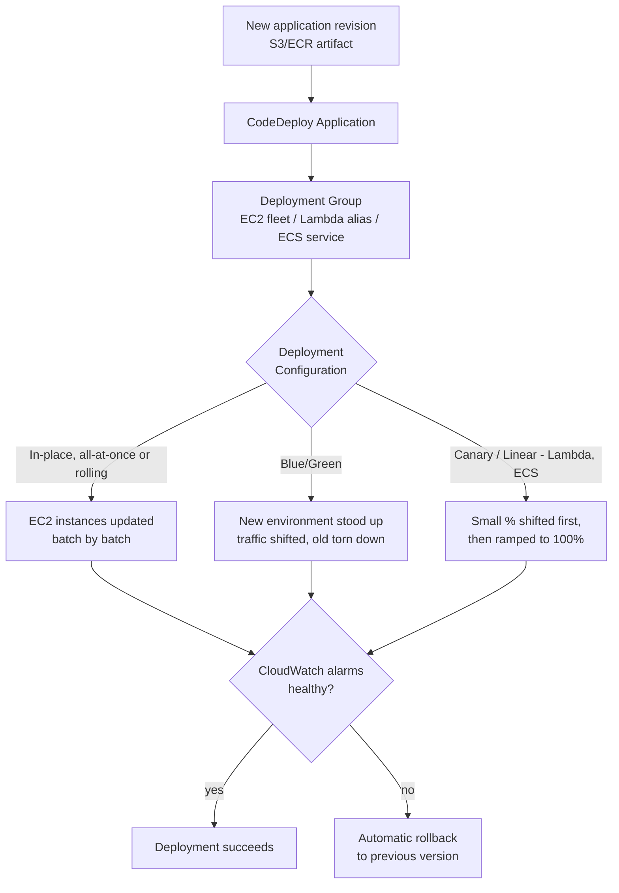
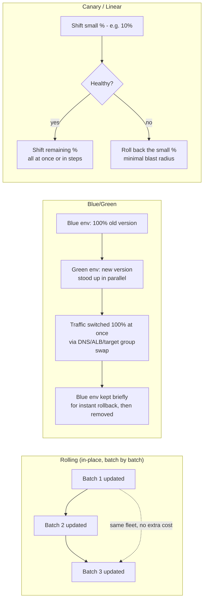

# AWS CodeDeploy


<!-- AWS Architecture Icons, Developer Tools category; see diagrams/README.md for the convention -->

## Definition

AWS CodeDeploy is a fully managed deployment service that automates releasing new application
versions onto EC2 instances, on-premises servers, Lambda functions, or ECS services —
specifically handling the *how do we roll this out safely* problem: in what order, how fast, and
what happens if something breaks.

## Purpose

Deploying new code is one of the riskiest moments in a system's life — it's when most real-world
outages happen. Manually copying files to servers one by one (or worse, all at once) has no
consistency guarantees and no automatic rollback. CodeDeploy exists to make releases
**repeatable, automated, and safe**: it defines exactly how traffic/instances move from the old
version to the new one, and it can automatically detect failure (via CloudWatch alarms) and roll
back before most users ever notice.

## How It Works

Plain explanation: CodeDeploy needs an **application** (a logical container for deployment
config), a **deployment group** (which instances/Lambda aliases/ECS service it targets), a
**deployment configuration** (the rollout strategy — how much/how fast), and an **AppSpec file**
(for EC2/on-prem and Lambda, the exact lifecycle hooks to run during deployment). It then executes
the rollout according to the chosen strategy, watching health checks the whole way.



Step by step:
1. A new application revision (a zip in S3 with an `AppSpec.yml` for EC2, or a new container
   image/task definition for ECS, or a new Lambda version) is registered with the CodeDeploy
   **Application**.
2. The **Deployment Group** defines the target: which EC2 instances (by tag or Auto Scaling
   Group), which Lambda function alias, or which ECS service.
3. The chosen **Deployment Configuration** (rollout strategy — see the strategies doc section
   below) determines pacing: all-at-once, rolling in batches, blue/green, or canary/linear traffic
   shifting.
4. CodeDeploy executes the rollout, running AppSpec lifecycle hooks (`BeforeInstall`,
   `AfterInstall`, `ApplicationStart`, `ValidateService`, etc. for EC2/Lambda) at each step.
5. **CloudWatch alarms** attached to the deployment group are continuously checked; if a threshold
   is breached (error rate spike, latency spike) during the rollout window, CodeDeploy
   automatically **rolls back** to the last known-good revision.
6. On success, the deployment completes and the new revision is now live for 100% of traffic/
   instances.

## Key Features / Components

- **Application** — the named container grouping a service's deployment configuration.
- **Deployment Group** — the actual target compute (EC2/ASG tags, Lambda alias, ECS service).
- **AppSpec file** — defines lifecycle hooks and, for EC2, file copy locations; for Lambda/ECS it
  defines the traffic-shifting hooks and target revision.
- **Deployment Configuration** — the named rollout strategy (AllAtOnce, HalfAtATime, OneAtATime
  for EC2; Canary10Percent5Minutes, Linear10PercentEvery1Minute, AllAtOnce for Lambda/ECS) — or a
  custom one you define.
- **Automatic rollback** — tied to CloudWatch alarms or deployment failure, reverts to the
  previous healthy revision with no manual intervention.
- **Lifecycle event hooks** — `BeforeInstall`, `AfterInstall`, `ApplicationStart`,
  `ValidateService` (EC2); `BeforeAllowTraffic`, `AfterAllowTraffic` (Lambda/ECS) for running
  custom validation (e.g., smoke tests) at precise points in the rollout.

## Deployment Strategies — Blue/Green vs. Canary vs. Rolling

These three strategies all answer "how do we move traffic from the old version to the new one,"
but they trade off **speed, blast radius, and infrastructure cost** differently.



- **Rolling** — updates the *same* fleet of instances in batches (e.g., one at a time, or half at
  a time). No duplicate infrastructure is created, so it's the cheapest option, but a bad
  deployment affects whichever batch is mid-update, and rollback means re-deploying the old
  version batch by batch (slower to fully revert than blue/green). Good for EC2 in-place
  deployments where cost matters more than instant rollback.
- **Blue/Green** — stands up a complete *second* environment ("green") running the new version
  alongside the fully running old one ("blue"), then switches all traffic at once (DNS, ALB
  target group reassignment, or ECS service task set swap). Rollback is nearly instant — just
  switch traffic back to blue, which is still warm. Costs more because you briefly run double the
  infrastructure. Best when you need a fast, safe, all-or-nothing cutover and can absorb the
  temporary doubled cost.
- **Canary (and its cousin, Linear)** — shifts a *small percentage* of traffic to the new version
  first (e.g., 10%), watches health/error metrics, then either proceeds to shift the rest (all at
  once for "canary," or in further small steps for "linear") or rolls back the small percentage if
  something looks wrong. This gives the smallest blast radius for catching a bad deployment before
  it affects everyone, at the cost of a slower full rollout. Most associated with **Lambda alias
  traffic shifting** and **ECS blue/green with CodeDeploy**, less commonly with raw EC2.

## Use Cases — When to Use It

- Automating zero/low-downtime releases to EC2 Auto Scaling Groups, ECS services, or Lambda
  functions with built-in health-check-driven rollback.
- Teams that need auditable, repeatable deployment history (who deployed what, when, with what
  rollback behavior).
- ML model-serving endpoints on ECS/EC2 needing a safe canary rollout before 100% of inference
  traffic hits a new model version.

## When NOT to Use It / Alternatives

- **You're deploying to Lambda but only need simple, built-in traffic shifting without
  CodeDeploy's full application/deployment-group model** → **Lambda's native alias weighted
  routing** (configured directly on the function) can suffice for very simple cases, though
  CodeDeploy adds hooks, alarms-based rollback, and a consistent cross-service deployment model
  CodeDeploy is usually still worth it for anything beyond a toy.
- **You're deploying a fully serverless app built with SAM/CDK** → SAM's `AWS::Serverless::
  Function` with `DeploymentPreference` wraps CodeDeploy for you under the hood — you still get
  CodeDeploy's engine, just configured declaratively through SAM instead of raw CodeDeploy API
  calls.
- **Kubernetes-native deployments on EKS** → typically use Kubernetes-native strategies (rolling
  updates via Deployment objects, or a service mesh/Argo Rollouts for canary) rather than
  CodeDeploy, since CodeDeploy's ECS support targets ECS Services, not EKS.

## Why It's Important

**Real-world weight:** The deployment step is statistically where outages happen — "a change was
just deployed" precedes a huge share of real production incidents. Picking the right strategy
(and wiring real alarms to it) is one of the highest-leverage reliability practices a team can
adopt, and it's genuinely free to set up relative to the risk it removes.

**Exam weight — exact mapping:**
- **DVA-C03 Domain 3, Task 3.3** ("Deploy code via CI/CD") explicitly lists **"CodeDeploy,
  CodePipeline, blue/green/canary/rolling strategies, rollback"** — this is a direct, named
  exam topic, not an inference.
- **SAA-C03 Domain 2, Task 2.2** ("Design highly available and/or fault-tolerant architectures")
  — deployment strategy choice is part of designing for minimal-downtime releases.
- **MLA-C02 Domain 3, Task 3.3** — CI/CD for ML explicitly includes CodeDeploy for rolling out new
  model-serving infrastructure safely.

## Pricing Model (summary)

- **No additional charge** for deployments to EC2/on-premises or Lambda — you pay only for the
  underlying compute (EC2 instance-hours, Lambda invocations) being deployed to.
- Deployments to **on-premises instances** registered with CodeDeploy do incur a small per-instance
  charge.
- Official pricing: https://aws.amazon.com/codedeploy/pricing/

## Hands-on Lab (Floci)

**CodeDeploy's deployment-orchestration control plane is not emulated by Floci.** The underlying
compute it targets (ECS) *is* Docker-backed in Floci, so you can practice the "end state" of a
blue/green ECS deployment manually, and use **GitHub Actions to simulate the orchestration logic**
for free:

```bash
# Simulate a "rolling" update directly against Floci's ECS emulation:
# update the task definition, then force a new deployment on the service
awslocal ecs register-task-definition --cli-input-json file://task-def-v2.json
awslocal ecs update-service \
  --cluster demo-cluster \
  --service demo-service \
  --task-definition demo-task:2 \
  --force-new-deployment
```

```yaml
# .github/workflows/deploy.yml — simulate canary logic with manual gating
name: deploy
on: [workflow_dispatch]
jobs:
  canary:
    runs-on: ubuntu-latest
    steps:
      - run: echo "shift 10% traffic (simulate)"
      - run: echo "run health check against canary"
      - run: echo "if healthy, shift remaining 90%; else roll back"
```

This won't exercise CodeDeploy's actual alarm-triggered rollback engine, but it builds the correct
mental model of staged traffic shifting, which is what the exam actually tests.

## Exam Tips

- **Classic trap — blue/green vs canary vs rolling**: "near-instant rollback, briefly double
  infrastructure cost" → blue/green. "Smallest blast radius, gradual traffic percentage" →
  canary/linear. "Same fleet, batch by batch, cheapest, no duplicate infra" → rolling.
- A question emphasizing **cost sensitivity** during deployment nudges toward rolling; a question
  emphasizing **risk/blast-radius minimization** nudges toward canary; a question emphasizing
  **fast, clean rollback** nudges toward blue/green.
- CodeDeploy integrates natively with Lambda alias traffic shifting and ECS service task sets for
  blue/green/canary — EC2 in-place deployments only really support all-at-once/rolling, not true
  blue/green (that requires standing up a second ASG/fleet, which is a different architectural
  pattern on top of CodeDeploy).
- Appears directly and by name in DVA-C03 Domain 3 Task 3.3, and in MLA-C02 Domain 3 Task 3.3.

## Related Terms

- [`codepipeline.md`](codepipeline.md) — typically invokes CodeDeploy as its deploy stage
- [`codebuild.md`](codebuild.md) — produces the artifact CodeDeploy releases
- `../containers/ecs.md` — common CodeDeploy deployment target for blue/green
- [`sam.md`](sam.md) — SAM's `DeploymentPreference` wraps CodeDeploy for Lambda deployments
