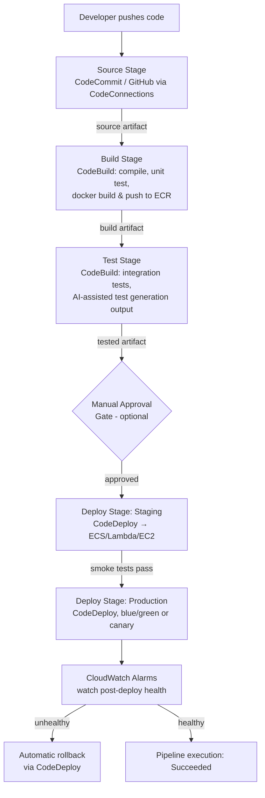

# AWS CodePipeline


<!-- AWS Architecture Icons, Developer Tools category; see diagrams/README.md for the convention -->

## Definition

AWS CodePipeline is a fully managed continuous integration/continuous delivery (CI/CD)
orchestration service: it connects your Source, Build, Test, and Deploy steps into one automated
pipeline that runs every time your code changes, without you writing custom glue scripts to chain
those steps together.

## Purpose

Each step of releasing software — pulling new code, building it, testing it, deploying it — can
be automated individually, but someone still has to *wire them together* in the right order, pass
artifacts between them, gate progress on approvals, and handle failures consistently. CodePipeline
exists to be that orchestration layer: a declarative definition of "when code changes, do these
steps, in this order, with these approval gates," removing the need for a custom-built
orchestrator (cron jobs, webhooks, and shell scripts duct-taped together) to achieve the same
result.

## How It Works

Plain explanation: a pipeline is a series of **stages**, each containing one or more **actions**.
Common stages are Source → Build → Test → Deploy, but you can add as many custom stages (manual
approval gates, multi-region deploys, staged environments) as needed. Each stage must succeed
before the pipeline advances to the next one; artifacts produced by one stage are passed as input
to the next via an S3-backed artifact store.



Step by step — a complete, realistic CI/CD pipeline flow:
1. **Source stage**: a developer pushes a commit. CodePipeline detects the change (via an
   EventBridge rule on CodeCommit, or a webhook-style connection to GitHub/GitLab/Bitbucket via
   **CodeConnections**) and starts a new pipeline **execution**, pulling the exact commit as the
   source artifact.
2. **Build stage**: CodePipeline invokes **CodeBuild**, passing the source artifact. CodeBuild
   compiles the code, runs unit tests, and — for containerized apps — builds and pushes a Docker
   image to **ECR**. The resulting build artifact (a zip, or a reference to the pushed image/task
   definition) is stored in the pipeline's S3 artifact bucket.
3. **Test stage**: a second CodeBuild action (or a dedicated test stage) runs integration tests
   against the built artifact, potentially including AI-assisted test generation/regression
   output (DVA-C03's Task 3.2 territory) or ML model validation metrics (MLA-C02's territory).
4. **Manual approval gate (optional)**: for production-sensitive changes, the pipeline pauses and
   waits for a human (via SNS notification + console/CLI approval) before proceeding — common
   before a production deploy.
5. **Deploy stage(s)**: CodePipeline invokes **CodeDeploy** (or CloudFormation/SAM/ECS deploy
   actions directly) to release the artifact — first typically to a staging environment, then,
   after smoke tests pass, to production using a blue/green or canary strategy (see
   `codedeploy.md`).
6. **Post-deploy monitoring**: CloudWatch alarms attached to the deployment continue watching
   health; if something regresses, CodeDeploy's automatic rollback (triggered through the
   pipeline) reverts to the last good state.
7. The pipeline execution is marked **Succeeded** or **Failed**, with full history and artifact
   lineage visible in the console for auditability.

## Key Features / Components

- **Stages & Actions** — the core structural unit; actions run in parallel within a stage or
  sequentially across stages.
- **Artifact store (S3)** — every stage's output artifact is stored and versioned automatically,
  giving you full traceability of what exactly was deployed.
- **Source providers** — CodeCommit, GitHub/GitLab/Bitbucket (via CodeConnections), S3, ECR
  (image push can trigger a pipeline).
- **Manual approval actions** — human-in-the-loop gates before risky stages.
- **Parallel & sequential actions** — e.g., deploy to two regions in parallel, or run multiple
  test suites concurrently within one stage.
- **Pipeline-level and stage-level triggers** — git push, tag creation, scheduled triggers,
  or triggering off another pipeline's completion.
- **Integration with CloudFormation/SAM/CDK** — a deploy action can directly apply an
  infrastructure-as-code stack update instead of (or alongside) CodeDeploy.

## Use Cases — When to Use It

- Any team practicing CI/CD on AWS that wants the orchestration layer managed rather than hand-
  rolled — connecting Source → Build → Test → Deploy with consistent artifact passing and audit
  history.
- Multi-environment release processes (dev → staging → prod) with approval gates between
  environments.
- ML pipelines needing automated retraining-and-redeploy flows (MLA-C02 Domain 3): a model
  artifact change or scheduled trigger kicks off build → validate → deploy to a SageMaker/ECS
  endpoint.
- Multi-account or multi-region deployment orchestration from one central pipeline definition.

## When NOT to Use It / Alternatives

- **Your team is already fully invested in GitHub and wants pipeline-as-code living right next to
  the repo with no separate AWS console configuration** → **GitHub Actions** (with GitHub-native
  workflows calling out to AWS via OIDC roles) is often simpler to adopt and has a much larger
  pre-built action ecosystem; many teams use GitHub Actions for CI and still call CodeDeploy/
  CloudFormation from within it, skipping CodePipeline's native orchestration layer entirely.
- **You need a vendor-neutral, multi-cloud pipeline definition** → **Jenkins**, **GitLab CI**, or
  GitHub Actions avoid tying your orchestration logic to AWS-specific pipeline syntax.
- **Your deployment is a single simple step with no multi-stage gating needed** → directly
  triggering CodeDeploy (or a CloudFormation stack update) from a CodeCommit/GitHub webhook
  without a full CodePipeline definition can be simpler for trivial cases.

## Why It's Important

**Real-world weight:** CodePipeline is the backbone that turns "we have tests and deployment
automation" into "every change actually goes through them, every time, with a record of what
happened" — removing the human-error risk of someone skipping a step or deploying an un-tested
artifact. The audit trail (exactly which commit, which build, which test results led to which
production deploy) is also frequently a compliance requirement, not just a convenience.

**Exam weight — exact mapping:**
- **DVA-C03 Domain 3, Task 3.3** ("Deploy code via CI/CD") explicitly names **CodePipeline**
  alongside CodeDeploy and the blue/green/canary/rolling strategies — this is a core, directly
  tested topic.
- **DVA-C03 Domain 3, Task 3.2** — automated testing stages within the pipeline, including
  AI-assisted test generation/regression automation.
- **SAA-C03 Domain 2, Task 2.1** — CI/CD pipelines are part of designing scalable, loosely-coupled,
  automated-deployment architectures.
- **MLA-C02 Domain 3, Task 3.3** — "CI/CD for ML (CodePipeline/CodeBuild/CodeDeploy...
  EventBridge-triggered retraining)" is named explicitly.

## Pricing Model (summary)

- Billed **per active pipeline per month** (a flat monthly fee once a pipeline has at least one
  execution), plus the underlying cost of whatever services it invokes (CodeBuild build minutes,
  S3 storage for artifacts, CodeDeploy's near-zero deployment cost).
- A free tier exists for a small number of active pipelines for new accounts.
- Official pricing: https://aws.amazon.com/codepipeline/pricing/

## Hands-on Lab (Floci)

**CodePipeline's orchestration control plane is not emulated by Floci** (neither is CodeBuild or
CodeDeploy's engine) — these are managed workflow services without a meaningful local-Docker
equivalent. **Use GitHub Actions as the free alternative to practice the exact same end-to-end
CI/CD concept**, while still exercising real AWS API calls against Floci for the "deploy" step:

```yaml
# .github/workflows/pipeline.yml — mirrors a full CodePipeline: source→build→test→deploy
name: ci-cd-pipeline
on: [push]
jobs:
  build:
    runs-on: ubuntu-latest
    steps:
      - uses: actions/checkout@v4                     # Source stage
      - run: pip install -r requirements.txt && pytest # Build + Test stage
  deploy:
    needs: build
    runs-on: ubuntu-latest
    steps:
      - uses: actions/checkout@v4
      - name: Deploy to local ECS (Floci)               # Deploy stage
        run: |
          awslocal ecs register-task-definition --cli-input-json file://task-def.json
          awslocal ecs update-service --cluster demo-cluster \
            --service demo-service --force-new-deployment
```

This reproduces CodePipeline's Source → Build → Test → Deploy shape, with a real deploy target
(Floci's Docker-backed ECS emulation) at the end — the closest free, hands-on equivalent to a full
AWS CI/CD pipeline you can run without an AWS bill.

## Exam Tips

- Keywords pointing to CodePipeline: "orchestrate the release process," "connect build and
  deploy," "multi-stage pipeline," "approval gate before production."
- Remember the layering: **CodeCommit/GitHub = source, CodeBuild = build/test, CodeDeploy =
  deploy/release strategy, CodePipeline = the orchestrator tying all three together.** A question
  describing the *whole* flow is asking about CodePipeline even if it never says the word.
- A pipeline can trigger **manual approval** before production — a frequent answer to "how do you
  require human sign-off before a production release in an automated pipeline?"
- Appears directly and by name in DVA-C03 Domain 3 Task 3.3, and in MLA-C02 Domain 3 Task 3.3.

## Related Terms

- [`codecommit.md`](codecommit.md) — Source stage
- [`codebuild.md`](codebuild.md) — Build/Test stage
- [`codedeploy.md`](codedeploy.md) — Deploy stage, including blue/green/canary/rolling strategies
- [`sam.md`](sam.md) — SAM/CDK deploy actions can plug directly into a CodePipeline deploy stage
- `../containers/ecr.md` — where the Build stage typically pushes container images
