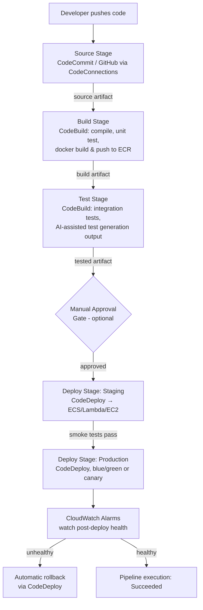
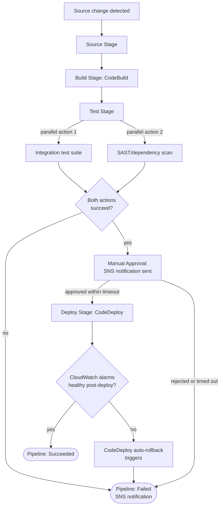
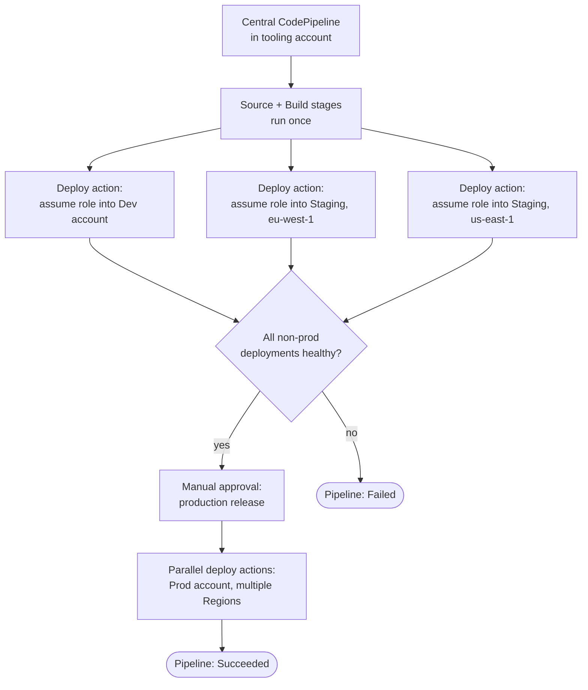
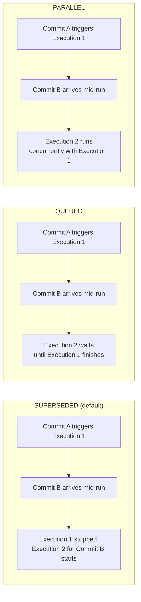

# AWS CodePipeline

> **Appears in:** [DVA-C03](../../certifications/dva-c03/README.md) · [MLA-C02](../../certifications/mla-c02/README.md)


<!-- AWS Architecture Icons, Developer Tools category; see diagrams/README.md for the convention -->

## Definition

AWS CodePipeline is a fully managed continuous integration/continuous delivery (CI/CD)
orchestration service: it connects your Source, Build, Test, and Deploy steps into one automated
pipeline that runs every time your code changes, without you writing custom glue scripts to chain
those steps together.

## Purpose

Each step of releasing software — pulling new code, building it, testing it, deploying it — can
be automated individually, but someone still has to *wire them together* in the right order, pass
artifacts between them, gate progress on approvals, and handle failures consistently. CodePipeline
exists to be that orchestration layer: a declarative definition of "when code changes, do these
steps, in this order, with these approval gates," removing the need for a custom-built
orchestrator (cron jobs, webhooks, and shell scripts duct-taped together) to achieve the same
result.

CodePipeline's core abstraction — Stages containing Actions, with an S3-backed artifact store
passing data between them — is intentionally simple and composable rather than a full workflow
programming language. This is a deliberate tradeoff: pipelines stay easy to reason about and audit
(you can look at the console and immediately see the entire release path), at the cost of needing
custom Lambda actions for truly complex conditional logic that a general-purpose workflow engine
(like Step Functions) would handle more naturally.

## How It Works

Plain explanation: a pipeline is a series of **stages**, each containing one or more **actions**.
Common stages are Source → Build → Test → Deploy, but you can add as many custom stages (manual
approval gates, multi-region deploys, staged environments) as needed. Each stage must succeed
before the pipeline advances to the next one; artifacts produced by one stage are passed as input
to the next via an S3-backed artifact store.



Step by step — a complete, realistic CI/CD pipeline flow:
1. **Source stage**: a developer pushes a commit. CodePipeline detects the change (via an
   EventBridge rule on CodeCommit, or a webhook-style connection to GitHub/GitLab/Bitbucket via
   **CodeConnections**) and starts a new pipeline **execution**, pulling the exact commit as the
   source artifact.
2. **Build stage**: CodePipeline invokes **CodeBuild**, passing the source artifact. CodeBuild
   compiles the code, runs unit tests, and — for containerized apps — builds and pushes a Docker
   image to **ECR**. The resulting build artifact (a zip, or a reference to the pushed image/task
   definition) is stored in the pipeline's S3 artifact bucket.
3. **Test stage**: a second CodeBuild action (or a dedicated test stage) runs integration tests
   against the built artifact, potentially including AI-assisted test generation/regression
   output (DVA-C03's Task 3.2 territory) or ML model validation metrics (MLA-C02's territory).
4. **Manual approval gate (optional)**: for production-sensitive changes, the pipeline pauses and
   waits for a human (via SNS notification + console/CLI approval) before proceeding — common
   before a production deploy.
5. **Deploy stage(s)**: CodePipeline invokes **CodeDeploy** (or CloudFormation/SAM/ECS deploy
   actions directly) to release the artifact — first typically to a staging environment, then,
   after smoke tests pass, to production using a blue/green or canary strategy (see
   `codedeploy.md`).
6. **Post-deploy monitoring**: CloudWatch alarms attached to the deployment continue watching
   health; if something regresses, CodeDeploy's automatic rollback (triggered through the
   pipeline) reverts to the last good state.
7. The pipeline execution is marked **Succeeded** or **Failed**, with full history and artifact
   lineage visible in the console for auditability.

### Real-World Reference Architecture


*Figure: A production-promotion reference architecture — a release manager issues a production
deployment request, **CodePipeline** invokes the build management tool which in turn calls a
database change-management tool, downloads the change scripts, runs them against the target RDS
production database, and then **CodePipeline** initiates its Deploy action to complete the
rollout, with performance monitoring (Performance Insights, DevOps Guru) feeding event
notifications. Source:
[AWS Reference Architecture Diagrams — "Database DevOps on AWS" Production Workflow](https://docs.aws.amazon.com/reference-architecture-diagrams/latest/database-devops/database-devops-production.md), © Amazon Web Services.*

This diagram illustrates a detail worth internalizing: a CodePipeline "Deploy" stage doesn't have
to mean "deploy an application" in the ECS/Lambda sense — it's a generic orchestration concept,
and this example uses it to orchestrate a *database* change process, with the same Source → Build
→ Deploy shape used throughout this entire document family applied to an entirely different kind
of release.

## Worked Example: A Realistic CodePipeline Declaration (CLI JSON)

```json
{
  "pipeline": {
    "name": "orders-api-pipeline",
    "roleArn": "arn:aws:iam::123456789012:role/codepipeline-service-role",
    "artifactStore": {
      "type": "S3",
      "location": "orders-api-pipeline-artifacts"
    },
    "stages": [
      {
        "name": "Source",
        "actions": [{
          "name": "SourceAction",
          "actionTypeId": {
            "category": "Source", "owner": "AWS", "provider": "CodeStarSourceConnection", "version": "1"
          },
          "configuration": {
            "ConnectionArn": "arn:aws:codeconnections:us-east-1:123456789012:connection/abc-123",
            "FullRepositoryId": "my-org/orders-api",
            "BranchName": "main"
          },
          "outputArtifacts": [{ "name": "SourceOutput" }]
        }]
      },
      {
        "name": "Build",
        "actions": [{
          "name": "BuildAction",
          "actionTypeId": { "category": "Build", "owner": "AWS", "provider": "CodeBuild", "version": "1" },
          "configuration": { "ProjectName": "orders-api-build" },
          "inputArtifacts": [{ "name": "SourceOutput" }],
          "outputArtifacts": [{ "name": "BuildOutput" }]
        }]
      },
      {
        "name": "ApproveProd",
        "actions": [{
          "name": "ManualApproval",
          "actionTypeId": { "category": "Approval", "owner": "AWS", "provider": "Manual", "version": "1" },
          "configuration": {
            "NotificationArn": "arn:aws:sns:us-east-1:123456789012:prod-deploy-approvals",
            "CustomData": "Approve deployment of orders-api to production"
          }
        }]
      },
      {
        "name": "DeployProd",
        "actions": [{
          "name": "ECSDeployAction",
          "actionTypeId": { "category": "Deploy", "owner": "AWS", "provider": "ECS", "version": "1" },
          "configuration": {
            "ClusterName": "prod-cluster",
            "ServiceName": "orders-api-svc",
            "FileName": "imagedefinitions.json"
          },
          "inputArtifacts": [{ "name": "BuildOutput" }]
        }]
      }
    ]
  }
}
```

What matters here for both the exam and real pipeline debugging:
- **`CodeStarSourceConnection`** as the Source action provider is the modern **CodeConnections**
  integration — note there's no CodeCommit-specific provider needed here; GitHub/GitLab/Bitbucket
  all flow through the same connection-based mechanism.
- **`inputArtifacts`/`outputArtifacts`** are how stages chain together — every action explicitly
  names which artifact it consumes and which it produces, and CodePipeline validates this wiring
  at pipeline creation time (a common error: an action referencing an `inputArtifacts` name that no
  earlier action actually produced).
- **The `Approval` action category** is a first-class action type, not a special pipeline feature —
  it behaves exactly like any other action (it has a provider, configuration, can have a timeout),
  which is why it can be placed at any point in any stage, not just "before deploy."
- **The ECS deploy action's `FileName: "imagedefinitions.json"`** directly ties back to
  `codebuild.md`'s worked buildspec example — this is the exact artifact file CodeBuild must
  produce for this deploy action to know which image to roll out.

## Full Pipeline Execution Flow with Parallel Actions and Rollback



Walkthrough: actions within the same stage can run **in parallel** (shown here with the
integration test suite and a security scan running concurrently), and the stage only advances once
*every* action in it succeeds — a single failed parallel action fails the whole stage, even if
every other action in it passed. The manual approval action has its own configurable timeout (the
pipeline execution pauses, consuming no compute, until someone responds or the timeout elapses),
and a rejection or timeout is treated identically to any other stage failure for the purposes of
pipeline status and notifications.

## Cross-Account, Cross-Region Pipeline Fan-Out



Walkthrough: a single Build stage's output artifact can be deployed to many
accounts/Regions in parallel actions within the same stage, each action assuming a
different cross-account IAM role scoped only to its target environment — the artifact itself
never changes between targets (reinforcing the "build once, deploy many" principle from the
Common Architectures section), only the destination and credentials used to deploy it do.

## Pipeline Execution Modes Compared



Walkthrough: `SUPERSEDED` (the default) optimizes for "always deploy the latest commit, don't
waste time deploying stale intermediate ones" — appropriate for most application pipelines.
`QUEUED` guarantees every single commit gets its own full pipeline run in order, which matters
when audit/compliance requires evidence that every change was individually built, tested, and
deployed. `PARALLEL` allows genuinely concurrent executions, useful for pipelines whose stages
don't share mutable state and where throughput matters more than ordering guarantees.

## Key Features / Components

- **Stages & Actions** — the core structural unit; actions run in parallel within a stage or
  sequentially across stages.
- **Artifact store (S3)** — every stage's output artifact is stored and versioned automatically,
  giving you full traceability of what exactly was deployed.
- **Source providers** — CodeCommit, GitHub/GitLab/Bitbucket (via CodeConnections), S3, ECR
  (image push can trigger a pipeline).
- **Manual approval actions** — human-in-the-loop gates before risky stages, with SNS
  notification and a configurable timeout.
- **Parallel & sequential actions** — e.g., deploy to two regions in parallel, or run multiple
  test suites concurrently within one stage.
- **Pipeline-level and stage-level triggers** — git push, tag creation, scheduled triggers,
  or triggering off another pipeline's completion.
- **Integration with CloudFormation/SAM/CDK** — a deploy action can directly apply an
  infrastructure-as-code stack update instead of (or alongside) CodeDeploy.
- **Pipeline variables and conditions** (newer) — lightweight expression-based conditional stage
  execution, narrowing some of the gap with Step Functions for simple branching needs without
  requiring a custom Lambda action.
- **Custom actions** — a Lambda function (or third-party integration) can act as any action
  category, letting you plug in arbitrary logic (e.g., a Slack notification, a custom compliance
  check) anywhere in the pipeline.

## Use Cases — When to Use It

- Any team practicing CI/CD on AWS that wants the orchestration layer managed rather than hand-
  rolled — connecting Source → Build → Test → Deploy with consistent artifact passing and audit
  history.
- Multi-environment release processes (dev → staging → prod) with approval gates between
  environments.
- ML pipelines needing automated retraining-and-redeploy flows (MLA-C02 Domain 3): a model
  artifact change or scheduled trigger kicks off build → validate → deploy to a SageMaker/ECS
  endpoint.
- Multi-account or multi-region deployment orchestration from one central pipeline definition.

## When NOT to Use It / Alternatives

- **Your team is already fully invested in GitHub and wants pipeline-as-code living right next to
  the repo with no separate AWS console configuration** → **GitHub Actions** (with GitHub-native
  workflows calling out to AWS via OIDC roles) is often simpler to adopt and has a much larger
  pre-built action ecosystem; many teams use GitHub Actions for CI and still call CodeDeploy/
  CloudFormation from within it, skipping CodePipeline's native orchestration layer entirely.
- **You need a vendor-neutral, multi-cloud pipeline definition** → **Jenkins**, **GitLab CI**, or
  GitHub Actions avoid tying your orchestration logic to AWS-specific pipeline syntax.
- **Your deployment is a single simple step with no multi-stage gating needed** → directly
  triggering CodeDeploy (or a CloudFormation stack update) from a CodeCommit/GitHub webhook
  without a full CodePipeline definition can be simpler for trivial cases.
- **You need complex conditional branching, long-running waits, or human-task patterns beyond a
  simple approval gate** → **Step Functions** is purpose-built for general workflow orchestration
  and is sometimes used *underneath* a CodePipeline custom action for the genuinely complex parts.

## Common Architectures

**1. Fan-out multi-account deployment pipeline**
A single pipeline's Source and Build stages run once; subsequent Deploy stages fan out in parallel
to separate CloudFormation StackSets or CodeDeploy deployment groups across multiple AWS accounts
(dev, staging, multiple production Regions), each assuming a cross-account role scoped to that
target account only.

**2. Pipeline-of-pipelines (cross-pipeline triggering)**
A shared-infrastructure pipeline (VPC, networking, IAM baseline) completes and triggers downstream
application pipelines via EventBridge, ensuring application deployments never run against
infrastructure that hasn't finished its own rollout — a common pattern in platform-team/
application-team organizational splits.

**3. Approval-gated progressive environment promotion**
Dev deploys automatically on every merge; staging requires one manual approval; production
requires a second, separate manual approval plus a scheduled deployment window (enforced via a
custom Lambda action checking the current time against a maintenance-window policy) — layering
governance progressively as risk increases.

**4. Security-and-compliance gated pipeline**
A dedicated stage runs infrastructure-as-code security scanning (e.g., `cfn-nag`/Checkov against a
CloudFormation/SAM template) and container image scanning results retrieval from ECR/Inspector,
failing the pipeline automatically if findings exceed policy — enforced as code, not as a manual
checklist item a human might skip under release pressure.

**5. ML retraining-and-redeploy pipeline (MLA-C02 relevant)**
An EventBridge scheduled rule (or an S3 event on new training data) triggers the pipeline's
Source stage; Build retrains a model and validates its metrics against a quality gate; if the new
model beats the previous one's benchmark, Deploy updates a SageMaker endpoint (or an
ECS/Fargate-served custom container) using a canary traffic shift via CodeDeploy — fully
automating the "detect drift, retrain, validate, redeploy" ML operations loop.

## Why It's Important

**Real-world weight:** CodePipeline is the backbone that turns "we have tests and deployment
automation" into "every change actually goes through them, every time, with a record of what
happened" — removing the human-error risk of someone skipping a step or deploying an un-tested
artifact. The audit trail (exactly which commit, which build, which test results led to which
production deploy) is also frequently a compliance requirement, not just a convenience.

**Exam weight — exact mapping:**
- **DVA-C03 Domain 3, Task 3.3** ("Deploy code via CI/CD") explicitly names **CodePipeline**
  alongside CodeDeploy and the blue/green/canary/rolling strategies — this is a core, directly
  tested topic.
- **DVA-C03 Domain 3, Task 3.2** — automated testing stages within the pipeline, including
  AI-assisted test generation/regression automation.
- **SAA-C03 Domain 2, Task 2.1** — CI/CD pipelines are part of designing scalable, loosely-coupled,
  automated-deployment architectures.
- **MLA-C02 Domain 3, Task 3.3** — "CI/CD for ML (CodePipeline/CodeBuild/CodeDeploy...
  EventBridge-triggered retraining)" is named explicitly.

### Expanded Exam Scenarios

**DVA-C03 Domain 3 scenario:** "A pipeline must require human sign-off before any change reaches
production, with the reviewer notified automatically and the pipeline paused (not polling) until
they respond." → Answer: a **Manual Approval action** configured with an SNS topic for
notification — the pipeline genuinely pauses (no compute billed, no polling) until the action is
approved, rejected, or times out.

**DVA-C03 Domain 3 scenario:** "Two independent test suites must both pass before a pipeline can
proceed to deployment, and they should run concurrently to minimize total pipeline duration." →
Answer: define both test actions **within the same stage** (not sequential stages) — actions in
the same stage run in parallel by default, and the stage only advances once all its actions
succeed.

**SAA-C03 Domain 2 scenario:** "A central platform team manages shared infrastructure as code,
and application teams' deployment pipelines must never run against infrastructure still mid-
update." → Answer: use **EventBridge to trigger the application pipeline only after the
infrastructure pipeline's completion event fires** — a direct pipeline-of-pipelines, event-driven
dependency, not a fixed time delay (which would be fragile) or manual coordination.

**MLA-C02 Domain 3 scenario:** "A retraining pipeline should only promote a new model to
production if its validation accuracy exceeds the currently deployed model's accuracy by a defined
margin." → Answer: a custom action (commonly Lambda-backed) in the Test/Validate stage that
compares metrics and explicitly fails the stage (non-zero exit / failure status) if the new
model doesn't clear the bar — CodePipeline itself has no built-in metric-comparison action, so this
logic is implemented as custom code within an action.

## Limits & Quotas

Current defaults (verify against the
[official CodePipeline limits page](https://docs.aws.amazon.com/codepipeline/latest/userguide/limits.html)):

| Quota | Default | Adjustable? |
|---|---|---|
| Pipelines per account (per Region) | 300 | Yes |
| Stages per pipeline | 20 | Yes |
| Actions per stage | 50 (practically far fewer due to parallelism limits) | Yes |
| Manual approval action timeout | 7 days (max) | Fixed ceiling |
| Concurrent pipeline executions per pipeline | 1 by default (configurable to allow superseding/queued executions) | Yes, via execution mode setting |

**Exam-relevant takeaway:** by default, a pipeline processes **one execution at a time** — a new
source change triggers a new execution, but depending on the configured execution mode
(`SUPERSEDED`, `QUEUED`, `PARALLEL`), a prior in-flight execution may be stopped, queued behind, or
run alongside the new one. A question about "multiple rapid commits only deploying the latest one"
is testing the default `SUPERSEDED` execution mode behavior.

## Troubleshooting / Common Issues

- **Pipeline stuck, not triggering on new commits** — verify the CodeConnections connection (for
  GitHub/GitLab/Bitbucket sources) is in an `Available` state, not `Pending` (a connection
  requiring manual OAuth completion in the console is a very common silent trigger failure).
- **Stage fails with "artifact not found"** — an action's `inputArtifacts` references a name no
  prior action in the pipeline actually produced as an `outputArtifacts` entry; check the exact
  artifact names match across stages.
- **Pipeline execution superseded unexpectedly** — multiple rapid commits with the default
  `SUPERSEDED` execution mode mean only the latest triggers a full run; if every commit must be
  individually built and deployed (e.g., for audit reasons), switch the pipeline to `QUEUED`
  execution mode.
- **Manual approval notification never arrives** — the SNS topic referenced in the approval
  action's configuration has no subscribed endpoint (email/Slack via Chatbot) or the
  CodePipeline service role lacks `sns:Publish` permission on that topic.
- **Cross-account deploy action fails with access denied** — cross-account pipeline actions
  require both the pipeline's service role to assume a role in the target account, and that
  target account's role to trust the pipeline account — a one-sided trust relationship is a
  frequent setup mistake.
- **Pipeline succeeds but the wrong artifact gets deployed** — usually a caching or artifact
  versioning confusion; CodePipeline always deploys the artifact produced by *that specific
  execution's* Build stage, but a custom action with its own internal caching logic can
  accidentally serve stale output if not implemented carefully.

## Pricing Model (summary)

- Billed **per active pipeline per month** (a flat monthly fee once a pipeline has at least one
  execution), plus the underlying cost of whatever services it invokes (CodeBuild build minutes,
  S3 storage for artifacts, CodeDeploy's near-zero deployment cost).
- A free tier exists for a small number of active pipelines for new accounts.
- Official pricing: https://aws.amazon.com/codepipeline/pricing/

## Hands-on Lab (Floci)

**CodePipeline's orchestration control plane is not emulated by Floci** (neither is CodeBuild or
CodeDeploy's engine) — these are managed workflow services without a meaningful local-Docker
equivalent. **Use GitHub Actions as the free alternative to practice the exact same end-to-end
CI/CD concept**, while still exercising real AWS API calls against Floci for the "deploy" step:

```yaml
# .github/workflows/pipeline.yml — mirrors a full CodePipeline: source→build→test→deploy
name: ci-cd-pipeline
on: [push]
jobs:
  build:
    runs-on: ubuntu-latest
    steps:
      - uses: actions/checkout@v4                     # Source stage
      - run: pip install -r requirements.txt && pytest # Build + Test stage
  deploy:
    needs: build
    runs-on: ubuntu-latest
    environment: production   # GitHub's equivalent of a manual approval gate
    steps:
      - uses: actions/checkout@v4
      - name: Deploy to local ECS (Floci)               # Deploy stage
        run: |
          awslocal ecs register-task-definition --cli-input-json file://task-def.json
          awslocal ecs update-service --cluster demo-cluster \
            --service demo-service --force-new-deployment
```

GitHub's `environment:` protection rules (requiring a manual reviewer before a job runs) are a
genuinely close free equivalent to a CodePipeline manual approval action, making this a solid
end-to-end practice loop for the full pipeline shape.

## Exam Tips

- Keywords pointing to CodePipeline: "orchestrate the release process," "connect build and
  deploy," "multi-stage pipeline," "approval gate before production."
- Remember the layering: **CodeCommit/GitHub = source, CodeBuild = build/test, CodeDeploy =
  deploy/release strategy, CodePipeline = the orchestrator tying all three together.** A question
  describing the *whole* flow is asking about CodePipeline even if it never says the word.
- A pipeline can trigger **manual approval** before production — a frequent answer to "how do you
  require human sign-off before a production release in an automated pipeline?"
- Actions within the **same stage run in parallel**; stages themselves run **sequentially** — a
  question about running two independent checks concurrently is testing whether you'd put them in
  the same stage (correct) or separate sequential stages (slower, wrong).
- Default execution mode is `SUPERSEDED` — rapid consecutive commits don't all get their own full
  pipeline run unless you explicitly configure `QUEUED` or `PARALLEL` execution mode.
- Appears directly and by name in DVA-C03 Domain 3 Task 3.3, and in MLA-C02 Domain 3 Task 3.3.

## Further Reading

- [What is AWS CodePipeline?](https://docs.aws.amazon.com/codepipeline/latest/userguide/welcome.html) — official overview
- [CodePipeline action structure reference](https://docs.aws.amazon.com/codepipeline/latest/userguide/reference-pipeline-structure.html) — the full pipeline/stage/action JSON schema used in the worked example above
- [Database DevOps on AWS: Production Workflow](https://docs.aws.amazon.com/reference-architecture-diagrams/latest/database-devops/database-devops-production.md) — the reference architecture used above
- [CodePipeline execution modes](https://docs.aws.amazon.com/codepipeline/latest/userguide/concepts-how-it-works-executions.html) — SUPERSEDED/QUEUED/PARALLEL behavior

## Related Terms

- [`codecommit.md`](codecommit.md) — Source stage
- [`codebuild.md`](codebuild.md) — Build/Test stage
- [`codedeploy.md`](codedeploy.md) — Deploy stage, including blue/green/canary/rolling strategies
- [`sam.md`](sam.md) — SAM/CDK deploy actions can plug directly into a CodePipeline deploy stage
- `../containers/ecr.md` — where the Build stage typically pushes container images
