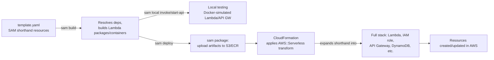

# AWS Serverless Application Model (SAM)


<!-- AWS Architecture Icons, Developer Tools category; see diagrams/README.md for the convention -->

## Definition

AWS SAM (Serverless Application Model) is an open-source framework for defining serverless
applications (Lambda functions, API Gateway APIs, DynamoDB tables, Step Functions) in a short,
simplified YAML template, plus a CLI (`sam`) that builds, tests, and deploys that template — it's
a thin, serverless-focused layer built directly **on top of** AWS CloudFormation.

## Purpose

Writing raw CloudFormation for a serverless app means a lot of repetitive boilerplate: every
Lambda function needs an execution role, every API Gateway route needs explicit method/integration
resources, and so on. SAM exists to compress that boilerplate into a few lines (one
`AWS::Serverless::Function` resource expands into the Lambda function, its IAM role, and its
event source mappings) while still being "real" CloudFormation underneath — so you get
serverless-specific shorthand without losing any CloudFormation capability or needing a different
deployment pipeline.

## How It Works

Plain explanation: you write a `template.yaml` using SAM's simplified resource types
(`AWS::Serverless::Function`, `AWS::Serverless::Api`, etc.). The SAM CLI **transforms** that
template into full, expanded CloudFormation (via the `AWS::Serverless-2016-10-31` transform macro
processed server-side by CloudFormation itself), then builds dependencies, packages artifacts to
S3, and deploys the resulting CloudFormation stack.



Step by step:
1. You author `template.yaml` with SAM's simplified resource types — e.g., one
   `AWS::Serverless::Function` block with `CodeUri`, `Handler`, `Runtime`, and an `Events` block
   describing its trigger (API Gateway route, S3 event, schedule).
2. `sam build` resolves dependencies (installing a Lambda layer's packages, or building a
   container image for container-packaged functions) into a deployable artifact.
3. `sam local invoke` / `sam local start-api` let you run and test functions **locally** in a
   Docker container that mimics the real Lambda execution environment, before ever touching AWS —
   genuinely useful for fast iteration.
4. `sam deploy` (which wraps `sam package` + a CloudFormation deploy) uploads artifacts to S3 (or
   images to ECR) and submits the template to **CloudFormation**.
5. CloudFormation processes the `AWS::Serverless-2016-10-31` **transform**, expanding SAM's
   shorthand resources into the full, verbose CloudFormation resources (the Lambda function *and*
   its IAM execution role *and* its API Gateway integration *and* permissions, etc.) — all of this
   happens server-side, so what you actually deployed is always inspectable as ordinary
   CloudFormation.
6. CloudFormation creates/updates the real resources as a single stack, with all of
   CloudFormation's usual rollback-on-failure safety.

## Key Features / Components

- **Simplified resource types** — `AWS::Serverless::Function`, `::Api`, `::SimpleTable`,
  `::StateMachine`, `::Application` (for deploying from the Serverless Application Repository).
- **`sam build`** — resolves and packages dependencies, including Docker-based builds for
  container-image Lambda functions.
- **`sam local`** — local emulation of Lambda invocation and API Gateway, backed by Docker, for
  fast offline iteration and debugging before deploying anything.
- **`sam deploy` / `sam sync`** — deploy the full stack, or (with `sync`) rapidly push just a
  changed function's code for fast dev-loop iteration without a full stack update.
- **`DeploymentPreference`** — a SAM-specific property on `AWS::Serverless::Function` that wires
  up **CodeDeploy** blue/green/canary traffic shifting for Lambda deployments declaratively, with
  automatic rollback on CloudWatch alarm.
- **Policy templates** — pre-built, named IAM policy snippets (e.g., `DynamoDBCrudPolicy`) you can
  attach to a function without hand-writing a full IAM policy document.

## Use Cases — When to Use It

- Building and deploying serverless applications (Lambda + API Gateway + DynamoDB + Step
  Functions combinations) with minimal boilerplate.
- Teams wanting fast local testing/debugging of Lambda functions before every deploy, which SAM's
  `local` subcommands are purpose-built for.
- Declarative, safe Lambda deployment strategies (canary/linear/blue-green via
  `DeploymentPreference`) without hand-configuring CodeDeploy directly.
- Teams who want "real CloudFormation" underneath (for state tracking, drift detection, rollback)
  but don't want to write the verbose, repetitive raw YAML for every serverless resource.

## When NOT to Use It / Alternatives

- **Your infrastructure includes more than just serverless resources — lots of VPCs, EC2 fleets,
  RDS clusters, complex networking** → **raw CloudFormation** or **CDK** are more natural for
  broad general-purpose infrastructure; SAM's shorthand only exists for the serverless resource
  types, and you'd mix SAM with nested raw CloudFormation anyway once you go wider.
- **Your team strongly prefers writing infrastructure in a real programming language (TypeScript,
  Python, Java) with loops, conditionals, and reusable constructs/classes, rather than YAML** →
  **AWS CDK** (see the SAM vs CDK vs CloudFormation comparison below) gives you a general-purpose
  language and a much richer L2/L3 construct library.
- **You need a provider-agnostic, multi-cloud IaC tool** → **Terraform** is the standard choice
  outside the AWS-only SAM/CDK/CloudFormation family (not in AWS's own ecosystem, so not
  typically tested on these certs, but worth knowing exists).

## SAM vs. CDK vs. Raw CloudFormation

All three ultimately produce and apply a CloudFormation stack — the difference is the authoring
experience and how much abstraction sits on top of CloudFormation's native JSON/YAML.

| | Raw CloudFormation | AWS SAM | AWS CDK |
|---|---|---|---|
| Language | YAML/JSON only | YAML/JSON (SAM-extended) | Real programming language (TypeScript, Python, Java, C#, Go) |
| Abstraction level | Lowest — every property explicit | Medium — serverless shorthand only | Highest — L2/L3 constructs encapsulate best-practice defaults |
| Best for | Full control, any resource type, no extra tooling dependency | Serverless-first apps wanting less boilerplate + local Lambda testing | Complex apps wanting reusable, composable, programmatic infrastructure |
| Local testing | None built-in | `sam local invoke` / `start-api` (genuinely strong feature) | `cdk synth` to preview; no native local Lambda emulator (can still shell out to SAM CLI) |
| Under the hood | — | Transforms into raw CloudFormation via a macro | `cdk synth` compiles to raw CloudFormation templates |
| Learning curve | Verbose but conceptually simple | Low if you already know CloudFormation | Steeper (real language + construct library), but very powerful once learned |
| Typical team fit | Infra/platform teams, simple/stable stacks | App developers building serverless services, wanting fast local iteration | Teams building many similar stacks, wanting code reuse, or already strong in a supported language |

Rule of thumb for the exam and for real decisions: **if the question's scenario is
"serverless app, fast local testing, simple team"**, pick SAM. **If it's "complex app, lots of
reusable patterns, developers who want a real language"**, pick CDK. **If it's "simplest possible,
most explicit, no extra abstraction, or the app includes major non-serverless infra"**, raw
CloudFormation works everywhere but costs more boilerplate.

## Why It's Important

**Real-world weight:** Infrastructure-as-code is the difference between "our environment is
reproducible and reviewable in a pull request" and "someone clicked things in the console and now
no one remembers exactly what's live." SAM specifically lowers the barrier for developers (not
just dedicated infra engineers) to safely define and deploy their own serverless services,
including safe deployment strategies, without needing deep CloudFormation expertise.

**Exam weight — exact mapping:**
- **DVA-C03 Domain 3, Task 3.2** ("Implement and automate application testing") explicitly names
  **"SAM/CDK/CloudFormation test validation"**.
- **DVA-C03 Domain 3, Task 3.3** — SAM's `DeploymentPreference` is a direct implementation of the
  blue/green/canary/rolling Lambda deployment strategies tested here.
- **SAA-C03 Domain 2, Task 2.1** — IaC (including SAM) supports scalable, repeatable, loosely
  coupled architecture deployment.
- **MLA-C02 Domain 3, Task 3.3** — "IaC (CloudFormation, CDK)" is explicitly listed for ML
  deployment/orchestration; SAM is the serverless-flavored sibling of that same family, often
  used when an ML inference layer is Lambda-based.

## Pricing Model (summary)

- **SAM itself is free** — it's an open-source CLI/transform, not a billed service.
- You pay for whatever resources it provisions (Lambda invocations/duration, API Gateway
  requests, DynamoDB capacity, CodeDeploy if `DeploymentPreference` is used, S3 storage for
  packaged artifacts) exactly as if you'd created them any other way.
- Official docs: https://docs.aws.amazon.com/serverless-application-model/

## Hands-on Lab (Floci)

SAM's CLI can target Floci for local deployment since Floci speaks the real CloudFormation and
Lambda APIs:

```bash
# 1. Initialize a new SAM app (choose a Python/Node starter template)
sam init --name demo-sam-app --runtime python3.12 --dependency-manager pip --app-template hello-world

# 2. Build it
cd demo-sam-app && sam build

# 3. Test locally — no AWS or Floci needed, fully offline via Docker
sam local invoke HelloWorldFunction --event events/event.json

# 4. Deploy to Floci instead of real AWS by pointing SAM at the local endpoint
sam deploy \
  --stack-name demo-sam-stack \
  --resolve-s3 \
  --capabilities CAPABILITY_IAM \
  --region us-east-1 \
  --endpoint-url http://localhost:4566
```

`sam local invoke` is worth drilling heavily on its own — it's one of SAM's standout features and
needs no cloud/emulator at all, just Docker.

## Exam Tips

- **Classic trap — SAM vs CDK vs CloudFormation**: all three end up as a CloudFormation stack.
  "Serverless-specific shorthand, local Lambda testing" → SAM. "Real programming language, reusable
  constructs, complex multi-service apps" → CDK. "Most explicit/verbose, no transform, any
  resource type" → raw CloudFormation.
- `sam local invoke`/`start-api` is a frequently-tested differentiator — no other IaC tool in this
  family offers built-in local Lambda emulation out of the box.
- `DeploymentPreference` directly implements CodeDeploy-style canary/linear/all-at-once for Lambda
  — a question combining "SAM" and "safe Lambda rollout" is pointing here.
- Appears in DVA-C03 Domain 3 directly, and conceptually in MLA-C02 Domain 3's IaC/CI-CD-for-ML
  task.

## Related Terms

- [`codedeploy.md`](codedeploy.md) — the engine behind SAM's `DeploymentPreference`
- [`codepipeline.md`](codepipeline.md) — can run `sam deploy` as a pipeline deploy action
- `../compute/` — Lambda, the primary resource SAM templates define
- `../management-governance/` — CloudFormation, the engine underneath SAM
