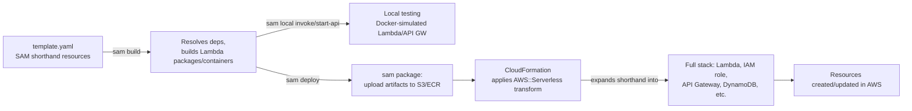
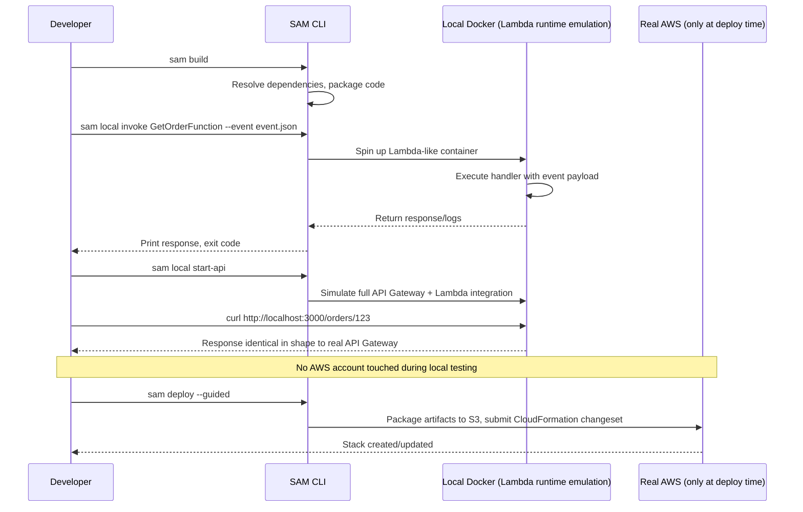
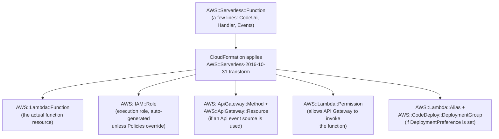
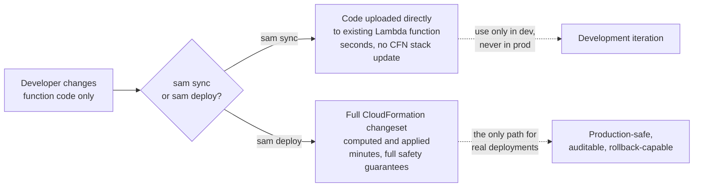

# AWS Serverless Application Model (SAM)


<!-- AWS Architecture Icons, Developer Tools category; see diagrams/README.md for the convention -->

## Definition

AWS SAM (Serverless Application Model) is an open-source framework for defining serverless
applications (Lambda functions, API Gateway APIs, DynamoDB tables, Step Functions) in a short,
simplified YAML template, plus a CLI (`sam`) that builds, tests, and deploys that template — it's
a thin, serverless-focused layer built directly **on top of** AWS CloudFormation.

## Purpose

Writing raw CloudFormation for a serverless app means a lot of repetitive boilerplate: every
Lambda function needs an execution role, every API Gateway route needs explicit method/integration
resources, and so on. SAM exists to compress that boilerplate into a few lines (one
`AWS::Serverless::Function` resource expands into the Lambda function, its IAM role, and its
event source mappings) while still being "real" CloudFormation underneath — so you get
serverless-specific shorthand without losing any CloudFormation capability or needing a different
deployment pipeline.

SAM's single most differentiating design decision versus CDK or raw CloudFormation is `sam local`
— a genuinely offline, Docker-backed emulation of the Lambda execution environment and API Gateway
that lets you run and debug a function exactly as it would behave in production, with no AWS
account or network connectivity required at all. This single feature is responsible for most of
SAM's adoption among application developers (as opposed to platform/infra teams, who more often
reach for CDK).

## How It Works

Plain explanation: you write a `template.yaml` using SAM's simplified resource types
(`AWS::Serverless::Function`, `AWS::Serverless::Api`, etc.). The SAM CLI **transforms** that
template into full, expanded CloudFormation (via the `AWS::Serverless-2016-10-31` transform macro
processed server-side by CloudFormation itself), then builds dependencies, packages artifacts to
S3, and deploys the resulting CloudFormation stack.



Step by step:
1. You author `template.yaml` with SAM's simplified resource types — e.g., one
   `AWS::Serverless::Function` block with `CodeUri`, `Handler`, `Runtime`, and an `Events` block
   describing its trigger (API Gateway route, S3 event, schedule).
2. `sam build` resolves dependencies (installing a Lambda layer's packages, or building a
   container image for container-packaged functions) into a deployable artifact.
3. `sam local invoke` / `sam local start-api` let you run and test functions **locally** in a
   Docker container that mimics the real Lambda execution environment, before ever touching AWS —
   genuinely useful for fast iteration.
4. `sam deploy` (which wraps `sam package` + a CloudFormation deploy) uploads artifacts to S3 (or
   images to ECR) and submits the template to **CloudFormation**.
5. CloudFormation processes the `AWS::Serverless-2016-10-31` **transform**, expanding SAM's
   shorthand resources into the full, verbose CloudFormation resources (the Lambda function *and*
   its IAM execution role *and* its API Gateway integration *and* permissions, etc.) — all of this
   happens server-side, so what you actually deployed is always inspectable as ordinary
   CloudFormation.
6. CloudFormation creates/updates the real resources as a single stack, with all of
   CloudFormation's usual rollback-on-failure safety.

### Real-World Reference Architecture


*Figure: The official "basic SAM application" reference diagram — an HTTP API triggers a Lambda
function which reads/writes a DynamoDB table, connected via a SAM `Connectors` resource that
automatically grants the least-privilege IAM permissions needed for the function to reach the
table, without hand-writing the policy document. Source:
[AWS SAM Developer Guide — "How AWS SAM works"](https://docs.aws.amazon.com/serverless-application-model/latest/developerguide/what-is-sam-overview.html), © Amazon Web Services.*


*Figure: SAM positioned within a broader microservices deployment pipeline — SAM templates
(alongside CDK and Terraform as alternatives) feed into CloudFormation, which is in turn invoked
by AWS CI/CD tooling as part of an automated release process, reinforcing that SAM is a template
*authoring* layer, not a separate deployment engine from CloudFormation. Source:
[AWS Whitepapers — "Microservices on AWS: Simplifying operations"](https://docs.aws.amazon.com/whitepapers/latest/microservices-on-aws/simplyfing-operations.html), © Amazon Web Services.*

## Worked Example: A Complete Production-Shaped SAM Template

```yaml
AWSTemplateFormatVersion: '2010-09-09'
Transform: AWS::Serverless-2016-10-31
Description: Orders API - Lambda + API Gateway + DynamoDB with canary deployment

Globals:
  Function:
    Runtime: python3.12
    Timeout: 10
    MemorySize: 256
    Tracing: Active
    Environment:
      Variables:
        TABLE_NAME: !Ref OrdersTable

Resources:
  OrdersApi:
    Type: AWS::Serverless::Api
    Properties:
      StageName: prod
      TracingEnabled: true

  GetOrderFunction:
    Type: AWS::Serverless::Function
    Properties:
      CodeUri: src/get_order/
      Handler: app.handler
      Events:
        GetOrder:
          Type: Api
          Properties:
            RestApiId: !Ref OrdersApi
            Path: /orders/{id}
            Method: get
      Policies:
        - DynamoDBReadPolicy:
            TableName: !Ref OrdersTable
      AutoPublishAlias: live
      DeploymentPreference:
        Type: Canary10Percent5Minutes
        Alarms:
          - !Ref OrderApiErrorAlarm
        Hooks:
          PreTraffic: !Ref PreTrafficHookFunction
          PostTraffic: !Ref PostTrafficHookFunction

  PreTrafficHookFunction:
    Type: AWS::Serverless::Function
    Properties:
      CodeUri: src/hooks/pre_traffic/
      Handler: app.handler
      Timeout: 30
      Policies:
        - Version: '2012-10-17'
          Statement:
            - Effect: Allow
              Action: codedeploy:PutLifecycleEventHookExecutionStatus
              Resource: '*'

  PostTrafficHookFunction:
    Type: AWS::Serverless::Function
    Properties:
      CodeUri: src/hooks/post_traffic/
      Handler: app.handler
      Timeout: 30

  OrderApiErrorAlarm:
    Type: AWS::CloudWatch::Alarm
    Properties:
      MetricName: Errors
      Namespace: AWS/Lambda
      Statistic: Sum
      Period: 60
      EvaluationPeriods: 1
      Threshold: 1
      ComparisonOperator: GreaterThanOrEqualToThreshold
      Dimensions:
        - Name: FunctionName
          Value: !Ref GetOrderFunction

  OrdersTable:
    Type: AWS::Serverless::SimpleTable
    Properties:
      PrimaryKey:
        Name: orderId
        Type: String
      BillingMode: PAY_PER_REQUEST

Outputs:
  ApiUrl:
    Description: "API Gateway endpoint URL"
    Value: !Sub "https://${OrdersApi}.execute-api.${AWS::Region}.amazonaws.com/prod/"
```

What matters here for both the exam and real production use:
- **`AutoPublishAlias` + `DeploymentPreference`** is SAM's signature feature — a few declarative
  lines wire up a full CodeDeploy canary deployment for a Lambda function, including pre/post
  traffic validation hooks and CloudWatch alarm-based automatic rollback, without a single raw
  CodeDeploy API call anywhere in the template.
- **`Policies: - DynamoDBReadPolicy`** is a SAM **policy template** — a pre-built, scoped IAM
  policy snippet (here, read-only access to exactly the named table) that expands into a full IAM
  policy document at transform time, sparing you from hand-writing `dynamodb:GetItem`/`Query`/
  `Scan` permission JSON.
- **`Globals`** avoids repeating `Runtime`/`Timeout`/`Environment` on every single function
  resource — a real template often has dozens of functions, and `Globals` keeps common
  configuration in one place.
- **`AWS::Serverless::SimpleTable`** is SAM's shorthand DynamoDB resource for simple cases (a
  single primary key, no GSIs); anything more complex (GSIs, streams, specific capacity settings)
  requires dropping down to a raw `AWS::DynamoDB::Table` resource alongside the SAM shorthand ones
  — SAM and raw CloudFormation resources coexist freely in the same template.
- **The `PreTrafficHookFunction`'s IAM policy** granting `codedeploy:PutLifecycleEventHookExecutionStatus`
  is mandatory — a hook function that doesn't have permission to report its own status back to
  CodeDeploy will cause the deployment to hang until timeout, a frequently-tested gotcha.

## SAM Build and Local Testing Flow



Walkthrough: every interaction up through `sam local start-api` happens entirely on the
developer's machine via Docker — no AWS credentials are even required for this phase, which is
why `sam local` is such a strong answer to exam scenarios about "test Lambda functions without
incurring any AWS cost or needing deployed infrastructure." Only `sam deploy` crosses the boundary
into real AWS, and even then it goes through CloudFormation's standard changeset-based update
mechanism — meaning a failed deployment rolls back using CloudFormation's own rollback behavior,
not something SAM-specific.

## SAM vs. CDK vs. Raw CloudFormation

All three ultimately produce and apply a CloudFormation stack — the difference is the authoring
experience and how much abstraction sits on top of CloudFormation's native JSON/YAML.

| | Raw CloudFormation | AWS SAM | AWS CDK |
|---|---|---|---|
| Language | YAML/JSON only | YAML/JSON (SAM-extended) | Real programming language (TypeScript, Python, Java, C#, Go) |
| Abstraction level | Lowest — every property explicit | Medium — serverless shorthand only | Highest — L2/L3 constructs encapsulate best-practice defaults |
| Best for | Full control, any resource type, no extra tooling dependency | Serverless-first apps wanting less boilerplate + local Lambda testing | Complex apps wanting reusable, composable, programmatic infrastructure |
| Local testing | None built-in | `sam local invoke` / `start-api` (genuinely strong feature) | `cdk synth` to preview; no native local Lambda emulator (can still shell out to SAM CLI) |
| Under the hood | — | Transforms into raw CloudFormation via a macro | `cdk synth` compiles to raw CloudFormation templates |
| Learning curve | Verbose but conceptually simple | Low if you already know CloudFormation | Steeper (real language + construct library), but very powerful once learned |
| Typical team fit | Infra/platform teams, simple/stable stacks | App developers building serverless services, wanting fast local iteration | Teams building many similar stacks, wanting code reuse, or already strong in a supported language |

Rule of thumb for the exam and for real decisions: **if the question's scenario is
"serverless app, fast local testing, simple team"**, pick SAM. **If it's "complex app, lots of
reusable patterns, developers who want a real language"**, pick CDK. **If it's "simplest possible,
most explicit, no extra abstraction, or the app includes major non-serverless infra"**, raw
CloudFormation works everywhere but costs more boilerplate.

## SAM Transform Expansion (What Actually Gets Deployed)



Walkthrough: one `AWS::Serverless::Function` block can expand into five or more raw
CloudFormation resources — this is exactly why the 500-resources-per-stack limit (see Limits &
Quotas) can be hit faster than a SAM template's apparent size suggests, and why `sam deploy
--debug` or inspecting the processed template in the CloudFormation console is the right move
when you need to understand exactly what got created from a short SAM resource block.

## sam sync: Fast Development Loop vs. Full Deploy



Walkthrough: `sam sync` deliberately bypasses CloudFormation's changeset mechanism to push code
changes directly to a running Lambda function in seconds — genuinely useful for rapid local
iteration against a dev/sandbox stack, but explicitly **not** meant for production deployments,
since it skips CloudFormation's drift tracking, rollback safety, and `DeploymentPreference`
traffic-shifting entirely. A question contrasting "fast dev-loop iteration" against "safe,
auditable production releases" is testing whether you know which command belongs to which use
case.

## Key Features / Components

- **Simplified resource types** — `AWS::Serverless::Function`, `::Api`, `::SimpleTable`,
  `::StateMachine`, `::Application` (for deploying from the Serverless Application Repository).
- **`sam build`** — resolves and packages dependencies, including Docker-based builds for
  container-image Lambda functions.
- **`sam local`** — local emulation of Lambda invocation and API Gateway, backed by Docker, for
  fast offline iteration and debugging before deploying anything.
- **`sam deploy` / `sam sync`** — deploy the full stack, or (with `sync`) rapidly push just a
  changed function's code for fast dev-loop iteration without a full stack update.
- **`DeploymentPreference`** — a SAM-specific property on `AWS::Serverless::Function` that wires
  up **CodeDeploy** blue/green/canary traffic shifting for Lambda deployments declaratively, with
  automatic rollback on CloudWatch alarm.
- **Policy templates** — pre-built, named IAM policy snippets (e.g., `DynamoDBCrudPolicy`) you can
  attach to a function without hand-writing a full IAM policy document.
- **`Connectors`** — a newer SAM feature that automatically computes and attaches least-privilege
  IAM permissions between two resources (e.g., "this function can write to this queue") based on
  declaring the relationship, rather than naming specific IAM actions yourself.
- **`sam validate` / `sam pipeline`** — template linting and a built-in CI/CD pipeline
  bootstrapper that generates a CodePipeline/GitHub Actions/Jenkins pipeline definition for a SAM
  application.

## Use Cases — When to Use It

- Building and deploying serverless applications (Lambda + API Gateway + DynamoDB + Step
  Functions combinations) with minimal boilerplate.
- Teams wanting fast local testing/debugging of Lambda functions before every deploy, which SAM's
  `local` subcommands are purpose-built for.
- Declarative, safe Lambda deployment strategies (canary/linear/blue-green via
  `DeploymentPreference`) without hand-configuring CodeDeploy directly.
- Teams who want "real CloudFormation" underneath (for state tracking, drift detection, rollback)
  but don't want to write the verbose, repetitive raw YAML for every serverless resource.

## When NOT to Use It / Alternatives

- **Your infrastructure includes more than just serverless resources — lots of VPCs, EC2 fleets,
  RDS clusters, complex networking** → **raw CloudFormation** or **CDK** are more natural for
  broad general-purpose infrastructure; SAM's shorthand only exists for the serverless resource
  types, and you'd mix SAM with nested raw CloudFormation anyway once you go wider.
- **Your team strongly prefers writing infrastructure in a real programming language (TypeScript,
  Python, Java) with loops, conditionals, and reusable constructs/classes, rather than YAML** →
  **AWS CDK** (see the SAM vs CDK vs CloudFormation comparison above) gives you a general-purpose
  language and a much richer L2/L3 construct library.
- **You need a provider-agnostic, multi-cloud IaC tool** → **Terraform** is the standard choice
  outside the AWS-only SAM/CDK/CloudFormation family (not in AWS's own ecosystem, so not
  typically tested on these certs, but worth knowing exists).

## Common Architectures

**1. Fully serverless REST API (the canonical SAM shape)**
`AWS::Serverless::Api` + multiple `AWS::Serverless::Function` resources + `AWS::Serverless::SimpleTable`
— the architecture used in the worked example above, and the single most common SAM template shape
tested on DVA-C03.

**2. Event-driven processing pipeline**
An S3 bucket event triggers a Lambda function (declared via the function's `Events: S3:` block),
which processes the object and writes results to DynamoDB or publishes to an SNS topic — all
declared in one template with no manually-wired S3 bucket notification configuration.

**3. Scheduled/cron-style Lambda via EventBridge Scheduler**
A function's `Events` block includes a `Schedule` type event (a cron or rate expression),
replacing what would otherwise require manually creating an EventBridge rule and target —
common for nightly reports, cleanup jobs, or retraining triggers in ML pipelines.

**4. Nested/shared application via the Serverless Application Repository**
A SAM template declares an `AWS::Serverless::Application` resource referencing a published SAR
application (e.g., a Slack notifier, a common authorizer) as a nested stack, composing
pre-built, reusable components into a larger application rather than reimplementing them.

**5. Canary Lambda deployment with automated rollback (shown in the worked example)**
Every production Lambda function uses `AutoPublishAlias` + `DeploymentPreference` with pre/post
traffic hooks and a CloudWatch alarm, making a safe, auditable deployment strategy the *default*
for every function in the template rather than something configured ad hoc per release.

## Why It's Important

**Real-world weight:** Infrastructure-as-code is the difference between "our environment is
reproducible and reviewable in a pull request" and "someone clicked things in the console and now
no one remembers exactly what's live." SAM specifically lowers the barrier for developers (not
just dedicated infra engineers) to safely define and deploy their own serverless services,
including safe deployment strategies, without needing deep CloudFormation expertise.

**Exam weight — exact mapping:**
- **DVA-C03 Domain 3, Task 3.2** ("Implement and automate application testing") explicitly names
  **"SAM/CDK/CloudFormation test validation"**.
- **DVA-C03 Domain 3, Task 3.3** — SAM's `DeploymentPreference` is a direct implementation of the
  blue/green/canary/rolling Lambda deployment strategies tested here.
- **SAA-C03 Domain 2, Task 2.1** — IaC (including SAM) supports scalable, repeatable, loosely
  coupled architecture deployment.
- **MLA-C02 Domain 3, Task 3.3** — "IaC (CloudFormation, CDK)" is explicitly listed for ML
  deployment/orchestration; SAM is the serverless-flavored sibling of that same family, often
  used when an ML inference layer is Lambda-based.

### Expanded Exam Scenarios

**DVA-C03 Domain 3 scenario:** "A developer wants to test a Lambda function's behavior locally,
including simulating the API Gateway event payload shape, entirely offline before any AWS
deployment." → Answer: `sam local start-api` — the defining, uniquely-SAM feature among the three
IaC tools compared above; CDK and raw CloudFormation have no equivalent built-in local Lambda
emulator.

**DVA-C03 Domain 3 scenario:** "A Lambda function deployment must shift traffic gradually to a new
version, run an automated validation check before any real users see it, and automatically roll
back on a CloudWatch alarm — expressed declaratively in the IaC template itself." → Answer: SAM's
`DeploymentPreference` with a `Canary`/`Linear` type, `Hooks.PreTraffic`, and an `Alarms` reference
— this is the single most SAM-specific, most heavily tested feature on the exam.

**DVA-C03 Domain 1 scenario:** "A function needs least-privilege read access to one specific
DynamoDB table, without the developer hand-writing an IAM policy document." → Answer: a SAM
**policy template** (`DynamoDBReadPolicy`, scoped via `TableName`) attached directly on the
function resource.

**SAA-C03 Domain 2 scenario:** "An architecture mixes serverless Lambda functions with a VPC, an
RDS cluster, and complex networking, and the team wants one consistent IaC tool for all of it." →
Answer: **raw CloudFormation or CDK**, not SAM — SAM's shorthand only exists for serverless
resource types; a template spanning broad infrastructure categories is better served by a tool not
narrowly scoped to serverless.

## Limits & Quotas

SAM itself imposes no limits beyond those of the underlying services it deploys — it is a template
transform and CLI, not a running service with its own quotas. The limits that matter are the
**CloudFormation** limits it inherits (verify against the
[official CloudFormation limits page](https://docs.aws.amazon.com/AWSCloudFormation/latest/UserGuide/cloudformation-limits.html)):

| Quota | Default | Notes |
|---|---|---|
| Resources per stack | 500 | Applies to the fully-expanded template, after the SAM transform runs |
| Template body size | 1 MB (direct upload) / 1 MB via S3 with larger practical ceiling | SAM's `sam package` uploads to S3 automatically to work around the direct-upload limit |
| Nested stack depth | 5 levels | Relevant for `AWS::Serverless::Application` nesting |
| Stack parameters | 200 | — |

**Exam-relevant takeaway:** because SAM's shorthand resources *expand* into multiple raw
CloudFormation resources, a template that looks small in SAM syntax can hit the 500-resources-per-
stack limit faster than its line count suggests — a detail occasionally tested as "why did my
seemingly small SAM template fail to deploy with a resource limit error."

## Troubleshooting / Common Issues

- **`sam deploy` fails with a transform error** — almost always a SAM syntax mistake (a typo'd
  property name, a resource type that doesn't exist) rather than a genuine CloudFormation issue;
  `sam validate` catches most of these before you even attempt a deploy.
- **`sam local invoke` works but the deployed function behaves differently** — check for
  environment variables or IAM permissions that exist in the real deployed environment but aren't
  replicated in the local invoke's event/environment configuration; `sam local` emulates the
  *runtime*, not every piece of deployed AWS configuration around it.
- **Canary deployment hangs indefinitely** — the `PreTraffic`/`PostTraffic` hook function failed to
  call `codedeploy:PutLifecycleEventHookExecutionStatus`, or lacks the IAM permission to do so (see
  the worked example above) — check the hook function's own CloudWatch Logs, not just the
  deployed function's.
- **`sam build` fails to resolve dependencies for a specific runtime** — confirm the `CodeUri`
  points at a directory containing the expected dependency manifest (`requirements.txt`,
  `package.json`) and that the `Runtime` property matches what the dependencies were actually
  built for (e.g., native dependencies compiled for the wrong architecture).
- **Stack update fails with "No updates are to be performed"** — SAM/CloudFormation detected no
  actual drift between the template and the deployed stack; this is usually expected behavior
  (nothing changed) rather than an error, though it can surprise a developer who changed only
  function code without bumping any template-tracked property.
- **Policy template grants broader access than expected** — policy templates like
  `DynamoDBCrudPolicy` grant a fixed, documented set of actions (not just read) scoped to the named
  resource; read the policy template's actual action list rather than assuming the name alone
  fully describes its scope.

## Pricing Model (summary)

- **SAM itself is free** — it's an open-source CLI/transform, not a billed service.
- You pay for whatever resources it provisions (Lambda invocations/duration, API Gateway
  requests, DynamoDB capacity, CodeDeploy if `DeploymentPreference` is used, S3 storage for
  packaged artifacts) exactly as if you'd created them any other way.
- Official docs: https://docs.aws.amazon.com/serverless-application-model/

## Hands-on Lab (Floci)

SAM's CLI can target Floci for local deployment since Floci speaks the real CloudFormation and
Lambda APIs:

```bash
# 1. Initialize a new SAM app (choose a Python/Node starter template)
sam init --name demo-sam-app --runtime python3.12 --dependency-manager pip --app-template hello-world

# 2. Build it
cd demo-sam-app && sam build

# 3. Test locally — no AWS or Floci needed, fully offline via Docker
sam local invoke HelloWorldFunction --event events/event.json

# 4. Start a local API Gateway emulation and curl it
sam local start-api &
curl http://127.0.0.1:3000/hello

# 5. Validate the template before attempting a deploy
sam validate

# 6. Deploy to Floci instead of real AWS by pointing SAM at the local endpoint
sam deploy \
  --stack-name demo-sam-stack \
  --resolve-s3 \
  --capabilities CAPABILITY_IAM \
  --region us-east-1 \
  --endpoint-url http://localhost:4566
```

`sam local invoke` is worth drilling heavily on its own — it's one of SAM's standout features and
needs no cloud/emulator at all, just Docker.

## Exam Tips

- **Classic trap — SAM vs CDK vs CloudFormation**: all three end up as a CloudFormation stack.
  "Serverless-specific shorthand, local Lambda testing" → SAM. "Real programming language, reusable
  constructs, complex multi-service apps" → CDK. "Most explicit/verbose, no transform, any
  resource type" → raw CloudFormation.
- `sam local invoke`/`start-api` is a frequently-tested differentiator — no other IaC tool in this
  family offers built-in local Lambda emulation out of the box.
- `DeploymentPreference` directly implements CodeDeploy-style canary/linear/all-at-once for Lambda
  — a question combining "SAM" and "safe Lambda rollout" is pointing here.
- A `PreTraffic`/`PostTraffic` hook function must explicitly report success/failure back to
  CodeDeploy via the SDK call, or the deployment hangs — a subtle but directly-testable detail.
- Policy templates (e.g., `DynamoDBCrudPolicy`) grant a documented, fixed action set — know this is
  a shorthand for a real IAM policy, not a magic "least privilege for whatever you need" wildcard.
- Appears in DVA-C03 Domain 3 directly, and conceptually in MLA-C02 Domain 3's IaC/CI-CD-for-ML
  task.

## Further Reading

- [How AWS SAM works](https://docs.aws.amazon.com/serverless-application-model/latest/developerguide/what-is-sam-overview.html) — official architecture overview, including the diagram used above
- [AWS SAM template specification](https://docs.aws.amazon.com/serverless-application-model/latest/developerguide/sam-specification.html) — the complete resource/property reference
- [Deploying Lambda functions with gradual code deployment](https://docs.aws.amazon.com/serverless-application-model/latest/developerguide/serverless-sam-cli-using-gradual-code-deployment.html) — `DeploymentPreference` official reference
- [AWS SAM policy templates](https://docs.aws.amazon.com/serverless-application-model/latest/developerguide/serverless-policy-templates.html) — the full list of available policy template shortcuts

## Related Terms

- [`codedeploy.md`](codedeploy.md) — the engine behind SAM's `DeploymentPreference`
- [`codepipeline.md`](codepipeline.md) — can run `sam deploy` as a pipeline deploy action
- `../compute/lambda.md` — Lambda, the primary resource SAM templates define
- `../management-governance/cloudformation.md` — CloudFormation, the engine underneath SAM
- `../management-governance/cdk.md` — the programmatic alternative compared above
