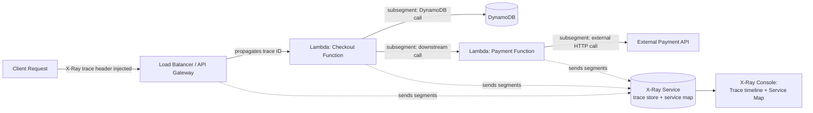
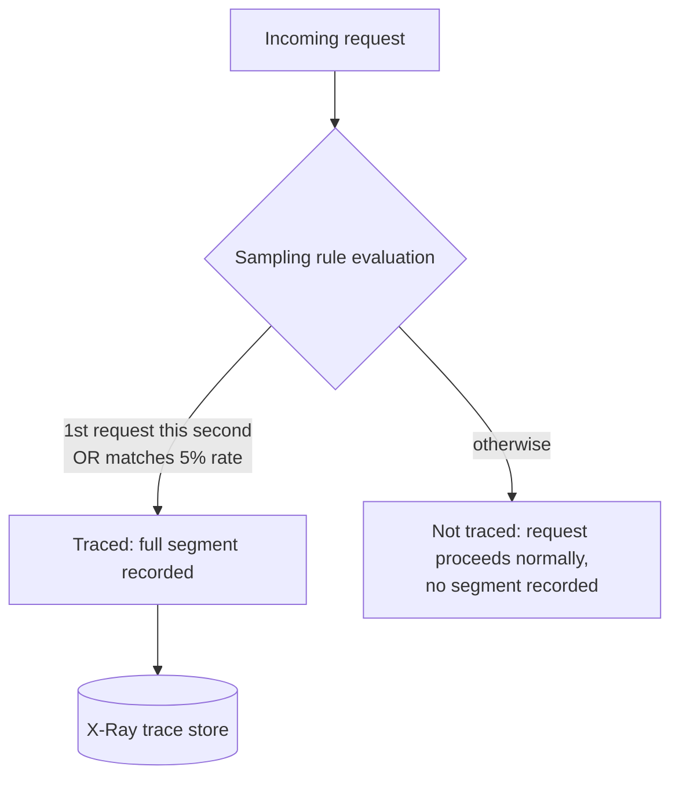

# AWS X-Ray

> **Appears in:** [SAA-C03](../../certifications/saa-c03/README.md) · [DVA-C03](../../certifications/dva-c03/README.md) · [MLA-C02](../../certifications/mla-c02/README.md)


<!-- AWS Architecture Icons, Developer Tools category; see diagrams/README.md for the convention -->

## Definition

AWS X-Ray is a distributed tracing service: it follows a single request as it travels through
every component of your application — API Gateway, a Lambda function, a database call, a
downstream microservice — and stitches all of that together into one visual timeline, so you can
see exactly where time was spent and where something broke, instead of grepping through a dozen
separate log streams trying to guess.

## Purpose

A monolith running on one server has one log file; if something's slow, you look at that one log.
A modern application split across API Gateway, three Lambda functions, a Step Functions
workflow, DynamoDB, and an external payment API has *no single log* — a single user-facing
request might touch six services, each writing its own logs in its own format, with no shared
thread connecting them. Before distributed tracing existed, debugging "why was this specific
request slow" meant manually correlating timestamps across six different CloudWatch Logs groups
and hoping the clocks were close enough to line up. X-Ray exists to solve exactly this problem:
every request gets a single **trace ID** that follows it through every service it touches, and
X-Ray assembles all the pieces back into one coherent picture automatically.

This matters more as architectures get more "serverless" and "microservice-y," not less — the
same decomposition that makes services independently deployable and scalable is precisely what
destroys the single-log-file debugging model. X-Ray is AWS's answer to that tradeoff: keep the
architectural benefits of decomposition, get back the single-pane-of-glass debugging experience
a monolith used to give you for free.

## How It Works

Plain explanation first: every traced request gets a **trace** — a unique ID generated the moment
the request enters your system (usually at the load balancer or API Gateway). As that request
flows through each service, each service records its own **segment** (the top-level record for
one service's work on that request) or **subsegment** (a finer-grained piece of work inside a
segment, like one SQL query or one call to a downstream API) and reports it to X-Ray, tagged with
that same trace ID. X-Ray's backend reassembles every segment/subsegment sharing a trace ID into
one end-to-end **trace**, and aggregates many traces into a **service map** — a visual graph of
every service in your architecture and how they call each other, with latency and error-rate
numbers on every edge.



Walking through it step by step:
1. **Trace header injection.** The very first service to handle the request (commonly a load
   balancer, API Gateway, or the first line of your own application code) generates a trace ID
   and attaches it to the request as an HTTP header (`X-Amzn-Trace-Id`). Every downstream call
   this request triggers carries that same header forward.
2. **Segment recording.** Each service instrumented with the X-Ray SDK (or, for many AWS
   services, instrumented automatically with zero code) records a **segment**: start time, end
   time, which resource handled it, whether it errored, and any **subsegments** for finer-grained
   work inside that segment (an individual database query, an individual outbound HTTP call).
3. **Sending data to X-Ray.** Segments are sent to the X-Ray service either via the **X-Ray
   daemon** (a small background process that batches and forwards UDP traffic — bundled
   automatically on Lambda and Elastic Beanstalk, run yourself as a sidecar/DaemonSet on
   EC2/ECS/EKS) or directly via the newer **CloudWatch agent with OTLP support** for
   OpenTelemetry-based instrumentation.
4. **Trace assembly.** X-Ray's backend groups every segment/subsegment sharing a trace ID into one
   complete, end-to-end trace — even though those segments arrived from five different services
   running on five different pieces of infrastructure, possibly out of order.
5. **Service map generation.** Across many traces, X-Ray builds a continuously updated graph of
   every node (service) your traffic touches and every edge (call) between them, color-coded by
   error rate and annotated with average/percentile latency — this is the view most engineers
   open first when something feels generally "off" before drilling into one specific trace.

### The X-Ray SDK and daemon, in more depth

A common point of confusion worth clearing up explicitly: the **X-Ray SDK** (a library you add
to your application code) and the **X-Ray daemon** (a separate background process) do two
different jobs, and most real setups need both.


*Figure: the X-Ray SDK (inside your application process) builds segment documents describing
each piece of work, and sends them over UDP to the X-Ray daemon running alongside your
application — a separate, lightweight process that buffers and batches those segments before
uploading them to the X-Ray API. This two-hop design (SDK → daemon → API) means your
application's own request-handling thread never blocks on a network call to X-Ray itself; it
only ever does a fast local UDP write. Source: AWS X-Ray Developer Guide, ["What is AWS
X-Ray?"](https://docs.aws.amazon.com/xray/latest/devguide/aws-xray.html).*

- **On Lambda and Elastic Beanstalk**, the daemon is already running for you — enabling "Active
  Tracing" on a Lambda function (one checkbox/config flag) is the entire setup; there's no daemon
  to install or manage.
- **On EC2, ECS, and EKS**, you run the daemon yourself — as a background process on an EC2
  instance, as a sidecar container in an ECS task definition, or as a DaemonSet in EKS — because
  there's no AWS-managed platform layer to run it for you automatically.
- **The SDK** is what you actually write code against: wrapping outbound HTTP/SDK calls so
  they're automatically captured as subsegments, and (optionally) adding custom subsegments
  around any block of code you specifically want timed and shown on the trace timeline.

### A single traced request, timeline view

This is what debugging *feels like* day to day — not the service map (the 10,000-foot view) but
one specific trace's timeline, the view you open after a customer reports "checkout was slow for
me at 2:14pm":


*Figure: a trace's timeline view — each horizontal bar is a segment or subsegment, its width is
proportional to duration, and bars are nested to show which subsegment happened inside which
segment. The practical debugging workflow this view enables: scan for the single widest bar (the
slowest piece of work), and that's almost always your answer to "why was this request slow" —
you don't need to inspect every segment, just the longest one. Source: AWS X-Ray Developer Guide,
["What is AWS X-Ray?"](https://docs.aws.amazon.com/xray/latest/devguide/aws-xray.html).*

### The service map, aggregate view

Where the timeline above answers "why was *this one* request slow," the service map answers "is
*anything* in my architecture unhealthy right now" — the view to open first, before you even know
which trace to drill into:


*Figure: the service map aggregates many traces into one graph — nodes are services, edges are
calls between them, edge color reflects error/fault rate (green healthy, red/yellow problems),
and edge thickness or the numbers alongside it show relative traffic volume and latency. Finding
a red node is the fastest way to localize "which service" before opening any individual trace to
find out "which specific request and why." Source: AWS X-Ray Developer Guide, ["What is AWS
X-Ray?"](https://docs.aws.amazon.com/xray/latest/devguide/aws-xray.html).*

### Sampling — why X-Ray doesn't trace every single request

Tracing every single request at high volume would be both expensive and, past a certain scale,
not actually more useful (you don't need to see 50,000 identical healthy checkout traces per
minute to know checkout is healthy). X-Ray's default **sampling rule** traces the first request
each second, plus 5% of any additional requests beyond that, per service — tunable via custom
sampling rules (e.g., always trace requests to a specific high-value endpoint, sample more
aggressively on a canary deployment, sample less on a known-noisy health-check endpoint).



*The key exam-relevant idea here: sampling is a cost/completeness tradeoff, not a bug — a service
with low traffic effectively traces everything (the "1 per second" floor covers it entirely),
while a very high-traffic service only traces a representative slice. A question describing "some
requests aren't showing up in X-Ray even though the application seems to be instrumented
correctly" is usually describing expected sampling behavior, not a misconfiguration, unless the
sampling rule itself was set incorrectly.*

### Annotations vs. metadata — the exam-tested distinction

X-Ray lets you attach extra data to a segment beyond the automatic timing information, and the
exam cares about the difference between the two mechanisms for doing this:
- **Annotations** — simple key-value pairs (string, number, or boolean) that are **indexed** and
  therefore **searchable** in the X-Ray console's filter expressions (e.g., search for every
  trace where `annotation.customer_tier = "premium"`). Use annotations for anything you want to
  filter traces *by*.
- **Metadata** — arbitrary, richer key-value data (objects, arrays, larger payloads) that is
  **not indexed** and therefore **not searchable** — you can view it once you've already opened a
  specific trace, but you can't filter the trace list by it. Use metadata for debugging context
  that's useful to see but not something you'd ever search across thousands of traces for.

A scenario describing "I need to filter/search traces by customer ID or feature flag value" is
pointing at annotations; "I just want to attach the full request payload for debugging once I've
already found the trace" is pointing at metadata.

## Key Features / Components

- **Segments and subsegments** — the fundamental unit of recorded work: a segment is one
  service's contribution to a trace, a subsegment is a finer-grained piece of work inside it
  (one SQL call, one outbound HTTP request).
- **Trace ID propagation** — the `X-Amzn-Trace-Id` HTTP header that carries one request's
  identity across every service boundary it crosses; the SDK handles reading/writing this header
  automatically for instrumented HTTP clients.
- **Service Map** — the auto-generated, continuously updated graph of every node your traffic
  touches, with latency and error-rate annotations per edge — the primary "is anything unhealthy"
  dashboard.
- **Sampling rules** — control what fraction of requests get fully traced, balancing visibility
  against cost/overhead at high volume; customizable per service, per endpoint, or by request
  attribute.
- **Annotations** — indexed, searchable key-value tags on a trace (filter traces by these).
- **Metadata** — unindexed, richer contextual data on a trace (view once you've found it, can't
  search by it).
- **X-Ray daemon** — the local UDP-listening process that batches and forwards segment data to
  the X-Ray API; built into Lambda/Elastic Beanstalk, self-managed on EC2/ECS/EKS.
- **X-Ray SDK** — language-specific libraries (Java, Node.js, Python, .NET, Go, Ruby, PHP) that
  auto-instrument common AWS SDK calls and HTTP clients, plus a manual API for custom
  subsegments and annotations.
- **X-Ray Insights** — automatic anomaly detection on the service map — flags an unusual spike
  in fault rate or latency on a specific node without you having to define a threshold alarm
  yourself, and groups related anomalies together as one Insight rather than a flood of
  individual alerts.
- **X-Ray Analytics** — a console view for slicing aggregate trace data by annotation, HTTP
  status, URL, or other dimensions — "show me the p99 latency of all traces where
  `annotation.customer_tier = premium` and status is 5xx" — without writing a CloudWatch Logs
  Insights query by hand.
- **CloudWatch ServiceLens** — an integration layer that overlays X-Ray trace/service-map data
  directly on top of CloudWatch metrics and logs in one unified view, so you can pivot from "this
  metric spiked" straight to "here are the traces from that exact time window" without switching
  consoles.
- **OpenTelemetry (OTel) support** — X-Ray increasingly accepts trace data in the vendor-neutral
  OpenTelemetry format (via the AWS Distro for OpenTelemetry, ADOT), letting teams instrument with
  the open-source OTel SDK instead of AWS's proprietary X-Ray SDK while still shipping data to
  X-Ray as the backend — relevant for teams who want portability across tracing backends.

## Use Cases — When to Use It

- **Serverless checkout pipeline latency debugging (e-commerce).** Situation: a checkout flow
  spans API Gateway, three chained Lambda functions, and DynamoDB, and customers intermittently
  report slow checkouts with no clear pattern in any single service's own CloudWatch metrics. Why
  X-Ray fits: Active Tracing on each Lambda function requires no code changes and immediately
  shows which specific function/call in the chain is the slow one on a per-request basis. What
  the alternative would cost: correlating five separate Lambda CloudWatch Logs groups by
  timestamp manually, for every slow-checkout complaint, is a slow, error-prone, non-scaling
  process that only gets worse as the chain grows.
- **Microservices error-rate triage during an incident (SaaS platform).** Situation: an
  on-call engineer gets paged for elevated 5xx errors across a 12-microservice ECS fleet and
  needs to find the root-cause service fast, under pressure. Why X-Ray fits: the service map
  immediately highlights the one red (high error-rate) node among the twelve, pointing the
  investigation at the right service in seconds instead of checking each one's dashboard in turn.
  What the alternative would cost: manually checking twelve separate CloudWatch dashboards during
  an active incident burns exactly the minutes an SLA-bound on-call response can't afford to lose.
- **Third-party API latency attribution (fintech/payments).** Situation: a payments company's
  transaction processing calls an external card-network API, and intermittent slowness is
  suspected but unproven — is it their own code, or the external API? Why X-Ray fits: a
  subsegment specifically wrapping the outbound call to the external API shows its latency
  separated cleanly from the rest of the request, settling the "is it us or them" question with
  data instead of guesswork. What the alternative would cost: without that isolated subsegment,
  teams often misattribute external latency to their own code and spend engineering time
  optimizing the wrong thing.
- **Step Functions workflow visibility (back-office automation).** Situation: a multi-step
  Step Functions state machine orchestrating order fulfillment occasionally stalls at an
  unpredictable step, and the Step Functions execution history alone doesn't show *why* a
  downstream Lambda call inside one state took unusually long. Why X-Ray fits: tracing the
  Lambda functions invoked by each state gives per-call timing and error detail that the
  state-machine-level execution history doesn't expose on its own. What the alternative would
  cost: relying on execution history alone tells you *which state* was slow but not *why*,
  forcing a slower, logs-only investigation into that one function afterward anyway.
- **GraphQL/API Gateway backend fan-out tracing (mobile backend).** Situation: a single mobile
  app API call fans out to five backend services via API Gateway and AppSync, and a slow mobile
  screen load needs attribution to exactly one of those five calls. Why X-Ray fits: trace
  propagation across API Gateway and AppSync resolvers shows the full fan-out shape and isolates
  the one slow backend call per request. What the alternative would cost: without end-to-end trace
  propagation, the mobile team can only measure total round-trip time, with no visibility into
  which of the five backend calls is actually responsible.
- **Compliance-driven request audit trail (healthcare/regulated industry).** Situation: a
  healthcare SaaS platform must be able to show, for any specific patient-record request, exactly
  which services touched the data and in what order, as part of an audit response. Why X-Ray
  fits: a trace is, by construction, a complete per-request record of every service call made on
  its behalf — exactly the shape an auditor's question takes. What the alternative would cost:
  reconstructing the same picture from independent per-service logs after the fact is slow,
  error-prone, and hard to defend as complete under audit scrutiny.
- **ML inference pipeline latency breakdown (MLA-C02-relevant, ML platform team).** Situation: a
  real-time fraud-scoring pipeline chains API Gateway → Lambda (feature lookup) → SageMaker
  real-time endpoint → Lambda (post-processing), and the team needs to know whether SageMaker
  inference itself or the surrounding glue code is the latency bottleneck before deciding what to
  optimize. Why X-Ray fits: tracing each hop (including the SageMaker invocation as its own
  subsegment) cleanly separates model inference time from feature-lookup and post-processing
  time. What the alternative would cost: without this separation, teams commonly over-invest in
  optimizing model inference when the real bottleneck turns out to be a slow DynamoDB feature
  lookup, wasting ML engineering effort on the wrong fix.
- **Canary/blue-green deployment safety verification (platform/SRE team).** Situation: a new
  version of a service is rolled out to a small percentage of traffic, and the team needs to
  confirm the new version's error rate and latency profile before shifting more traffic to it.
  Why X-Ray fits: a custom sampling rule or annotation tagging requests by deployment version lets
  the service map and trace analytics be filtered to "new version only" traffic, giving a clean
  before/after comparison. What the alternative would cost: without per-version trace tagging,
  teams are stuck eyeballing aggregate CloudWatch metrics that blend old and new version traffic
  together, hiding a regression that only affects the new version.
- **Cross-account/cross-account service tracing for an organization (enterprise platform team).**
  Situation: a large organization runs shared services (an internal auth service, a shared
  notifications service) in a separate AWS account from the application teams that call them, and
  needs end-to-end visibility across that account boundary during an incident. Why X-Ray fits:
  with proper trace header propagation and IAM permissions, X-Ray can assemble traces that span
  account boundaries, giving a unified picture instead of two disconnected ones. What the
  alternative would cost: two separate X-Ray consoles (one per account) force manual, slow
  cross-referencing by trace ID during exactly the moment speed matters most.

## When NOT to Use It / Alternatives

- **You just need plain-text application logs, not request-flow visualization** — X-Ray traces
  *timing and call structure*, not arbitrary log content; use **CloudWatch Logs** (and CloudWatch
  Logs Insights for querying them) for free-text log search, and treat X-Ray as the complement
  that tells you *which* trace/time window to go search those logs for.
- **A genuinely single-service, single-log-file application** — if there's no cross-service call
  chain to visualize, X-Ray's distributed-tracing value proposition doesn't apply; CloudWatch
  metrics/alarms and ordinary logging cover a monolith's debugging needs without the extra setup.
- **You need a full metrics/alerting platform, not request tracing** — X-Ray is not a
  replacement for **CloudWatch** metrics/alarms/dashboards; the two are complementary (CloudWatch
  tells you *something* is wrong via a threshold breach, X-Ray tells you *why*, at the
  individual-request level) rather than substitutes for each other.
- **You're already standardized on a third-party APM tool** (Datadog, New Relic, Dynatrace) with
  its own tracing backend across a multi-cloud environment — X-Ray is AWS-native and works best
  when your whole stack is on AWS; a multi-cloud shop may reasonably prefer a vendor-neutral APM
  with its own agent, using X-Ray only incidentally if at all (though ADOT/OpenTelemetry narrows
  this gap by letting the same instrumentation ship to either backend).
- **You need code-level profiling (CPU/memory flame graphs inside one process)** — X-Ray traces
  *between* services and major internal operations you've wrapped in a subsegment, not low-level
  in-process profiling; use **Amazon CodeGuru Profiler** or a language-specific profiler for that
  granularity instead.

## Why It's Important

**Real-world:** as architectures decompose into more services (Lambda functions, microservices,
managed services calling each other), "where did this specific slow/broken request actually go"
becomes genuinely hard to answer without tracing — and the mean time to resolve an incident is
directly, measurably shaped by how fast an on-call engineer can localize the problem to one
service. X-Ray (or an equivalent tracing tool) has become a practical necessity, not a nice-to-
have, for any team running more than a couple of interdependent services in production.

**Exam relevance:**
- **SAA-C03** — Domain 2 "Design Resilient Architectures," specifically the task statement
  covering monitoring and observability for distributed workloads. A question describing "need
  visibility into how requests flow across multiple decoupled components to design/validate a
  resilient architecture" is pointing at X-Ray as the visibility tool, often alongside CloudWatch
  for the metrics/alarms half of the same picture.
- **DVA-C03** — Domain 4 "Troubleshooting and Optimization" is where X-Ray is most heavily
  tested on this exam: a developer-facing scenario describing a multi-service application with an
  intermittent, hard-to-reproduce performance problem is the classic DVA-C03 X-Ray setup, and the
  expected answer is almost always "enable X-Ray tracing and look at the resulting trace/service
  map," not "add more CloudWatch Logs statements and grep through them."
- **MLA-C02** — Domain 4 "Monitoring, Maintenance, and Security" tests observability for ML
  pipelines and inference endpoints specifically; a scenario describing an ML inference pipeline
  with an unclear latency bottleneck across multiple chained AWS services (API Gateway, Lambda,
  SageMaker) is testing whether you'd reach for X-Ray to localize which hop is actually slow
  before trying to optimize the model itself.

## Pricing Model (summary)

- **Trace storage and retrieval** — billed per trace recorded and per trace retrieved/scanned,
  with the first 100,000 traces recorded and first 1,000,000 traces retrieved each month free
  under the AWS Free Tier (check the official page for current thresholds — free tier terms
  change).
- **X-Ray Insights** events (automatic anomaly detections) have their own separate, smaller
  per-event pricing beyond the free tier.
- **No charge for the X-Ray daemon or SDK themselves** — you're billed for trace volume sent to
  the service, not for running the instrumentation.
- Because sampling controls trace *volume*, sampling rate is directly a cost lever at high
  request volume, not just a noise-reduction lever — a question combining "minimize X-Ray cost at
  very high request volume" with "still catch real problems" is pointing at a well-tuned sampling
  rule (lower baseline rate, but always-trace rules for specific high-value or error-prone paths),
  not disabling tracing entirely.
- Official current pricing: https://aws.amazon.com/xray/pricing/

## Hands-on Lab (Floci)

Floci does not emulate the X-Ray trace-ingestion/analysis backend itself (it's a managed
analytics service, not a simple API surface Floci replicates record-for-record), but it does
support the X-Ray API surface well enough to practice the actual CLI shape — submitting segment
documents and querying them back, which is exactly the mechanics the SDK performs for you
automatically in a real application.

```bash
# 1. Submit a manually-constructed trace segment (what the SDK does for you automatically)
awslocal xray put-trace-segments --trace-segment-documents '[
  {
    "name": "checkout-service",
    "id": "6226734323ec3b0a",
    "trace_id": "1-5e645f3e-1dfad076a177c5ccc5de12f5",
    "start_time": 1700000000.0,
    "end_time": 1700000000.5,
    "http": {
      "request": {"method": "POST", "url": "https://example.com/checkout"},
      "response": {"status": 200}
    }
  }
]'

# 2. Create a sampling rule (mirrors the real default-and-custom sampling model)
awslocal xray create-sampling-rule --sampling-rule '{
  "RuleName": "checkout-high-priority",
  "Priority": 1,
  "FixedRate": 0.1,
  "ReservoirSize": 1,
  "ServiceName": "checkout-service",
  "ServiceType": "*",
  "Host": "*",
  "HTTPMethod": "*",
  "URLPath": "/checkout",
  "ResourceARN": "*",
  "Version": 1
}'

# 3. Retrieve trace summaries for a time window (what the console's trace list view calls)
awslocal xray get-trace-summaries \
  --start-time 1700000000 \
  --end-time 1700003600

# 4. Fetch the full segment detail for a specific trace ID
awslocal xray batch-get-traces --trace-ids "1-5e645f3e-1dfad076a177c5ccc5de12f5"
```

See `labs-floci/README.md` for the shared setup. The exercise worth internalizing even though
it's manually constructed here: a segment document's `trace_id` is the single field that ties
otherwise-unrelated API calls together into one trace — that's the entire mechanism X-Ray's SDK
automates for you across real services in production.

## Exam Tips

- **X-Ray vs. CloudWatch**: they answer different questions and the exam tests the distinction
  directly — CloudWatch tells you *something* crossed a threshold (a metric/alarm), X-Ray tells
  you *why*, at the level of one specific request's path through your services. A question
  describing "need to see which specific downstream call in a request chain is slow" points at
  X-Ray, not a CloudWatch metric alone.
- **Enabling tracing on Lambda** is a configuration flag ("Active Tracing"), not a code rewrite —
  a question implying X-Ray requires re-architecting a Lambda function is wrong; the SDK wrapper
  for *custom* subsegments/annotations is optional on top of that baseline.
- **Annotations vs. metadata**: annotations are indexed/searchable (filter traces by them),
  metadata is not (view-only once you've found the trace). "I need to filter/search traces by a
  custom value" → annotations. "I just want extra debug context visible on the trace" → metadata.
- **Sampling is expected behavior, not a bug** — a question describing "some requests don't
  appear in X-Ray even though tracing is enabled and working" is usually describing normal
  sampling, not a misconfiguration, unless a custom sampling rule was clearly set up wrong.
- **The X-Ray daemon is already running for you on Lambda and Elastic Beanstalk**, but you must
  run it yourself on EC2/ECS/EKS (as a process, sidecar container, or DaemonSet respectively) —
  a question about "tracing isn't showing up on an EC2-hosted application" should make you check
  whether the daemon is even running there, a step that doesn't exist on Lambda.
- **Service map vs. individual trace**: service map = "is anything broadly unhealthy right now,"
  individual trace timeline = "why was this one specific request slow/broken." Recognize which
  one a question scenario is actually asking for before answering.
- Don't confuse X-Ray with **CodeGuru Profiler** — X-Ray traces *between* services and explicitly
  wrapped operations; CodeGuru Profiler does in-process CPU/latency profiling *within* one
  running application, a different granularity entirely.
- For MLA-C02 specifically: expect X-Ray framed around tracing an **inference pipeline's** hops
  (API Gateway → Lambda → SageMaker endpoint) to isolate whether model inference itself or
  surrounding orchestration code is the latency source — not deep model-internals profiling, which
  X-Ray doesn't do.

## Further Reading

- [AWS X-Ray Developer Guide — "What is AWS X-Ray?"](https://docs.aws.amazon.com/xray/latest/devguide/aws-xray.html)
- [AWS X-Ray Developer Guide — Getting started](https://docs.aws.amazon.com/xray/latest/devguide/xray-gettingstarted.html)
- [AWS X-Ray Developer Guide — Choosing an interface](https://docs.aws.amazon.com/xray/latest/devguide/aws-xray-interface.html)
- [AWS X-Ray pricing](https://aws.amazon.com/xray/pricing/)
- [AWS Distro for OpenTelemetry (ADOT) documentation](https://aws-otel.github.io/docs/introduction)
- [CloudWatch ServiceLens overview](https://docs.aws.amazon.com/AmazonCloudWatch/latest/monitoring/CloudWatch-ServiceLens.html)

## Related Terms

- [`../management-governance/cloudwatch.md`](../management-governance/cloudwatch.md) — metrics,
  alarms, and logs that complement X-Ray's request-level tracing
- [`codebuild.md`](codebuild.md) · [`codepipeline.md`](codepipeline.md) — X-Ray is commonly used
  to verify a new deployment's health before/after a pipeline-driven release
- `services/compute/lambda.md` — the most common place Active Tracing is enabled with a single
  configuration flag
- `services/machine-learning-ai/sagemaker-deployment-endpoints.md` — a frequent tracing target
  when isolating inference latency from surrounding orchestration code
- `glossary/README.md` — trace, segment, subsegment, sampling rule definitions

---

**Repo completeness note — cert cross-linking not yet applied:** this doc should also be
referenced from the following certification domain pages, which currently don't link to it
(these files were intentionally **not edited** here to avoid conflicting with other in-flight
edits elsewhere in the repo — flagging for a follow-up pass):
- `certifications/saa-c03/domain-2-resilient-architectures/README.md` — workload visibility /
  observability for resilient architectures (SAA-C03 Domain 2)
- `certifications/dva-c03/domain-4-troubleshooting-optimization/README.md` — troubleshooting and
  observability tooling (DVA-C03 Domain 4)
- `certifications/mla-c02/domain-4-monitoring-security/README.md` — monitoring for ML pipelines
  and inference endpoints (MLA-C02 Domain 4)
