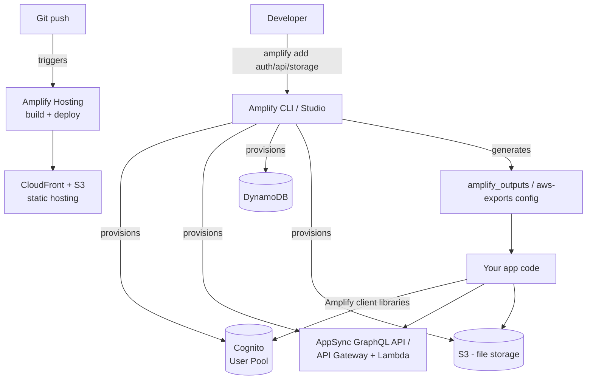

# AWS Amplify

> **Appears in:** [DVA-C03](../../certifications/dva-c03/README.md) · [SAA-C03](../../certifications/saa-c03/README.md)

## Definition

AWS Amplify is a set of tools and services for building and deploying full-stack web and mobile
applications quickly — it provisions a backend (auth, API, database, storage, functions) from
simple config or CLI commands, gives you client libraries to call that backend from your app
code, and hosts/deploys your frontend with Git-push CI/CD, without you hand-wiring each
underlying AWS service yourself.

## Purpose

A typical full-stack app needs a lot of AWS plumbing before a single feature ships: an auth
service (Cognito), an API layer (AppSync or API Gateway + Lambda), a database (DynamoDB), file
storage (S3), and a hosting/CDN pipeline (S3 + CloudFront) with CI/CD wired to your Git repo.
Each of those is a solid service on its own, but wiring all five together correctly — consistent
IAM roles, matching API schemas, a working deploy pipeline — is real, repetitive undifferentiated
work most app teams don't want to own. Amplify exists to collapse that setup from days/weeks of
manual IAM-and-service wiring down to a CLI command or a console click, while still deploying
*real, individually-manageable* AWS resources underneath (not a black box) — so a frontend-focused
team can ship a production-grade backend without becoming infrastructure experts first.

## How It Works

Plain-English: you describe what your app needs (a REST/GraphQL API, a login system, a file
store) in Amplify's CLI or console; Amplify provisions the actual AWS resources for it and hands
you a generated config file plus a client library; your app code calls that library instead of
talking to each AWS SDK directly. Separately, Amplify Hosting watches your Git repository and
redeploys your frontend automatically on every push.



Step by step:
1. **You declare backend needs** through the Amplify CLI (`amplify add auth`, `amplify add api`,
   `amplify add storage`), the Admin UI, or — in the newer Amplify Gen 2 model — TypeScript code
   that defines your backend resources directly (`amplify/backend.ts`).
2. **Amplify provisions real AWS resources** behind that command: `amplify add auth` creates an
   actual Cognito User Pool (and Identity Pool if federated AWS access is needed); `amplify add
   api` creates a real AppSync GraphQL API (schema-driven, with a DynamoDB table auto-generated
   per type) or a REST API Gateway + Lambda combo; `amplify add storage` creates an S3 bucket with
   access rules tied to the Cognito identity.
3. **A config file is generated** (`aws-exports.js` in Gen 1, `amplify_outputs.json` in Gen 2)
   containing the endpoints, pool IDs, and region info your frontend needs — you import this once
   and the Amplify client libraries handle the rest (token refresh, signed requests, offline
   sync for data APIs).
4. **Your application code calls the Amplify libraries**, not each AWS SDK separately — e.g.
   `Auth.signIn()` instead of hand-rolling a Cognito SRP auth flow, or `DataStore`/`generateClient()`
   for the GraphQL API instead of constructing AppSync requests by hand.
5. **Amplify Hosting handles the frontend side**: connect a Git repository (GitHub/GitLab/
   Bitbucket/CodeCommit), and every push to a tracked branch triggers a build (using your
   `amplify.yml` build spec) and a deploy to a globally distributed CloudFront + S3 static hosting
   setup, including automatic preview deployments for pull requests.
6. **Everything provisioned is a real, individually inspectable AWS resource** — you can open the
   Cognito console and see the actual User Pool Amplify created; it's not a hidden proprietary
   runtime, which matters for debugging and for knowing you can "eject" to raw AWS SDK calls later
   if needed.

## Key Features / Components

- **Amplify CLI / Studio / Gen 2 TypeScript backend-as-code** — the three ways to define backend
  resources, from imperative CLI commands (Gen 1) to a visual builder (Studio) to typed
  infrastructure-as-code (`amplify/backend.ts` in Gen 2).
- **Auth category** — provisions Amazon Cognito (User Pools + optional Identity Pools) with
  drop-in UI components for sign-up/sign-in/MFA.
- **API category** — GraphQL via AWS AppSync (with auto-generated resolvers and DynamoDB tables
  from a GraphQL schema) or REST via API Gateway + Lambda.
- **DataStore** — an on-device data layer with automatic cloud sync and conflict resolution,
  letting an app work fully offline and reconcile changes when connectivity returns.
- **Storage category** — provisions S3 with access rules scoped to the authenticated user's
  Cognito identity (private/protected/public access levels).
- **Amplify Hosting** — Git-connected CI/CD for frontend frameworks (React, Vue, Next.js, Angular,
  Flutter Web, and more), with CloudFront CDN distribution and PR preview environments built in.
- **Amplify UI component libraries** — pre-built, framework-specific (React, Vue, Angular, Swift,
  Android) UI components wired directly to the backend categories (e.g., a complete `<Authenticator>`
  login flow component).
- **Multi-environment support** — separate backend environments (dev/staging/prod) per Git branch,
  each with its own isolated set of AWS resources.
- **Functions category** — provisions Lambda functions wired into your API or triggered by other
  categories (e.g., a Cognito post-confirmation trigger).

## Use Cases — When to Use It

- **Standing up a full-stack mobile or web app backend fast.** Problem — a small team needs auth,
  a data API, and file storage without weeks of manual service wiring. Why it fits — one CLI flow
  provisions all three consistently. Tradeoff vs hand-wiring Cognito + AppSync + S3 directly: more
  control and no "Amplify opinions" to work around, at the cost of the setup time Amplify exists
  to remove.
- **Rapid prototyping / hackathon-speed MVPs.** Problem — validate a product idea with a real,
  working backend in hours, not sprints. Why it fits — `amplify init && amplify add api && amplify
  push` is a genuinely fast path to a deployed GraphQL API with a database behind it.
- **Static site / SPA hosting with Git-based CI/CD.** Problem — a React/Vue/Next.js site needs
  automatic build-and-deploy on every push, plus PR preview URLs for review. Why it fits — Amplify
  Hosting's Git integration does exactly this out of the box. Tradeoff vs S3 + CloudFront wired
  manually, or Vercel/Netlify: Amplify Hosting is the AWS-native option when the rest of your
  backend is already Amplify-provisioned, keeping billing and IAM in one place.
- **Mobile apps needing offline-first data sync.** Problem — a field-service or note-taking app
  must work with no connectivity and sync later without manual conflict-resolution code. Why it
  fits — DataStore's built-in offline cache and sync engine is purpose-built for this. Tradeoff vs
  rolling your own local cache + sync queue against AppSync directly: DataStore trades some
  flexibility in exactly how conflicts resolve for a working offline story out of the box.
- **Apps needing drop-in, pre-styled auth UI.** Problem — a team doesn't want to build a login/
  sign-up/MFA screen from scratch. Why it fits — the Amplify UI `<Authenticator>` component is a
  complete, wired-up auth flow in a few lines. Tradeoff vs a fully custom Cognito Hosted UI or
  hand-built form: faster to ship, less control over exact UX than a bespoke implementation.
- **Teams who want environment-per-branch isolation.** Problem — dev, staging, and prod need
  genuinely separate backend resources that don't collide. Why it fits — Amplify's multi-
  environment model ties a backend environment to a Git branch automatically. Tradeoff vs manually
  maintained CloudFormation stacks per environment: faster to set up, less explicit control over
  stack naming/structure than hand-rolled IaC.
- **Exam scenario — "fastest way to add a backend to a mobile/web app without managing individual
  AWS services directly."** This phrasing is the direct Amplify trigger on both SAA-C03 and
  DVA-C03; recognize it over any answer that wires Cognito/AppSync/S3 manually.
- **GraphQL APIs with minimal resolver-writing.** Problem — a team wants a working GraphQL API
  from a schema without hand-writing AppSync resolvers and the DynamoDB table behind them. Why it
  fits — Amplify's `amplify add api` (GraphQL) auto-generates resolvers and tables straight from
  the `.graphql` schema. Tradeoff vs writing AppSync + DynamoDB directly: far less boilerplate,
  at the cost of some control over exact resolver/table design for unusual access patterns.

## When NOT to Use It / Alternatives

- **An existing, complex backend architecture already exists and doesn't map to Amplify's
  categories cleanly** → wire the services directly (**Cognito, AppSync/API Gateway, DynamoDB, S3**
  individually) for full control — Amplify's abstractions pay off most for new, Amplify-shaped
  projects, not for retrofitting an existing bespoke architecture.
- **You need fine-grained, non-standard infrastructure control** (custom VPC placement, unusual
  IAM boundary conditions, non-standard resource naming) → **CloudFormation/CDK directly** — Amplify
  generates CloudFormation under the hood, but its CLI workflow optimizes for speed of setup, not
  maximal low-level control.
- **Your frontend hosting needs are already solved elsewhere** (an existing CloudFront + S3 setup,
  or a non-AWS host) → just use Amplify's backend categories alone; Hosting is optional and
  independent of the other categories.
- **Heavy server-side rendering / backend logic beyond simple Lambda functions** → a fuller
  framework-native deployment target (e.g., **Elastic Beanstalk**, **App Runner**, or containers on
  **ECS/Fargate**) may fit better than Amplify's Hosting + Functions model, which leans toward
  JAMstack-style static/SSR frontends plus thin backend functions.

## Why It's Important

**Real world:** Amplify meaningfully lowers the barrier for small teams and solo developers to
ship a production-shaped (not toy) full-stack app on real AWS infrastructure, and because it
provisions genuine, inspectable resources (not a proprietary runtime), teams aren't locked into
Amplify's tooling forever — they can keep using the underlying Cognito/AppSync/S3 resources even
if they later outgrow the CLI workflow.

**Exam mapping:**
- **SAA-C03** — appears as a quick-recognition option in questions about standing up a mobile/web
  app backend fast without directly provisioning each underlying service; it's a "know it exists
  and what it bundles" service rather than deep architectural test material.
- **DVA-C03** — more central here: Domain 1 (Development with AWS Services) can test recognizing
  Amplify as the tool that generates client-side SDK config and wires a frontend to Cognito/
  AppSync/S3 without the developer hand-writing that integration glue.

**Expanded exam scenarios:**
- *"A startup needs to launch a mobile app with authentication, a GraphQL API, and file upload
  within days, with a small engineering team."* → Amplify — the bundled, fast-setup answer.
- *"A question describes generated SDK/client configuration used to connect a frontend to Cognito
  and AppSync without writing that integration code by hand."* → Amplify's generated config
  (`aws-exports.js`/`amplify_outputs.json`) plus its client libraries — a DVA-C03-flavored detail.
- *"A team wants automatic build-and-deploy triggered by a Git push, including preview URLs for
  pull requests, for a React frontend."* → Amplify Hosting specifically, distinct from the backend
  categories.

## Pricing Model (summary)

- **Amplify Hosting** — billed per build minute and per GB served/stored, with a free tier.
- **Backend resources provisioned by Amplify** (Cognito, AppSync, DynamoDB, S3, Lambda) are billed
  at each underlying service's own standard rates — Amplify itself adds no markup, it's purely a
  provisioning/CLI convenience layer on top of normal AWS billing.
- Exact current rates: https://aws.amazon.com/amplify/pricing/

## Hands-on Lab (Floci)

Floci emulates the individual underlying services (Cognito, DynamoDB, Lambda, S3) but not
Amplify's CLI/provisioning layer itself. Practice the shape with direct CLI calls against the
services Amplify would provision for you:

```bash
# What Amplify would provision under the hood for "amplify add auth" + "amplify add storage"
# — practiced directly against Floci's emulated services.

awslocal cognito-idp create-user-pool --pool-name study-amplify-users
awslocal s3 mb s3://study-amplify-storage
awslocal dynamodb create-table \
  --table-name study-amplify-todos \
  --attribute-definitions AttributeName=id,AttributeType=S \
  --key-schema AttributeName=id,KeyType=HASH \
  --billing-mode PAY_PER_REQUEST

# Real Amplify CLI shape, for muscle memory (needs a real AWS account/region):
# amplify init
# amplify add auth      # -> provisions a Cognito User Pool
# amplify add storage   # -> provisions an S3 bucket scoped to the Cognito identity
# amplify push          # -> deploys everything as real CloudFormation-managed resources
```

## Exam Tips

- **"Fast full-stack app backend without managing each AWS service individually"** is the
  Amplify trigger phrase on both SAA-C03 and DVA-C03.
- Know Amplify **provisions real, separately manageable AWS resources** (Cognito, AppSync,
  DynamoDB, S3, Lambda) — it is not a separate proprietary compute platform.
- Distinguish **Amplify Hosting** (frontend CI/CD + CDN) from the **backend categories** (auth,
  API, storage, functions) — a question can ask about either independently.
- **DataStore** = offline-first data sync with automatic conflict resolution; recognize "works
  offline and syncs later" as the DataStore trigger, not a generic AppSync detail.
- Don't confuse Amplify with **AWS Device Farm** (app testing on real devices) or **Amazon
  Pinpoint** (marketing/engagement messaging) — all three sit in the same exam category
  ("front-end web & mobile") but solve different problems.

## Related Terms

- [`device-farm.md`](device-farm.md) — testing the mobile app Amplify helps you build.
- [`pinpoint.md`](pinpoint.md) — engaging users of the app after it's shipped.
- [`../security-identity-compliance/cognito.md`](../security-identity-compliance/cognito.md) —
  the identity service Amplify's Auth category provisions.
- [`../database/dynamodb.md`](../database/dynamodb.md) — the database commonly provisioned behind
  Amplify's API category.
- Glossary: GraphQL, AppSync, CI/CD, JAMstack, Offline-first.
