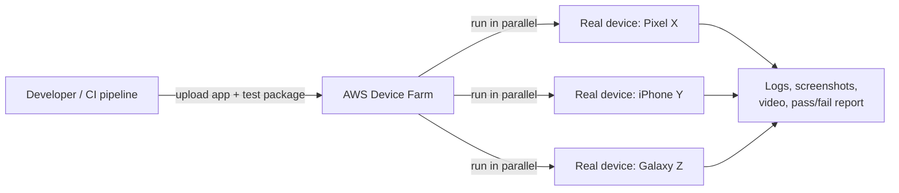

# AWS Device Farm

> **Appears in:** [SAA-C03](../../certifications/saa-c03/README.md)

## Definition

AWS Device Farm is an app-testing service that lets you test Android, iOS, and web apps on real,
physical phones and tablets hosted by AWS — either by running automated test suites across many
real devices in parallel, or by remotely controlling a single real device interactively through
your browser.

## Purpose

Mobile apps behave differently across real hardware — screen sizes, OS versions, manufacturer
customizations, chipset quirks — in ways emulators and simulators don't fully reproduce. Buying
and maintaining a physical device lab covering a meaningful spread of real-world phones/tablets
is expensive and becomes stale as new devices ship every year. Device Farm exists to let any team,
regardless of size, test against a large, continuously refreshed fleet of real devices on demand,
paying only for the testing time actually used instead of owning a hardware lab.

## How It Works

Plain-English: you upload your app package and your test suite (or use Device Farm's built-in,
script-free "Fuzz" test); Device Farm installs the app on a selection of real physical devices
in its fleet, runs the tests on each one in parallel, and returns logs, screenshots, video
recordings, and a pass/fail report per device.



Step by step:
1. **Upload your app** (an `.apk`/`.ipa`/web app URL) and your **test package** — a supported
   automated framework (Appium, Espresso, XCTest, Calabash, and others) or Device Farm's built-in,
   no-code **Fuzz test** (randomized input stress-testing to shake out crashes).
2. **Select a device pool** — either a curated/default pool spanning common real devices, or a
   custom pool you define (specific OS versions, screen sizes, manufacturers relevant to your
   user base).
3. **Device Farm runs the test suite on every device in the pool in parallel** — this is the core
   time-saving mechanism: testing against 20 real devices takes roughly as long as testing on one,
   not 20x longer.
4. **Results come back per device**: pass/fail status, full logs, screenshots at each test step,
   and a video recording of the actual run on that physical hardware — critical for debugging a
   failure that's specific to one device's screen size or OS quirk.
5. **Remote access mode** (the second usage pattern) skips automated testing entirely — you get
   real-time, interactive control of one physical device through your browser, useful for manual
   exploratory testing, reproducing a user-reported bug on their exact device model, or checking
   visual rendering by eye.
6. **CI/CD integration** — Device Farm has a CLI and direct integrations with common CI tools, so
   "upload app, run on real device fleet, fail the build on device-specific failures" becomes a
   normal pipeline stage rather than a manual QA step.

## Key Features / Components

- **Automated testing** — parallel test execution across a real device fleet, supporting Appium,
  Espresso, XCTest, UI Automator, Calabash, and raw Fuzz testing.
- **Remote access** — live, interactive browser-based control of a single real device for manual
  testing and bug reproduction.
- **Device pools** — curated default pools or custom pools scoped to specific OS versions, form
  factors, or manufacturers matching your actual user base.
- **Private devices** — the ability to reserve specific physical devices for your account's
  exclusive use (useful for devices with pre-installed custom profiles/certificates).
- **Video + screenshot capture** — every automated run records video and step-by-step screenshots,
  not just a pass/fail flag.
- **VPC connectivity for test hosts and devices** — devices/hosts can reach private endpoints
  inside your VPC, so apps hitting internal/non-public APIs can still be tested realistically.
- **Desktop browser testing** — in addition to mobile apps, Device Farm can test web apps across
  real desktop browser/OS combinations.

## Use Cases — When to Use It

- **Pre-release regression testing across real hardware.** Problem — confirm a new app build
  doesn't break on real devices before shipping to users. Why it fits — parallel runs across a
  representative device pool catch hardware-specific regressions emulators miss. Tradeoff vs
  emulator-only CI testing: emulators are faster and cheaper for everyday unit/UI testing, but
  don't catch real-GPU/real-sensor/real-OEM-skin bugs the way physical hardware does.
- **Reproducing a user-reported, device-specific bug.** Problem — a bug only happens on a
  specific phone model a developer doesn't personally own. Why it fits — Remote Access gives live
  control of that exact device model without buying one. Tradeoff vs maintaining an in-house
  device drawer: Device Farm removes the capital cost and obsolescence problem of owning the
  hardware yourself.
- **CI/CD pipeline gate before app store submission.** Problem — automatically block a release if
  it fails on a defined device matrix. Why it fits — Device Farm's CLI integrates into a build
  pipeline so this becomes a scripted gate, not manual QA. Tradeoff vs manual QA sign-off: faster
  and more consistent, but automated tests still need to be well-written to catch what a human
  tester might notice visually.
- **Screen-size / rendering verification across form factors.** Problem — confirm UI layout holds
  up on both small phones and large tablets. Why it fits — a custom device pool spanning screen
  sizes surfaces layout bugs directly. Tradeoff vs responsive-design review in a browser dev tool:
  dev-tool emulation approximates screen size but not real touch/rendering behavior.
- **Fuzz/stress testing without writing test scripts.** Problem — a small team has no time to
  write a full automated test suite but wants basic crash-hunting coverage. Why it fits — Device
  Farm's built-in Fuzz test needs zero test code. Tradeoff vs a hand-written test suite: Fuzz
  testing finds crashes from randomized input but can't verify specific business-logic
  correctness the way targeted tests can.
- **Testing apps against internal/private backend endpoints.** Problem — the app under test talks
  to an internal API inside a VPC, not a public endpoint. Why it fits — Device Farm's VPC
  connectivity lets real devices reach that private endpoint during the test run. Tradeoff vs
  exposing a test backend publicly just for testing purposes: VPC connectivity avoids that
  security tradeoff entirely.
- **Exam scenario — "test a mobile app on a wide range of real physical devices without buying and
  maintaining the hardware."** This is the direct, textbook Device Farm trigger phrase.

## When NOT to Use It / Alternatives

- **You only need fast, cheap, everyday unit/UI test runs during development** → **local emulators/
  simulators** — faster feedback loop for routine development; reserve Device Farm runs for
  pre-release gates or hardware-specific verification where emulators fall short.
- **You're testing pure backend/API logic with no device-specific UI concern** → ordinary
  integration/unit testing frameworks; Device Farm's value is specifically real-hardware mobile/
  web client behavior, not backend logic.
- **You need a permanently dedicated personal device for ongoing, exclusive development use** →
  Device Farm's "Private devices" feature covers reserved exclusive access, but if you genuinely
  need to own hardware long-term (e.g., specialized/rare devices), outright purchase may still be
  simpler than a continuous Device Farm reservation.
- **Desktop-only applications with no mobile/web-cross-browser testing need** → standard CI test
  runners on EC2/CodeBuild are a better fit; Device Farm's specific value is the real mobile
  device / real browser matrix.

## Why It's Important

**Real world:** Device fragmentation is one of the most common, hardest-to-catch-in-development
sources of mobile app bugs — a layout or crash bug that only appears on one specific manufacturer's
Android skin is nearly impossible to anticipate without testing on that actual hardware. Device
Farm turns "do we have access to that specific device" from a capital/logistics problem into an
on-demand service call.

**Exam mapping:**
- **SAA-C03** — Device Farm is a recognition-level service in the exam's front-end/mobile
  category: know what it does and that it solves "test on real devices without owning them,"
  without deep architectural depth expected.

**Expanded exam scenarios:**
- *"A mobile development team needs to validate app behavior across a wide range of real Android
  and iOS devices before release, without purchasing and maintaining a physical device lab."* →
  AWS Device Farm — the textbook trigger.
- *"QA needs to manually reproduce a bug reported on a specific phone model the team doesn't own."*
  → Device Farm's Remote Access feature specifically, not the automated-testing feature.
- *"A CI/CD pipeline should fail a build automatically if the app crashes on any device in a
  defined device matrix."* → Device Farm's CLI/CI integration, running automated tests as a
  pipeline gate.

## Pricing Model (summary)

- **Automated testing** — billed per device-minute of test execution (pay-as-you-go), or via a
  flat-rate unlimited plan for high-volume testing teams.
- **Remote access** — billed per device-minute of interactive session time.
- **Private devices** — a separate reservation fee for exclusive access to specific physical
  hardware.
- Exact current rates: https://aws.amazon.com/device-farm/pricing/

## Hands-on Lab (Floci)

**Honest limitation:** Device Farm provisions and schedules time on *real physical hardware* —
there is no way to emulate this locally or in Floci, which emulates AWS control-plane APIs, not
physical device farms. For real hands-on practice:

```bash
# Real AWS CLI shape — requires a real AWS account (Device Farm has a free trial tier)
aws devicefarm create-project --name "study-project"
aws devicefarm list-devices --query "devices[?os=='Android']"
aws devicefarm schedule-run \
  --project-arn <project-arn> \
  --app-arn <uploaded-app-arn> \
  --device-pool-arn <pool-arn> \
  --test type=APPIUM_JAVA_TESTNG_TEST_PACKAGE,testPackageArn=<test-arn>

# Local stand-in for practicing the *testing framework* itself (not the real-device fleet):
# run the same Appium/Espresso/XCTest suite against a local emulator/simulator first,
# then point the identical test package at Device Farm for the real-device run.
```

## Exam Tips

- **"Real physical devices," "device fragmentation," "without maintaining a device lab"** are the
  Device Farm trigger phrases.
- Two distinct usage modes: **automated testing** (parallel test suite runs across a device pool)
  vs **remote access** (live interactive control of one device) — a question may ask about either.
- Don't confuse with emulator/simulator-based testing (local, faster, cheaper, but not real
  hardware) — Device Farm's specific value is *real* devices.
- Device Farm sits in the same "front-end web & mobile" exam category as **Amplify** (build the
  backend) and **Pinpoint** (engage users post-launch) — know these three solve different stages
  of the mobile app lifecycle, not overlapping functions.

## Related Terms

- [`amplify.md`](amplify.md) — builds the backend/app Device Farm tests.
- [`pinpoint.md`](pinpoint.md) — engages users after the tested app ships.
- Glossary: Appium, Fuzz testing, Device pool, Remote access, Test fragmentation.
