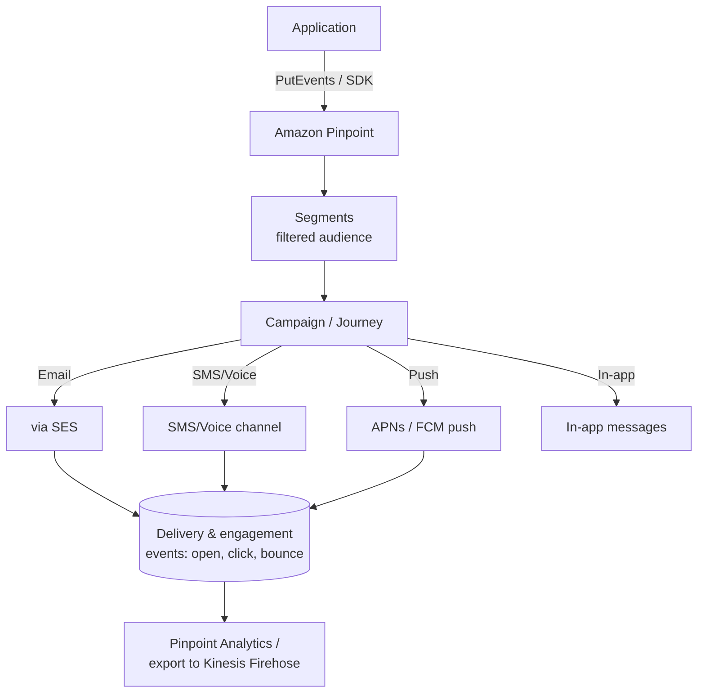

# Amazon Pinpoint

> **Appears in:** [SAA-C03](../../certifications/saa-c03/README.md)

## Definition

Amazon Pinpoint is a managed service for engaging customers through multi-channel messaging —
email, SMS, push notifications, voice, and in-app messages — with built-in audience segmentation,
campaign scheduling, and delivery/engagement analytics (opens, clicks, bounces, opt-outs) per
channel.

## Purpose

Customer engagement messaging looks simple from the outside ("send an email," "send a push
notification") but gets genuinely hard at scale: you need to segment users meaningfully (who
should get this message), avoid messaging people who opted out, track whether messages actually
delivered and whether anyone engaged, and coordinate the same campaign consistently across
multiple channels (email + SMS + push) without building five separate bespoke pipelines. Pinpoint
exists to give application teams this capability as a managed service — segmentation, delivery,
and analytics unified across channels — instead of each team wiring up SES for email, SNS for
push, a third-party SMS gateway, and a homegrown analytics pipeline to stitch the results together.

## How It Works

Plain-English: you define an audience segment (a filtered slice of your user base), create a
campaign or journey targeting that segment with a message template, and Pinpoint handles sending
across the right channel(s), then reports back delivery and engagement events.



Step by step:
1. **Your application reports user activity and attributes** to Pinpoint (via SDK or API) — this
   builds up the data Pinpoint uses to define segments, e.g. "users who haven't opened the app in
   14 days" or "users in a specific region who made a purchase last month."
2. **You define a Segment** — a filtered slice of your endpoint (user/device) data, either static
   (an imported list) or dynamic (continuously recalculated from live attributes/events).
3. **You create a Campaign** (one-time or scheduled, single message) or a **Journey** (a
   multi-step, branching, triggered sequence — e.g., "send a push notification; if not opened in
   24h, send an SMS instead") targeting that segment.
4. **Pinpoint sends through the appropriate channel** — email (via SES integration), SMS/voice
   (direct carrier integration), mobile push (via Apple APNs / Google FCM), or in-app messages
   rendered inside your own app UI.
5. **Delivery and engagement events flow back** — sends, deliveries, opens, clicks, bounces,
   complaints, and opt-outs are all tracked per channel and feed Pinpoint's built-in analytics
   dashboards, or can be streamed out to Kinesis Data Firehose for a custom data warehouse/
   Redshift pipeline.
6. **A/B testing is built into campaigns** — you can split a segment across message variants and
   let Pinpoint report which performed better before a full rollout.

### Reference architecture — resilient multi-Region Pinpoint


*Figure: AWS's own active-active reference architecture for Amazon Pinpoint — traffic is split
across two Regions under normal conditions, with delivery/engagement event data replicated so no
reporting data is lost if traffic needs to fail over entirely to one Region. Source: AWS Pinpoint
Resilient Architecture Guide (docs.aws.amazon.com/pinpoint/latest/archguide/architectures.html).*

## Key Features / Components

- **Segments** — dynamic or static filtered audiences, built from endpoint attributes and
  reported user behavior/events.
- **Campaigns** — scheduled or one-time messages to a segment across a chosen channel, with
  built-in A/B variant testing.
- **Journeys** — multi-step, branching, trigger-based messaging flows spanning multiple channels
  and conditions (e.g., wait, if/else branches based on engagement).
- **Channels** — email (via SES), SMS, voice, mobile push (APNs/FCM), and in-app messaging, all
  managed from one service.
- **Analytics dashboards** — built-in delivery, open, click, bounce, complaint, and opt-out
  metrics per channel/campaign, no separate analytics pipeline required for basic reporting.
- **Event streaming** — raw engagement events can be streamed to Kinesis Data Firehose for
  custom analysis in Redshift/S3/a data lake.
- **Endpoint targeting model** — each user/device the service can reach is an "endpoint" with
  attributes and channel-specific addresses, the core unit segments and campaigns target.

## Use Cases — When to Use It

- **Re-engagement push campaigns for an inactive mobile user base.** Problem — win back users who
  haven't opened the app recently. Why it fits — a dynamic segment ("inactive 14+ days") feeding
  a push campaign automates this without manual list-building. Tradeoff vs a hand-rolled SNS push
  job: Pinpoint adds segmentation and engagement analytics SNS alone doesn't provide.
- **Transactional + marketing email unified with SMS fallback.** Problem — ensure a critical
  notification reaches the user even if they don't check email. Why it fits — a Journey can send
  email first and branch to SMS if no engagement is detected within a window. Tradeoff vs
  separate SES + a third-party SMS tool: Pinpoint coordinates both from one place with shared
  segment/event data.
- **A/B testing message copy or send time before a full campaign rollout.** Problem — determine
  which of two subject lines or push copy variants performs better. Why it fits — Pinpoint
  campaigns have built-in A/B variant splitting and reporting. Tradeoff vs manually splitting
  the audience and tracking results in a spreadsheet: Pinpoint automates the split and the
  comparison reporting.
- **Behavior-triggered onboarding journeys.** Problem — guide a new user through a multi-step
  onboarding sequence that adapts based on what they do (or don't do). Why it fits — Journeys
  support branching logic keyed on user events/engagement, not just a fixed drip schedule.
  Tradeoff vs a fixed-schedule email drip: Journeys cost more setup complexity but adapt to real
  user behavior instead of a one-size-fits-all timeline.
- **Centralizing delivery/engagement analytics across channels for reporting.** Problem — product
  and marketing teams want unified open/click/bounce metrics across email, SMS, and push in one
  place. Why it fits — Pinpoint's analytics dashboard already unifies this per campaign/channel.
  Tradeoff vs building a custom analytics pipeline from each channel's raw logs: much faster to
  get basic reporting, less flexible than a fully custom warehouse model (mitigated by event
  streaming to Firehose for teams that need that flexibility).
- **Location/geofence-triggered marketing messages (retail).** Problem — notify a customer with a
  relevant offer when they enter a geofenced area near a store. Why it fits — Pinpoint integrates
  with Amazon Location Service-driven geofence events to trigger targeted campaigns. Tradeoff vs
  a fully custom event pipeline: Pinpoint's built-in campaign/segment model handles the messaging
  side once the geofence event fires, so only the location-detection piece needs separate work.
- **Exam scenario — "send targeted push notifications/SMS/email to a segmented user base and
  track engagement" is the direct Pinpoint trigger** across any SAA-C03 scenario naming customer
  engagement, marketing campaigns, or multi-channel notifications with analytics.

## When NOT to Use It / Alternatives

- **Simple, unsegmented, one-off transactional email** (password reset, order confirmation) →
  **Amazon SES** directly is simpler and cheaper; Pinpoint's segmentation/campaign/analytics layer
  is overhead you don't need for a single templated transactional send.
- **Simple pub/sub fan-out push notifications with no segmentation or analytics need** → **Amazon
  SNS** mobile push directly is lighter-weight; reach for Pinpoint when you need audience
  targeting and engagement tracking, not just "send this message to this device token."
- **You need a fully custom, bespoke customer data platform with engagement logic beyond what
  Journeys support** → a custom pipeline (Kinesis + Lambda + your own rules engine) gives full
  control, at the cost of building what Pinpoint already provides out of the box.
- **Purely internal/operational alerting (not customer-facing)** → **SNS** or **CloudWatch
  Alarms + SNS** — Pinpoint is built for customer engagement, not ops alerting.

## Why It's Important

**Real world:** Fragmented, uncoordinated messaging across channels is a common source of both
poor user experience (duplicate or conflicting messages) and compliance risk (failing to honor
opt-outs consistently across channels). Pinpoint's unified endpoint/segment/opt-out model reduces
both risks by centralizing the logic in one service rather than five independent ones.

**Exam mapping:**
- **SAA-C03** — Pinpoint is a recognition-level service in the front-end/mobile and application-
  integration space: know it's the multi-channel customer engagement and analytics service,
  distinct from SES (plain email) and SNS (plain pub/sub push/notifications).

**Expanded exam scenarios:**
- *"A company wants to send targeted marketing push notifications to users who haven't opened the
  app in two weeks, and track open/click rates."* → Amazon Pinpoint — segmentation + campaign +
  analytics, the full trigger combination.
- *"A question asks for the simplest way to send a single transactional confirmation email with
  no segmentation or analytics requirement."* → This is a trap pointing to **SES** directly, not
  Pinpoint — recognize when the simpler, cheaper service is the better-fit answer.
- *"A mobile app needs a multi-step onboarding flow that sends different messages depending on
  whether the user completed a prior step."* → Pinpoint Journeys — the branching-logic trigger.

## Pricing Model (summary)

- **Per-message/channel pricing** — billed per email, SMS, voice message, or push notification
  sent, with rates varying by channel and destination (SMS pricing varies significantly by
  country/carrier).
- **Monthly active endpoints** — some usage dimensions are billed per monthly targeted/active
  endpoint, separate from the per-message channel costs.
- Exact current rates: https://aws.amazon.com/pinpoint/pricing/

## Hands-on Lab (Floci)

**Honest limitation:** Pinpoint is **not** in Floci's supported-services table — its segmentation,
campaign, and journey engine is control-plane logic with no widely used local emulator. The
commands below show the real CLI shape for muscle memory; use a real AWS account's Pinpoint free
tier for actual hands-on campaign-building practice.

```bash
# Real AWS CLI shape — try against Floci, expect "not implemented"
awslocal pinpoint create-app --create-application-request Name=study-pinpoint-app

# Real AWS CLI shape against a genuine AWS account (Pinpoint has a usable free tier):
aws pinpoint create-app --create-application-request Name=study-pinpoint-app
aws pinpoint create-segment --application-id <app-id> \
  --write-segment-request '{"Name":"InactiveUsers","Dimensions":{"Behavior":{"Recency":{"Duration":"DAY_14","RecencyType":"INACTIVE"}}}}'
aws pinpoint create-campaign --application-id <app-id> \
  --write-campaign-request '{"Name":"ReengagementPush","SegmentId":"<segment-id>","Schedule":{"StartTime":"IMMEDIATE"},"MessageConfiguration":{"DefaultMessage":{"Body":"We miss you!"}}}'
```

## Exam Tips

- **"Segmented," "multi-channel campaign," "engagement analytics," "push/SMS/email together"**
  are Pinpoint trigger phrases.
- Distinguish from **SES** (plain transactional/bulk email sending, no built-in segmentation/
  analytics layer) and **SNS** (plain pub/sub push/fan-out, no segmentation or campaign concept) —
  Pinpoint sits a layer above both, orchestrating *when and to whom*, often using SES/mobile push
  services underneath for the actual channel delivery.
- **Journeys** = branching, multi-step, trigger-based flows; **Campaigns** = simpler one-time or
  scheduled single-message sends to a segment — know which term a question is actually describing.
- Sits in the same exam category as **Amplify** (build the app) and **Device Farm** (test the
  app) — Pinpoint is specifically the post-launch user engagement piece.

## Related Terms

- [`amplify.md`](amplify.md) — builds the app whose users Pinpoint engages.
- [`device-farm.md`](device-farm.md) — tests the app before the audience Pinpoint reaches ever sees it.
- Glossary: Segment, Campaign, Journey, Endpoint, Opt-out, A/B testing.
