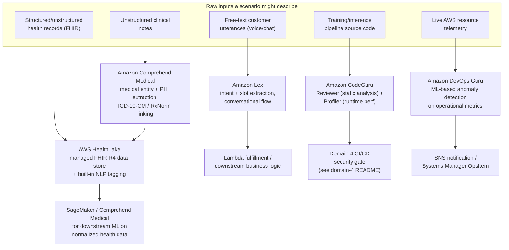
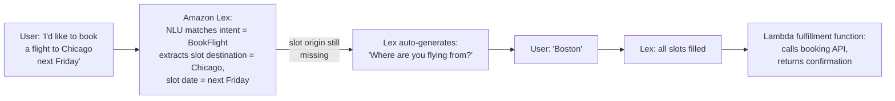
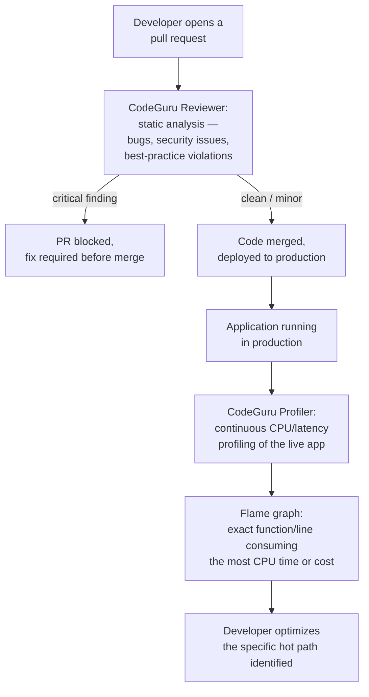
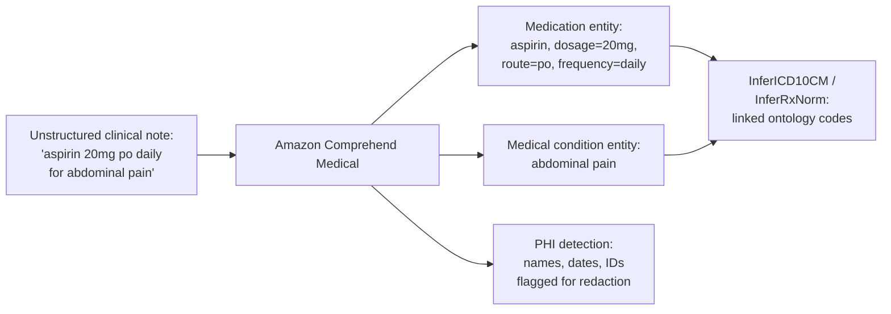
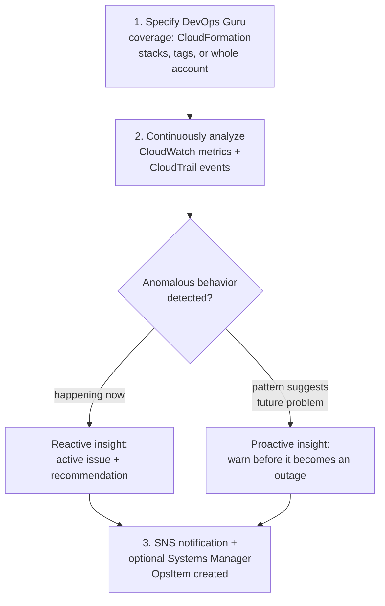
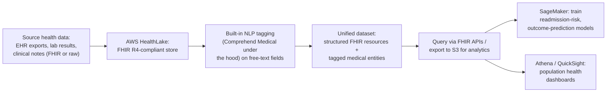

# Additional AI/AI-Adjacent Services for MLA-C02 (Lex, CodeGuru, Comprehend Medical, DevOps Guru, HealthLake)

> **Appears in:** [MLA-C02](../../certifications/mla-c02/README.md) only — confirmed **not** in
> scope for [SAA-C03](../../certifications/saa-c03/README.md) or
> [DVA-C03](../../certifications/dva-c03/README.md) per those exams' own published appendices.

This doc consolidates five ML/AI-category services confirmed in the official MLA-C02 exam guide
appendix that had **zero or only passing coverage** elsewhere in this repo: **Amazon Lex**
(conversational AI/chatbots), **Amazon CodeGuru** (ML-powered code review and profiling —
already referenced from Domain 4's CI/CD security content, but with no dedicated doc of its
own), **Amazon Comprehend Medical** (clinical-text NLP), **Amazon DevOps Guru** (ML-powered
operations anomaly detection), and **AWS HealthLake** (managed FHIR health-data store). None of
these is a "deep configuration" exam topic the way SageMaker or Bedrock are — the exam tests
whether you can **recognize the right pre-built AI service from a scenario's keywords**, not
configure any of them in depth. Each gets a lighter format: definition, purpose, one concrete
use case, and the exam-trigger phrasing to recognize.

## Where these five fit in the MLA-C02 universe

Step by step: a scenario's **raw input shape** is the fastest way to identify which of these
five services is being tested. Conversational text from a user → Lex. Source code or a running
application's performance → CodeGuru. Unstructured clinical notes → Comprehend Medical.
Operational telemetry from live AWS resources → DevOps Guru. Structured or unstructured health
records that need a durable, standards-compliant store → HealthLake. The exam rarely asks you to
chain all five together, but it does expect you to immediately rule out the other four once you
recognize the input shape in a given question.

---

## Amazon Lex

### Definition
Amazon Lex is a fully managed service for building conversational interfaces — chatbots and
voice assistants — using the same deep-learning-based natural language understanding (NLU) and
automatic speech recognition (ASR) technology that powers Amazon Alexa. You define **intents**
(what the user wants to do, e.g., "BookFlight"), **slots** (the pieces of information needed to
fulfill that intent, e.g., `origin`, `destination`, `date`), and **sample utterances** (example
phrasings of each intent); Lex handles matching free-form user input to the right intent,
extracting slot values from natural phrasing, and managing the back-and-forth dialogue needed to
fill in any slots the user didn't provide up front.

### Purpose
Building a chatbot from scratch means solving natural language understanding (what does the user
actually want, from messy, varied phrasing), slot-filling dialogue management (what questions to
ask next if required information is missing), and speech recognition (if voice is involved) —
each a deep ML problem in its own right. Lex exists so an application team can define *what* the
bot needs to accomplish (intents and slots) and let AWS handle the NLU/ASR modeling underneath,
the same way Rekognition lets a team skip building their own computer-vision model from scratch.

### Use Case
An airline wants a customer-facing chatbot on its website and mobile app that can handle "book a
flight," "check flight status," and "change a reservation" requests in natural language, without
forcing users through a rigid menu tree. Lex intents model each of those three tasks, slots
capture the specific details (flight number, new date, passenger name), and a Lambda fulfillment
function attached to each intent calls the airline's actual booking backend once Lex has
collected everything it needs — with Lex handling every variation of how a real user might phrase
"I need to change my flight" without the airline's team writing any NLU code themselves.

### Exam Tip
**"Build a chatbot," "conversational interface," "voice assistant," "natural language intent
recognition with slot filling"** → Amazon Lex. The exam-relevant distinction from **Bedrock
Agents**: Lex is built specifically for structured, intent/slot-driven conversational flows
(a fixed, enumerable set of things a user can ask for); Bedrock Agents are built for open-ended,
foundation-model-driven reasoning that can call arbitrary tools and handle requests that don't
map cleanly to a predefined intent list. A scenario describing a small, well-defined set of
customer-service tasks (book, cancel, check status) with voice/IVR integration points at Lex; a
scenario describing an agent that needs to reason through multi-step, open-ended requests points
at Bedrock Agents instead.

---

## Amazon CodeGuru

### Definition
Amazon CodeGuru is an ML-powered developer tool with two distinct halves: **CodeGuru Reviewer**
performs automated static analysis on your source code (Java and Python) to flag potential bugs,
security vulnerabilities, and deviations from AWS best practices, trained on millions of lines of
code from Amazon's own codebase and open-source repositories; **CodeGuru Profiler** analyzes a
*running* application's CPU/latency behavior in production to pinpoint exactly which lines of
code are consuming the most resources, without you needing to reproduce the issue in a test
environment.

### Purpose
Two very different problems get conflated under "code quality": catching defects *before* they
ship (a code-review problem, solved by Reviewer) and finding *why a running application is slow
or expensive* (a runtime-profiling problem, solved by Profiler). Both are traditionally manual,
expertise-heavy, and easy to skip under deadline pressure — a human reviewer misses a subtle
thread-safety bug, or nobody profiles production until a cost or latency complaint forces the
issue. CodeGuru exists to make both continuous and automatic rather than occasional and
manual — this repo's Domain 4 content already covers CodeGuru Reviewer as a CI/CD security gate
(see `certifications/mla-c02/domain-4-monitoring-security/README.md`'s "Securing ML/AI CI/CD
Pipelines" section); this doc is CodeGuru's first dedicated, standalone treatment covering both
halves together.

### Use Case
A fintech's ML platform team runs a shared CI/CD pipeline for every SageMaker training and
inference script. CodeGuru Reviewer is wired into every pull request, automatically flagging a
hardcoded credential a developer accidentally left in an inference script — catching it before
the container is even built, let alone deployed. Separately, once a real-time inference endpoint
is live, CodeGuru Profiler runs continuously against it and surfaces a flame graph showing that
60% of CPU time is spent in a redundant JSON re-serialization step inside the request-handling
loop — a fix the team would otherwise have had to discover by hand-instrumenting the running
service during a cost investigation.

### Exam Tip
**"Automated code review flagging bugs/security issues before merge"** → CodeGuru **Reviewer**.
**"Find which specific line of code is consuming the most CPU/cost in a running application,
without reproducing the issue locally"** → CodeGuru **Profiler**. These are the two separate
halves of one service name — a question naming "CodeGuru" generically is usually really asking
about one specific half, and recognizing *which* half (pre-merge static analysis vs. production
runtime profiling) from the scenario's phrasing is the actual tested skill. Don't confuse
Profiler with **X-Ray**: X-Ray traces *between* services and timing across a distributed request
path; Profiler does in-process CPU/latency profiling *within* one running application — see
`../developer-tools/x-ray.md` for that explicit contrast.

---

## Amazon Comprehend Medical

### Definition
Amazon Comprehend Medical is a HIPAA-eligible natural language processing service purpose-built
to extract structured medical information from unstructured clinical text — physician's notes,
discharge summaries, clinical trial reports, insurance claims — identifying medical conditions,
medications (with dosage/frequency/route), anatomy, test results, and protected health
information (PHI), and optionally linking detected entities to standard medical ontology codes
(**ICD-10-CM** for diagnoses, **RxNorm** for medications).

### Purpose
Clinical text is written by clinicians for other clinicians, dense with domain-specific
shorthand, abbreviations, and structure (dosage/frequency/route patterns) that a general-purpose
NLP service (plain Amazon Comprehend) isn't tuned to parse reliably. Before Comprehend Medical,
extracting structured data from clinical notes meant either expensive manual chart abstraction by
trained medical coders, or building/maintaining a custom medical NLP model in-house — both slow
and specialist-dependent. Comprehend Medical exists to make that extraction a managed API call,
pre-trained specifically on clinical language patterns.

### Use Case
A hospital network wants to automate medical coding — assigning standardized ICD-10-CM diagnosis
codes to each patient encounter based on the physician's free-text notes, a task normally done by
trained human coders reading each note line by line. Comprehend Medical's `InferICD10CM` API
extracts medical conditions directly from the note text and returns candidate ICD-10-CM codes
with confidence scores and the exact text evidence supporting each one, which coders then review
and confirm rather than deriving from scratch — cutting coding time while keeping a human in the
loop for the final determination, which matters because this directly affects billing and
compliance.

### Exam Tip
**"Extract medical entities/medications/diagnoses from clinical text," "ICD-10-CM coding from
physician notes," "detect PHI in unstructured health records"** → Amazon Comprehend Medical.
Distinguish from plain **Amazon Comprehend** (general-purpose entity/sentiment/PII detection, not
tuned for clinical shorthand and dosage patterns) and from **AWS HealthLake** (a durable FHIR data
*store*, not an NLP extraction engine — HealthLake commonly uses Comprehend Medical internally to
tag/extract entities from unstructured text fields it stores, but they solve different problems:
storage/interoperability vs. extraction). A scenario describing "store structured health records
long-term in FHIR format" is HealthLake; "pull medical entities out of this block of free text" is
Comprehend Medical — they're frequently paired, not interchangeable.

---

## Amazon DevOps Guru

### Definition
Amazon DevOps Guru is a fully managed operations service that uses machine learning to
continuously analyze CloudWatch metrics, AWS CloudTrail events, and (optionally) CodeDeploy
deployment events across your AWS resources, automatically detecting anomalous operational
behavior and surfacing it as an **insight** — a bundle of related anomalies, a specific
recommendation for how to fix it, and the metrics/events/logs that justify the finding — without
you having to hand-configure a single CloudWatch alarm threshold yourself.

### Purpose
Traditional operational monitoring requires a human to decide, in advance, what "normal" looks
like for every metric and set a threshold alarm accordingly — brittle, because normal behavior
shifts over time (traffic grows, usage patterns change), and threshold alarms either fire too
often (alert fatigue) or miss a genuinely new kind of problem nobody thought to alarm on. DevOps
Guru exists to replace manually-tuned thresholds with ML-learned baselines of normal behavior per
resource, catching both **reactive** anomalies (something is wrong right now) and **proactive**
insights (a pattern suggesting a problem is likely *before* it becomes a full outage).

### Use Case
A media company's platform team runs dozens of microservices and can't realistically hand-tune
CloudWatch alarm thresholds for every metric on every service. DevOps Guru, scoped to the
account's CloudFormation-managed resources, learns each resource's normal operational baseline
and flags a reactive insight when a specific Lambda function's error rate spikes well outside its
learned-normal range — correlating that spike with a CloudTrail-logged configuration change made
minutes earlier, pointing the on-call engineer straight at the likely cause instead of a blind
metrics search across dozens of services.

### Exam Tip
**"ML-based anomaly detection across AWS operational metrics with no manually-configured
thresholds," "automatically correlate an anomaly with a related deployment/config change"** →
Amazon DevOps Guru. Distinguish from **CloudWatch Alarms** (you define the threshold yourself,
DevOps Guru learns it) and from **X-Ray** (X-Ray traces one request's path across services;
DevOps Guru analyzes aggregate operational metrics/events for anomalies, not individual request
traces). For MLA-C02 specifically, expect DevOps Guru framed as one layer of Domain 4's
operational-health monitoring, complementary to (not a replacement for) SageMaker Model Monitor,
which watches model-specific data/concept drift rather than general AWS infrastructure health.

---

## AWS HealthLake

### Definition
AWS HealthLake is a HIPAA-eligible managed service that stores, transforms, and queries health
data at petabyte scale using the **FHIR R4** (Fast Healthcare Interoperability Resources)
standard — the industry-standard format for electronic health records — automatically tagging
unstructured clinical text fields within that data with structured medical entities (using
Comprehend Medical's NLP under the hood) so the resulting dataset is both standards-compliant for
interoperability *and* ML/analytics-ready, without a separate manual normalization step.

### Purpose
Health data arrives from many systems (EHRs, lab systems, imaging systems) in a mix of structured
fields and dense unstructured free text, and healthcare interoperability specifically requires
conforming to the FHIR standard so different systems (a hospital's EHR, an insurer's claims
system, a research dataset) can exchange and query the same data consistently. Before HealthLake,
a team needed to both stand up FHIR-compliant storage themselves *and* separately run NLP over
the unstructured portions to make them queryable — two separate, specialist-heavy engineering
efforts. HealthLake exists to make both a single managed service: ingest data in FHIR format (or
transform it into FHIR), and get back a dataset where free-text fields are also tagged with
structured, queryable medical entities.

### Use Case
A regional hospital network wants to train a readmission-risk model but its patient data is
scattered across an EHR system (structured FHIR-ish records) and years of unstructured discharge
notes that were never normalized into a queryable format. HealthLake ingests both, storing the
structured FHIR resources natively and automatically tagging medical entities (conditions,
medications, PHI) inside the unstructured discharge notes — producing one unified, queryable
dataset that a downstream SageMaker training job can pull features from, without the hospital's
data team hand-building a FHIR-compliant store or running separate NLP extraction themselves.

### Exam Tip
**"FHIR-compliant health data store," "normalize/query structured and unstructured health records
together," "HIPAA-eligible health data repository feeding ML training"** → AWS HealthLake. The
exam-relevant layering to remember: HealthLake is the **storage and interoperability** layer;
**Comprehend Medical** is the **extraction** engine HealthLake uses internally on free-text
fields; **SageMaker** is where a model actually gets trained on the resulting data. A scenario
naming all three together is describing one coherent pipeline (store in FHIR → auto-tag entities
→ train a model), not three competing, interchangeable choices for the same step.

---

## Official AWS reference screenshots

*An Amazon Lex V2 bot's conversational flow integrated with a retrieval backend. Source: AWS
Lex V2 Developer Guide, [Call center agent
assistant](https://docs.aws.amazon.com/ru_ru/lexv2/latest/dg/example-call-center.md). © Amazon
Web Services.*

*Starting a full-repository CodeGuru Reviewer analysis from the console — the same analysis type
that runs automatically on the first association with a repository. Source: AWS CodeGuru
Reviewer User Guide, [Create code reviews](https://docs.aws.amazon.com/codeguru/latest/reviewer-ug/create-code-reviews.html).
© Amazon Web Services.*

*Enabling DevOps Guru coverage directly from the RDS console at cluster-creation time — one of
several ways to opt resources into DevOps Guru's ML-based anomaly analysis. Source: AWS Aurora
User Guide, [Analyzing Aurora performance anomalies with Amazon DevOps Guru for Amazon
RDS](https://docs.aws.amazon.com/AmazonRDS/latest/AuroraUserGuide/devops-guru-for-rds.html).
© Amazon Web Services.*

*AWS's own reference architecture showing HealthLake as the durable FHIR storage destination at
the center of a healthcare data interoperability pipeline. Source: AWS Reference Architecture
Diagrams, [Healthcare Interoperability Stack on
AWS](https://docs.aws.amazon.com/reference-architecture-diagrams/latest/healthcare-interoperability-stack/healthcare-interoperability-stack.html).
© Amazon Web Services.*

## Why These Five Matter for the Exam

**Real-world:** each of these five solves a genuinely different, narrow problem well — a
chatbot's NLU, catching code defects before they ship, extracting structure from clinical text,
learning what "normal" operations look like without manual tuning, and storing health data in a
standards-compliant, ML-ready form. None of them requires deep architectural decisions the way
SageMaker deployment choices or Bedrock model selection do; the practical skill is recognizing
*which* narrow problem a scenario describes and reaching for the matching pre-built service
instead of trying to build a custom solution with a more general-purpose tool.

**Exam mapping:**
- **Amazon Lex** — appears under the ML/AI services category in the MLA-C02 appendix as a
  pre-built AI service; expect it in scenario questions about customer-facing conversational
  interfaces, contrasted against Bedrock Agents for open-ended reasoning tasks.
- **Amazon CodeGuru** — explicitly named in Domain 4's new task statement 4.3.1 ("Secure ML/AI
  CI/CD pipelines"), covered in depth from the operational-security angle in
  `certifications/mla-c02/domain-4-monitoring-security/README.md`; this doc adds the standalone
  service-level depth (both Reviewer and Profiler) that a dedicated service page provides.
- **Amazon Comprehend Medical** — a named pre-built AI service for the specific vertical of
  clinical/healthcare text, relevant to any scenario involving medical notes, clinical trial data,
  or healthcare compliance (PHI detection).
- **Amazon DevOps Guru** — a named pre-built AI service for ML-driven operations monitoring,
  complementary to SageMaker Model Monitor (which watches model drift specifically, not general
  AWS resource health) in Domain 4's "operate, monitor, secure" picture.
- **AWS HealthLake** — a named pre-built AI/analytics service for the healthcare-data storage and
  interoperability problem specifically, commonly paired with Comprehend Medical and SageMaker in
  a healthcare ML pipeline scenario.

## Further Reading

- [What Is Amazon Lex?](https://docs.aws.amazon.com/lexv2/latest/dg/what-is.html)
- [How Amazon CodeGuru Reviewer works](https://docs.aws.amazon.com/codeguru/latest/reviewer-ug/how-codeguru-reviewer-works.html)
- [Amazon CodeGuru Profiler — What is Amazon CodeGuru Profiler?](https://docs.aws.amazon.com/codeguru/latest/profiler-ug/what-is-codeguru-profiler.html)
- [What is Amazon Comprehend Medical?](https://docs.aws.amazon.com/comprehend-medical/latest/dev/comprehendmedical-welcome.html)
- [How does DevOps Guru work?](https://docs.aws.amazon.com/devops-guru/latest/userguide/how-it-works.html)
- [What is AWS HealthLake?](https://docs.aws.amazon.com/healthlake/latest/devguide/what-is.html)

## Related Terms

- [`ai-services-overview.md`](ai-services-overview.md) — the umbrella doc for pre-built AI
  services; this doc's five services slot into that same "don't build it yourself" category.
- [`fraud-detector-and-kendra.md`](fraud-detector-and-kendra.md) — the SAA-C03-scoped sibling
  doc covering two other pre-built AI services with the same lighter, consolidated format.
- [`bedrock.md`](bedrock.md) — the generative-AI service Lex's intent-driven model is
  increasingly contrasted against in scenario questions about open-ended conversational agents.
- [`../developer-tools/x-ray.md`](../developer-tools/x-ray.md) — the distributed-tracing service
  CodeGuru Profiler is most often confused with; see that doc's explicit contrast.
- [`../../certifications/mla-c02/domain-4-monitoring-security/README.md`](../../certifications/mla-c02/domain-4-monitoring-security/README.md)
  — Domain 4's CI/CD security section, where CodeGuru is already covered from the operational
  angle.
- Glossary: Intent, Slot, FHIR, PHI (Protected Health Information), Insight (DevOps Guru),
  Flame graph.
