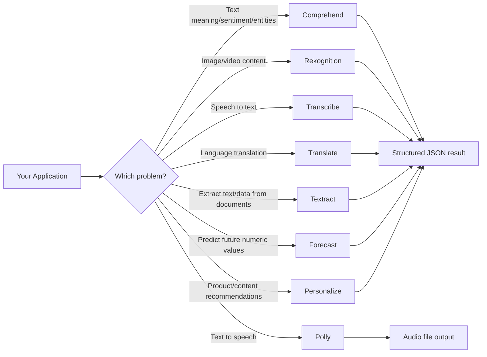

# AWS Pre-Built AI Services — Overview


## Definition

These are AWS's "AI as an API" services: each one does one specific intelligence task (read
text out of an image, understand what language a sentence expresses, detect a face, translate
a sentence, forecast a number, recommend a product) and you call it with a single API request —
no model training, no data science team, no infrastructure. You send data in, a trained-by-AWS
model does the work, you get a structured result back.

## Purpose

Most companies don't need a custom ML model for "can this image contain a stop sign" or "is this
customer review positive or negative" — these are common, well-understood problems that AWS has
already solved extremely well with its own models, trained on massive datasets, continuously
improved by AWS itself. Building and maintaining a custom version of any of these in-house would
be slower, more expensive, and almost certainly less accurate than what AWS already offers as an
API. These services exist so that a regular application developer — not a data scientist — can
add real AI capability to a product in an afternoon.

## How It Works

Plain-English: all eight of these services share the same basic shape — you send data (an
image, an audio file, a block of text, historical numbers) to an API endpoint, AWS's managed
model (which you never see or touch) processes it, and you get back structured JSON. The
difference between them is purely *which kind of data* and *which kind of output*.



Step by step:
1. Your application decides which capability it needs and calls the matching service's API
   (synchronously for quick jobs, asynchronously for long-running ones like batch video
   analysis or large documents).
2. The service's AWS-managed, pre-trained model processes the input — none of these require you
   to provide training data to get useful baseline results (though some, like Comprehend and
   Personalize, support optional custom training on your own data for better domain fit).
3. You get back a structured result: JSON with scores/labels/entities for most of them, or an
   audio file for Polly.
4. Your application uses that result directly — no model hosting, scaling, or monitoring is your
   responsibility; AWS owns all of that behind the API.

## Comparison Table — What Each One Does, When to Use It

| Service | What it does | Input | Typical use case | Don't use it for |
|---|---|---|---|---|
| **Comprehend** | Natural language understanding: sentiment, entities (people/places/orgs), key phrases, language detection, PII detection, topic modeling, custom text classification | Text | Analyzing customer reviews/support tickets for sentiment and topics; redacting PII from documents | Generating new text, summarizing, chatting (use Bedrock) |
| **Rekognition** | Computer vision: object/scene detection, face detection & comparison, text-in-image (basic), content moderation, celebrity recognition, video analysis | Image / Video | Content moderation on user uploads; detecting objects/people in security footage; comparing two faces for identity verification | Reading structured documents/forms (use Textract instead — it's purpose-built for that) |
| **Transcribe** | Speech-to-text, with speaker labeling (diarization), custom vocabulary, PII redaction in transcripts | Audio | Call-center transcription and analytics; generating captions/subtitles | Understanding the *meaning* of the transcript (pair it with Comprehend) |
| **Translate** | Neural machine translation between languages | Text | Localizing UI/content, translating support tickets in real time | Translating speech directly (chain Transcribe → Translate → Polly for that) |
| **Textract** | Extract text, forms (key-value pairs), and tables from scanned documents/images, with layout awareness | Image / PDF | Automating invoice/receipt processing, extracting data from ID documents, digitizing paper forms | General photo understanding (use Rekognition); simple printed-text-only OCR where layout doesn't matter (either works, Textract is still usually the better choice for documents) |
| **Polly** | Text-to-speech with lifelike voices, SSML control, multiple languages/voices | Text | Voice assistants, accessibility (read-aloud), IVR phone systems | Real-time conversational voice AI with reasoning (pair Polly with Bedrock/Lex for that) |
| **Forecast** | Time-series forecasting (demand, inventory, financial metrics) using built-in algorithms tuned for forecasting | Historical numeric time-series data | Retail demand planning, inventory forecasting, workforce scheduling | One-off, non-time-series predictions (use SageMaker built-in algorithms or Bedrock as appropriate) |
| **Personalize** | Real-time recommendation engine (product recs, personalized rankings, similar items) trained on your interaction data | User interaction history | E-commerce product recommendations, personalized content ranking/search re-ranking | Cold-start scenarios with zero interaction history (needs some data to personalize against) |

## Key Features / Components

- **Comprehend Medical** — a specialized variant for extracting medical information (conditions,
  medications, dosages) from clinical text, with HIPAA-eligible handling.
- **Rekognition Custom Labels** — train a custom object/scene detector on your own images when
  the built-in categories aren't specific enough (e.g., detecting a specific product defect).
- **Transcribe Medical** — specialized medical speech-to-text with clinical vocabulary.
- **Translate Active Custom Translation** — improve translation quality using your own parallel
  text examples without full model training.
- **Textract Queries** — ask a specific natural-language question against a document ("What's
  the invoice total?") instead of extracting everything and parsing it yourself.
- **Forecast's built-in algorithms** — AutoML-style automatic algorithm selection (CNN-QR,
  DeepAR+, Prophet, ARIMA, ETS) based on your data's characteristics.
- **Personalize recipes** — pre-built algorithm templates (user-personalization, similar-items,
  personalized-ranking) you select based on your use case rather than building from scratch.

## Use Cases — When to Use It

- You need a specific, well-defined intelligence capability (sentiment, OCR, translation, facial
  comparison, recommendations, forecasting) and the AWS-trained general model is accurate enough
  for your domain — just call the API.
- Your team doesn't have ML expertise and needs AI capability fast, with no model lifecycle to
  manage.
- You need the specific regulatory/compliance posture these services offer for sensitive data
  (e.g., Comprehend Medical/Transcribe Medical for healthcare contexts).
- You want predictable per-request/per-unit pricing without worrying about hosting costs.

## When NOT to Use It / Alternatives

- **Your problem is genuinely novel or highly domain-specific** and the pre-built models don't
  perform well enough even with the available customization options (Custom Labels, Active
  Custom Translation) — train a custom model on SageMaker instead.
- **You need open-ended generative capability** (write new content, hold a conversation, reason
  across documents) — none of these services generate open-ended text; that's Bedrock's job, not
  Comprehend's or any AI service here.
- **You need the absolute lowest per-unit cost at very high constant volume** and have ML
  expertise — a self-trained, self-hosted model might eventually be cheaper than per-request AI
  service pricing at extreme scale, though you give up the zero-maintenance benefit.
- **Personalize/Forecast with no historical data** — both need a meaningful amount of historical
  interaction/time-series data to produce good results; a cold-start product with zero history
  won't get much value from either yet.

## Why It's Important

**Real-world:** These services are frequently the fastest, cheapest, most accurate path to
adding "AI" to a product — reaching for SageMaker or Bedrock when one of these already solves
the exact problem is a common, costly overengineering mistake. Knowing the full roster well
enough to instantly recognize "this is a Textract problem, not a Rekognition problem" (or vice
versa) is a genuinely useful day-to-day engineering skill, not just exam trivia.

**Exam weight (MLA-C02):** These appear across **Domain 1** (as alternatives/complements to
custom data prep — e.g., using Comprehend for text classification instead of training your own),
**Domain 2** (as an alternative to custom model development — "is a pre-built AI service
sufficient, or do we need to train something?" is a very common scenario-question framing), and
**Domain 3** (these services themselves are already deployed/managed by AWS, so questions often
test recognizing when you *don't* need your own deployment infrastructure at all). MLA-C02
expects you to correctly triage: pre-built AI service vs. SageMaker custom model vs. Bedrock
foundation model, for a given scenario.

**DVA-C03 relevance:** Lightly in scope — a developer-exam question might ask you to call one of
these APIs (e.g., Textract to process an uploaded document, Translate to localize content) as
part of "Development with AWS Services" (Domain 1), with no expectation of knowing internal
model mechanics — just correct API usage and IAM permissions.

## Pricing Model (summary)

All are consumption-based with no infrastructure to provision:
- **Comprehend** — per unit of text processed (per 100 characters for most operations).
- **Rekognition** — per image processed, or per minute of video analyzed.
- **Transcribe** — per second/minute of audio processed.
- **Translate** — per character translated.
- **Textract** — per page processed (rate varies by operation: text detection vs. forms vs.
  tables vs. queries).
- **Polly** — per character of text converted to speech.
- **Forecast** — per forecast generated plus a training-time component for custom predictors.
- **Personalize** — per training hour plus per recommendation request (TPS-based) for real-time
  inference, plus batch inference job pricing.
- All have a free tier for initial experimentation (specifics change — check the official
  pricing page per service): https://aws.amazon.com/machine-learning/ (links to each service's
  pricing page).

## Hands-on Lab (Floci)

Floci does not emulate these AI services' inference APIs (they're managed model endpoints, not
open control-plane shapes Floci replicates). Use:

**Option A — Real AWS free tier:** most of these services have a genuine always-free monthly
tier (e.g., Comprehend's free tier covers several thousand text units/month) small enough to
experiment with at zero cost on a real AWS account.

**Option B — Local equivalents using open-source libraries, to build intuition for each
capability without any AWS account:**
```bash
pip install textblob pytesseract pillow
python3 - <<'EOF'
# Comprehend-style sentiment, done locally with TextBlob (NOT the same model/accuracy as AWS,
# but the same conceptual task — useful for understanding input/output shape)
from textblob import TextBlob
text = "The AWS documentation was surprisingly clear and helpful."
blob = TextBlob(text)
print("Sentiment polarity (-1 negative to +1 positive):", blob.sentiment.polarity)
EOF
```
For a Textract-style OCR stand-in, `pytesseract` (wrapping the open-source Tesseract OCR engine)
run against a local image demonstrates the same "extract text from an image" task shape, though
Textract's layout-aware form/table extraction goes well beyond what plain OCR does.

**Option C — stage input files in S3 against Floci + dry-run the real CLI calls:**
```bash
awslocal s3 mb s3://ai-services-demo
awslocal s3 cp invoice.pdf s3://ai-services-demo/
# Real AWS CLI calls you'd run against actual AWS (NOT executable against Floci):
# aws textract analyze-document --document '{"S3Object":{"Bucket":"ai-services-demo","Name":"invoice.pdf"}}' --feature-types '["FORMS","TABLES"]'
# aws comprehend detect-sentiment --text "The AWS documentation was helpful." --language-code en
# aws translate translate-text --text "Hello, world" --source-language-code en --target-language-code es
```

See `certifications/mla-c02/domain-2-model-development/labs.md`.

## Exam Tips

- Build a mental triage: "pre-built AI service already does this exact thing" → use it directly,
  don't train anything custom; this is the most common correct answer pattern for these
  services' exam questions.
- Textract vs. Rekognition is a classic confusion: Textract = structured documents/forms/tables
  with layout awareness; Rekognition = general image/video content (objects, faces, scenes,
  moderation) — Textract for "read this invoice," Rekognition for "what's in this photo."
- Forecast vs. Personalize: Forecast = predicting a *number over time* (demand, sales);
  Personalize = predicting *what a specific user wants* (recommendations/ranking) — different
  axis entirely despite both being "prediction."
- Comprehend vs. Bedrock for text: Comprehend classifies/extracts/scores existing text;
  Bedrock *generates* new text. A question about "classify sentiment" is Comprehend; "write a
  summary" is Bedrock (or SageMaker/your own summarization model).
- Know the free tier exists for most of these — "minimize cost for low-volume analysis" often
  points here instead of a custom-trained model with its development overhead.

## Related Terms

- `bedrock.md` — the generative counterpart for open-ended text/content generation
- `sagemaker-overview.md` — the custom-model alternative when pre-built isn't accurate enough
- `amazon-q.md` — AWS's own assistant product, built using these and other AI building blocks
- `glossary/` — sentiment analysis, named entity recognition (NER), OCR, diarization, cold start
  (recommendations)
