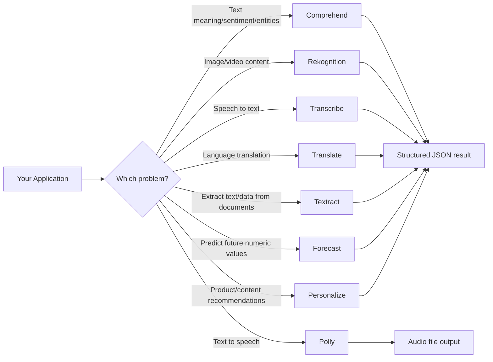
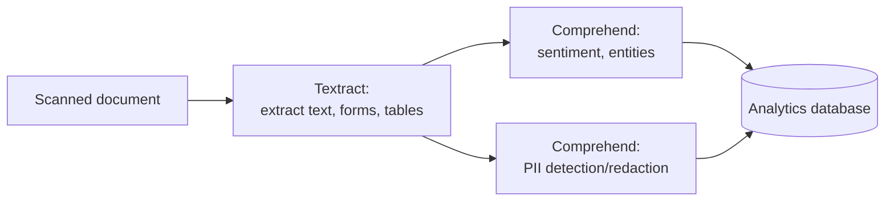
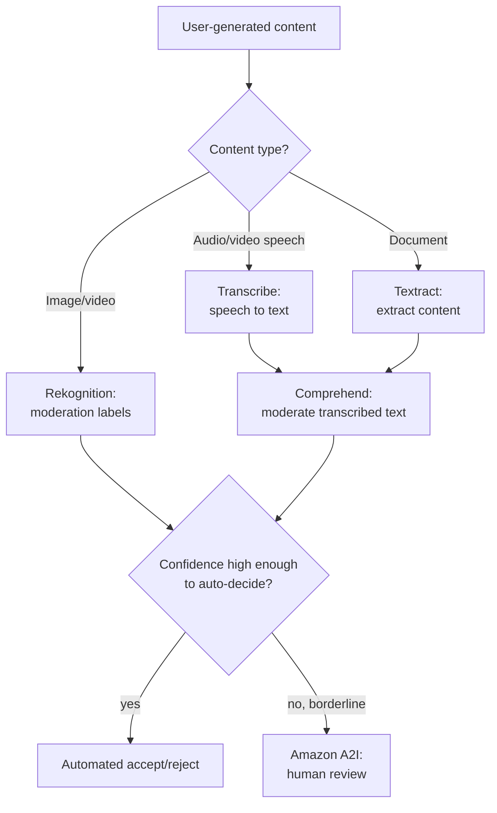
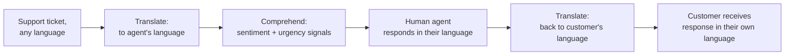
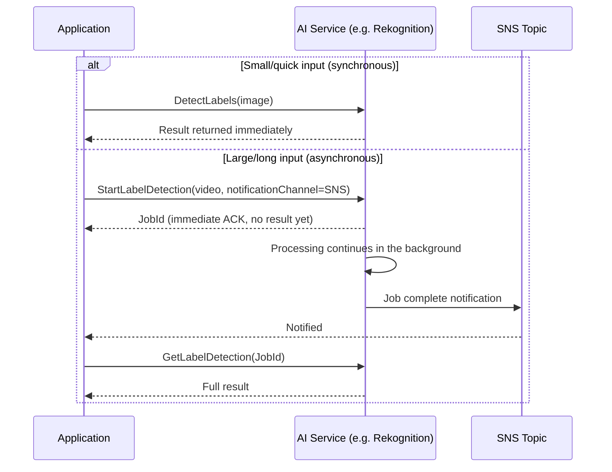

# AWS Pre-Built AI Services — Overview


## Definition

These are AWS's "AI as an API" services: each one does one specific intelligence task (read
text out of an image, understand what language a sentence expresses, detect a face, translate
a sentence, forecast a number, recommend a product) and you call it with a single API request —
no model training, no data science team, no infrastructure. You send data in, a trained-by-AWS
model does the work, you get a structured result back.

A few terms worth defining up front, since they're used precisely throughout this document:
- **OCR (Optical Character Recognition)** — reading text out of an image or scanned document.
  Plain OCR just extracts raw text; Textract goes further by also understanding *layout*
  (which text belongs to which form field, which cells belong to which table row).
- **Sentiment analysis** — classifying whether a piece of text expresses a positive, negative,
  neutral, or mixed emotional tone — Comprehend's most commonly cited capability, but only one
  of several it offers.
- **Named entity recognition (NER)** — identifying and categorizing specific real-world things
  mentioned in text (a person's name, a company, a location, a date) — distinct from sentiment,
  which is about *tone*, not *content extraction*.
- **Diarization** — in speech-to-text, figuring out *which speaker* said which part of the
  transcript ("Speaker 1 said X, Speaker 2 said Y") — a specific, named Transcribe capability,
  not something basic transcription automatically includes.
- **Cold start (recommendations)** — the problem of trying to personalize for a user or item
  with no historical interaction data yet; Personalize specifically needs *some* interaction
  history to work well, and a brand-new user/product starts with none.

## Purpose

Most companies don't need a custom ML model for "can this image contain a stop sign" or "is this
customer review positive or negative" — these are common, well-understood problems that AWS has
already solved extremely well with its own models, trained on massive datasets, continuously
improved by AWS itself. Building and maintaining a custom version of any of these in-house would
be slower, more expensive, and almost certainly less accurate than what AWS already offers as an
API. These services exist so that a regular application developer — not a data scientist — can
add real AI capability to a product in an afternoon.

## How It Works

Plain-English: all eight of these services share the same basic shape — you send data (an
image, an audio file, a block of text, historical numbers) to an API endpoint, AWS's managed
model (which you never see or touch) processes it, and you get back structured JSON. The
difference between them is purely *which kind of data* and *which kind of output*.



Step by step:
1. Your application decides which capability it needs and calls the matching service's API
   (synchronously for quick jobs, asynchronously for long-running ones like batch video
   analysis or large documents).
2. The service's AWS-managed, pre-trained model processes the input — none of these require you
   to provide training data to get useful baseline results (though some, like Comprehend and
   Personalize, support optional custom training on your own data for better domain fit).
3. You get back a structured result: JSON with scores/labels/entities for most of them, or an
   audio file for Polly.
4. Your application uses that result directly — no model hosting, scaling, or monitoring is your
   responsibility; AWS owns all of that behind the API.

### A real-world composed architecture, from AWS's own reference

Several of these services are frequently chained together rather than used individually —
seeing AWS's own documented example makes this concrete:


*Figure: AWS's own reference architecture for content moderation and compliance — Transcribe and
Rekognition process audio/video streams and extract moderation categories; Transcribe converts
audio to text for Comprehend's NLP analysis; Textract extracts document content for further
Comprehend moderation; Ground Truth and Amazon Augmented AI (A2I) bring human reviewers into the
loop for cases that aren't fully automatable. Source: AWS Reference Architecture Diagrams,
"Content Moderation and Compliance Using AWS AI Services" —
docs.aws.amazon.com/reference-architecture-diagrams/latest/content-moderation-compliance/.*

### Worked example — a document-processing pipeline, chaining three services

To see these services composed concretely rather than in isolation, walk through processing a
batch of scanned customer complaint letters.

**Step 1 — Textract extracts structured content.** A scanned PDF complaint letter goes to
Textract's `AnalyzeDocument` with `FORMS` and `TABLES` feature types. The result isn't just raw
text — it's structured key-value pairs ("Customer Name": "Jane Doe", "Account Number": "48213")
and any tables (an itemized list of disputed charges), with Textract's layout awareness
correctly associating each label with its corresponding value even when the scan is slightly
skewed or the layout varies letter to letter.

**Step 2 — Comprehend analyzes the extracted free-text complaint body.** The "complaint
details" text block extracted in Step 1 is sent to Comprehend's `DetectSentiment` and
`DetectEntities` operations. Sentiment comes back as `NEGATIVE` (unsurprising for a complaint
letter) with a confidence score; entities extract the product name, a date, and a dollar amount
mentioned in the free text — distinct, structured signals pulled out of what was otherwise an
unstructured paragraph.

**Step 3 — Comprehend's PII detection redacts sensitive content before storage.** Before the
extracted text is stored in a database for analytics, `DetectPiiEntities` scans it and flags/
redacts the customer's account number and any other personally identifiable information,
satisfying a data-minimization requirement without a human manually reviewing every letter for
PII first.

**Step 4 — The structured output feeds a dashboard.** A downstream analytics dashboard now
shows: how many complaints mention each product, the overall sentiment trend over time, and the
dollar amounts in dispute — all derived from scanned paper letters, without a human manually
transcribing or tagging a single one.

This is exactly the "chain purpose-built services" pattern the exam rewards recognizing —
Textract for structure, Comprehend for meaning and redaction — rather than reaching for a single
custom model (or a Bedrock prompt) to do the whole job end to end.

## Comparison Table — What Each One Does, When to Use It

| Service | What it does | Input | Typical use case | Don't use it for |
|---|---|---|---|---|
| **Comprehend** | Natural language understanding: sentiment, entities (people/places/orgs), key phrases, language detection, PII detection, topic modeling, custom text classification | Text | Analyzing customer reviews/support tickets for sentiment and topics; redacting PII from documents | Generating new text, summarizing, chatting (use Bedrock) |
| **Rekognition** | Computer vision: object/scene detection, face detection & comparison, text-in-image (basic), content moderation, celebrity recognition, video analysis | Image / Video | Content moderation on user uploads; detecting objects/people in security footage; comparing two faces for identity verification | Reading structured documents/forms (use Textract instead — it's purpose-built for that) |
| **Transcribe** | Speech-to-text, with speaker labeling (diarization), custom vocabulary, PII redaction in transcripts | Audio | Call-center transcription and analytics; generating captions/subtitles | Understanding the *meaning* of the transcript (pair it with Comprehend) |
| **Translate** | Neural machine translation between languages | Text | Localizing UI/content, translating support tickets in real time | Translating speech directly (chain Transcribe → Translate → Polly for that) |
| **Textract** | Extract text, forms (key-value pairs), and tables from scanned documents/images, with layout awareness | Image / PDF | Automating invoice/receipt processing, extracting data from ID documents, digitizing paper forms | General photo understanding (use Rekognition); simple printed-text-only OCR where layout doesn't matter (either works, Textract is still usually the better choice for documents) |
| **Polly** | Text-to-speech with lifelike voices, SSML control, multiple languages/voices | Text | Voice assistants, accessibility (read-aloud), IVR phone systems | Real-time conversational voice AI with reasoning (pair Polly with Bedrock/Lex for that) |
| **Forecast** | Time-series forecasting (demand, inventory, financial metrics) using built-in algorithms tuned for forecasting | Historical numeric time-series data | Retail demand planning, inventory forecasting, workforce scheduling | One-off, non-time-series predictions (use SageMaker built-in algorithms or Bedrock as appropriate) |
| **Personalize** | Real-time recommendation engine (product recs, personalized rankings, similar items) trained on your interaction data | User interaction history | E-commerce product recommendations, personalized content ranking/search re-ranking | Cold-start scenarios with zero interaction history (needs some data to personalize against) |

## Key Features / Components

- **Comprehend Medical** — a specialized variant for extracting medical information (conditions,
  medications, dosages) from clinical text, with HIPAA-eligible handling.
- **Rekognition Custom Labels** — train a custom object/scene detector on your own images when
  the built-in categories aren't specific enough (e.g., detecting a specific product defect).
- **Transcribe Medical** — specialized medical speech-to-text with clinical vocabulary.
- **Translate Active Custom Translation** — improve translation quality using your own parallel
  text examples without full model training.
- **Textract Queries** — ask a specific natural-language question against a document ("What's
  the invoice total?") instead of extracting everything and parsing it yourself.
- **Forecast's built-in algorithms** — AutoML-style automatic algorithm selection (CNN-QR,
  DeepAR+, Prophet, ARIMA, ETS) based on your data's characteristics.
- **Personalize recipes** — pre-built algorithm templates (user-personalization, similar-items,
  personalized-ranking) you select based on your use case rather than building from scratch.
- **Rekognition content moderation** — detects specific categories of unsafe content (explicit
  nudity, violence, drugs, hate symbols) with per-category confidence scores, letting an
  application set its own moderation thresholds per category rather than a single blanket
  on/off decision.
- **Comprehend custom classification/entity recognition** — train a lightweight custom model on
  top of Comprehend's base capability for domain-specific categories or entity types the
  built-in model doesn't cover out of the box.

## Use Cases — When to Use It

- You need a specific, well-defined intelligence capability (sentiment, OCR, translation, facial
  comparison, recommendations, forecasting) and the AWS-trained general model is accurate enough
  for your domain — just call the API.
- Your team doesn't have ML expertise and needs AI capability fast, with no model lifecycle to
  manage.
- You need the specific regulatory/compliance posture these services offer for sensitive data
  (e.g., Comprehend Medical/Transcribe Medical for healthcare contexts).
- You want predictable per-request/per-unit pricing without worrying about hosting costs.
- You need to chain several of these together into a composed pipeline (OCR → NLP → redaction,
  as in the worked example above) rather than build each piece as a custom model.
- You need content moderation at scale across user-generated images/video/text without staffing
  a fully manual review team for every single upload.

## When NOT to Use It / Alternatives

- **Your problem is genuinely novel or highly domain-specific** and the pre-built models don't
  perform well enough even with the available customization options (Custom Labels, Active
  Custom Translation) — train a custom model on SageMaker instead.
- **You need open-ended generative capability** (write new content, hold a conversation, reason
  across documents) — none of these services generate open-ended text; that's Bedrock's job, not
  Comprehend's or any AI service here.
- **You need the absolute lowest per-unit cost at very high constant volume** and have ML
  expertise — a self-trained, self-hosted model might eventually be cheaper than per-request AI
  service pricing at extreme scale, though you give up the zero-maintenance benefit.
- **Personalize/Forecast with no historical data** — both need a meaningful amount of historical
  interaction/time-series data to produce good results; a cold-start product with zero history
  won't get much value from either yet.
- **You need the AI capability to take an action, not just produce an answer** — none of these
  services execute multi-step tasks against other systems; that's the Agents layer in Bedrock,
  not a pre-built AI service's job.

## Common Architectures

### Pattern 1 — End-to-end document intelligence pipeline

The pattern behind the worked example above, generalized:



The architectural idea: each service does exactly one well-defined job in sequence, with
Textract's structured output feeding directly into Comprehend's text-analysis input — no single
service tries to do the whole pipeline's work alone.

### Pattern 2 — Multi-modal content moderation at scale

The pattern directly shown in AWS's reference architecture above:



The key structural idea worth internalizing: full automation isn't the goal for every case —
confident predictions get auto-decided, borderline ones route to a human reviewer (Amazon
Augmented AI), which is a deliberately designed escape hatch rather than a gap in the
architecture.

### Pattern 3 — Cross-language customer support

Chaining three services to support a multilingual help desk without hiring multilingual staff
for every language:



This pattern shows Translate used twice, in opposite directions, around a human agent who never
needs to speak the customer's language at all — the AI services handle the language barrier
entirely, while the actual judgment/empathy of the response stays human.

### Synchronous vs. asynchronous calls, as an actual sequence

A recurring pattern across Rekognition (video), Textract (large documents), and Transcribe
(long audio) is the split between quick synchronous calls and longer asynchronous jobs — worth
seeing as one sequence since the mechanics are nearly identical across all three services:



Recognizing which path a scenario describes — a single small image vs. a multi-minute video, a
one-page form vs. a 200-page contract — is the direct, practical skill behind "should this call
be synchronous or asynchronous," the same underlying tradeoff `sagemaker-deployment-endpoints.md`
covers for custom-trained models, applied here to the pre-built AI services instead.

## Why It's Important

**Real-world:** These services are frequently the fastest, cheapest, most accurate path to
adding "AI" to a product — reaching for SageMaker or Bedrock when one of these already solves
the exact problem is a common, costly overengineering mistake. Knowing the full roster well
enough to instantly recognize "this is a Textract problem, not a Rekognition problem" (or vice
versa) is a genuinely useful day-to-day engineering skill, not just exam trivia.

**Exam weight (MLA-C02):** These appear across **Domain 1** (as alternatives/complements to
custom data prep — e.g., using Comprehend for text classification instead of training your own),
**Domain 2** (as an alternative to custom model development — "is a pre-built AI service
sufficient, or do we need to train something?" is a very common scenario-question framing), and
**Domain 3** (these services themselves are already deployed/managed by AWS, so questions often
test recognizing when you *don't* need your own deployment infrastructure at all). MLA-C02
expects you to correctly triage: pre-built AI service vs. SageMaker custom model vs. Bedrock
foundation model, for a given scenario.

**DVA-C03 relevance:** Lightly in scope — a developer-exam question might ask you to call one of
these APIs (e.g., Textract to process an uploaded document, Translate to localize content) as
part of "Development with AWS Services" (Domain 1), with no expectation of knowing internal
model mechanics — just correct API usage and IAM permissions.

## Limits & Quotas

- **Rekognition image/video size and format limits** — images must be under a maximum size and
  in a supported format (JPEG/PNG); video analysis has its own duration and format constraints,
  requiring asynchronous processing (via `StartLabelDetection`-style APIs) for longer videos
  rather than a single synchronous call.
- **Textract document page count and size limits** — synchronous APIs handle single-page,
  smaller documents; large multi-page PDFs require the asynchronous document analysis APIs
  instead, following the same synchronous-vs-asynchronous split seen elsewhere in this category.
- **Comprehend text length limits per request** — very long documents need to be chunked into
  smaller pieces before analysis, conceptually similar to (though a different mechanism from)
  RAG's chunking concept in `bedrock.md`.
- **Transcribe audio length and format limits** — very long audio files (hours-long recordings)
  are handled via asynchronous batch transcription jobs rather than the real-time streaming API,
  which is itself bounded by a maximum session duration.
- **Personalize and Forecast minimum data requirements** — both have minimum thresholds for
  historical interaction/time-series data volume below which training simply isn't supported or
  won't produce meaningful results — this isn't a soft recommendation, it's an enforced
  requirement on the training data you supply.
- **Request rate (TPS) quotas per service, per account, per Region** — a sudden burst of
  requests beyond the account's configured transactions-per-second limit gets throttled,
  requiring the same backoff/retry discipline as any other throttled AWS API.

## Pricing Model (summary)

All are consumption-based with no infrastructure to provision:
- **Comprehend** — per unit of text processed (per 100 characters for most operations).
- **Rekognition** — per image processed, or per minute of video analyzed.
- **Transcribe** — per second/minute of audio processed.
- **Translate** — per character translated.
- **Textract** — per page processed (rate varies by operation: text detection vs. forms vs.
  tables vs. queries).
- **Polly** — per character of text converted to speech.
- **Forecast** — per forecast generated plus a training-time component for custom predictors.
- **Personalize** — per training hour plus per recommendation request (TPS-based) for real-time
  inference, plus batch inference job pricing.
- All have a free tier for initial experimentation (specifics change — check the official
  pricing page per service): https://aws.amazon.com/machine-learning/ (links to each service's
  pricing page).

**Worked cost sanity check:** processing 10,000 scanned invoices a month through Textract
(`AnalyzeDocument` with forms) at a representative per-page rate, versus building and hosting a
custom document-extraction model on SageMaker (training time, ongoing endpoint instance-hours,
plus the engineering time to build and maintain the extraction logic), the Textract path is
almost always cheaper and faster to ship for this exact, common, already-solved problem shape —
this comparison (not the specific dollar figures) is precisely the "is a pre-built AI service
sufficient" triage the exam tests directly.

Full current rates: https://aws.amazon.com/machine-learning/

## Troubleshooting / Common Issues

- **Rekognition returns no labels/faces on an image that clearly contains them.** Check image
  quality/resolution and format — very low resolution, extreme angles, or unsupported formats
  can meaningfully reduce detection confidence below the default minimum confidence threshold.
- **Textract's `AnalyzeDocument` extracts text correctly but misses form key-value pairs.** Check
  that the `FORMS` feature type was actually requested — Textract's base text detection and its
  forms/tables analysis are separate, explicitly-requested feature types, not automatically
  included together.
- **Comprehend's sentiment result seems wrong for sarcastic or highly domain-specific text.**
  General-purpose sentiment models can genuinely struggle with sarcasm and jargon-heavy domain
  text — if this is a recurring, material problem for your use case, Comprehend's custom
  classification training (on your own labeled examples) is the documented path to improve
  domain fit, rather than assuming the base model is simply broken.
- **Transcribe's output has poor accuracy on industry-specific terminology.** Configure a custom
  vocabulary with the specific terms/jargon Transcribe should recognize — this is a named,
  built-in feature for exactly this problem, not something requiring a different service.
  Comprehend Medical / Transcribe Medical exist specifically because clinical terminology is
  common enough to deserve dedicated model variants.
- **Personalize recommendations look poor or generic for a specific user.** Check whether that
  user has enough interaction history — the cold-start problem described above means a new or
  low-activity user simply won't get strongly personalized results yet regardless of model
  quality; this is an inherent data limitation, not necessarily a configuration bug.
- **An async Rekognition video job or Textract document job never seems to complete.** Check
  that your application is actually polling the job status (or subscribed to the configured SNS
  completion topic) correctly — these asynchronous APIs don't push a result automatically to a
  webhook unless you've wired that integration yourself.

## Hands-on Lab (Floci)

Floci does not emulate these AI services' inference APIs (they're managed model endpoints, not
open control-plane shapes Floci replicates). Use:

**Option A — Real AWS free tier:** most of these services have a genuine always-free monthly
tier (e.g., Comprehend's free tier covers several thousand text units/month) small enough to
experiment with at zero cost on a real AWS account.

**Option B — Local equivalents using open-source libraries, to build intuition for each
capability without any AWS account:**
```bash
pip install textblob pytesseract pillow
python3 - <<'EOF'
# Comprehend-style sentiment, done locally with TextBlob (NOT the same model/accuracy as AWS,
# but the same conceptual task — useful for understanding input/output shape)
from textblob import TextBlob
text = "The AWS documentation was surprisingly clear and helpful."
blob = TextBlob(text)
print("Sentiment polarity (-1 negative to +1 positive):", blob.sentiment.polarity)
EOF
```
For a Textract-style OCR stand-in, `pytesseract` (wrapping the open-source Tesseract OCR engine)
run against a local image demonstrates the same "extract text from an image" task shape, though
Textract's layout-aware form/table extraction goes well beyond what plain OCR does.

**Option C — stage input files in S3 against Floci + dry-run the real CLI calls:**
```bash
awslocal s3 mb s3://ai-services-demo
awslocal s3 cp invoice.pdf s3://ai-services-demo/
# Real AWS CLI calls you'd run against actual AWS (NOT executable against Floci):
# aws textract analyze-document --document '{"S3Object":{"Bucket":"ai-services-demo","Name":"invoice.pdf"}}' --feature-types '["FORMS","TABLES"]'
# aws comprehend detect-sentiment --text "The AWS documentation was helpful." --language-code en
# aws translate translate-text --text "Hello, world" --source-language-code en --target-language-code es
```

**Option D — simulate the three-service document pipeline locally, end to end:**
```bash
pip install textblob
python3 - <<'EOF'
from textblob import TextBlob

# Stand-in for Textract's structured extraction output
extracted = {
    "Customer Name": "Jane Doe",
    "Account Number": "48213",
    "Complaint Details": "This product broke after only two weeks and support never replied.",
}

# Stand-in for Comprehend's sentiment analysis on the extracted free text
sentiment = TextBlob(extracted["Complaint Details"]).sentiment.polarity
sentiment_label = "NEGATIVE" if sentiment < 0 else "POSITIVE" if sentiment > 0 else "NEUTRAL"

# Stand-in for Comprehend's PII redaction before storage
redacted = dict(extracted)
redacted["Account Number"] = "***REDACTED***"

print("Sentiment:", sentiment_label, f"(score={sentiment:.2f})")
print("Redacted record for storage:", redacted)
EOF
```

See `certifications/mla-c02/domain-2-model-development/labs.md`.

## Exam Tips

- Build a mental triage: "pre-built AI service already does this exact thing" → use it directly,
  don't train anything custom; this is the most common correct answer pattern for these
  services' exam questions.
- Textract vs. Rekognition is a classic confusion: Textract = structured documents/forms/tables
  with layout awareness; Rekognition = general image/video content (objects, faces, scenes,
  moderation) — Textract for "read this invoice," Rekognition for "what's in this photo."
- Forecast vs. Personalize: Forecast = predicting a *number over time* (demand, sales);
  Personalize = predicting *what a specific user wants* (recommendations/ranking) — different
  axis entirely despite both being "prediction."
- Comprehend vs. Bedrock for text: Comprehend classifies/extracts/scores existing text;
  Bedrock *generates* new text. A question about "classify sentiment" is Comprehend; "write a
  summary" is Bedrock (or SageMaker/your own summarization model).
- Know the free tier exists for most of these — "minimize cost for low-volume analysis" often
  points here instead of a custom-trained model with its development overhead.

### Sample exam scenarios, worked

**Scenario 1:** "A company needs to digitize thousands of scanned paper invoices, extracting the
vendor name, invoice total, and line-item table into a structured database." *Answer:* Textract
with `FORMS` and `TABLES` feature types — the combination of key-value extraction (vendor name,
total) and table extraction (line items) with layout awareness is specifically what
distinguishes Textract from either plain OCR or Rekognition's general image analysis.

**Scenario 2:** "A video platform needs to automatically flag user-uploaded videos containing
explicit content, routing only borderline/uncertain cases to human moderators." *Answer:*
Rekognition's content moderation labels with per-category confidence thresholds, combined with
Amazon Augmented AI (A2I) for the human-review escalation path on low-confidence cases — exactly
Pattern 2 in Common Architectures above.

**Scenario 3:** "A retailer wants to forecast next quarter's demand for each SKU across 200
stores, using three years of historical sales data." *Answer:* Forecast — time-series prediction
of a number over time, for many related series simultaneously, is Forecast's exact design
center (and echoes the DeepAR built-in algorithm's use case in `sagemaker-training-and-tuning.md`,
except here you don't want to manage SageMaker training infrastructure at all).

**Scenario 4:** "A support team wants to automatically detect and redact customers' Social
Security numbers from chat transcripts before the transcripts are stored for analytics."
*Answer:* Comprehend's PII detection (`DetectPiiEntities`), not a custom regex-based solution —
a named, purpose-built capability for exactly this problem, more robust than hand-rolled pattern
matching against varying real-world PII formatting.

### Building vs. buying — the triage worth internalizing

A short, explicit decision aid worth keeping in mind across every scenario in this category,
since it's the single most repeated judgment call across Domain 1 and Domain 2:
1. **Does a pre-built AI service already do exactly this?** (sentiment, OCR, translation, face
   comparison, forecasting, recommendations) → use it directly, stop here.
2. **Is the task open-ended generation/conversation/reasoning over documents?** → Bedrock, not
   any service in this document.
3. **Is it a narrow, well-defined prediction task these services don't cover, on your own
   labeled data?** → SageMaker custom training.
4. **Only if none of the above fit** should "build something entirely custom" even be on the
   table — and even then, check whether a pre-built service's optional customization (Rekognition
   Custom Labels, Comprehend custom classification, Active Custom Translation) closes the gap
   before reaching for a fully from-scratch model.

This ordering — pre-built service, then Bedrock, then SageMaker custom, then fully bespoke — is
itself worth memorizing as a sequence, because almost every MLA-C02 "which AWS service fits this
scenario" question is implicitly asking you to walk this exact decision tree correctly, not
recall an isolated fact about any single service.

## Further Reading

- Amazon Comprehend: https://docs.aws.amazon.com/comprehend/latest/dg/what-is.html
- Amazon Rekognition: https://docs.aws.amazon.com/rekognition/latest/dg/what-is.html
- Amazon Textract: https://docs.aws.amazon.com/textract/latest/dg/what-is.html
- Amazon Transcribe: https://docs.aws.amazon.com/transcribe/latest/dg/what-is.html
- AWS Reference Architecture Diagrams — "Content Moderation and Compliance Using AWS AI
  Services": https://docs.aws.amazon.com/reference-architecture-diagrams/latest/content-moderation-compliance/
- AWS Machine Learning hub (service list + pricing links): https://aws.amazon.com/machine-learning/
- AWS Skill Builder — "Exam Prep: AWS Certified Machine Learning Engineer – Associate (MLA-C02)"

## Related Terms

- `bedrock.md` — the generative counterpart for open-ended text/content generation
- `sagemaker-overview.md` — the custom-model alternative when pre-built isn't accurate enough
- `amazon-q.md` — AWS's own assistant product, built using these and other AI building blocks
- `glossary/` — sentiment analysis, named entity recognition (NER), OCR, diarization, cold start
  (recommendations)
