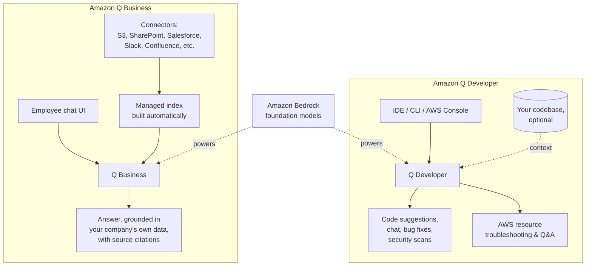

# Amazon Q


<!-- icepanel CDN mirror (diagrams/README.md convention) doesn't carry Amazon Q yet since it's a
     newer service; fallback source used per that doc's instructions: official AWS Architecture
     Icons asset, mirrored at awsfundamentals.com/aws-icons/amazon-q (Arch_Amazon-Q_64.svg from
     the AWS Architecture Icons package, Artificial-Intelligence category). -->

## Definition

Amazon Q is AWS's family of generative-AI-powered assistants, built on top of Bedrock's
foundation models, aimed at two different audiences doing two different jobs: **Amazon Q
Developer** helps people write, review, and troubleshoot code and AWS infrastructure, and
**Amazon Q Business** helps employees find answers and get work done across a company's own
internal documents and business applications. In plain terms: Q is "AWS's own chatbot product,"
as opposed to Bedrock, which is "the raw toolkit for building your own AI features."

## Purpose

Bedrock gives you the building blocks (models, RAG, agents) to build a generative AI
application, but building a good coding assistant or a good internal company chatbot still takes
real engineering work — prompt design, retrieval setup, UI, context about your specific
environment. AWS built Amazon Q as the finished product on top of those building blocks, aimed
at two extremely common needs: developers want an assistant that already understands AWS
services, their codebase, and their cloud resources without them building that integration
themselves; and businesses want an internal assistant that can answer "where's our Q3 budget
doc" or "what's our PTO policy" without building a custom RAG pipeline from scratch. Q exists so
these common cases don't each require a bespoke Bedrock application.

## How It Works

Plain-English: Q Developer lives inside your IDE/CLI/AWS console and already knows about AWS
services and (optionally) your own codebase/cloud resources. Q Business lives as a chat
interface connected to your company's own data sources and already knows how to do RAG against
them without you configuring a Knowledge Base by hand.



Step by step:
1. **Amazon Q Developer** integrates directly into IDEs (VS Code, JetBrains), the AWS CLI, and
   the AWS Management Console. It provides inline code suggestions and full-function generation
   as you type (similar in spirit to GitHub Copilot), chat-based Q&A about your code or AWS
   services, automated code review/security scanning, and the ability to answer questions about
   your actual AWS account resources and costs directly in the console.
2. **Optional codebase context** — Q Developer can be connected to your own repository so its
   suggestions and answers are grounded in your actual code patterns and conventions, not just
   generic best practices.
3. **Amazon Q Business** connects to your company's existing data sources through pre-built
   **connectors** (S3, SharePoint, Salesforce, ServiceNow, Slack, Confluence, Google Workspace,
   and dozens more) with no custom integration code required.
4. **Automatic indexing** — unlike building a Bedrock Knowledge Base by hand (choosing a vector
   store, chunking strategy, embedding model), Q Business manages all of that internally and
   automatically once you point it at a data source.
5. **Employees chat with Q Business** through a web UI, Slack, or Teams integration, and get
   answers grounded in the actual connected documents, with citations back to the source —
   the same RAG principle as a Bedrock Knowledge Base, pre-packaged as a finished product.
6. **Permissions-aware** — Q Business respects the existing access controls of the connected
   data sources, so an employee only gets answers from documents they'd already be allowed to
   see directly, not a shortcut around access control.
7. **Underneath both products**, Amazon Q runs on Bedrock's foundation models — Q is a specific
   application built using the same generative AI infrastructure described in `bedrock.md`, not
   a separate model technology.

## Key Features / Components

- **Q Developer — inline code suggestions** — real-time, context-aware code completion as you
  type, across many languages.
- **Q Developer — chat** — ask questions about code, AWS services, error messages, or
  architecture directly in your IDE or the AWS console.
- **Q Developer — /dev agentic feature generation** — describe a feature in natural language and
  Q Developer can generate a multi-file implementation plan and code changes.
- **Q Developer — code transformation** — automated upgrades (e.g., Java version upgrades) across
  a codebase.
- **Q Developer — security scanning** — flags vulnerabilities and insecure patterns in code,
  with suggested fixes.
- **Q Developer — AWS console integration** — answers questions about your actual deployed
  resources, costs, and errors (e.g., "why did this CloudFormation stack fail").
- **Q Business — connectors** — pre-built integrations into dozens of common enterprise data
  sources, no custom pipeline required.
- **Q Business — managed retrieval/indexing** — automatic RAG setup without configuring a vector
  store or embedding model yourself.
- **Q Business — plugins/actions** — can take actions in connected business apps (e.g., create a
  Jira ticket, update a Salesforce record) in addition to answering questions.
- **Q Business — permissions-aware answers** — respects source-system access control at query
  time.

## Use Cases — When to Use It

- A developer wants in-IDE code completion and chat help without building any custom AI
  integration — **Q Developer**.
- A team wants to ask natural-language questions about their AWS environment/costs/errors
  directly in the console — **Q Developer**.
- A company wants an internal chatbot that can answer employee questions across SharePoint,
  Slack, Salesforce, and S3 documents, without a custom RAG build — **Q Business**.
- You want AI assistance in code review/security scanning integrated into existing developer
  workflows — **Q Developer**.
- You want employees to be able to take simple actions (file a ticket, look up a record) via
  natural language chat, grounded in your own systems — **Q Business** with plugins/actions.

## When NOT to Use It / Alternatives

- **You need a fully custom, branded AI application with specific UX, model choice, or
  orchestration logic** that Q's packaged products don't offer — build directly on Bedrock
  (Knowledge Bases + Agents) instead; Q trades customization for speed of adoption.
- **Your data sources aren't on Q Business's connector list and building a custom connector
  isn't worth it for your case** — a custom Bedrock Knowledge Base ingesting from S3 gives you
  full control over ingestion instead.
- **You need the AI capability embedded inside your own product for end customers** (not an
  internal tool for your own employees/developers) — Q Business is designed for internal
  enterprise use; a customer-facing experience should be built on Bedrock directly.
- **A narrower, purpose-built AI service already solves the problem** (e.g., you just need OCR,
  not a chat assistant) — don't reach for Q when `ai-services-overview.md`'s services or a
  direct Bedrock call is simpler and cheaper for a narrow task.

## Why It's Important

**Real-world:** AI-assisted development has rapidly become a standard part of how developers
work day to day — correctly scoping what an assistant like Q Developer can and can't be trusted
with (it can suggest code, but a human still reviews/tests it; it can answer AWS questions, but
shouldn't be treated as authoritative over actually checking IAM policy or billing data) is a
practical skill. For businesses, Q Business represents a very fast, low-risk way to pilot
generative AI internally (employee-facing, not customer-facing, so the blast radius of a bad
answer is smaller) before committing to a larger custom Bedrock build.

**Exam weight:**
- **DVA-C03** — Amazon Q is explicitly named in-scope content: AI-assisted code
  generation/review (Domain 1), test generation and CI/CD automation assistance (Domain 3),
  and AI-assisted root-cause/error analysis and optimization recommendations (Domain 4) all map
  directly to Q Developer's capabilities. Also relevant to the new Task 2.3 (security risks of
  AI service integration) — e.g., making sure Q Developer's codebase context doesn't leak
  secrets, and that its suggestions are still reviewed for security issues before merging.
- **MLA-C02** — lighter touch than Bedrock itself, but relevant to **Domain 3** (as an example
  of a production-grade RAG/agent application built on Bedrock) and conceptually useful for
  understanding managed-RAG tradeoffs (Q Business's automatic indexing) vs. building a custom
  Knowledge Base by hand.

## Pricing Model (summary)

- **Q Developer** — offered in a free individual tier with usage limits, and a paid Pro tier
  (per user, per month) for higher usage limits, enterprise features (codebase customization,
  admin controls), and higher security scan limits.
- **Q Business** — per user, per month subscription (with a Lite and a Pro tier differing in
  feature access, including which actions/plugins and admin controls are available), plus
  underlying Bedrock model usage is included in the subscription rather than billed separately
  per token.
- Full current rates: https://aws.amazon.com/q/pricing/

## Hands-on Lab (Floci)

Floci does not emulate Amazon Q (a proprietary, hosted AI product, not an open API shape). Use:

**Option A — Real free tier (genuinely the best option here):** Amazon Q Developer has a free
individual tier usable directly inside VS Code or JetBrains IDEs with an AWS Builder ID (no
credit card required for the free tier) — install the "Amazon Q" extension and try inline
suggestions and chat on a real local project at zero cost; this is the most realistic way to
actually understand the product, since it's not something that benefits from a local-equivalent
simulation.

**Option B — Conceptual local equivalent (demonstrating the RAG-with-citations pattern Q
Business uses, since the underlying mechanic is the same as `bedrock.md`'s RAG lab):**
```bash
pip install sentence-transformers scikit-learn
python3 - <<'EOF'
from sentence_transformers import SentenceTransformer
from sklearn.metrics.pairwise import cosine_similarity
import numpy as np

# stand-in for a Q Business connector having indexed a few "company documents"
documents = [
    ("hr-policy.pdf", "Employees accrue 15 days of PTO per year, prorated by start date."),
    ("it-handbook.pdf", "VPN access requires MFA and is provisioned through the IT portal."),
    ("benefits-guide.pdf", "Health insurance enrollment opens every November for the following year."),
]
texts = [d[1] for d in documents]

model = SentenceTransformer("all-MiniLM-L6-v2")
doc_embeddings = model.encode(texts)

question = "How much paid time off do I get?"
q_embedding = model.encode([question])
scores = cosine_similarity(q_embedding, doc_embeddings)[0]
best_idx = int(np.argmax(scores))

print(f"Question: {question}")
print(f"Answer source: {documents[best_idx][0]} (citation)")
print(f"Relevant passage: {documents[best_idx][1]}")
EOF
```
This mirrors Q Business's core promise — an answer grounded in a specific internal document,
returned with a citation back to the source — using the same retrieval mechanics as a Bedrock
Knowledge Base, just without the managed connectors/indexing Q Business automates for you.

**Option C — stage source documents in S3 against Floci (the realistic, Floci-supported slice):**
```bash
awslocal s3 mb s3://q-business-demo-docs
awslocal s3 cp hr-policy.pdf s3://q-business-demo-docs/
# Real AWS CLI call (NOT executable against Floci — Q Business's control plane isn't emulated):
# aws qbusiness create-application --display-name "internal-helpdesk"
# aws qbusiness create-data-source --application-id <id> --display-name "s3-docs" --configuration '{"type":"S3", ...}'
```

See `certifications/dva-c03/domain-1-development/labs.md`.

## Exam Tips

- Q Developer = coding/AWS-console assistant for developers; Q Business = internal company
  knowledge assistant for employees across business data — a very common exam distinction.
- Both are built *on* Bedrock, not a separate/competing model technology — if a question implies
  Q has its own distinct foundation models unrelated to Bedrock, that's wrong.
- Q Business's automatic connectors/indexing is the key differentiator from "build your own
  Bedrock Knowledge Base" — remember that trade: less setup work, less control over
  chunking/embedding choices.
- On DVA-C03, expect Q Developer tied to specific domains: Domain 1 (code generation), Domain 3
  (test generation/CI-CD assistance), Domain 4 (error analysis/optimization) — and Task 2.3
  (security risks of AI-assisted development, e.g., reviewing AI-suggested code for
  vulnerabilities before merging).
- Permissions-aware answering (Q Business respects existing source-system access control) is a
  frequently tested security nuance — Q doesn't bypass or flatten access control.

## Related Terms

- `bedrock.md` — the foundation-model infrastructure Q is built on
- `ai-services-overview.md` — narrower, purpose-built AI APIs vs. Q's assistant-style product
- `sagemaker-overview.md` — the custom-ML counterpart for problems Q's packaged products don't
  address
- `glossary/` — RAG, connector, foundation model, agent, AI Builder ID
