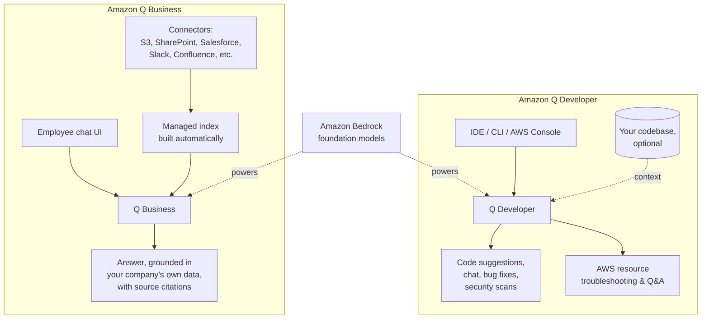
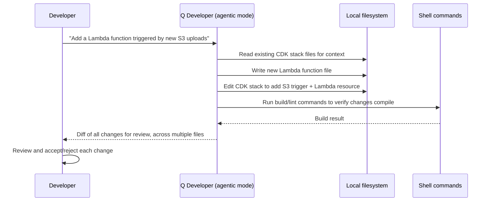
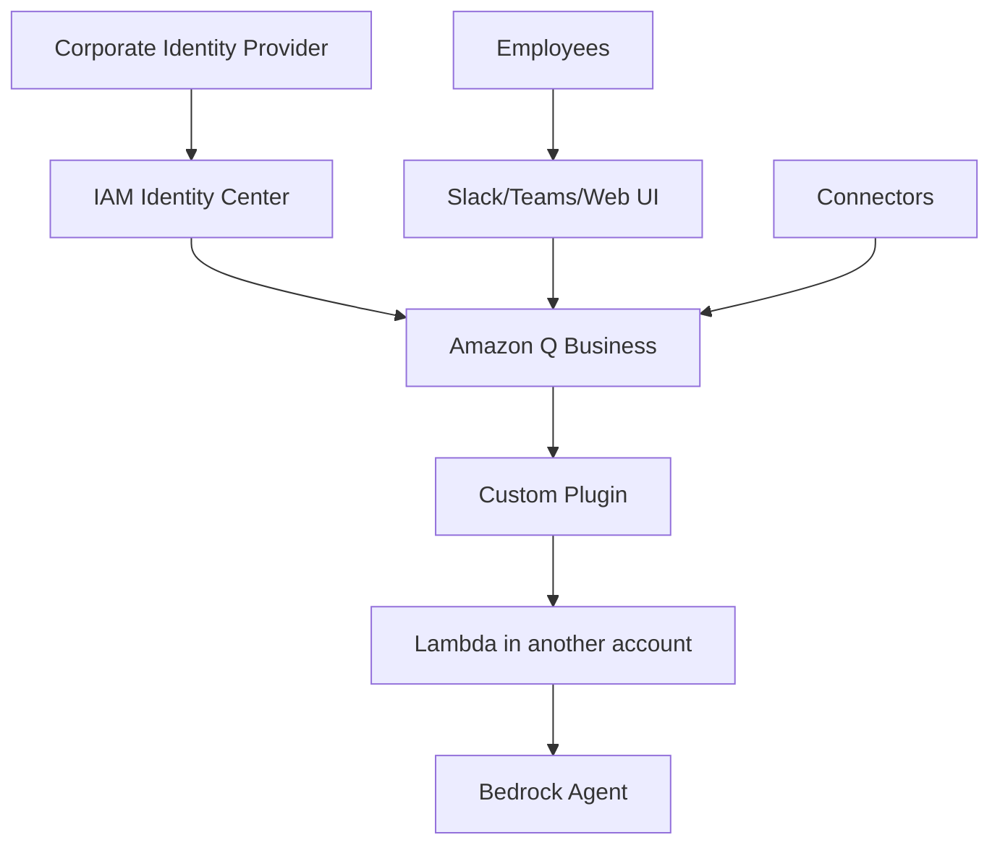
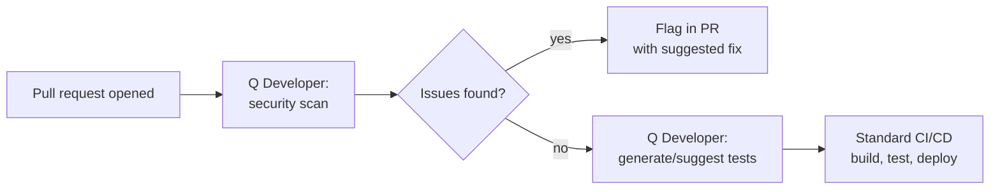
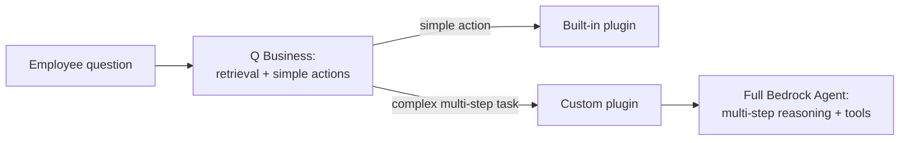

# Amazon Q

> **Appears in:** [DVA-C03](../../certifications/dva-c03/README.md)


## Definition

Amazon Q is AWS's family of generative-AI-powered assistants, built on top of Bedrock's
foundation models, aimed at two different audiences doing two different jobs: **Amazon Q
Developer** helps people write, review, and troubleshoot code and AWS infrastructure, and
**Amazon Q Business** helps employees find answers and get work done across a company's own
internal documents and business applications. In plain terms: Q is "AWS's own chatbot product,"
as opposed to Bedrock, which is "the raw toolkit for building your own AI features."

Two terms worth being precise about before going further:
- **Connector** — a pre-built integration Q Business uses to pull content from an existing
  enterprise system (SharePoint, Salesforce, Slack, S3, and dozens more) into its managed index,
  without you writing any custom ingestion code — the direct analog of building a Bedrock
  Knowledge Base's ingestion pipeline by hand, just pre-packaged.
- **Plugin** (Q Business) — distinct from a connector: a connector *indexes* content for
  retrieval; a plugin lets Q Business *take an action* in a connected system (create a Jira
  ticket, update a Salesforce record) in response to a natural-language request, the same
  conceptual role Bedrock Action Groups play for a custom Agent.

## Purpose

Bedrock gives you the building blocks (models, RAG, agents) to build a generative AI
application, but building a good coding assistant or a good internal company chatbot still takes
real engineering work — prompt design, retrieval setup, UI, context about your specific
environment. AWS built Amazon Q as the finished product on top of those building blocks, aimed
at two extremely common needs: developers want an assistant that already understands AWS
services, their codebase, and their cloud resources without them building that integration
themselves; and businesses want an internal assistant that can answer "where's our Q3 budget
doc" or "what's our PTO policy" without building a custom RAG pipeline from scratch. Q exists so
these common cases don't each require a bespoke Bedrock application.

## How It Works

Plain-English: Q Developer lives inside your IDE/CLI/AWS console and already knows about AWS
services and (optionally) your own codebase/cloud resources. Q Business lives as a chat
interface connected to your company's own data sources and already knows how to do RAG against
them without you configuring a Knowledge Base by hand.



Step by step:
1. **Amazon Q Developer** integrates directly into IDEs (VS Code, JetBrains), the AWS CLI, and
   the AWS Management Console. It provides inline code suggestions and full-function generation
   as you type (similar in spirit to GitHub Copilot), chat-based Q&A about your code or AWS
   services, automated code review/security scanning, and the ability to answer questions about
   your actual AWS account resources and costs directly in the console.
2. **Optional codebase context** — Q Developer can be connected to your own repository so its
   suggestions and answers are grounded in your actual code patterns and conventions, not just
   generic best practices.
3. **Amazon Q Business** connects to your company's existing data sources through pre-built
   **connectors** (S3, SharePoint, Salesforce, ServiceNow, Slack, Confluence, Google Workspace,
   and dozens more) with no custom integration code required.
4. **Automatic indexing** — unlike building a Bedrock Knowledge Base by hand (choosing a vector
   store, chunking strategy, embedding model), Q Business manages all of that internally and
   automatically once you point it at a data source.
5. **Employees chat with Q Business** through a web UI, Slack, or Teams integration, and get
   answers grounded in the actual connected documents, with citations back to the source —
   the same RAG principle as a Bedrock Knowledge Base, pre-packaged as a finished product.
6. **Permissions-aware** — Q Business respects the existing access controls of the connected
   data sources, so an employee only gets answers from documents they'd already be allowed to
   see directly, not a shortcut around access control.
7. **Underneath both products**, Amazon Q runs on Bedrock's foundation models — Q is a specific
   application built using the same generative AI infrastructure described in `bedrock.md`, not
   a separate model technology.

### Q Business's reference architecture, from AWS's own diagram


*Figure: AWS's own reference architecture for deploying Amazon Q Business — users interact via an
enterprise collaboration tool or Q's built-in web interface, authenticated through IAM Identity
Center (optionally federated to a third-party identity provider); data sources are indexed
through connectors; and custom plugins can call out to a Bedrock agent (via Lambda or EKS,
potentially in another AWS account) to extend Q Business beyond simple Q&A into real actions.
Source: AWS Machine Learning Blog, "Accelerate enterprise AI implementations with Amazon Q
Business" — aws.amazon.com/blogs/machine-learning/accelerate-enterprise-ai-implementations-with-amazon-q-business/.*

### Q Developer's code-development workflow, from AWS's own diagram


*Figure: AWS's own diagram of where Amazon Q Developer accelerates the code-development
lifecycle — design/planning, code writing, debugging/testing, and code review each get
AI-assisted steps (generating outlines, inline suggestions, generating unit tests, explaining
code during review). Source: AWS Prescriptive Guidance, "Developer workflows with Amazon Q
Developer" — docs.aws.amazon.com/prescriptive-guidance/latest/best-practices-code-generation/.*

### Worked example — Q Business answering a grounded question, end to end

To make "automatic indexing" and "permissions-aware" concrete rather than abstract claims, walk
through an actual employee question.

**Step 1 — Connectors index existing content with no custom pipeline.** An admin configures a
Q Business application with an S3 connector (pointed at the company's HR policy documents) and
a Confluence connector (pointed at the engineering wiki). Unlike building a Bedrock Knowledge
Base, the admin never chooses a chunking strategy, an embedding model, or a vector store — Q
Business's managed indexing handles all of that internally, automatically, on a sync schedule.

**Step 2 — An employee asks a question in Slack**, where Q Business is integrated: *"How many
vacation days do I get, and can I carry them over to next year?"*

**Step 3 — Retrieval and grounding happen exactly like a Bedrock Knowledge Base, under the
hood.** Q Business's managed index finds the HR policy passage describing PTO accrual and
carryover rules, and the underlying Bedrock foundation model generates an answer grounded in
that retrieved passage — the same RAG mechanics described in `bedrock.md`, just with the
Knowledge Base configuration entirely hidden from the admin.

**Step 4 — The answer includes a citation.** The response in Slack includes a link back to the
specific HR policy document the answer was drawn from, letting the employee verify it directly
rather than trusting the chatbot's word alone — mirroring exactly the citation behavior Bedrock
Knowledge Bases provide.

**Step 5 — Permissions are respected automatically.** If that same HR policy document were
restricted to HR staff only in the source system, a non-HR employee asking the identical
question would get no answer from it at all — Q Business's permissions-awareness means the
*connector* carries forward the source system's access control, it isn't something the admin
has to separately configure inside Q Business.

**Step 6 — A plugin extends this from Q&A into action.** If the same employee instead asked
*"Submit a request to carry over 5 unused vacation days,"* and a Workday plugin were configured,
Q Business could call that plugin to actually file the request — the distinction between a
connector (step 1-4, retrieval) and a plugin (step 6, action) made concrete in one continuous
example.

### Q Developer's agentic coding flow, as a sequence



The important distinction from inline suggestions or one-shot chat: this mode reads and writes
multiple real files and runs real commands across a multi-step conversation, always surfacing a
reviewable diff rather than silently committing changes — the same "human stays in the loop"
principle Bedrock Agents apply to calling external APIs, applied here to a developer's own
codebase.

## Key Features / Components

- **Q Developer — inline code suggestions** — real-time, context-aware code completion as you
  type, across many languages.
- **Q Developer — chat** — ask questions about code, AWS services, error messages, or
  architecture directly in your IDE or the AWS console.
- **Q Developer — /dev agentic feature generation** — describe a feature in natural language and
  Q Developer can generate a multi-file implementation plan and code changes.
- **Q Developer — code transformation** — automated upgrades (e.g., Java version upgrades) across
  a codebase.
- **Q Developer — security scanning** — flags vulnerabilities and insecure patterns in code,
  with suggested fixes.
- **Q Developer — AWS console integration** — answers questions about your actual deployed
  resources, costs, and errors (e.g., "why did this CloudFormation stack fail").
- **Q Developer — agentic coding in the IDE** — a newer capability letting Q Developer read and
  write files locally, run shell commands, and build/iterate on code changes across a multi-step
  conversation, going beyond single inline suggestions or one-shot chat answers.
- **Q Business — connectors** — pre-built integrations into dozens of common enterprise data
  sources, no custom pipeline required.
- **Q Business — managed retrieval/indexing** — automatic RAG setup without configuring a vector
  store or embedding model yourself.
- **Q Business — plugins/actions** — can take actions in connected business apps (e.g., create a
  Jira ticket, update a Salesforce record) in addition to answering questions; built-in plugins
  cover common systems (Jira Cloud, ServiceNow, Zendesk, Confluence, Salesforce, and others) with
  custom plugins available for anything else via OpenAPI-described endpoints.
- **Q Business — permissions-aware answers** — respects source-system access control at query
  time.
- **Q Apps** — a Q Business feature letting end users build lightweight, shareable mini-
  applications from a natural-language description (e.g., "an app that summarizes meeting notes
  into action items"), without writing code — a no-code layer on top of Q Business's core
  capabilities.

## Use Cases — When to Use It

- **In-IDE code completion for a development team (software engineering):** Problem — developers
  want real-time code suggestions and chat help without building any custom AI integration. Why
  it fits — Q Developer integrates directly into VS Code/JetBrains/CLI with zero setup. Tradeoff
  vs. building on Bedrock directly — a custom Bedrock integration offers more control over UX and
  model choice, but takes real engineering time Q Developer's packaged product skips entirely.
- **AWS resource/cost troubleshooting (any team running AWS infrastructure):** Problem — a team
  wants to ask "why did this CloudFormation stack fail" or "why is this month's bill higher than
  usual" directly in the console. Why it fits — Q Developer's console integration answers
  questions about your actual deployed resources, costs, and errors. Tradeoff vs. manually digging
  through CloudTrail/Cost Explorer — manual investigation gives full control over the exact query
  but is slower than Q Developer's natural-language shortcut for common troubleshooting questions.
- **Internal HR/IT helpdesk chatbot (any enterprise):** Problem — employees waste time hunting
  across SharePoint, Slack, and Confluence for policy answers. Why it fits — Q Business's
  pre-built connectors index all three sources automatically with no custom RAG pipeline to build.
  Tradeoff vs. a custom Bedrock Knowledge Base — a custom build gives full control over chunking
  strategy and UI, but Q Business ships the entire managed retrieval/indexing stack with far less
  engineering time.
- **Code review and security scanning in CI/CD (software engineering):** Problem — catch insecure
  code patterns before they merge, integrated into the existing pull-request workflow. Why it fits
  — Q Developer's automated security scanning flags vulnerabilities with suggested fixes directly
  in the PR. Tradeoff vs. a dedicated static-analysis tool — a specialized SAST tool may catch a
  narrower set of issues more precisely; Q Developer's scanning is broader and conversational but
  should complement, not replace, a mature security review process.
- **Claims/ticket triage with action-taking (insurance/IT service management):** Problem —
  employees want to both ask about a policy *and* file a ticket in Jira/ServiceNow from one chat
  interface. Why it fits — Q Business plugins let the same assistant both retrieve answers
  (connectors) and take actions (plugins) in the same conversation. Tradeoff vs. building a custom
  Bedrock Agent with Action Groups — a custom Agent gives full control over the action's logic and
  schema; a built-in Q Business plugin (Jira, ServiceNow, Salesforce) needs zero custom
  development when the target system is already on the supported plugin list.
- **Multi-file feature generation (software engineering):** Problem — a developer needs a
  multi-file change (a new Lambda function plus its CDK stack wiring) generated from a single
  natural-language description. Why it fits — Q Developer's agentic coding mode reads/writes
  multiple real files and runs build/lint commands across a multi-step conversation, always
  surfacing a reviewable diff. Tradeoff vs. a single inline suggestion — inline suggestions are
  faster for small, single-line changes; agentic mode is the right tool once a request spans
  multiple files and build verification, at the cost of a slower, more involved multi-step flow.
- **Onboarding and internal knowledge discovery (any large enterprise):** Problem — new employees
  don't know where internal documentation lives across a dozen disconnected tools. Why it fits —
  Q Business's permissions-aware search surfaces the right document from whichever connected
  system holds it, without the new hire needing to know which tool to check first. Tradeoff vs. a
  single centralized wiki — a wiki requires actively migrating content into one place; Q Business
  indexes content where it already lives, trading some structural tidiness for zero migration
  effort.
- **Lightweight internal tool creation by non-engineers (any business team):** Problem — a
  business team wants a small, purpose-specific tool (e.g., "summarize meeting notes into action
  items") without waiting on engineering bandwidth. Why it fits — Q Apps lets end users describe
  and build a shareable mini-application in natural language, no code. Tradeoff vs. a proper
  engineered internal tool — a Q App is faster to stand up but less customizable and robust than
  an engineering team's purpose-built application; reserve Q Apps for genuinely lightweight,
  low-stakes internal tooling.

## When NOT to Use It / Alternatives

- **You need a fully custom, branded AI application with specific UX, model choice, or
  orchestration logic** that Q's packaged products don't offer — build directly on Bedrock
  (Knowledge Bases + Agents) instead; Q trades customization for speed of adoption.
- **Your data sources aren't on Q Business's connector list and building a custom connector
  isn't worth it for your case** — a custom Bedrock Knowledge Base ingesting from S3 gives you
  full control over ingestion instead.
- **You need the AI capability embedded inside your own product for end customers** (not an
  internal tool for your own employees/developers) — Q Business is designed for internal
  enterprise use; a customer-facing experience should be built on Bedrock directly.
- **A narrower, purpose-built AI service already solves the problem** (e.g., you just need OCR,
  not a chat assistant) — don't reach for Q when `ai-services-overview.md`'s services or a
  direct Bedrock call is simpler and cheaper for a narrow task.
- **Your organization has strict policies against AI-suggested code without heavyweight review
  processes already in place** — adopting Q Developer without an established code-review
  discipline risks accepting unreviewed AI-generated code into production; the tool assumes a
  human reviewer remains firmly in the loop.

## Common Architectures

### Pattern 1 — Enterprise Q Business deployment with IAM Identity Center

The standard production deployment shape, directly mirroring the reference architecture image
above:



The key structural idea: identity flows through IAM Identity Center (federated to the
organization's existing IdP) rather than Q Business managing its own separate user directory —
a direct application of "don't build parallel identity systems" good practice, and the same
reason custom plugins are architected to call out to Lambda/Bedrock Agents in potentially
separate AWS accounts rather than embedding that logic inside Q Business itself.

### Pattern 2 — Q Developer in a CI/CD pipeline

Beyond interactive IDE use, Q Developer's capabilities extend into automated pipeline stages:



This directly maps to DVA-C03's Domain 3 (test generation/CI-CD assistance) and Domain 4
(error analysis) content — Q Developer isn't only an interactive, single-developer tool, it has
a role inside the broader automated software delivery pipeline too.

### Pattern 3 — Hybrid: Q Business for retrieval, Bedrock Agent for complex action

For organizations that start with Q Business's packaged convenience but need a genuinely
complex, multi-step action beyond what a simple plugin covers:



The structural lesson: Q Business and custom Bedrock development aren't mutually exclusive —
Q Business can be the front door for most employee interactions while routing the genuinely
complex cases to a purpose-built Bedrock Agent behind a custom plugin, getting the convenience
of a packaged product without being limited to only what it can do out of the box.

## Why It's Important

**Real-world:** AI-assisted development has rapidly become a standard part of how developers
work day to day — correctly scoping what an assistant like Q Developer can and can't be trusted
with (it can suggest code, but a human still reviews/tests it; it can answer AWS questions, but
shouldn't be treated as authoritative over actually checking IAM policy or billing data) is a
practical skill. For businesses, Q Business represents a very fast, low-risk way to pilot
generative AI internally (employee-facing, not customer-facing, so the blast radius of a bad
answer is smaller) before committing to a larger custom Bedrock build.

**Exam weight:**
- **DVA-C03** — Amazon Q is explicitly named in-scope content: AI-assisted code
  generation/review (Domain 1), test generation and CI/CD automation assistance (Domain 3),
  and AI-assisted root-cause/error analysis and optimization recommendations (Domain 4) all map
  directly to Q Developer's capabilities. Also relevant to the new Task 2.3 (security risks of
  AI service integration) — e.g., making sure Q Developer's codebase context doesn't leak
  secrets, and that its suggestions are still reviewed for security issues before merging.
- **MLA-C02** — lighter touch than Bedrock itself, but relevant to **Domain 3** (as an example
  of a production-grade RAG/agent application built on Bedrock) and conceptually useful for
  understanding managed-RAG tradeoffs (Q Business's automatic indexing) vs. building a custom
  Knowledge Base by hand.

## Limits & Quotas

- **Q Business connector sync frequency and document count** are both subject to account-level
  quotas — a very large document corpus or a need for near-real-time index freshness may require
  planning around sync schedule limits rather than assuming instant, unlimited indexing.
- **Q Business index storage capacity** is provisioned per application and has a configurable
  (and billable) capacity unit model — an organization with an unusually large total document
  volume needs to plan index capacity the same way they'd plan storage for any other managed
  search index.
- **Q Developer's free individual tier** has defined monthly usage limits (code suggestion
  volume, chat interactions, security scans) distinct from the paid Pro tier's higher limits —
  a team evaluating Q Developer at scale should expect to move to Pro once free-tier limits are
  regularly exhausted.
- **Custom plugin action complexity** is bounded by what a single OpenAPI-described action can
  express — genuinely complex, multi-step business processes may be better served by a full
  Bedrock Agent behind the plugin (Pattern 3 above) rather than trying to encode the entire
  process into one plugin action.

## Pricing Model (summary)

- **Q Developer** — offered in a free individual tier with usage limits, and a paid Pro tier
  (per user, per month) for higher usage limits, enterprise features (codebase customization,
  admin controls), and higher security scan limits.
- **Q Business** — per user, per month subscription (with a Lite and a Pro tier differing in
  feature access, including which actions/plugins and admin controls are available), plus
  underlying Bedrock model usage is included in the subscription rather than billed separately
  per token.

**Worked cost sanity check:** a 300-person engineering organization adopting Q Developer Pro at
a per-user-per-month rate, versus the same organization building and maintaining an equivalent
in-house AI coding assistant on raw Bedrock (engineering time to build IDE integrations, prompt
engineering, ongoing maintenance, plus the underlying per-token Bedrock costs) — the subscription
model trades a predictable, scaling-with-headcount cost for the significant upfront and ongoing
engineering investment a custom-built equivalent would require; this tradeoff (buy a packaged
product vs. build on the underlying platform) is exactly the lens the exam expects for comparing
Q against building directly on Bedrock.

Full current rates: https://aws.amazon.com/q/pricing/

## Troubleshooting / Common Issues

- **Q Business gives an incomplete or "I don't know" answer for a document you know exists in a
  connected source.** Check the connector's sync status and schedule — a document added or
  changed since the last sync simply isn't in the index yet; this is a sync-timing issue, not a
  retrieval-quality problem.
- **An employee reports getting a different (or no) answer than a colleague for the same
  question.** This is very often permissions-awareness working as designed, not a bug — check
  whether the underlying source document has different access restrictions for each employee in
  the source system itself.
- **Q Developer's suggestions don't reflect your team's actual coding conventions.** Confirm
  codebase context/customization is actually connected and configured — without it, Q Developer
  falls back to generic best-practice suggestions rather than your repository's specific
  patterns.
- **A custom plugin fails to execute the requested action.** Check the plugin's OpenAPI schema
  for ambiguous or missing parameter descriptions — the same root cause as a Bedrock Agent
  Action Group failing to call the right function correctly (see `bedrock.md`'s Troubleshooting
  section), since Q Business plugins follow the same underlying mechanism.
- **Q Developer's security scan flags an issue the team considers a false positive.** Review the
  specific flagged pattern against your actual threat model before dismissing it outright — but
  also know that, like any automated scanner, some false positives are expected, and the
  appropriate response is documented suppression with a reviewed justification, not disabling
  scanning broadly.

## Hands-on Lab (Floci)

Floci does not emulate Amazon Q (a proprietary, hosted AI product, not an open API shape). Use:

**Option A — Real free tier (genuinely the best option here):** Amazon Q Developer has a free
individual tier usable directly inside VS Code or JetBrains IDEs with an AWS Builder ID (no
credit card required for the free tier) — install the "Amazon Q" extension and try inline
suggestions and chat on a real local project at zero cost; this is the most realistic way to
actually understand the product, since it's not something that benefits from a local-equivalent
simulation.

**Option B — Conceptual local equivalent (demonstrating the RAG-with-citations pattern Q
Business uses, since the underlying mechanic is the same as `bedrock.md`'s RAG lab):**
```bash
pip install sentence-transformers scikit-learn
python3 - <<'EOF'
from sentence_transformers import SentenceTransformer
from sklearn.metrics.pairwise import cosine_similarity
import numpy as np

# stand-in for a Q Business connector having indexed a few "company documents"
documents = [
    ("hr-policy.pdf", "Employees accrue 15 days of PTO per year, prorated by start date."),
    ("it-handbook.pdf", "VPN access requires MFA and is provisioned through the IT portal."),
    ("benefits-guide.pdf", "Health insurance enrollment opens every November for the following year."),
]
texts = [d[1] for d in documents]

model = SentenceTransformer("all-MiniLM-L6-v2")
doc_embeddings = model.encode(texts)

question = "How much paid time off do I get?"
q_embedding = model.encode([question])
scores = cosine_similarity(q_embedding, doc_embeddings)[0]
best_idx = int(np.argmax(scores))

print(f"Question: {question}")
print(f"Answer source: {documents[best_idx][0]} (citation)")
print(f"Relevant passage: {documents[best_idx][1]}")
EOF
```
This mirrors Q Business's core promise — an answer grounded in a specific internal document,
returned with a citation back to the source — using the same retrieval mechanics as a Bedrock
Knowledge Base, just without the managed connectors/indexing Q Business automates for you.

**Option C — stage source documents in S3 against Floci (the realistic, Floci-supported slice):**
```bash
awslocal s3 mb s3://q-business-demo-docs
awslocal s3 cp hr-policy.pdf s3://q-business-demo-docs/
# Real AWS CLI call (NOT executable against Floci — Q Business's control plane isn't emulated):
# aws qbusiness create-application --display-name "internal-helpdesk"
# aws qbusiness create-data-source --application-id <id> --display-name "s3-docs" --configuration '{"type":"S3", ...}'
```

**Option D — simulate the permissions-aware filtering Q Business applies automatically:**
```bash
python3 - <<'EOF'
documents = [
    {"title": "general-pto-policy.pdf", "content": "Standard PTO is 15 days/year.", "access": "all-employees"},
    {"title": "exec-compensation.pdf", "content": "Executive bonus structure details...", "access": "hr-only"},
]

def answer_for(employee_role, question_keywords):
    for doc in documents:
        if doc["access"] == "all-employees" or doc["access"] == employee_role:
            if any(kw in doc["content"].lower() for kw in question_keywords):
                return f"Answer from {doc['title']}: {doc['content']}"
    return "No accessible document answers this question."

print("Regular employee asking about PTO:", answer_for("employee", ["pto"]))
print("Regular employee asking about exec comp:", answer_for("employee", ["bonus"]))  # blocked by access control
print("HR employee asking about exec comp:", answer_for("hr-only", ["bonus"]))
EOF
```

See `certifications/dva-c03/domain-1-development/labs.md`.

## Exam Tips

- Q Developer = coding/AWS-console assistant for developers; Q Business = internal company
  knowledge assistant for employees across business data — a very common exam distinction.
- Both are built *on* Bedrock, not a separate/competing model technology — if a question implies
  Q has its own distinct foundation models unrelated to Bedrock, that's wrong.
- Q Business's automatic connectors/indexing is the key differentiator from "build your own
  Bedrock Knowledge Base" — remember that trade: less setup work, less control over
  chunking/embedding choices.
- On DVA-C03, expect Q Developer tied to specific domains: Domain 1 (code generation), Domain 3
  (test generation/CI-CD assistance), Domain 4 (error analysis/optimization) — and Task 2.3
  (security risks of AI-assisted development, e.g., reviewing AI-suggested code for
  vulnerabilities before merging).
- Permissions-aware answering (Q Business respects existing source-system access control) is a
  frequently tested security nuance — Q doesn't bypass or flatten access control.

### Sample exam scenarios, worked

**Scenario 1:** "A development team wants AI-generated unit tests as part of their standard pull
request workflow, integrated with their existing CI/CD pipeline." *Answer:* Amazon Q Developer —
specifically named DVA-C03 content under test generation/CI-CD automation assistance (Domain 3),
distinguishing this from Q Business, which has no code-development capability at all.

**Scenario 2:** "A company wants an internal assistant answering employee questions across
Confluence, Salesforce, and S3 documents, without building a custom retrieval pipeline, while
ensuring an employee never sees an answer sourced from a document they wouldn't normally have
access to." *Answer:* Amazon Q Business — both the managed-connector convenience and the
permissions-aware answering are explicit, named Q Business capabilities, not something requiring
custom configuration on top.

**Scenario 3:** "A security team is concerned that AI-suggested code from a coding assistant
might introduce vulnerabilities that go unnoticed before merging." *Answer:* this maps to
DVA-C03's Task 2.3 (security risks of AI service integration) — the correct answer is a process
one (mandatory human code review plus Q Developer's own security scanning as a complementary
check), not disabling AI assistance entirely; the exam expects you to know AI-assisted
development requires continued human review, not blind trust.

**Scenario 4:** "An organization wants to extend their Q Business deployment so employees can
ask it to automatically file a Jira ticket from a natural-language description of a bug."
*Answer:* a Q Business plugin (built-in Jira plugin if available, or a custom plugin otherwise)
— distinct from a connector, which only indexes content for retrieval and cannot itself take
an action in an external system.

### Where Q sits relative to everything else in this category

One final positioning worth being explicit about: Q is the only product in this entire
machine-learning-ai category that is simultaneously relevant to *both* certifications covered by
this repo (MLA-C02 and DVA-C03) as a named, in-scope topic, rather than belonging primarily to
one. Bedrock is deep MLA-C02 content with shallow DVA-C03 relevance; SageMaker is MLA-C02-only;
the pre-built AI services lean MLA-C02 with light DVA-C03 touches. Q Developer, specifically, is
core DVA-C03 content (explicitly named across three of its four domains) while also being a
useful MLA-C02 example of a production Bedrock-based application. Keeping this asymmetry straight
— Q Developer matters more for the developer exam than for the ML exam, while Bedrock and
SageMaker matter far more for the ML exam — is itself a frequently useful piece of exam-scoping
knowledge when deciding how deeply to study each document in this folder for a specific
certification target.

## Further Reading

- Amazon Q Developer: https://docs.aws.amazon.com/amazonq/latest/qdeveloper-ug/what-is.html
- Amazon Q Business: https://docs.aws.amazon.com/amazonq/latest/qbusiness-ug/what-is.html
- Plugins for Amazon Q Business: https://docs.aws.amazon.com/amazonq/latest/qbusiness-ug/plugins.html
- AWS ML Blog — "Accelerate enterprise AI implementations with Amazon Q Business":
  https://aws.amazon.com/blogs/machine-learning/accelerate-enterprise-ai-implementations-with-amazon-q-business/
- AWS ML Blog — "How Kyndryl integrated ServiceNow and Amazon Q Business":
  https://aws.amazon.com/blogs/machine-learning/how-kyndryl-integrated-servicenow-and-amazon-q-business/
- AWS Prescriptive Guidance — "Developer workflows with Amazon Q Developer":
  https://docs.aws.amazon.com/prescriptive-guidance/latest/best-practices-code-generation/developer-workflows.html
- Amazon Q pricing: https://aws.amazon.com/q/pricing/
- AWS Skill Builder — "Exam Prep: AWS Certified Developer – Associate (DVA-C03)"

## Related Terms

- `bedrock.md` — the foundation-model infrastructure Q is built on
- `ai-services-overview.md` — narrower, purpose-built AI APIs vs. Q's assistant-style product
- `sagemaker-overview.md` — the custom-ML counterpart for problems Q's packaged products don't
  address
- `glossary/` — RAG, connector, foundation model, agent, AI Builder ID
