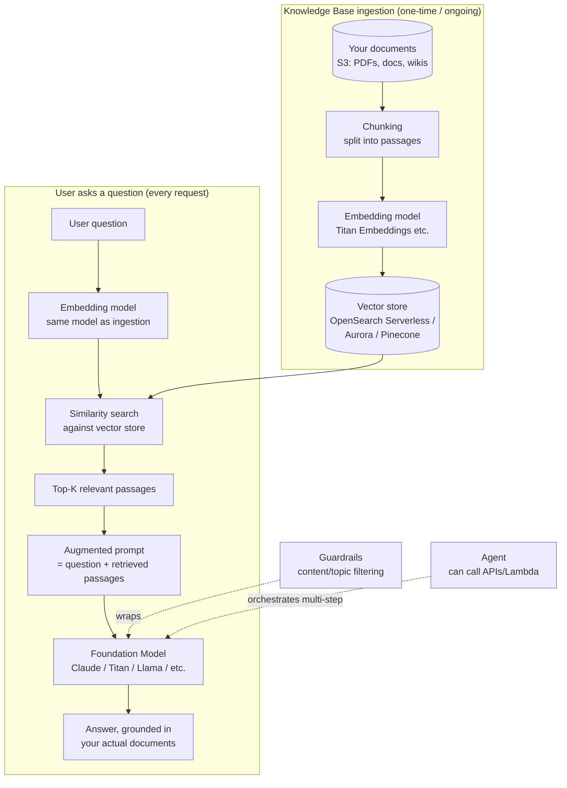

# Amazon Bedrock


<!-- icepanel CDN mirror (diagrams/README.md convention) doesn't carry Bedrock yet since it's a
     newer service; fallback source used per that doc's instructions: official AWS Architecture
     Icons asset, mirrored at awsfundamentals.com/aws-icons/amazon-bedrock (Arch_Amazon-Bedrock_64.svg
     from the AWS Architecture Icons package, Artificial-Intelligence category). -->

## Definition

Amazon Bedrock is AWS's fully managed service for using and customizing **foundation models**
(large pre-trained AI models — the kind behind ChatGPT-style chat, image generation, and text
embeddings) from multiple providers, through one consistent API, without you ever provisioning
a GPU or managing any infrastructure. In plain terms: Bedrock is "AI models as an API call" —
you send text in, you get text (or an image, or a decision) out, and AWS runs everything behind
the scenes.

## Purpose

Training a large language model from scratch costs tens to hundreds of millions of dollars and
requires expertise almost no company has in-house. Most businesses don't need to build a
foundation model — they need to *use* one, often customized with their own data, embedded
safely into their own product. Before Bedrock, doing this on AWS meant either calling an
external AI vendor's API directly (losing AWS's security/compliance/billing integration) or
self-hosting an open model on SageMaker/EC2 (requiring real ML infrastructure expertise). Bedrock
exists to close that gap: it gives you serverless access to multiple best-in-class foundation
models (from Amazon itself, Anthropic, Meta, Mistral, AI21, Cohere, Stability AI, and others)
through one API, with AWS-native security, data privacy (your prompts/data aren't used to
retrain the underlying model, and stay inside your AWS account boundary), and pay-per-use
pricing — making generative AI something an ordinary application team can integrate in days,
not months.

## How It Works

Plain-English first, because this section has to carry real weight for MLA-C02: a **foundation
model** is a very large neural network trained on enormous amounts of text (or images, or code)
that has learned general patterns of language and knowledge, which you can then direct toward a
specific task just by how you phrase your request (a "prompt") — no training required for basic
use. **RAG (Retrieval-Augmented Generation)** is the technique of giving that model *your own*
private documents to reference at answer-time, so it can answer accurately about things it was
never trained on (your company's internal policies, your product's documentation) instead of
guessing or "hallucinating." An **embedding** is a way of converting a chunk of text into a list
of numbers (a vector) that captures its *meaning* — so two sentences that mean similar things end
up with similar vectors, which is what makes "find documents similar to this question" possible
mathematically.



Step by step — RAG architecture (this is the single most important diagram in this category for
MLA-C02, because Domain 1, 2, and 3 all reference pieces of it):
1. **Your documents** (PDFs, Confluence pages, support tickets — whatever your organization's
   knowledge lives in) are stored in S3 as the source for a Bedrock **Knowledge Base**.
2. **Chunking** — because foundation models can't usefully search across a 200-page PDF as one
   blob, each document is split into smaller passages (a few hundred words each) — chunk size is
   a real tuning parameter: too small loses context, too large dilutes relevance.
3. **Embedding (ingestion time)** — each chunk is converted to an embedding vector by an
   embedding model (e.g., Amazon Titan Embeddings) and stored in a **vector store** (a database
   specialized for fast "find similar vectors" search — OpenSearch Serverless, Amazon Aurora
   with pgvector, or a third-party vector DB like Pinecone).
4. **A user asks a question** — at query time, that question is converted to an embedding using
   the *same* embedding model used during ingestion (this consistency matters — mismatched
   embedding models produce garbage similarity scores).
5. **Similarity search** — the vector store finds the chunks whose embeddings are mathematically
   closest to the question's embedding — i.e., the passages most likely to actually answer it.
6. **Augmented prompt** — the retrieved passages are inserted into the prompt sent to the
   foundation model, alongside the original question: "Using only the following context, answer
   this question: [context] [question]."
7. **Foundation Model generates the answer**, grounded in the retrieved real content instead of
   relying purely on what it memorized during training — this is what makes RAG dramatically
   reduce hallucination for knowledge the model wasn't trained on (and keeps proprietary data out
   of model retraining entirely).
8. **Guardrails** sit as a policy layer around the model call, filtering denied topics, PII,
   profanity, or off-brand responses on both the input and output side, regardless of what the
   user asked or the model generated.
9. **Agents** sit a layer above a single model call — rather than just answering a question, an
   Agent can plan a multi-step task, decide to call an external API or a Lambda function (e.g.,
   "look up this order status in DynamoDB," "submit this refund request"), and loop the result
   back into its reasoning before giving a final answer. Knowledge Bases are commonly one tool an
   Agent has available among several.

## Key Features / Components

- **Foundation Model access** — one API across multiple model providers: Amazon's own **Titan**
  family (text, embeddings, image generation), **Anthropic Claude**, **Meta Llama**, **Mistral**,
  **AI21 Jamba**, **Cohere Command**, **Stability AI** (image generation) — switch models by
  changing a model ID, not rewriting your integration.
- **Knowledge Bases for Bedrock** — the managed RAG pipeline described above: handles chunking,
  embedding, vector store management, and retrieval orchestration so you don't build that
  plumbing yourself.
- **Agents for Bedrock** — multi-step task orchestration: the model plans actions, calls
  Lambda functions/APIs, and incorporates results, enabling "do this task" instead of just
  "answer this question."
- **Guardrails for Bedrock** — configurable content filtering (denied topics, harmful content
  categories, PII redaction, word filters) applied to both prompts and model responses,
  independent of which underlying foundation model you're using.
- **Model customization** — **Fine-tuning** (continue training a model on your labeled
  input/output examples to shift its behavior/style/domain knowledge) and **Continued
  pre-training** (further train on your unlabeled domain text to deepen domain knowledge) —
  both produce a private, custom version of the base model that only your account can use.
- **Prompt management & Prompt flows** — version and manage prompt templates, and chain
  multiple model calls/logic steps visually (a lightweight workflow layer, simpler than a full
  Agent).
- **Model evaluation** — built-in tooling to compare multiple models/prompts against your own
  test data using automatic metrics or human review, before you commit to one in production.
- **Provisioned Throughput** — reserve dedicated model capacity for predictable, high-volume
  workloads at a flat rate, instead of per-token on-demand pricing.
- **Bedrock AgentCore** — newer infrastructure layer for running agents at production scale
  (session management, memory, identity, observability for agentic workloads) — this is where
  MLA-C02's expanded Domain 3 agent-orchestration content increasingly points.

## Use Cases — When to Use It

- You want a chatbot/assistant that answers questions grounded in your own company documents
  without hallucinating — Knowledge Bases (RAG).
- You want generative text (summaries, drafts, classification, extraction) in your application
  without hosting any model infrastructure — direct model invocation via the Bedrock API.
- You need an AI feature to actually *do* things (look up an order, file a ticket, query a
  database) based on natural-language requests, not just answer questions — Agents.
- You need every AI response to comply with a content policy (no competitor mentions, no medical
  advice, PII scrubbed) regardless of underlying model — Guardrails.
- You need a model that speaks in your brand's voice, follows a very specific output format, or
  knows deep domain-specific jargon your base model wasn't trained on — fine-tuning or continued
  pre-training.
- You're prototyping which foundation model fits your use case best before committing — Bedrock's
  single API makes it cheap to A/B test Claude vs. Titan vs. Llama with the same application code.

## When NOT to Use It / Alternatives

- **You need a classifier/regressor on structured/tabular data** (fraud score, churn
  probability) — a foundation model is the wrong tool entirely; use SageMaker training with a
  built-in algorithm (XGBoost etc.) instead — Bedrock is for generative/language/vision tasks,
  not traditional supervised ML on tabular data.
- **You need full control over the model's weights, training infrastructure, or want to
  self-host an open-source model with custom serving code** — use SageMaker (JumpStart to pull
  an open model, or custom training/hosting) instead; Bedrock deliberately trades some control
  for zero infrastructure management.
- **Your task is a narrow, well-defined pattern already solved by a purpose-built AI service** —
  don't build a Bedrock prompt to do OCR or sentiment analysis; Textract and Comprehend are
  cheaper, faster, and more accurate for those specific jobs (see `ai-services-overview.md`).
- **You need guaranteed low, predictable latency at very high constant volume and have the ML
  expertise to manage it** — self-hosting an open model on SageMaker/EC2 with reserved capacity
  might be more cost-effective at extreme scale than per-token Bedrock pricing, though it trades
  away Bedrock's zero-ops simplicity.
- **Strict data residency/offline requirements with no cloud connectivity at all** — Bedrock is
  a cloud API; edge/offline generative AI needs a different (much more involved) architecture.

## Why It's Important

**Real-world:** Generative AI adoption inside real companies increasingly runs through managed
platforms like Bedrock specifically *because* of the data-privacy and security guarantees it
provides (your prompts and documents aren't used to train the underlying shared models, traffic
stays inside your AWS account/VPC boundary, IAM governs who can call what) — this is the
difference between "safe enough for internal compliance review" and "legal says no." Guardrails
and content filtering are not optional nice-to-haves in production — they're often the
difference between shipping a GenAI feature and having it blocked by legal/security review
entirely.

**Exam weight (MLA-C02) — this is critical, read carefully:** Bedrock is the headline reason
MLA-C02 exists as a distinct, heavier exam than MLA-C01. It's woven through **every domain**:
- **Domain 1 (Data Preparation, 28%)** — preparing data for embeddings and RAG (chunking
  strategy, document preprocessing for Knowledge Bases).
- **Domain 2 (Model & FM Development, 24%)** — *explicitly renamed* to include Foundation Model
  development: selecting a foundation model for a task, prompt engineering, fine-tuning vs.
  continued pre-training vs. RAG (know when each is the right customization approach — RAG for
  "needs current/proprietary facts," fine-tuning for "needs to behave/format differently,"
  neither alone fixes a fundamentally wrong base model choice).
- **Domain 3 (Deployment & Orchestration, 24%)** — Knowledge Bases and Agents as deployment
  targets, Provisioned Throughput vs. on-demand for cost/latency tradeoffs.
- **Domain 4 (Monitoring & Security, 24%)** — Guardrails for content safety, GenAI-specific cost
  monitoring (token-based billing is a different cost model than instance-hour billing and needs
  its own Cost Explorer/Budget strategy).

**DVA-C03 relevance:** Bedrock (plus Bedrock AgentCore) and Amazon Q are explicitly **in scope**
for DVA-C03 as part of its "AI-assisted development" and new Task 2.3 (security risks of
integrating AI services) content — a developer-exam question might ask about calling the
Bedrock API from application code, securing that integration (IAM scoping, VPC endpoints,
keeping sensitive data out of prompts/logs), or using Guardrails to prevent prompt injection —
but DVA-C03 will never ask you to design a Knowledge Base's chunking strategy or compare
fine-tuning approaches; that depth is MLA-C02 territory.

## Pricing Model (summary)

- **On-Demand model invocation** — billed per 1,000 input tokens and per 1,000 output tokens,
  rates vary by model (larger/more capable models cost more per token); no commitment, no
  minimum.
- **Provisioned Throughput** — a flat hourly rate for a reserved amount of model capacity
  (measured in "model units"), for predictable high-volume workloads where per-token pricing
  would cost more; requires a time commitment (e.g., 1 or 6 months) for a discount.
- **Fine-tuning / Continued pre-training** — billed for the training compute consumed plus
  ongoing storage of the custom model, and the custom model's inference is typically billed via
  Provisioned Throughput (not standard on-demand per-token rates).
- **Knowledge Bases** — no separate Bedrock fee for retrieval itself, but you pay for the
  underlying vector store (OpenSearch Serverless OCU-hours, Aurora instance costs, etc.) plus
  the embedding model's per-token ingestion cost plus the generation model's per-token cost at
  query time.
- **Guardrails** — billed per text unit evaluated (a small per-request cost on top of the model
  call).
- Full current rates: https://aws.amazon.com/bedrock/pricing/

## Hands-on Lab (Floci)

Floci does not emulate Bedrock's model inference, Knowledge Bases, or Agents (these are AWS's
proprietary GenAI control/data planes, not open API shapes Floci replicates). Use:

**Option A — Real Bedrock free-tier-style experimentation (cheapest real path):** Bedrock has no
separate free tier, but on-demand pricing means a handful of test prompts costs fractions of a
cent — if en has an AWS account with budget, the AWS Console's Bedrock Playground lets you try
models interactively with no code, which is the fastest way to build real intuition about
prompting and model differences cited directly on the exam.

**Option B — Local equivalent: simulate the RAG pipeline's mechanics with open, free, local
tools (no AWS, no API key, fully offline) to understand embeddings/retrieval/augmentation
conceptually:**
```bash
pip install sentence-transformers scikit-learn numpy
python3 - <<'EOF'
from sentence_transformers import SentenceTransformer
from sklearn.metrics.pairwise import cosine_similarity
import numpy as np

# "Knowledge Base" documents (stand-in for your company docs, already chunked)
documents = [
    "Our return policy allows refunds within 30 days of purchase with a receipt.",
    "Shipping typically takes 3-5 business days within the continental US.",
    "The warranty on electronics covers manufacturing defects for one year.",
]

# small local embedding model (stand-in for Titan Embeddings)
model = SentenceTransformer("all-MiniLM-L6-v2")
doc_embeddings = model.encode(documents)

# user question
question = "How long do I have to return something?"
question_embedding = model.encode([question])

# similarity search (stand-in for the vector store lookup)
scores = cosine_similarity(question_embedding, doc_embeddings)[0]
best_idx = np.argmax(scores)

print(f"Question: {question}")
print(f"Most relevant chunk (score={scores[best_idx]:.3f}): {documents[best_idx]}")
print("\n--> In real Bedrock, this retrieved chunk would now be inserted into a prompt")
print("    sent to the foundation model: 'Using this context, answer the question.'")
EOF
```
This is a genuinely accurate, runnable demonstration of RAG's retrieval half — embeddings,
vector similarity, and context retrieval are the same concept locally as inside a real Bedrock
Knowledge Base; only the final "augmented prompt → foundation model" generation step needs a
real LLM API to complete end-to-end (swap in any API you have access to, or stop here — the
retrieval mechanics are the exam-relevant part).

**Option C — stage source documents in S3 against Floci (the realistic, Floci-supported slice
of Knowledge Base setup) + dry-run the real CLI:**
```bash
awslocal s3 mb s3://bedrock-knowledge-base-docs
awslocal s3 cp policy.pdf s3://bedrock-knowledge-base-docs/
# Real AWS CLI call you'd run against actual Bedrock (NOT executable against Floci):
# aws bedrock-agent create-knowledge-base \
#   --name "support-docs-kb" \
#   --role-arn arn:aws:iam::123456789012:role/BedrockKBRole \
#   --knowledge-base-configuration '{"type":"VECTOR","vectorKnowledgeBaseConfiguration":{"embeddingModelArn":"arn:aws:bedrock:us-east-1::foundation-model/amazon.titan-embed-text-v2:0"}}' \
#   --storage-configuration '{"type":"OPENSEARCH_SERVERLESS", ...}'
```

See `certifications/mla-c02/domain-2-model-development/labs.md` and
`certifications/mla-c02/domain-3-deployment-orchestration/labs.md`.

## Exam Tips

- **RAG vs. fine-tuning vs. continued pre-training** is one of the single most-tested decision
  points on MLA-C02: needs *current or proprietary facts* → RAG (Knowledge Bases); needs to
  change *behavior/style/output format* or deeply learn a narrow domain's patterns → fine-tuning;
  needs *broad domain fluency* from a lot of unlabeled text → continued pre-training. They're
  not mutually exclusive — a real system often combines RAG with a lightly fine-tuned model.
- "Reduce hallucination, ground answers in our own documents" → RAG/Knowledge Bases, not
  fine-tuning (a very common trap answer).
- "Multi-step task, needs to call an API/function, not just answer a question" → Agents.
- "Filter harmful/off-topic content regardless of which model" → Guardrails (model-agnostic by
  design — remember this, it's tested).
- "Predictable high volume, need a flat cost, not per-token" → Provisioned Throughput.
- Know Bedrock is explicitly in scope for **both** MLA-C02 (deep: RAG architecture, fine-tuning,
  agents, Guardrails internals) **and** DVA-C03 (shallow: calling the API securely, AI-service
  integration risks) — don't assume Bedrock questions only belong to one exam.
- Embeddings, chunking, and vector stores are new C02 vocabulary vs. C01 — expect direct
  definitional questions, not just applied scenarios.

## Related Terms

- `jumpstart.md` — SageMaker's own route to foundation models, with more infrastructure control
  than Bedrock
- `sagemaker-overview.md` — the traditional ML counterpart Bedrock complements, not replaces
- `amazon-q.md` — a product built *on top of* Bedrock/other models for specific assistant use
  cases
- `ai-services-overview.md` — purpose-built AI APIs that are often a better fit than a
  foundation-model prompt for narrow tasks
- `glossary/` — foundation model, embedding, RAG, fine-tuning, prompt engineering, hallucination,
  token, vector store, agent
