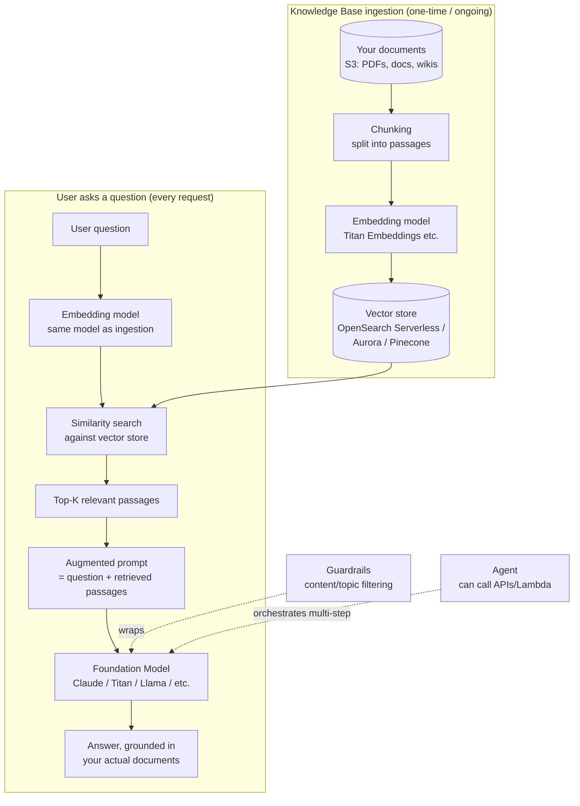
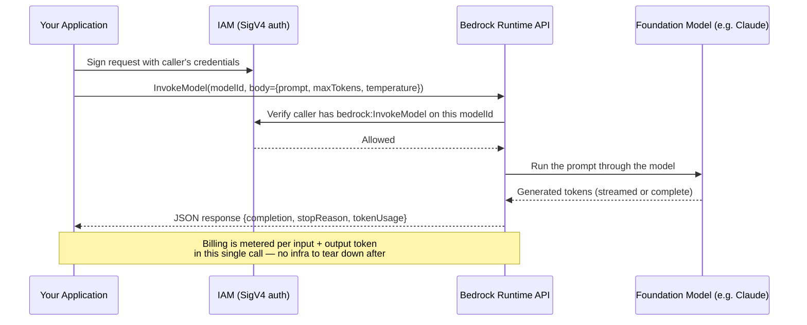
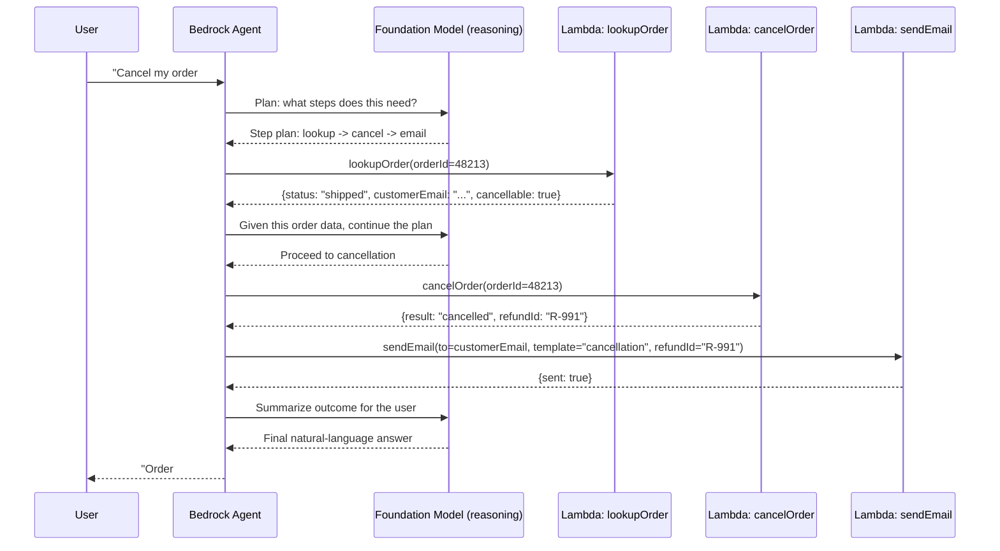
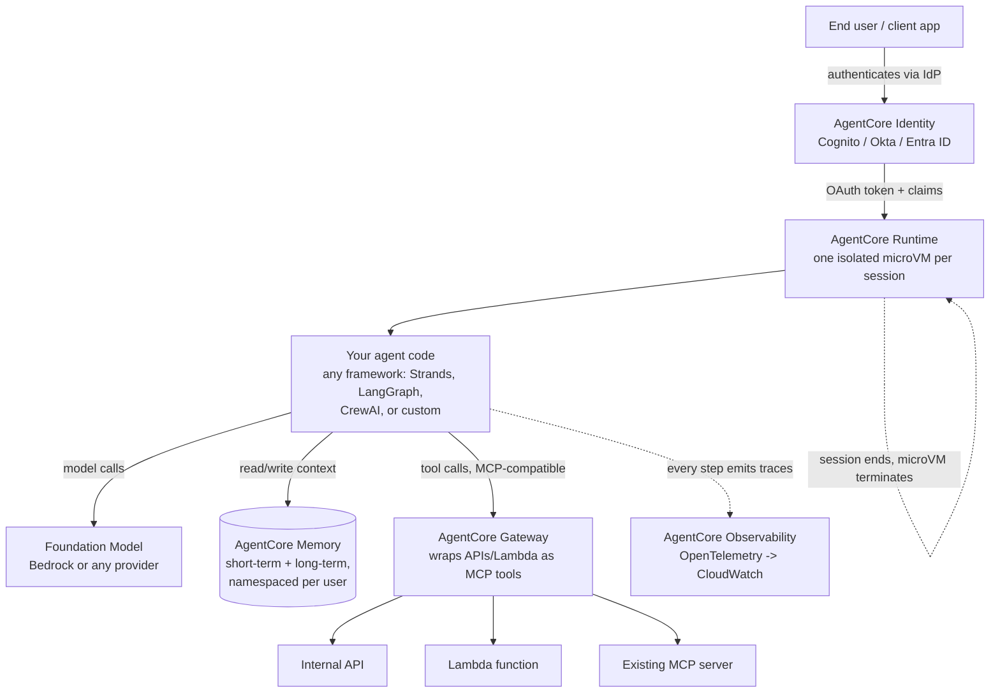
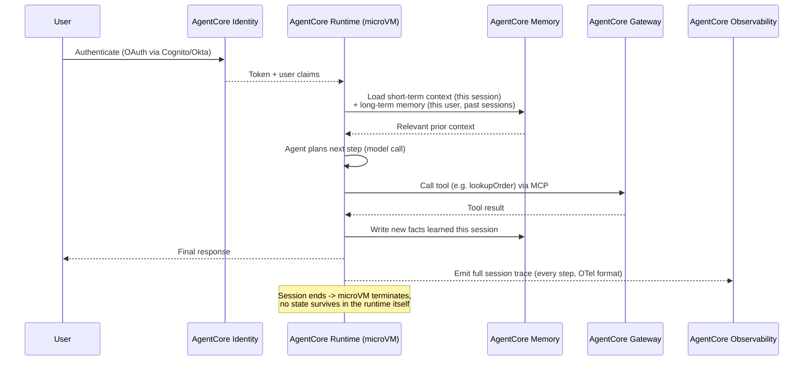
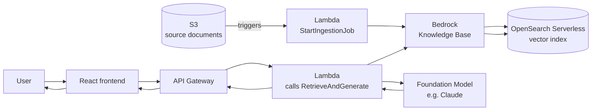
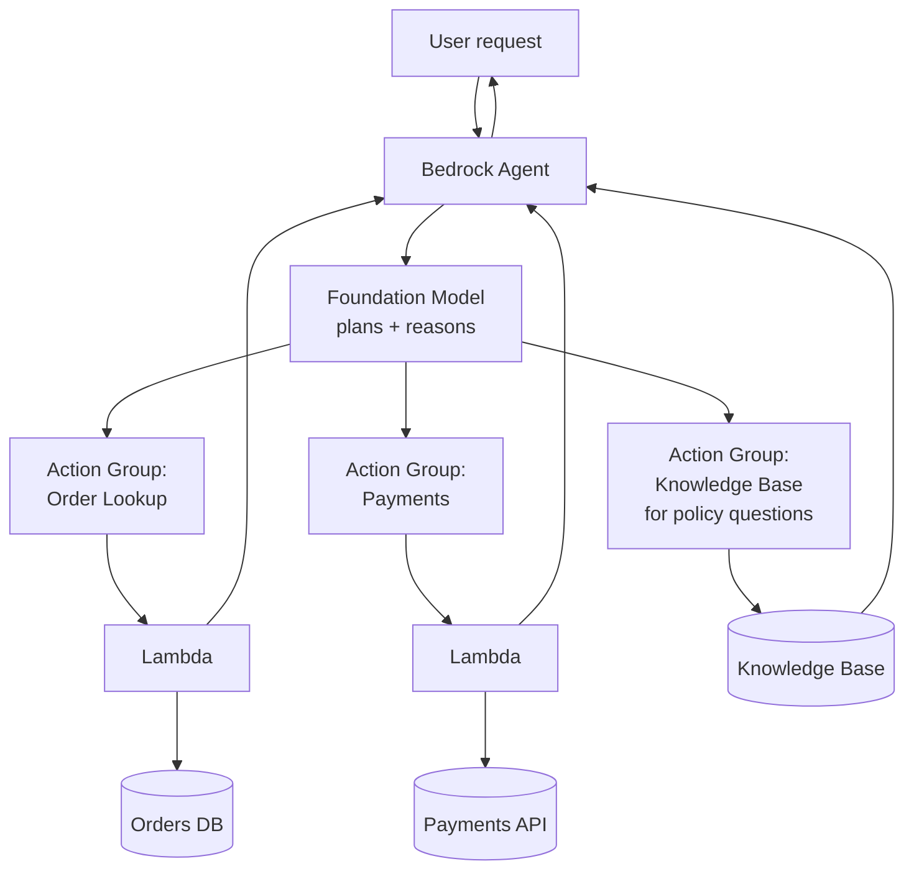
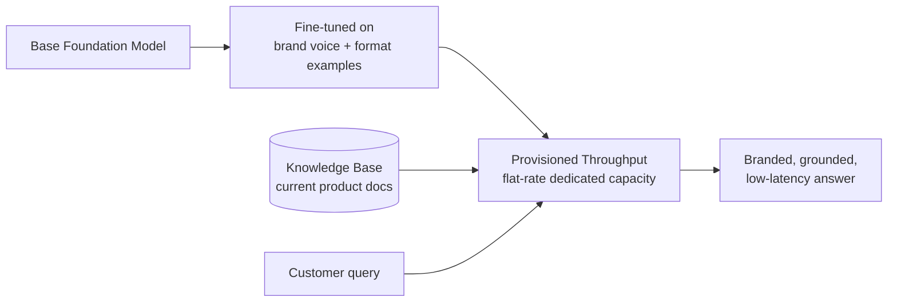
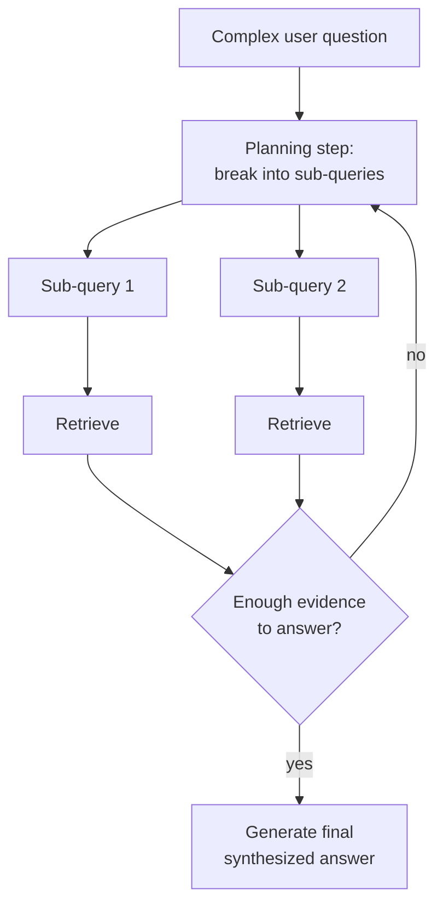

# Amazon Bedrock

> **Appears in:** [DVA-C03](../../certifications/dva-c03/README.md) · [MLA-C02](../../certifications/mla-c02/README.md)


## Definition

Amazon Bedrock is AWS's fully managed service for using and customizing **foundation models**
(large pre-trained AI models — the kind behind ChatGPT-style chat, image generation, and text
embeddings) from multiple providers, through one consistent API, without you ever provisioning
a GPU or managing any infrastructure. In plain terms: Bedrock is "AI models as an API call" —
you send text in, you get text (or an image, or a decision) out, and AWS runs everything behind
the scenes.

A few words you'll see constantly in this document, defined up front so nothing below assumes
prior ML knowledge:
- **Token** — the basic unit a foundation model reads and writes in. Not quite a word, not quite
  a character — roughly ¾ of an English word on average ("unbelievable" might be 2-3 tokens).
  Billing, context limits, and speed are all measured in tokens, not words or characters.
- **Context window** — the maximum number of tokens (input + output combined, depending on the
  model) a model can "see" at once in a single conversation/request. Think of it as the model's
  short-term memory for that one call — anything outside the window simply isn't visible to it.
- **Prompt** — the text you send the model, including instructions and any data you want it to
  consider. **Prompt engineering** is the skill of wording that input to reliably get the output
  you want.
- **Temperature** — a setting (usually 0 to 1) controlling how "creative" vs. "deterministic" a
  model's output is. Low temperature → same input tends to produce very similar output every
  time (good for extraction/classification); high temperature → more varied, surprising phrasing
  (good for brainstorming/creative writing).
- **Hallucination** — when a model states something confidently that is factually wrong or made
  up, because it's generating plausible-sounding text, not looking anything up. This is the core
  problem RAG (below) exists to reduce.

## Purpose

Training a large language model from scratch costs tens to hundreds of millions of dollars and
requires expertise almost no company has in-house. Most businesses don't need to build a
foundation model — they need to *use* one, often customized with their own data, embedded
safely into their own product. Before Bedrock, doing this on AWS meant either calling an
external AI vendor's API directly (losing AWS's security/compliance/billing integration) or
self-hosting an open model on SageMaker/EC2 (requiring real ML infrastructure expertise). Bedrock
exists to close that gap: it gives you serverless access to multiple best-in-class foundation
models (from Amazon itself, Anthropic, Meta, Mistral, AI21, Cohere, Stability AI, and others)
through one API, with AWS-native security, data privacy (your prompts/data aren't used to
retrain the underlying model, and stay inside your AWS account boundary), and pay-per-use
pricing — making generative AI something an ordinary application team can integrate in days,
not months.

Why this matters more than it sounds: before any managed service existed, a team that wanted
"ChatGPT, but grounded in our own internal wiki" had to solve four hard problems simultaneously —
pick and host a model, build a search system over their documents, glue the two together
correctly, and wrap the whole thing in enough security/compliance controls to pass a legal
review. Bedrock collapses all four into configuration choices on top of a single managed service.
That's the entire reason it exists, and it's also why MLA-C02 leans on it so heavily: the exam is
testing whether you understand *which* of those four problems a given Bedrock feature solves.

## How It Works

Plain-English first, because this section has to carry real weight for MLA-C02: a **foundation
model** is a very large neural network trained on enormous amounts of text (or images, or code)
that has learned general patterns of language and knowledge, which you can then direct toward a
specific task just by how you phrase your request (a "prompt") — no training required for basic
use. **RAG (Retrieval-Augmented Generation)** is the technique of giving that model *your own*
private documents to reference at answer-time, so it can answer accurately about things it was
never trained on (your company's internal policies, your product's documentation) instead of
guessing or "hallucinating." An **embedding** is a way of converting a chunk of text into a list
of numbers (a vector) that captures its *meaning* — so two sentences that mean similar things end
up with similar vectors, which is what makes "find documents similar to this question" possible
mathematically.



Step by step — RAG architecture (this is the single most important diagram in this category for
MLA-C02, because Domain 1, 2, and 3 all reference pieces of it):
1. **Your documents** (PDFs, Confluence pages, support tickets — whatever your organization's
   knowledge lives in) are stored in S3 as the source for a Bedrock **Knowledge Base**.
2. **Chunking** — because foundation models can't usefully search across a 200-page PDF as one
   blob, each document is split into smaller passages (a few hundred words each) — chunk size is
   a real tuning parameter: too small loses context, too large dilutes relevance.
3. **Embedding (ingestion time)** — each chunk is converted to an embedding vector by an
   embedding model (e.g., Amazon Titan Embeddings) and stored in a **vector store** (a database
   specialized for fast "find similar vectors" search — OpenSearch Serverless, Amazon Aurora
   with pgvector, or a third-party vector DB like Pinecone).
4. **A user asks a question** — at query time, that question is converted to an embedding using
   the *same* embedding model used during ingestion (this consistency matters — mismatched
   embedding models produce garbage similarity scores).
5. **Similarity search** — the vector store finds the chunks whose embeddings are mathematically
   closest to the question's embedding — i.e., the passages most likely to actually answer it.
6. **Augmented prompt** — the retrieved passages are inserted into the prompt sent to the
   foundation model, alongside the original question: "Using only the following context, answer
   this question: [context] [question]."
7. **Foundation Model generates the answer**, grounded in the retrieved real content instead of
   relying purely on what it memorized during training — this is what makes RAG dramatically
   reduce hallucination for knowledge the model wasn't trained on (and keeps proprietary data out
   of model retraining entirely).
8. **Guardrails** sit as a policy layer around the model call, filtering denied topics, PII,
   profanity, or off-brand responses on both the input and output side, regardless of what the
   user asked or the model generated.
9. **Agents** sit a layer above a single model call — rather than just answering a question, an
   Agent can plan a multi-step task, decide to call an external API or a Lambda function (e.g.,
   "look up this order status in DynamoDB," "submit this refund request"), and loop the result
   back into its reasoning before giving a final answer. Knowledge Bases are commonly one tool an
   Agent has available among several.

### A single model invocation, request to response

Before building anything RAG- or Agent-shaped, it helps to see the simplest possible Bedrock
interaction — one prompt in, one answer out, no retrieval, no tools. This is what "calling
Bedrock" means at its most basic, and it's the request/response shape both `InvokeModel` and
`Converse` (Bedrock's newer, model-agnostic chat API) wrap:



Two details worth internalizing because they're exam-relevant: the `modelId` string (e.g.
`anthropic.claude-3-5-sonnet-20240620-v1:0`) *is* the model choice — switching models is a
one-line change, not a redeployment, which is the whole point of Bedrock's unified API; and IAM
permissions are scoped **per model ID**, so "this role can call Titan but not Claude" is a normal,
testable policy shape, not an edge case.

### Worked example — building a RAG pipeline end to end, with real numbers

This is the walkthrough to actually understand RAG instead of just reciting the five-step list
above. Say your company has a 40-page internal IT support PDF ("how to request VPN access,"
"how to reset your password," etc.) and you want an internal chatbot to answer employee questions
from it accurately.

**Step 1 — Chunking.** A 40-page PDF is roughly 20,000 words, or about 27,000 tokens (English
text averages ~1.3 tokens per word). You cannot stuff that whole document into every prompt —
even if it fit in the context window, most of it is irrelevant to any single question and would
dilute the model's attention. So Bedrock Knowledge Bases splits it into chunks. A common, sane
starting configuration:
- **Chunk size: 300 tokens** (roughly a long paragraph — enough to contain a complete thought,
  short enough to stay topically focused).
- **Chunk overlap: 20%** (60 tokens shared between consecutive chunks) so a sentence that happens
  to fall across a chunk boundary still appears intact in at least one chunk.
- Result: ~27,000 tokens ÷ (300 − 60 effective new tokens per chunk) ≈ roughly 112 chunks for the
  whole document.

**Step 2 — Embedding each chunk.** Every one of those ~112 chunks is sent to an embedding model —
say Amazon Titan Text Embeddings V2, which outputs a **1,024-dimension vector** per chunk (a list
of 1,024 numbers; you can configure it down to 512 or 256 dimensions for a storage/speed
tradeoff, trading some retrieval precision). Conceptually, two chunks about "resetting your VPN
password" end up with vectors that are numerically *close* to each other, while a chunk about
"expense report submission" ends up numerically *far away* — even though none of the chunks share
many of the same literal words. That's the "captures meaning, not just keywords" property that
makes semantic search possible.

**Step 3 — Storing in the vector store.** All ~112 (vector, chunk text, source document)
triples are written into the configured vector store — most commonly Amazon OpenSearch
Serverless for a new build. The vector store's whole job is: given a new vector, find the stored
vectors closest to it, fast, even across millions of chunks.

**Step 4 — A user asks a question.** An employee types: *"How do I get VPN access for my new
laptop?"* That ~12-word question is itself converted to a 1,024-dim vector using the **exact same
Titan embedding model** used in Step 2 — if ingestion used a different embedding model than query
time, the two vector spaces wouldn't be comparable and similarity scores would be meaningless
(this exact mismatch is a real, tested failure mode — see Troubleshooting below).

**Step 5 — Similarity search (retrieval).** The vector store computes **cosine similarity**
(a number from -1 to 1 measuring how aligned two vectors' directions are, independent of their
length — 1 means pointing the exact same direction, i.e., "same meaning") between the question's
vector and all ~112 stored chunk vectors, and returns the **top-K** (commonly K=3 to 5) highest-
scoring chunks. In this example, the top 3 might be: "VPN access request process," "required
approvals for new device enrollment," and "IT help desk contact for access issues" — all
genuinely relevant, none of them literally containing the word "laptop."

**Step 6 — Augmenting the prompt.** Bedrock's `RetrieveAndGenerate` API assembles a new prompt
automatically, roughly:
```
System: Answer the user's question using ONLY the context below. If the answer isn't in the
context, say you don't know — do not guess.

Context:
[chunk 1 text: VPN access request process...]
[chunk 2 text: required approvals for new device enrollment...]
[chunk 3 text: IT help desk contact for access issues...]

Question: How do I get VPN access for my new laptop?
```

**Step 7 — Generation.** That augmented prompt (question + ~900 tokens of retrieved context) is
sent to the chosen foundation model (say Claude 3.5 Sonnet). The model generates a grounded
answer citing the actual retrieved process, and Bedrock returns both the answer text and the
source chunks/document references used — the **citations** that let a user (or an auditor) verify
the answer actually came from a real document, not from the model's imagination.

**Cost sanity check for this one query:** ~900 tokens of context + ~15 tokens of question as
input, plus maybe 150 tokens of generated answer as output. At representative on-demand Claude
3.5 Sonnet rates (check current pricing — rates change), that's a fraction of a cent per question.
The embedding calls (one at ingestion per chunk, one per query) are billed separately and are
typically far cheaper per token than generation calls — this is why RAG's *ongoing* query cost is
usually dominated by the generation step, not retrieval.

### Worked example — fine-tuning vs. RAG, side by side on the same problem

Take the same IT-helpdesk scenario and now ask: should we fine-tune a model instead of (or in
addition to) using RAG? **Fine-tuning** means continuing to train a copy of the base model on
labeled example pairs you provide, so it shifts its behavior/style/format. A fine-tuning dataset
for this case is a JSONL file (one JSON object per line) of prompt/completion pairs:

```json
{"prompt": "How do I reset my VPN password?", "completion": "Go to vpn.company.com/reset, enter your employee ID, and follow the emailed link. Resets take effect within 5 minutes."}
{"prompt": "My badge won't open the server room door.", "completion": "Server room access requires a separate Tier-2 badge request via the IT portal, approved by your manager. Standard badges don't include this by default."}
```

You'd need hundreds to thousands of such examples for a meaningful behavior shift. Fine-tuning
this way teaches the model a *response style/format* (short, this-company's-tone, always
mentioning the right portal name) — but it does **not** reliably teach it new *facts*, and if the
underlying VPN reset URL changes next quarter, every fine-tuned response is now wrong until you
re-fine-tune (an expensive, slow cycle). RAG, by contrast, just needs the updated document
re-ingested — the next query automatically retrieves the current URL, no retraining required.

**The exam-relevant takeaway, stated plainly:** RAG is for facts that change or that the model
never saw ("what does OUR current policy say"); fine-tuning is for behavior/format/tone that
should hold steady regardless of which facts are involved ("always respond in this exact JSON
schema," "always sound like our brand voice," "deeply understand this narrow domain's jargon").
The strongest real systems typically use both — a lightly fine-tuned model (consistent tone/
format) that also has a Knowledge Base attached (current facts).

### Agents — a multi-step tool-calling walkthrough

A single model call answers a question. An **Agent** can *act* — deciding on its own, across
multiple steps, to call external functions and incorporate their results before responding.
Concretely, for "Cancel my order #48213 and email me a confirmation":



Each Lambda function here is registered with the Agent as an **Action Group** — a formally
described set of operations (with an OpenAPI-style schema) the model is allowed to call, with
clear input/output shapes. The model itself never touches your database or email system directly;
it only ever decides *which* registered function to call with *what* arguments, and your Lambda
code does the actual work under normal IAM permissions — this separation is exactly what makes
Agents auditable and safe to put in front of a production system.

### Prompt engineering, worked side by side

The same question, phrased three different ways, produces measurably different reliability —
this is "prompt engineering," and it's worth seeing concretely rather than as an abstract term:

**Zero-shot** (just ask):
```
Classify this support ticket as Billing, Technical, or Account:
"I was charged twice for my subscription this month."
```
Works fine for an easy case like this one, but gets inconsistent on ambiguous tickets because the
model has no example of your exact labeling convention to anchor on.

**Few-shot** (show 2-3 examples of the exact input/output pattern you want first):
```
Classify each ticket as Billing, Technical, or Account.

Ticket: "My password reset email never arrived." -> Account
Ticket: "The app crashes when I upload a photo." -> Technical
Ticket: "I was charged twice for my subscription this month." -> Billing

Ticket: "I can't remember which email I signed up with." ->
```
Few-shot dramatically improves consistency on edge cases because the model now has a concrete
pattern to match against, not just a category name to interpret.

**Chain-of-thought** (ask the model to reason step by step before answering, for tasks that
need real reasoning, e.g. multi-step arithmetic or policy interpretation):
```
A customer wants a refund on an order placed 35 days ago. Our policy allows refunds within 30
days, with a 10-day grace period for orders over $200. The order was $250.

Think through the policy step by step, then give a final Yes/No answer.
```
Chain-of-thought trades a few extra output tokens (hence a small cost increase) for a large
reliability improvement on anything resembling a multi-step decision — a direct, practical
cost/accuracy tradeoff worth knowing, not just a prompting trick.

### Model family comparison — choosing a starting point

Bedrock's "one API, many models" design only pays off if you know roughly what each family is
good at. A rough starting mental map (always confirm current model cards — capabilities and
rankings change fast):

| Family | Typical strength | Good first choice for |
|---|---|---|
| **Anthropic Claude** | Strong reasoning, long context, careful instruction-following | Complex RAG/agentic tasks, nuanced writing, code review |
| **Amazon Titan** | Native AWS integration, strong embeddings model, lower cost text models | Embeddings for Knowledge Bases, cost-sensitive simple text tasks |
| **Meta Llama** | Strong open-weight option, good general performance | Teams who may want to later self-host the same model family on SageMaker |
| **Mistral** | Efficient, strong at lower parameter counts | Cost/latency-sensitive tasks that don't need the largest model |
| **Cohere Command** | Strong retrieval/rerank and enterprise search features | Search-heavy, retrieval-centric applications |
| **AI21 Jamba** | Long-context, hybrid architecture efficiency | Long-document summarization/analysis |
| **Stability AI** | Image generation | Generating marketing/product imagery, not text at all |

The exam doesn't expect you to memorize which model "wins" a benchmark — it expects you to know
that **embeddings and text generation are different model types**, that **image generation is a
separate model category from either**, and that switching between providers inside Bedrock is a
configuration change, not an architecture change.

## Bedrock AgentCore — Deep Dive

Everything above this section describes calling a model and, at most, letting an Agent call a
handful of Lambda-backed Action Groups. **Bedrock AgentCore** is a separate, newer platform layer
that exists for a different problem: *running agents in production, at scale, safely* — session
isolation, durable state across a long-running or multi-turn interaction, identity/credential
management for what an agent is allowed to touch, and purpose-built observability for agentic
workloads specifically. Bedrock Agents (covered earlier) answer "can the model call a function";
AgentCore answers "how do I actually operate hundreds of these agent sessions in production
without building my own session/state/identity/observability infrastructure by hand."

### Why AgentCore exists as a separate thing from "just an Agent"

A single Bedrock Agent calling a few Action Groups, as described above, is enough for a
demo or a lightly-used internal tool. It is *not* enough once you need: many concurrent users each
with their own isolated, stateful session; an agent that needs to remember something from three
days ago in a different conversation; credentials scoped per-end-user rather than one shared
execution role; or a way to debug *which specific step* in a long multi-step agent run actually
failed, across potentially dozens of tool calls. Building all of that yourself (session storage,
per-user credential vending, step-level tracing) is exactly the kind of undifferentiated
infrastructure work AWS keeps building managed services to absorb — AgentCore is that managed
layer, purpose-built for agentic workloads instead of adapted from general-purpose compute.

### AgentCore architecture



Walking through each piece and the problem it specifically solves:

1. **AgentCore Identity** handles authentication and authorization *for the agent itself*, not
   just for your application's human users. A user authenticates through your existing identity
   provider (Amazon Cognito, Okta, Microsoft Entra ID — AgentCore doesn't require migrating
   away from whatever IdP you already run); AgentCore Identity receives that token, extracts
   custom claims defining what this specific user is allowed to do, and makes those claims
   available throughout the session — so an agent acting *on behalf of* a specific user inherits
   that user's actual permissions rather than one shared, overly broad service-role identity for
   every user. A **token vault**, backed by Secrets Manager, secures the API keys/credentials the
   agent needs to reach external systems, with role-based access control over who/what can use
   which stored credential.
2. **AgentCore Runtime** is the actual execution environment: a secure, serverless runtime where
   **every session runs in its own isolated microVM**, with dedicated compute and memory,
   framework-agnostic (works with LangGraph, Strands Agents, CrewAI, LlamaIndex, Google ADK,
   OpenAI Agents SDK, or fully custom agent code), and supporting long-running sessions (AgentCore
   Runtime explicitly supports extended execution — hours, not just a typical Lambda's
   15-minute ceiling — for genuinely long agentic workflows like deep research tasks). When a
   session ends, its microVM terminates entirely — no state silently persists in a shared process
   between unrelated users' sessions, which is the architectural guarantee that makes multi-tenant
   agent hosting safe in the first place.
3. **AgentCore Memory** is the answer to **agent state management** specifically — the part of
   this architecture most directly relevant to anyone who has tried to build this themselves and
   hit the "where does conversation history actually live" wall. It provides both:
   - **Short-term memory** — conversation history and working context for the *current*
     multi-turn session, so the agent remembers what was said five messages ago within one
     conversation.
   - **Long-term memory** — facts, preferences, and summarized context that persists **across**
     sessions, **namespaced per user/actor**, so a returning user's agent remembers relevant
     history from a prior, entirely separate conversation days or weeks later, without manually
     re-feeding that context every time. Memory can also be **shared across multiple agents**
     within a session for multi-agent systems, so a specialist sub-agent inherits context a
     planning agent already gathered instead of starting cold.
   The practical shift this represents: before AgentCore, "does my agent remember anything beyond
   this one request" was a problem every team solved with their own DynamoDB table and
   hand-rolled summarization logic; AgentCore Memory makes that a configured capability instead
   of a bespoke subsystem.
4. **AgentCore Gateway** turns existing APIs, Lambda functions, and even other pre-existing MCP
   (Model Context Protocol) servers into MCP-compatible tools an agent can call, with
   `AWS_IAM`/SigV4-authenticated tool traffic and exposing only the specific, approved tool
   targets a given agent is allowed to reach — the production-grade, access-controlled version of
   what an Action Group does for a basic Bedrock Agent.
5. **AgentCore Observability** is the piece worth calling out explicitly by name, because it
   solves a problem generic application monitoring genuinely does not: debugging *one specific
   agent run's reasoning path*. It emits **OpenTelemetry (OTel)-standardized traces** through
   Amazon CloudWatch, giving:
   - **Session-level and step-level tracing** — every planning step, every tool call, every
     intermediate model response inside one agent run is captured as part of one trace, the same
     way X-Ray stitches together a request's hops across services (see `x-ray.md`), but purpose-
     built for an agent's *reasoning* steps specifically, not just service-to-service network
     calls.
   - **Execution path visualization** — a step-by-step view of exactly what the agent decided to
     do and in what order, letting you inspect intermediate outputs (what did the agent actually
     retrieve or compute at step 3, before it made the decision that turned out wrong at step 5).
   - **Token-level foundation model spend tracking** — cost attribution down to which session,
     which agent, and which model call actually consumed the tokens, rather than one undifferentiated
     monthly Bedrock bill.
   - **Standard observability stack compatibility** — because it's OTel-based, the same trace
     data can flow to any OTel-compatible backend (CloudWatch natively, or third-party tools like
     Datadog), rather than being locked into a single proprietary format.
   The exam-relevant framing: **AgentCore Observability is to an agent's reasoning steps what
   X-Ray is to a distributed request's service hops** — same underlying idea (trace one logical
   unit of work across many smaller steps), applied one layer up, to an agent's *decisions*
   rather than a request's network calls.

### A real multi-step agent session, traced through AgentCore



Reading this top to bottom: authentication and memory loading happen *before* the agent's first
real reasoning step, which is what lets the agent act with the correct user's permissions and
relevant history from the very first decision, not as an afterthought bolted on partway through.
The trace to Observability happens continuously (not just at the end) in a real deployment — it's
drawn here as one step purely for diagram clarity — and the microVM's termination at session end
is the mechanism, not just a policy, behind AgentCore's session-isolation guarantee: there's no
shared long-lived process for stale state to leak out of between unrelated sessions.

### AgentCore vs. a plain Bedrock Agent — when the upgrade is warranted

| Need | Plain Bedrock Agent (covered above) | Bedrock AgentCore |
|---|---|---|
| Single-session, single-user tool-calling demo | Sufficient on its own | Overkill for this alone |
| Many concurrent users, each needing isolated session state | Not built for this — no session-isolation guarantee of this kind | **Runtime's per-session microVM is exactly this** |
| Agent must remember facts across separate, later conversations | No native cross-session memory | **AgentCore Memory's long-term, per-user-namespaced store** |
| Credentials/permissions should reflect the specific end user, not one shared execution role | Harder to express cleanly | **AgentCore Identity's per-user claims and token vault** |
| Need to debug exactly which step of a multi-step agent run failed, in production | Limited visibility beyond basic invocation logs | **AgentCore Observability's step-level, OTel-based tracing** |
| Need agents built in an open-source framework (LangGraph, CrewAI) rather than Bedrock's own Agent construct | Not supported — a Bedrock Agent is Bedrock's own construct | **Framework-agnostic by design** |

The practical exam-relevant takeaway: a scenario describing a single, lightly-used, stateless
tool-calling assistant is still just "Agents for Bedrock." A scenario describing *scale*
(many concurrent users), *persistence* (remembering across sessions), *per-user security
boundaries*, or *production-grade step-level debugging* is describing the specific problems
AgentCore's Runtime, Memory, Identity, and Observability components solve, respectively — naming
the *right AgentCore component* for the *specific* problem in the scenario (not just saying
"AgentCore" generically) is the deeper skill being tested.

### Official architecture reference


*Figure: the official AgentCore harness architecture — every session is stateful by default and
runs in a secure, isolated microVM (backed by AgentCore Runtime), with its own filesystem and
shell so the agent can write and execute code directly, while short-term and long-term memories
persist across sessions even after a given microVM has terminated and been replaced. This is the
concrete, AWS-drawn version of the same microVM-isolation-plus-persistent-memory idea walked
through in the architecture diagram above. Source: Amazon Bedrock AgentCore Developer Guide,
["AgentCore harness"](https://docs.aws.amazon.com/bedrock-agentcore/latest/devguide/what-is-bedrock-agentcore.html).*


*Figure: a concrete, event-driven reference pattern — EventBridge triggers an AgentCore-hosted
agent in response to a real business event (e.g., a new support ticket), with AgentCore Memory
persisting task/context state across the (potentially asynchronous, multi-step) resolution
process and Lambda handling discrete tool actions along the way. This illustrates AgentCore being
used for *event-driven, backend* agentic automation, not just a synchronous chat-style
interaction. Source: AWS Prescriptive Guidance, ["Orchestration models: From rule-based to
AI-native"](https://docs.aws.amazon.com/prescriptive-guidance/latest/agentic-ai-serverless/orchestration-models.html).*

### AgentCore and the exams, specifically

- **MLA-C02** — AgentCore extends Domain 3's (Deployment & Orchestration) agent-orchestration
  content beyond single-call Agents into production operating concerns: session isolation,
  memory architecture (short-term vs. long-term, per-user namespacing), and identity/credential
  scoping for agents acting on a user's behalf. Domain 4 (Monitoring & Security) content
  increasingly points at **AgentCore Observability** specifically for anything framed as
  "debugging a multi-step agent's execution path in production" or "tracking per-session
  foundation model cost," distinct from Guardrails (content safety) or general CloudWatch metrics
  (infrastructure health).
- **DVA-C03** — AgentCore is in scope at the "building/integrating with AI services securely"
  depth this exam tests Bedrock at generally: a developer-facing question might ask about
  AgentCore Identity's role in scoping an agent's permissions to the calling user (an IAM/security
  question wearing an agentic-AI costume) rather than expecting agent-architecture design depth —
  that design depth is MLA-C02 territory.

## Key Features / Components

- **Foundation Model access** — one API across multiple model providers: Amazon's own **Titan**
  family (text, embeddings, image generation), **Anthropic Claude**, **Meta Llama**, **Mistral**,
  **AI21 Jamba**, **Cohere Command**, **Stability AI** (image generation) — switch models by
  changing a model ID, not rewriting your integration.
- **Knowledge Bases for Bedrock** — the managed RAG pipeline described above: handles chunking,
  embedding, vector store management, and retrieval orchestration so you don't build that
  plumbing yourself. Supports multiple chunking strategies (fixed-size, hierarchical, semantic —
  splitting at natural topic boundaries rather than a raw token count) and multiple vector store
  backends.
- **Agents for Bedrock** — multi-step task orchestration: the model plans actions, calls
  Lambda functions/APIs, and incorporates results, enabling "do this task" instead of just
  "answer this question." Action Groups define exactly what an Agent is allowed to call.
- **Guardrails for Bedrock** — configurable content filtering applied to both prompts and model
  responses, independent of which underlying foundation model you're using. Concretely covers:
  **denied topics** (define a topic in plain language, e.g. "investment advice," and the model
  refuses to engage with it), **content filters** (hate, insults, sexual, violence, misconduct —
  each with a configurable strictness threshold), **PII redaction** (detect and mask things like
  SSNs, emails, phone numbers in either direction), **word filters** (exact profanity/competitor-
  name blocklists), and **contextual grounding checks** (flag a generated answer that isn't
  actually supported by the retrieved RAG context — a direct hallucination detector).
- **Model customization** — **Fine-tuning** (continue training a model on your labeled
  input/output examples to shift its behavior/style/domain knowledge) and **Continued
  pre-training** (further train on your unlabeled domain text to deepen domain knowledge) —
  both produce a private, custom version of the base model that only your account can use.
- **Prompt management & Prompt flows** — version and manage prompt templates, and chain
  multiple model calls/logic steps visually (a lightweight workflow layer, simpler than a full
  Agent).
- **Model evaluation** — built-in tooling to compare multiple models/prompts against your own
  test data using automatic metrics (e.g., BERTScore-style similarity, F1) or human review, before
  you commit to one in production.
- **Provisioned Throughput** — reserve dedicated model capacity (in "model units," a defined
  throughput rate) for predictable, high-volume workloads at a flat rate, instead of per-token
  on-demand pricing.
- **Bedrock Marketplace** — an expanded catalog of specialized and emerging third-party models
  (beyond the headline providers) deployable with the same unified API, for narrower or
  newer-research use cases.
- **Bedrock AgentCore** — newer infrastructure layer for running agents at production scale
  (session management, memory, identity, observability for agentic workloads) — this is where
  MLA-C02's expanded Domain 3 agent-orchestration content increasingly points.
- **Model Distillation** — train a smaller, cheaper, faster model to mimic a larger model's
  outputs on your specific task, trading a little quality for significantly lower latency/cost at
  high volume.

## Use Cases — When to Use It

Each scenario names the business problem, why the specific Bedrock feature fits it, and the
tradeoff against the nearest alternative:

- **Internal IT/HR helpdesk chatbot (any enterprise):** Problem — employees waste time hunting
  through wikis/PDFs for policy answers. Why Bedrock fits — Knowledge Bases (RAG) retrieve the
  exact current policy passage and generate a grounded, cited answer. Tradeoff vs. Amazon Q
  Business (see `amazon-q.md`) — Q Business packages this entire pattern (connectors, indexing,
  chat UI) with far less engineering; build directly on Bedrock only when you need custom
  chunking, a bespoke UI, or tighter control than Q's managed defaults allow.
- **Customer-facing product support bot (e-commerce/SaaS):** Problem — support tickets repeat the
  same questions about a catalog or feature set that changes weekly. Why Bedrock fits — RAG means
  re-ingesting updated product docs keeps answers current with zero retraining. Tradeoff vs.
  fine-tuning — fine-tuning would need a full retrain every time the catalog changes, a slow,
  expensive cycle RAG avoids entirely for fast-changing facts.
- **Fraud-pattern narrative summarization (financial services):** Problem — fraud analysts must
  read hundreds of flagged-transaction case notes a day. Why Bedrock fits — a foundation model
  summarizes each case's evidence into a short, structured brief, letting analysts triage faster.
  Tradeoff vs. a custom SageMaker summarization model — Bedrock needs no training data or
  infrastructure, but a tightly-scoped custom model might eventually be cheaper at extreme,
  sustained volume.
- **Medical literature / clinical note summarization (healthcare):** Problem — clinicians need
  key facts extracted from long, unstructured clinical notes or research papers quickly. Why
  Bedrock fits — long-context models (Claude, AI21 Jamba) digest a multi-page note into a
  structured summary in one call. Tradeoff vs. Comprehend Medical — Comprehend Medical is
  purpose-built for extracting discrete medical entities (conditions, dosages) more cheaply and
  predictably; Bedrock is the better fit for open-ended summarization/synthesis Comprehend Medical
  doesn't attempt.
- **Content moderation and brand-safety filtering (media/UGC platforms):** Problem — generative
  features must never produce off-brand, unsafe, or legally risky text regardless of what a user
  prompts. Why Bedrock fits — Guardrails apply denied-topic, content-filter, and PII-redaction
  policy uniformly across every model call. Tradeoff vs. Rekognition's image-moderation
  categories — Guardrails governs *generated text*, Rekognition governs *uploaded images/video*;
  a platform handling both content types needs both tools, not one in place of the other.
- **Demand-forecasting narrative explanations (retail):** Problem — a forecasting model (Amazon
  Forecast or SageMaker DeepAR) produces numbers a merchandising team doesn't intuitively trust.
  Why Bedrock fits — a model call turns raw forecast output into a plain-English explanation
  ("demand is projected up 12% due to the historical pattern around this holiday"). Tradeoff vs.
  a human analyst writing the same narrative — Bedrock scales to thousands of SKUs instantly;
  accuracy of the *narrative* still depends entirely on the upstream forecast being correct.
- **Recommendation engine re-ranking and explanation (e-commerce):** Problem — a recommendation
  model (Personalize/SageMaker) returns a ranked list, but the product team wants a natural-
  language "why we recommended this" line per item. Why Bedrock fits — a lightweight prompt
  turns structured recommendation metadata into a persuasive, grounded one-line explanation.
  Tradeoff vs. hand-written template strings — templates are cheaper and fully deterministic but
  can't adapt phrasing to each item's actual attributes the way a model call can.
- **Document/contract analysis (legal/insurance):** Problem — extract obligations, dates, and risk
  clauses from long, unstructured contracts that vary wildly in format. Why Bedrock fits — a
  long-context model reads the whole document and extracts structured fields with reasoning
  Textract's layout-based extraction can't perform (it finds structure, not legal meaning).
  Tradeoff vs. Textract — Textract is far cheaper and more deterministic for form/table
  extraction; Bedrock is the right tool once the task requires actually *understanding* the text,
  not just locating it.
- **Synthetic training data generation (any ML team bootstrapping a smaller model):** Problem — a
  team needs thousands of example conversations or labeled text to train a smaller, cheaper
  downstream model, and manual authoring is too slow. Why Bedrock fits — a foundation model
  drafts a first-pass dataset far faster than human authors. Tradeoff vs. fully human-authored
  data — synthetic data is faster and cheaper but needs human review for quality/bias before it's
  trusted as training data, unlike a smaller, curated human-written set.
- **Multilingual customer support (global consumer products):** Problem — support agents and
  customers speak different languages, and translating through a separate service loses context
  between turns. Why Bedrock fits — one model both understands and responds fluently across
  languages in the same conversation, no separate Translate hop required. Tradeoff vs. Transcribe
  + Translate + Polly chained together (see `ai-services-overview.md`) — the chained AI-services
  pipeline is cheaper per call and fully deterministic in each step, but Bedrock handles open-ended
  conversational nuance across languages better than a rigid translate-then-respond pipeline.
- **Code generation and review assistance (software engineering):** Problem — developers want
  inline code suggestions and natural-language explanations of unfamiliar code. Why Bedrock fits —
  direct model invocation for ad hoc code-related prompts inside a custom internal tool. Tradeoff
  vs. Amazon Q Developer — Q Developer packages this exact capability into IDE/CLI integrations
  with zero setup; build directly on Bedrock only if you need a bespoke tool Q Developer doesn't
  offer.
- **Insurance claims triage (insurance):** Problem — incoming claims (text descriptions, attached
  photos' captions, adjuster notes) need to be read, categorized by severity, and routed to the
  right team. Why Bedrock fits — an Agent can read a claim, classify it, query a claims database
  via an Action Group, and route it — a multi-step task, not just a single answer. Tradeoff vs. a
  rules-based routing engine — rules are fully deterministic and auditable but brittle against
  claims phrased in ways the rule author didn't anticipate; an Agent handles that variability at
  the cost of needing careful Action Group schema design and ongoing monitoring.

## When NOT to Use It / Alternatives

- **You need a classifier/regressor on structured/tabular data** (fraud score, churn
  probability) — a foundation model is the wrong tool entirely; use SageMaker training with a
  built-in algorithm (XGBoost etc.) instead — Bedrock is for generative/language/vision tasks,
  not traditional supervised ML on tabular data.
- **You need full control over the model's weights, training infrastructure, or want to
  self-host an open-source model with custom serving code** — use SageMaker (JumpStart to pull
  an open model, or custom training/hosting) instead; Bedrock deliberately trades some control
  for zero infrastructure management.
- **Your task is a narrow, well-defined pattern already solved by a purpose-built AI service** —
  don't build a Bedrock prompt to do OCR or sentiment analysis; Textract and Comprehend are
  cheaper, faster, and more accurate for those specific jobs (see `ai-services-overview.md`).
- **You need guaranteed low, predictable latency at very high constant volume and have the ML
  expertise to manage it** — self-hosting an open model on SageMaker/EC2 with reserved capacity
  might be more cost-effective at extreme scale than per-token Bedrock pricing, though it trades
  away Bedrock's zero-ops simplicity.
- **Strict data residency/offline requirements with no cloud connectivity at all** — Bedrock is
  a cloud API; edge/offline generative AI needs a different (much more involved) architecture.
- **Your "AI" requirement is actually deterministic business logic in disguise** (e.g., "always
  reject refunds over $500 without a manager code") — don't ask a foundation model to enforce a
  hard rule it might occasionally phrase around; enforce hard rules in ordinary application code,
  and reserve the model for the genuinely language-y parts of the interaction.
- **You need bit-for-bit reproducible output for compliance/audit reasons** — even at temperature
  0, foundation models aren't guaranteed perfectly deterministic across model version updates;
  if you need guaranteed-identical output for a given input indefinitely, that's a sign you need
  deterministic code, not a generative model, for that specific step.

## Common Architectures

Three patterns come up repeatedly in both real deployments and MLA-C02 scenario questions —
worth recognizing by shape, not just by name.

### Pattern 1 — Serverless RAG chatbot (the "internal knowledge assistant")

This is the most common production Bedrock pattern: a chat frontend, an API layer, and a
Knowledge Base doing the grounding. It's exactly the architecture AWS's own reference blog post
for this pattern uses:


*Figure: solution architecture for a contextual chatbot built on Amazon Bedrock Knowledge Bases —
S3 as the document source, Lambda triggering ingestion, OpenSearch Serverless as the vector
store, and an API Gateway + Lambda layer calling `RetrieveAndGenerate` for the chat frontend.
Source: AWS Machine Learning Blog, "Build a contextual chatbot application using Amazon Bedrock
Knowledge Bases" — aws.amazon.com/blogs/machine-learning.*



This maps directly onto the RAG diagram earlier in this document — S3/Lambda/OpenSearch
Serverless are simply the concrete AWS services filling the "Ingestion" and "Query" boxes.

### Pattern 2 — Agentic multi-tool orchestration

For "do something" rather than "answer something" use cases, an Agent sits in front of multiple
Action Groups, each backed by a Lambda function hitting a different backend system:



The key architectural idea here (and a tested distinction): a Knowledge Base can itself be *one
of the tools* an Agent has access to, alongside action-taking Lambda functions — RAG and Agents
aren't competing patterns, Agents are often built *using* a Knowledge Base as one capability among
several.

### Pattern 3 — Hybrid: fine-tuned model + RAG + Provisioned Throughput

For a high-volume, brand-voice-sensitive production assistant (e.g., a customer-facing support
bot with heavy, predictable traffic), the strongest real-world pattern combines all three
customization axes:



Fine-tuning fixes *tone/format* consistency, the Knowledge Base fixes *factual currency*, and
Provisioned Throughput fixes *cost/latency predictability* at scale — three separate problems,
three separate Bedrock features, deliberately composed rather than any single feature trying to
solve all three.

### Pattern 4 — Multi-step agentic retrieval (planning loop)

A newer pattern worth recognizing: instead of one retrieval pass, an Agent can *plan* its
retrieval — break a complex question into sub-questions, retrieve for each, judge whether it has
enough evidence, and retrieve again if not:



This is meaningfully different from the single-pass RAG in Pattern 1 — it costs more (multiple
retrieval + reasoning round-trips) but handles genuinely multi-part questions ("compare our
return policy to our warranty policy and tell me which is more generous") that a single
similarity search would answer only partially. Recognize this as the deeper end of what "Agents"
can mean beyond simple tool-calling — the planning loop itself is a reasoning pattern, not just
function dispatch.

## Why It's Important

**Real-world:** Generative AI adoption inside real companies increasingly runs through managed
platforms like Bedrock specifically *because* of the data-privacy and security guarantees it
provides (your prompts and documents aren't used to train the underlying shared models, traffic
stays inside your AWS account/VPC boundary, IAM governs who can call what) — this is the
difference between "safe enough for internal compliance review" and "legal says no." Guardrails
and content filtering are not optional nice-to-haves in production — they're often the
difference between shipping a GenAI feature and having it blocked by legal/security review
entirely.

### Security and network isolation, concretely

Since both DVA-C03 and MLA-C02 touch Bedrock's security posture, it's worth being specific about
what "stays inside your AWS account boundary" actually means in practice:
- **IAM** governs every Bedrock API call exactly like any other AWS service — `bedrock:InvokeModel`,
  `bedrock:CreateKnowledgeBase`, etc. are ordinary IAM actions you can scope per role, per model
  ID, per Knowledge Base ARN. A Lambda function calling Bedrock needs an execution role with
  exactly the actions it uses — nothing more.
- **VPC endpoints (PrivateLink)** let you call the Bedrock API without the traffic ever traversing
  the public internet, keeping prompt/response traffic inside your VPC's private network path —
  relevant for any compliance posture that restricts what's allowed to touch a public endpoint.
- **Encryption** — data in transit is TLS-protected by default; data at rest (fine-tuned model
  artifacts, Knowledge Base vector stores where applicable) can be encrypted with your own
  customer-managed KMS keys, not just AWS-managed defaults, for organizations that require
  key-level control.
- **CloudTrail** logs every Bedrock API call (who called what, when, with which model) for audit
  purposes — this is how "who asked Bedrock what, and when" gets answered after the fact,
  separate from any application-level conversation logging you add yourself.
- None of this is unique to Bedrock — it's the same IAM/VPC/KMS/CloudTrail pattern every AWS
  service follows — but a surprising number of real teams assume generative AI APIs are somehow
  exempt from normal AWS security practice, and that assumption is exactly what exam questions
  (and real security reviews) are testing against.

**Exam weight (MLA-C02) — this is critical, read carefully:** Bedrock is the headline reason
MLA-C02 exists as a distinct, heavier exam than MLA-C01. It's woven through **every domain**:
- **Domain 1 (Data Preparation, 28%)** — preparing data for embeddings and RAG (chunking
  strategy, document preprocessing for Knowledge Bases).
- **Domain 2 (Model & FM Development, 24%)** — *explicitly renamed* to include Foundation Model
  development: selecting a foundation model for a task, prompt engineering, fine-tuning vs.
  continued pre-training vs. RAG (know when each is the right customization approach — RAG for
  "needs current/proprietary facts," fine-tuning for "needs to behave/format differently,"
  neither alone fixes a fundamentally wrong base model choice).
- **Domain 3 (Deployment & Orchestration, 24%)** — Knowledge Bases and Agents as deployment
  targets, Provisioned Throughput vs. on-demand for cost/latency tradeoffs.
- **Domain 4 (Monitoring & Security, 24%)** — Guardrails for content safety, GenAI-specific cost
  monitoring (token-based billing is a different cost model than instance-hour billing and needs
  its own Cost Explorer/Budget strategy).

**DVA-C03 relevance:** Bedrock (plus Bedrock AgentCore) and Amazon Q are explicitly **in scope**
for DVA-C03 as part of its "AI-assisted development" and new Task 2.3 (security risks of
integrating AI services) content — a developer-exam question might ask about calling the
Bedrock API from application code, securing that integration (IAM scoping, VPC endpoints,
keeping sensitive data out of prompts/logs), or using Guardrails to prevent prompt injection —
but DVA-C03 will never ask you to design a Knowledge Base's chunking strategy or compare
fine-tuning approaches; that depth is MLA-C02 territory.

## Limits & Quotas

Exact numbers change as AWS updates service quotas — always check the Service Quotas console for
current values — but knowing the *shape* of what's limited is genuinely tested:

- **Context window size is model-specific, not a Bedrock-wide setting.** Claude 3.5 Sonnet
  supports up to 200K tokens of context; Titan Text models historically support far smaller
  windows (check current model card). A question about "the document is too long for the model
  to process in one call" is pointing at context window size, which is a property of the chosen
  model, not something Bedrock lets you override.
- **Requests-per-minute and tokens-per-minute quotas** are set per account, per model, per
  Region, and differ for on-demand vs. Provisioned Throughput traffic — a sudden `Throttling
  Exception` under load is almost always an RPM/TPM quota being hit, not a bug.
- **Knowledge Bases** — there are limits on the number of data sources per knowledge base, max
  document size per ingested file, and max chunk size — a document far larger than the per-file
  limit needs to be split before ingestion, not handled automatically.
- **Guardrails** — a limit on the number of denied topics, word filter entries, and PII entity
  types configurable per Guardrail; very large blocklists may need to be split across multiple
  Guardrails or consolidated.
- **Provisioned Throughput** is purchased in whole "model units," each with a fixed
  tokens-per-second capacity that varies by model — undersizing this for your real traffic shows
  up as latency degradation under load exactly like an undersized SageMaker endpoint would.
- **Model access must be explicitly requested per model, per Region** before you can invoke it —
  this is a one-time console/API action, and forgetting it is the single most common "it's not
  working" cause for anyone trying Bedrock for the first time (see Troubleshooting).
- **Batch inference** (processing a large set of prompts asynchronously, without holding a live
  connection per request) has its own separate quota and job-size limits distinct from the
  synchronous `InvokeModel` path — relevant when the use case is "score 2 million support tickets
  overnight" rather than "answer this one chat message now."
- **Image generation models** (Stability AI, Titan Image Generator) have their own resolution,
  image-count-per-request, and content-policy limits distinct from text model quotas — don't
  assume a text-model quota increase also raises image generation limits in the same account.

## Pricing Model (summary)

### Choosing between RAG, fine-tuning, and continued pre-training — a cost lens

Beyond the technical fit discussed earlier, each customization approach has a distinct cost
shape worth knowing explicitly:
- **RAG** has low upfront cost (no training compute) but an ongoing per-query cost (embedding +
  retrieval + generation on every single request) — cost scales with *query volume*.
- **Fine-tuning** has a real upfront cost (training compute, proportional to dataset size and
  epochs) plus ongoing Provisioned Throughput cost for serving the custom model — cost is
  front-loaded, then relatively flat regardless of query volume (within the provisioned
  capacity).
- **Continued pre-training** is typically the most expensive upfront (more data, more compute,
  deepening broad domain knowledge rather than a narrow behavior) but similarly flattens into a
  Provisioned Throughput serving cost afterward.

A system with low, steady query volume often favors RAG's low-upfront-cost shape; a system with
very high, predictable query volume can find fine-tuning's front-loaded cost model cheaper in
total once amortized across enough queries — this crossover point is exactly the kind of
cost-reasoning MLA-C02 expects, not a fixed rule that one approach is always cheaper.

- **On-Demand model invocation** — billed per 1,000 input tokens and per 1,000 output tokens,
  rates vary by model (larger/more capable models cost more per token); no commitment, no
  minimum.
- **Provisioned Throughput** — a flat hourly rate for a reserved amount of model capacity
  (measured in "model units"), for predictable high-volume workloads where per-token pricing
  would cost more; requires a time commitment (e.g., 1 or 6 months) for a discount.
- **Fine-tuning / Continued pre-training** — billed for the training compute consumed plus
  ongoing storage of the custom model, and the custom model's inference is typically billed via
  Provisioned Throughput (not standard on-demand per-token rates).
- **Knowledge Bases** — no separate Bedrock fee for retrieval itself, but you pay for the
  underlying vector store (OpenSearch Serverless OCU-hours, Aurora instance costs, etc.) plus
  the embedding model's per-token ingestion cost plus the generation model's per-token cost at
  query time.
- **Guardrails** — billed per text unit evaluated (a small per-request cost on top of the model
  call).

**Worked cost example** (illustrative — always confirm current rates before budgeting for real):
a support team runs 10,000 RAG queries/day. Each query sends roughly 1,000 input tokens (question
+ retrieved context) and generates roughly 200 output tokens. At input/output rates in the
rough ballpark of $0.003/1K input tokens and $0.015/1K output tokens for a mid-tier model:
- Input cost: 10,000 × 1,000 tokens = 10M tokens/day → 10,000 × $0.003 = $30/day
- Output cost: 10,000 × 200 tokens = 2M tokens/day → 10,000 × $0.015 × 0.2 = $30/day
- Rough total: ~$60/day on-demand, before embedding/vector-store costs, scaling linearly with
  volume. This is the calculation a cost-optimization exam question is really asking you to be
  *able* to do — not memorize a specific dollar figure.

Full current rates: https://aws.amazon.com/bedrock/pricing/

## Troubleshooting / Common Issues

- **`AccessDeniedException` calling a model you can clearly see in the console.** The single most
  common first-time Bedrock problem: model access is **opt-in per model, per Region**, separate
  from IAM permissions. Check Bedrock console → Model access, and confirm the specific model ID
  is "Access granted," not just that your IAM role has `bedrock:InvokeModel`.
- **`ThrottlingException` under moderate load.** You've hit your account's RPM/TPM quota for that
  model in that Region. Either request a quota increase, implement client-side exponential
  backoff/retry, or move high-volume traffic to Provisioned Throughput, which isn't subject to
  the same shared on-demand quota pool.
- **RAG answers are confidently wrong despite citing a source.** Usually one of: (a) chunk size
  too large, so the retrieved passage contains the right topic but the wrong specific fact buried
  inside it; (b) too few chunks retrieved (low top-K) missing the actually-relevant passage
  entirely; or (c) the embedding model used at query time doesn't match the one used at ingestion
  — re-check your Knowledge Base configuration if you ever changed embedding models.
- **Knowledge Base sync stuck in `INCOMPLETE` or ingestion job failing.** Usually a document
  format/size issue (check per-file size limits) or an IAM permissions gap on the Knowledge Base's
  service role reading from S3 — check the ingestion job's failure reasons in the console, not
  just the top-level status.
- **Guardrail blocking legitimate content (false positive).** Denied-topic and content-filter
  strictness thresholds are tunable; a Guardrail tuned too aggressively for "medical content"
  can block entirely reasonable questions ("what are the side effects of ibuprofen" in a health
  app). Test Guardrails against real sample traffic before tightening thresholds in production.
- **Fine-tuned model inference is unexpectedly expensive/slow.** Custom models are typically
  served via Provisioned Throughput, not on-demand per-token billing — if nobody provisioned
  adequate throughput, you get both high flat cost (over-provisioned) or throttling/latency
  (under-provisioned); size model units against real expected traffic, the same discipline as
  sizing a SageMaker endpoint's instance count.
- **Agent loops or fails to complete a multi-step task.** Usually an Action Group's OpenAPI schema
  is ambiguous or missing a required parameter description, so the model can't reliably decide
  what to call next — tightening the Action Group's schema and descriptions is the fix, not
  prompt-tweaking the top-level instruction alone.

## Hands-on Lab (Floci)

Floci does not emulate Bedrock's model inference, Knowledge Bases, or Agents (these are AWS's
proprietary GenAI control/data planes, not open API shapes Floci replicates). Use:

**Option A — Real Bedrock free-tier-style experimentation (cheapest real path):** Bedrock has no
separate free tier, but on-demand pricing means a handful of test prompts costs fractions of a
cent — if en has an AWS account with budget, the AWS Console's Bedrock Playground lets you try
models interactively with no code, which is the fastest way to build real intuition about
prompting and model differences cited directly on the exam.

**Option B — Local equivalent: simulate the RAG pipeline's mechanics with open, free, local
tools (no AWS, no API key, fully offline) to understand embeddings/retrieval/augmentation
conceptually:**
```bash
pip install sentence-transformers scikit-learn numpy
python3 - <<'EOF'
from sentence_transformers import SentenceTransformer
from sklearn.metrics.pairwise import cosine_similarity
import numpy as np

# "Knowledge Base" documents (stand-in for your company docs, already chunked)
documents = [
    "Our return policy allows refunds within 30 days of purchase with a receipt.",
    "Shipping typically takes 3-5 business days within the continental US.",
    "The warranty on electronics covers manufacturing defects for one year.",
]

# small local embedding model (stand-in for Titan Embeddings)
model = SentenceTransformer("all-MiniLM-L6-v2")
doc_embeddings = model.encode(documents)

# user question
question = "How long do I have to return something?"
question_embedding = model.encode([question])

# similarity search (stand-in for the vector store lookup)
scores = cosine_similarity(question_embedding, doc_embeddings)[0]
best_idx = np.argmax(scores)

print(f"Question: {question}")
print(f"Most relevant chunk (score={scores[best_idx]:.3f}): {documents[best_idx]}")
print("\n--> In real Bedrock, this retrieved chunk would now be inserted into a prompt")
print("    sent to the foundation model: 'Using this context, answer the question.'")
EOF
```
This is a genuinely accurate, runnable demonstration of RAG's retrieval half — embeddings,
vector similarity, and context retrieval are the same concept locally as inside a real Bedrock
Knowledge Base; only the final "augmented prompt → foundation model" generation step needs a
real LLM API to complete end-to-end (swap in any API you have access to, or stop here — the
retrieval mechanics are the exam-relevant part).

**Option C — stage source documents in S3 against Floci (the realistic, Floci-supported slice
of Knowledge Base setup) + dry-run the real CLI:**
```bash
awslocal s3 mb s3://bedrock-knowledge-base-docs
awslocal s3 cp policy.pdf s3://bedrock-knowledge-base-docs/
# Real AWS CLI call you'd run against actual Bedrock (NOT executable against Floci):
# aws bedrock-agent create-knowledge-base \
#   --name "support-docs-kb" \
#   --role-arn arn:aws:iam::123456789012:role/BedrockKBRole \
#   --knowledge-base-configuration '{"type":"VECTOR","vectorKnowledgeBaseConfiguration":{"embeddingModelArn":"arn:aws:bedrock:us-east-1::foundation-model/amazon.titan-embed-text-v2:0"}}' \
#   --storage-configuration '{"type":"OPENSEARCH_SERVERLESS", ...}'
```

See `certifications/mla-c02/domain-2-model-development/labs.md` and
`certifications/mla-c02/domain-3-deployment-orchestration/labs.md`.

## Exam Tips

- **RAG vs. fine-tuning vs. continued pre-training** is one of the single most-tested decision
  points on MLA-C02: needs *current or proprietary facts* → RAG (Knowledge Bases); needs to
  change *behavior/style/output format* or deeply learn a narrow domain's patterns → fine-tuning;
  needs *broad domain fluency* from a lot of unlabeled text → continued pre-training. They're
  not mutually exclusive — a real system often combines RAG with a lightly fine-tuned model.
- "Reduce hallucination, ground answers in our own documents" → RAG/Knowledge Bases, not
  fine-tuning (a very common trap answer).
- "Multi-step task, needs to call an API/function, not just answer a question" → Agents.
- "Filter harmful/off-topic content regardless of which model" → Guardrails (model-agnostic by
  design — remember this, it's tested).
- "Predictable high volume, need a flat cost, not per-token" → Provisioned Throughput.
- Know Bedrock is explicitly in scope for **both** MLA-C02 (deep: RAG architecture, fine-tuning,
  agents, Guardrails internals) **and** DVA-C03 (shallow: calling the API securely, AI-service
  integration risks) — don't assume Bedrock questions only belong to one exam.
- Embeddings, chunking, and vector stores are new C02 vocabulary vs. C01 — expect direct
  definitional questions, not just applied scenarios.
- **Chunk size tradeoffs are directly testable**: too small → loses surrounding context, answers
  feel fragmented; too large → dilutes relevance, retrieval returns passages that are only
  partially on-topic, wasting context window and confusing the model. "Chunks are too big and
  retrieval quality is poor" is a real scenario-question shape — the fix is reducing chunk size
  or switching chunking strategy, not swapping models.
- **Know the difference between `InvokeModel`/`Converse` (single-turn API call) and
  `RetrieveAndGenerate` (the Knowledge-Base-aware API that does retrieval + augmentation +
  generation in one call)** — a question describing a RAG application calling the model "directly"
  without retrieval wired in is describing a bug, not a correct architecture.
- A mismatched embedding model between ingestion and query time is a real, named failure mode —
  if a question describes "retrieval returning irrelevant chunks even though the documents are
  clearly relevant," suspect this before suspecting the vector store or the generation model.
- Guardrails' **contextual grounding check** specifically targets hallucination *within* a RAG
  answer (does the output actually follow from the retrieved context) — distinct from denied
  topics/content filters, which operate independent of any retrieved context.

### Sample exam scenarios, worked

**Scenario 1:** "A company wants a chatbot that answers customer questions about their current
product catalog, which changes weekly. The chatbot should cite its sources and never invent
product details. Which Bedrock capability is the best fit?"
*Answer:* Knowledge Bases (RAG). The weekly-changing catalog rules out fine-tuning (you'd have
to retrain every week); the citation and anti-invention requirement is literally what RAG's
grounding + citation mechanism is built for. If the question had instead emphasized *consistent
tone/format* regardless of catalog content, fine-tuning would be in the running too — the giveaway
here is "changes weekly" + "never invent."

**Scenario 2:** "A development team needs an AI feature that can create a support ticket in
Jira and notify the assigned engineer, triggered by a user's natural-language description of a
bug." *Answer:* Agents for Bedrock, with an Action Group wrapping a Lambda function that calls
the Jira API. The giveaway: the system must *take an action in an external system*, not just
answer a question — any answer that stops at "use Knowledge Bases" or "just call the model" is
incomplete, because neither does anything outside the conversation.

**Scenario 3:** "An application calls Bedrock directly from a Lambda function and is
intermittently failing with `ThrottlingException` during a marketing campaign traffic spike."
*Answer:* The account's requests-per-minute/tokens-per-minute quota for that model is being
exceeded by the spike. Correct remediation is exponential backoff and retry in the client code,
and/or requesting a quota increase, and/or moving to Provisioned Throughput for guaranteed
capacity during known high-traffic events — not switching models or rewriting the prompt.

**Scenario 4:** "A healthcare company wants to use Bedrock but a compliance reviewer is
concerned that patient data sent in prompts might be used to improve the underlying shared
foundation models." *Answer:* This is a factually incorrect premise to correct, not a feature to
configure — Bedrock's data handling design explicitly does not use customer prompts/completions
to train or improve the underlying foundation models, and data stays within the customer's AWS
account/Region boundary. The "right answer" on this style of question is usually explaining the
actual data-isolation guarantee, sometimes paired with enabling Guardrails for PII redaction as
defense in depth — not switching to a different, non-existent "private" Bedrock tier.

## Further Reading

- Amazon Bedrock User Guide: https://docs.aws.amazon.com/bedrock/latest/userguide/what-is-bedrock.html
- Bedrock Knowledge Bases: https://docs.aws.amazon.com/bedrock/latest/userguide/knowledge-base.html
- Bedrock Agents: https://docs.aws.amazon.com/bedrock/latest/userguide/agents.html
- Bedrock Guardrails: https://docs.aws.amazon.com/bedrock/latest/userguide/guardrails.html
- Bedrock model access and supported models: https://docs.aws.amazon.com/bedrock/latest/userguide/model-access.html
- AWS ML Blog — "Build a contextual chatbot application using Amazon Bedrock Knowledge Bases":
  https://aws.amazon.com/blogs/machine-learning/build-a-contextual-chatbot-application-using-amazon-bedrock-knowledge-bases/
- AWS ML Blog — "A comprehensive guide to RAG, fine-tuning, and hybrid approaches":
  https://aws.amazon.com/blogs/machine-learning/tailoring-foundation-models-for-your-business-needs-a-comprehensive-guide-to-rag-fine-tuning-and-hybrid-approaches/
- AWS ML Blog — "Agentic retrieval with LangChain and Amazon Bedrock Knowledge Bases":
  https://aws.amazon.com/blogs/machine-learning/agentic-retrieval-with-langchain-and-amazon-bedrock-knowledge-bases/
- AWS Public Sector Blog — "Building a RAG architecture on Amazon Bedrock to support CJIS
  compliance" (a real regulated-industry reference architecture):
  https://aws.amazon.com/blogs/publicsector/building-a-rag-architecture-on-amazon-bedrock-to-support-cjis-compliance/
- Bedrock pricing: https://aws.amazon.com/bedrock/pricing/
- AWS Skill Builder — "Exam Prep: AWS Certified Machine Learning Engineer – Associate (MLA-C02)"

## Related Terms

- `jumpstart.md` — SageMaker's own route to foundation models, with more infrastructure control
  than Bedrock
- `sagemaker-overview.md` — the traditional ML counterpart Bedrock complements, not replaces
- `amazon-q.md` — a product built *on top of* Bedrock/other models for specific assistant use
  cases
- `ai-services-overview.md` — purpose-built AI APIs that are often a better fit than a
  foundation-model prompt for narrow tasks
- [`../developer-tools/x-ray.md`](../developer-tools/x-ray.md) — distributed tracing for ordinary
  service-to-service request hops; AgentCore Observability applies the same underlying idea one
  layer up, to an agent's own reasoning/tool-call steps
- `glossary/` — foundation model, embedding, RAG, fine-tuning, prompt engineering, hallucination,
  token, vector store, agent
