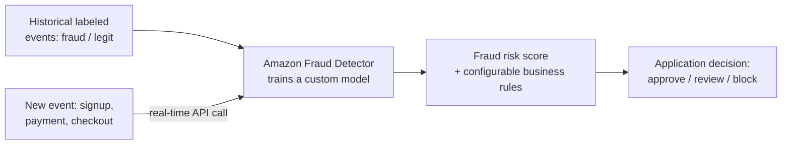
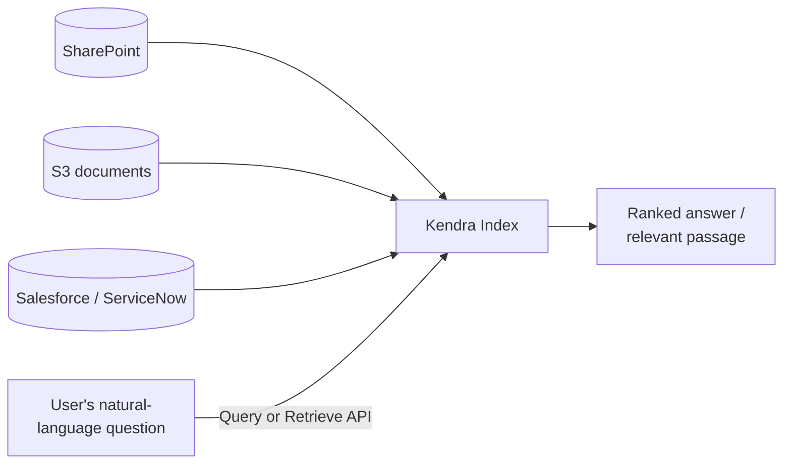

# Amazon Fraud Detector & Amazon Kendra

> **Appears in:** [SAA-C03](../../certifications/saa-c03/README.md)

This doc covers two managed AI services confirmed in the SAA-C03 appendix with no existing
standalone doc: Amazon Fraud Detector (fraud-risk scoring) and Amazon Kendra (intelligent
enterprise search). Each gets definition, purpose, a concrete use case, and the exam-trigger
phrasing to recognize.

## Amazon Fraud Detector

### Definition
Amazon Fraud Detector is a managed service that builds custom fraud-detection machine learning
models from your own historical event data (with no ML expertise required) and returns a
real-time fraud risk score for new events — new account signups, online payments, guest checkouts
— that your application can act on immediately.

### Purpose
Building a fraud-detection model from scratch requires both ML expertise and large volumes of
correctly-labeled historical fraud/non-fraud data to train against — a serious barrier for most
application teams, who end up either buying an expensive third-party fraud product or shipping
with only basic rule-based checks. Fraud Detector exists to let a team with its own historical
transaction data (even without ML expertise) get a trained, purpose-built fraud model and a
real-time scoring API, combining both a trained ML model and configurable business rules in one
evaluation.

### Use Case
An e-commerce company has years of historical order data labeled as fraudulent or legitimate and
wants a real-time risk score at checkout to decide whether to approve, hold for manual review, or
block a new order — Fraud Detector trains a model on that historical data and exposes a real-time
scoring API the checkout flow calls synchronously, combining the model's score with the
company's own configurable business rules (e.g., "always flag orders over $X shipping to a new
address") in one evaluation.

### Exam Tip
**"Real-time fraud risk score," "detect fraudulent accounts/transactions using our own historical
labeled data," "no ML expertise required"** → Amazon Fraud Detector. Distinguish from building a
custom fraud model yourself in **SageMaker** (full control and flexibility, but requires your own
ML expertise and much more build time) — Fraud Detector is the fast, managed, fraud-specific path
when the use case fits its model squarely (new account fraud, payment fraud, guest checkout
fraud) and a generic managed service is an acceptable tradeoff against full custom-model control.

---

## Amazon Kendra

### Definition
Amazon Kendra is a managed, intelligent enterprise search service that uses natural language
processing and semantic understanding — not simple keyword matching — to let users ask natural-
language questions across multiple connected document repositories and get ranked, relevant
answers or passages back.

### Purpose
Traditional enterprise search (keyword-matching against an index) returns documents containing
the literal words you typed, forcing users to guess the right keywords and then manually skim
results to find the actual answer. Kendra exists to let users ask a real question in plain
language ("what's our parental leave policy?") and get back a direct, ranked answer or relevant
passage — understanding semantic/contextual meaning, not just literal keyword overlap — pulled
from documents scattered across many different systems (SharePoint, S3, Salesforce, ServiceNow,
and more) unified into one searchable index.

### Use Case
An internal HR team's policy documents are scattered across SharePoint, a shared S3 bucket of
PDFs, and a ServiceNow knowledge base, and employees struggle to find answers with basic keyword
search across any single one of those systems — Kendra connects to all three as data sources,
indexes them together, and lets an employee ask "how many vacation days do I get after 5 years"
in plain language and get a direct, ranked answer regardless of which underlying system the
answer actually lives in.

### Exam Tip
**"Natural language enterprise search across multiple document repositories," "semantic search,
not just keyword matching," "unified search across SharePoint/S3/Salesforce"** → Amazon Kendra.
Note Kendra's **Retrieve API** is specifically built for **Retrieval-Augmented Generation (RAG)**
pipelines — feeding retrieved passages into an LLM (e.g., via Bedrock) to ground its answers in
your actual enterprise documents — a direct, testable intersection with generative-AI/RAG
scenarios. Distinguish from a basic keyword-index search tool (e.g., a simple OpenSearch keyword
index) — Kendra's specific value is the semantic/NLP-driven relevance layer on top.

## Related Terms

- [`../machine-learning-ai/sagemaker-overview.md`](sagemaker-overview.md) — the fully custom-model
  path Fraud Detector trades flexibility for speed against.
- [`../machine-learning-ai/bedrock.md`](bedrock.md) — the generative-AI service Kendra's Retrieve
  API commonly feeds in a RAG architecture.
- Glossary: RAG (Retrieval-Augmented Generation), Semantic search, Risk score, Labeled data.
