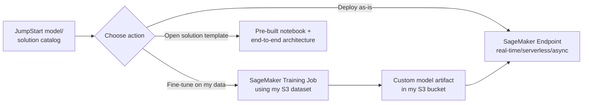

# SageMaker JumpStart


## Definition

SageMaker JumpStart is a hub, built into SageMaker, of hundreds of pre-trained open and
proprietary models — including foundation models — plus ready-made solution templates, that you
can deploy to a SageMaker endpoint or fine-tune on your own data in a few clicks, instead of
finding, downloading, and configuring a model yourself from scratch.

## Purpose

Two groups of AWS customers kept running into the same friction: people who wanted to deploy a
well-known open-source model (Llama, Stable Diffusion, BERT variants, Falcon) but didn't want to
manually find the right weights, write the serving code, and configure a SageMaker endpoint by
hand; and people who wanted a full worked example of a common ML pattern (document
summarization, fraud detection, demand forecasting) to use as a starting point rather than
starting from a blank notebook. JumpStart exists to serve both: a curated model zoo with
one-click deploy/fine-tune, plus a library of solution templates, all living inside the
SageMaker ecosystem you already use for training/hosting/monitoring.

## How It Works

Plain-English: JumpStart is a catalog with a "Deploy" and a "Fine-tune" button next to each
model card. Behind those buttons, it's just using the same SageMaker Training/Inference
infrastructure described in the other SageMaker docs — JumpStart's value is removing the setup
work, not introducing new infrastructure concepts.



Step by step:
1. **Browse the catalog** in SageMaker Studio (or via the SDK) — filter by task (text
   generation, image generation, classification, embeddings) or provider (Amazon, Meta,
   Hugging Face, Stability AI, and others).
2. **Deploy as-is** — for models you want to use out of the box, JumpStart provisions a
   SageMaker endpoint (you still choose real-time/serverless/async as covered in
   `sagemaker-deployment-endpoints.md`) pre-loaded with the model, ready to call.
3. **Fine-tune on my data** — for models you want adapted to your domain, you point JumpStart at
   your labeled dataset in S3; it launches a standard SageMaker Training Job (under the hood,
   this is script mode or a built-in fine-tuning recipe for that model family) and produces a
   new model artifact that's yours — not shared with anyone else.
4. **The fine-tuned artifact deploys the same way** any other trained model would — to any of
   the standard SageMaker inference options.
5. **Solution templates** are a separate, broader category: a complete reference
   architecture-plus-notebook for a full use case (e.g., "predictive maintenance"), giving you
   a working starting point across multiple AWS services, not just one model.

## Key Features / Components

- **Model Hub** — hundreds of models across text, vision, tabular, and embeddings tasks, sourced
  from Hugging Face, Meta, Stability AI, Amazon, and other partners.
- **One-click deploy** — provisions a SageMaker endpoint pre-configured for the chosen model's
  container and typical instance requirements.
- **One-click / guided fine-tuning** — launches a Training Job using your own S3 dataset against
  the chosen base model, without you needing to write the fine-tuning script yourself for
  supported model families.
- **Solution templates** — complete, deployable reference architectures (notebooks +
  infrastructure-as-code) for common applied ML problems.
- **Model cards** — each model lists its license, intended use, size/instance requirements, and
  benchmark info before you deploy it.
- **Private model sharing** — teams can publish their own fine-tuned/custom models into a
  private JumpStart catalog for reuse across the organization.

## Use Cases — When to Use It

- You want to deploy a known open-source model (e.g., a Llama variant, a Stable Diffusion model)
  quickly, without manually configuring the serving container yourself.
- You want to fine-tune a foundation model on your own data but want more infrastructure
  control (instance type choice, VPC placement, custom training parameters) than Bedrock's
  managed fine-tuning currently exposes.
- You want a working, end-to-end reference architecture for a common ML problem to learn from
  or adapt, rather than designing one from zero.
- You need the deployed model to live inside your own SageMaker/VPC environment specifically
  (rather than calling a fully external managed API), for architectural or compliance reasons.

## When NOT to Use It / Alternatives

- **You want the absolute lowest-ops path to a foundation model with no infrastructure
  decisions at all** — use Bedrock instead; it's serverless by default with no instance type or
  endpoint configuration required, trading some control for simplicity.
- **Your task is already solved by a purpose-built AI API** — don't deploy a JumpStart vision
  model to do what Rekognition already does out of the box, cheaper and simpler.
- **You need a traditional tabular classifier/regressor, not a foundation/open model** — use
  SageMaker's standard built-in algorithms or script mode (see
  `sagemaker-training-and-tuning.md`) instead of browsing JumpStart's model-zoo-style catalog.
- **Licensing matters and you haven't checked the model card** — some JumpStart models carry
  licenses with usage restrictions (non-commercial, attribution requirements); always check
  before deploying for production use.

## Why It's Important

**Real-world:** JumpStart lowers the barrier to using serious open-source models inside an
AWS-native, governed environment (VPC isolation, IAM, logging) rather than pulling random model
weights from the open internet into your own infrastructure by hand — that governance matters a
lot to security and compliance teams.

**Exam weight (MLA-C02):** Appears mainly in **Domain 2 (Model and Foundation Model
Development, 24%)** as one of the ways to obtain/customize a foundation model (alongside Bedrock
directly), and in **Domain 3 (Deployment, 24%)** since JumpStart deployments use the same
endpoint types as any other SageMaker model. The key exam distinction is JumpStart (inside
SageMaker, more infra control, open model catalog) vs. Bedrock (fully managed, serverless,
curated provider list) — expect a scenario question that hinges on exactly this difference.

**DVA-C03 relevance:** Out of scope — JumpStart is explicitly a SageMaker feature, and SageMaker
is out of scope for DVA-C03.

## Pricing Model (summary)

- **No separate JumpStart fee** — you pay standard SageMaker rates for whatever it provisions:
  Training Job instance-hours for fine-tuning, and the chosen endpoint type's normal billing for
  deployment (see `sagemaker-deployment-endpoints.md` and `sagemaker-training-and-tuning.md`).
- Some third-party models in the catalog may carry their own licensing terms/costs separate from
  AWS compute charges — check the model card.
- Full current rates: https://aws.amazon.com/sagemaker/pricing/

## Hands-on Lab (Floci)

Floci does not host SageMaker's JumpStart catalog or run its deployment/fine-tuning jobs. Use:

**Option A — SageMaker Studio Lab:** browse Hugging Face's open model hub directly
(https://huggingface.co/models) — many of the same open models JumpStart offers are available
there to download and run locally/in Studio Lab for free, giving you hands-on practice with the
model-deploy concept without AWS billing.

**Option B — Local equivalent: deploy a small open pre-trained model locally with
Hugging Face's `transformers`, mirroring JumpStart's "one-click deploy" idea:**
```bash
pip install transformers torch
python3 - <<'EOF'
from transformers import pipeline

# This mirrors JumpStart's "deploy a pre-trained model" action, run locally instead of
# on a SageMaker endpoint.
classifier = pipeline("sentiment-analysis", model="distilbert-base-uncased-finetuned-sst-2-english")
result = classifier("This product completely exceeded my expectations!")
print(result)
EOF
```

**Option C — stage fine-tuning data in S3 against Floci + dry-run the real CLI:**
```bash
awslocal s3 mb s3://jumpstart-finetune-data
awslocal s3 cp training_examples.jsonl s3://jumpstart-finetune-data/
# Real AWS CLI/SDK call (NOT executable against Floci):
# from sagemaker.jumpstart.estimator import JumpStartEstimator
# estimator = JumpStartEstimator(model_id="huggingface-llm-falcon-7b-bf16")
# estimator.fit({"training": "s3://jumpstart-finetune-data/"})
```

See `certifications/mla-c02/domain-2-model-development/labs.md`.

## Exam Tips

- JumpStart = inside SageMaker, more infrastructure control, open model catalog (Hugging Face/
  Meta/Stability AI and others), you choose the endpoint type and instance size.
- Bedrock = fully managed, serverless, curated proprietary + partner model list, no
  infrastructure choices exposed.
- "Deploy an open-source model with more control over the underlying infrastructure" → JumpStart.
  "Zero infrastructure management, pay per token" → Bedrock.
- Solution templates are a distinct JumpStart feature from the model hub — don't confuse "deploy
  a model" with "deploy a full reference architecture."
- Always check model licensing on the model card — a tested nuance for production-use questions.

## Related Terms

- `sagemaker-overview.md` — the platform JumpStart lives inside
- `sagemaker-training-and-tuning.md` — what fine-tuning via JumpStart actually runs
- `sagemaker-deployment-endpoints.md` — what hosts a JumpStart-deployed model
- `bedrock.md` — the fully managed alternative for foundation models
- `glossary/` — foundation model, fine-tuning, open-source model, model license
