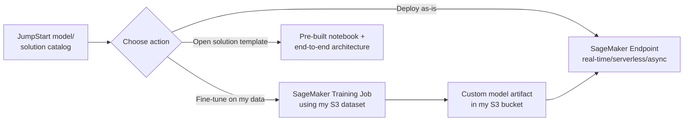
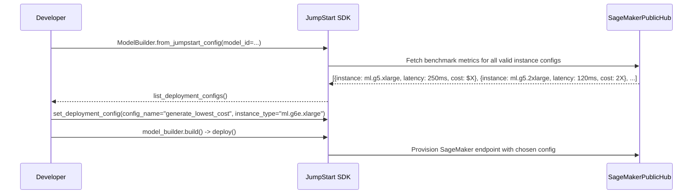
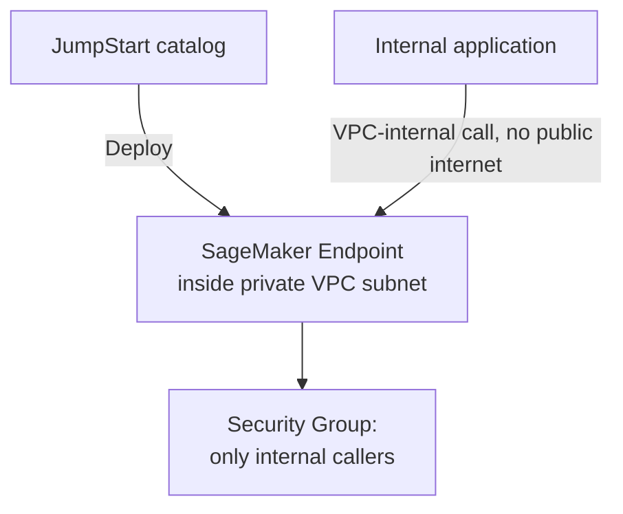
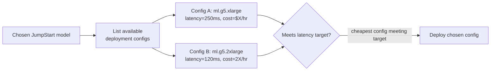
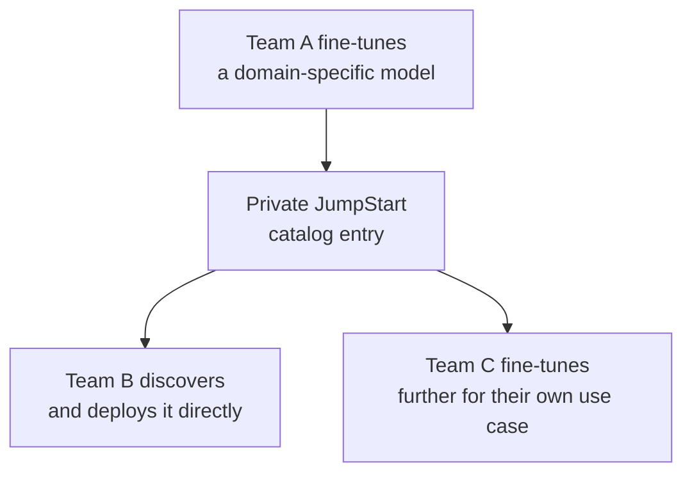

# SageMaker JumpStart

> **Appears in:** [MLA-C02](../../certifications/mla-c02/README.md)


## Definition

SageMaker JumpStart is a hub, built into SageMaker, of hundreds of pre-trained open and
proprietary models — including foundation models — plus ready-made solution templates, that you
can deploy to a SageMaker endpoint or fine-tune on your own data in a few clicks, instead of
finding, downloading, and configuring a model yourself from scratch.

Two terms worth being precise about, since this document (and its comparison to `bedrock.md`)
depends on the distinction:
- **Open-weight model** — a model whose actual learned parameters (weights) are published and
  downloadable (e.g., many Llama and Mistral releases), as opposed to a **proprietary/closed
  model** accessible only through an API, with its weights never shared. JumpStart's catalog
  spans both — some models you can fully download and inspect, others you deploy/fine-tune
  through JumpStart without ever seeing the underlying weights directly, depending on the
  provider's licensing.
- **Model card** — a structured summary (license, intended use, benchmark results, instance
  requirements) published alongside each model in the catalog — the thing you should always
  check before deploying a model for any production use.

## Purpose

Two groups of AWS customers kept running into the same friction: people who wanted to deploy a
well-known open-source model (Llama, Stable Diffusion, BERT variants, Falcon) but didn't want to
manually find the right weights, write the serving code, and configure a SageMaker endpoint by
hand; and people who wanted a full worked example of a common ML pattern (document
summarization, fraud detection, demand forecasting) to use as a starting point rather than
starting from a blank notebook. JumpStart exists to serve both: a curated model zoo with
one-click deploy/fine-tune, plus a library of solution templates, all living inside the
SageMaker ecosystem you already use for training/hosting/monitoring.

## How It Works

Plain-English: JumpStart is a catalog with a "Deploy" and a "Fine-tune" button next to each
model card. Behind those buttons, it's just using the same SageMaker Training/Inference
infrastructure described in the other SageMaker documents — JumpStart's value is removing the setup
work, not introducing new infrastructure concepts.



Step by step:
1. **Browse the catalog** in SageMaker Studio (or via the SDK) — filter by task (text
   generation, image generation, classification, embeddings) or provider (Amazon, Meta,
   Hugging Face, Stability AI, and others).
2. **Deploy as-is** — for models you want to use out of the box, JumpStart provisions a
   SageMaker endpoint (you still choose real-time/serverless/async as covered in
   `sagemaker-deployment-endpoints.md`) pre-loaded with the model, ready to call.
3. **Fine-tune on my data** — for models you want adapted to your domain, you point JumpStart at
   your labeled dataset in S3; it launches a standard SageMaker Training Job (under the hood,
   this is script mode or a built-in fine-tuning recipe for that model family) and produces a
   new model artifact that's yours — not shared with anyone else.
4. **The fine-tuned artifact deploys the same way** any other trained model would — to any of
   the standard SageMaker inference options.
5. **Solution templates** are a separate, broader category: a complete reference
   architecture-plus-notebook for a full use case (e.g., "predictive maintenance"), giving you
   a working starting point across multiple AWS services, not just one model.

### Browsing the catalog, in AWS's own screenshot


*Figure: the JumpStart foundation model catalog inside SageMaker Studio — browse by task or
provider, open a model card for license/benchmark/instance-requirement details, and choose
Deploy or Fine-tune directly from the card. Source: AWS SageMaker Developer Guide, "Use
foundation models in Amazon SageMaker Studio Classic" —
docs.aws.amazon.com/sagemaker/latest/dg/jumpstart-foundation-models-use-studio.html.*

### Worked example — fine-tuning an open model through JumpStart, concretely

To make "point JumpStart at your data" tangible, walk through fine-tuning an open text-
classification model on a company's own labeled support-ticket data.

**Step 1 — Prepare labeled data in the format the model family expects.** For a typical
JumpStart text classification fine-tuning job, this is a simple structure in S3:
```
s3://my-bucket/finetune-data/
  train.csv   # columns: text, label
  validation.csv
```
A few example rows:
```csv
text,label
"My VPN keeps disconnecting every few minutes",technical
"I was charged twice this month",billing
"How do I change my emergency contact",account
```

**Step 2 — Configure and launch via the SDK** (the same action the "Fine-tune" button in Studio
triggers under the hood):
```python
from sagemaker.jumpstart.estimator import JumpStartEstimator

estimator = JumpStartEstimator(
    model_id="huggingface-text-classification-bert-base-uncased",
    instance_type="ml.g5.xlarge",
)
estimator.set_hyperparameters(epochs="3", learning_rate="2e-5", batch_size="16")
estimator.fit({"training": "s3://my-bucket/finetune-data/"})
```
Notice this is literally a standard SageMaker Training Job underneath — `JumpStartEstimator` is
a thin wrapper around the exact same `Estimator`/training-job mechanics covered in
`sagemaker-training-and-tuning.md`; JumpStart's actual contribution here is knowing the right
container, default hyperparameters, and data format conventions for this specific model family
so you don't have to research them yourself.

**Step 3 — Deploy the fine-tuned result.** Once training completes, the resulting artifact is
yours alone (not merged back into any shared model), and deploys exactly like any other trained
model:
```python
predictor = estimator.deploy(initial_instance_count=1, instance_type="ml.g5.xlarge")
result = predictor.predict({"inputs": "My password reset link never arrived"})
print(result)  # -> likely classified as "account" or "technical", shaped by this company's own labels
```

**Step 4 — Compare against the base model's zero-shot behavior, to see what fine-tuning
actually changed.** The base `bert-base-uncased` model, called with no fine-tuning, has no
concept of this company's specific label taxonomy (`technical`/`billing`/`account`) at all — it
would need to be given those categories and examples to have any chance of classifying
correctly. After fine-tuning on this company's labeled examples, the model has specifically
learned *this* taxonomy and *this* company's phrasing patterns — exactly the kind of narrow,
domain-specific behavior shift fine-tuning is good at, contrasted with Bedrock's RAG approach
(see `bedrock.md`), which would instead be the right tool if the task were "answer questions
about our current ticket-routing policy" rather than "classify into a fixed label set."

### The deployment configuration decision, as a sequence



This sequence is the concrete mechanics behind "choosing the cheapest adequate configuration" —
JumpStart has already run these benchmarks for you against each model in the catalog, so the
decision is picking from real measured numbers rather than guessing at instance sizing the way
you might have to for a fully custom model.

## Key Features / Components

- **Model Hub** — hundreds of models across text, vision, tabular, and embeddings tasks, sourced
  from Hugging Face, Meta, Stability AI, Amazon, and other partners.
- **One-click deploy** — provisions a SageMaker endpoint pre-configured for the chosen model's
  container and typical instance requirements.
- **One-click / guided fine-tuning** — launches a Training Job using your own S3 dataset against
  the chosen base model, without you needing to write the fine-tuning script yourself for
  supported model families.
- **Solution templates** — complete, deployable reference architectures (notebooks +
  infrastructure-as-code) for common applied ML problems.
- **Model cards** — each model lists its license, intended use, size/instance requirements, and
  benchmark info before you deploy it.
- **Private model sharing** — teams can publish their own fine-tuned/custom models into a
  private JumpStart catalog for reuse across the organization.
- **`ModelBuilder` and deployment config selection** — newer SDK tooling that lists multiple
  valid deployment configurations per model (different instance types, each with associated
  benchmark metrics like latency/throughput), letting you pick the cheapest configuration that
  still meets a target, rather than guessing at an instance type.
- **Evaluate action** — compare a model's outputs against your own test data directly from the
  model card, similar in spirit to Bedrock's model evaluation tooling but specific to the
  JumpStart catalog's models.

### JumpStart vs. Bedrock vs. training from scratch

A direct three-way comparison, since every JumpStart scenario question is implicitly testing
whether you'd reach for JumpStart instead of one of these two alternatives:

| | JumpStart | Bedrock | Train from scratch (built-in algorithm/script mode) |
|---|---|---|---|
| Infrastructure control | High (you choose instance, VPC, endpoint type) | Low (serverless, no instance choices) | Highest (full control over everything) |
| Setup effort | Low-medium | Lowest | Highest |
| Model source | Open-source + some proprietary catalog | Curated proprietary + partner models | Your own architecture/algorithm |
| Best for | Known open model, need infra control | Zero-ops foundation model usage | A problem with no existing model fitting it well |
| Billing model | Standard SageMaker instance-hour | Per-token/request | Standard SageMaker instance-hour |

The exam's favorite trap here is treating JumpStart and Bedrock as interchangeable "foundation
model" answers — they solve the same underlying need (use a foundation model without building
one) but trade control for simplicity in opposite directions, and a scenario's specific
requirement (VPC isolation vs. zero infrastructure) almost always disambiguates which one is
actually correct.

## Use Cases — When to Use It

- You want to deploy a known open-source model (e.g., a Llama variant, a Stable Diffusion model)
  quickly, without manually configuring the serving container yourself.
- You want to fine-tune a foundation model on your own data but want more infrastructure
  control (instance type choice, VPC placement, custom training parameters) than Bedrock's
  managed fine-tuning currently exposes.
- You want a working, end-to-end reference architecture for a common ML problem to learn from
  or adapt, rather than designing one from zero.
- You need the deployed model to live inside your own SageMaker/VPC environment specifically
  (rather than calling a fully external managed API), for architectural or compliance reasons.
- You want to benchmark several candidate open models/instance configurations against your own
  evaluation data before committing to one for production.
- Your organization has already built custom models and wants an internal, governed catalog
  (private JumpStart) so other teams can discover and reuse them, mirroring the problem Feature
  Store solves for engineered features but applied to whole models instead.

## When NOT to Use It / Alternatives

- **You want the absolute lowest-ops path to a foundation model with no infrastructure
  decisions at all** — use Bedrock instead; it's serverless by default with no instance type or
  endpoint configuration required, trading some control for simplicity.
- **Your task is already solved by a purpose-built AI API** — don't deploy a JumpStart vision
  model to do what Rekognition already does out of the box, cheaper and simpler.
- **You need a traditional tabular classifier/regressor, not a foundation/open model** — use
  SageMaker's standard built-in algorithms or script mode (see
  `sagemaker-training-and-tuning.md`) instead of browsing JumpStart's model-zoo-style catalog.
- **Licensing matters and you haven't checked the model card** — some JumpStart models carry
  licenses with usage restrictions (non-commercial, attribution requirements); always check
  before deploying for production use.
- **You need the model customized primarily with current/proprietary facts rather than a
  different behavior/format** — this is a RAG problem, not a fine-tuning problem; consider
  Bedrock Knowledge Bases, or building your own retrieval layer around a JumpStart-deployed
  model, rather than fine-tuning facts into weights that will go stale.

## Common Architectures

### Pattern 1 — Open-model deployment inside a locked-down VPC

For organizations that specifically need a foundation model's inference traffic to never leave
their own network boundary (a common reason to choose JumpStart over Bedrock despite more setup
work):



The architectural payoff here is specifically network isolation — the model's inference traffic
never traverses a public endpoint at all, which is the scenario where JumpStart's "more
infrastructure control" genuinely earns its extra setup cost over Bedrock's simpler, but less
network-configurable, managed API.

### Pattern 2 — Benchmark-then-deploy, choosing the cheapest adequate configuration



This is the practical embodiment of `ModelBuilder.list_deployment_configs()` from the worked
example above — rather than guessing an instance type, you select based on actual benchmark
data for the specific model, picking the cheapest option that still clears your latency/
throughput bar.

### Pattern 3 — Private catalog for internal model reuse



The structural idea mirrors Feature Store's "one governed source of truth, many consumers"
pattern (see `sagemaker-data-wrangler-and-feature-store.md`), but applied to entire trained
models rather than individual features — avoiding duplicated fine-tuning effort across teams
solving closely related problems.

### Solution templates, a closer look

It's easy to skim past "solution templates" as a minor bullet, but they deserve a slightly
deeper look because they're conceptually distinct from the model catalog. A solution template
isn't a single model you deploy — it's a **complete worked example of an end-to-end applied ML
problem**, typically bundling:
- A notebook walking through the full problem (e.g., predictive maintenance: ingesting sensor
  data, feature engineering, training an anomaly-detection model, deploying it).
- Infrastructure-as-code (usually CloudFormation) that provisions every AWS resource the
  example needs — not just a SageMaker endpoint, but potentially S3 buckets, IAM roles, Lambda
  functions, and other supporting services the full scenario requires.
- A specific, realistic dataset or data-generation script so the template runs end-to-end
  out of the box, rather than requiring you to supply your own data before you can even see it
  work.

The practical value: rather than designing an architecture for "predictive maintenance" from a
blank page, you start from a working reference, understand how each piece fits together by
reading real code, and then adapt it to your actual sensors/data/business rules — a fundamentally
different kind of starting point than "deploy this one pre-trained model."

## Why It's Important

**Real-world:** JumpStart lowers the barrier to using serious open-source models inside an
AWS-native, governed environment (VPC isolation, IAM, logging) rather than pulling random model
weights from the open internet into your own infrastructure by hand — that governance matters a
lot to security and compliance teams.

**Exam weight (MLA-C02):** Appears mainly in **Domain 2 (Model and Foundation Model
Development, 24%)** as one of the ways to obtain/customize a foundation model (alongside Bedrock
directly), and in **Domain 3 (Deployment, 24%)** since JumpStart deployments use the same
endpoint types as any other SageMaker model. The key exam distinction is JumpStart (inside
SageMaker, more infra control, open model catalog) vs. Bedrock (fully managed, serverless,
curated provider list) — expect a scenario question that hinges on exactly this difference.

**DVA-C03 relevance:** Out of scope — JumpStart is explicitly a SageMaker feature, and SageMaker
is out of scope for DVA-C03.

## Limits & Quotas

- **Model size vs. instance memory** — a model simply won't deploy on an instance type too
  small to hold it in memory; the deployment config benchmarking described above exists
  precisely to surface this before you waste time on a failed deployment attempt.
- **Fine-tuning data format/size limits** vary per model family — check the specific model
  card's fine-tuning documentation rather than assuming a universal format across the whole
  catalog, since JumpStart spans many providers with their own conventions.
- **Instance quotas per type/Region** apply to JumpStart deployments exactly as they do to any
  other SageMaker Training Job or endpoint — a popular large GPU instance type may have a lower
  default quota than a general-purpose CPU instance, worth checking before planning a
  deployment around it.
- **Private catalog sharing scope** is controlled by standard IAM/resource-sharing mechanisms —
  there's no separate "JumpStart sharing" permission model distinct from how SageMaker resources
  are normally shared across roles/accounts.

## Pricing Model (summary)

- **No separate JumpStart fee** — you pay standard SageMaker rates for whatever it provisions:
  Training Job instance-hours for fine-tuning, and the chosen endpoint type's normal billing for
  deployment (see `sagemaker-deployment-endpoints.md` and `sagemaker-training-and-tuning.md`).
- Some third-party models in the catalog may carry their own licensing terms/costs separate from
  AWS compute charges — check the model card.

**Worked cost sanity check:** fine-tuning a mid-size open text model for 3 epochs on a modest
labeled dataset, on a single `ml.g5.xlarge` GPU instance, taking roughly 2 hours, costs
approximately 2 × that instance's hourly GPU rate — a training-job cost exactly like any other
SageMaker Training Job, because that's precisely what it is under the hood; there's no JumpStart
markup layered on top of the standard SageMaker training/inference rates.

Full current rates: https://aws.amazon.com/sagemaker/pricing/

## Troubleshooting / Common Issues

- **A JumpStart model fails to deploy with an out-of-memory or capacity error.** The chosen
  instance type is too small for that model's actual memory footprint — check the model card's
  listed minimum instance requirements, or use `ModelBuilder.list_deployment_configs()` to find
  a configuration that's actually benchmarked as working for this model.
- **A fine-tuning job fails immediately with a data format error.** Different model families
  expect different input formats (CSV with specific columns, JSONL, a specific directory
  structure) — check that model family's specific fine-tuning documentation rather than assuming
  a universal format works across the whole catalog.
- **A fine-tuned model's output looks no different from the base model.** Check the actual
  number of training epochs run and the learning rate — too few epochs or too small a learning
  rate on a small fine-tuning dataset may not shift behavior meaningfully; also confirm the
  fine-tuning job genuinely completed successfully and didn't silently fail partway through.
- **Deploying a proprietary (not open-weight) JumpStart model fails with a subscription error.**
  Some proprietary models require a one-time AWS Marketplace subscription before they can be
  deployed or fine-tuned — the model card links directly to the required subscription step.
- **A solution template's example notebook fails on first run.** Solution templates often assume
  specific IAM permissions or resource names from their own setup — read the template's
  accompanying README/setup instructions fully before running the notebook, rather than
  executing cells independently.

## Hands-on Lab (Floci)

Floci does not host SageMaker's JumpStart catalog or run its deployment/fine-tuning jobs. Use:

**Option A — SageMaker Studio Lab:** browse Hugging Face's open model hub directly
(https://huggingface.co/models) — many of the same open models JumpStart offers are available
there to download and run locally/in Studio Lab for free, giving you hands-on practice with the
model-deploy concept without AWS billing.

**Option B — Local equivalent: deploy a small open pre-trained model locally with
Hugging Face's `transformers`, mirroring JumpStart's "one-click deploy" idea:**
```bash
pip install transformers torch
python3 - <<'EOF'
from transformers import pipeline

# This mirrors JumpStart's "deploy a pre-trained model" action, run locally instead of
# on a SageMaker endpoint.
classifier = pipeline("sentiment-analysis", model="distilbert-base-uncased-finetuned-sst-2-english")
result = classifier("This product completely exceeded my expectations!")
print(result)
EOF
```

**Option C — stage fine-tuning data in S3 against Floci + dry-run the real CLI:**
```bash
awslocal s3 mb s3://jumpstart-finetune-data
awslocal s3 cp training_examples.jsonl s3://jumpstart-finetune-data/
# Real AWS CLI/SDK call (NOT executable against Floci):
# from sagemaker.jumpstart.estimator import JumpStartEstimator
# estimator = JumpStartEstimator(model_id="huggingface-llm-falcon-7b-bf16")
# estimator.fit({"training": "s3://jumpstart-finetune-data/"})
```

**Option D — locally simulate "zero-shot base model vs. fine-tuned model" behavior change:**
```bash
python3 - <<'EOF'
# A tiny, deliberately simplified stand-in for "fine-tuning shifts behavior on a narrow task"
base_model_labels = {"technical", "billing", "account"}  # labels the base model has NO concept of
company_taxonomy = {
    "vpn disconnecting": "technical",
    "charged twice": "billing",
    "change emergency contact": "account",
}

def zero_shot_predict(text):
    return "UNKNOWN -- base model has no concept of this label taxonomy"

def finetuned_predict(text):
    for phrase, label in company_taxonomy.items():
        if phrase in text.lower():
            return label
    return "UNKNOWN"

sample = "my vpn disconnecting constantly"
print("Zero-shot (base model):", zero_shot_predict(sample))
print("Fine-tuned (this company's data):", finetuned_predict(sample))
EOF
```

See `certifications/mla-c02/domain-2-model-development/labs.md`.

## Exam Tips

- JumpStart = inside SageMaker, more infrastructure control, open model catalog (Hugging Face/
  Meta/Stability AI and others), you choose the endpoint type and instance size.
- Bedrock = fully managed, serverless, curated proprietary + partner model list, no
  infrastructure choices exposed.
- "Deploy an open-source model with more control over the underlying infrastructure" → JumpStart.
  "Zero infrastructure management, pay per token" → Bedrock.
- Solution templates are a distinct JumpStart feature from the model hub — don't confuse "deploy
  a model" with "deploy a full reference architecture."
- Always check model licensing on the model card — a tested nuance for production-use questions.

### Sample exam scenarios, worked

**Scenario 1:** "A company needs to deploy an open-source language model entirely within their
own VPC, with no traffic ever reaching a public endpoint, for a strict internal compliance
requirement." *Answer:* JumpStart — deployed as a SageMaker endpoint inside a private VPC
subnet, giving the network-isolation control Bedrock's managed public API doesn't expose in the
same way.

**Scenario 2:** "A team wants to fine-tune an open text model on their own labeled examples but
isn't sure which instance type offers the best cost/latency tradeoff for this specific model."
*Answer:* use JumpStart's deployment configuration listing/benchmarking (`ModelBuilder`) to
compare actual measured latency and cost across valid instance options for that exact model,
rather than guessing based on general instance-type intuition.

**Scenario 3:** "An engineering team deploys a JumpStart model for a commercial product and
later discovers the model's license prohibits commercial use without a separate agreement."
*Answer:* this is a process failure — the model card's license field should have been checked
before deployment; the fix going forward is adding a license-review step before any JumpStart
model reaches production use, not a technical SageMaker configuration change.

**Scenario 4:** "A team wants a working reference architecture for a predictive-maintenance use
case spanning sensor ingestion, feature engineering, and model deployment, to adapt rather than
design from a blank page." *Answer:* a JumpStart solution template — distinguish this
explicitly from "deploy a model," since the ask here is a full multi-service reference
architecture and working example code, not a single model's inference endpoint.

### Keeping a fine-tuned model current — the maintenance question

A question worth asking before committing to any JumpStart fine-tuning effort: who owns keeping
this custom model current as the underlying open model family releases new versions? Unlike
Bedrock's managed foundation models (where AWS handles underlying model updates/deprecation on
its own timeline, with you choosing when to move to a newer model ID), a JumpStart fine-tuned
model is a point-in-time artifact — if the base open model it was fine-tuned from is later
superseded by a meaningfully better version, re-running the fine-tuning job against the new base
is a deliberate choice your team has to make and schedule, not something that happens
automatically. Teams adopting JumpStart for an ongoing production use case should budget for
this periodic re-fine-tuning cycle as a real, recurring engineering cost, not a one-time setup
task.

## Further Reading

- SageMaker JumpStart overview: https://docs.aws.amazon.com/sagemaker/latest/dg/studio-jumpstart.html
- JumpStart Foundation Models: https://docs.aws.amazon.com/sagemaker/latest/dg/jumpstart-foundation-models.html
- Available foundation models (listing/benchmarking via SDK):
  https://docs.aws.amazon.com/sagemaker/latest/dg/jumpstart-foundation-models-latest.html
- Use foundation models in Amazon SageMaker Studio Classic:
  https://docs.aws.amazon.com/sagemaker/latest/dg/jumpstart-foundation-models-use-studio.html
- SageMaker pricing: https://aws.amazon.com/sagemaker/pricing/
- AWS Skill Builder — "Exam Prep: AWS Certified Machine Learning Engineer – Associate (MLA-C02)"

## Related Terms

- `sagemaker-overview.md` — the platform JumpStart lives inside
- `sagemaker-training-and-tuning.md` — what fine-tuning via JumpStart actually runs
- `sagemaker-deployment-endpoints.md` — what hosts a JumpStart-deployed model
- `bedrock.md` — the fully managed alternative for foundation models
- `glossary/` — foundation model, fine-tuning, open-source model, model license
