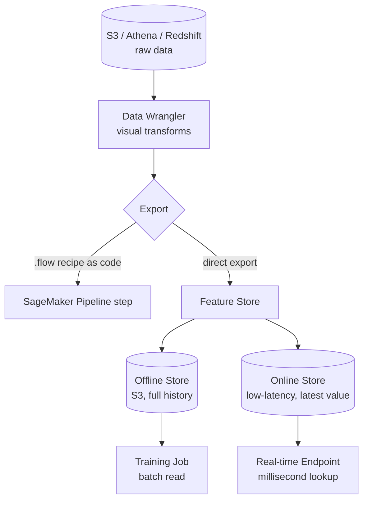

# SageMaker Data Wrangler & Feature Store


## Definition

**Data Wrangler** is a visual, mostly no-code tool inside SageMaker Studio for cleaning,
transforming, and joining raw data into a shape a model can learn from. **Feature Store** is a
central, versioned database for the *finished* features you engineered, so every model and team
pulls the exact same definition of "customer_lifetime_value" instead of each writing their own
slightly-different version. They sit back-to-back in the pipeline: Wrangler prepares, Feature
Store stores and serves.

## Purpose

Data preparation is widely cited as 60-80% of the real work in any ML project — and it's the
most error-prone part, because small inconsistencies (one team computes "average order value"
over 30 days, another over 90) silently produce different model behavior. AWS built these two
tools to attack both halves of that problem: Data Wrangler removes the need to hand-write pandas/
Spark scripts for routine cleaning steps, and Feature Store removes the "whose version of this
feature is correct" problem by giving the feature a single, governed home that both training
jobs (which need historical/batch data) and live inference (which needs the latest value in
milliseconds) can read from.

## How It Works

Plain-English: Data Wrangler is like a spreadsheet with a recorded macro — you point, click,
preview the before/after, and it remembers the whole transformation as a reusable recipe. Feature
Store is like a shared filing cabinet with two drawers: one slow drawer with the complete history
(for training) and one fast drawer with just the latest values (for real-time predictions).



Step by step:
1. **Raw data** is connected from S3, Athena, Redshift, Snowflake, or a direct database
   connector — Data Wrangler doesn't require you to copy the data first, it can query in place
   for a preview.
2. **Visual transforms** — in the Data Wrangler UI you apply built-in steps (drop missing values,
   one-hot encode a categorical column, balance an imbalanced class, bucket a numeric range,
   join two tables) and immediately see a live preview on a data sample. It ships 300+ built-in
   transforms plus custom pandas/PySpark/SQL code cells for anything bespoke.
3. **Export** — the recorded sequence of steps is a `.flow` file. You can export it three ways:
   as a notebook, as a SageMaker Pipeline step (so it reruns automatically every time new data
   lands), or directly into Feature Store.
4. **Feature Store ingestion** — when you define a "Feature Group" (a named table of related
   features, like `customer_features`), every record you write goes to *both* stores
   simultaneously.
5. **Offline Store** — an S3-backed, append-only historical record of every feature value ever
   written, partitioned for efficient querying via Athena. This is what training jobs read —
   they need the full history to learn patterns across time.
6. **Online Store** — a low-latency key-value store (backed by a fully managed, SageMaker-run
   database) holding only the *most recent* value per record. This is what a live endpoint reads
   at inference time — it needs "what is this customer's feature value right now," in single-
   digit milliseconds, not a historical scan.
7. **Consistency guarantee** — because both stores are written from the same ingestion call,
   the feature value a model was trained on and the feature value it sees in production come
   from the same pipeline, eliminating training/serving skew (a very common real-world bug
   where production features drift from what the model was trained on).

## Key Features / Components

- **Data Wrangler built-in transforms** — missing value handling, encoding, scaling, outlier
  detection, text/NLP transforms (tokenize, n-grams), time series transforms (lag features,
  resampling), image preparation.
- **Data Quality and Insights report** — one-click report flagging target leakage, class
  imbalance, duplicate rows, anomalies, and feature correlation before you waste a training run.
- **Bias detection in Data Wrangler** — runs the same analysis as SageMaker Clarify (e.g.,
  disparate impact) directly during data prep.
- **Quick Model** — trains a fast, disposable baseline model inside Data Wrangler just to sanity
  check if your features predict the target at all before committing to a full pipeline.
- **Feature Group** — the schema (named table) for a related set of features; has a defined
  record identifier and event-time column.
- **Offline Store** — S3 + Glue Data Catalog + Athena, for batch/historical reads.
- **Online Store** — low-latency store for real-time feature lookups at inference time.
- **Feature discovery/search** — Studio lets you browse and search existing Feature Groups so
  teams reuse features instead of recreating them.
- **Time travel queries** — the offline store supports point-in-time correct joins, so you can
  reconstruct exactly what a feature's value was at a specific past timestamp (critical for
  avoiding leakage when building training sets from historical data).

## Use Cases — When to Use It

- You have messy raw tabular data (missing values, inconsistent types, imbalanced classes) and
  want to clean it visually instead of hand-writing a pandas script.
- Multiple teams/models need the *same* engineered feature (e.g., "30-day rolling average
  spend") and you want one governed source of truth instead of N slightly different
  implementations.
- You're serving real-time predictions and need a feature's latest value looked up in
  milliseconds (fraud scoring, recommendation at checkout) without querying your production
  database directly.
- You want an automatic report on data quality/bias before you even start training.
- You need point-in-time-correct historical data to build a training set without leaking future
  information into the past (a frequent cause of models that look great in testing and fail in
  production).

## When NOT to Use It / Alternatives

- **You already have a mature Spark/Glue ETL pipeline and engineering team** — Data Wrangler's
  visual UI is aimed at data scientists without heavy ETL tooling; if you have Glue/EMR jobs
  already doing this well, exporting to a SageMaker Pipeline step might just add an extra layer.
  Glue DataBrew is a closer analog for general (non-ML-specific) visual data prep.
  AWS Glue remains the better fit for large-scale, scheduled, production ETL outside the ML
  context.
  Use the one with the right governance/orchestration your org already has.
- **You only have one model and no reuse need** — if nobody else will ever use this feature,
  a Feature Store is pure overhead; just engineer it in your training script.
  Feature Store's value is proportional to how many models/teams reuse the same feature.
- **Your inference is always batch (never real-time)** — you don't need the Online Store at all;
  reading straight from the Offline Store (or even plain S3) is simpler and cheaper.
- **You need sub-millisecond lookups at extreme scale** — DynamoDB with your own feature
  pipeline might outperform the Feature Store's online store for very latency-sensitive,
  very high-throughput custom use cases; Feature Store trades a bit of flexibility for the
  "comes with training/serving consistency built in" guarantee.

## Why It's Important

**Real-world:** Training/serving skew — where the feature values a model saw during training
don't match what it sees live — is one of the most common causes of "the model worked in
testing but broke in production." Feature Store exists specifically to make that bug structurally
harder to create. Data Wrangler's data-quality report similarly catches class imbalance and
leakage *before* you burn compute on a doomed training run, which directly saves money.

**Exam weight (MLA-C02):** Both tools sit squarely in **Domain 1: Data Preparation for ML and AI
(28%)** — the single heaviest-weighted domain on MLA-C02. Expect direct questions on:
transforming/cleaning data (Data Wrangler transforms, Quick Model), detecting bias/imbalance
during prep, and choosing Feature Store for feature reuse and training/serving consistency. The
C02 update also expects you to know these tools extend to **embeddings prep for RAG** —
Data Wrangler-style cleaning applies equally to the text chunks you'll later embed for a Bedrock
Knowledge Base (see `bedrock.md`).

**DVA-C03 relevance:** Out of scope — Data Wrangler and Feature Store are SageMaker-specific and
not part of the developer exam.

## Pricing Model (summary)

- **Data Wrangler** — billed per instance-hour for the underlying compute while the Data
  Wrangler session/flow is actively running (it's a SageMaker Studio app under the hood); no
  charge when not in use, but forgetting to shut down the instance bills you for idle time.
- **Feature Store** — Offline Store billed at standard S3 storage rates plus a small per-write
  fee; Online Store billed per GB-month of storage plus read/write throughput capacity
  (provisioned or on-demand, similar in spirit to DynamoDB pricing).
- Full current rates: https://aws.amazon.com/sagemaker/pricing/ (see "Data Wrangler" and
  "Feature Store" sections).

## Hands-on Lab (Floci)

Floci does not emulate Data Wrangler's visual UI or Feature Store's managed online/offline store
backend. Use these instead:

**Option A — SageMaker Studio Lab or real SageMaker Studio (visual Data Wrangler UI):**
Data Wrangler specifically requires the real SageMaker Studio UI — there is no free-tier
standalone equivalent. If you don't have an AWS account with budget, read through AWS's own
Data Wrangler console walkthrough (docs) to understand the click-path; the exam tests concepts
(what transforms exist, offline vs. online store) far more than pixel-level UI navigation.

**Option B — Local equivalent (pandas as a stand-in for Data Wrangler; SQLite as a stand-in for
Feature Store's two-store split):**
```bash
pip install pandas
python3 - <<'EOF'
import pandas as pd
import sqlite3

# "raw data" -> mimic what Data Wrangler would clean
df = pd.DataFrame({
    "customer_id": [1, 2, 3, 4],
    "monthly_spend": [120.5, None, 80.0, 999999],   # missing value + outlier
    "segment": ["A", "B", "A", "C"],
})

# transform 1: fill missing values (a Data Wrangler built-in transform)
df["monthly_spend"] = df["monthly_spend"].fillna(df["monthly_spend"].median())
# transform 2: one-hot encode categorical (another built-in transform)
df = pd.get_dummies(df, columns=["segment"])

print("Cleaned feature table:\n", df)

# mimic Feature Store's split: offline (full history) vs online (latest only)
conn = sqlite3.connect(":memory:")
df.to_sql("offline_store_customer_features", conn, index=False)   # full history
latest = df.drop_duplicates("customer_id", keep="last")
latest.to_sql("online_store_customer_features", conn, index=False)  # latest-only

print("\nOnline store (what a live endpoint would look up):")
print(pd.read_sql("SELECT * FROM online_store_customer_features WHERE customer_id=3", conn))
EOF
```
This mirrors the real workflow's shape: clean → split into a full-history table and a
latest-value table — even though real Feature Store's online store is a managed low-latency
service, not SQLite.

**Option C — stage the raw/cleaned data in S3 against Floci:**
```bash
awslocal s3 mb s3://feature-store-offline
awslocal s3 cp cleaned_features.csv s3://feature-store-offline/customer_features/
awslocal s3 ls s3://feature-store-offline/customer_features/
```

See `certifications/mla-c02/domain-1-data-preparation/labs.md`.

## Exam Tips

- Offline Store = **training** (needs full history, S3-backed, Athena-queryable). Online Store
  = **real-time inference** (needs the latest value, low-latency). This distinction is tested
  directly and repeatedly.
- "Training/serving skew" or "feature consistency between training and inference" in a question
  stem is the signal word combo for Feature Store.
- Data Wrangler vs. Glue DataBrew: both are visual/low-code data prep; Data Wrangler is the
  ML-pipeline-integrated, SageMaker-native choice (exports straight into SageMaker Pipelines/
  Feature Store); DataBrew is the general-purpose AWS data prep tool, not ML-specific.
- A question mentioning "point-in-time correct" or "avoid leaking future data" points to Feature
  Store's offline store time-travel query capability.
- Know this is Domain 1 (28% weight) territory — the heaviest single domain on MLA-C02.

## Related Terms

- `sagemaker-overview.md` — where these tools sit in the full lifecycle
- `sagemaker-training-and-tuning.md` — what consumes the prepared data next
- `sagemaker-pipelines.md` — how Data Wrangler flows become repeatable pipeline steps
- `glossary/` — training/serving skew, feature engineering, data leakage, class imbalance
