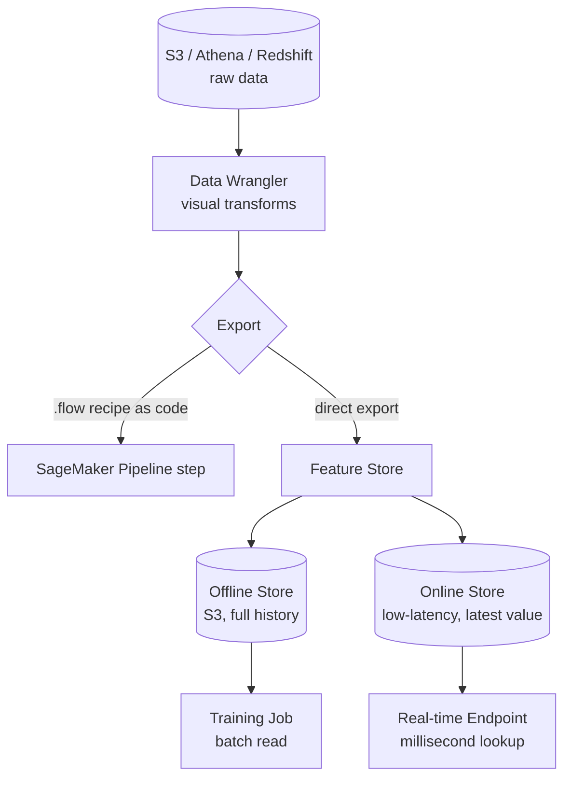
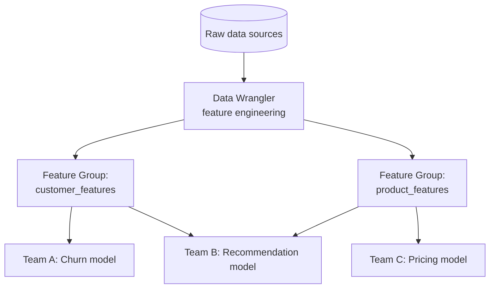
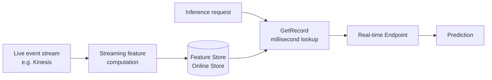

# SageMaker Data Wrangler & Feature Store


## Definition

**Data Wrangler** is a visual, mostly no-code tool inside SageMaker Studio for cleaning,
transforming, and joining raw data into a shape a model can learn from. **Feature Store** is a
central, versioned database for the *finished* features you engineered, so every model and team
pulls the exact same definition of "customer_lifetime_value" instead of each writing their own
slightly-different version. They sit back-to-back in the pipeline: Wrangler prepares, Feature
Store stores and serves.

A few terms worth defining immediately, since this document leans on them constantly:
- **Feature** — a single, usable input column for a model, typically derived from raw data
  (e.g., "average order value over the last 30 days" is a feature *computed from* raw order
  history, not a raw column that existed originally).
- **Feature engineering** — the overall process of deciding which features to derive from raw
  data and actually computing them — widely considered the single highest-leverage activity in
  a traditional ML project, often mattering more to final model quality than the choice of
  algorithm.
- **Training/serving skew** — when the feature values a model was trained on don't match the
  feature values it sees in production, because two different pieces of code computed
  "the same" feature slightly differently. This is one of the most common, hardest-to-detect
  causes of "the model worked great in testing and then underperformed in production."
- **Data leakage** — when information that wouldn't actually be available at prediction time
  accidentally ends up in the training data, making the model look far better in testing than
  it will ever perform live (e.g., accidentally including "did this loan ultimately default,"
  itself, as an input feature to a model trying to predict default).

## Purpose

Data preparation is widely cited as 60-80% of the real work in any ML project — and it's the
most error-prone part, because small inconsistencies (one team computes "average order value"
over 30 days, another over 90) silently produce different model behavior. AWS built these two
tools to attack both halves of that problem: Data Wrangler removes the need to hand-write pandas/
Spark scripts for routine cleaning steps, and Feature Store removes the "whose version of this
feature is correct" problem by giving the feature a single, governed home that both training
jobs (which need historical/batch data) and live inference (which needs the latest value in
milliseconds) can read from.

It's worth being blunt about why this matters more than it sounds on paper: a model is never
better than the data it learned from. A brilliant choice of algorithm trained on inconsistent,
leaky, or poorly-engineered features will reliably underperform a mediocre algorithm trained on
clean, well-engineered, leak-free features. Every other document in this category — training,
tuning, deployment, monitoring — assumes the data feeding into it is sound; these two tools are
where that soundness is actually established, which is exactly why Domain 1 (Data Preparation)
carries the single heaviest weight of any MLA-C02 domain.

## How It Works

Plain-English: Data Wrangler is like a spreadsheet with a recorded macro — you point, click,
preview the before/after, and it remembers the whole transformation as a reusable recipe. Feature
Store is like a shared filing cabinet with two drawers: one slow drawer with the complete history
(for training) and one fast drawer with just the latest values (for real-time predictions).



Step by step:
1. **Raw data** is connected from S3, Athena, Redshift, Snowflake, or a direct database
   connector — Data Wrangler doesn't require you to copy the data first, it can query in place
   for a preview.
2. **Visual transforms** — in the Data Wrangler UI you apply built-in steps (drop missing values,
   one-hot encode a categorical column, balance an imbalanced class, bucket a numeric range,
   join two tables) and immediately see a live preview on a data sample. It ships 300+ built-in
   transforms plus custom pandas/PySpark/SQL code cells for anything bespoke.
3. **Export** — the recorded sequence of steps is a `.flow` file. You can export it three ways:
   as a notebook, as a SageMaker Pipeline step (so it reruns automatically every time new data
   lands), or directly into Feature Store.
4. **Feature Store ingestion** — when you define a "Feature Group" (a named table of related
   features, like `customer_features`), every record you write goes to *both* stores
   simultaneously.
5. **Offline Store** — an S3-backed, append-only historical record of every feature value ever
   written, partitioned for efficient querying via Athena. This is what training jobs read —
   they need the full history to learn patterns across time.
6. **Online Store** — a low-latency key-value store (backed by a fully managed, SageMaker-run
   database) holding only the *most recent* value per record. This is what a live endpoint reads
   at inference time — it needs "what is this customer's feature value right now," in single-
   digit milliseconds, not a historical scan.
7. **Consistency guarantee** — because both stores are written from the same ingestion call,
   the feature value a model was trained on and the feature value it sees in production come
   from the same pipeline, eliminating training/serving skew (a very common real-world bug
   where production features drift from what the model was trained on).

### Where Feature Store fits — the official picture


*Figure: AWS's own diagram of Feature Store's place in an ML pipeline — raw data in, transformed
into features, ingested (streaming or batch) into both the online and offline stores, then read
back out for exploration, training, and real-time or batch inference. Source: AWS SageMaker
Developer Guide, "Create, store, and share features with Feature Store" —
docs.aws.amazon.com/sagemaker/latest/dg/feature-store.html.*

### Worked example — building a feature group end to end, with real field shapes

To make "Feature Group," "record identifier," and "event time" concrete rather than abstract
vocabulary, walk through defining one for an e-commerce recommendation use case.

**Step 1 — Decide the schema.** You're engineering features about customers for a
recommendation model. A sensible Feature Group definition:
```
FeatureGroupName: "customer-engagement-features"
RecordIdentifierFeatureName: "customer_id"
EventTimeFeatureName: "event_time"
Features:
  - customer_id (String)
  - event_time (Fractional, Unix timestamp)
  - avg_session_duration_30d (Fractional)
  - purchase_count_90d (Integral)
  - preferred_category (String)
  - days_since_last_purchase (Integral)
```
`customer_id` is the **record identifier** — the key every lookup is keyed on, exactly like a
primary key in a database table. `event_time` is required on *every* Feature Group — it's what
lets the Online Store know "is this the newest value for this customer" and lets the Offline
Store support point-in-time-correct historical queries.

**Step 2 — Ingest a record.** Concretely, a single `PutRecord` call (or a Data Wrangler export
doing this in bulk) looks like:
```json
{
  "FeatureGroupName": "customer-engagement-features",
  "Record": [
    {"FeatureName": "customer_id", "ValueAsString": "C-48213"},
    {"FeatureName": "event_time", "ValueAsString": "1718000000"},
    {"FeatureName": "avg_session_duration_30d", "ValueAsString": "312.5"},
    {"FeatureName": "purchase_count_90d", "ValueAsString": "7"},
    {"FeatureName": "preferred_category", "ValueAsString": "electronics"},
    {"FeatureName": "days_since_last_purchase", "ValueAsString": "4"}
  ]
}
```
This single call writes to **both stores at once**: the Offline Store appends this record
(keeping every past record for `C-48213` too — full history), and the Online Store overwrites
whatever was previously stored for `C-48213` with this new record, since its `event_time` is
newer.

**Step 3 — Read from each store for its intended purpose.** For training a new recommendation
model, you query the Offline Store via Athena to assemble a historical training set spanning
months of customer behavior:
```sql
SELECT customer_id, avg_session_duration_30d, purchase_count_90d, preferred_category
FROM "customer-engagement-features-offline"
WHERE event_time BETWEEN 1700000000 AND 1718000000
```
For a live recommendation request at checkout, your application instead calls `GetRecord`
against the Online Store with just the customer ID, getting the single latest row back in
single-digit milliseconds — no scan, no query planning, no Athena involved at all.

**Step 4 — Point-in-time correctness, the subtle but critical part.** Suppose you're building a
training set from data collected over the last six months, and one of your labels is "did this
customer make a purchase in the week after this snapshot." If you naively join *today's*
`purchase_count_90d` value against a six-month-old snapshot row, you've just leaked future
information into a feature that's supposed to represent what was known *at that past moment* —
exactly the "data leakage" problem defined above. Feature Store's offline store supports
**time travel queries** specifically to prevent this: you query "what was this feature's value
at event_time=X," not "what is this feature's value right now," when assembling historical
training sets. Getting this wrong is a genuinely common, hard-to-detect modeling bug, and it's
exactly why time-travel correctness is a named, tested Feature Store capability rather than an
incidental detail.

## Key Features / Components

- **Data Wrangler built-in transforms** — missing value handling, encoding, scaling, outlier
  detection, text/NLP transforms (tokenize, n-grams), time series transforms (lag features,
  resampling), image preparation.
- **Data Quality and Insights report** — one-click report flagging target leakage, class
  imbalance, duplicate rows, anomalies, and feature correlation before you waste a training run.
- **Bias detection in Data Wrangler** — runs the same analysis as SageMaker Clarify (e.g.,
  disparate impact) directly during data prep.
- **Quick Model** — trains a fast, disposable baseline model inside Data Wrangler just to sanity
  check if your features predict the target at all before committing to a full pipeline.
- **Feature Group** — the schema (named table) for a related set of features; has a defined
  record identifier and event-time column.
- **Offline Store** — S3 + Glue Data Catalog + Athena, for batch/historical reads.
- **Online Store** — low-latency store for real-time feature lookups at inference time.
- **Feature discovery/search** — Studio lets you browse and search existing Feature Groups so
  teams reuse features instead of recreating them.
- **Time travel queries** — the offline store supports point-in-time correct joins, so you can
  reconstruct exactly what a feature's value was at a specific past timestamp (critical for
  avoiding leakage when building training sets from historical data).
- **Streaming ingestion** — Feature Groups can be fed continuously (e.g., from a Kinesis stream
  processing live events) rather than only in scheduled batches, keeping the Online Store
  genuinely current for latency-sensitive use cases like fraud scoring.
- **Feature-level access control** — IAM governs who can read/write specific Feature Groups,
  supporting organizations where different teams own different feature domains but share the
  same Feature Store infrastructure.

## Use Cases — When to Use It

- You have messy raw tabular data (missing values, inconsistent types, imbalanced classes) and
  want to clean it visually instead of hand-writing a pandas script.
- Multiple teams/models need the *same* engineered feature (e.g., "30-day rolling average
  spend") and you want one governed source of truth instead of N slightly different
  implementations.
- You're serving real-time predictions and need a feature's latest value looked up in
  milliseconds (fraud scoring, recommendation at checkout) without querying your production
  database directly.
- You want an automatic report on data quality/bias before you even start training.
- You need point-in-time-correct historical data to build a training set without leaking future
  information into the past (a frequent cause of models that look great in testing and fail in
  production).
- You need a quick, low-code sanity check (Quick Model) that a proposed feature set is even worth
  building a full pipeline around.
- Your raw data comes from multiple source systems (a CRM, a data warehouse, event logs) that
  need joining before any single row represents a complete training example.

## When NOT to Use It / Alternatives

- **You already have a mature Spark/Glue ETL pipeline and engineering team** — Data Wrangler's
  visual UI is aimed at data scientists without heavy ETL tooling; if you have Glue/EMR jobs
  already doing this well, exporting to a SageMaker Pipeline step might just add an extra layer.
  Glue DataBrew is a closer analog for general (non-ML-specific) visual data prep.
  AWS Glue remains the better fit for large-scale, scheduled, production ETL outside the ML
  context.
  Use the one with the right governance/orchestration your org already has.
- **You only have one model and no reuse need** — if nobody else will ever use this feature,
  a Feature Store is pure overhead; just engineer it in your training script.
  Feature Store's value is proportional to how many models/teams reuse the same feature.
- **Your inference is always batch (never real-time)** — you don't need the Online Store at all;
  reading straight from the Offline Store (or even plain S3) is simpler and cheaper.
- **You need sub-millisecond lookups at extreme scale** — DynamoDB with your own feature
  pipeline might outperform the Feature Store's online store for very latency-sensitive,
  very high-throughput custom use cases; Feature Store trades a bit of flexibility for the
  "comes with training/serving consistency built in" guarantee.
- **Your raw data is already clean, consistent, and ready to train on as-is** — adding a
  Data Wrangler flow around data that needs no transformation is unnecessary ceremony; go
  straight to a Training Job.

## Common Architectures

### Pattern 1 — Centralized feature platform serving multiple teams

The core reason Feature Store exists — many models, one governed set of feature definitions:



The payoff: when Team A fixes a subtle bug in how "average spend" is computed, Teams B and C
automatically get the corrected definition the next time they read from the Feature Group — there
is no second, drifted copy of the logic to separately find and fix.

### Pattern 2 — Real-time feature enrichment for low-latency inference

The pattern specifically justifying the Online Store's existence:



This is the shape behind "fraud scoring needs the customer's up-to-the-second transaction
pattern" — the feature computation happens continuously off the request path, and inference just
does a fast lookup rather than computing anything expensive at request time.

### Pattern 3 — Leak-free historical training set assembly

The pattern that prevents the data-leakage failure mode described in the worked example above:


Any time a question describes a model that performed suspiciously well in testing and poorly in
production, and the description involves historical data assembled from multiple timestamps,
suspect a leakage bug this exact pattern is designed to prevent.

### A closer look — the dual-write mechanics of a single ingestion call

It's worth seeing the "both stores updated from one call" guarantee as an actual sequence, since
this is the specific mechanism that prevents training/serving skew:

```mermaid
sequenceDiagram
    participant App as Application / Data Wrangler export
    participant FS as Feature Store API
    participant Off as Offline Store (S3)
    participant On as Online Store

    App->>FS: PutRecord(FeatureGroup, record, event_time)
    par Write to both stores
        FS->>Off: Append record (keep full history)
        FS->>On: Upsert record IF event_time is newer than current
    end
    FS-->>App: Success
    Note over Off,On: One write call, two consistent destinations —<br/>this is what structurally prevents skew
```

Contrast this with a naive, hand-rolled alternative: a team writes features to a training data
warehouse with one pipeline and separately writes "current" features to a cache or database with
a *different* pipeline for live serving. Any bug, timing difference, or logic drift between those
two independently-maintained pipelines is exactly the training/serving skew problem — Feature
Store's single dual-write API is the structural fix, not a coding-discipline fix.

### Data Wrangler's transform catalog, by category

The "300+ built-in transforms" bullet in Key Features is easy to skim past — a categorized
sample makes it concrete what's actually available without writing custom code:

| Category | Example transforms |
|---|---|
| Missing values | Drop rows/columns, fill with mean/median/mode/constant |
| Encoding | One-hot encode, ordinal encode, similarity encode (for high-cardinality categories) |
| Scaling | Min-max scaling, standard (z-score) scaling, robust scaling (outlier-resistant) |
| Outliers | Detect and cap/remove values beyond a configurable threshold |
| Class imbalance | Random oversampling, random undersampling, SMOTE-style synthetic oversampling |
| Text/NLP | Tokenize, n-grams, vectorize (count/TF-IDF), lowercase/strip |
| Time series | Lag features, rolling window aggregates, resampling to a different frequency |
| Joins | Inner/left/outer join between two datasets on a key column |
| Custom | Pandas, PySpark, or SQL code cells for anything the built-ins don't cover |

The exam doesn't expect you to memorize this whole catalog — it expects you to recognize that
"transform category X" questions (e.g., "the dataset has far more non-fraud examples than fraud
examples") map to a *specific, named* built-in Data Wrangler capability (class imbalance
correction), not a vague "clean the data" answer.

## Why It's Important

**Real-world:** Training/serving skew — where the feature values a model saw during training
don't match what it sees live — is one of the most common causes of "the model worked in
testing but broke in production." Feature Store exists specifically to make that bug structurally
harder to create. Data Wrangler's data-quality report similarly catches class imbalance and
leakage *before* you burn compute on a doomed training run, which directly saves money.

**Exam weight (MLA-C02):** Both tools sit squarely in **Domain 1: Data Preparation for ML and AI
(28%)** — the single heaviest-weighted domain on MLA-C02. Expect direct questions on:
transforming/cleaning data (Data Wrangler transforms, Quick Model), detecting bias/imbalance
during prep, and choosing Feature Store for feature reuse and training/serving consistency. The
C02 update also expects you to know these tools extend to **embeddings prep for RAG** —
Data Wrangler-style cleaning applies equally to the text chunks you'll later embed for a Bedrock
Knowledge Base (see `bedrock.md`).

**DVA-C03 relevance:** Out of scope — Data Wrangler and Feature Store are SageMaker-specific and
not part of the developer exam.

## Limits & Quotas

- **Feature Groups per account and features per Feature Group** are both capped — a single,
  extremely wide table (hundreds of feature columns) may be better split into multiple logically-
  related Feature Groups than one monolithic group.
- **Online Store throughput** (reads/writes per second) is provisioned or on-demand depending on
  configuration — a sudden spike in real-time feature writes (e.g., a flash sale generating a
  burst of events) can hit throughput limits exactly like an undersized DynamoDB table would.
- **Record size limits** apply per Feature Group record — a feature value that's unusually large
  (e.g., embedding vectors with very high dimensionality) needs to fit within the per-record size
  ceiling.
- **Data Wrangler flow file size and transform count** have practical ceilings — an extremely
  long chain of transforms on one flow may need to be split into multiple flows or exported to a
  Processing script for maintainability, independent of any hard technical limit.
- **Offline Store Athena query limits** follow standard Athena query service quotas (query
  timeout, concurrent queries) since the Offline Store is just S3 + Glue Catalog + Athena under
  the hood.
- **Feature value data types** are limited to a fixed set (String, Integral, Fractional) — more
  complex structures (nested JSON, arbitrary blobs) need to be flattened or serialized into one
  of these supported types before ingestion, a real practical constraint when migrating an
  existing feature pipeline that used richer data structures.

## Pricing Model (summary)

- **Data Wrangler** — billed per instance-hour for the underlying compute while the Data
  Wrangler session/flow is actively running (it's a SageMaker Studio app under the hood); no
  charge when not in use, but forgetting to shut down the instance bills you for idle time.
- **Feature Store** — Offline Store billed at standard S3 storage rates plus a small per-write
  fee; Online Store billed per GB-month of storage plus read/write throughput capacity
  (provisioned or on-demand, similar in spirit to DynamoDB pricing).

**Worked cost sanity check:** a Feature Group with 1 million customers, each with ~20 features
updated daily, writes roughly 20 million feature values/day to the Offline Store (small, standard
S3 storage economics) and maintains 1 million "latest record" rows in the Online Store. The
Online Store's ongoing cost is dominated by its provisioned read/write throughput capacity, not
raw storage — a recommendation engine reading the Online Store on every page view needs
meaningfully more provisioned read capacity than a model only scored once a day, and sizing that
capacity correctly (the same discipline as sizing a DynamoDB table) is the actual cost lever here,
not the number of stored features.

Full current rates: https://aws.amazon.com/sagemaker/pricing/ (see "Data Wrangler" and
"Feature Store" sections).

## Troubleshooting / Common Issues

- **Online Store returns a value that doesn't match what you just wrote.** Check the `event_time`
  on your write — if an older record is written *after* a newer one (e.g., a delayed backfill
  job), the Online Store still keeps whichever record has the latest `event_time`, not whichever
  was written most recently in wall-clock time. This is a frequent source of "the online store
  seems broken" confusion that's actually working exactly as designed.
- **A training set built from the Offline Store performs unrealistically well in testing.**
  Suspect data leakage from not using point-in-time-correct (time travel) queries — check whether
  the training set join used each feature's value *as of* the relevant historical timestamp, or
  accidentally used today's current value for a historical row.
- **Data Wrangler's Data Quality report flags "target leakage" on a column you didn't expect.**
  This usually means a feature is suspiciously, almost perfectly correlated with the label —
  often because it was computed *from* the label or from data only available after the outcome
  is already known. Investigate the feature's derivation before dismissing the warning.
- **A Feature Group ingestion job fails partway through a large backfill.** Check IAM permissions
  on the Feature Store execution role (common for S3 read access on the backfill source) and
  whether any individual record exceeds the per-record size limit — a single oversized record can
  fail an otherwise-correct bulk ingestion job.
- **Data Wrangler flow runs fine interactively but the exported Pipeline step fails.** Interactive
  Data Wrangler previews run against a data *sample*; the full production dataset run as a
  Pipeline step may surface edge cases (nulls, unexpected categories) the sample never contained
  — treat the interactive preview as a sanity check, not a guarantee of production-scale
  correctness.

## Hands-on Lab (Floci)

Floci does not emulate Data Wrangler's visual UI or Feature Store's managed online/offline store
backend. Use these instead:

**Option A — SageMaker Studio Lab or real SageMaker Studio (visual Data Wrangler UI):**
Data Wrangler specifically requires the real SageMaker Studio UI — there is no free-tier
standalone equivalent. If you don't have an AWS account with budget, read through AWS's own
Data Wrangler console walkthrough (docs) to understand the click-path; the exam tests concepts
(what transforms exist, offline vs. online store) far more than pixel-level UI navigation.

**Option B — Local equivalent (pandas as a stand-in for Data Wrangler; SQLite as a stand-in for
Feature Store's two-store split):**
```bash
pip install pandas
python3 - <<'EOF'
import pandas as pd
import sqlite3

# "raw data" -> mimic what Data Wrangler would clean
df = pd.DataFrame({
    "customer_id": [1, 2, 3, 4],
    "monthly_spend": [120.5, None, 80.0, 999999],   # missing value + outlier
    "segment": ["A", "B", "A", "C"],
})

# transform 1: fill missing values (a Data Wrangler built-in transform)
df["monthly_spend"] = df["monthly_spend"].fillna(df["monthly_spend"].median())
# transform 2: one-hot encode categorical (another built-in transform)
df = pd.get_dummies(df, columns=["segment"])

print("Cleaned feature table:\n", df)

# mimic Feature Store's split: offline (full history) vs online (latest only)
conn = sqlite3.connect(":memory:")
df.to_sql("offline_store_customer_features", conn, index=False)   # full history
latest = df.drop_duplicates("customer_id", keep="last")
latest.to_sql("online_store_customer_features", conn, index=False)  # latest-only

print("\nOnline store (what a live endpoint would look up):")
print(pd.read_sql("SELECT * FROM online_store_customer_features WHERE customer_id=3", conn))
EOF
```
This mirrors the real workflow's shape: clean → split into a full-history table and a
latest-value table — even though real Feature Store's online store is a managed low-latency
service, not SQLite.

**Option C — stage the raw/cleaned data in S3 against Floci:**
```bash
awslocal s3 mb s3://feature-store-offline
awslocal s3 cp cleaned_features.csv s3://feature-store-offline/customer_features/
awslocal s3 ls s3://feature-store-offline/customer_features/
```

**Option D — a point-in-time-correct join, locally, to internalize the leakage-prevention
concept concretely:**
```bash
python3 - <<'EOF'
# Historical feature values at different timestamps for one customer
history = [
    {"customer_id": "C1", "event_time": 100, "purchase_count_90d": 3},
    {"customer_id": "C1", "event_time": 200, "purchase_count_90d": 5},
    {"customer_id": "C1", "event_time": 300, "purchase_count_90d": 9},
]

def value_as_of(customer_id, as_of_time):
    """Point-in-time query: the latest value that existed AT OR BEFORE as_of_time."""
    candidates = [r for r in history if r["customer_id"] == customer_id and r["event_time"] <= as_of_time]
    return max(candidates, key=lambda r: r["event_time"]) if candidates else None

# Building a training example as of time=250 should NOT see the time=300 value (the future)
print("Correct (point-in-time):", value_as_of("C1", 250))   # -> purchase_count_90d: 5
print("Leaky (using latest-ever value):", history[-1])       # -> purchase_count_90d: 9, WRONG for this example
EOF
```

See `certifications/mla-c02/domain-1-data-preparation/labs.md`.

## Exam Tips

- Offline Store = **training** (needs full history, S3-backed, Athena-queryable). Online Store
  = **real-time inference** (needs the latest value, low-latency). This distinction is tested
  directly and repeatedly.
- "Training/serving skew" or "feature consistency between training and inference" in a question
  stem is the signal word combo for Feature Store.
- Data Wrangler vs. Glue DataBrew: both are visual/low-code data prep; Data Wrangler is the
  ML-pipeline-integrated, SageMaker-native choice (exports straight into SageMaker Pipelines/
  Feature Store); DataBrew is the general-purpose AWS data prep tool, not ML-specific.
- A question mentioning "point-in-time correct" or "avoid leaking future data" points to Feature
  Store's offline store time-travel query capability.
- Know this is Domain 1 (28% weight) territory — the heaviest single domain on MLA-C02.
- **Sample scenario:** "A team's recommendation model performs well in offline evaluation but
  poorly once deployed, and the team confirms the exact same feature-computation code runs in
  both training and production." *Answer:* this specific combination (same code, still broken)
  points away from training/serving skew and toward something else entirely — likely a genuine
  data distribution shift (concept drift) rather than a Feature Store problem; know that
  "identical code, still mismatched behavior" rules out the classic Feature Store failure mode,
  it doesn't automatically confirm it.
- **Sample scenario:** "A fraud model needs the customer's transaction velocity over the last 10
  minutes, updated continuously as new transactions occur." *Answer:* streaming ingestion into
  Feature Store's Online Store — not a scheduled batch job, which couldn't keep a 10-minute
  window current.
- Remember that both the record identifier and event time are **mandatory** on every Feature
  Group — a question describing a Feature Group with no concept of "when" a value was recorded
  is describing something that isn't actually a valid Feature Store configuration.

### More sample exam scenarios, worked

**Scenario 1:** "A retail company's data scientists each independently compute 'customer
lifetime value' slightly differently across three different models, leading to inconsistent
business reporting." *Answer:* Feature Store — centralizing the CLV feature's definition in one
Feature Group so all three models (and any reporting built on top) read the identical, single
source of truth, eliminating the inconsistency at its root rather than trying to reconcile three
separately-maintained calculations after the fact.

**Scenario 2:** "A training dataset has 95% 'normal' transactions and 5% 'fraudulent'
transactions, and a model trained on it almost never predicts fraud." *Answer:* this is a class
imbalance problem, fixed during data preparation with Data Wrangler's built-in oversampling/
undersampling/SMOTE-style transforms — not a training hyperparameter fix (adjusting the
algorithm after the fact is a weaker, secondary lever compared to correcting the underlying data
imbalance first).

**Scenario 3:** "A data scientist wants to know, in under a minute, whether a newly-engineered
feature set is even worth building a full training pipeline around." *Answer:* Data Wrangler's
Quick Model — the explicit purpose-built feature for exactly this fast sanity check, distinct
from a full SageMaker Training Job.

**Scenario 4:** "An online store (Feature Store's Online Store, not an e-commerce storefront)
must serve a feature lookup with 5ms p99 latency for a real-time bidding system handling
thousands of requests per second." *Answer:* this is a throughput/capacity planning question —
Online Store read capacity needs to be provisioned (or configured for sufficient on-demand
throughput) to match this request rate, the same sizing discipline you'd apply to a DynamoDB
table under similar load; the Online Store's existence answers "can it be fast enough
architecturally," but capacity planning answers "is it fast enough at this specific scale."

## Further Reading

- SageMaker Feature Store: https://docs.aws.amazon.com/sagemaker/latest/dg/feature-store.html
- Feature Store concepts (online/offline, feature groups):
  https://docs.aws.amazon.com/sagemaker/latest/dg/feature-store-concepts.html
- SageMaker Data Wrangler: https://docs.aws.amazon.com/sagemaker/latest/dg/data-wrangler.html
- SageMaker Feature Store time travel / point-in-time queries:
  https://docs.aws.amazon.com/sagemaker/latest/dg/feature-store-time-travel.html
- SageMaker pricing: https://aws.amazon.com/sagemaker/pricing/
- AWS Skill Builder — "Exam Prep: AWS Certified Machine Learning Engineer – Associate (MLA-C02)"

## Related Terms

- `sagemaker-overview.md` — where these tools sit in the full lifecycle
- `sagemaker-training-and-tuning.md` — what consumes the prepared data next
- `sagemaker-pipelines.md` — how Data Wrangler flows become repeatable pipeline steps
- `glossary/` — training/serving skew, feature engineering, data leakage, class imbalance
