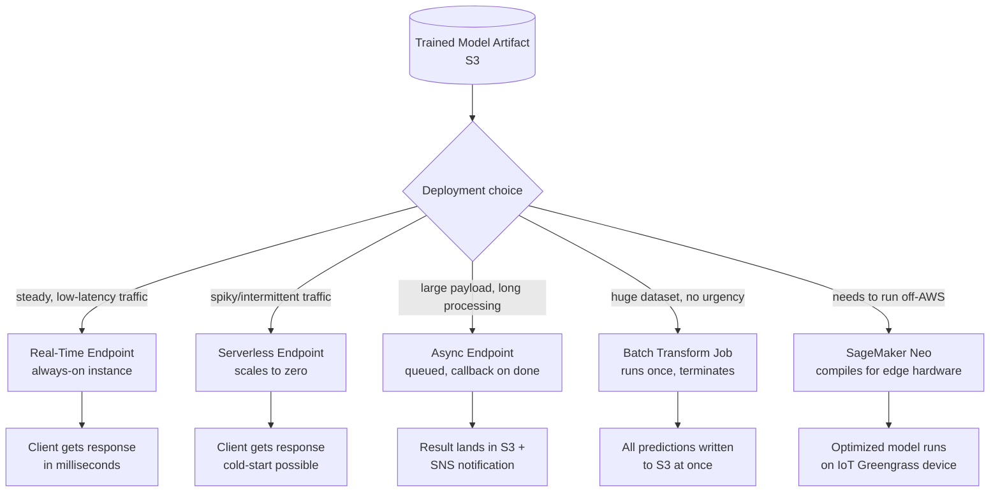
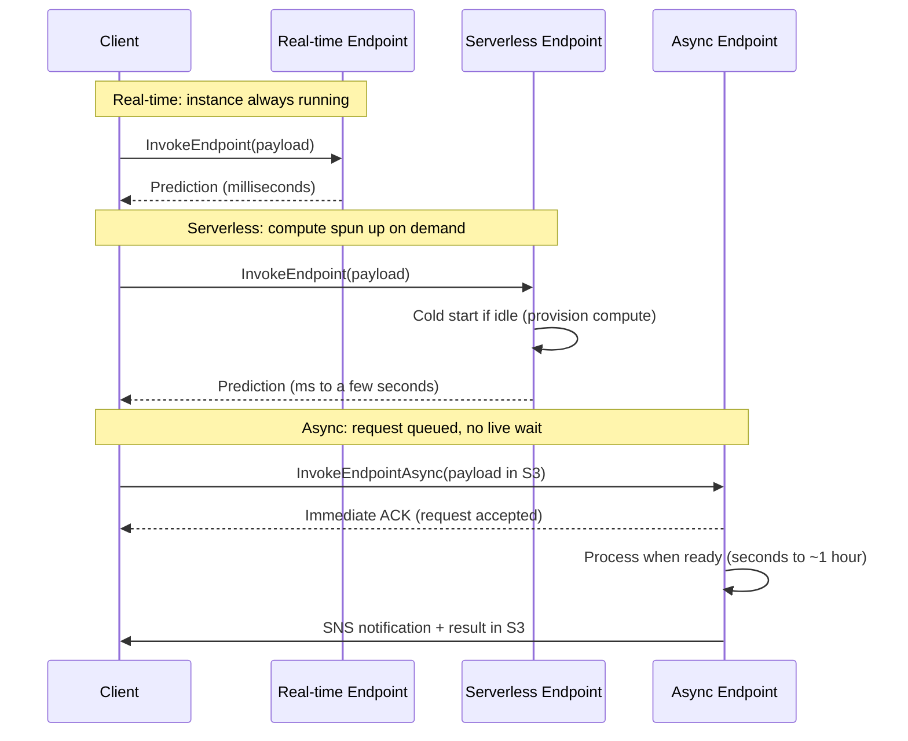
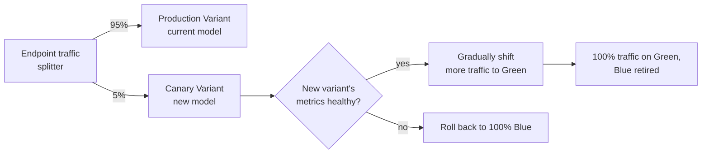
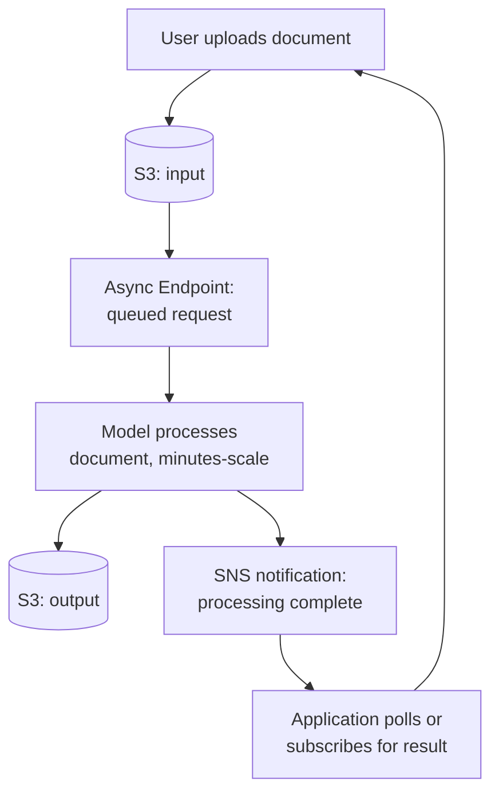
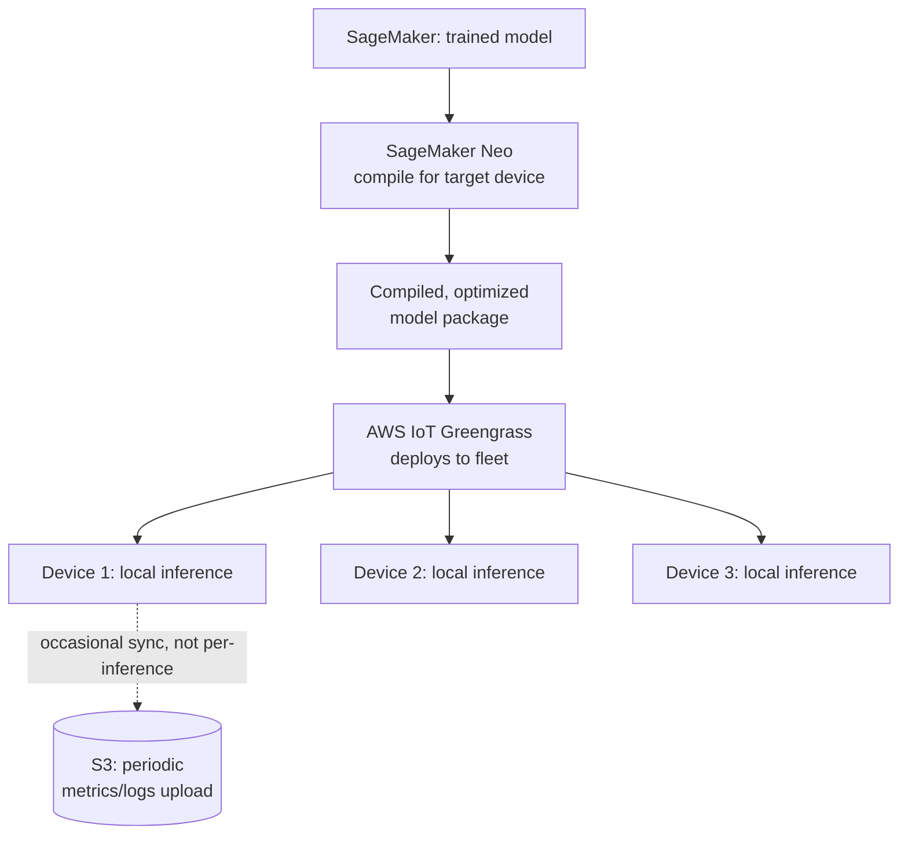

# SageMaker Deployment & Endpoints

> **Appears in:** [MLA-C02](../../certifications/mla-c02/README.md)


## Definition

Deployment is turning a trained model artifact into something that can actually answer
questions ("is this transaction fraud?", "what's in this image?"). SageMaker gives you four
different hosting shapes — **real-time**, **serverless**, **asynchronous**, and **batch
transform** — plus **SageMaker Neo** to compile a model for efficient execution on edge
hardware. Picking the right one for your traffic pattern is one of the highest-value decisions
in an ML system's cost and latency profile.

Two terms worth pinning down precisely before the rest of this document leans on them:
- **Latency** — how long a single prediction takes to come back after it's requested. A fraud
  check needs latency measured in tens-to-low-hundreds of milliseconds; a nightly report has
  essentially no latency requirement at all.
- **Cold start** — the delay the *first* request after a period of inactivity experiences while
  AWS provisions compute that wasn't already running. This is the specific, named cost serverless
  and async endpoints pay in exchange for not billing anything while idle.

## Purpose

Not every prediction need is the same. A fraud-check needs an answer in under 100ms. A nightly
report scoring 10 million records doesn't care if it takes an hour, but it does care about cost
per prediction. A document-processing pipeline might need to handle a 5-minute image analysis
without holding a client connection open the whole time. A traffic-light camera running a
model doesn't have reliable internet access to call AWS at all. One-size-fits-all hosting would
force you to overpay for latency you don't need or underdeliver on latency you do need —
SageMaker's four endpoint types plus Neo exist precisely to match infrastructure cost and shape
to the actual traffic pattern.

## How It Works

Plain-English: think of the four inference options as four ways to ask a question and get an
answer — "right now, while I wait" (real-time), "right now, but you only pay when I actually
ask" (serverless), "soon, I'll check back for the answer" (async), and "here's a huge list, tell
me all the answers whenever you're done" (batch). Neo is a separate concern: it's about shrinking
and optimizing the model itself so it can run outside AWS entirely.



Step by step:
1. **Everything starts from a trained model artifact in S3** — the output of a Training Job
   (see `sagemaker-training-and-tuning.md`).
2. **Real-Time Endpoint** — you provision one or more instances that stay running continuously,
   behind a persistent HTTPS endpoint. Every request gets a synchronous response, typically in
   milliseconds. Supports auto-scaling, multi-model endpoints (many models sharing one
   endpoint to save cost), and shadow/canary deployment for safe rollouts. Billed per
   instance-hour **whether or not** it's receiving traffic — this is the "always-on" option.
3. **Serverless Endpoint** — no instance to provision; you just set a memory size and max
   concurrency. AWS scales the compute up from zero on each request and back down when idle.
   There's a **cold start** penalty (first request after idle takes longer while AWS spins up
   compute) but you pay only for the compute-time actually used per request, nothing while idle.
4. **Asynchronous Endpoint** — for requests with large payloads (tens of MB) or long processing
   times (minutes) where you don't want a client holding a connection open. The request is
   queued; the endpoint processes it when ready; the result lands in an S3 location and an SNS
   notification tells the caller it's done. Can also scale to zero when there's no queued work.
5. **Batch Transform** — for offline scoring of a dataset you already have in full (no live
   traffic involved at all). You point it at an S3 path of input records; it spins up the
   compute, scores everything, writes all predictions to an S3 output path, and the compute
   terminates. No persistent endpoint exists before or after.
6. **SageMaker Neo** is a separate axis entirely — it takes any trained model and compiles/
   optimizes it for a specific target (a CPU architecture, a specific edge device like a Jetson
   board, a mobile OS). The compiled model then runs via an edge runtime (commonly **AWS IoT
   Greengrass**) directly on the device, without needing a live connection to a SageMaker
   endpoint at inference time at all.

### The serverless workflow, in AWS's own diagram


*Figure: AWS's own diagram of Serverless Inference — when you create an on-demand serverless
endpoint, SageMaker provisions and manages the compute resources for you, scaling up and down
with request traffic, billing only for what's used. Source: AWS SageMaker Developer Guide,
"Deploy models with Amazon SageMaker Serverless Inference" —
docs.aws.amazon.com/sagemaker/latest/dg/serverless-endpoints.html.*

### Worked example — choosing (and justifying) an inference option, three ways

To see the decision-making in action rather than as an abstract table, walk through three
variants of the same underlying model (a product recommendation scorer) under different traffic
assumptions.

**Variant A — storefront homepage, every page load.** Hundreds of requests per second,
consistently, all day, every day, each needing a response in well under 200ms to not visibly
slow the page. **Real-time endpoint**, sized with auto-scaling policies tied to a target
invocations-per-instance metric, is the only option that fits — serverless's cold starts would
be visible to real users at this request rate, and nothing about this traffic is spiky or
low-volume enough to justify paying for idle-avoidance machinery that doesn't apply here anyway
(the endpoint is essentially never idle).

**Variant B — an internal admin tool used by five employees a few times a day.** A handful of
requests scattered through business hours, long idle stretches overnight and on weekends. A
real-time endpoint here would bill 24/7 for an endpoint that's idle more than 95% of the time —
**serverless** is the clear fit: near-zero cost during the long idle periods, and the occasional
cold start (maybe a second or two) is a completely acceptable tradeoff for an internal tool used
by five people.

**Variant C — a nightly batch job scoring the entire 2-million-row product catalog for next
week's merchandising report.** No live user is waiting on any individual prediction; the whole
job just needs to finish by morning. **Batch Transform** is correct — provisioning a persistent
endpoint (real-time or serverless) for a workload that never serves a live request at all would
be pure unnecessary infrastructure; Batch Transform spins up exactly the compute needed, scores
everything, writes results to S3, and tears down, with zero endpoint existing before or after.

The pattern across all three: the *traffic pattern description* in a scenario, not the model
itself, is almost always what determines the correct inference option — the same trained model
artifact could legitimately be deployed via any of the four options depending on how it's called.

### The request lifecycle, side by side

Seeing the actual request/response shape for each synchronous-feeling option clarifies exactly
where the differences live:



The three all start the same way — the client calls an `Invoke*` API — but what happens next,
and when the client actually learns the answer, differs entirely by design, which is exactly
what the "traffic pattern" framing in exam scenarios is probing.

## Key Features / Components

- **Real-time endpoint** — persistent, low-latency, auto-scaling, supports multi-model/multi-
  container hosting and A/B/canary traffic splitting for safe rollout.
- **Serverless endpoint** — zero-infrastructure-management, scale-to-zero, pay-per-use; subject
  to cold starts; good fit for unpredictable/spiky traffic.
- **Asynchronous endpoint** — queue-based, handles large payloads/long processing, scale-to-
  zero, result delivery via S3 + SNS instead of a synchronous HTTP response.
- **Batch Transform** — ephemeral, no endpoint persists, ideal for large one-off or scheduled
  scoring jobs.
- **SageMaker Neo** — model compiler targeting specific hardware/OS combos (ARM, x86, NVIDIA
  Jetson, mobile), typically shrinks model size and speeds up inference 2x or more without
  losing meaningful accuracy.
- **Multi-model endpoints (MME)** — host hundreds/thousands of models behind one endpoint,
  loading them into memory on demand, sharing the same underlying instances to cut cost when
  you have many infrequently-used models.
- **Inference components** — a newer real-time endpoint feature letting you deploy multiple
  models to one endpoint with independently-managed compute allocation per model (CPU/GPU/memory
  assigned per model, scaled and updated independently), a more flexible evolution of the older
  single-model-per-endpoint pattern.
- **Inference Recommender** — runs automated load tests across instance types/configurations and
  recommends the cheapest one that meets your latency/throughput target.
- **Auto Scaling** — real-time endpoints can scale instance count based on invocation metrics.
- **Shadow testing** — route a copy of live production traffic to a new model variant without
  affecting what users actually see, comparing its predictions against the current production
  model before committing to a real rollout.
- **Deployment guardrails** — built-in support for blue/green and rolling deployments when
  updating a real-time or async endpoint to a new model version, reducing the risk of a bad
  update taking down live traffic.

### The four options, side by side

| | Real-time | Serverless | Asynchronous | Batch Transform |
|---|---|---|---|---|
| Response | Synchronous | Synchronous (with possible cold start) | Async (S3 + SNS) | N/A (batch output) |
| Scales to zero | No | Yes | Yes | N/A (ephemeral by design) |
| Max payload | Smallest | Small | Largest | Bounded by job config |
| Max processing time | Shortest (sub-minute) | Short | Up to ~1 hour | Bounded by job's `MaxRuntimeInSeconds` |
| Billing while idle | Yes (always) | No | No | N/A (no idle state exists) |
| Best traffic shape | Steady, latency-sensitive | Spiky, low/unpredictable | Large/long, non-blocking | One-off or scheduled bulk |

This table is worth memorizing in shape (not exact numbers, which change) because nearly every
Domain 3 scenario question reduces to picking one row based on the traffic/payload/latency
clues embedded in the question's wording.

## Use Cases — When to Use It

- **Real-time** — a live product feature calling the model on every user action (fraud check at
  checkout, product recommendation, chatbot response) where latency must stay low and traffic
  is fairly steady.
- **Serverless** — an internal tool, a dev/test environment, or a feature with unpredictable,
  bursty, or low-volume traffic where paying for an always-on instance would waste money.
- **Asynchronous** — processing a large document, video frame batch, or a model with multi-
  minute inference time, where the caller can poll or get notified later instead of waiting live.
- **Batch Transform** — scoring your entire customer base overnight for a churn report, or
  running one-time inference over a historical dataset with no live traffic involved.
- **Neo** — a smart camera, drone, or factory sensor that must run inference locally with no
  guaranteed internet connectivity, or where sending every frame to the cloud would be too slow
  or too expensive in data transfer.
- **Multi-model endpoints / inference components** — you have many models (per-customer models,
  many narrow use cases) each with low individual traffic, and hosting one dedicated endpoint
  per model would be prohibitively expensive.
- **Shadow testing** — you want real confidence a new model version performs at least as well as
  the current one before it ever actually influences a real user's experience.

## When NOT to Use It / Alternatives

- **Real-time endpoint for occasional/unpredictable traffic** — you'll pay for 24/7 uptime you
  don't use; switch to serverless.
- **Serverless endpoint for strict low-latency SLAs with constant heavy traffic** — cold starts
  and the per-request scaling model make serverless a poor fit; use real-time with proper auto
  scaling instead.
- **Batch Transform when you need an answer right now for one record** — it's built for bulk,
  not a single synchronous call; use real-time or serverless.
- **Async endpoint when the client genuinely needs a synchronous answer** — if your application
  can't tolerate a "come back later" pattern, async adds unnecessary complexity; use real-time.
- **Neo when you have reliable connectivity and no hardware constraint** — compiling for a
  narrow target adds engineering overhead with no benefit if you can just call a normal cloud
  endpoint; only invest in Neo when edge deployment is a genuine requirement.
- **Any SageMaker endpoint when a pre-built AI API already does the job** — don't host your own
  model to do sentiment analysis; call Comprehend instead.
- **Multi-model endpoints when you have very few, very high-traffic models** — the memory
  management overhead of loading/evicting models on demand only pays off when you have *many*
  models with individually modest traffic; a single hot model is better served by a dedicated
  endpoint with its own autoscaling.

## Common Architectures

### Pattern 1 — Blue/green canary rollout on a real-time endpoint

The standard safe-deployment pattern for updating a production model without risking a bad
version taking down live traffic all at once:



This pattern — small initial exposure, monitor, then gradually increase — is the direct
production-deployment analog of a software canary release, applied to a model update instead of
an application code update.

### Pattern 2 — Document processing pipeline with async endpoints

For a system ingesting user-uploaded documents that take meaningful time to process (OCR +
model-based classification, say) without holding an HTTP connection open:



The key structural idea: the user's upload action and the eventual result delivery are
decoupled — nothing in this architecture requires a client to hold a connection open for however
long the model actually takes to run.

### Pattern 3 — Edge inference with centralized model management

For a fleet of IoT devices (cameras, sensors) that need to run inference locally but still be
centrally managed and updated:



The critical property this architecture provides: inference itself never depends on live
connectivity to AWS — only periodic management/telemetry traffic does, which is exactly what
makes this pattern viable for devices with unreliable or bandwidth-constrained network access.

## Why It's Important

**Real-world:** Picking the wrong inference option is one of the most common, most expensive
mistakes in production ML — a forgotten real-time endpoint running 24/7 for a feature used twice
a day is a recurring "why is our AWS bill so high" story. Understanding the cost/latency
tradeoffs here is a direct, practical skill, not abstract trivia. Neo matters wherever
connectivity, privacy, or physics (light-speed round-trip latency) make cloud-only inference
impossible — manufacturing, autonomous devices, retail cameras.

**Exam weight (MLA-C02):** This is the core of **Domain 3: Deployment and Orchestration of ML
and AI Workflows (24%)**. Expect heavy scenario-based questions: "traffic is unpredictable and
infrequent, minimize cost" → serverless; "large payloads, long processing, caller doesn't need
immediate response" → async; "score 50 million records once a week" → batch transform; "steady,
latency-sensitive traffic" → real-time with auto scaling; "needs to run on a factory floor
sensor with no internet" → Neo + IoT Greengrass. Domain 3 in C02 also folds in GenAI
orchestration (Bedrock Knowledge Bases/agents as deployment targets) — see `bedrock.md`.

**DVA-C03 relevance:** Largely out of scope (SageMaker hosting isn't a DVA-C03 topic), but the
general pattern of "choose the right compute/latency tradeoff" echoes DVA-C03's own content on
choosing between Lambda, Fargate, and EC2 for application hosting — same engineering instinct,
different service family.

## Limits & Quotas

- **Real-time endpoint payload size** is capped (well under 10 MB) — a request larger than this
  limit is rejected outright, which is exactly why large-payload workloads need the asynchronous
  endpoint's much larger payload allowance instead.
- **Request timeout** differs sharply by endpoint type: real-time and serverless endpoints
  enforce a timeout well under a minute; asynchronous endpoints tolerate processing times up to
  about an hour; batch transform has no per-record timeout in the same sense, bounded instead by
  the overall job's configured runtime.
- **Serverless endpoint memory and concurrency** are configured per endpoint, with an account-
  level ceiling on total concurrent serverless executions — a sudden spike beyond configured max
  concurrency causes throttling, the serverless-world equivalent of an under-scaled real-time
  endpoint.
- **Multi-model endpoint model count** is bounded by the available memory on the underlying
  instances, not an arbitrary API cap — too many large models competing for the same memory
  footprint causes more frequent load/evict cycles and higher average latency, a capacity-
  planning problem rather than a hard quota.
- **Instance quotas per type/Region** apply to endpoint instances exactly as they do to training
  instances — a real-time endpoint's desired autoscaling max instance count can be silently
  capped by an account quota lower than that max, a genuinely common production surprise.

## Pricing Model (summary)

- **Real-time endpoint** — billed per instance-hour continuously while deployed, regardless of
  traffic.
- **Serverless endpoint** — billed per request + compute duration (GB-second, similar to
  Lambda's model); zero cost while idle.
- **Async endpoint** — billed per instance-hour while instances are active (can scale to zero
  when idle, unlike real-time).
- **Batch Transform** — billed per instance-hour only for the job's actual run duration.
- **SageMaker Neo** — compilation jobs billed per use; running the compiled model on your own
  edge hardware has no SageMaker inference charge (you're running it off-AWS), though IoT
  Greengrass device management has its own pricing.

**Worked cost comparison, continuing the three-variant example above:** Variant A's real-time
endpoint at, say, three `ml.m5.xlarge` instances running continuously costs roughly 3 × 730
instance-hours/month regardless of traffic shape, because it's genuinely busy most of the time —
the right cost to pay for the latency this traffic pattern demands. Variant B's serverless setup
for the same model, called perhaps 50 times/day at 300ms each, bills for roughly 50 × 0.3
seconds/day ≈ 15 seconds/day of actual compute — a difference of multiple orders of magnitude
from running the same model as a real-time endpoint, purely because the *traffic pattern*
differs, not because the model itself is any different.

Full current rates: https://aws.amazon.com/sagemaker/pricing/

## Troubleshooting / Common Issues

- **Real-time endpoint returns `ModelError` or times out under load it handled fine in testing.**
  Check whether Application Auto Scaling is actually configured on the endpoint — a fixed
  instance count under a sudden traffic increase behaves like any other under-provisioned
  service; this is not automatic unless you've set up a scaling policy.
- **Serverless endpoint's first request after a quiet period takes multiple seconds.** This is
  the expected cold-start behavior, not a bug — if this latency is unacceptable for your use
  case, that's a signal to move to a real-time endpoint (possibly with a minimum instance count)
  rather than trying to eliminate cold starts from a serverless endpoint.
- **Async endpoint's SNS notification never arrives even though the job appears to have
  completed.** Check the SNS topic's subscription/permissions configuration and the endpoint's
  configured success/failure topic ARNs separately — these are configured independently, and a
  misconfigured failure topic can silently swallow notifications for failed jobs specifically.
- **Multi-model endpoint has inconsistent latency per model.** Models not recently called get
  evicted from memory and must be reloaded on the next request (a cold-start-like penalty per
  model) — if specific models are latency-critical, consider pre-warming them or moving
  especially hot models to a dedicated endpoint instead.
- **A Neo-compiled model behaves differently (lower accuracy) than the original on the edge
  device.** Compilation can involve precision reduction (e.g., FP32 → FP16/INT8) as part of the
  size/speed optimization — validate the compiled model's accuracy against a held-out test set
  on the actual target hardware before deploying to a full device fleet, don't assume
  compilation is accuracy-neutral by default.
- **Batch Transform job output has fewer records than input.** Check for malformed input records
  being silently skipped (inspect CloudWatch Logs for per-record errors) rather than assuming the
  job partially succeeded without issue.
- **An endpoint using inference components shows uneven latency across the hosted models.**
  Inference components each get their own compute allocation, but if several hot models are
  packed too densely onto the same underlying instances, resource contention between them can
  degrade latency for all of them — check whether the per-component compute allocation (CPU
  cores, memory, accelerator share) matches each model's actual traffic, not just a default even
  split across components.
- **A canary deployment's new variant looks fine in aggregate metrics but individual users are
  reporting problems.** Aggregate latency/error-rate metrics can mask problems affecting a
  specific input pattern or user segment that happens to be underrepresented in the canary's 5%
  traffic slice — widen the canary percentage or extend the observation window before concluding
  a new variant is genuinely safe to fully promote.

## Hands-on Lab (Floci)

Floci does not host real SageMaker inference endpoints. Use:

**Option A — SageMaker Studio Lab:** deploy a trained scikit-learn model locally within the
notebook and call `.predict()` directly — this won't exercise the actual endpoint
infrastructure, but it's the free, real way to practice the model-serving code path.

**Option B — Local equivalent simulating the four hosting shapes with a Flask/function stand-in:**
```bash
pip install scikit-learn flask
python3 - <<'EOF'
from sklearn.datasets import load_iris
from sklearn.ensemble import RandomForestClassifier
import joblib

X, y = load_iris(return_X_y=True)
model = RandomForestClassifier().fit(X, y)
joblib.dump(model, "model.joblib")

# --- "Real-time" simulation: always-loaded model, instant response ---
model = joblib.load("model.joblib")
print("Real-time-style prediction:", model.predict([X[0]]))

# --- "Batch Transform" simulation: score a whole file at once ---
import pandas as pd
df = pd.DataFrame(X, columns=[f"f{i}" for i in range(4)])
df["prediction"] = model.predict(X)
df.to_csv("batch_predictions.csv", index=False)
print("Batch Transform-style output written: batch_predictions.csv")
EOF
```
This models the conceptual difference: real-time = model loaded, answer per call; batch =
one pass over an entire file, output written once.

**Option C — stage model artifacts in S3 against Floci (realistic slice) + dry-run the real CLI
calls:**
```bash
awslocal s3 mb s3://sagemaker-model-artifacts
awslocal s3 cp model.tar.gz s3://sagemaker-model-artifacts/
# Real AWS CLI calls (NOT executable against Floci — SageMaker inference control plane isn't emulated):
# aws sagemaker create-model --model-name iris-rf --primary-container Image=<container-uri>,ModelDataUrl=s3://sagemaker-model-artifacts/model.tar.gz --execution-role-arn <role>
# aws sagemaker create-endpoint-config --endpoint-config-name iris-rf-config --production-variants VariantName=AllTraffic,ModelName=iris-rf,InstanceType=ml.t2.medium,InitialInstanceCount=1
# aws sagemaker create-endpoint --endpoint-name iris-rf-endpoint --endpoint-config-name iris-rf-config
```

**Option D — simulate an async endpoint's queue + notification pattern locally:**
```bash
python3 - <<'EOF'
import time, queue, threading

request_queue = queue.Queue()
results = {}

def worker():
    while True:
        req_id, payload = request_queue.get()
        time.sleep(1)  # stand-in for a multi-minute processing job
        results[req_id] = f"processed: {payload}"
        print(f"[SNS-style notification] request {req_id} complete")
        request_queue.task_done()

threading.Thread(target=worker, daemon=True).start()
request_queue.put(("req-1", "large-document.pdf"))
print("Client: submitted request, not waiting for a synchronous response")
request_queue.join()
print("Result now available:", results["req-1"])
EOF
```

See `certifications/mla-c02/domain-3-deployment-orchestration/labs.md`.

## Exam Tips

- Build a mental decision tree: steady + low-latency → real-time; spiky/infrequent → serverless;
  large payload/long-running + no immediate response needed → async; huge dataset, no live
  traffic → batch transform; must run off-cloud → Neo.
- "Pay only when used, scales to zero" is the signal phrase for serverless (and also applies to
  async when idle).
- "Cold start" as a named tradeoff belongs to serverless endpoints — know it as a downside, not
  a feature.
- Multi-model endpoints are the answer to "host many models cheaply without one endpoint each."
- Neo always pairs conceptually with IoT Greengrass for the actual edge execution runtime.
- Distinguish this domain's content from Domain 2 (training) — a question about "already-trained
  model, now serving it" is Domain 3, not Domain 2.

### Sample exam scenarios, worked

**Scenario 1:** "A company wants to test a new model version against real production traffic
without risking a bad model affecting any actual user's experience." *Answer:* Shadow testing —
a copy of live traffic is sent to the new variant for comparison, but its responses are never
actually returned to real users, distinguishing it from a canary deployment (which does expose
a small percentage of real users to the new variant).

**Scenario 2:** "An endpoint hosts 300 lightly-used per-customer models, and the team's current
approach (one real-time endpoint per customer) costs far more than the traffic justifies."
*Answer:* multi-model endpoints or inference components — consolidate onto shared instances,
loading each customer's model into memory only when actually called, instead of paying for 300
continuously-running dedicated endpoints.

**Scenario 3:** "A medical imaging application needs to process large image files (50+ MB) and
can tolerate a response arriving a minute or two later via notification rather than instantly."
*Answer:* asynchronous endpoint — the payload size alone rules out real-time and serverless
(both have much smaller payload limits), and the tolerance for a delayed, notification-based
response is exactly async's design center.

**Scenario 4:** "A smart security camera needs to detect intrusions locally within 50
milliseconds, and the facility has no reliable internet connectivity." *Answer:* SageMaker Neo
compiling the model for the camera's specific hardware, deployed and managed via AWS IoT
Greengrass — a cloud endpoint of any kind is disqualified by "no reliable internet connectivity"
regardless of how fast that endpoint's latency would otherwise be.

**Scenario 5:** "A team wants to roll out a new model version gradually, starting with 5% of
traffic, with the ability to immediately revert to the old version if error rates increase."
*Answer:* a canary deployment on the real-time endpoint using production variants — distinct from
shadow testing (which never exposes real users to the new variant's actual responses) and
distinct from a full blue/green cutover (which shifts all traffic at once rather than gradually).
Getting canary, shadow, and blue/green straight — all three are safe-rollout patterns, but they
differ in whether real users see the new variant's output (canary: yes, partially; shadow: no;
blue/green: yes, fully, after validation) — is itself a recurring source of exam distractors.

### Deployment's place in the lifecycle, one more time

Deployment only ever receives what Training produced and the Registry approved — it's worth
restating this dependency explicitly, because a surprising number of real-world incidents trace
back to someone deploying directly from a Training Job's output, skipping the Registry's
approval gate entirely, simply because it was technically possible to do so. Nothing in
SageMaker's API *forces* you to route every deployment through an Approved Registry entry — the
governance is a process discipline your pipeline design enforces (via a Condition Step gating
the Register and Deploy steps, as described in `sagemaker-pipelines.md`), not a hard technical
constraint SageMaker itself imposes. Recognizing that this is a *process* gate, not a *platform*
gate, is itself a useful piece of exam-reasoning: a question describing a bypassed approval
process is describing a pipeline design gap, not evidence that SageMaker's governance tooling
failed.

## Further Reading

- Understand the options for deploying models in Amazon SageMaker AI:
  https://docs.aws.amazon.com/sagemaker/latest/dg/deploy-model-get-started.html
- Deploy models with Amazon SageMaker Serverless Inference:
  https://docs.aws.amazon.com/sagemaker/latest/dg/serverless-endpoints.html
- SageMaker inference options supported features matrix:
  https://docs.aws.amazon.com/sagemaker/latest/dg/model-deploy-feature-matrix.html
- SageMaker Neo: https://docs.aws.amazon.com/sagemaker/latest/dg/neo.html
- Deploy models for real-time inference (inference components):
  https://docs.aws.amazon.com/sagemaker/latest/dg/realtime-endpoints-deploy-models.html
- SageMaker pricing: https://aws.amazon.com/sagemaker/pricing/
- AWS Skill Builder — "Exam Prep: AWS Certified Machine Learning Engineer – Associate (MLA-C02)"

## Related Terms

- `sagemaker-overview.md` — where deployment fits in the full lifecycle
- `sagemaker-training-and-tuning.md` — produces the model artifact deployed here
- `sagemaker-model-monitor-and-registry.md` — monitoring the endpoint once live, approving
  models before they reach this stage
- `sagemaker-pipelines.md` — automating deployment as part of a CI/CD-style pipeline
- `glossary/` — inference, latency, cold start, auto scaling
