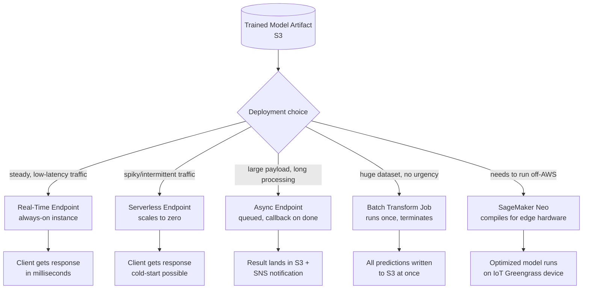

# SageMaker Deployment & Endpoints


## Definition

Deployment is turning a trained model artifact into something that can actually answer
questions ("is this transaction fraud?", "what's in this image?"). SageMaker gives you four
different hosting shapes — **real-time**, **serverless**, **asynchronous**, and **batch
transform** — plus **SageMaker Neo** to compile a model for efficient execution on edge
hardware. Picking the right one for your traffic pattern is one of the highest-value decisions
in an ML system's cost and latency profile.

## Purpose

Not every prediction need is the same. A fraud-check needs an answer in under 100ms. A nightly
report scoring 10 million records doesn't care if it takes an hour, but it does care about cost
per prediction. A document-processing pipeline might need to handle a 5-minute image analysis
without holding a client connection open the whole time. A traffic-light camera running a
model doesn't have reliable internet access to call AWS at all. One-size-fits-all hosting would
force you to overpay for latency you don't need or underdeliver on latency you do need —
SageMaker's four endpoint types plus Neo exist precisely to match infrastructure cost and shape
to the actual traffic pattern.

## How It Works

Plain-English: think of the four inference options as four ways to ask a question and get an
answer — "right now, while I wait" (real-time), "right now, but you only pay when I actually
ask" (serverless), "soon, I'll check back for the answer" (async), and "here's a huge list, tell
me all the answers whenever you're done" (batch). Neo is a separate concern: it's about shrinking
and optimizing the model itself so it can run outside AWS entirely.



Step by step:
1. **Everything starts from a trained model artifact in S3** — the output of a Training Job
   (see `sagemaker-training-and-tuning.md`).
2. **Real-Time Endpoint** — you provision one or more instances that stay running continuously,
   behind a persistent HTTPS endpoint. Every request gets a synchronous response, typically in
   milliseconds. Supports auto-scaling, multi-model endpoints (many models sharing one
   endpoint to save cost), and shadow/canary deployment for safe rollouts. Billed per
   instance-hour **whether or not** it's receiving traffic — this is the "always-on" option.
3. **Serverless Endpoint** — no instance to provision; you just set a memory size and max
   concurrency. AWS scales the compute up from zero on each request and back down when idle.
   There's a **cold start** penalty (first request after idle takes longer while AWS spins up
   compute) but you pay only for the compute-time actually used per request, nothing while idle.
4. **Asynchronous Endpoint** — for requests with large payloads (tens of MB) or long processing
   times (minutes) where you don't want a client holding a connection open. The request is
   queued; the endpoint processes it when ready; the result lands in an S3 location and an SNS
   notification tells the caller it's done. Can also scale to zero when there's no queued work.
5. **Batch Transform** — for offline scoring of a dataset you already have in full (no live
   traffic involved at all). You point it at an S3 path of input records; it spins up the
   compute, scores everything, writes all predictions to an S3 output path, and the compute
   terminates. No persistent endpoint exists before or after.
6. **SageMaker Neo** is a separate axis entirely — it takes any trained model and compiles/
   optimizes it for a specific target (a CPU architecture, a specific edge device like a Jetson
   board, a mobile OS). The compiled model then runs via an edge runtime (commonly **AWS IoT
   Greengrass**) directly on the device, without needing a live connection to a SageMaker
   endpoint at inference time at all.

## Key Features / Components

- **Real-time endpoint** — persistent, low-latency, auto-scaling, supports multi-model/multi-
  container hosting and A/B/canary traffic splitting for safe rollout.
- **Serverless endpoint** — zero-infrastructure-management, scale-to-zero, pay-per-use; subject
  to cold starts; good fit for unpredictable/spiky traffic.
- **Asynchronous endpoint** — queue-based, handles large payloads/long processing, scale-to-
  zero, result delivery via S3 + SNS instead of a synchronous HTTP response.
- **Batch Transform** — ephemeral, no endpoint persists, ideal for large one-off or scheduled
  scoring jobs.
- **SageMaker Neo** — model compiler targeting specific hardware/OS combos (ARM, x86, NVIDIA
  Jetson, mobile), typically shrinks model size and speeds up inference 2x or more without
  losing meaningful accuracy.
- **Multi-model endpoints (MME)** — host hundreds/thousands of models behind one endpoint,
  loading them into memory on demand, sharing the same underlying instances to cut cost when
  you have many infrequently-used models.
- **Inference Recommender** — runs automated load tests across instance types/configurations and
  recommends the cheapest one that meets your latency/throughput target.
- **Auto Scaling** — real-time endpoints can scale instance count based on invocation metrics.
- **Elastic Inference (legacy)/GPU vs CPU instance choice** — pick GPU instances for deep
  learning inference where latency matters, CPU for simpler models where cost matters more.

## Use Cases — When to Use It

- **Real-time** — a live product feature calling the model on every user action (fraud check at
  checkout, product recommendation, chatbot response) where latency must stay low and traffic
  is fairly steady.
- **Serverless** — an internal tool, a dev/test environment, or a feature with unpredictable,
  bursty, or low-volume traffic where paying for an always-on instance would waste money.
- **Asynchronous** — processing a large document, video frame batch, or a model with multi-
  minute inference time, where the caller can poll or get notified later instead of waiting live.
- **Batch Transform** — scoring your entire customer base overnight for a churn report, or
  running one-time inference over a historical dataset with no live traffic involved.
- **Neo** — a smart camera, drone, or factory sensor that must run inference locally with no
  guaranteed internet connectivity, or where sending every frame to the cloud would be too slow
  or too expensive in data transfer.

## When NOT to Use It / Alternatives

- **Real-time endpoint for occasional/unpredictable traffic** — you'll pay for 24/7 uptime you
  don't use; switch to serverless.
- **Serverless endpoint for strict low-latency SLAs with constant heavy traffic** — cold starts
  and the per-request scaling model make serverless a poor fit; use real-time with proper auto
  scaling instead.
- **Batch Transform when you need an answer right now for one record** — it's built for bulk,
  not a single synchronous call; use real-time or serverless.
- **Async endpoint when the client genuinely needs a synchronous answer** — if your application
  can't tolerate a "come back later" pattern, async adds unnecessary complexity; use real-time.
- **Neo when you have reliable connectivity and no hardware constraint** — compiling for a
  narrow target adds engineering overhead with no benefit if you can just call a normal cloud
  endpoint; only invest in Neo when edge deployment is a genuine requirement.
- **Any SageMaker endpoint when a pre-built AI API already does the job** — don't host your own
  model to do sentiment analysis; call Comprehend instead.

## Why It's Important

**Real-world:** Picking the wrong inference option is one of the most common, most expensive
mistakes in production ML — a forgotten real-time endpoint running 24/7 for a feature used twice
a day is a recurring "why is our AWS bill so high" story. Understanding the cost/latency
tradeoffs here is a direct, practical skill, not abstract trivia. Neo matters wherever
connectivity, privacy, or physics (light-speed round-trip latency) make cloud-only inference
impossible — manufacturing, autonomous devices, retail cameras.

**Exam weight (MLA-C02):** This is the core of **Domain 3: Deployment and Orchestration of ML
and AI Workflows (24%)**. Expect heavy scenario-based questions: "traffic is unpredictable and
infrequent, minimize cost" → serverless; "large payloads, long processing, caller doesn't need
immediate response" → async; "score 50 million records once a week" → batch transform; "steady,
latency-sensitive traffic" → real-time with auto scaling; "needs to run on a factory floor
sensor with no internet" → Neo + IoT Greengrass. Domain 3 in C02 also folds in GenAI
orchestration (Bedrock Knowledge Bases/agents as deployment targets) — see `bedrock.md`.

**DVA-C03 relevance:** Largely out of scope (SageMaker hosting isn't a DVA-C03 topic), but the
general pattern of "choose the right compute/latency tradeoff" echoes DVA-C03's own content on
choosing between Lambda, Fargate, and EC2 for application hosting — same engineering instinct,
different service family.

## Pricing Model (summary)

- **Real-time endpoint** — billed per instance-hour continuously while deployed, regardless of
  traffic.
- **Serverless endpoint** — billed per request + compute duration (GB-second, similar to
  Lambda's model); zero cost while idle.
- **Async endpoint** — billed per instance-hour while instances are active (can scale to zero
  when idle, unlike real-time).
- **Batch Transform** — billed per instance-hour only for the job's actual run duration.
- **SageMaker Neo** — compilation jobs billed per use; running the compiled model on your own
  edge hardware has no SageMaker inference charge (you're running it off-AWS), though IoT
  Greengrass device management has its own pricing.
- Full current rates: https://aws.amazon.com/sagemaker/pricing/

## Hands-on Lab (Floci)

Floci does not host real SageMaker inference endpoints. Use:

**Option A — SageMaker Studio Lab:** deploy a trained scikit-learn model locally within the
notebook and call `.predict()` directly — this won't exercise the actual endpoint
infrastructure, but it's the free, real way to practice the model-serving code path.

**Option B — Local equivalent simulating the four hosting shapes with a Flask/function stand-in:**
```bash
pip install scikit-learn flask
python3 - <<'EOF'
from sklearn.datasets import load_iris
from sklearn.ensemble import RandomForestClassifier
import joblib

X, y = load_iris(return_X_y=True)
model = RandomForestClassifier().fit(X, y)
joblib.dump(model, "model.joblib")

# --- "Real-time" simulation: always-loaded model, instant response ---
model = joblib.load("model.joblib")
print("Real-time-style prediction:", model.predict([X[0]]))

# --- "Batch Transform" simulation: score a whole file at once ---
import pandas as pd
df = pd.DataFrame(X, columns=[f"f{i}" for i in range(4)])
df["prediction"] = model.predict(X)
df.to_csv("batch_predictions.csv", index=False)
print("Batch Transform-style output written: batch_predictions.csv")
EOF
```
This models the conceptual difference: real-time = model loaded, answer per call; batch =
one pass over an entire file, output written once.

**Option C — stage model artifacts in S3 against Floci (realistic slice) + dry-run the real CLI
calls:**
```bash
awslocal s3 mb s3://sagemaker-model-artifacts
awslocal s3 cp model.tar.gz s3://sagemaker-model-artifacts/
# Real AWS CLI calls (NOT executable against Floci — SageMaker inference control plane isn't emulated):
# aws sagemaker create-model --model-name iris-rf --primary-container Image=<container-uri>,ModelDataUrl=s3://sagemaker-model-artifacts/model.tar.gz --execution-role-arn <role>
# aws sagemaker create-endpoint-config --endpoint-config-name iris-rf-config --production-variants VariantName=AllTraffic,ModelName=iris-rf,InstanceType=ml.t2.medium,InitialInstanceCount=1
# aws sagemaker create-endpoint --endpoint-name iris-rf-endpoint --endpoint-config-name iris-rf-config
```

See `certifications/mla-c02/domain-3-deployment-orchestration/labs.md`.

## Exam Tips

- Build a mental decision tree: steady + low-latency → real-time; spiky/infrequent → serverless;
  large payload/long-running + no immediate response needed → async; huge dataset, no live
  traffic → batch transform; must run off-cloud → Neo.
- "Pay only when used, scales to zero" is the signal phrase for serverless (and also applies to
  async when idle).
- "Cold start" as a named tradeoff belongs to serverless endpoints — know it as a downside, not
  a feature.
- Multi-model endpoints are the answer to "host many models cheaply without one endpoint each."
- Neo always pairs conceptually with IoT Greengrass for the actual edge execution runtime.
- Distinguish this domain's content from Domain 2 (training) — a question about "already-trained
  model, now serving it" is Domain 3, not Domain 2.

## Related Terms

- `sagemaker-overview.md` — where deployment fits in the full lifecycle
- `sagemaker-training-and-tuning.md` — produces the model artifact deployed here
- `sagemaker-model-monitor-and-registry.md` — monitoring the endpoint once live, approving
  models before they reach this stage
- `sagemaker-pipelines.md` — automating deployment as part of a CI/CD-style pipeline
- `glossary/` — inference, latency, cold start, auto scaling
