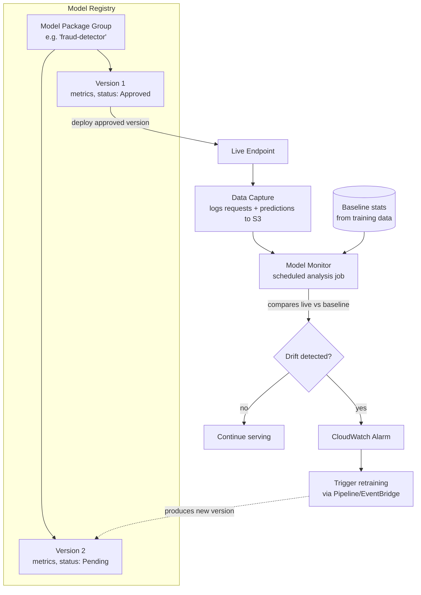
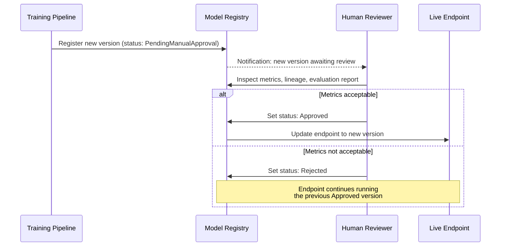
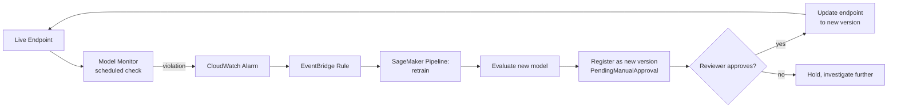
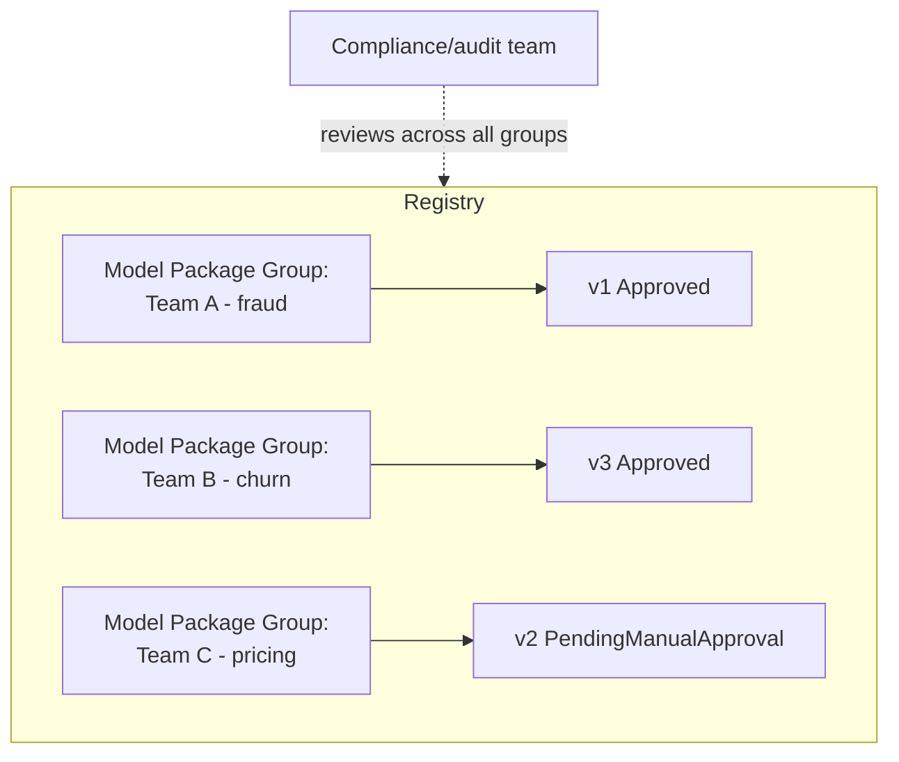
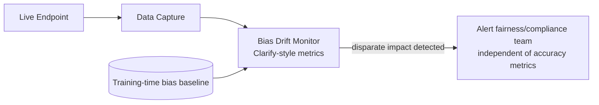

# SageMaker Model Monitor & Model Registry

> **Appears in:** [MLA-C02](../../certifications/mla-c02/README.md)


## Definition

**Model Monitor** continuously watches a live SageMaker endpoint and flags when the data it's
receiving, or its predictions, start looking statistically different from what the model was
trained on — an early warning system for a model quietly going stale. **Model Registry** is the
version-controlled catalog of every trained model: what it is, how it performed, and whether
it's been approved to go to production — the audit trail that answers "what model is actually
running, and who signed off on it."

A few definitions that anchor the rest of this document:
- **Data drift** — when the statistical distribution of the *inputs* a model sees in production
  shifts away from what it was trained on (e.g., average transaction amounts rising due to
  inflation) — the model itself hasn't changed, but the world feeding it has.
  **Concept drift**, by contrast, is when the actual *relationship* between inputs and the
  correct output changes (the same transaction pattern that used to mean "legitimate" now means
  "fraud," because fraud tactics evolved) — a subtler, often more dangerous shift than drift in
  the raw input distribution alone.
- **Ground truth** — the actual, later-confirmed correct answer for a prediction (did the
  customer really churn; was the transaction really fraud) — often only available after a delay,
  which is exactly why some drift checks (Model Quality) need it and others (Data Quality) don't.
- **Baseline** — the statistical "fingerprint" of the training data (feature distributions,
  types, ranges, completeness), computed once, that every later comparison measures live traffic
  against.

## Purpose

A model doesn't stay accurate forever — the real world changes (customer behavior shifts, a new
product category appears, a sensor gets recalibrated) while the model stays frozen at whatever
it learned during training. Without something watching for this, a model can silently degrade
for months before anyone notices from business metrics alone. Model Monitor exists to catch that
early, automatically, from the data itself rather than waiting for downstream damage. Separately,
once you have more than one person or team training models, you need a single source of truth
for "which version of this model is this," "what were its metrics," and "has anyone approved it
for production" — without that, teams end up with "final_v2_REAL_final.pkl" chaos and no audit
trail for regulators or incident review. Model Registry solves that.

## How It Works

Plain-English: Model Monitor is like a smoke detector that compares what's happening right now
against a baseline of "normal," and Model Registry is like a library's card catalog — every model
version gets a record, a status, and a history.



Step by step:
1. **Model Package Group** — a named container in the Registry for all versions of "the same"
   model concept (e.g., every iteration of your fraud detector lives under one group).
2. **Each version registered** carries its model artifact location, evaluation metrics,
   lineage (what training job/data produced it), and an **approval status**: `PendingManualApproval`,
   `Approved`, or `Rejected`. A human (or an automated gate in a pipeline) reviews metrics and
   flips the status.
3. **Only an Approved version gets deployed** to a live endpoint — this is the governance gate;
   in regulated environments this maps directly to change-management/sign-off requirements.
4. **Data Capture** — once live, you configure the endpoint to log a sample (or all) of incoming
   requests and the model's predictions to S3, continuously, in the background.
5. **Baseline** — before monitoring starts, you run a baselining job against the original
   training dataset to compute its statistical profile (feature distributions, data types,
   completeness).
6. **Monitoring schedule** — Model Monitor runs on a recurring schedule (e.g., hourly), pulling
   the newly captured live traffic and comparing its statistical profile against the baseline.
7. **Drift detected** — if live data drifts meaningfully from the baseline (a feature's
   distribution shifted, a new unexpected category appeared, missing-value rates spiked), a
   violation is reported and a CloudWatch alarm can fire.
8. **Automated response** — the alarm can trigger an EventBridge rule that kicks off a SageMaker
   Pipeline to retrain, producing a new model version that lands back in the Registry as
   `PendingManualApproval`, closing the loop.

### The two monitoring shapes AWS actually supports


*Figure: AWS's own diagram of the Model Monitor process for a real-time endpoint — captured
request/response data is compared against a baseline on a recurring schedule, with violations
surfaced through CloudWatch. Source: AWS SageMaker Developer Guide, "Monitor models for data and
model quality, bias, and explainability" — docs.aws.amazon.com/sagemaker/latest/dg/model-monitor.html.*


*Figure: the equivalent Model Monitor process applied to a batch transform job instead of a
live endpoint — the same baseline-comparison concept, applied to each new batch of inference
inputs/outputs rather than continuous live traffic. Source: AWS SageMaker Developer Guide,
"Monitor models for data and model quality, bias, and explainability" —
docs.aws.amazon.com/sagemaker/latest/dg/model-monitor.html.*

### Worked example — detecting drift with real numbers

To make "statistical comparison against a baseline" concrete, walk through an actual (simplified)
drift check on one feature: `transaction_amount` for a fraud-detection model.

**Step 1 — Baseline, computed once from training data.** Training data's `transaction_amount`
has a mean of $85, standard deviation of $40, and a maximum observed value of $2,000. This
profile — not the raw training data itself — is what gets stored as the baseline.

**Step 2 — A week of live traffic is captured.** Via Data Capture, every incoming request and
the model's prediction are logged to S3 continuously, with no code changes needed in the
application calling the endpoint — SageMaker handles the capture at the endpoint level.

**Step 3 — The scheduled monitoring job runs** (say, hourly), computing the *same* statistics
on the newly captured live data: suppose this hour's `transaction_amount` shows a mean of $130,
standard deviation of $60, and a new maximum of $5,500.

**Step 4 — Statistical comparison.** Model Monitor's Data Quality check runs a statistical test
(conceptually similar to a Kolmogorov-Smirnov test, comparing two distributions) and flags a
violation if the live distribution has shifted meaningfully from the baseline — in this example,
both the mean (+53%) and the maximum (+175%) shifted substantially, which would very plausibly
trigger a violation under typical configured thresholds.

**Step 5 — What this drift might mean in plain English.** This specific shift pattern (mean up,
new much-larger maximum) is exactly what you'd expect if, say, the business recently started
processing larger B2B transactions that didn't exist in the original training data at all — the
model was never shown transactions this large during training, so its predictions on them are
untested and potentially unreliable, regardless of whether they turn out to be fraud or not.

**Step 6 — Response.** The violation triggers a CloudWatch alarm, which triggers an EventBridge
rule, which kicks off a SageMaker Pipeline to retrain on a dataset that now includes this new
transaction pattern — closing the loop without anyone needing to notice the shift by eyeballing
a dashboard.

### The approval workflow, as an actual sequence



This sequence is worth internalizing precisely because it shows the approval gate as a genuine
decision point with two real outcomes, not a rubber stamp — "Rejected" is just as valid and
expected an outcome as "Approved," and a healthy MLOps process should see both happen regularly.

## Key Features / Components

- **Model Registry** — model package groups, versioned model packages, approval workflow
  (Approved/Rejected/Pending), metadata/lineage tracking, cross-account model sharing.
- **Model Monitor — Data Quality** — detects schema/statistics drift (missing values, type
  mismatches, distribution shifts) in input features. Does not require ground truth labels.
- **Model Monitor — Model Quality** — compares predictions against ground truth (when
  available later) to track accuracy/precision/recall decay over time. Requires ground truth
  labels to eventually arrive and be supplied.
- **Model Monitor — Bias Drift** — re-runs Clarify-style bias metrics on live traffic to catch
  bias that emerges after deployment, not just at training time.
- **Model Monitor — Feature Attribution Drift** — detects when which features matter most to
  the model's predictions has shifted (explainability drift) — a subtler signal than raw input
  drift, catching cases where the *relationship* the model relies on has changed even if the
  input distribution itself looks superficially stable.
- **Data Capture** — configurable logging of endpoint input/output to S3, the raw material
  every monitor type analyzes; supports both real-time endpoints and batch transform jobs.
- **CloudWatch integration** — violations surface as metrics/alarms, hookable into any
  notification or automation (SNS, EventBridge, Lambda).
- **SageMaker Pipelines integration** — registry approval status can be a gate/condition step in
  an automated deployment pipeline.
- **Model Cards** — a structured, human-readable summary document for a registered model
  (intended use, training data description, evaluation results, known limitations) — increasingly
  relevant for governance and responsible-AI documentation requirements.

### The four Model Monitor types, side by side

| Monitor type | Detects | Needs ground truth? | Typical trigger phrase in a scenario |
|---|---|---|---|
| Data Quality | Input feature distribution/schema drift | No | "live traffic no longer matches training data" |
| Model Quality | Prediction accuracy/precision/recall decay | Yes | "accuracy has been dropping," "predictions seem worse lately" |
| Bias Drift | Emerging unfairness between groups in predictions | No (compares prediction rates, not correctness) | "fairness/bias appeared after deployment" |
| Feature Attribution Drift | Shift in which features drive predictions | No | "the model seems to be relying on different signals than before" |

Memorizing which row needs ground truth is the single highest-value fact in this table — it's
the fastest way to eliminate wrong answers on a monitor-type question, since three of the four
types work purely from input/prediction data with no labels required at all.

## Use Cases — When to Use It

- **Fraud detection drift monitoring (financial services):** Problem — fraud patterns genuinely
  shift as new tactics emerge, and a model trained months ago can silently miss new fraud shapes.
  Why it fits — Data Quality monitoring continuously compares live transaction statistics against
  the training baseline, catching distribution shifts (a new transaction-size pattern) within
  hours instead of discovering the problem from a business-metric drop weeks later. Tradeoff vs. a
  fixed retraining calendar — a scheduled monthly retrain wastes compute when nothing's drifted
  and reacts too slowly when something has; drift-triggered retraining is responsive to actual
  evidence instead of an arbitrary date.
- **Customer churn model governance (telecom/SaaS):** Problem — multiple data scientists each
  produce "a churn model," and nobody has a clean record of which version is actually live or why
  it was approved. Why it fits — Model Registry's versioned catalog plus approval workflow gives
  one auditable source of truth. Tradeoff vs. informal file-naming conventions
  ("final_v2_REAL.pkl") — informal naming is zero-setup but produces exactly the chaos and lost
  audit trail Model Registry is built to prevent.
- **Medical risk-model bias monitoring (healthcare):** Problem — a readmission-risk model can
  develop a demographic bias in production even while its overall accuracy looks stable. Why it
  fits — Bias Drift monitoring reruns Clarify-style fairness metrics continuously on live
  predictions, independent of the aggregate accuracy metric that would otherwise mask the problem.
  Tradeoff vs. relying on Model Quality monitoring alone — Model Quality tracks accuracy/precision
  decay but has no concept of fairness across subgroups; a model can show perfectly healthy
  accuracy while a specific group's outcomes worsen, which is exactly why Bias Drift exists as its
  own distinct check.
- **Credit scoring regulatory compliance (banking):** Problem — a regulator demands proof of
  exactly which data, code, and approver produced the model currently making live credit
  decisions. Why it fits — Model Registry's lineage tracking ties a specific version to its
  originating training job, data, and the human who approved it. Tradeoff vs. ad hoc
  documentation in a shared spreadsheet — a spreadsheet is faster to start but has no enforced
  structure and is trivially easy to fall out of sync with what's actually deployed.
- **Demand forecasting accuracy tracking (retail/CPG):** Problem — a forecasting model's accuracy
  can decay gradually as market conditions shift, well before anyone would notice from inventory
  reports alone. Why it fits — Model Quality monitoring compares predictions against eventual
  ground truth (actual sales once known) to track accuracy decay directly. Tradeoff vs. Data
  Quality monitoring alone — Data Quality only checks whether the *inputs* look different from
  training, which wouldn't catch a case where inputs look stable but the demand-driving
  relationship itself has genuinely changed (concept drift).
- **Recommendation engine governance across teams (e-commerce):** Problem — a large organization
  has dozens of recommendation model variants across different product surfaces, and compliance
  needs to know which are currently approved for production at a glance. Why it fits — Model
  Registry's Model Package Groups give a compliance reviewer one place to check every team's
  approval status. Tradeoff vs. asking each team individually — asking around doesn't scale past
  a handful of teams and provides no permanent audit record, unlike a centralized Registry.
- **Content moderation model monitoring (social/UGC platforms):** Problem — a custom moderation
  classifier's effectiveness can degrade as new slang/evasion patterns emerge among bad actors.
  Why it fits — Feature Attribution Drift detects when which input signals the model relies on
  has shifted, a subtler signal than raw accuracy alone catching an adversarial pattern shift
  early. Tradeoff vs. waiting for accuracy to visibly drop — by the time aggregate accuracy
  visibly drops, meaningful harmful content may have already slipped through; Feature Attribution
  Drift can surface the underlying shift earlier.

## When NOT to Use It / Alternatives

- **A one-off batch scoring job with no persistent endpoint** — Model Monitor is built around
  continuously sampled live traffic; it doesn't apply to Batch Transform jobs the same way (you'd
  instead re-run data-quality checks like Data Wrangler's report on each new batch).
  Model Monitor requires a live endpoint or configured batch monitoring — don't try to attach it
  to processes it wasn't designed for.
- **A single experimental model with no production deployment** — Model Registry's approval
  workflow is overhead you don't need yet; skip it until you have more than one
  version/stakeholder to coordinate.
- **You need deep custom drift logic beyond statistical distribution comparison** — Model
  Monitor's built-in checks cover the common cases; highly custom drift definitions may need a
  bespoke monitoring job (SageMaker Processing jobs running your own code) instead.
- **Ground truth labels never become available** — Model Quality monitoring needs eventual
  ground truth to compare against; if your use case never gets labeled feedback (truly
  unverifiable predictions), you're limited to Data Quality/Bias Drift monitoring only.
- **Extremely low-traffic endpoints** — statistical drift tests need a meaningful sample size to
  be reliable; an endpoint receiving only a handful of requests per monitoring window may produce
  noisy, unreliable violation signals regardless of whether real drift is occurring.

## Common Architectures

### Pattern 1 — Full closed-loop MLOps: monitor, alarm, retrain, re-approve

The canonical production pattern tying Model Monitor and Model Registry together with Pipelines:



This is the single most important architecture in this document for Domain 4 — notice that drift
detection *never* auto-deploys a new model without a registry approval step; the automation
covers detection and retraining, but a governance gate still sits before anything reaches
production traffic.

### Pattern 2 — Multi-model governance across teams

For an organization with many models across many teams, all needing consistent governance:



The structural value: a compliance reviewer can answer "which models are currently approved for
production, across the entire organization" from one place, instead of asking each team
individually — exactly the audit-trail problem Model Registry exists to solve at scale.

### Pattern 3 — Bias monitoring as a first-class, continuous check

Distinct from the general drift-retrain loop, because bias drift specifically needs its own
dedicated attention even when overall accuracy looks fine:



The key point this pattern makes: a model can show stable, healthy accuracy metrics overall while
simultaneously developing a bias problem for a specific subgroup — which is exactly why Bias
Drift is tracked as its own distinct monitor type rather than folded into general Data/Model
Quality checks.

## Why It's Important

**Real-world:** Silent model decay is a genuinely common, expensive failure mode — a
recommendation engine or credit model that degrades gradually can cost real money or create
compliance exposure long before anyone would notice from a dashboard. Model Registry's approval
gate is the mechanism that prevents "someone pushed an unreviewed model to prod" incidents, which
matter enormously in finance/healthcare/insurance contexts where every production model needs a
defensible audit trail.

**Exam weight (MLA-C02):** Squarely in **Domain 4: Operating, Monitoring, and Securing ML and
AI Solutions (24%)** — expect direct questions on "detect that live traffic no longer matches
training data" (Data Quality monitor), "model's accuracy appears to be dropping over time"
(Model Quality monitor, requires ground truth), "need an approval gate before a model reaches
production" (Model Registry), and "bias appeared in production that wasn't in training data"
(Bias Drift monitor). Also touches **Domain 2** lightly (Model Registry as the final step of
model development) and **Domain 3** (Registry approval as a pipeline gate).

**DVA-C03 relevance:** Out of scope — this is MLA-specific MLOps tooling.

## Limits & Quotas

- **Monitoring schedule frequency** has a practical floor (monitoring jobs can't run arbitrarily
  often — hourly is a common minimum granularity) — use cases needing sub-hourly drift detection
  need a custom monitoring approach outside the built-in scheduler.
- **Data Capture sampling rate** is configurable but captures at less than 100% have an inherent
  statistical cost: a very low sampling rate on a very-low-traffic endpoint may not accumulate
  enough captured data per monitoring window for a reliable drift signal.
- **Model Package Groups and versions per group per account** are both capped — an organization
  registering very large numbers of narrow, per-customer models should plan a grouping
  convention rather than assuming unlimited versions per group.
- **Baseline dataset size** has a practical ceiling for the baselining job's own processing time
  and cost — extremely large training datasets are typically baselined against a representative
  sample rather than every single row.
- **CloudWatch alarm and EventBridge rule quotas** are standard account-level service quotas,
  not Model-Monitor-specific, but matter once you're wiring many models' drift alarms into a
  shared automated retraining pipeline infrastructure.

## Pricing Model (summary)

- **Model Registry** — no separate charge; you pay normal S3 storage for model artifacts and
  metadata.
- **Model Monitor** — billed as a SageMaker Processing job: per instance-hour for the scheduled
  analysis job's compute, only while it runs (e.g., a brief hourly job, not continuous).
- **Data Capture** — billed at standard S3 storage rates for the captured request/response logs.

**Worked cost sanity check:** an hourly Data Quality monitoring job running for roughly 10
minutes on a small instance (e.g., `ml.m5.large`) costs a small fraction of what the *endpoint*
itself costs running continuously — monitoring overhead is typically a minor fraction of an
endpoint's total operating cost, which is a deliberate design point: the cost of *not* monitoring
(silent decay going unnoticed for months) is almost always far larger than the cost of the
monitoring job itself.

Full current rates: https://aws.amazon.com/sagemaker/pricing/

## Troubleshooting / Common Issues

- **Model Monitor reports no violations, but the model is clearly underperforming in
  production.** Check whether you're running Data Quality monitoring only — it detects *input*
  drift, not accuracy decay; if ground truth labels are available (even delayed), enable Model
  Quality monitoring specifically to catch accuracy/precision/recall decay directly.
- **A monitoring job fails to run on schedule.** Usually an IAM permissions gap on the monitoring
  job's execution role (reading captured data from S3, reading the baseline) or a Data Capture
  configuration that was accidentally disabled on the endpoint — check both before assuming the
  schedule itself is broken.
- **Drift violations fire constantly, even on data that looks reasonable.** The configured
  statistical threshold may be too sensitive for data with genuinely high natural variance (some
  features are expected to fluctuate meaningfully hour to hour) — review and, if appropriate,
  loosen the threshold for specifically volatile features rather than ignoring all violations
  going forward.
- **A model stuck in `PendingManualApproval` for a long time blocks an automated pipeline.**
  This is a process/ownership gap, not a technical bug — ensure a specific person or role is
  accountable for reviewing pending registry entries within a defined SLA, since the approval
  gate is deliberately manual by default and won't resolve itself.
- **Bias Drift monitor flags a violation that the team disagrees is actually unfair.** Bias
  metrics (like Disparate Impact) are statistical signals, not an automatic verdict — a flagged
  difference between groups may have a legitimate, defensible explanation once investigated;
  treat a Bias Drift violation as a required investigation trigger, not an automatic
  "something's wrong" conclusion.
- **Registering a new model version fails with a permissions or validation error.** Check that
  the model artifact's S3 path, the specified container image, and required metrics fields all
  match what the Model Package Group's schema expects — a Registry entry has required structure,
  not an arbitrary free-form record.

## Hands-on Lab (Floci)

Floci does not run real SageMaker Model Monitor jobs or host a real Model Registry. Use:

**Option A — SageMaker Studio Lab / conceptual walkthrough:** Model Registry and Model Monitor
are control-plane features tied to real SageMaker endpoints; there's no meaningful free-tier
standalone emulation. Focus study here on the concepts (baseline, drift types, approval states)
rather than clicking through the console, since the exam tests understanding over navigation.

**Option B — Local equivalent: a simple statistical drift check (what Model Monitor does under
the hood, simplified):**
```bash
pip install pandas scipy
python3 - <<'EOF'
import pandas as pd
import numpy as np
from scipy.stats import ks_2samp

np.random.seed(0)
# baseline = training data distribution for a feature
baseline = pd.Series(np.random.normal(loc=50, scale=5, size=1000))
# "live traffic" that has drifted (mean shifted up)
live_traffic = pd.Series(np.random.normal(loc=58, scale=5, size=1000))

# Kolmogorov-Smirnov test: are these two distributions statistically different?
stat, p_value = ks_2samp(baseline, live_traffic)
print(f"KS statistic={stat:.3f}, p-value={p_value:.5f}")
if p_value < 0.05:
    print("DRIFT DETECTED — live data distribution differs significantly from baseline")
else:
    print("No significant drift detected")
EOF
```
This mirrors the statistical-comparison logic Model Monitor's Data Quality check performs,
simplified to one feature instead of a full captured request schema.

**Option C — simulate the Registry approval workflow with a JSON "model package" file:**
```bash
cat > model_registry_entry.json <<'EOF'
{
  "ModelPackageGroupName": "fraud-detector",
  "ModelPackageVersion": 2,
  "ModelMetrics": {"accuracy": 0.94, "auc": 0.97},
  "ModelApprovalStatus": "PendingManualApproval"
}
EOF
# "approve" it (what a human reviewer or pipeline gate would do):
python3 -c "
import json
d = json.load(open('model_registry_entry.json'))
d['ModelApprovalStatus'] = 'Approved'
json.dump(d, open('model_registry_entry.json', 'w'), indent=2)
print('Model version', d['ModelPackageVersion'], 'status:', d['ModelApprovalStatus'])
"
```

**Option D — simulate Model Quality monitoring (accuracy decay over time, with ground truth):**
```bash
python3 - <<'EOF'
import random

def accuracy_for_week(week):
    # a model whose real-world accuracy gradually decays as the world drifts from training data
    base_accuracy = 0.95
    decay_per_week = 0.01
    noise = random.uniform(-0.01, 0.01)
    return max(0.5, base_accuracy - decay_per_week * week + noise)

threshold = 0.90
for week in range(10):
    acc = accuracy_for_week(week)
    flag = "VIOLATION (below threshold)" if acc < threshold else "OK"
    print(f"week={week} accuracy={acc:.3f} {flag}")
EOF
```

See `certifications/mla-c02/domain-4-monitoring-security/labs.md`.

## Exam Tips

- Know the four Model Monitor types cold: **Data Quality** (input drift), **Model Quality**
  (accuracy decay, needs ground truth), **Bias Drift**, **Feature Attribution Drift**.
- "Needs ground truth labels to work" is the distinguishing clue for Model Quality monitoring —
  the others work without labels, just on the input feature distributions.
- Model Registry's approval status (`PendingManualApproval` / `Approved` / `Rejected`) is a
  governance gate, not an automatic quality check — a human or pipeline condition sets it.
- A question about "automatically retrain when drift is detected" is testing whether you know
  to wire CloudWatch alarm → EventBridge → SageMaker Pipeline, not a single built-in feature.
- Don't confuse this with Clarify (bias/explainability analysis primarily at training time) —
  Model Monitor's Bias Drift reuses Clarify's logic but applies it continuously to live traffic.

### Sample exam scenarios, worked

**Scenario 1:** "A company's model shows completely stable input data statistics month over
month, but a delayed quarterly audit reveals its predictions have been meaningfully less
accurate than when it launched." *Answer:* this is concept drift caught by Model Quality
monitoring (which needs the eventual ground truth the quarterly audit supplied) — stable *input*
statistics specifically rule out Data Quality monitoring as the tool that would have caught this,
since the inputs genuinely didn't drift; the relationship between inputs and correct outputs did.

**Scenario 2:** "A regulated financial services company needs to prove, for an external audit,
exactly which data and code produced the model currently serving production credit decisions."
*Answer:* Model Registry's lineage tracking — not Model Monitor (which watches ongoing behavior,
not provenance) and not a general logging system, but the Registry entry's recorded metadata
tying a specific version to its originating training job, data, and code.

**Scenario 3:** "A model's overall accuracy metric looks healthy, but a fairness audit reveals
one demographic group now receives unfavorable predictions at a notably higher rate than before
launch." *Answer:* Bias Drift monitoring — specifically because this is exactly the scenario
where overall accuracy can mask a subgroup-specific fairness problem, which is why Bias Drift
exists as an independent monitor rather than being inferred from aggregate accuracy alone.

**Scenario 4:** "A pipeline is configured to retrain automatically whenever Model Monitor
detects drift, but the team is concerned about a bad automatically-retrained model silently
replacing a good one in production." *Answer:* ensure the Model Registry's approval step remains
a required manual gate in the pipeline (rather than auto-approving) — automating detection and
retraining is appropriate, but automating the final production promotion decision without review
is the specific risk this scenario is flagging.

### Model Monitor and Model Registry, positioned against the rest of this category

A brief but useful cross-reference, since this document sits at the end of the pipeline
described across every other file in this folder: Data Wrangler and Feature Store (data prep)
feed Training and Tuning (model development), which produces artifacts that Deployment hosts as
live endpoints, which this document's Model Monitor watches continuously, feeding back into
Pipelines' automated retraining loop — and Model Registry is the versioned record threading
through every single one of those stages, from the first trained candidate to whatever's
currently serving production traffic. Understanding this document in isolation is useful; seeing
exactly where it closes the loop back to `sagemaker-training-and-tuning.md` and
`sagemaker-pipelines.md` is what actually makes the MLOps lifecycle "click" conceptually for
Domain 3 and Domain 4 scenario questions that span more than one of these documents at once.

## Further Reading

- Monitor models for data and model quality, bias, and explainability:
  https://docs.aws.amazon.com/sagemaker/latest/dg/model-monitor.html
- SageMaker Model Registry: https://docs.aws.amazon.com/sagemaker/latest/dg/model-registry.html
- SageMaker Clarify (bias and explainability): https://docs.aws.amazon.com/sagemaker/latest/dg/clarify-configure-processing-jobs.html
- SageMaker pricing: https://aws.amazon.com/sagemaker/pricing/
- AWS Skill Builder — "Exam Prep: AWS Certified Machine Learning Engineer – Associate (MLA-C02)"

## Related Terms

- `sagemaker-overview.md` — where monitoring/registry fit in the lifecycle
- `sagemaker-training-and-tuning.md` — produces the versions tracked in the Registry
- `sagemaker-deployment-endpoints.md` — the live endpoint Model Monitor watches
- `sagemaker-pipelines.md` — automating the retrain-on-drift loop
- `glossary/` — data drift, concept drift, ground truth, bias, model lineage
