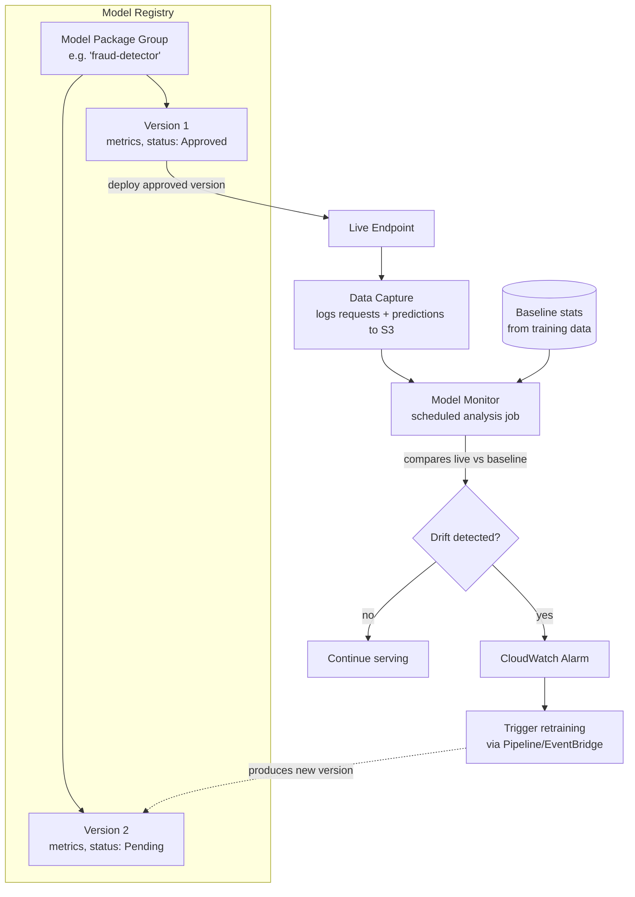

# SageMaker Model Monitor & Model Registry


## Definition

**Model Monitor** continuously watches a live SageMaker endpoint and flags when the data it's
receiving, or its predictions, start looking statistically different from what the model was
trained on — an early warning system for a model quietly going stale. **Model Registry** is the
version-controlled catalog of every trained model: what it is, how it performed, and whether
it's been approved to go to production — the audit trail that answers "what model is actually
running, and who signed off on it."

## Purpose

A model doesn't stay accurate forever — the real world changes (customer behavior shifts, a new
product category appears, a sensor gets recalibrated) while the model stays frozen at whatever
it learned during training. Without something watching for this, a model can silently degrade
for months before anyone notices from business metrics alone. Model Monitor exists to catch that
early, automatically, from the data itself rather than waiting for downstream damage. Separately,
once you have more than one person or team training models, you need a single source of truth
for "which version of this model is this," "what were its metrics," and "has anyone approved it
for production" — without that, teams end up with "final_v2_REAL_final.pkl" chaos and no audit
trail for regulators or incident review. Model Registry solves that.

## How It Works

Plain-English: Model Monitor is like a smoke detector that compares what's happening right now
against a baseline of "normal," and Model Registry is like a library's card catalog — every model
version gets a record, a status, and a history.



Step by step:
1. **Model Package Group** — a named container in the Registry for all versions of "the same"
   model concept (e.g., every iteration of your fraud detector lives under one group).
2. **Each version registered** carries its model artifact location, evaluation metrics,
   lineage (what training job/data produced it), and an **approval status**: `PendingManualApproval`,
   `Approved`, or `Rejected`. A human (or an automated gate in a pipeline) reviews metrics and
   flips the status.
3. **Only an Approved version gets deployed** to a live endpoint — this is the governance gate;
   in regulated environments this maps directly to change-management/sign-off requirements.
4. **Data Capture** — once live, you configure the endpoint to log a sample (or all) of incoming
   requests and the model's predictions to S3, continuously, in the background.
5. **Baseline** — before monitoring starts, you run a baselining job against the original
   training dataset to compute its statistical profile (feature distributions, data types,
   completeness).
6. **Monitoring schedule** — Model Monitor runs on a recurring schedule (e.g., hourly), pulling
   the newly captured live traffic and comparing its statistical profile against the baseline.
7. **Drift detected** — if live data drifts meaningfully from the baseline (a feature's
   distribution shifted, a new unexpected category appeared, missing-value rates spiked), a
   violation is reported and a CloudWatch alarm can fire.
8. **Automated response** — the alarm can trigger an EventBridge rule that kicks off a SageMaker
   Pipeline to retrain, producing a new model version that lands back in the Registry as
   `PendingManualApproval`, closing the loop.

## Key Features / Components

- **Model Registry** — model package groups, versioned model packages, approval workflow
  (Approved/Rejected/Pending), metadata/lineage tracking, cross-account model sharing.
- **Model Monitor — Data Quality** — detects schema/statistics drift (missing values, type
  mismatches, distribution shifts) in input features.
- **Model Monitor — Model Quality** — compares predictions against ground truth (when
  available later) to track accuracy/precision/recall decay over time.
- **Model Monitor — Bias Drift** — re-runs Clarify-style bias metrics on live traffic to catch
  bias that emerges after deployment, not just at training time.
- **Model Monitor — Feature Attribution Drift** — detects when which features matter most to
  the model's predictions has shifted (explainability drift).
- **Data Capture** — configurable logging of endpoint input/output to S3, the raw material
  every monitor type analyzes.
- **CloudWatch integration** — violations surface as metrics/alarms, hookable into any
  notification or automation (SNS, EventBridge, Lambda).
- **SageMaker Pipelines integration** — registry approval status can be a gate/condition step in
  an automated deployment pipeline.

## Use Cases — When to Use It

- You have a live production model and need to know, automatically, when it starts seeing data
  unlike what it was trained on (seasonal shift, new customer segment, upstream data bug).
- You operate in a regulated industry and need an auditable record of every model version, its
  metrics, and who approved it for production.
- You want retraining to be triggered by actual evidence of drift rather than an arbitrary
  calendar schedule (cheaper and more responsive than "retrain every Monday regardless").
- You have multiple models or teams and need a shared catalog so nobody accidentally deploys an
  unapproved or stale version.
- You need to detect fairness/bias problems that only show up once the model meets real-world
  traffic, not just the training set.

## When NOT to Use It / Alternatives

- **A one-off batch scoring job with no persistent endpoint** — Model Monitor is built around
  continuously sampled live traffic; it doesn't apply to Batch Transform jobs the same way (you'd
  instead re-run data-quality checks like Data Wrangler's report on each new batch).
  Model Monitor requires a live endpoint — don't try to attach it to batch processes it wasn't
  designed for.
- **A single experimental model with no production deployment** — Model Registry's approval
  workflow is overhead you don't need yet; skip it until you have more than one
  version/stakeholder to coordinate.
- **You need deep custom drift logic beyond statistical distribution comparison** — Model
  Monitor's built-in checks cover the common cases; highly custom drift definitions may need a
  bespoke monitoring job (SageMaker Processing jobs running your own code) instead.
- **Ground truth labels never become available** — Model Quality monitoring needs eventual
  ground truth to compare against; if your use case never gets labeled feedback (truly
  unverifiable predictions), you're limited to Data Quality/Bias Drift monitoring only.

## Why It's Important

**Real-world:** Silent model decay is a genuinely common, expensive failure mode — a
recommendation engine or credit model that degrades gradually can cost real money or create
compliance exposure long before anyone would notice from a dashboard. Model Registry's approval
gate is the mechanism that prevents "someone pushed an unreviewed model to prod" incidents, which
matter enormously in finance/healthcare/insurance contexts where every production model needs a
defensible audit trail.

**Exam weight (MLA-C02):** Squarely in **Domain 4: Operating, Monitoring, and Securing ML and
AI Solutions (24%)** — expect direct questions on "detect that live traffic no longer matches
training data" (Data Quality monitor), "model's accuracy appears to be dropping over time"
(Model Quality monitor, requires ground truth), "need an approval gate before a model reaches
production" (Model Registry), and "bias appeared in production that wasn't in training data"
(Bias Drift monitor). Also touches **Domain 2** lightly (Model Registry as the final step of
model development) and **Domain 3** (Registry approval as a pipeline gate).

**DVA-C03 relevance:** Out of scope — this is MLA-specific MLOps tooling.

## Pricing Model (summary)

- **Model Registry** — no separate charge; you pay normal S3 storage for model artifacts and
  metadata.
- **Model Monitor** — billed as a SageMaker Processing job: per instance-hour for the scheduled
  analysis job's compute, only while it runs (e.g., a brief hourly job, not continuous).
- **Data Capture** — billed at standard S3 storage rates for the captured request/response logs.
- Full current rates: https://aws.amazon.com/sagemaker/pricing/

## Hands-on Lab (Floci)

Floci does not run real SageMaker Model Monitor jobs or host a real Model Registry. Use:

**Option A — SageMaker Studio Lab / conceptual walkthrough:** Model Registry and Model Monitor
are control-plane features tied to real SageMaker endpoints; there's no meaningful free-tier
standalone emulation. Focus study here on the concepts (baseline, drift types, approval states)
rather than clicking through the console, since the exam tests understanding over navigation.

**Option B — Local equivalent: a simple statistical drift check (what Model Monitor does under
the hood, simplified):**
```bash
pip install pandas scipy
python3 - <<'EOF'
import pandas as pd
import numpy as np
from scipy.stats import ks_2samp

np.random.seed(0)
# baseline = training data distribution for a feature
baseline = pd.Series(np.random.normal(loc=50, scale=5, size=1000))
# "live traffic" that has drifted (mean shifted up)
live_traffic = pd.Series(np.random.normal(loc=58, scale=5, size=1000))

# Kolmogorov-Smirnov test: are these two distributions statistically different?
stat, p_value = ks_2samp(baseline, live_traffic)
print(f"KS statistic={stat:.3f}, p-value={p_value:.5f}")
if p_value < 0.05:
    print("DRIFT DETECTED — live data distribution differs significantly from baseline")
else:
    print("No significant drift detected")
EOF
```
This mirrors the statistical-comparison logic Model Monitor's Data Quality check performs,
simplified to one feature instead of a full captured request schema.

**Option C — simulate the Registry approval workflow with a JSON "model package" file:**
```bash
cat > model_registry_entry.json <<'EOF'
{
  "ModelPackageGroupName": "fraud-detector",
  "ModelPackageVersion": 2,
  "ModelMetrics": {"accuracy": 0.94, "auc": 0.97},
  "ModelApprovalStatus": "PendingManualApproval"
}
EOF
# "approve" it (what a human reviewer or pipeline gate would do):
python3 -c "
import json
d = json.load(open('model_registry_entry.json'))
d['ModelApprovalStatus'] = 'Approved'
json.dump(d, open('model_registry_entry.json', 'w'), indent=2)
print('Model version', d['ModelPackageVersion'], 'status:', d['ModelApprovalStatus'])
"
```

See `certifications/mla-c02/domain-4-monitoring-security/labs.md`.

## Exam Tips

- Know the four Model Monitor types cold: **Data Quality** (input drift), **Model Quality**
  (accuracy decay, needs ground truth), **Bias Drift**, **Feature Attribution Drift**.
- "Needs ground truth labels to work" is the distinguishing clue for Model Quality monitoring —
  the others work without labels, just on the input feature distributions.
- Model Registry's approval status (`PendingManualApproval` / `Approved` / `Rejected`) is a
  governance gate, not an automatic quality check — a human or pipeline condition sets it.
- A question about "automatically retrain when drift is detected" is testing whether you know
  to wire CloudWatch alarm → EventBridge → SageMaker Pipeline, not a single built-in feature.
- Don't confuse this with Clarify (bias/explainability analysis primarily at training time) —
  Model Monitor's Bias Drift reuses Clarify's logic but applies it continuously to live traffic.

## Related Terms

- `sagemaker-overview.md` — where monitoring/registry fit in the lifecycle
- `sagemaker-training-and-tuning.md` — produces the versions tracked in the Registry
- `sagemaker-deployment-endpoints.md` — the live endpoint Model Monitor watches
- `sagemaker-pipelines.md` — automating the retrain-on-drift loop
- `glossary/` — data drift, concept drift, ground truth, bias, model lineage
