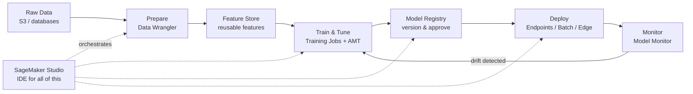

# Amazon SageMaker — Overview


## Definition

Amazon SageMaker is AWS's fully managed platform for the entire machine learning lifecycle —
it's a single product that bundles together everything you need to prepare data, build, train,
tune, deploy, and monitor ML models, so you don't have to stitch together your own servers,
notebooks, and training scripts from scratch. Think of it as "ML infrastructure as a service":
AWS runs the compute, you bring the data and the code (or use the no-code tools).

## Purpose

Before SageMaker (launched 2017), a data scientist who wanted to train a model had to: provision
an EC2 instance, install Jupyter and every ML library by hand, manage GPU drivers, write their
own code to save/load models, build their own deployment server, and babysit scaling. That's a
lot of undifferentiated heavy lifting that has nothing to do with the actual data science. AWS
built SageMaker to remove all of that plumbing — one managed service that handles the
infrastructure so ML teams spend their time on data and models, not DevOps. It also standardizes
how AWS customers do ML, which makes it easier for AWS to add new capabilities (distributed
training, AutoML, explainability, GenAI) into one coherent product instead of bolting them onto
raw EC2.

## How It Works

Plain-English version: SageMaker is really an umbrella brand for a dozen+ sub-services that map
to each stage of an ML project. You don't have to use all of them — many teams only use two or
three — but together they form a pipeline: raw data goes in one end, a deployed, monitored model
comes out the other end.



Step by step:
1. **Raw data** sits wherever it already lives — almost always Amazon S3 for SageMaker workflows,
   sometimes a database accessed through Athena/Redshift connectors.
2. **Prepare** — SageMaker Data Wrangler gives you a visual, low-code tool to clean, transform,
   and join datasets (handle missing values, encode categories, balance classes) without writing
   a full ETL pipeline by hand.
3. **Feature Store** — once you've engineered useful features (derived columns like "average
   purchase per month"), you save them centrally so other models/teams can reuse the exact same
   feature definitions instead of recomputing them inconsistently.
4. **Train & Tune** — a Training Job spins up managed compute (CPU or GPU instances), runs your
   training code (or a built-in algorithm) against the data, and saves the resulting model
   artifact to S3. Automatic Model Tuning (AMT) wraps training jobs in a search loop to find the
   best hyperparameters.
5. **Model Registry** — every trained model version gets registered with metadata, metrics, and
   an approval status, so you have an auditable catalog of "what model is this, and is it
   approved for production."
6. **Deploy** — an approved model is pushed to one of several hosting options depending on your
   latency/traffic pattern (real-time endpoint, serverless endpoint, async endpoint, batch
   transform job, or compiled to an edge device via Neo).
7. **Monitor** — once live, Model Monitor watches the incoming traffic and compares it to the
   training data's statistical profile, flagging data drift or quality issues.
8. **Feedback loop** — drift or performance decay detected by Model Monitor is the trigger to go
   back to step 4 and retrain, often automated via SageMaker Pipelines + EventBridge.
9. **SageMaker Studio** is the web-based IDE (built on JupyterLab) that acts as the single pane
   of glass over every stage above — notebooks, experiment tracking, pipeline visualization,
   endpoint management, all in one browser tab.

## Key Features / Components

- **SageMaker Studio** — the integrated IDE; notebooks, debugger, experiments, and pipeline
  visual editor in one browser-based workspace.
- **Data Wrangler** — visual data prep with 300+ built-in transformations, no-code.
- **Feature Store** — centralized, versioned repository of ML features for both training
  (offline store) and real-time inference (online, low-latency store).
- **Training Jobs** — managed, ephemeral compute clusters that run your training script or a
  built-in algorithm and auto-terminate when done (you only pay for the run).
- **Automatic Model Tuning (AMT)** — hyperparameter optimization (grid/random/Bayesian) run as
  many parallel training jobs that converge on the best-performing configuration.
- **Model Registry** — version control + approval workflow for trained models.
- **Inference options** — real-time endpoints, serverless endpoints, asynchronous endpoints,
  batch transform jobs, and multi-model/multi-container endpoints.
- **SageMaker Neo** — compiles a trained model to run efficiently on specific edge hardware
  (ARM, Jetson, etc.) and in specific runtime environments.
- **Model Monitor** — continuous quality/drift monitoring on live endpoints.
- **Pipelines** — CI/CD-style orchestration (a DAG of steps) for repeatable ML workflows.
- **Clarify** — bias detection and model explainability (SHAP values) across the lifecycle.
- **Ground Truth** — managed and human-in-the-loop data labeling.
- **JumpStart** — a hub of pre-trained models and solution templates you can deploy or fine-tune
  in a few clicks, including many foundation models.
- **Canvas** — a no-code visual interface for business analysts to build models without writing
  code.

## Use Cases — When to Use It

- You need to train a custom model (fraud scoring, demand forecasting, image classification)
  on your own labeled data and don't want to manage training infrastructure.
- You have an ML team that needs reproducible experiments, versioned models, and an approval
  gate before production (regulated industries: finance, healthcare).
- You need to serve predictions at scale with autoscaling, canary deployments, and multi-model
  hosting to save cost.
- You need to label large unlabeled datasets (Ground Truth) before you can train anything.
- You want to compile a model to run on a resource-constrained edge device (Neo).
- You're building a full MLOps pipeline that retrains automatically when new data or drift
  appears (Pipelines + Model Monitor + EventBridge).

## When NOT to Use It / Alternatives

- **You just need "AI" results (sentiment, translation, OCR) and don't want to train anything**
  — use the pre-built AI services instead (Comprehend, Rekognition, Textract, Translate, Polly,
  Transcribe, Forecast, Personalize). Training your own model for a problem AWS already solved
  with a managed API is wasted effort and cost.
- **You want to use or customize a large foundation model (text generation, chat, RAG) without
  managing GPU infrastructure at all** — use Amazon Bedrock; it's serverless by default and
  billed per token/request, vs. SageMaker endpoints which bill per instance-hour whether or not
  you're sending traffic (SageMaker JumpStart overlaps here if you need more control over the
  underlying instance or model source).
- **You're a solo developer/student experimenting casually** — SageMaker Studio Lab (the free
  tier, separate signup, no AWS account/billing needed) or a local Jupyter + scikit-learn/PyTorch
  setup is faster to start with and costs nothing.
- **Your workload is simple batch scoring of a small dataset on a schedule** — a scheduled
  Lambda or Glue job calling a lightweight model might be cheaper and simpler than standing up
  SageMaker infrastructure.
- **You need sub-millisecond inference on a device with no network connection at all** — Neo
  compiles the model but you still need an edge runtime (IoT Greengrass); for extremely simple
  models, a hand-rolled embedded inference loop might outperform the overhead of the SageMaker
  edge stack.

## Why It's Important

**Real-world:** SageMaker is the backbone of AWS's ML/AI story for the enterprise — it's what
lets a company go from "we have data in S3" to "we have a monitored, versioned model serving
predictions in production" without hiring an infrastructure team first. Cost control matters a
lot here: training jobs and endpoints bill per instance-hour, so an idle real-time endpoint left
running is a classic "surprise AWS bill" story; knowing which inference option fits your traffic
pattern is a genuine cost-engineering skill, not just trivia.

**Exam weight (MLA-C02):** SageMaker touches every one of the four MLA-C02 domains and is
arguably the single most tested surface area on the exam:
- **Domain 1 (Data Preparation, 28%)** — Data Wrangler, Feature Store, Ground Truth labeling.
- **Domain 2 (Model & FM Development, 24%)** — Training Jobs, built-in algorithms, script mode,
  AMT, Model Registry, Clarify (bias/explainability), JumpStart for foundation models.
- **Domain 3 (Deployment & Orchestration, 24%)** — all inference options, Neo, Pipelines.
- **Domain 4 (Monitoring & Security, 24%)** — Model Monitor, cost optimization (Spot training,
  Savings Plans), IAM/VPC/KMS around SageMaker resources.

**DVA-C03 relevance:** SageMaker is explicitly **out of scope** for DVA-C03 (the exam guide
calls it out directly) — a developer-exam question will never ask you to configure a training
job. DVA-C03's light GenAI coverage is Bedrock and Amazon Q, not SageMaker.

## Pricing Model (summary)

No charge for SageMaker itself — you pay for what you consume:
- **Studio/notebooks** — billed per instance-hour while the notebook/app is running (stop it
  when not in use, or it keeps billing).
- **Training Jobs** — billed per instance-second for the compute type you choose, only while
  the job runs; Spot-backed "Managed Spot Training" can cut this up to ~90%.
- **Inference endpoints** — real-time/async endpoints bill per instance-hour **continuously**
  while deployed (even with zero traffic); serverless endpoints bill per request + compute
  duration with no idle cost; batch transform bills only for the job's run duration.
- **Storage** — model artifacts and data in S3 are billed at normal S3 rates; Feature Store has
  its own per-GB-month + read/write throughput pricing.
- Full current rates: https://aws.amazon.com/sagemaker/pricing/

## Hands-on Lab (Floci)

**Honest limitation up front:** Floci emulates AWS control-plane APIs; it does **not** run real
SageMaker training jobs or host real inference endpoints (no GPU/CPU backing for SageMaker
specifically — see `labs-floci/README.md`). Use one of these instead:

**Option A — SageMaker Studio Lab (free, no AWS account needed):**
1. Sign up at https://studiolab.sagemaker.aws (separate from your AWS account, genuinely free).
2. Start a CPU runtime, open a notebook.
3. `pip install scikit-learn pandas` and train a small classifier (e.g., on the classic Iris or
   a sample tabular dataset) to get the feel of the SageMaker-style notebook workflow without
   any billing risk.

**Option B — Local equivalent (scikit-learn):**
```bash
pip install scikit-learn pandas joblib
python3 - <<'EOF'
from sklearn.datasets import load_iris
from sklearn.model_selection import train_test_split
from sklearn.ensemble import RandomForestClassifier
from sklearn.metrics import accuracy_score
import joblib

X, y = load_iris(return_X_y=True)
X_train, X_test, y_train, y_test = train_test_split(X, y, test_size=0.2, random_state=42)

model = RandomForestClassifier(n_estimators=100, random_state=42)
model.fit(X_train, y_train)
preds = model.predict(X_test)
print("Accuracy:", accuracy_score(y_test, preds))

joblib.dump(model, "model.joblib")  # this is the "model artifact" SageMaker would save to S3
EOF
```
This mirrors exactly what a SageMaker Training Job does under the hood: fit a model, produce an
artifact. In real SageMaker, `model.joblib` would be tarred up and pushed to the S3 path you
specified as `output_path` in the training job config.

**Option C — stage the data the way a real pipeline would, against Floci (S3 only):**
```bash
awslocal s3 mb s3://ml-training-data
awslocal s3 cp iris.csv s3://ml-training-data/raw/iris.csv
awslocal s3 ls s3://ml-training-data/raw/
```
This is the realistic, Floci-supported slice of the workflow: staging training data in S3 is
identical between Floci and real AWS; only the actual `sagemaker.estimator.Estimator.fit()` call
needs real SageMaker (or Studio Lab) to execute.

See `labs-floci/README.md` and `certifications/mla-c02/domain-2-model-development/labs.md` for
the full lab writeup.

## Exam Tips

- If a question says "fully managed, no infrastructure to manage, train and deploy a custom
  model" → SageMaker. If it says "I just want sentiment/text/image analysis, no training" → a
  pre-built AI service (Comprehend/Rekognition/etc).
- Memorize which inference option fits which traffic pattern — this is a very common
  scenario-based question (see `sagemaker-deployment-endpoints.md`).
- Know that real-time endpoints bill continuously whether idle or not — a classic "most
  cost-effective option" question hinges on this.
- SageMaker is explicitly out of scope for DVA-C03 — if you see a SageMaker-training question
  framed as a developer-exam question, that's your signal something's off (or you're actually
  looking at MLA-C02 material).
- Don't confuse SageMaker **Studio** (the IDE) with SageMaker **Studio Lab** (the free, separate,
  no-AWS-account product) — exam questions test this distinction.

## Related Terms

- `sagemaker-data-wrangler-and-feature-store.md` — Domain 1 data prep tools
- `sagemaker-training-and-tuning.md` — training jobs, algorithms, AMT
- `sagemaker-deployment-endpoints.md` — all inference options + Neo
- `sagemaker-model-monitor-and-registry.md` — drift detection + model versioning
- `sagemaker-pipelines.md` — MLOps orchestration
- `jumpstart.md` — pre-trained models and foundation models inside SageMaker
- `bedrock.md` — the serverless alternative for foundation models
- `glossary/` — epoch, overfitting, hyperparameter, inference, training job
