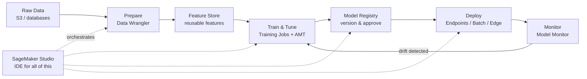
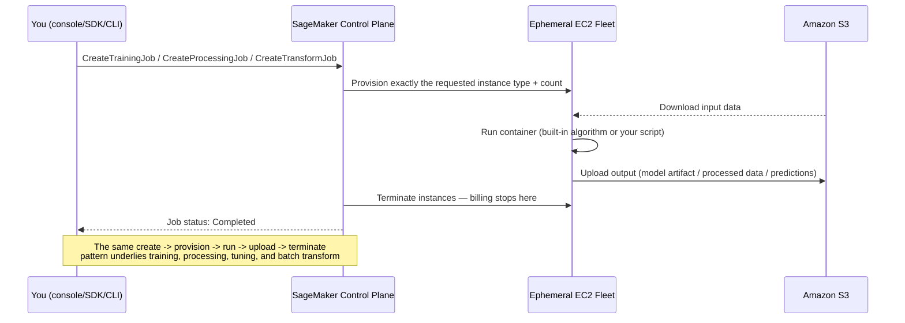
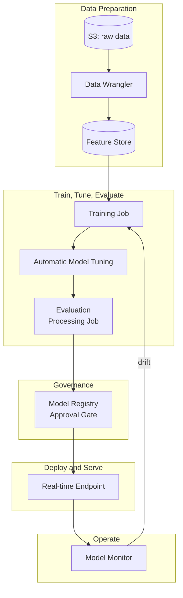
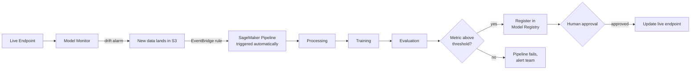
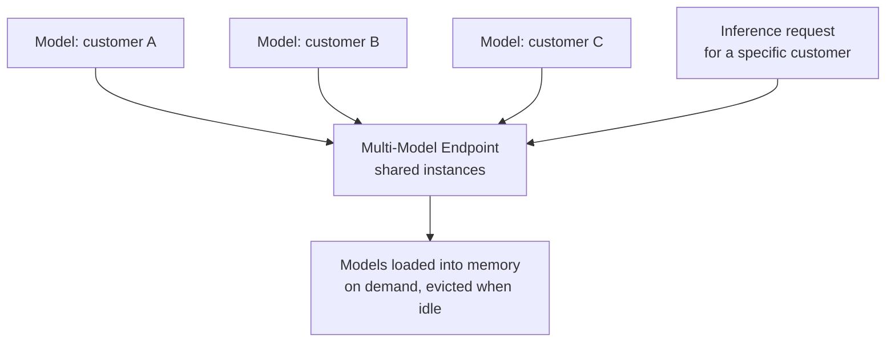

# Amazon SageMaker — Overview

> **Appears in:** [MLA-C02](../../certifications/mla-c02/README.md)


## Definition

Amazon SageMaker is AWS's fully managed platform for the entire machine learning lifecycle —
it's a single product that bundles together everything you need to prepare data, build, train,
tune, deploy, and monitor ML models, so you don't have to stitch together your own servers,
notebooks, and training scripts from scratch. Think of it as "ML infrastructure as a service":
AWS runs the compute, you bring the data and the code (or use the no-code tools).

Before going further, a handful of terms that recur throughout every SageMaker document in this
category, defined in plain English so nothing below assumes prior ML background:
- **Model** — a mathematical function, learned from data, that maps an input (a transaction's
  details, an image, a sentence) to a prediction (fraud/not fraud, a label, a translated
  sentence). "Training" is the process of learning that function from example data; "inference"
  is using the already-learned function to make a new prediction.
- **Training data** — the historical examples (with known correct answers, for supervised
  learning) a model learns patterns from. Garbage in, garbage out — bad or biased training data
  produces a bad or biased model no matter how good the algorithm is.
- **Hyperparameter** — a setting you choose *before* training starts that controls how training
  happens (how many trees in a forest, how fast the model adjusts per step) — distinct from the
  model's learned internal parameters, which training discovers automatically.
- **Epoch** — one complete pass through the entire training dataset. Training usually runs for
  many epochs; too few and the model hasn't learned enough (underfitting), too many and it starts
  memorizing noise specific to the training set rather than learning general patterns
  (overfitting).
- **Inference** — the act of asking a trained model for a prediction on new, previously-unseen
  data. This is the "online"/"production" use of a model, as opposed to training.
- **Artifact** — the saved, reusable output of a completed training job (the model's learned
  parameters, serialized to a file) — this is literally what gets deployed to serve predictions.

## Purpose

Before SageMaker (launched 2017), a data scientist who wanted to train a model had to: provision
an EC2 instance, install Jupyter and every ML library by hand, manage GPU drivers, write their
own code to save/load models, build their own deployment server, and babysit scaling. That's a
lot of undifferentiated heavy lifting that has nothing to do with the actual data science. AWS
built SageMaker to remove all of that plumbing — one managed service that handles the
infrastructure so ML teams spend their time on data and models, not DevOps. It also standardizes
how AWS customers do ML, which makes it easier for AWS to add new capabilities (distributed
training, AutoML, explainability, GenAI) into one coherent product instead of bolting them onto
raw EC2.

Put differently: every one of the sub-services described below exists because someone,
repeatedly, had to solve the same infrastructure problem by hand before AWS packaged a managed
answer for it. Data Wrangler exists because data scientists kept hand-writing the same pandas
cleaning code. Feature Store exists because teams kept building slightly-different, inconsistent
versions of "the same" feature. Model Monitor exists because models kept silently going stale in
production with nobody noticing until a downstream business metric moved. Understanding
SageMaker's *shape* — why there are this many pieces, and why they're organized this way — is
actually more useful for the exam than memorizing any single feature in isolation, because every
scenario question is really asking "which piece of this well-known problem are you being shown."

### What SageMaker replaces, concretely

A direct before/after comparison makes the value proposition concrete rather than abstract:

| Task | Before SageMaker (DIY on EC2) | With SageMaker |
|---|---|---|
| Get a notebook running | Provision an EC2 instance, install CUDA/drivers, install Jupyter + every library by hand | Launch a Studio notebook app, pre-configured kernel images available |
| Train on a GPU briefly | Keep a GPU instance running (and paying) the whole time you might need it | A Training Job provisions the GPU instance only for the job's duration, then terminates |
| Save/load a trained model | Write your own serialization and S3 upload/download code | `fit()` automatically produces and uploads a standard model artifact |
| Serve predictions | Build and scale your own HTTP server, handle health checks, load balancing | Choose an inference option; SageMaker provisions, load-balances, and scales it |
| Track experiment history | Spreadsheets, naming conventions, tribal knowledge | Experiments automatically records every run's parameters/metrics |
| Detect model staleness | Nothing, until someone notices a business metric drop | Model Monitor compares live traffic to a training baseline on a schedule |
| Audit which model version is live | Hope someone wrote it down | Model Registry's versioned, approved catalog |

None of these are capabilities SageMaker invented from nothing — every row was solvable by hand
before 2017. What SageMaker did was turn each one into a managed, reusable building block instead
of a bespoke engineering project every team reinvents independently.

## How It Works

Plain-English version: SageMaker is really an umbrella brand for a dozen+ sub-services that map
to each stage of an ML project. You don't have to use all of them — many teams only use two or
three — but together they form a pipeline: raw data goes in one end, a deployed, monitored model
comes out the other end.



Step by step:
1. **Raw data** sits wherever it already lives — almost always Amazon S3 for SageMaker workflows,
   sometimes a database accessed through Athena/Redshift connectors.
2. **Prepare** — SageMaker Data Wrangler gives you a visual, low-code tool to clean, transform,
   and join datasets (handle missing values, encode categories, balance classes) without writing
   a full ETL pipeline by hand.
3. **Feature Store** — once you've engineered useful features (derived columns like "average
   purchase per month"), you save them centrally so other models/teams can reuse the exact same
   feature definitions instead of recomputing them inconsistently.
4. **Train & Tune** — a Training Job spins up managed compute (CPU or GPU instances), runs your
   training code (or a built-in algorithm) against the data, and saves the resulting model
   artifact to S3. Automatic Model Tuning (AMT) wraps training jobs in a search loop to find the
   best hyperparameters.
5. **Model Registry** — every trained model version gets registered with metadata, metrics, and
   an approval status, so you have an auditable catalog of "what model is this, and is it
   approved for production."
6. **Deploy** — an approved model is pushed to one of several hosting options depending on your
   latency/traffic pattern (real-time endpoint, serverless endpoint, async endpoint, batch
   transform job, or compiled to an edge device via Neo).
7. **Monitor** — once live, Model Monitor watches the incoming traffic and compares it to the
   training data's statistical profile, flagging data drift or quality issues.
8. **Feedback loop** — drift or performance decay detected by Model Monitor is the trigger to go
   back to step 4 and retrain, often automated via SageMaker Pipelines + EventBridge.
9. **SageMaker Studio** is the web-based IDE (built on JupyterLab) that acts as the single pane
   of glass over every stage above — notebooks, experiment tracking, pipeline visualization,
   endpoint management, all in one browser tab.

### The underlying compute pattern, every stage shares it

It's worth seeing explicitly that "Training Job," "Processing Job," and "Batch Transform Job"
are really the same underlying mechanic applied at different stages — AWS provisions exactly the
compute you asked for, runs your container, saves the output, and tears the compute back down.
Seeing this once makes every later SageMaker document's "how it works" section much faster to
absorb, because you're not learning a new infrastructure model each time, just a new container
and a new input/output shape.


*Figure: the basic architecture of a SageMaker job — you bring data in S3 and either a built-in
algorithm or your own training script; SageMaker provisions the EC2 instances behind the scenes,
runs the job, and returns a model artifact. Source: AWS SageMaker Developer Guide, "Model
training" — docs.aws.amazon.com/sagemaker/latest/dg/train-model.html.*



### Worked example — a complete lifecycle, start to finish, with real artifact shapes

To make the whole diagram above concrete, walk through an actual small project: predicting
whether a customer will churn, from a CSV of customer records.

1. **Raw data in S3** — `s3://my-bucket/raw/customers.csv`, 50,000 rows, 20 columns (tenure,
   monthly charges, contract type, churn label, etc.), with some missing values and one
   imbalanced class (churners are 15% of rows).
2. **Data Wrangler** opens that CSV, you apply three transforms visually: fill missing
   `monthly_charges` with the median, one-hot encode `contract_type` (turn a text category into
   several 0/1 columns a model can use numerically), and apply class balancing so the training
   set isn't overwhelmingly "did not churn." Export produces a cleaned
   `s3://my-bucket/processed/customers_clean.csv`.
3. **Feature Store** (optional here, valuable if other teams will reuse these same features) —
   you define a Feature Group `customer_churn_features` with `customer_id` as the record
   identifier and `event_time` as the timestamp column; the cleaned features are ingested into
   both the Offline Store (for this and future training) and the Online Store (if you'll need
   real-time lookups at inference time later).
4. **Training Job** — you launch SageMaker's built-in XGBoost algorithm against the cleaned data,
   specifying instance type `ml.m5.xlarge`, hyperparameters (`max_depth=5`, `eta=0.2`,
   `num_round=100`), and output path `s3://my-bucket/models/churn-v1/`. SageMaker provisions the
   instance, trains, and writes `model.tar.gz` to that S3 path — this is the **artifact**.
5. **Automatic Model Tuning** (optional, if you want better-than-default hyperparameters) — you
   instead launch a tuning job with a search range for `max_depth` (3-10) and `eta` (0.01-0.3),
   objective "maximize validation AUC," and a budget of 20 training jobs; AMT returns the single
   best-performing combination's artifact.
6. **Model Registry** — the winning artifact is registered under Model Package Group
   `churn-detector`, version 3, with its validation AUC (say, 0.91) attached as metadata, status
   `PendingManualApproval`.
7. **A reviewer checks the metrics**, confirms 0.91 AUC clears the team's bar (say, > 0.88), and
   flips the status to `Approved`.
8. **Deployment** — because churn scoring happens as part of a nightly batch job (not a live user
   action), the team chooses **Batch Transform**, not a real-time endpoint: point it at this
   week's full customer list in S3, it scores all 50,000 rows, writes predictions to
   `s3://my-bucket/predictions/churn-2024-06-01.csv`, and the compute terminates — no endpoint
   stays running between nightly runs, which is also the cheapest option for this traffic shape.
9. **Model Monitor** — because there's no persistent endpoint here, data-quality monitoring
   instead runs as a periodic Processing job against each new batch, checking whether this week's
   input distribution has drifted from the training baseline (e.g., did average tenure suddenly
   shift because of a product change) — the same conceptual check Model Monitor does for a live
   endpoint, applied to the batch pattern instead.
10. **If drift is detected**, a SageMaker Pipeline (wiring steps 2-6 together as a repeatable DAG)
    is triggered to retrain automatically, producing version 4 in the Registry for a human to
    review — closing the loop back to step 4 without anyone re-running the notebook by hand.

Every one of those ten steps maps onto one of the five dedicated SageMaker documents in this
folder — this overview exists specifically to show how they chain together before you read each
one in isolation.

### A second worked example — the real-time traffic-pattern version

The churn example above was batch, end to end. To see how the *same* lifecycle changes shape for
a live, latency-sensitive use case, consider a fraud-detection model scoring every card
transaction as it happens:

1. **Raw data** is still historical transactions in S3, but now also a live stream of new
   transactions arriving continuously (e.g., via Kinesis) that need scoring within milliseconds.
2. **Feature Store's Online Store** becomes essential here, not optional — at the moment of a
   new transaction, the model needs "this customer's average transaction size over the last 30
   days" looked up in single-digit milliseconds, not computed fresh from a historical table.
   The Offline Store (full history) is what trained the model in the first place; the Online
   Store (latest values only) is what serves it live.
3. **Training** happens the same way as the churn example — a Training Job against historical,
   labeled (fraud/not-fraud) data, likely XGBoost given it's tabular classification.
4. **Deployment** is where this diverges sharply from the batch example: a **real-time endpoint**
   is the only sensible choice, because a card transaction can't wait for a nightly batch job —
   the model must answer in the time it takes to authorize a purchase. Auto scaling is configured
   so the endpoint can absorb traffic spikes (e.g., Black Friday) without manual intervention.
5. **Model Monitor** now runs continuously against live traffic (not a periodic batch check),
   because fraud patterns genuinely shift fast — a new fraud technique appearing this week is
   exactly the kind of drift this setup needs to catch quickly, not after a weekly batch review.
6. **The retraining loop** is the same Pipelines + EventBridge pattern as the churn example, but
   triggered by Model Monitor's live-traffic drift alarm rather than a calendar schedule — because
   for fraud, "the model is wrong right now" matters far more than "the model hasn't been
   refreshed in a while."

Contrasting these two worked examples side by side is exactly the skill MLA-C02's Domain 3
scenario questions are testing: the same five-stage lifecycle, but the *correct configuration
choice at each stage* depends entirely on the traffic pattern and latency requirement described
in the scenario, not on any single "best" default.

## Key Features / Components

- **SageMaker Studio** — the integrated IDE; notebooks, debugger, experiments, and pipeline
  visual editor in one browser-based workspace. Studio is itself built on JupyterLab, so existing
  Jupyter notebook skills transfer directly.
- **Data Wrangler** — visual data prep with 300+ built-in transformations, no-code.
- **Feature Store** — centralized, versioned repository of ML features for both training
  (offline store) and real-time inference (online, low-latency store).
- **Training Jobs** — managed, ephemeral compute clusters that run your training script or a
  built-in algorithm and auto-terminate when done (you only pay for the run).
- **Automatic Model Tuning (AMT)** — hyperparameter optimization (grid/random/Bayesian) run as
  many parallel training jobs that converge on the best-performing configuration.
- **Model Registry** — version control + approval workflow for trained models.
- **Inference options** — real-time endpoints, serverless endpoints, asynchronous endpoints,
  batch transform jobs, and multi-model/multi-container endpoints.
- **SageMaker Neo** — compiles a trained model to run efficiently on specific edge hardware
  (ARM, Jetson, etc.) and in specific runtime environments.
- **Model Monitor** — continuous quality/drift monitoring on live endpoints.
- **Pipelines** — CI/CD-style orchestration (a DAG of steps) for repeatable ML workflows.
- **Clarify** — bias detection and model explainability (SHAP values) across the lifecycle. SHAP
  (SHapley Additive exPlanations) values answer "how much did each input feature push this
  specific prediction up or down" — the standard technique for explaining an individual
  prediction rather than just the model as a whole.
- **Ground Truth** — managed and human-in-the-loop data labeling; supports automated labeling
  (the service labels easy examples itself once confident, routing only hard/ambiguous examples
  to human labelers), which cuts labeling cost substantially on large datasets.
- **JumpStart** — a hub of pre-trained models and solution templates you can deploy or fine-tune
  in a few clicks, including many foundation models.
- **Canvas** — a no-code visual interface for business analysts to build models without writing
  code.
- **Experiments** — automatic tracking of every training run's parameters, metrics, and
  artifacts for side-by-side comparison, which is what makes "why is this run different from last
  week's" an answerable question instead of a guessing game.
- **Debugger** — real-time monitoring during training itself, catching problems like vanishing
  gradients or GPU underutilization while a job is still running, rather than after it fails or
  produces a bad model.
- **SageMaker HyperPod** — a newer offering for very large-scale distributed training (hundreds
  of GPUs/nodes), with automatic faulty-node detection and replacement so a single hardware
  failure doesn't require restarting a multi-day training run from scratch.

### Choosing the right sub-service — a decision guide

A huge fraction of MLA-C02 scenario questions are really just "which SageMaker sub-service does
this job," dressed up in a business scenario. A quick reference, matching the order these pieces
appear in the lifecycle diagram:

| If the scenario says... | You need |
|---|---|
| "clean/join/transform messy raw data before training" | Data Wrangler |
| "multiple models/teams need the exact same feature definition" | Feature Store |
| "label a large unlabeled dataset" | Ground Truth |
| "train a classifier/regressor on our own labeled data" | Training Jobs (built-in algorithm or script mode) |
| "find the best hyperparameters automatically" | Automatic Model Tuning (AMT) |
| "explain why the model made this specific prediction" / "detect bias" | Clarify |
| "version models, require sign-off before production" | Model Registry |
| "steady, latency-sensitive live traffic" | Real-time endpoint |
| "spiky/unpredictable/low traffic, minimize idle cost" | Serverless endpoint |
| "large payload or long processing time, caller doesn't need an instant answer" | Asynchronous endpoint |
| "score a huge dataset once, no live traffic" | Batch Transform |
| "needs to run on a device with no reliable internet" | SageMaker Neo + IoT Greengrass |
| "detect that live traffic no longer matches training data" | Model Monitor |
| "automate retraining when new data arrives or drift is detected" | Pipelines + EventBridge |
| "deploy/fine-tune an open-source or foundation model with infra control" | JumpStart |
| "business analyst, no code, build a model from a spreadsheet-like UI" | Canvas |

Keep this table as a mental checklist while reading exam scenarios — correctly identifying which
row applies is most of the work; the specific configuration details (instance types, thresholds)
are usually secondary to picking the right sub-service first.

### Built-in algorithms, a quick index

`sagemaker-training-and-tuning.md` covers this in full depth, but it's useful to see the
shortlist here too, since "which built-in algorithm fits this problem type" is tested from the
overview level as much as the training-specific document:

| Problem type | Built-in algorithm |
|---|---|
| Tabular classification/regression | XGBoost (usually the strongest default baseline) |
| Large-scale linear regression/classification | Linear Learner |
| Clustering (grouping similar records with no labels) | K-Means |
| Anomaly/outlier detection | Random Cut Forest |
| Time-series forecasting | DeepAR |
| Text classification / word embeddings | BlazingText |
| Image classification / object detection | built-in CNN-based algorithms |
| Recommendations / sparse, high-dimensional data | Factorization Machines |

If none of these fit your problem's shape, script mode (bring your own TensorFlow/PyTorch code)
or Bring Your Own Container is the escape hatch — this exact decision tree is what Domain 2
scenario questions about "which algorithm" are testing.

### Clarify in depth — a worked bias-detection example

Clarify deserves a slightly deeper look than a single bullet, because "detect bias" sounds vague
until you see what it actually measures. Take the churn-model example from earlier: suppose the
training data happens to contain a disproportionate number of "non-churned" examples from one
customer segment (say, customers who signed up via a particular channel) relative to how that
segment appears in the real population. Clarify's pre-training bias check computes metrics like
**Class Imbalance (CI)** (how skewed is the representation of one group vs. another) and
**Difference in Proportions of Labels (DPL)** (does the positive outcome rate differ meaningfully
between groups) *before* you spend any compute training a model on data that's already skewed in
a way that would bake an unfair pattern into the resulting model.

After training, Clarify's post-training checks go further: **Disparate Impact (DI)** compares the
rate of favorable predictions between groups — if one segment's customers are flagged as "will
churn" at a dramatically different rate than another segment's, *and* that difference isn't
explained by any legitimate feature, that's the kind of signal DI is built to surface. SHAP-based
explainability then tells you, for one specific prediction, exactly how much each individual
feature (tenure, monthly charges, contract type, etc.) pushed the prediction toward "will churn"
versus away from it — the same concept whether you're explaining a churn score or an insurance
denial, which is exactly why the earlier Scenario 2 example referenced it directly.

The exam-relevant takeaway: bias detection happens at **two distinct points** (pre-training, on
the data itself; post-training, on the model's actual predictions), and they catch different
problems — skewed training data vs. a model that's actually making unfair predictions in
production, which Model Monitor's Bias Drift then continues watching for after deployment.

### JumpStart and Canvas, briefly positioned

Both get a dedicated document each (`jumpstart.md`, and Canvas appears throughout this overview),
but it's worth placing them clearly relative to everything above:
- **JumpStart** is the "don't start from a blank model" shortcut — instead of writing a training
  script or picking a built-in algorithm from scratch, you start from a pre-trained model (open-
  source or foundation model) and either deploy it as-is or fine-tune it on your own data, still
  using the same underlying Training Job / endpoint infrastructure described throughout this
  document. It's a faster on-ramp into the same lifecycle, not a separate lifecycle.
- **Canvas** is the "skip the code entirely" shortcut for business users — point it at a dataset,
  pick a target column, and it runs AutoML-style model selection and training behind a UI with
  no notebook, no script, no CLI. Under the hood it's still using SageMaker's training
  infrastructure; Canvas's value is entirely in who can use it (non-engineers), not in offering
  different underlying capability than the rest of the platform.

## Use Cases — When to Use It

- You need to train a custom model (fraud scoring, demand forecasting, image classification)
  on your own labeled data and don't want to manage training infrastructure.
- You have an ML team that needs reproducible experiments, versioned models, and an approval
  gate before production (regulated industries: finance, healthcare).
- You need to serve predictions at scale with autoscaling, canary deployments, and multi-model
  hosting to save cost.
- You need to label large unlabeled datasets (Ground Truth) before you can train anything.
- You want to compile a model to run on a resource-constrained edge device (Neo).
- You're building a full MLOps pipeline that retrains automatically when new data or drift
  appears (Pipelines + Model Monitor + EventBridge).
- You need to explain *why* a model made a specific prediction (loan denial, medical risk score)
  to satisfy a regulatory or customer-facing explainability requirement — Clarify.
- You're training at a scale where a single hardware failure shouldn't cost you a multi-day
  training run — HyperPod's resilient training infrastructure.
- You need business analysts, not engineers, to be able to build a working model from a
  spreadsheet-like interface — Canvas.
- You need to label large volumes of unstructured data (images, audio, text) with a mix of
  automated pre-labeling and human review, rather than either fully manual labeling or no
  labeling pipeline at all — Ground Truth's automated data labeling mode.
- You're migrating an existing, successful notebook-based workflow to something reproducible and
  team-shareable without a ground-up rewrite — SageMaker Studio adopts standard Jupyter notebook
  files directly.
- You need a single system of record for "which data, code, and parameters produced this exact
  model" across dozens of experiments run by different team members — Experiments + Pipelines'
  lineage tracking together.

## When NOT to Use It / Alternatives

- **You just need "AI" results (sentiment, translation, OCR) and don't want to train anything**
  — use the pre-built AI services instead (Comprehend, Rekognition, Textract, Translate, Polly,
  Transcribe, Forecast, Personalize). Training your own model for a problem AWS already solved
  with a managed API is wasted effort and cost.
- **You want to use or customize a large foundation model (text generation, chat, RAG) without
  managing GPU infrastructure at all** — use Amazon Bedrock; it's serverless by default and
  billed per token/request, vs. SageMaker endpoints which bill per instance-hour whether or not
  you're sending traffic (SageMaker JumpStart overlaps here if you need more control over the
  underlying instance or model source).
- **You're a solo developer/student experimenting casually** — SageMaker Studio Lab (the free
  tier, separate signup, no AWS account/billing needed) or a local Jupyter + scikit-learn/PyTorch
  setup is faster to start with and costs nothing.
- **Your workload is simple batch scoring of a small dataset on a schedule** — a scheduled
  Lambda or Glue job calling a lightweight model might be cheaper and simpler than standing up
  SageMaker infrastructure.
- **You need sub-millisecond inference on a device with no network connection at all** — Neo
  compiles the model but you still need an edge runtime (IoT Greengrass); for extremely simple
  models, a hand-rolled embedded inference loop might outperform the overhead of the SageMaker
  edge stack.
- **You're doing purely exploratory data analysis with no intent to train a model soon** — a
  plain Jupyter notebook on your laptop, or even a spreadsheet, is faster to get started with than
  spinning up a Studio environment for analysis that was never going to become a training job.
- **Your organization has strict "no custom ML, approved-vendor-APIs-only" policy** for a given
  data category — some regulated environments restrict even managed custom-model training for
  certain data classes; check organizational policy before assuming SageMaker is automatically
  the approved path just because it's an AWS-native service.
- **A single person needs to run one quick what-if analysis and throw the result away** — the
  overhead of creating a Feature Group, registering a model version, and setting up monitoring
  is entirely disproportionate to a one-off, disposable analysis; reserve the full MLOps tooling
  for work that will actually be repeated or handed off.

## Common Architectures

Three recurring end-to-end patterns, seen repeatedly both in real deployments and in MLA-C02
scenario questions:

### Pattern 1 — The full managed ML lifecycle (the "textbook" pattern)

AWS's own reference architecture for this exact pattern mirrors the lifecycle diagram earlier in
this document almost exactly, which is itself a strong signal of how standard this shape is:



This is precisely the shape described in AWS's own "Architect and build the full machine
learning lifecycle with Amazon SageMaker" reference blog post, which breaks the same lifecycle
into exactly these four solution-architecture phases (data prep, train/tune, deploy/serve, and
an automated end-to-end pipeline tying them together) — worth reading directly if you want to
see the AWS-diagram version of what this document walks through conceptually
(aws.amazon.com/blogs/machine-learning/architect-and-build-the-full-machine-learning-lifecycle-with-amazon-sagemaker/).

### Pattern 2 — Automated, event-driven retraining (MLOps maturity)

The pattern that turns a one-off model into a system that stays healthy without a human
babysitting it:



This pattern is the practical answer to "how do you keep a model from silently rotting in
production" — the answer is never "someone remembers to retrain it," it's "an EventBridge rule
and a Condition Step make retraining and quality-gating automatic."


*Figure: a real SageMaker Pipelines DAG — Processing (clean data) → Training → Evaluation →
Condition (does the new model clear the quality bar?) → Register. This is the literal AWS-console
rendering of the automated retraining pattern described above. Source: AWS SageMaker Developer
Guide, "Pipelines overview" — docs.aws.amazon.com/sagemaker/latest/dg/pipelines-overview.html.*

### Pattern 3 — Multi-model cost-optimized serving

For organizations with many models and uneven, often-low traffic per model (common in B2B SaaS
with per-customer models, or companies with dozens of narrow use cases):



Hosting 200 small, infrequently-used models behind 200 separate real-time endpoints would be
wildly expensive (each billed continuously per instance-hour). A multi-model endpoint shares the
underlying instances across all 200 models, loading each into memory only when it's actually
being called — the architectural answer to "many models, most idle most of the time."

### SageMaker Studio — what actually lives inside it

Because almost every other document in this category assumes you'll be working from inside
Studio, it's worth a dedicated look at what's actually in there, since "just open Studio" hides
a surprising amount of structure:
- **Notebooks** — JupyterLab-compatible notebook instances, but backed by SageMaker's own
  elastic compute (you can resize the underlying instance without losing your notebook state,
  unlike a fixed-size local Jupyter server).
- **Experiments** — every training/tuning job you run gets automatically tracked here: its
  hyperparameters, metrics, and artifacts, browsable and comparable side by side without you
  writing any logging code yourself.
- **Pipelines (visual)** — a drag-and-drop DAG editor as an alternative to writing pipeline
  definitions in the Python SDK, useful for less code-heavy team members or for a first visual
  pass before formalizing a pipeline in code.
- **Model Registry (browser)** — browse registered model versions, their metrics, and flip
  approval status directly from the UI instead of the CLI/SDK.
- **Endpoints** — view, create, and monitor live endpoints, including real-time metrics
  (invocations, latency, errors) without leaving the browser tab.
- **Data Wrangler flows** — the visual data-prep tool lives here as a specific app type within
  Studio, distinct from a plain notebook.
- **JumpStart browsing** — the model/solution catalog described in `jumpstart.md` is itself a
  Studio-embedded experience, not a separate product you navigate to.

This is also why Studio itself has a cost footprint: every one of the above runs on an underlying
compute instance that bills per instance-hour while active, exactly like a notebook does — the
convenience of "everything in one browser tab" doesn't remove the need to shut things down when
you're not using them.

### Cost optimization, concretely

SageMaker cost questions are common enough on MLA-C02 that it's worth internalizing the concrete
levers, not just "know that cost matters":
- **Managed Spot Training** — training jobs tolerant of interruption can run on spare EC2
  capacity at up to ~90% off On-Demand pricing; SageMaker automatically checkpoints progress and
  resumes if the Spot instance is reclaimed, so you don't lose completed work, only time.
- **Right-sizing training instances** — a training job on an oversized GPU instance for a small
  tabular dataset wastes money for no speed benefit; Inference Recommender's training-side
  analog is simply benchmarking a couple of instance sizes on a representative data sample before
  committing to a production training configuration.
- **Choosing the right inference option** (the single highest-leverage cost decision in this
  entire category) — see the worked cost comparison above; a mismatched inference option can
  easily be a 10-100x cost difference for the same traffic pattern, dwarfing any instance-size
  optimization.
- **Multi-model endpoints** — consolidating many small, infrequently-called models onto shared
  instances instead of one endpoint each, described in Pattern 3 above.
- **Savings Plans** — for predictable, steady SageMaker compute usage (training or inference),
  a 1- or 3-year compute Savings Plan commitment offers a meaningful discount over On-Demand,
  the same mechanism as EC2 Savings Plans applied to SageMaker's underlying compute.
- **Auto-shutdown for idle Studio apps** — Studio supports automatically stopping idle
  notebook/app instances after a configurable period, directly preventing the "forgot to stop it"
  billing surprise described in Troubleshooting below.
- **Pipeline step caching** — re-running a pipeline where only the training step's code changed
  skips re-running the unchanged processing step, saving both time and the compute cost of
  redoing work that would produce an identical result.

## Why It's Important

**Real-world:** SageMaker is the backbone of AWS's ML/AI story for the enterprise — it's what
lets a company go from "we have data in S3" to "we have a monitored, versioned model serving
predictions in production" without hiring an infrastructure team first. Cost control matters a
lot here: training jobs and endpoints bill per instance-hour, so an idle real-time endpoint left
running is a classic "surprise AWS bill" story; knowing which inference option fits your traffic
pattern is a genuine cost-engineering skill, not just trivia.

**Exam weight (MLA-C02):** SageMaker touches every one of the four MLA-C02 domains and is
arguably the single most tested surface area on the exam:
- **Domain 1 (Data Preparation, 28%)** — Data Wrangler, Feature Store, Ground Truth labeling.
- **Domain 2 (Model & FM Development, 24%)** — Training Jobs, built-in algorithms, script mode,
  AMT, Model Registry, Clarify (bias/explainability), JumpStart for foundation models.
- **Domain 3 (Deployment & Orchestration, 24%)** — all inference options, Neo, Pipelines.
- **Domain 4 (Monitoring & Security, 24%)** — Model Monitor, cost optimization (Spot training,
  Savings Plans), IAM/VPC/KMS around SageMaker resources.

**DVA-C03 relevance:** SageMaker is explicitly **out of scope** for DVA-C03 (the exam guide
calls it out directly) — a developer-exam question will never ask you to configure a training
job. DVA-C03's light GenAI coverage is Bedrock and Amazon Q, not SageMaker.

### Security and governance, concretely

SageMaker resources follow the same IAM/VPC/KMS security model as the rest of AWS, with a few
SageMaker-specific wrinkles worth knowing explicitly for Domain 4:
- **Execution roles** — every Training Job, Processing Job, and endpoint runs under an IAM role
  *you specify*, separate from your own console/CLI identity; that role needs exactly the S3,
  KMS, and other permissions the job actually requires, following least-privilege the same way
  any other AWS compute resource would.
- **VPC configuration** — training jobs and endpoints can be launched inside your VPC (with no
  internet access at all, if desired), so training data never has to leave a private network
  boundary — a common requirement for sensitive data (healthcare, finance).
- **Encryption** — S3 data, EBS volumes attached to training instances, and endpoint traffic can
  all be encrypted with customer-managed KMS keys rather than AWS default keys, for
  organizations requiring key-level control and audit trail over who can decrypt what.
- **Network isolation mode** — SageMaker supports a strict "network isolation" setting that
  blocks a training container from making *any* outbound network call (even to other AWS
  services) beyond the explicitly configured data channels — relevant when running third-party
  or untrusted training code.
- **Model Registry cross-account sharing** — a model package group can be shared with another
  AWS account under controlled permissions, supporting organizations that separate ML
  development and production AWS accounts for governance reasons.

## Limits & Quotas

Exact numeric limits change over time — check the Service Quotas console for current values —
but the *categories* worth knowing:
- **Instance quotas per instance type, per Region** govern how many training/endpoint instances
  of a given type you can run concurrently — a large distributed training job or a burst of
  parallel AMT trials can hit this before it hits any budget constraint, and the fix is a quota
  increase request, not a code change.
- **Training job max runtime** is configurable per job (`MaxRuntimeInSeconds`) but has an account-
  level ceiling — extremely long-running jobs need checkpointing and resumption design, not just
  a bigger timeout value.
- **Notebook/Studio instance idle cost** isn't a hard quota but is the single most common billing
  surprise: a notebook instance left running racks up instance-hours identically to a training
  job, with no automatic shutdown unless you configure Studio's auto-shutdown/idle-detection
  feature.
- **Endpoint instance count and model size limits** vary by instance type — a model too large for
  the chosen instance's memory fails to deploy, which is a capacity-planning question, not a
  SageMaker bug.
- **AMT's maximum number of training jobs per tuning job** is capped — a search space far larger
  than the cap needs either a narrower range or a smarter strategy (Bayesian/Hyperband) rather
  than brute-force grid search across everything at once.
- **Feature Store** has limits on the number of feature groups per account, the number of
  features per feature group, and online-store read/write throughput capacity — a feature group
  with hundreds of columns or very high-throughput real-time writes may need throughput capacity
  planning the same way a DynamoDB table would.
- **Pipelines** cap the number of steps per pipeline and the pipeline definition's total size —
  an extremely large, monolithic pipeline may need to be split into multiple linked pipelines
  rather than one giant DAG.
- **Ground Truth labeling jobs** have limits on the number of objects per labeling job and
  concurrent active labeling jobs — very large labeling efforts are typically split into batches
  rather than submitted as one enormous job.
- **Model Registry** caps the number of model package groups and versions per group per account
  — an organization registering a very large number of narrow, per-customer models should plan
  a naming/grouping convention accordingly rather than assuming unlimited versions.

## Pricing Model (summary)

No charge for SageMaker itself — you pay for what you consume:
- **Studio/notebooks** — billed per instance-hour while the notebook/app is running (stop it
  when not in use, or it keeps billing).
- **Training Jobs** — billed per instance-second for the compute type you choose, only while
  the job runs; Spot-backed "Managed Spot Training" can cut this up to ~90%.
- **Inference endpoints** — real-time/async endpoints bill per instance-hour **continuously**
  while deployed (even with zero traffic); serverless endpoints bill per request + compute
  duration with no idle cost; batch transform bills only for the job's run duration.
- **Storage** — model artifacts and data in S3 are billed at normal S3 rates; Feature Store has
  its own per-GB-month + read/write throughput pricing.

**Worked cost comparison** (illustrative, confirm current instance pricing before budgeting):
a model needs occasional scoring, roughly 500 requests/day, each taking ~200ms. A real-time
`ml.m5.xlarge` endpoint running 24/7 bills for 720 instance-hours/month regardless of those 500
daily requests being a tiny fraction of that capacity — almost all of that cost is pure idle time.
The same workload on a serverless endpoint only bills for the actual ~500 × 200ms ≈ 100 seconds
of real compute per day, roughly 3,000 seconds/month — a difference of multiple orders of
magnitude for genuinely low, spiky traffic. This exact calculation (not the specific numbers,
the *shape* of the comparison) is what a "most cost-effective deployment option" exam question
is testing.

Full current rates: https://aws.amazon.com/sagemaker/pricing/

## Troubleshooting / Common Issues

- **"Why is my AWS bill so high and I'm not even using SageMaker right now?"** — almost always an
  idle real-time endpoint or a Studio notebook instance left running; both bill continuously
  per instance-hour regardless of usage. Check the SageMaker console's Endpoints and Notebook
  Instances pages for anything still "InService"/"Running" that nobody's actively using.
  `sagemaker-deployment-endpoints.md` covers the inference-option cost tradeoffs in depth.
  `sagemaker-overview.md`'s own pricing section above shows the magnitude of this exact mistake.
- **A Training Job fails immediately with a permissions error.** The IAM role passed to the
  training job (not your own user's role) needs permission to read the input S3 path and write
  the output S3 path — a very common first-time setup gap, distinct from your own console/CLI
  permissions being correct.
- **Training job succeeds but the model performs poorly on new data (but great on training
  data).** Classic overfitting — too many epochs/too complex a model relative to the data
  available; address with regularization, more data, early stopping, or a simpler
  algorithm/hyperparameters, not more training time.
- **An AMT tuning job isn't converging on good results.** Check whether the search range is
  sensible (a `learning_rate` range that's too wide wastes trials on obviously bad values) and
  whether the strategy fits the budget — Bayesian search learns from prior trials and needs fewer
  total jobs than Random/Grid for the same quality of result.
- **A deployed endpoint returns errors under load it handled fine in testing.** Likely an
  autoscaling configuration gap — real-time endpoints don't scale automatically unless you've
  configured Application Auto Scaling policies on the endpoint; a sudden traffic spike against a
  fixed instance count behaves exactly like any other under-provisioned service.
- **Studio won't launch / shows a "ResourceLimitExceeded" error.** Usually an instance-type quota
  for the chosen notebook/app instance type in that Region — request a quota increase or choose
  a different instance size with available quota.
- **A SageMaker Pipeline execution fails at the Condition Step even though the model trained
  successfully.** This is usually *working as intended*, not a bug — the Condition Step exists
  specifically to stop a pipeline when the new model doesn't clear the configured quality bar;
  check the evaluation metric against the threshold before assuming something's broken.
- **Feature Store ingestion succeeds but the Online Store returns stale data.** Check that writes
  are actually going to both stores (some ingestion paths can be configured Offline-only by
  mistake) and that the `event_time` column is being set correctly — the Online Store keeps only
  the record with the *latest* event time per identifier, so a backfill job writing old
  timestamps won't update what the Online Store serves.
- **A Batch Transform job produces fewer output records than input records.** Usually a data
  format issue causing silent row drops (e.g., malformed JSON lines) — check the job's
  CloudWatch Logs for per-record processing errors, don't assume the job "mostly worked."
- **Clarify bias/explainability reports take far longer to generate than expected on a large
  dataset.** SHAP value computation scales with dataset size and feature count — for very large
  datasets, running Clarify against a representative sample rather than the full dataset is the
  standard mitigation, trading a small amount of precision for a large time/cost reduction.

## Hands-on Lab (Floci)

**Honest limitation up front:** Floci emulates AWS control-plane APIs; it does **not** run real
SageMaker training jobs or host real inference endpoints (no GPU/CPU backing for SageMaker
specifically — see `labs-floci/README.md`). Use one of these instead:

**Option A — SageMaker Studio Lab (free, no AWS account needed):**
1. Sign up at https://studiolab.sagemaker.aws (separate from your AWS account, genuinely free).
2. Start a CPU runtime, open a notebook.
3. `pip install scikit-learn pandas` and train a small classifier (e.g., on the classic Iris or
   a sample tabular dataset) to get the feel of the SageMaker-style notebook workflow without
   any billing risk.

**Option B — Local equivalent (scikit-learn):**
```bash
pip install scikit-learn pandas joblib
python3 - <<'EOF'
from sklearn.datasets import load_iris
from sklearn.model_selection import train_test_split
from sklearn.ensemble import RandomForestClassifier
from sklearn.metrics import accuracy_score
import joblib

X, y = load_iris(return_X_y=True)
X_train, X_test, y_train, y_test = train_test_split(X, y, test_size=0.2, random_state=42)

model = RandomForestClassifier(n_estimators=100, random_state=42)
model.fit(X_train, y_train)
preds = model.predict(X_test)
print("Accuracy:", accuracy_score(y_test, preds))

joblib.dump(model, "model.joblib")  # this is the "model artifact" SageMaker would save to S3
EOF
```
This mirrors exactly what a SageMaker Training Job does under the hood: fit a model, produce an
artifact. In real SageMaker, `model.joblib` would be tarred up and pushed to the S3 path you
specified as `output_path` in the training job config.

**Option C — stage the data the way a real pipeline would, against Floci (S3 only):**
```bash
awslocal s3 mb s3://ml-training-data
awslocal s3 cp iris.csv s3://ml-training-data/raw/iris.csv
awslocal s3 ls s3://ml-training-data/raw/
```
This is the realistic, Floci-supported slice of the workflow: staging training data in S3 is
identical between Floci and real AWS; only the actual `sagemaker.estimator.Estimator.fit()` call
needs real SageMaker (or Studio Lab) to execute.

See `labs-floci/README.md` and `certifications/mla-c02/domain-2-model-development/labs.md` for
the full lab writeup.

**Option D — understand the Feature Store split locally, as a bridge to the dedicated
`sagemaker-data-wrangler-and-feature-store.md` lab:**
```bash
python3 - <<'EOF'
# A tiny mental model of Feature Store's online/offline split, using plain dicts.
offline_store = []  # append-only, full history — mirrors S3-backed Offline Store
online_store = {}    # keyed by record id, latest value only — mirrors the Online Store

def ingest(record_id, event_time, features):
    offline_store.append({"id": record_id, "time": event_time, **features})
    existing = online_store.get(record_id)
    if existing is None or event_time > existing["time"]:
        online_store[record_id] = {"time": event_time, **features}

ingest("cust_1", 100, {"avg_spend": 42.0})
ingest("cust_1", 150, {"avg_spend": 55.0})  # a newer value for the same customer

print("Offline store (full history):", offline_store)
print("Online store (latest only):", online_store["cust_1"])
EOF
```
This is a deliberately simplified stand-in, but it makes the "offline keeps everything, online
keeps only the latest" rule tangible before reading the dedicated Feature Store document's fuller
treatment.

## Exam Tips

- If a question says "fully managed, no infrastructure to manage, train and deploy a custom
  model" → SageMaker. If it says "I just want sentiment/text/image analysis, no training" → a
  pre-built AI service (Comprehend/Rekognition/etc).
- Memorize which inference option fits which traffic pattern — this is a very common
  scenario-based question (see `sagemaker-deployment-endpoints.md`).
- Know that real-time endpoints bill continuously whether idle or not — a classic "most
  cost-effective option" question hinges on this.
- SageMaker is explicitly out of scope for DVA-C03 — if you see a SageMaker-training question
  framed as a developer-exam question, that's your signal something's off (or you're actually
  looking at MLA-C02 material).
- Don't confuse SageMaker **Studio** (the IDE) with SageMaker **Studio Lab** (the free, separate,
  no-AWS-account product) — exam questions test this distinction.
- **Sample scenario:** "A data science team needs a reproducible, auditable record of exactly
  which training data and code produced each deployed model version, for a financial services
  compliance review." → Model Registry (versioning/approval) + Pipelines (lineage tracking),
  not just "SageMaker" as a vague answer — the exam rewards naming the specific sub-service.
- **Sample scenario:** "Training data lives in multiple source systems and needs cleaning,
  joining, and class-imbalance correction before any model can be trained." → Data Wrangler,
  specifically its built-in transforms and Data Quality report — this is Domain 1 territory, the
  heaviest-weighted domain, so expect multiple variations of this exact framing.
- **Sample scenario:** "A model trained on the public cloud needs to run inference on a factory
  floor sensor with no reliable internet connection." → SageMaker Neo (compiles the model for the
  target hardware) + AWS IoT Greengrass (the edge runtime that actually executes it) — know both
  halves, not just "Neo."
- When a question lists symptoms of model decay ("accuracy has been dropping for weeks," "fewer
  conversions than when the model launched") without mentioning any code change, think Model
  Monitor + retraining pipeline, not a training bug.

### More sample exam scenarios, worked

**Scenario 1:** "A data science team wants to confirm, before spending any compute on a full
training run, whether a proposed set of features actually predicts the target variable at all."
*Answer:* Data Wrangler's **Quick Model** feature — it trains a fast, disposable baseline model
directly inside the data-prep tool for exactly this sanity check, before you commit to a real
Training Job. The giveaway is "before spending any compute" — this is a cost-avoidance question,
not a model-quality question.

**Scenario 2:** "An insurance company must be able to explain to a regulator exactly why a
specific applicant was denied coverage by their ML model." *Answer:* SageMaker Clarify's SHAP-
based explainability, generating a per-prediction feature attribution report — distinguish this
from Model Monitor's Bias Drift (which checks for bias emerging over time in aggregate, not a
single prediction's explanation) and from Model Registry (which tracks versions/approval, not
individual prediction rationale).

**Scenario 3:** "A company has ten different small models, each used by a different internal
team a handful of times per day, and the current approach of one real-time endpoint per model is
costing far more than expected." *Answer:* Multi-model endpoints — consolidate all ten models
onto a smaller number of shared instances rather than one dedicated, continuously-billed endpoint
each; this is Pattern 3 in Common Architectures above, and it's a frequently tested cost-
optimization scenario precisely because the "obvious" answer (one endpoint per model) is the
expensive one.

**Scenario 4:** "A healthcare provider needs training data to never leave their private network,
even transiently, during model training." *Answer:* Launch the Training Job inside a VPC with no
internet access configured (VPC-only training), with the training container's S3 access going
through a VPC endpoint rather than the public internet — a direct application of the Security
and governance section above, and a recurring Domain 4 scenario shape ("data must never traverse
the public internet" → VPC endpoints, not just "enable encryption").

**Scenario 5:** "Company policy requires any model promoted to production to have been reviewed
and explicitly approved by a named person, with a permanent record of who approved it and why."
*Answer:* Model Registry's approval workflow (`PendingManualApproval` → `Approved`/`Rejected`),
which is specifically a governance/audit feature, not a quality-check feature — Model Monitor
and Clarify inform *what* a reviewer sees, but the Registry's approval status is the actual
auditable gate a compliance question is asking about.

## Further Reading

- Amazon SageMaker Developer Guide: https://docs.aws.amazon.com/sagemaker/latest/dg/whatis.html
- SageMaker model training overview: https://docs.aws.amazon.com/sagemaker/latest/dg/train-model.html
- SageMaker Pipelines overview: https://docs.aws.amazon.com/sagemaker/latest/dg/pipelines-overview.html
- SageMaker security and IAM: https://docs.aws.amazon.com/sagemaker/latest/dg/security.html
- AWS ML Blog — "Architect and build the full machine learning lifecycle with Amazon SageMaker":
  https://aws.amazon.com/blogs/machine-learning/architect-and-build-the-full-machine-learning-lifecycle-with-amazon-sagemaker/
- AWS ML Blog — "End-to-End model training and deployment with Amazon SageMaker Unified Studio":
  https://aws.amazon.com/blogs/machine-learning/end-to-end-model-training-and-deployment-with-amazon-sagemaker-unified-studio/
- AWS ML Blog — "Training Llama 3.3 Swallow: A Japanese sovereign LLM on Amazon SageMaker
  HyperPod" (a real large-scale distributed training reference):
  https://aws.amazon.com/blogs/machine-learning/training-llama-3-3-swallow-a-japanese-sovereign-llm-on-amazon-sagemaker-hyperpod/
- SageMaker pricing: https://aws.amazon.com/sagemaker/pricing/
- AWS Skill Builder — "Exam Prep: AWS Certified Machine Learning Engineer – Associate (MLA-C02)"

## Related Terms

- `sagemaker-data-wrangler-and-feature-store.md` — Domain 1 data prep tools
- `sagemaker-training-and-tuning.md` — training jobs, algorithms, AMT
- `sagemaker-deployment-endpoints.md` — all inference options + Neo
- `sagemaker-model-monitor-and-registry.md` — drift detection + model versioning
- `sagemaker-pipelines.md` — MLOps orchestration
- `jumpstart.md` — pre-trained models and foundation models inside SageMaker
- `bedrock.md` — the serverless alternative for foundation models
- `glossary/` — epoch, overfitting, hyperparameter, inference, training job
