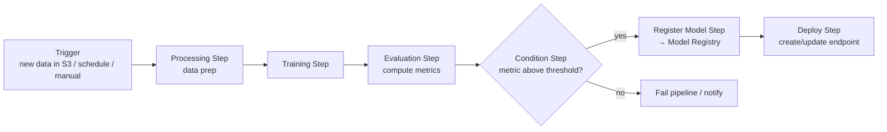

# SageMaker Pipelines


## Definition

SageMaker Pipelines is the MLOps orchestration tool that lets you define your entire ML
workflow — data prep, training, evaluation, registration, deployment — as a single connected
sequence of steps (a DAG) that can be run repeatedly, automatically, and consistently, instead
of manually re-running a stack of notebooks every time new data arrives.

## Purpose

Running an ML workflow by hand once is easy; running it correctly and identically every week, or
automatically the moment new data lands, is not — manual processes drift, steps get skipped
under deadline pressure, and nobody has a clean record of exactly what ran and in what order.
Pipelines exists to turn "a notebook I ran manually last Tuesday" into a versioned, auditable,
automatable piece of infrastructure — the same problem CI/CD pipelines solve for software,
applied to ML workflows specifically.

## How It Works

Plain-English: a Pipeline is a flowchart you define in code once, and SageMaker executes it as
a sequence of jobs, passing outputs from one step as inputs to the next, tracking every run.



Step by step:
1. **Trigger** — a pipeline execution can start manually (console/SDK call), on a schedule
   (via EventBridge), or automatically when new data lands in S3 (also via EventBridge).
2. **Processing Step** — runs a SageMaker Processing job: typically your data cleaning/feature
   engineering code (can be the same logic exported from Data Wrangler).
3. **Training Step** — runs a Training Job using the processed data as input; identical concept
   to a standalone training job, but now wired into the pipeline's dependency graph.
4. **Evaluation Step** — another Processing job that scores the newly trained model against a
   held-out test set and outputs metrics (accuracy, AUC, RMSE, whatever's relevant) as a file.
5. **Condition Step** — reads the evaluation metrics and branches: if the new model clears a
   quality bar (e.g., accuracy > 0.9), proceed; if not, stop the pipeline and alert someone —
   this prevents a worse model from silently replacing a better one in production.
6. **Register Model Step** — on success, registers the new model version in the Model Registry,
   typically with status `PendingManualApproval` (or auto-approved, if your governance allows
   fully automated rollout).
7. **Deploy Step** — optionally, once approved (by a human or an automated downstream trigger),
   update the live endpoint to the new model version — often done via a separate
   CodePipeline/CloudFormation step outside the SageMaker Pipeline itself, or via a Lambda step
   inside it.
8. **Every execution is tracked** — SageMaker Studio's Pipelines UI shows a visual DAG of the
   run, each step's status, duration, and artifacts, giving you the audit trail a manual
   notebook-running process never had.

## Key Features / Components

- **Pipeline SDK (Python)** — define pipelines as code (`sagemaker.workflow` module), so the
  whole workflow is version-controlled alongside your model code.
- **Step types** — Processing, Training, Tuning (AMT), Model (register), Condition,
  Callback (wait for an external/manual process), Lambda (run custom logic), Transform (batch
  scoring as a step), Fail.
- **Parameters** — pipelines accept typed input parameters (e.g., instance type, data path) so
  the same pipeline definition can be reused across environments/datasets without editing code.
- **Caching** — steps can cache results and skip re-running if nothing relevant changed since
  the last execution, saving time and cost on repeated runs.
- **Lineage tracking** — automatic recording of exactly which data, code, and parameters
  produced each model version — critical for audit and debugging "why did this model behave
  differently."
- **Integration with EventBridge** — trigger pipeline runs on a schedule or on S3 data arrival,
  turning retraining into a fully automated, event-driven process.
- **Visual pipeline editor in Studio** — drag-and-drop view of the DAG for teams who prefer not
  to write the SDK code directly for simple pipelines.

## Use Cases — When to Use It

- You want model retraining to happen automatically whenever new data arrives or drift is
  detected, without a human manually re-running notebooks.
- You need an auditable, reproducible record of exactly what produced each model version
  (required in regulated industries).
- You want a quality gate (via Condition Step) that prevents a worse model from automatically
  replacing a better one in production.
- Multiple steps in your workflow (clean → train → evaluate → register) need to run in a
  defined order with outputs passed between them, and you want that dependency management
  handled for you instead of hand-rolled with shell scripts and cron.
- You're building CI/CD for ML specifically and want it to integrate with the rest of your
  AWS deployment tooling (CodePipeline, EventBridge, Lambda).

## When NOT to Use It / Alternatives

- **A single, infrequent, manually-run experiment** — if you're not yet retraining regularly or
  coordinating multiple steps, a plain notebook is simpler; adopt Pipelines once repeatability
  and automation actually matter.
- **Your orchestration needs span far beyond ML** (e.g., coordinating ML steps with unrelated
  business workflows, human approval chains outside AWS, multi-day waits) — **AWS Step
  Functions** is a more general-purpose state machine orchestrator and can even call SageMaker
  APIs as one of its steps; some teams use Step Functions as the outer orchestrator with
  SageMaker Pipelines (or individual SageMaker jobs) as a component within it.
- **You need pure software CI/CD** (build/test/deploy application code with no ML-specific
  steps) — CodePipeline/CodeBuild/CodeDeploy alone, without SageMaker Pipelines, is the right
  tool; SageMaker Pipelines is specifically for the ML workflow's internal steps.
- **Extremely simple, single-step workflows** — if your "pipeline" is just "run one training
  job," the orchestration overhead of defining a full Pipeline may not be worth it versus a
  direct SDK call or CLI command.

## Why It's Important

**Real-world:** The difference between an ML project that stays healthy for years and one that
rots within months is almost always whether retraining is automated and gated by real quality
checks, or whether it depends on someone remembering to do it manually. Pipelines is the tool
that makes "keep the model fresh without a human babysitting it" actually achievable, which
directly protects against the silent model decay problem Model Monitor is built to detect (see
`sagemaker-model-monitor-and-registry.md`) — Monitor finds the problem, Pipelines is how you fix
it automatically.

**Exam weight (MLA-C02):** Core to **Domain 3: Deployment and Orchestration of ML and AI
Workflows (24%)** — expect questions on automating retraining (EventBridge-triggered pipeline
runs), CI/CD for ML (how Pipelines relates to CodePipeline/CodeBuild/CodeDeploy), and using
Condition Steps as a quality gate before registering/deploying a model. Also touches
**Domain 4** (the retrain-on-drift automated loop) and **Domain 2** (Pipelines often embeds the
AMT tuning step).

**DVA-C03 relevance:** DVA-C03 tests CI/CD concepts generally (CodePipeline, blue/green,
canary) but SageMaker Pipelines itself is out of scope there — the underlying CI/CD vocabulary
(stages, approval gates, rollback) transfers conceptually even though the specific tool doesn't
appear on DVA-C03.

## Pricing Model (summary)

- **No separate charge for SageMaker Pipelines itself** — you pay only for the underlying
  resources each step consumes (Processing job instance-hours, Training job instance-hours, etc.)
  exactly as if you'd run them standalone.
- **Step caching** reduces cost on repeated executions by skipping unchanged steps.
- Full current rates: https://aws.amazon.com/sagemaker/pricing/

## Hands-on Lab (Floci)

Floci does not run SageMaker Pipelines' control plane. Use:

**Option A — SageMaker Studio Lab / real SageMaker free-tier pipeline:** the SDK-defined
pipeline concept can be practiced in any Python environment with the `sagemaker` SDK installed
(`pip install sagemaker`), even without executing it against real infrastructure, to study the
step/parameter/condition syntax.

**Option B — Local equivalent: a tiny "pipeline" using plain Python functions chained together,
mirroring Pipelines' step/condition structure:**
```bash
pip install scikit-learn pandas
python3 - <<'EOF'
from sklearn.datasets import load_wine
from sklearn.model_selection import train_test_split
from sklearn.ensemble import RandomForestClassifier
from sklearn.metrics import accuracy_score

def processing_step():
    X, y = load_wine(return_X_y=True)
    return train_test_split(X, y, test_size=0.2, random_state=1)

def training_step(X_train, y_train):
    model = RandomForestClassifier(n_estimators=100, random_state=1).fit(X_train, y_train)
    return model

def evaluation_step(model, X_test, y_test):
    return accuracy_score(y_test, model.predict(X_test))

def condition_step(accuracy, threshold=0.9):
    return accuracy >= threshold

def register_step(model, accuracy):
    print(f"REGISTERED model with accuracy={accuracy:.3f} status=PendingManualApproval")

# --- "pipeline execution" ---
X_train, X_test, y_train, y_test = processing_step()
model = training_step(X_train, y_train)
accuracy = evaluation_step(model, X_test, y_test)
print(f"Evaluation accuracy: {accuracy:.3f}")

if condition_step(accuracy):
    register_step(model, accuracy)
else:
    print("CONDITION FAILED — pipeline stopped, model not registered")
EOF
```
This is a direct, simplified mirror of a real SageMaker Pipeline's step graph: Processing →
Training → Evaluation → Condition → Register, with the condition gating the final step exactly
like a real Condition Step would.

**Option C — stage pipeline artifacts in S3 against Floci:**
```bash
awslocal s3 mb s3://ml-pipeline-artifacts
awslocal s3 cp processed_data.csv s3://ml-pipeline-artifacts/processing-output/
awslocal s3 cp eval_metrics.json s3://ml-pipeline-artifacts/evaluation-output/
```

See `certifications/mla-c02/domain-3-deployment-orchestration/labs.md`.

## Exam Tips

- "Automate retraining when new data arrives / on a schedule" → SageMaker Pipelines +
  EventBridge trigger.
- A Condition Step gating model registration on an evaluation metric is the canonical "prevent
  a worse model from reaching production automatically" answer.
- Pipelines vs. Step Functions: Pipelines is ML-workflow-specific and SageMaker-native; Step
  Functions is a general-purpose state machine that can orchestrate ML steps alongside non-ML
  AWS services — a question involving non-ML steps in the same workflow points to Step
  Functions.
- Know that Pipelines has no separate charge — cost comes entirely from the underlying step
  resources, a common "which pricing is correct" distractor.
- Lineage tracking (what data/code produced a given model) is a Pipelines/Registry feature
  worth remembering for audit-themed questions.

## Related Terms

- `sagemaker-overview.md` — where Pipelines sits in the full lifecycle
- `sagemaker-data-wrangler-and-feature-store.md` — common Processing Step source
- `sagemaker-training-and-tuning.md` — the Training/Tuning steps inside a pipeline
- `sagemaker-model-monitor-and-registry.md` — the Registry step's destination, and the drift
  signal that often triggers a new pipeline execution
- `glossary/` — CI/CD, DAG, MLOps, lineage
