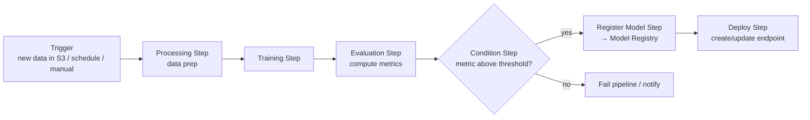
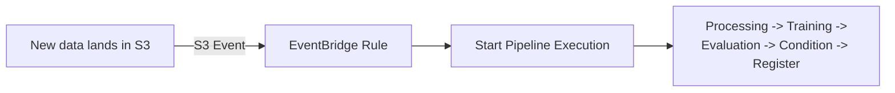
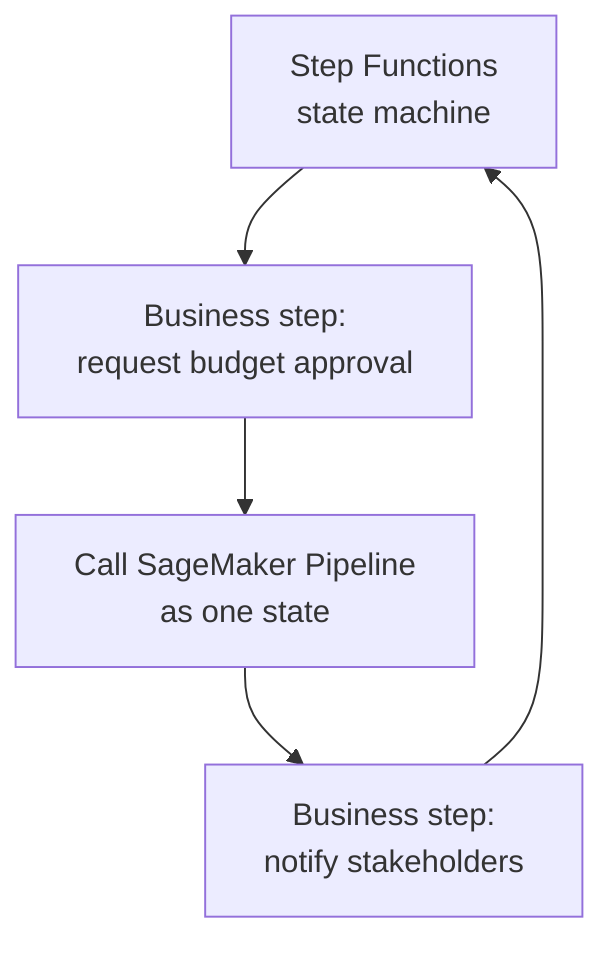
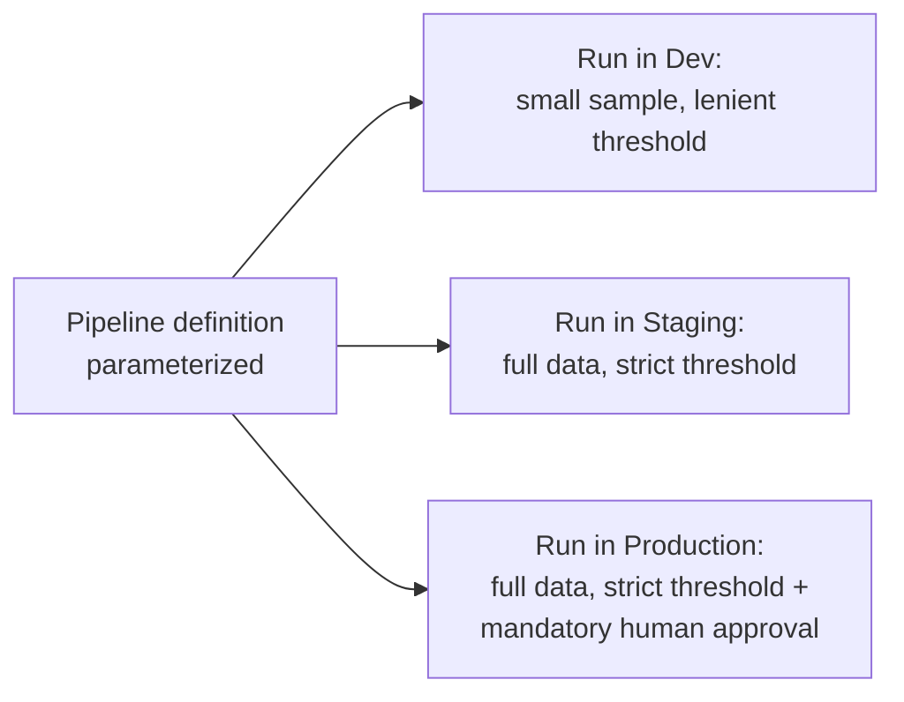
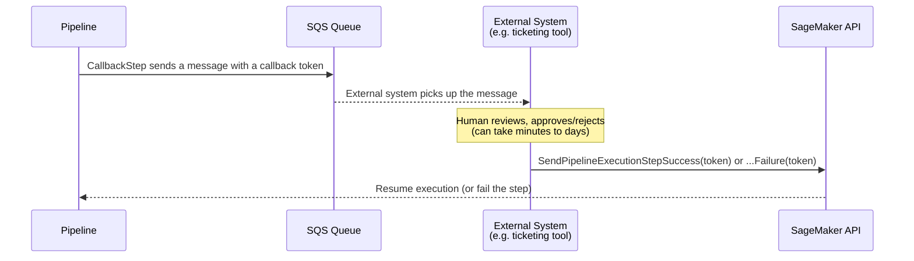

# SageMaker Pipelines

> **Appears in:** [MLA-C02](../../certifications/mla-c02/README.md)


## Definition

SageMaker Pipelines is the MLOps orchestration tool that lets you define your entire ML
workflow — data prep, training, evaluation, registration, deployment — as a single connected
sequence of steps (a DAG) that can be run repeatedly, automatically, and consistently, instead
of manually re-running a stack of notebooks every time new data arrives.

A couple of terms worth pinning down since the rest of this document assumes them:
- **DAG (Directed Acyclic Graph)** — a flowchart where steps connect in one direction only, with
  no loops back to an earlier step. "Directed" means each connection has a clear from/to order;
  "acyclic" means you can't create a circular dependency; this is simply the mathematical shape
  that guarantees a pipeline has a well-defined order of execution with no ambiguity about what
  runs before what.
- **MLOps** — the ML-specific analog of DevOps: the practices and tooling (versioning,
  automated testing/evaluation, CI/CD, monitoring) that keep a *model* reliable and reproducible
  over time, the same way DevOps practices keep *application code* reliable over time.
- **Lineage** — the recorded chain of exactly which data, code, and parameters produced a
  specific model version — the ML equivalent of a software build's exact commit hash and
  dependency versions, and the thing an audit or incident investigation actually needs.

## Purpose

Running an ML workflow by hand once is easy; running it correctly and identically every week, or
automatically the moment new data lands, is not — manual processes drift, steps get skipped
under deadline pressure, and nobody has a clean record of exactly what ran and in what order.
Pipelines exists to turn "a notebook I ran manually last Tuesday" into a versioned, auditable,
automatable piece of infrastructure — the same problem CI/CD pipelines solve for software,
applied to ML workflows specifically.

## How It Works

Plain-English: a Pipeline is a flowchart you define in code once, and SageMaker executes it as
a sequence of jobs, passing outputs from one step as inputs to the next, tracking every run.



Step by step:
1. **Trigger** — a pipeline execution can start manually (console/SDK call), on a schedule
   (via EventBridge), or automatically when new data lands in S3 (also via EventBridge).
2. **Processing Step** — runs a SageMaker Processing job: typically your data cleaning/feature
   engineering code (can be the same logic exported from Data Wrangler).
3. **Training Step** — runs a Training Job using the processed data as input; identical concept
   to a standalone training job, but now wired into the pipeline's dependency graph.
4. **Evaluation Step** — another Processing job that scores the newly trained model against a
   held-out test set and outputs metrics (accuracy, AUC, RMSE, whatever's relevant) as a file.
5. **Condition Step** — reads the evaluation metrics and branches: if the new model clears a
   quality bar (e.g., accuracy > 0.9), proceed; if not, stop the pipeline and alert someone —
   this prevents a worse model from silently replacing a better one in production.
6. **Register Model Step** — on success, registers the new model version in the Model Registry,
   typically with status `PendingManualApproval` (or auto-approved, if your governance allows
   fully automated rollout).
7. **Deploy Step** — optionally, once approved (by a human or an automated downstream trigger),
   update the live endpoint to the new model version — often done via a separate
   CodePipeline/CloudFormation step outside the SageMaker Pipeline itself, or via a Lambda step
   inside it.
8. **Every execution is tracked** — SageMaker Studio's Pipelines UI shows a visual DAG of the
   run, each step's status, duration, and artifacts, giving you the audit trail a manual
   notebook-running process never had.

### A real pipeline DAG, in AWS's own UI


*Figure: a real SageMaker Pipelines DAG — `AbaloneProcess` (Processing), `AbaloneTrain`
(Training), `AbaloneEval` (Processing, using the test split from the first step), and
`AbaloneMSECond` (Condition, checking the mean-squared-error result before proceeding). This is
the literal shape described step by step above, rendered by AWS's own pipeline definition
example. Source: AWS SageMaker Developer Guide, "Pipelines overview" —
docs.aws.amazon.com/sagemaker/latest/dg/pipelines-overview.html.*


*Figure: the SageMaker Studio visual pipeline designer — a drag-and-drop alternative to writing
a pipeline definition in the Python SDK directly, useful for a first visual pass or for less
code-heavy team members. Source: AWS SageMaker Developer Guide, "Pipelines actions" —
docs.aws.amazon.com/sagemaker/latest/dg/pipelines-build.html.*

### Worked example — defining a pipeline in code, step by step

To make "define a pipeline in code" concrete, here's an abbreviated but realistic Python
SDK definition for exactly the DAG described above, with each piece explained:

```python
from sagemaker.workflow.pipeline import Pipeline
from sagemaker.workflow.steps import ProcessingStep, TrainingStep
from sagemaker.workflow.condition_step import ConditionStep
from sagemaker.workflow.conditions import ConditionGreaterThanOrEqualTo
from sagemaker.workflow.parameters import ParameterString

# Parameters -- let the SAME pipeline definition be reused across environments
input_data = ParameterString(name="InputData", default_value="s3://my-bucket/raw/")
accuracy_threshold = ParameterString(name="AccuracyThreshold", default_value="0.90")

# Step 1: Processing -- clean/split the data (could be exported from Data Wrangler)
process_step = ProcessingStep(
    name="PreprocessChurnData",
    processor=sklearn_processor,              # a configured SKLearnProcessor
    inputs=[...],                              # reads from `input_data`
    outputs=[...],                             # writes train/validation/test splits to S3
    code="preprocess.py",
)

# Step 2: Training -- consumes Step 1's train split directly (this IS the DAG edge)
train_step = TrainingStep(
    name="TrainChurnModel",
    estimator=xgb_estimator,                   # a configured XGBoost Estimator
    inputs={"train": process_step.properties.ProcessingOutputConfig.Outputs["train"].S3Output.S3Uri},
)

# Step 3: Evaluation -- consumes Step 2's model artifact
eval_step = ProcessingStep(
    name="EvaluateChurnModel",
    processor=sklearn_processor,
    inputs=[train_step.properties.ModelArtifacts.S3ModelArtifacts],
    code="evaluate.py",                        # writes a metrics.json with the AUC score
)

# Step 4: Condition -- only proceed if evaluation cleared the threshold
condition = ConditionGreaterThanOrEqualTo(
    left=eval_step.properties.Outputs["auc"],
    right=accuracy_threshold,
)
condition_step = ConditionStep(
    name="CheckAccuracy",
    conditions=[condition],
    if_steps=[register_step],                  # defined elsewhere: registers the model
    else_steps=[],                              # pipeline simply stops here if condition fails
)

pipeline = Pipeline(
    name="churn-retraining-pipeline",
    parameters=[input_data, accuracy_threshold],
    steps=[process_step, train_step, eval_step, condition_step],
)
pipeline.upsert(role_arn="arn:aws:iam::123456789012:role/SageMakerPipelineRole")
pipeline.start()
```

A few things worth noticing about this code that map directly to concepts described above:
- **The DAG itself is implicit, not manually declared** — `train_step` references
  `process_step.properties...`, and that reference *is* the dependency edge; SageMaker
  determines execution order from these references, you never separately write "run step 2
  after step 1."
- **Parameters** (`input_data`, `accuracy_threshold`) mean the exact same pipeline definition
  can be run against a dev dataset with a lenient threshold and a production dataset with a
  strict threshold, without editing the code — this is what "parameters accept typed input" in
  Key Features means concretely.
- **The Condition Step's `if_steps`/`else_steps`** is literally the quality gate from the
  earlier diagram — if the condition evaluates false, `else_steps` (here, empty) runs instead of
  registering a new model, and the pipeline execution ends without ever touching the Registry.

## Key Features / Components

- **Pipeline SDK (Python)** — define pipelines as code (`sagemaker.workflow` module), so the
  whole workflow is version-controlled alongside your model code.
- **Step types** — Processing, Training, Tuning (AMT), Model (register), Condition,
  Callback (wait for an external/manual process), Lambda (run custom logic), Transform (batch
  scoring as a step), Fail.
- **Parameters** — pipelines accept typed input parameters (e.g., instance type, data path) so
  the same pipeline definition can be reused across environments/datasets without editing code.
- **Caching** — steps can cache results and skip re-running if nothing relevant changed since
  the last execution, saving time and cost on repeated runs.
- **Lineage tracking** — automatic recording of exactly which data, code, and parameters
  produced each model version — critical for audit and debugging "why did this model behave
  differently."
- **Integration with EventBridge** — trigger pipeline runs on a schedule or on S3 data arrival,
  turning retraining into a fully automated, event-driven process.
- **Visual pipeline editor in Studio** — drag-and-drop view of the DAG for teams who prefer not
  to write the SDK code directly for simple pipelines.
- **Callback Steps** — a step type specifically for pausing a pipeline until an external system
  (not SageMaker itself) signals completion — useful for inserting a genuinely manual approval
  gate, or integrating a non-AWS system as part of the workflow.
- **Parallel step execution** — independent steps with no data dependency between them (e.g.,
  two separate evaluation jobs against different test sets) can run concurrently rather than
  strictly sequentially, since the DAG's structure, not an arbitrary list order, determines what
  can run in parallel.

## Use Cases — When to Use It

- **Automated fraud-model retraining (financial services):** Problem — a fraud model must be
  retrained promptly whenever Model Monitor flags drift, without a human remembering to re-run
  notebooks. Why it fits — an EventBridge-triggered Pipeline chains processing, training,
  evaluation, and a Condition Step gate automatically. Tradeoff vs. a human manually re-running
  the workflow — manual retraining is simpler to set up once but reliably gets skipped or delayed
  under deadline pressure, exactly the risk automated, drift-triggered retraining removes.
- **Churn model CI/CD (telecom/SaaS):** Problem — a churn model needs to retrain weekly on fresh
  billing data, with a quality gate preventing a worse model from silently replacing a better one.
  Why it fits — a Condition Step checks the new model's evaluation metric against a threshold
  before the Register Model Step ever runs. Tradeoff vs. auto-registering every retrain
  unconditionally — unconditional registration is simpler but risks a regression silently reaching
  the Registry (and potentially production) with no gate catching it.
- **Medical risk-model lineage for audit (healthcare):** Problem — a hospital's compliance team
  must prove exactly which data and code produced a currently-deployed diagnostic risk model. Why
  it fits — Pipelines' automatic lineage tracking records every execution's inputs and outputs.
  Tradeoff vs. manually documented lineage — manual documentation is easy to let lapse under
  deadline pressure; automatic lineage tracking can't be skipped because it's generated by the
  pipeline's own execution, not a separate manual step.
- **Demand forecasting pipeline triggered by new POS data (retail/CPG):** Problem — a forecasting
  model should retrain the moment this week's sales data lands in S3, not on a fixed calendar that
  might run before or after the data actually arrives. Why it fits — an EventBridge rule watching
  for new S3 objects starts the pipeline execution automatically, reacting to a fact about the
  world rather than a human's calendar reminder. Tradeoff vs. a cron-scheduled pipeline — a cron
  schedule is simpler to configure but can run before new data has actually landed, training on
  stale data, or run redundantly if new data arrived early.
- **Document processing pipeline (insurance/legal back office):** Problem — a claims-processing
  pipeline chains OCR-style preprocessing, a classification training step, and evaluation, and
  needs to run identically every time without someone hand-executing each notebook in order. Why
  it fits — Pipelines' Processing/Training/Evaluation step chain enforces the dependency order
  and passes outputs between steps automatically. Tradeoff vs. a sequence of standalone scheduled
  jobs (cron + shell scripts) — standalone scripts can run out of order or with stale intermediate
  data if one step fails silently; a Pipeline's DAG-based dependency tracking prevents that class
  of failure structurally.
- **Recommendation engine retraining with mandatory human sign-off (e-commerce):** Problem — a
  recommendation model retrains automatically on new interaction data, but a product manager wants
  to review it before it ever reaches customers. Why it fits — a Callback Step pauses the pipeline
  for an external, non-SageMaker approval system to signal completion, which can take hours or
  days without consuming any compute while waiting. Tradeoff vs. a fully automated Condition Step
  alone — a Condition Step only evaluates metrics already computed inside the pipeline; a genuinely
  human sign-off step needs the Callback mechanism's external wait, which a Condition Step cannot
  provide on its own.
- **Multi-environment model promotion (any regulated industry, e.g., banking credit models):**
  Problem — the same retraining logic needs to run against a small dev sample with a lenient
  threshold and the full production dataset with a strict threshold and mandatory approval,
  without maintaining near-duplicate pipeline code per environment. Why it fits — typed Pipeline
  Parameters let one pipeline definition be reused with different data paths/thresholds/approval
  requirements per environment. Tradeoff vs. maintaining separate pipeline files per environment —
  separate files are simpler to reason about individually but drift out of sync over time as one
  gets updated and the other doesn't; parameterizing one definition keeps them structurally
  identical by construction.

## When NOT to Use It / Alternatives

- **A single, infrequent, manually-run experiment** — if you're not yet retraining regularly or
  coordinating multiple steps, a plain notebook is simpler; adopt Pipelines once repeatability
  and automation actually matter.
- **Your orchestration needs span far beyond ML** (e.g., coordinating ML steps with unrelated
  business workflows, human approval chains outside AWS, multi-day waits) — **AWS Step
  Functions** is a more general-purpose state machine orchestrator and can even call SageMaker
  APIs as one of its steps; some teams use Step Functions as the outer orchestrator with
  SageMaker Pipelines (or individual SageMaker jobs) as a component within it.
- **You need pure software CI/CD** (build/test/deploy application code with no ML-specific
  steps) — CodePipeline/CodeBuild/CodeDeploy alone, without SageMaker Pipelines, is the right
  tool; SageMaker Pipelines is specifically for the ML workflow's internal steps.
- **Extremely simple, single-step workflows** — if your "pipeline" is just "run one training
  job," the orchestration overhead of defining a full Pipeline may not be worth it versus a
  direct SDK call or CLI command.
- **A workflow requiring tight integration with non-AWS systems at every step** — if most steps
  live outside AWS entirely, a more general workflow tool native to that other environment might
  integrate more naturally than forcing everything through SageMaker's step types.

## Common Architectures

### Pattern 1 — Event-driven retraining triggered by new data

The most common real production trigger for a pipeline, distinct from a fixed calendar schedule:



This pattern directly answers "how do you keep a model fresh without someone remembering to
retrain it" — the trigger is a fact about the world (new data exists), not a human's calendar
reminder.

### Pattern 2 — SageMaker Pipelines as a component inside a larger Step Functions workflow

For an organization whose overall process spans well beyond ML (e.g., a broader business
approval chain involving non-AWS systems):



The architectural distinction worth remembering: Step Functions is the general-purpose outer
orchestrator here; the SageMaker Pipeline is one component/state within that larger workflow,
not a replacement for it — this is exactly the "Pipelines vs. Step Functions" exam distinction
covered below.

### Pattern 3 — Multi-environment promotion with parameterized pipelines

A single pipeline definition, promoted across dev → staging → production with different
parameter values and, critically, different approval rigor at each stage:



The point this pattern makes concrete: parameters don't just change *data paths* — they can
change the entire governance posture of a run (e.g., production requiring a mandatory human
approval step that dev skips), all from the same underlying pipeline code.

### Callback Steps, as an actual sequence

Because Callback Steps are the mechanism for genuinely external, non-SageMaker waits, it's worth
seeing the actual round trip:



The pipeline genuinely pauses — consuming no compute — for however long the external review
takes; nothing about this architecture requires SageMaker to poll or wait actively, which is
exactly why Callback Steps are the right tool for waits that could plausibly take days, not just
seconds.

## Why It's Important

**Real-world:** The difference between an ML project that stays healthy for years and one that
rots within months is almost always whether retraining is automated and gated by real quality
checks, or whether it depends on someone remembering to do it manually. Pipelines is the tool
that makes "keep the model fresh without a human babysitting it" actually achievable, which
directly protects against the silent model decay problem Model Monitor is built to detect (see
`sagemaker-model-monitor-and-registry.md`) — Monitor finds the problem, Pipelines is how you fix
it automatically.

**Exam weight (MLA-C02):** Core to **Domain 3: Deployment and Orchestration of ML and AI
Workflows (24%)** — expect questions on automating retraining (EventBridge-triggered pipeline
runs), CI/CD for ML (how Pipelines relates to CodePipeline/CodeBuild/CodeDeploy), and using
Condition Steps as a quality gate before registering/deploying a model. Also touches
**Domain 4** (the retrain-on-drift automated loop) and **Domain 2** (Pipelines often embeds the
AMT tuning step).

**DVA-C03 relevance:** DVA-C03 tests CI/CD concepts generally (CodePipeline, blue/green,
canary) but SageMaker Pipelines itself is out of scope there — the underlying CI/CD vocabulary
(stages, approval gates, rollback) transfers conceptually even though the specific tool doesn't
appear on DVA-C03.

## Limits & Quotas

- **Steps per pipeline and pipeline definition size** are both capped — an extremely large,
  monolithic pipeline may need to be split into multiple linked pipelines rather than one
  enormous DAG.
- **Concurrent pipeline executions per account/Region** have a quota — a burst of many
  simultaneous triggered executions (e.g., many S3 data-arrival events firing close together)
  can be throttled if it exceeds this limit, which is a capacity-planning consideration for
  high-frequency event-driven retraining setups.
- **Callback Step timeout** is configurable but bounded — a manual approval step waiting far
  longer than the configured timeout will fail the pipeline execution rather than waiting
  indefinitely, which needs to be accounted for in any workflow design relying on genuinely
  slow human processes.
- **Parameter count and payload size per pipeline execution** are limited — a pipeline designed
  to accept an unusually large number of parameters or very large inline parameter values may
  need to pass bulk configuration via S3 references instead of direct parameter values.

## Pricing Model (summary)

- **No separate charge for SageMaker Pipelines itself** — you pay only for the underlying
  resources each step consumes (Processing job instance-hours, Training job instance-hours, etc.)
  exactly as if you'd run them standalone.
- **Step caching** reduces cost on repeated executions by skipping unchanged steps.

**Worked cost sanity check:** a pipeline with four steps (Processing: 10 minutes on
`ml.m5.large`; Training: 30 minutes on `ml.m5.xlarge`; Evaluation: 5 minutes on `ml.m5.large`;
Condition + Register: negligible compute) costs roughly the sum of those four steps' individual
instance-hour costs — there's no "pipeline orchestration fee" layered on top. If the pipeline
runs daily and step caching correctly skips the Processing step on days when the underlying raw
data genuinely hasn't changed, that's a direct, compounding cost saving over naively re-running
every step on every single execution regardless of whether anything upstream changed.

Full current rates: https://aws.amazon.com/sagemaker/pricing/

## Troubleshooting / Common Issues

- **A pipeline execution fails at the Condition Step even though the model trained fine.** This
  is very often *working as designed*, not a bug — the Condition Step exists specifically to
  stop the pipeline when a quality bar isn't cleared; check the actual evaluation metric value
  against the configured threshold before assuming something's broken.
- **A step fails with a permissions error even though a standalone job with the same
  configuration succeeds.** The pipeline's execution role (not necessarily the same role you'd
  use for a standalone job) needs permissions for every step's S3 paths and any other resources
  it touches — double-check the role actually passed to `pipeline.upsert()`.
- **Step caching isn't skipping a step that genuinely didn't change.** Caching keys off the
  step's exact input arguments/code hash — a change elsewhere in the pipeline definition (even
  an unrelated step) can sometimes invalidate a cache entry depending on how dependencies are
  structured; check the pipeline execution's cache-hit details in the console rather than
  assuming caching is simply broken.
- **A Callback Step never resumes even though the external approval was given.** Check that the
  external system is actually sending the `SendPipelineExecutionStepSuccess`/`...Failure` API
  call back to SageMaker with the correct callback token — "approving in the external tool's own
  UI" alone does nothing unless that tool is wired to call back into the pipeline's API.
- **An EventBridge-triggered pipeline runs far more often than expected.** Check the EventBridge
  rule's event pattern — an overly broad S3 event pattern (e.g., matching any object write to a
  bucket rather than a specific prefix/suffix) can trigger far more pipeline executions than
  intended, each one costing real compute.

## Hands-on Lab (Floci)

Floci does not run SageMaker Pipelines' control plane. Use:

**Option A — SageMaker Studio Lab / real SageMaker free-tier pipeline:** the SDK-defined
pipeline concept can be practiced in any Python environment with the `sagemaker` SDK installed
(`pip install sagemaker`), even without executing it against real infrastructure, to study the
step/parameter/condition syntax.

**Option B — Local equivalent: a tiny "pipeline" using plain Python functions chained together,
mirroring Pipelines' step/condition structure:**
```bash
pip install scikit-learn pandas
python3 - <<'EOF'
from sklearn.datasets import load_wine
from sklearn.model_selection import train_test_split
from sklearn.ensemble import RandomForestClassifier
from sklearn.metrics import accuracy_score

def processing_step():
    X, y = load_wine(return_X_y=True)
    return train_test_split(X, y, test_size=0.2, random_state=1)

def training_step(X_train, y_train):
    model = RandomForestClassifier(n_estimators=100, random_state=1).fit(X_train, y_train)
    return model

def evaluation_step(model, X_test, y_test):
    return accuracy_score(y_test, model.predict(X_test))

def condition_step(accuracy, threshold=0.9):
    return accuracy >= threshold

def register_step(model, accuracy):
    print(f"REGISTERED model with accuracy={accuracy:.3f} status=PendingManualApproval")

# --- "pipeline execution" ---
X_train, X_test, y_train, y_test = processing_step()
model = training_step(X_train, y_train)
accuracy = evaluation_step(model, X_test, y_test)
print(f"Evaluation accuracy: {accuracy:.3f}")

if condition_step(accuracy):
    register_step(model, accuracy)
else:
    print("CONDITION FAILED — pipeline stopped, model not registered")
EOF
```
This is a direct, simplified mirror of a real SageMaker Pipeline's step graph: Processing →
Training → Evaluation → Condition → Register, with the condition gating the final step exactly
like a real Condition Step would.

**Option C — stage pipeline artifacts in S3 against Floci:**
```bash
awslocal s3 mb s3://ml-pipeline-artifacts
awslocal s3 cp processed_data.csv s3://ml-pipeline-artifacts/processing-output/
awslocal s3 cp eval_metrics.json s3://ml-pipeline-artifacts/evaluation-output/
```

**Option D — simulate parameterized reuse across environments locally:**
```bash
python3 - <<'EOF'
def run_pipeline(environment, accuracy_threshold, require_approval):
    # same "pipeline logic", different parameters per environment -- mirrors the real SDK's Parameters
    simulated_accuracy = 0.93
    print(f"[{environment}] threshold={accuracy_threshold} approval_required={require_approval}")
    if simulated_accuracy < accuracy_threshold:
        print(f"[{environment}] CONDITION FAILED -- pipeline stops")
        return
    if require_approval:
        print(f"[{environment}] Registered as PendingManualApproval -- awaiting human review")
    else:
        print(f"[{environment}] Registered and auto-approved -- deploying immediately")

run_pipeline("dev", accuracy_threshold=0.70, require_approval=False)
run_pipeline("production", accuracy_threshold=0.90, require_approval=True)
EOF
```

See `certifications/mla-c02/domain-3-deployment-orchestration/labs.md`.

## Exam Tips

- "Automate retraining when new data arrives / on a schedule" → SageMaker Pipelines +
  EventBridge trigger.
- A Condition Step gating model registration on an evaluation metric is the canonical "prevent
  a worse model from reaching production automatically" answer.
- Pipelines vs. Step Functions: Pipelines is ML-workflow-specific and SageMaker-native; Step
  Functions is a general-purpose state machine that can orchestrate ML steps alongside non-ML
  AWS services — a question involving non-ML steps in the same workflow points to Step
  Functions.
- Know that Pipelines has no separate charge — cost comes entirely from the underlying step
  resources, a common "which pricing is correct" distractor.
- Lineage tracking (what data/code produced a given model) is a Pipelines/Registry feature
  worth remembering for audit-themed questions.

### Sample exam scenarios, worked

**Scenario 1:** "A workflow needs to wait for a manual sign-off from a compliance officer,
potentially taking several business days, before a pipeline continues to the next step."
*Answer:* a Callback Step — specifically designed to pause a pipeline for an external,
non-SageMaker process (here, a human sign-off system) to signal completion, as opposed to a
Condition Step (which evaluates data already available within the pipeline automatically,
with no external wait).

**Scenario 2:** "A company's end-to-end process involves an ML retraining step, a legal review
step handled in a separate ticketing system, and a final deployment step across two different
AWS accounts." *Answer:* AWS Step Functions as the outer orchestrator, with the ML retraining
portion implemented as a SageMaker Pipeline invoked as one state within the larger state
machine — the giveaway is steps that are explicitly *not* ML-specific (legal review, cross-
account deployment) living alongside the ML step in one coordinated workflow.

**Scenario 3:** "A team wants the exact same retraining workflow logic to run against a small
sample in a dev account and the full dataset in production, without maintaining two separate
pipeline definitions." *Answer:* typed Pipeline Parameters — one pipeline definition, different
parameter values (data path, instance size, threshold) per invocation/environment.

**Scenario 4:** "A pipeline is re-run daily, but the underlying raw data only actually changes
about once a week; the team wants to avoid wasting compute re-running the same processing step
on unchanged data." *Answer:* step caching — SageMaker Pipelines' built-in mechanism for
skipping a step whose inputs/code haven't changed since the last successful execution, directly
reducing both cost and runtime on days when nothing upstream has actually changed.

### Pipelines as the connective tissue of this entire document category

It's worth being explicit about why Pipelines is described last among the SageMaker documents
in this folder: it's genuinely the piece that *ties the others together* rather than one more
independent capability. A Data Wrangler flow becomes a repeatable Processing Step; a Training
Job and AMT tuning job become Training/Tuning Steps; a Model Registry entry becomes the
destination of a Register Model Step; and Model Monitor's drift alarm becomes the trigger that
starts a new Pipeline execution in the first place. If you've read all six SageMaker documents
in this category, Pipelines is the one that should make the other five feel like a single
coherent system rather than five separate tools that happen to share a product name.

## Further Reading

- SageMaker Pipelines overview: https://docs.aws.amazon.com/sagemaker/latest/dg/pipelines-overview.html
- Define a Pipeline (DAG, Python SDK, visual designer):
  https://docs.aws.amazon.com/sagemaker/latest/dg/define-pipeline.html
- Pipelines actions (visual designer, execution, monitoring):
  https://docs.aws.amazon.com/sagemaker/latest/dg/pipelines-build.html
- AWS ML Blog — "Move Amazon SageMaker Autopilot ML models from experimentation to production
  using Amazon SageMaker Pipelines":
  https://aws.amazon.com/blogs/machine-learning/move-amazon-sagemaker-autopilot-ml-models-from-experimentation-to-production-using-amazon-sagemaker-pipelines/
- SageMaker pricing: https://aws.amazon.com/sagemaker/pricing/

## Related Terms

- `sagemaker-overview.md` — where Pipelines sits in the full lifecycle
- `sagemaker-data-wrangler-and-feature-store.md` — common Processing Step source
- `sagemaker-training-and-tuning.md` — the Training/Tuning steps inside a pipeline
- `sagemaker-model-monitor-and-registry.md` — the Registry step's destination, and the drift
  signal that often triggers a new pipeline execution
- `glossary/` — CI/CD, DAG, MLOps, lineage
