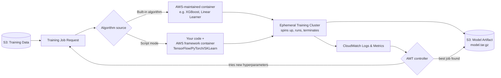
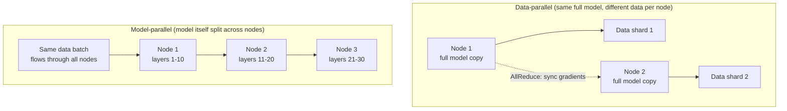
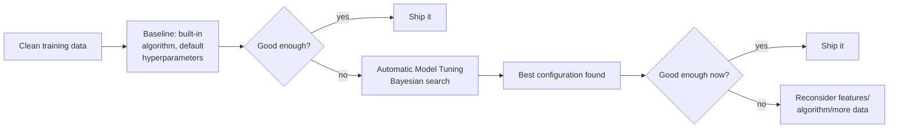
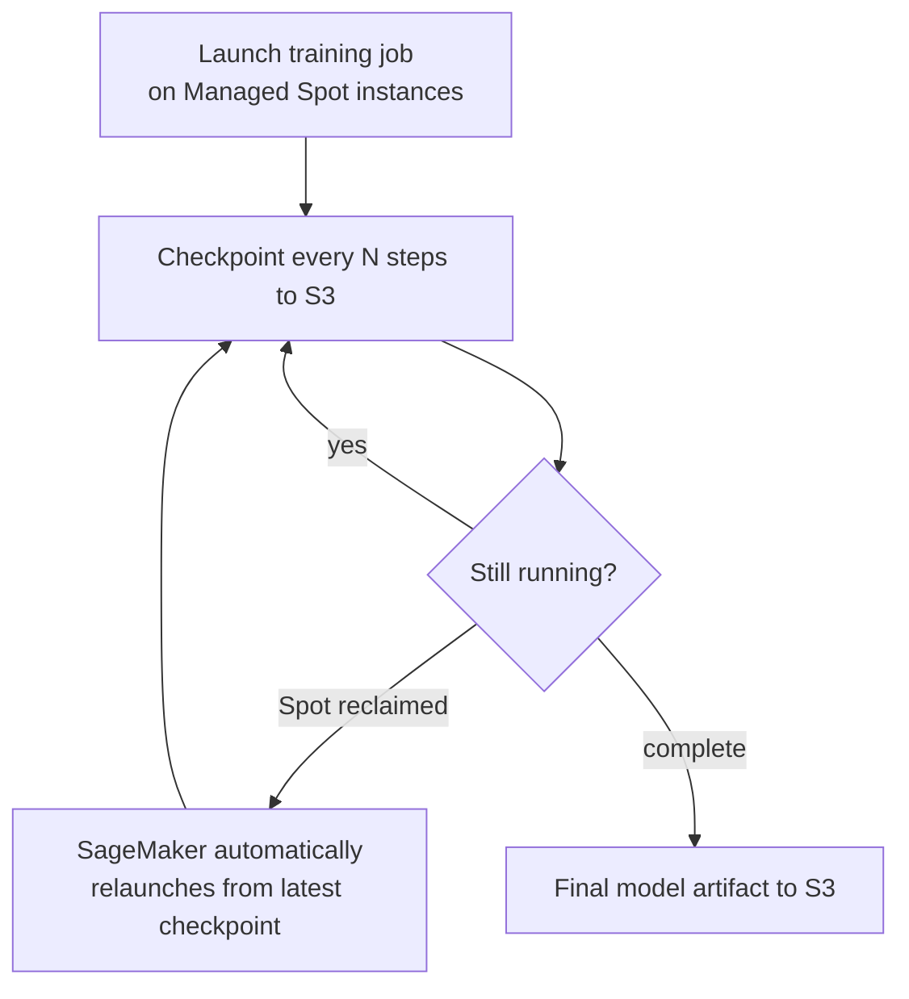
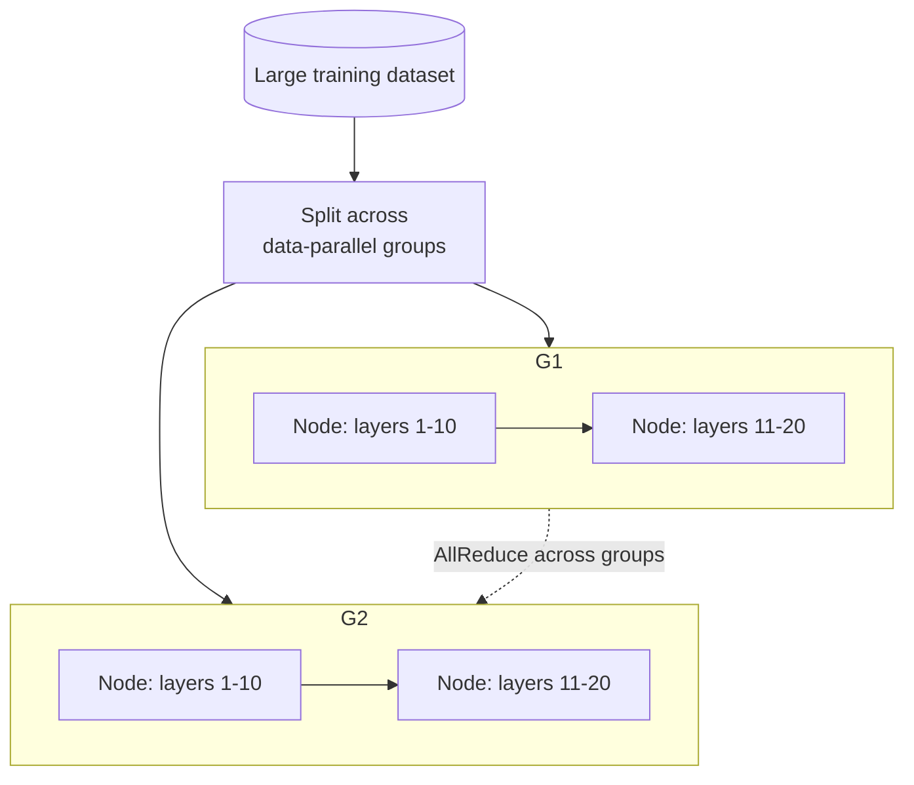

# SageMaker Training & Tuning

> **Appears in:** [MLA-C02](../../certifications/mla-c02/README.md)


## Definition

SageMaker Training is the managed service that runs your model-training code on temporary,
auto-provisioned compute and saves the result. You get there by one of two routes: **built-in
algorithms** (AWS-written, pre-optimized implementations you just point at data) or **script
mode** (your own TensorFlow/PyTorch/XGBoost/etc. code, run inside an AWS-provided container).
**Automatic Model Tuning (AMT)** is the layer on top that runs many training jobs with different
hyperparameter values and finds the best-performing combination automatically.

Terms worth defining up front, since they recur through every section below:
- **Hyperparameter vs. parameter** — a *hyperparameter* (learning rate, number of trees, batch
  size) is a setting *you* choose before training starts; a *parameter* (the actual learned
  weights inside the model) is something training *discovers* automatically from data. You tune
  hyperparameters; you never hand-set parameters.
- **Loss function** — a number measuring how wrong the model's current predictions are on the
  training data; training is literally the process of adjusting parameters to make this number
  smaller, step by step.
- **Learning rate** — how large a step the training algorithm takes each time it adjusts
  parameters to reduce the loss. Too high and training overshoots and never settles (loss
  bounces around or diverges); too low and training crawls, taking far longer than necessary to
  reach a good result.
- **Batch size** — how many training examples are processed together before the model's
  parameters are updated once. Larger batches give a more stable (less noisy) estimate of the
  right adjustment per step but need more memory and can sometimes generalize slightly worse;
  smaller batches are noisier but can escape shallow local minima more easily.
- **Validation set** — a held-out slice of data *not* used for training, used instead to check
  how well the model is generalizing to data it hasn't memorized — this is what catches
  overfitting during training, before you ever touch a separate final test set.

## Purpose

Training a model requires compute that you only need in short, often GPU-hungry bursts — buying
or permanently reserving that hardware is wasteful. SageMaker Training exists so you request
exactly the instance type and count you need, for exactly as long as the job runs, and the
infrastructure disappears and stops billing the moment it's done. Built-in algorithms exist
because many problems (classification, regression, recommendation, clustering) are common enough
that AWS maintains a tuned, scalable implementation so you don't have to write XGBoost's internals
yourself. Script mode exists for everyone with a model architecture AWS doesn't ship a built-in
for, or who simply prefers their own training logic — without script mode, SageMaker would force
you to only ever use the algorithms AWS chose to maintain. AMT exists because manually guessing
hyperparameters (how many trees, what learning rate, how many layers) is slow and unreliable;
automating that search finds better models faster than a human trying values by hand.

## How It Works

Plain-English: you describe the job (what container, what instance type, where's the data, where
should the output go) and SageMaker spins up exactly that compute, runs it, saves the result, and
tears it down. AMT just repeats this whole cycle many times with different settings and keeps
the best one.



Step by step:
1. **Training data** lives in S3 (the most common source; EFS/FSx also supported for very large
   or shared datasets).
2. **You submit a Training Job request** specifying: the algorithm/container, instance type and
   count, hyperparameters, and input/output S3 paths.
3. **Algorithm source** is either a built-in algorithm's prebuilt container, or script mode
   where SageMaker takes your training script and runs it inside AWS's framework container
   (which already has TensorFlow/PyTorch/scikit-learn/etc. installed) — your code just needs to
   follow a few conventions (read `SM_CHANNEL_TRAIN` env var for the data path, etc.).
4. **SageMaker provisions an ephemeral training cluster** — exactly the instance type/count you
   asked for, nothing pre-existing, nothing left running after.
5. **The job runs**, writing progress/errors to CloudWatch Logs and metrics (loss, accuracy per
   epoch) to CloudWatch Metrics, which you can graph in real time.
6. **On completion**, the trained model artifact is saved to the S3 path you specified, and the
   cluster terminates — billing stops the instant the job ends.
7. **If you're using AMT**, instead of one job you define a hyperparameter search space (e.g.,
   `learning_rate` between 0.001 and 0.3) and an objective metric (e.g., maximize validation
   accuracy). The AMT controller launches a batch of jobs with different values, and based on
   the strategy (Random, Bayesian, Hyperband, Grid) uses earlier results to pick smarter values
   for the next batch — converging on a strong combination without trying every possibility.
8. **Distributed training** — for data too large or models too big for one instance, SageMaker
   supports data-parallel (split the data across instances, same model) and model-parallel
   (split the model itself across instances/GPUs) strategies natively.

### The architecture behind "SageMaker provisions compute on your behalf"


*Figure: AWS's own diagram of the basic SageMaker training architecture — you provide training
data in S3 and choose a built-in algorithm or your own script; SageMaker provisions the EC2
instances, runs the container, and returns a model artifact. Source: AWS SageMaker Developer
Guide, "Model training" — docs.aws.amazon.com/sagemaker/latest/dg/train-model.html.*

### Worked example — a complete training job configuration, field by field

To make "submit a Training Job request" concrete rather than abstract, here is an actual,
realistic configuration for training an XGBoost churn classifier, with every field explained:

```json
{
  "TrainingJobName": "churn-xgboost-2024-06-01",
  "AlgorithmSpecification": {
    "TrainingImage": "683313688378.dkr.ecr.us-east-1.amazonaws.com/sagemaker-xgboost:1.7-1",
    "TrainingInputMode": "File"
  },
  "RoleArn": "arn:aws:iam::123456789012:role/SageMakerExecutionRole",
  "HyperParameters": {
    "max_depth": "5",
    "eta": "0.2",
    "objective": "binary:logistic",
    "num_round": "100",
    "eval_metric": "auc"
  },
  "InputDataConfig": [
    {
      "ChannelName": "train",
      "DataSource": {"S3DataSource": {"S3Uri": "s3://my-bucket/processed/train/", "S3DataType": "S3Prefix"}},
      "ContentType": "text/csv"
    },
    {
      "ChannelName": "validation",
      "DataSource": {"S3DataSource": {"S3Uri": "s3://my-bucket/processed/validation/", "S3DataType": "S3Prefix"}},
      "ContentType": "text/csv"
    }
  ],
  "OutputDataConfig": {"S3OutputPath": "s3://my-bucket/models/churn-v1/"},
  "ResourceConfig": {"InstanceType": "ml.m5.xlarge", "InstanceCount": 1, "VolumeSizeInGB": 10},
  "StoppingCondition": {"MaxRuntimeInSeconds": 3600}
}
```

Reading this field by field, in plain English:
- **`TrainingImage`** — the specific Docker container AWS maintains for XGBoost 1.7; this *is*
  "choosing a built-in algorithm" — you're pointing at AWS's pre-built, pre-optimized container
  rather than supplying your own.
- **`RoleArn`** — the IAM role the *training job itself* assumes to read `train`/`validation`
  from S3 and write the output artifact — distinct from your own personal IAM permissions, and a
  common first-time setup gap (see Troubleshooting).
- **`HyperParameters`** — note these are passed as strings, regardless of their logical type;
  `max_depth=5` limits how deep each decision tree can grow (deeper trees fit more complex
  patterns but risk overfitting); `eta=0.2` is XGBoost's learning rate; `num_round=100` is how
  many boosting rounds (roughly, how many trees) to build.
- **`InputDataConfig`** — two **channels**, `train` and `validation` — SageMaker mounts each at
  a predictable local path inside the container (`/opt/ml/input/data/train`,
  `/opt/ml/input/data/validation`) that the algorithm (or your script, in script mode) reads from.
- **`OutputDataConfig`** — exactly where the resulting `model.tar.gz` artifact lands in S3 once
  training finishes.
- **`ResourceConfig`** — `ml.m5.xlarge` (a general-purpose CPU instance, appropriate for tabular
  XGBoost — no GPU needed), `InstanceCount: 1` (XGBoost here doesn't need distributed training at
  this data size), `VolumeSizeInGB: 10` (the EBS volume attached to the training instance for
  temporary data/working files).
- **`StoppingCondition`** — a hard safety ceiling (1 hour here) so a runaway or stuck job can't
  bill indefinitely; the job is killed if it exceeds this regardless of progress.

### Worked example — script mode, the shape of your own training code

For a custom PyTorch model, script mode means writing a script that follows a small set of
conventions SageMaker expects, then SageMaker runs it inside AWS's PyTorch container:

```python
# train.py -- this is YOUR code, running inside the AWS-maintained PyTorch container
import argparse, os
import torch

if __name__ == "__main__":
    parser = argparse.ArgumentParser()
    # SageMaker passes hyperparameters as command-line arguments
    parser.add_argument("--epochs", type=int, default=10)
    parser.add_argument("--learning-rate", type=float, default=0.01)
    # SageMaker sets these environment variables automatically -- read them, don't hardcode paths
    parser.add_argument("--train", type=str, default=os.environ.get("SM_CHANNEL_TRAIN"))
    parser.add_argument("--model-dir", type=str, default=os.environ.get("SM_MODEL_DIR"))
    args = parser.parse_args()

    # ... load data from args.train, build and train a PyTorch model using args.epochs,
    #     args.learning_rate exactly as you would locally ...

    # Save the trained model to SM_MODEL_DIR -- SageMaker automatically tars this up
    # and uploads it to the S3 output path you configured, no extra code needed.
    torch.save(model.state_dict(), os.path.join(args.model_dir, "model.pth"))
```

The entire value of script mode in one sentence: you write ordinary PyTorch/TensorFlow code,
SageMaker handles provisioning the GPU instance, mounting the data at `SM_CHANNEL_TRAIN`,
invoking your script with the right arguments, and uploading whatever you save to `SM_MODEL_DIR`
— the only "SageMaker-specific" parts of this script are reading those few environment variables
instead of hardcoding local file paths.

### Distributed training, visualized



Data-parallel is the right choice when the **data** doesn't fit comfortably on one machine but
the **model** does — every node has a full copy of the model and works on a different slice of
data, periodically synchronizing (`AllReduce`) so all copies stay in agreement. Model-parallel is
the right choice when the **model itself** is too large to fit in one GPU's memory — different
layers/parameters live on different devices, and a single batch of data flows through all of them
in sequence. A real large-scale training job (e.g., training a large foundation model from
scratch) often combines both simultaneously — which is exactly the kind of multi-GPU, multi-node
setup SageMaker HyperPod is built to manage reliably at scale.

## Key Features / Components

- **Built-in algorithms** — AWS-maintained, pre-optimized implementations for common problems:
  **XGBoost** (tabular classification/regression, usually the strongest baseline), **Linear
  Learner** (regression/classification at scale), **K-Means** (clustering), **Random Cut
  Forest** (anomaly detection), **DeepAR** (time-series forecasting), **BlazingText**
  (word embeddings/text classification), **Object Detection/Image Classification** (built on
  CNNs), **Factorization Machines** (recommendation/sparse data).
- **Script mode** — bring your own training script written in TensorFlow, PyTorch, MXNet,
  Hugging Face, or scikit-learn; runs in AWS's maintained framework container.
- **Bring Your Own Container (BYOC)** — full custom Docker image if script mode's frameworks
  don't fit (most flexible, most setup work).
- **Managed Spot Training** — run training jobs on spare EC2 capacity at up to ~90% discount;
  SageMaker automatically checkpoints and resumes if Spot capacity is reclaimed.
- **Distributed training libraries** — SageMaker's own data-parallel (SMDDP) and model-parallel
  (SMP) libraries, optimized for multi-GPU/multi-node scale beyond what open-source frameworks
  alone achieve, using AWS-optimized collective communication operations like `AllReduce` and
  `AllGather` over the Elastic Fabric Adapter network.
- **Automatic Model Tuning (AMT)** — hyperparameter optimization with Grid, Random, Bayesian, or
  Hyperband search strategies; supports warm-starting a new tuning job from a previous one's
  results.
- **Experiments** — automatic tracking of every training job's parameters, metrics, and
  artifacts, so you can compare runs side by side in Studio.
- **Debugger** — real-time monitoring during training for problems like vanishing gradients,
  exploding loss, or GPU underutilization.
- **Checkpointing** — periodic save of training state to S3, so long jobs can resume after an
  interruption instead of restarting from scratch.
- **SageMaker HyperPod** — purpose-built infrastructure for very large distributed training runs
  (hundreds+ of nodes/GPUs), with automatic detection and replacement of faulty nodes so a single
  hardware failure during a multi-day run doesn't force a full restart.

## Use Cases — When to Use It

- You have a well-understood tabular problem (churn prediction, credit risk, fraud) → start with
  the **XGBoost built-in algorithm**; it's usually competitive out of the box.
- You have a custom deep learning architecture (a specific CNN, transformer variant) → **script
  mode** with PyTorch or TensorFlow.
- You need the best possible model and have budget for a systematic search → **AMT**, especially
  Bayesian strategy for expensive-to-train models (fewer total jobs needed than Random/Grid).
- You're training on a large dataset that doesn't fit one instance's memory → **distributed data-
  parallel training**.
- You're training a large model that doesn't fit one GPU → **model-parallel training**.
- Your training budget is tight and jobs can tolerate interruption/resumption → **Managed Spot
  Training**.
- You're training at a scale where hardware failures during a multi-day run are a real
  operational risk → **SageMaker HyperPod**.
- You need an algorithm with no existing open-source/framework implementation that fits, or need
  to control the entire runtime environment precisely → **Bring Your Own Container**.

## When NOT to Use It / Alternatives

- **The problem is already solved by a pre-built AI API** (sentiment, OCR, speech-to-text) —
  don't train a custom model at all; use Comprehend/Textract/Transcribe. Training is only
  justified when you need something tailored to your specific data/domain.
- **You want a foundation model for text generation/chat, not a classifier/regressor** — go to
  Bedrock (fully managed foundation models) or SageMaker JumpStart (if you need more control
  over the underlying infrastructure); training a transformer-scale language model from scratch
  on SageMaker built-in algorithms isn't realistic for almost any team.
- **You're iterating rapidly on a tiny dataset during early research** — a local Jupyter
  notebook with scikit-learn/PyTorch is faster to iterate in than spinning up remote training
  jobs each time; move to SageMaker Training once you need scale, reproducibility, or team
  sharing.
- **AMT on a cheap, fast-training model** — if a single training run takes seconds and
  hyperparameter space is small, manual or simple grid search in a notebook might be faster than
  AMT's job-orchestration overhead.
- **You need guaranteed capacity with zero interruption risk** — avoid Managed Spot Training;
  use On-Demand instances.
- **Your model is small enough to train on one GPU in minutes** — don't reach for distributed
  training libraries or HyperPod; the orchestration overhead only pays off once a single
  instance genuinely can't do the job in reasonable time.

## Common Architectures

### Pattern 1 — Baseline-first, then systematic tuning

The standard, pragmatic sequence for a new tabular ML problem:



This pattern directly argues against jumping straight to an expensive hyperparameter search —
establish a baseline first, because tuning a fundamentally wrong algorithm or feature set wastes
compute chasing marginal gains on a model that was never going to be good enough regardless of
its hyperparameters.

### Pattern 2 — Spot-backed, checkpointed large training run

For a long, expensive training job (deep learning on a large dataset) where cost matters and
occasional Spot interruption is tolerable:



The key architectural idea: checkpointing isn't just a nice-to-have for this pattern, it's a
prerequisite — without it, a Spot interruption would lose all progress since the start, defeating
the entire cost-saving premise of using Spot in the first place.

### Pattern 3 — Hybrid distributed training for very large models

For training a large model that's both too big for one GPU *and* needs to process more data than
one node can efficiently handle:



This is model-parallelism *within* each group (splitting one model's layers across nodes) and
data-parallelism *across* groups (multiple full copies of that split model working on different
data), synchronized periodically — the combined strategy behind training genuinely large models
at scale, and the specific pattern SageMaker's distributed training libraries and HyperPod are
designed to manage reliably.

## Why It's Important

**Real-world:** Choosing between built-in algorithms, script mode, and BYOC is a genuine
engineering tradeoff between speed-to-start and flexibility — picking wrong wastes weeks.
Understanding **overfitting** (model memorizes training data, performs poorly on new data) and
**epochs** (one full pass through the training dataset) is foundational — too few epochs
underfits, too many overfits, and tuning this is core to getting a model that generalizes.
Managed Spot Training and AMT's efficient search strategies are direct cost levers — teams that
don't understand them routinely overspend 5-10x on training compute.

**Exam weight (MLA-C02):** This is the heart of **Domain 2: ML Model and Foundation Model
Development (24%)**. Expect scenario questions like "which built-in algorithm fits this
problem" (tabular → XGBoost, time series → DeepAR, anomaly detection → Random Cut Forest,
clustering → K-Means), "script mode vs. built-in vs. BYOC" tradeoffs, hyperparameter concepts
(learning rate, batch size, epochs, early stopping), AMT search strategies, and distributed
training concepts (data-parallel vs. model-parallel). Domain 2 in C02 is renamed to explicitly
include **Foundation Model** development — meaning the exam also expects you to know when
fine-tuning/prompt-engineering a foundation model (via Bedrock or JumpStart) is the better
choice over training a model from scratch here.

**DVA-C03 relevance:** Out of scope — training jobs and hyperparameter tuning are SageMaker/MLA
territory, not developer-exam territory.

## Limits & Quotas

- **Instance quotas per instance type, per Region** limit how many training instances you can
  run concurrently — a large AMT job launching many parallel trials, or a large distributed
  training job requesting many GPU instances at once, can hit this before any budget constraint.
- **`MaxRuntimeInSeconds`** is configurable per job but has an account-level ceiling — a job
  genuinely needing to run longer than that ceiling needs a checkpoint/resume design rather than
  a single uninterrupted run.
- **AMT's maximum concurrent and total training jobs per tuning job** are both capped — an
  oversized search space needs a narrower range, a smarter strategy (Bayesian/Hyperband), or
  multiple sequential tuning jobs (optionally warm-started from each other) rather than one
  enormous job exceeding the cap.
- **Input channel count and data size** per training job have practical limits tied to the
  underlying instance's storage/network — extremely large datasets may need FSx for Lustre
  instead of a direct S3 channel for throughput reasons.
- **Managed Spot Training's maximum wait time** for Spot capacity is configurable but bounded —
  a job configured to wait indefinitely for Spot capacity that's never available will eventually
  be capped by this limit, not retry forever.

## Pricing Model (summary)

- **Training Jobs** — billed per instance-second for the chosen instance type, only while the
  job is actually running; no charge before/after.
- **Managed Spot Training** — same instance types, billed at the Spot discount rate (up to ~90%
  off On-Demand), but can be interrupted (SageMaker auto-checkpoints/resumes).
- **AMT** — no separate fee; you pay for every underlying training job it launches (so a tuning
  job with 20 training runs costs ~20x a single run — budget accordingly).
- **Storage** — model artifacts and input data billed at standard S3 rates.

**Worked cost example:** a single training job on `ml.m5.xlarge` running 2 hours costs roughly
2 × (the instance's hourly rate). An AMT job running 20 such trials to find the best
hyperparameters costs roughly 20 × that, i.e., ~40 instance-hours total — a real, multiplicative
cost that's easy to underestimate when only thinking about "one training run's cost." Switching
that same 20-trial search to Managed Spot Training at a representative ~70% discount cuts the
~40 instance-hour bill to roughly 12 instance-hour-equivalents in cost — a concrete, large saving
for a workload that can tolerate occasional interruption.

Full current rates: https://aws.amazon.com/sagemaker/pricing/

## Troubleshooting / Common Issues

- **Training job fails immediately with an IAM permissions error.** The execution role passed in
  `RoleArn` needs S3 read access on the input channels and write access on the output path —
  distinct from your own console/CLI identity's permissions, and the single most common
  first-attempt failure.
- **Training job runs but loss never decreases (or explodes to NaN).** Classic learning-rate
  problem: too high causes divergence (loss explodes), too low causes near-zero progress within
  the job's time budget. Try a smaller learning rate first for divergence, a larger one (or more
  epochs) for stagnation.
- **Training accuracy is excellent but validation accuracy is poor.** Overfitting — the model has
  memorized the training set's noise rather than learning generalizable patterns. Standard fixes:
  more training data, simpler model/fewer parameters, regularization, or early stopping once
  validation performance stops improving.
- **Managed Spot Training job seems to restart from scratch after an interruption.** Check that
  your training script is actually writing checkpoints to the configured checkpoint S3 path and
  reading them back in on startup — SageMaker provides the mechanism, but script mode requires
  your code to use it; built-in algorithms handle this automatically, custom scripts do not
  unless you implement it.
- **AMT isn't finding better results than the default hyperparameters.** Check whether the search
  ranges actually bracket a sensible region (a `learning_rate` range of 0.9 to 1.0 is probably
  wrong for most algorithms) and whether the chosen objective metric is the one that actually
  matters for the business problem (optimizing for accuracy on a heavily imbalanced dataset, for
  instance, can silently produce a useless model — see `sagemaker-data-wrangler-and-feature-store.md`
  on class imbalance).
- **Distributed training job is slower than expected relative to instance count.** Often a
  communication-bound bottleneck (too much time spent synchronizing gradients between nodes
  relative to actual compute) — check instance network bandwidth/EFA configuration before
  assuming more nodes will always mean proportionally faster training; past a certain point,
  communication overhead can dominate and adding nodes stops helping or even hurts.

## Hands-on Lab (Floci)

Floci does not run real SageMaker training infrastructure. Use:

**Option A — SageMaker Studio Lab (free):** train a real XGBoost model on a sample dataset,
in a real managed Jupyter environment, at zero cost — the closest free analog to a real
SageMaker training job's workflow.

**Option B — Local equivalent demonstrating script-mode-style training + a tiny hyperparameter
search (standing in for AMT):**
```bash
pip install scikit-learn pandas
python3 - <<'EOF'
from sklearn.datasets import load_breast_cancer
from sklearn.model_selection import train_test_split, GridSearchCV
from sklearn.ensemble import GradientBoostingClassifier

X, y = load_breast_cancer(return_X_y=True)
X_train, X_test, y_train, y_test = train_test_split(X, y, test_size=0.25, random_state=0)

# the "hyperparameter search space" — mirrors what you'd define for SageMaker AMT
param_grid = {
    "n_estimators": [50, 100, 200],
    "learning_rate": [0.01, 0.1, 0.3],
    "max_depth": [2, 3, 4],
}

# GridSearchCV here plays the role of AMT's search controller
search = GridSearchCV(GradientBoostingClassifier(), param_grid, cv=3, scoring="accuracy")
search.fit(X_train, y_train)

print("Best hyperparameters found:", search.best_params_)
print("Best cross-val accuracy:", search.best_score_)
print("Test accuracy with best model:", search.best_estimator_.score(X_test, y_test))
EOF
```
This is the exact conceptual loop AMT runs at AWS scale: define a search space, run many trials,
keep the best. `GridSearchCV` here is the local stand-in for the AMT controller.

**Option C — stage training config/data in S3 against Floci (dry-run of the real
`aws sagemaker create-training-job` call shape, without actually executing it):**
```bash
awslocal s3 mb s3://sagemaker-training-demo
awslocal s3 cp train.csv s3://sagemaker-training-demo/input/
# Real AWS CLI call you'd run against actual SageMaker (NOT executable against Floci):
# aws sagemaker create-training-job \
#   --training-job-name xgboost-demo \
#   --algorithm-specification TrainingImage=<xgboost-ecr-uri>,TrainingInputMode=File \
#   --role-arn arn:aws:iam::123456789012:role/SageMakerRole \
#   --input-data-config '[{"ChannelName":"train","DataSource":{"S3DataSource":{"S3Uri":"s3://sagemaker-training-demo/input/","S3DataType":"S3Prefix"}}}]' \
#   --output-data-config S3OutputPath=s3://sagemaker-training-demo/output/ \
#   --resource-config InstanceType=ml.m5.large,InstanceCount=1,VolumeSizeInGB=10 \
#   --stopping-condition MaxRuntimeInSeconds=3600
```
This dry-run shows the exact shape of a real training job request even though Floci can't
execute SageMaker's training control plane.

**Option D — simulate Managed Spot Training's checkpoint/resume behavior locally:**
```bash
python3 - <<'EOF'
import random

def train_with_checkpointing(total_epochs=10, interrupt_at=4):
    start_epoch = 0
    checkpoint = {"epoch": 0, "loss": 1.0}
    while start_epoch < total_epochs:
        if start_epoch == interrupt_at:
            print(f"  [SPOT INTERRUPTION at epoch {start_epoch} -- resuming from checkpoint]")
        for epoch in range(start_epoch, total_epochs):
            checkpoint = {"epoch": epoch, "loss": round(1.0 / (epoch + 1), 3)}
            print(f"  epoch={epoch} loss={checkpoint['loss']} (checkpoint saved)")
            if epoch == interrupt_at - 1 and start_epoch == 0:
                start_epoch = epoch + 1
                break
        else:
            break
    print("Final checkpoint:", checkpoint)

train_with_checkpointing()
EOF
```

See `certifications/mla-c02/domain-2-model-development/labs.md`.

## Exam Tips

- Memorize the built-in algorithm → problem-type mapping: XGBoost (tabular), DeepAR
  (forecasting), Random Cut Forest (anomaly detection), K-Means (clustering), BlazingText
  (text/embeddings), Object Detection/Image Classification (vision), Factorization Machines
  (recommendations/sparse data).
- "Train on your own custom neural network architecture" → script mode, not built-in.
- "Minimize cost, job can tolerate interruption" → Managed Spot Training.
- "Find the best hyperparameters automatically, fewer total training runs than brute force" →
  AMT with Bayesian strategy (vs. Random/Grid which don't learn from prior results).
- Know the difference between **data-parallel** (split data, same full model per node) and
  **model-parallel** (split the model itself across nodes) — a common distractor pairing.
- Epoch = one full pass through the training set; too many epochs without regularization →
  overfitting (low training error, high validation/test error) — a frequently tested concept.

### Sample exam scenarios, worked

**Scenario 1:** "A team needs to forecast next month's inventory demand for 500 different
products, using several years of historical daily sales data per product." *Answer:* DeepAR —
purpose-built for time-series forecasting, specifically designed to learn patterns across many
related time series simultaneously (not 500 separate single-series models), which is exactly
this scenario's shape.

**Scenario 2:** "A fraud detection model trained on an extremely large transaction dataset is
taking too long to train on a single GPU instance, and the model itself fits comfortably in
that GPU's memory." *Answer:* data-parallel distributed training — the model fits fine, the
*data volume* is the bottleneck, so splitting data across multiple instances (each with a full
model copy) is the correct lever, not model-parallel (which addresses a model too large for one
GPU, not a dataset too large).

**Scenario 3:** "A team wants to find the best combination of three hyperparameters but has a
strict compute budget allowing only 15 total training runs." *Answer:* AMT with Bayesian search
strategy — it's specifically designed to make the most of a limited trial budget by learning
from each completed trial's result to pick smarter values for the next one, unlike Random or
Grid search which don't use prior results at all.

**Scenario 4:** "A model is being trained on preemptible EC2 Spot capacity, and the team is
concerned about losing significant progress if that capacity is reclaimed mid-training."
*Answer:* configure checkpointing — Managed Spot Training's interruption-tolerance guarantee
depends entirely on checkpoints actually being written and read correctly; "Spot was interrupted"
alone is not evidence of lost progress if checkpointing was configured and working as designed.

## Further Reading

- SageMaker model training overview: https://docs.aws.amazon.com/sagemaker/latest/dg/train-model.html
- SageMaker built-in algorithms: https://docs.aws.amazon.com/sagemaker/latest/dg/algos.html
- Distributed training strategies: https://docs.aws.amazon.com/sagemaker/latest/dg/distributed-training-strategies.html
- SageMaker distributed data parallelism library: https://docs.aws.amazon.com/sagemaker/latest/dg/data-parallel-intro.html
- Introduction to model parallelism: https://docs.aws.amazon.com/sagemaker/latest/dg/model-parallel-intro.html
- AWS ML Blog — "Training Llama 3.3 Swallow: A Japanese sovereign LLM on Amazon SageMaker
  HyperPod": https://aws.amazon.com/blogs/machine-learning/training-llama-3-3-swallow-a-japanese-sovereign-llm-on-amazon-sagemaker-hyperpod/
- SageMaker pricing: https://aws.amazon.com/sagemaker/pricing/

## Related Terms

- `sagemaker-overview.md` — where training fits in the full lifecycle
- `sagemaker-data-wrangler-and-feature-store.md` — what feeds data into training
- `sagemaker-deployment-endpoints.md` — what happens after training produces a model artifact
- `sagemaker-model-monitor-and-registry.md` — registering and tracking trained model versions
- `jumpstart.md` / `bedrock.md` — foundation-model alternatives to training from scratch
- `glossary/` — epoch, overfitting, hyperparameter, learning rate, batch size, early stopping
