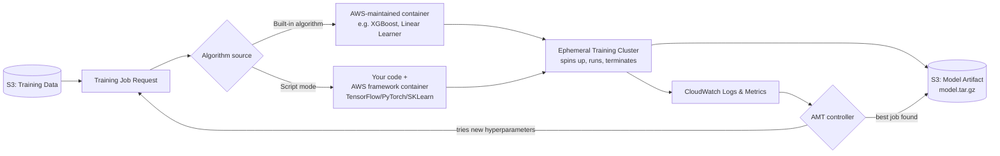

# SageMaker Training & Tuning


## Definition

SageMaker Training is the managed service that runs your model-training code on temporary,
auto-provisioned compute and saves the result. You get there by one of two routes: **built-in
algorithms** (AWS-written, pre-optimized implementations you just point at data) or **script
mode** (your own TensorFlow/PyTorch/XGBoost/etc. code, run inside an AWS-provided container).
**Automatic Model Tuning (AMT)** is the layer on top that runs many training jobs with different
hyperparameter values and finds the best-performing combination automatically.

## Purpose

Training a model requires compute that you only need in short, often GPU-hungry bursts — buying
or permanently reserving that hardware is wasteful. SageMaker Training exists so you request
exactly the instance type and count you need, for exactly as long as the job runs, and the
infrastructure disappears and stops billing the moment it's done. Built-in algorithms exist
because many problems (classification, regression, recommendation, clustering) are common enough
that AWS maintains a tuned, scalable implementation so you don't have to write XGBoost's internals
yourself. Script mode exists for everyone with a model architecture AWS doesn't ship a built-in
for, or who simply prefers their own training logic — without script mode, SageMaker would force
you to only ever use the algorithms AWS chose to maintain. AMT exists because manually guessing
hyperparameters (how many trees, what learning rate, how many layers) is slow and unreliable;
automating that search finds better models faster than a human trying values by hand.

## How It Works

Plain-English: you describe the job (what container, what instance type, where's the data, where
should the output go) and SageMaker spins up exactly that compute, runs it, saves the result, and
tears it down. AMT just repeats this whole cycle many times with different settings and keeps
the best one.



Step by step:
1. **Training data** lives in S3 (the most common source; EFS/FSx also supported for very large
   or shared datasets).
2. **You submit a Training Job request** specifying: the algorithm/container, instance type and
   count, hyperparameters, and input/output S3 paths.
3. **Algorithm source** is either a built-in algorithm's prebuilt container, or script mode
   where SageMaker takes your training script and runs it inside AWS's framework container
   (which already has TensorFlow/PyTorch/scikit-learn/etc. installed) — your code just needs to
   follow a few conventions (read `SM_CHANNEL_TRAIN` env var for the data path, etc.).
4. **SageMaker provisions an ephemeral training cluster** — exactly the instance type/count you
   asked for, nothing pre-existing, nothing left running after.
5. **The job runs**, writing progress/errors to CloudWatch Logs and metrics (loss, accuracy per
   epoch) to CloudWatch Metrics, which you can graph in real time.
6. **On completion**, the trained model artifact is saved to the S3 path you specified, and the
   cluster terminates — billing stops the instant the job ends.
7. **If you're using AMT**, instead of one job you define a hyperparameter search space (e.g.,
   `learning_rate` between 0.001 and 0.3) and an objective metric (e.g., maximize validation
   accuracy). The AMT controller launches a batch of jobs with different values, and based on
   the strategy (Random, Bayesian, Hyperband, Grid) uses earlier results to pick smarter values
   for the next batch — converging on a strong combination without trying every possibility.
8. **Distributed training** — for data too large or models too big for one instance, SageMaker
   supports data-parallel (split the data across instances, same model) and model-parallel
   (split the model itself across instances/GPUs) strategies natively.

## Key Features / Components

- **Built-in algorithms** — AWS-maintained, pre-optimized implementations for common problems:
  **XGBoost** (tabular classification/regression, usually the strongest baseline), **Linear
  Learner** (regression/classification at scale), **K-Means** (clustering), **Random Cut
  Forest** (anomaly detection), **DeepAR** (time-series forecasting), **BlazingText**
  (word embeddings/text classification), **Object Detection/Image Classification** (built on
  CNNs), **Factorization Machines** (recommendation/sparse data).
- **Script mode** — bring your own training script written in TensorFlow, PyTorch, MXNet,
  Hugging Face, or scikit-learn; runs in AWS's maintained framework container.
- **Bring Your Own Container (BYOC)** — full custom Docker image if script mode's frameworks
  don't fit (most flexible, most setup work).
- **Managed Spot Training** — run training jobs on spare EC2 capacity at up to ~90% discount;
  SageMaker automatically checkpoints and resumes if Spot capacity is reclaimed.
- **Distributed training libraries** — SageMaker's own data-parallel and model-parallel
  libraries, optimized for multi-GPU/multi-node scale beyond what open-source frameworks alone
  achieve.
- **Automatic Model Tuning (AMT)** — hyperparameter optimization with Grid, Random, Bayesian, or
  Hyperband search strategies; supports warm-starting a new tuning job from a previous one's
  results.
- **Experiments** — automatic tracking of every training job's parameters, metrics, and
  artifacts, so you can compare runs side by side in Studio.
- **Debugger** — real-time monitoring during training for problems like vanishing gradients,
  exploding loss, or GPU underutilization.
- **Checkpointing** — periodic save of training state to S3, so long jobs can resume after an
  interruption instead of restarting from scratch.

## Use Cases — When to Use It

- You have a well-understood tabular problem (churn prediction, credit risk, fraud) → start with
  the **XGBoost built-in algorithm**; it's usually competitive out of the box.
- You have a custom deep learning architecture (a specific CNN, transformer variant) → **script
  mode** with PyTorch or TensorFlow.
- You need the best possible model and have budget for a systematic search → **AMT**, especially
  Bayesian strategy for expensive-to-train models (fewer total jobs needed than Random/Grid).
- You're training on a large dataset that doesn't fit one instance's memory → **distributed data-
  parallel training**.
- You're training a large model that doesn't fit one GPU → **model-parallel training**.
- Your training budget is tight and jobs can tolerate interruption/resumption → **Managed Spot
  Training**.

## When NOT to Use It / Alternatives

- **The problem is already solved by a pre-built AI API** (sentiment, OCR, speech-to-text) —
  don't train a custom model at all; use Comprehend/Textract/Transcribe. Training is only
  justified when you need something tailored to your specific data/domain.
- **You want a foundation model for text generation/chat, not a classifier/regressor** — go to
  Bedrock (fully managed foundation models) or SageMaker JumpStart (if you need more control
  over the underlying infrastructure); training a transformer-scale language model from scratch
  on SageMaker built-in algorithms isn't realistic for almost any team.
- **You're iterating rapidly on a tiny dataset during early research** — a local Jupyter
  notebook with scikit-learn/PyTorch is faster to iterate in than spinning up remote training
  jobs each time; move to SageMaker Training once you need scale, reproducibility, or team
  sharing.
- **AMT on a cheap, fast-training model** — if a single training run takes seconds and
  hyperparameter space is small, manual or simple grid search in a notebook might be faster than
  AMT's job-orchestration overhead.
- **You need guaranteed capacity with zero interruption risk** — avoid Managed Spot Training;
  use On-Demand instances.

## Why It's Important

**Real-world:** Choosing between built-in algorithms, script mode, and BYOC is a genuine
engineering tradeoff between speed-to-start and flexibility — picking wrong wastes weeks.
Understanding **overfitting** (model memorizes training data, performs poorly on new data) and
**epochs** (one full pass through the training dataset) is foundational — too few epochs
underfits, too many overfits, and tuning this is core to getting a model that generalizes.
Managed Spot Training and AMT's efficient search strategies are direct cost levers — teams that
don't understand them routinely overspend 5-10x on training compute.

**Exam weight (MLA-C02):** This is the heart of **Domain 2: ML Model and Foundation Model
Development (24%)**. Expect scenario questions like "which built-in algorithm fits this
problem" (tabular → XGBoost, time series → DeepAR, anomaly detection → Random Cut Forest,
clustering → K-Means), "script mode vs. built-in vs. BYOC" tradeoffs, hyperparameter concepts
(learning rate, batch size, epochs, early stopping), AMT search strategies, and distributed
training concepts (data-parallel vs. model-parallel). Domain 2 in C02 is renamed to explicitly
include **Foundation Model** development — meaning the exam also expects you to know when
fine-tuning/prompt-engineering a foundation model (via Bedrock or JumpStart) is the better
choice over training a model from scratch here.

**DVA-C03 relevance:** Out of scope — training jobs and hyperparameter tuning are SageMaker/MLA
territory, not developer-exam territory.

## Pricing Model (summary)

- **Training Jobs** — billed per instance-second for the chosen instance type, only while the
  job is actually running; no charge before/after.
- **Managed Spot Training** — same instance types, billed at the Spot discount rate (up to ~90%
  off On-Demand), but can be interrupted (SageMaker auto-checkpoints/resumes).
- **AMT** — no separate fee; you pay for every underlying training job it launches (so a tuning
  job with 20 training runs costs ~20x a single run — budget accordingly).
- **Storage** — model artifacts and input data billed at standard S3 rates.
- Full current rates: https://aws.amazon.com/sagemaker/pricing/

## Hands-on Lab (Floci)

Floci does not run real SageMaker training infrastructure. Use:

**Option A — SageMaker Studio Lab (free):** train a real XGBoost model on a sample dataset,
in a real managed Jupyter environment, at zero cost — the closest free analog to a real
SageMaker training job's workflow.

**Option B — Local equivalent demonstrating script-mode-style training + a tiny hyperparameter
search (standing in for AMT):**
```bash
pip install scikit-learn pandas
python3 - <<'EOF'
from sklearn.datasets import load_breast_cancer
from sklearn.model_selection import train_test_split, GridSearchCV
from sklearn.ensemble import GradientBoostingClassifier

X, y = load_breast_cancer(return_X_y=True)
X_train, X_test, y_train, y_test = train_test_split(X, y, test_size=0.25, random_state=0)

# the "hyperparameter search space" — mirrors what you'd define for SageMaker AMT
param_grid = {
    "n_estimators": [50, 100, 200],
    "learning_rate": [0.01, 0.1, 0.3],
    "max_depth": [2, 3, 4],
}

# GridSearchCV here plays the role of AMT's search controller
search = GridSearchCV(GradientBoostingClassifier(), param_grid, cv=3, scoring="accuracy")
search.fit(X_train, y_train)

print("Best hyperparameters found:", search.best_params_)
print("Best cross-val accuracy:", search.best_score_)
print("Test accuracy with best model:", search.best_estimator_.score(X_test, y_test))
EOF
```
This is the exact conceptual loop AMT runs at AWS scale: define a search space, run many trials,
keep the best. `GridSearchCV` here is the local stand-in for the AMT controller.

**Option C — stage training config/data in S3 against Floci (dry-run of the real
`aws sagemaker create-training-job` call shape, without actually executing it):**
```bash
awslocal s3 mb s3://sagemaker-training-demo
awslocal s3 cp train.csv s3://sagemaker-training-demo/input/
# Real AWS CLI call you'd run against actual SageMaker (NOT executable against Floci):
# aws sagemaker create-training-job \
#   --training-job-name xgboost-demo \
#   --algorithm-specification TrainingImage=<xgboost-ecr-uri>,TrainingInputMode=File \
#   --role-arn arn:aws:iam::123456789012:role/SageMakerRole \
#   --input-data-config '[{"ChannelName":"train","DataSource":{"S3DataSource":{"S3Uri":"s3://sagemaker-training-demo/input/","S3DataType":"S3Prefix"}}}]' \
#   --output-data-config S3OutputPath=s3://sagemaker-training-demo/output/ \
#   --resource-config InstanceType=ml.m5.large,InstanceCount=1,VolumeSizeInGB=10 \
#   --stopping-condition MaxRuntimeInSeconds=3600
```
This dry-run shows the exact shape of a real training job request even though Floci can't
execute SageMaker's training control plane.

See `certifications/mla-c02/domain-2-model-development/labs.md`.

## Exam Tips

- Memorize the built-in algorithm → problem-type mapping: XGBoost (tabular), DeepAR
  (forecasting), Random Cut Forest (anomaly detection), K-Means (clustering), BlazingText
  (text/embeddings), Object Detection/Image Classification (vision), Factorization Machines
  (recommendations/sparse data).
- "Train on your own custom neural network architecture" → script mode, not built-in.
- "Minimize cost, job can tolerate interruption" → Managed Spot Training.
- "Find the best hyperparameters automatically, fewer total training runs than brute force" →
  AMT with Bayesian strategy (vs. Random/Grid which don't learn from prior results).
- Know the difference between **data-parallel** (split data, same full model per node) and
  **model-parallel** (split the model itself across nodes) — a common distractor pairing.
- Epoch = one full pass through the training set; too many epochs without regularization →
  overfitting (low training error, high validation/test error) — a frequently tested concept.

## Related Terms

- `sagemaker-overview.md` — where training fits in the full lifecycle
- `sagemaker-data-wrangler-and-feature-store.md` — what feeds data into training
- `sagemaker-deployment-endpoints.md` — what happens after training produces a model artifact
- `sagemaker-model-monitor-and-registry.md` — registering and tracking trained model versions
- `jumpstart.md` / `bedrock.md` — foundation-model alternatives to training from scratch
- `glossary/` — epoch, overfitting, hyperparameter, learning rate, batch size, early stopping
