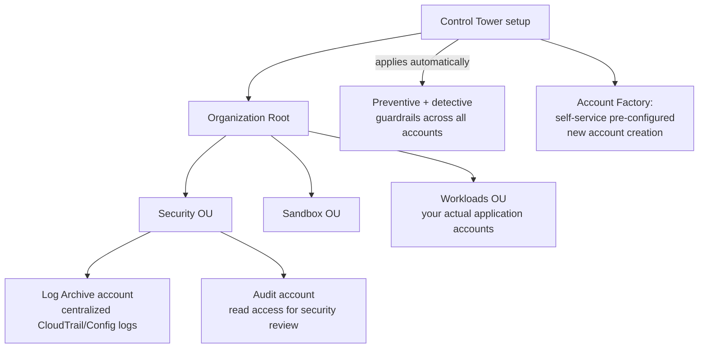

# Additional Governance Services — Control Tower, Health Dashboard, License Manager, Managed Grafana, Managed Prometheus, Proton, Service Catalog, Compute Optimizer

> **Appears in:** [SAA-C03](../../certifications/saa-c03/README.md)
>
> AWS Compute Optimizer also appears in: [MLA-C02](../../certifications/mla-c02/README.md)

This doc consolidates eight lower-exam-weight management/governance services confirmed in the
SAA-C03 appendix with no existing standalone doc. Each section covers definition, purpose, a
concrete use case, and the exam-trigger phrasing to recognize.

## AWS Control Tower

### Definition
AWS Control Tower automates setting up a secure, multi-account AWS environment ("landing zone")
following AWS best practices — provisioning an organizational structure, baseline security/
compliance rules ("guardrails"), centralized logging, and a self-service way to create new,
pre-configured accounts, all in one guided setup instead of building the equivalent manually with
AWS Organizations, Config, and CloudTrail.

### Purpose
A well-structured multi-account AWS environment (separate accounts for logging, security
auditing, and workloads, with consistent guardrails everywhere) is widely recognized as the right
pattern — but building it entirely by hand with raw AWS Organizations, SCPs, Config rules, and
CloudTrail is a substantial, easy-to-get-wrong undertaking. Control Tower exists to turn "build a
well-architected multi-account landing zone" from a bespoke, weeks-long project into an automated,
opinionated setup that still uses the same underlying services.

Walking the diagram: Control Tower's setup creates a **Security OU** automatically, housing a
**Log Archive account** (centralizing CloudTrail/Config logs from every account into one place)
and an **Audit account** (giving security/compliance teams read access across the whole
landing zone without each auditor needing standing access to every individual account). A
**Sandbox OU** and **Workloads OU** (or custom OUs you define) hold your actual application
accounts. **Guardrails** — preventive (block an action outright via SCP) or detective (flag a
violation after the fact via Config rules) — apply automatically across every in-scope account.
**Account Factory** lets any authorized user self-service-create a new, already-compliant account
instead of a manual, error-prone account setup process each time.

### Use Case
A company adopting a multi-account AWS strategy for the first time wants centralized logging, a
consistent security baseline, and a self-service way for teams to get new compliant accounts,
without hand-building that structure from raw Organizations/Config/CloudTrail — Control Tower
provisions all of it in one guided setup and keeps enforcing it automatically on every new
account created afterward.

### Exam Tip
**"Set up a multi-account landing zone," "automate account governance/guardrails," "self-service
account provisioning that's already compliant"** → Control Tower. Know it's built *on top of*
AWS Organizations, Config, and CloudTrail (it doesn't replace them, it automates and orchestrates
them) — distinguish from raw Organizations/SCPs alone, which is the lower-level building block
Control Tower automates the setup of.

---

## AWS Health Dashboard

### Definition
AWS Health Dashboard (formerly the Personal Health Dashboard) provides a personalized view of AWS
service health events and scheduled changes that specifically and actually affect *your* AWS
resources and accounts — distinct from the public Service Health Dashboard, which shows general
AWS-wide service status regardless of whether it affects you.

### Purpose
A public, AWS-wide status page tells you "S3 is experiencing elevated error rates in us-east-1"
but not whether *your specific resources* are impacted, or what you personally need to do about
it (e.g., an EC2 instance scheduled for retirement). Health Dashboard exists to filter that noise
down to events relevant to your actual account and resources, with actionable, personalized
guidance.

### Use Case
An operations team wants automatic notification specifically when an AWS-scheduled maintenance
event will affect one of their actual running EC2 instances, not a general "maintenance is
happening somewhere in this Region" alert — AWS Health Dashboard surfaces exactly that
personalized, resource-scoped event, and can trigger EventBridge-based automated responses.

### Exam Tip
**"Personalized view of AWS events affecting my resources," "scheduled maintenance/retirement
notifications for my specific account"** → AWS Health Dashboard. Distinguish from the public
**AWS Service Health Dashboard** (general, account-agnostic AWS-wide status, no personalization).
A question emphasizing "affecting *my* resources specifically" is the Health Dashboard trigger.

---

## AWS License Manager

### Definition
AWS License Manager centrally tracks software license usage (vCPU-based, core-based, socket-
based, or per-instance licensing from vendors like Microsoft, SAP, Oracle, IBM) across your AWS
accounts and on-premises servers, and can enforce licensing rules automatically to prevent
accidental non-compliance.

### Purpose
Bring-your-own-license (BYOL) software is often priced per-core/per-socket/per-vCPU under
contracts with hard usage caps — exceeding them without knowing it creates real compliance and
audit-penalty risk, especially once licensed software is running across many accounts and both
on-premises and cloud footprints. License Manager exists to track consumption centrally against
those limits and, if configured, actively prevent launches that would exceed them, rather than
discovering an overage only when a vendor audit happens.

### Use Case
A company has a capped number of Microsoft SQL Server core licenses for bring-your-own-license use
on EC2 and wants to make sure no team accidentally launches more licensed instances than the
contract allows — License Manager tracks consumption against the defined limit and can block a
launch that would exceed it, preventing an accidental compliance violation before it happens.

### Exam Tip
**"Track/enforce BYOL software license limits (vCPU/core/socket) across accounts," "prevent
license overage"** → AWS License Manager. Distinguish from **Service Catalog** (governs *which
products/templates* users may launch generally) and **RAM** (shares the license *configuration
resource* itself across accounts) — License Manager specifically enforces numeric license-usage
caps against a vendor contract.

---

## Amazon Managed Grafana

### Definition
Amazon Managed Grafana is a fully managed version of the open-source Grafana dashboarding/
visualization tool, letting teams build and share operational dashboards against CloudWatch,
Prometheus, and many other data sources without hosting and patching Grafana servers themselves.

### Purpose
Grafana is the de facto standard, widely adopted open-source dashboarding tool across the
industry — but self-hosting it means patching, scaling, and securing the Grafana server yourself.
Managed Grafana exists to let teams keep using the exact dashboards/plugins/query language they
already know, with AWS running the underlying infrastructure, authentication (via IAM Identity
Center or SAML/OIDC), and scaling.

### Use Case
A platform team already has a library of Grafana dashboards built against Prometheus metrics and
wants to keep using them after migrating workloads to AWS, without operating Grafana's own
server infrastructure — Managed Grafana runs the same dashboards against CloudWatch and Amazon
Managed Service for Prometheus data sources, with AWS handling the hosting.

### Exam Tip
**"Grafana dashboards without managing Grafana servers," "visualize CloudWatch/Prometheus metrics
in Grafana"** → Amazon Managed Grafana. Know it's the *visualization* layer; it's frequently paired
with **Amazon Managed Service for Prometheus** as the metrics *storage/query* layer underneath it
— a question describing both together is describing this exact managed-Grafana-on-managed-
Prometheus pairing.

---

## Amazon Managed Service for Prometheus

### Definition
Amazon Managed Service for Prometheus is a fully managed, Prometheus-compatible monitoring service
for storing and querying metrics — especially container/Kubernetes metrics — using the same
PromQL query language and existing Prometheus exporters/instrumentation, without operating
Prometheus servers or worrying about their storage scaling.

### Purpose
Prometheus is the dominant metrics standard in the Kubernetes/container ecosystem, but self-hosted
Prometheus has real, well-known operational pain points at scale — particularly long-term storage
and high-availability of the Prometheus server itself. Managed Service for Prometheus exists to
keep teams on the exact metrics format and query language (PromQL) they already use with EKS/ECS,
while AWS absorbs the storage-scaling and HA operational burden.

### Use Case
A platform team running EKS already instruments everything with Prometheus exporters and writes
PromQL-based alerting rules, but is tired of operating and scaling their own Prometheus server's
storage — switching the metrics backend to Amazon Managed Service for Prometheus keeps every
existing PromQL query and exporter working unchanged, while AWS handles the storage and
availability.

### Exam Tip
**"Prometheus-compatible metrics for Kubernetes/containers without operating Prometheus servers,"
"PromQL," "long-term Prometheus metric storage"** → Amazon Managed Service for Prometheus.
Frequently paired with **Amazon Managed Grafana** for visualization — recognize the two as a
matched pair (metrics storage + dashboards) rather than overlapping/competing services.

---

## AWS Proton

### Definition
AWS Proton lets a platform/infrastructure team define standardized, versioned infrastructure
templates for container and serverless application deployment, which individual development
teams can then self-service deploy and keep automatically updated as the template evolves —
without each dev team hand-rolling or copy-pasting their own CloudFormation/Terraform.

### Purpose
In organizations with many small application teams, letting every team write its own deployment
infrastructure from scratch leads to inconsistency (different logging setups, different security
postures) and duplicated effort, while a fully centralized platform team manually provisioning
for every app team doesn't scale either. Proton exists as a middle path: the platform team
authors the template once, versions it, and every consuming application's actual deployed
infrastructure can be automatically updated when the template changes — solving template drift
across many deployed services at once.

### Use Case
A platform engineering team wants every microservice team in the company to deploy onto a
consistent, pre-approved ECS Fargate + Application Load Balancer pattern, and wants to be able to
push a security patch to that pattern across every team's deployed service at once when the
template changes — Proton's versioned templates and managed deployment-update mechanism do exactly
this, instead of each team's infrastructure silently drifting from the original pattern over time.

### Exam Tip
**"Standardized infrastructure templates for many app teams," "centrally update deployed
infrastructure across teams when a template changes," "self-service container/serverless
deployment with platform-team-defined guardrails"** → AWS Proton. Distinguish from **Service
Catalog** (broader, covers any CloudFormation-based product, including non-container/serverless
things like RDS databases or EC2 AMIs) — Proton is specifically scoped to container/serverless
*application deployment* patterns with an explicit template-versioning and automatic-update
mechanism baked in.

---

## AWS Service Catalog

### Definition
AWS Service Catalog lets administrators curate a catalog of pre-approved, CloudFormation-template-
defined products (an EC2 AMI, a full application stack, an RDS configuration) that end users can
then browse and self-service-launch within guardrails the administrator defines, without those
end users needing direct access to the underlying AWS services themselves.

### Purpose
Letting every employee freely provision arbitrary AWS resources risks inconsistent configurations,
untagged/ungoverned sprawl, and compliance violations; locking resource provisioning down to a
central IT team entirely creates a slow bottleneck for routine, pre-approved needs. Service
Catalog exists as the middle ground — self-service for end users, but only from a pre-approved,
centrally governed menu of options.

### Use Case
An IT department wants developers to be able to spin up a pre-approved, correctly-configured
RDS database or EC2 instance type on demand, without having direct IAM permissions to create
arbitrary RDS/EC2 resources themselves — Service Catalog exposes exactly the pre-approved product
set via a self-service portal, with the administrator's IAM role (not the end user's) actually
performing the underlying CloudFormation deployment.

### Exam Tip
**"Curated catalog of approved products," "self-service provisioning within guardrails," "end
users shouldn't have direct AWS service access"** → Service Catalog. Compare with **Proton**
(narrower scope: specifically container/serverless app deployment patterns with built-in template-
version-push-update automation) — Service Catalog is the more general-purpose "any CloudFormation
product" catalog across any resource type.

---

## AWS Compute Optimizer

### Definition
AWS Compute Optimizer uses machine learning analysis of historical CloudWatch utilization
metrics to recommend better-fitting resource types and sizes for EC2 instances, EBS volumes,
Lambda functions, and ECS services on Fargate — flagging both over-provisioned (wasting money)
and under-provisioned (risking performance problems) resources.

### Purpose
Right-sizing compute resources by hand means someone manually eyeballing CloudWatch CPU/memory
graphs across potentially thousands of resources — slow, inconsistent, and easy to defer
indefinitely. Compute Optimizer exists to turn that into an automated, ML-driven recommendation
engine that continuously analyzes real historical usage and tells you specifically which resources
are mis-sized and what size would fit better, with a quantified estimate of performance risk and
potential savings.

### Use Case
A FinOps team wants to systematically identify every over-provisioned EC2 instance across a large
fleet to reduce cost, without manually reviewing CloudWatch metrics instance-by-instance — Compute
Optimizer's dashboard surfaces every instance it has enough utilization history to analyze, with a
specific recommended instance type and projected savings per instance.

### Exam Tip
**"ML-based rightsizing recommendations," "identify over/under-provisioned EC2/EBS/Lambda/
Fargate resources from historical utilization data"** → AWS Compute Optimizer. On **SAA-C03**
this sits in the cost-optimization domain, as a concrete tool distinct from manually reviewing
Cost Explorer or Trusted Advisor checks. On **MLA-C02**, know Compute Optimizer itself as an
example of a managed AWS service *applying* ML to an operational problem (resource rightsizing)
— a useful contrast case for "what ML looks like baked into an AWS service" versus building your
own SageMaker model for the same kind of prediction task.

## Related Terms

- [`../security-identity-compliance/organizations-and-scps.md`](../security-identity-compliance/organizations-and-scps.md) —
  the underlying multi-account/SCP mechanism Control Tower automates on top of.
- [`cloudwatch.md`](cloudwatch.md) — the metrics source behind Compute Optimizer, Managed
  Grafana, and Managed Prometheus.
- [`cost-management-tools.md`](cost-management-tools.md) — Cost Explorer/Budgets/Trusted Advisor,
  which Compute Optimizer's rightsizing recommendations complement.
- [`../security-identity-compliance/additional-security-services.md`](../security-identity-compliance/additional-security-services.md) —
  AWS RAM, referenced above for license/resource sharing across accounts.
- Glossary: Landing zone, Guardrail, BYOL, PromQL, Rightsizing.
