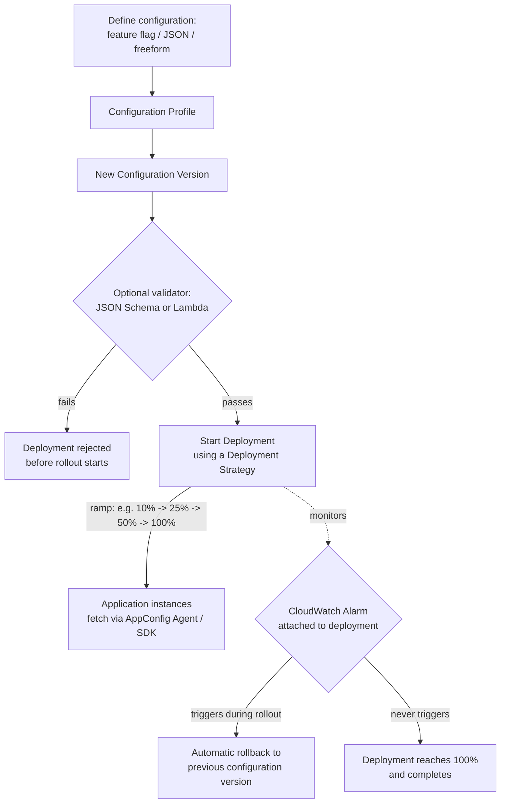

# AWS AppConfig

> **Appears in:** [DVA-C03](../../certifications/dva-c03/README.md)


<!-- AWS Architecture Icons, Management & Governance category; see diagrams/README.md for the convention -->

> **Distinguishing this from the other two "store a value for an app to read" services is the
> single most important thing in this document.** Secrets Manager and Parameter Store (covered
> together in [`secrets-manager-vs-parameter-store.md`](../security-identity-compliance/secrets-manager-vs-parameter-store.md))
> store *secrets and simple config values*. AppConfig is a different tool for a different job:
> **safely rolling out an application configuration change — including feature flags — to
> production, gradually, with automatic rollback if something goes wrong.** Read the dedicated
> comparison section below before anything else in this file.

## Definition

AWS AppConfig lets you change how a running application behaves — turn a feature on for 10% of
users, flip an operational setting, change a tuning parameter — **without redeploying code**, and
without flipping the switch for 100% of production traffic all at once. It's a deployment system
for configuration data, with the same gradual-rollout, validation, and automatic-rollback
safety net you'd expect from a code deployment, applied to config and feature flags instead.

## Purpose

Two different problems tend to get confused, and AppConfig is built for the second one
specifically. Problem one: "where do I durably store a config value or a secret so my app can
fetch it" — that's what Parameter Store and Secrets Manager solve; fetching either one simply
returns whatever the current value is, instantly, with no concept of a rollout. Problem two: "I
want to **change** a config value or flip a **feature flag** in a live production system, for a
controlled subset of traffic first, with automatic validation and the ability to instantly
revert if something goes wrong" — a config *deployment*, not just config *storage*. Before
AppConfig, teams solved problem two by building this logic themselves (a custom feature-flag
service, a home-grown percentage-rollout mechanism, manual CloudWatch-alarm-triggered rollback
scripts) or, worse, by not solving it at all and just pushing a changed Parameter Store value to
100% of traffic instantly and hoping for the best. AppConfig exists to make the safe, gradual,
auto-rollback rollout pattern a managed, configuration-only feature instead of a custom-built
system every team reinvents (often badly, under pressure, during an incident caused by a bad
instant rollout).

## How It Works

Plain-English first: you define what configuration data looks like and where it comes from (a
**configuration profile** — which might just be a feature flag definition, a JSON blob, or a
pointer to a value already sitting in Parameter Store/Secrets Manager/S3), bundle a specific
version of that data (a **configuration version**), and then **deploy** it using a **deployment
strategy** that controls how fast the new value reaches 100% of your application instances —
typically a percentage ramp over minutes to hours, not an instant flip. Throughout the rollout,
AppConfig watches **CloudWatch alarms** you've attached; if one trips, the deployment
automatically halts and rolls back to the previous value, with zero manual intervention required.



Step by step:
1. **Define a configuration profile.** You tell AppConfig what the configuration *is* and where
   its data comes from — a **feature flag** configuration profile (a special, purpose-built type
   with built-in attributes, variants, and targeting rules), a **freeform** configuration profile
   backed by a JSON/YAML/text document you author directly, or a profile whose source is an
   **existing Parameter Store parameter, Secrets Manager secret, S3 object, SSM Document, or
   CodePipeline artifact** — AppConfig can wrap any of these as the *content* of a profile while
   adding its own deployment/validation/rollback layer on top.
2. **Create a configuration version.** Each distinct set of values is a new, immutable version —
   exactly like a new build artifact, giving you a clean history of every configuration state
   that was ever deployed and an obvious rollback target (the previous version).
3. **Optional validation before rollout even starts.** A **JSON Schema validator** checks the
   version's structure/types, or a **Lambda validator** runs arbitrary custom logic (e.g.,
   "reject this config if the referenced downstream service endpoint doesn't respond") — a
   version that fails validation is rejected before a single instance ever sees it, catching
   malformed configuration before it becomes a production incident rather than during one.
4. **Deploy using a Deployment Strategy.** A strategy defines the ramp: how long to wait before
   the first exposure (**Growth Factor**/**Deployment Duration**), what percentage increment to
   step through, and a **bake time** at the end to keep watching after reaching 100% before
   calling the deployment fully complete. AWS provides predefined strategies (`AppConfig.Linear50PercentEvery30Seconds`
   for fast-moving, low-risk changes; `AppConfig.AllAtOnce` for a deliberate instant flip when
   that's genuinely the right call) and you can define custom ones.
5. **Applications fetch the current value** via the **AppConfig Agent** (a local caching daemon
   — run as a Lambda extension, an ECS/EKS sidecar, or a standalone process on EC2) or directly via
   the AppConfig Data API/SDK. The agent's local in-memory cache means your application never
   makes a network call to AppConfig on every single request — it asks the agent, which serves
   from cache and refreshes in the background on a configured poll interval.
6. **CloudWatch Alarms monitor the rollout.** If you've attached one or more alarms to the
   deployment, and any of them enters `ALARM` state during the rollout window, AppConfig
   **automatically stops the deployment and reverts every instance that received the new version
   back to the previous one** — no human needs to notice the problem and manually intervene for
   the blast radius to stop growing.

### How AppConfig works end to end, per the official architecture


*Figure: the official AppConfig workflow diagram — configuration data is identified, wrapped in a
configuration profile, deployed using a chosen deployment strategy, and the running application
retrieves the resulting value. The key detail this diagram makes clear: deployment strategy
selection happens as a distinct, separate step from simply defining what the configuration data
*is* — the same configuration profile can be deployed with a cautious, slow-ramping strategy one
time and a fast or instant strategy another time, without redefining the configuration itself.
Source: AWS AppConfig User Guide, ["What is AWS
AppConfig?"](https://docs.aws.amazon.com/appconfig/latest/userguide/what-is-appconfig.html).*

### The AppConfig Agent's local caching model

Understanding why applications don't call the AppConfig service directly on every single request
matters for both cost and latency reasoning:


*Figure: the AppConfig Agent sits between your application and the AppConfig service as a local
caching layer — your code asks the agent (a fast, local, in-process or sidecar call), the agent
answers from its in-memory cache, and separately, on a configured polling cadence, the agent
checks AppConfig in the background for a newer configuration version, swapping the cache contents
in only when something actually changed. The practical effect: your application's hot path never
waits on a network call to AppConfig, and AppConfig's own request volume scales with your fleet
size and poll interval, not with your application's actual request-per-second traffic — a
critical distinction for both latency and the pricing model below. Source: AWS AppConfig User
Guide, ["What is AWS AppConfig
Agent?"](https://docs.aws.amazon.com/appconfig/latest/userguide/appconfig-agent.html).*

### The Lambda extension variant, specifically

Lambda functions can't run a long-lived background daemon the way an EC2 instance or ECS task
can, so AppConfig ships a purpose-built Lambda extension that adapts the same caching idea to
Lambda's execution model:


*Figure: inside a Lambda function, the AppConfig Agent Lambda extension runs as a layer and
exposes a local HTTP endpoint at `localhost:2772`; your function code calls that endpoint instead
of the AppConfig API directly, and the extension manages the cache and the background
poll-for-updates logic exactly as the standalone agent does elsewhere — adapted specifically to
fit inside Lambda's layer/extension model since there's no separately-running daemon process
available. Source: AWS AppConfig User Guide, ["Understanding how the AWS AppConfig Agent Lambda
extension
works"](https://docs.aws.amazon.com/appconfig/latest/userguide/appconfig-integration-lambda-extensions-how-it-works.html).*

### AppConfig vs. Secrets Manager vs. Parameter Store — the exam-critical comparison

This is the distinction that genuinely gets tested, and it's worth a dedicated table rather than
a passing mention:

| Dimension | Secrets Manager | Parameter Store | AWS AppConfig |
|---|---|---|---|
| Core job | Store + **automatically rotate** secrets | Store any config value or secret, no built-in rotation | **Deploy** a configuration/feature-flag change safely |
| Has a rollout/ramp concept? | No — fetching returns the current value instantly | No — fetching returns the current value instantly | **Yes** — this is its entire reason to exist |
| Automatic rollback on failure? | No | No | **Yes**, via attached CloudWatch Alarms |
| Validation before a value takes effect? | No | No | **Yes** — JSON Schema or Lambda validators |
| Purpose-built feature-flag support (targeting rules, variants)? | No | No | **Yes** — a dedicated configuration profile type |
| Typical use | Database credentials, API keys needing rotation | Simple config values, feature-flag-style booleans with no rollout need, cheap SecureString secrets | Feature flags and config changes that must roll out gradually and be revertible automatically |
| Can AppConfig use it as a data source? | Yes — AppConfig can wrap a Secrets Manager secret as a configuration profile's content | Yes — same, for Parameter Store parameters | — |

The giveaway phrase to watch for in a scenario question: **"gradually roll out," "percentage of
users/instances," "automatically roll back if X happens," or "feature flag with targeting rules"**
→ AppConfig. **"Just store/fetch a value," "needs automatic rotation,"** or **"cheapest option for
a simple config value"** → Secrets Manager or Parameter Store instead (see
[`secrets-manager-vs-parameter-store.md`](../security-identity-compliance/secrets-manager-vs-parameter-store.md)
for choosing between those two specifically). A question describing a feature flag that must be
instantly toggleable for 100% of traffic with zero concept of a ramp could, in principle, be done
with a Parameter Store boolean — but if *any* part of the scenario mentions a controlled rollout,
targeting, or automatic rollback, that rules Parameter Store out and points at AppConfig.

## Key Features / Components

- **Configuration profile** — defines what the configuration data is and where it comes from:
  **Feature Flags** (a purpose-built type with flags, attributes, and variants built in),
  **Freeform** (your own JSON/YAML/text, authored directly or sourced from Parameter Store,
  Secrets Manager, S3, an SSM Document, or a CodePipeline artifact).
- **Configuration version** — an immutable snapshot of a profile's content at a point in time;
  every deployment targets a specific version, giving a clean audit trail and rollback target.
- **Deployment strategy** — controls the ramp: growth factor/step percentage, deployment
  duration, and a final bake time. Predefined strategies cover common patterns
  (`AppConfig.Linear50PercentEvery30Seconds`, `AppConfig.Canary10Percent20Minutes`,
  `AppConfig.AllAtOnce`); custom strategies are fully configurable.
- **Validators** — a JSON Schema validator (structural/type checking) or a Lambda validator
  (arbitrary custom logic) run against a configuration version *before* a deployment is allowed
  to start.
- **CloudWatch Alarm integration** — attach one or more alarms to a deployment; any alarm
  entering `ALARM` state during the rollout automatically halts and reverts the deployment.
- **AppConfig Agent** — a local caching daemon (standalone process, ECS/EKS sidecar, or Lambda
  extension) that serves configuration reads from an in-memory cache and polls AppConfig in the
  background for updates, keeping your application's hot path free of a network call per request.
- **Application, Environment, and Configuration Profile hierarchy** — AppConfig organizes
  deployments around an **Application** (a logical grouping, e.g. "checkout-service"), containing
  one or more **Environments** (e.g. "staging," "production-us-east-1"), each of which can deploy
  any of the application's configuration profiles independently — the same flag can be at 100% in
  staging and 10% in production simultaneously, deliberately.
- **Feature flag targeting and variants** — within a Feature Flags configuration profile, define
  multiple **variants** of a flag's value and **targeting rules** (e.g., serve variant B only to
  a specific attribute match) without needing a separate rollout mechanism layered on top.
- **AppConfig Extensions** — attach custom actions (an SNS notification, a Lambda invocation) to
  specific points in the deployment lifecycle (on deployment start, on each step, on completion,
  on rollback) for integrating AppConfig into a broader operational workflow.

## Common Architectures

**1. Feature-flag-gated progressive rollout for a single application** — the canonical AppConfig
pattern: one Application, a "production" Environment, a Feature Flags configuration profile per
flag, each deployed with a percentage-ramp strategy and a CloudWatch Alarm watching the error-rate
metric most relevant to that specific feature. This is the shape almost every DVA-C03 "roll out a
new feature safely" scenario is secretly describing.

**2. Multi-region, independently-paced rollout** — a global application defines one Environment
per Region (`production-us-east-1`, `production-eu-west-1`, `production-ap-southeast-1`), and
the same configuration profile/version is deployed to each Environment on its own schedule —
often starting in the lowest-traffic or lowest-risk Region first, watching its alarms specifically,
before proceeding to the next Region, rather than one global deployment hitting every Region
simultaneously.

**3. Lambda-based serverless configuration reads** — a Lambda function includes the AppConfig
Agent as a Lambda layer/extension, calling `localhost:2772` to read the current configuration
value on each invocation (served from the extension's cache, refreshed on a background poll),
avoiding both a cold-start-time call to the AppConfig API and the latency/cost of calling it on
every single invocation.

**4. Coordinated code-and-config canary release** — a CodeDeploy canary deployment rolling out a
new application version is paired with an AppConfig deployment rolling out an associated
configuration change on a matching timeline, both watching shared CloudWatch Alarms, so a
problem triggers rollback of *both* the code and the configuration together rather than leaving
them in an inconsistent, partially-rolled-back state relative to each other.

## Use Cases — When to Use It

1. **Gradual feature flag rollout for a new checkout flow (e-commerce).** A new checkout UI needs
   to reach real production traffic cautiously — 5% first, watching conversion/error metrics,
   before scaling to everyone. AppConfig's Feature Flags profile type plus a percentage-ramp
   deployment strategy is purpose-built for exactly this. **Tradeoff vs. a custom in-house
   feature-flag table in DynamoDB**: a custom table can store a flag value but has none of
   AppConfig's built-in ramp/rollback/validation machinery — you'd be rebuilding all of it by hand.
2. **Operational tuning parameter changes without a redeploy (any backend service).** A
   thread-pool size or a cache TTL needs adjusting in production without a full code deployment
   cycle. AppConfig's Freeform configuration profile lets ops change the value and roll it out
   gradually, watching for regressions before going to 100%. **Tradeoff vs. a plain Parameter
   Store value fetched on every request**: Parameter Store works for storage, but a bad new value
   takes effect for 100% of instances the moment it's updated — AppConfig's ramp catches a bad
   value at 10% exposure instead of 100%.
3. **Safe feature flag kill-switch during an incident (SRE/on-call).** A newly released feature is
   suspected of causing elevated error rates, and on-call needs to instantly disable it for all
   traffic. AppConfig's `AllAtOnce` strategy (deliberately bypassing the ramp when speed matters
   more than caution) flips the flag off everywhere in seconds. **Tradeoff vs. rolling back a full
   code deployment**: redeploying code to disable a feature is far slower than flipping a flag
   AppConfig already has wired into the running application.
4. **A/B testing a pricing algorithm change (growth/product team).** A new pricing calculation
   needs to run for a defined percentage of users, measured against a control group, before a
   full rollout decision. AppConfig's targeting rules and variants within a Feature Flags profile
   express the A/B split natively. **Tradeoff vs. a dedicated experimentation platform (e.g.
   Amazon Pinpoint/third-party)**: a dedicated experimentation platform adds statistical
   significance tooling AppConfig doesn't provide; AppConfig is the right tool for the *delivery*
   mechanism of the split, not necessarily the full experiment-analysis pipeline.
5. **Regional configuration rollout for a multi-region application (platform engineering).**
   A configuration change needs to roll out to `us-east-1` first, be monitored, and only then
   proceed to `eu-west-1` and `ap-southeast-1`. AppConfig's per-Environment deployment model
   (one Environment per Region) lets each Region's rollout be sequenced and monitored
   independently. **Tradeoff vs. a single global Parameter Store value**: a single global value
   changes everywhere simultaneously, with no per-Region staged rollout or independent rollback.
6. **Validating configuration structure before it ever reaches production (platform
   reliability).** A misconfigured JSON payload (a missing required field, a wrong type) has
   previously caused a production incident when pushed directly via Parameter Store with no
   validation step. AppConfig's JSON Schema validator rejects a malformed version before any
   instance ever receives it. **Tradeoff vs. application-side defensive parsing alone**:
   application-side validation only catches the problem *after* the bad config has already
   reached production instances; AppConfig's pre-deployment validator catches it before rollout
   even starts.
7. **Canary deployment correlated with configuration change (release engineering).** A new code
   version and an associated configuration change need to roll out together, in lockstep, with
   a shared rollback trigger if either one causes a problem. AppConfig deployments can be
   coordinated alongside a CodeDeploy canary release, sharing the same CloudWatch alarms for
   rollback decisions. **Tradeoff vs. deploying code and config entirely independently**:
   independent rollout timing risks a window where new code runs against old config (or vice
   versa) in a way nobody explicitly tested.
8. **ML model-serving feature flag for a new inference endpoint version (MLA-C02/DVA-C03
   adjacent, ML platform team).** A new model version needs to serve a small percentage of
   inference traffic before fully replacing the current production model, with automatic
   rollback if latency or error-rate alarms trip. AppConfig's percentage-ramp deployment strategy,
   driving which model endpoint a request-routing layer calls, provides exactly this control.
   **Tradeoff vs. SageMaker's own built-in traffic-shifting for endpoint variants**: SageMaker's
   native production-variant weighting is the more common tool for this specific model-routing
   case, but AppConfig is the right fit when the flag controls broader application logic around
   the model call (e.g., whether to call the model at all, or which feature set to send it),
   not just raw traffic-split percentages between two SageMaker endpoint variants.
9. **Compliance-driven configuration change audit trail (regulated industries).** An auditor
   needs to see exactly what configuration was live at any point in time, who deployed it, and
   confirmation that any failed rollout was caught and reverted automatically. AppConfig's
   versioned configuration history plus CloudWatch Alarm-triggered rollback records satisfy this
   directly. **Tradeoff vs. manually logging every Parameter Store update**: manual logging is
   achievable but doesn't give you the automatic-rollback *evidence* an auditor may specifically
   want to see — that only exists because AppConfig enforces it structurally.

## When NOT to Use It / Alternatives

- **You just need to store and fetch a secret or a simple config value, with no rollout/rollback
  concept at all** — use **Parameter Store** (free tier, simplest) or **Secrets Manager** (if
  automatic rotation is needed); wrapping a value in AppConfig purely for storage, with no
  intention of ever using its ramp/rollback features, adds complexity for no benefit.
- **You need automatic credential rotation** — AppConfig has no rotation engine of its own; that
  is specifically Secrets Manager's job. AppConfig can *reference* a Secrets Manager secret as a
  configuration profile's content, but the rotation itself still happens in Secrets Manager.
- **You need infrastructure-level configuration (security groups, instance types, IAM policies)**
  — that's **CloudFormation**/**CDK** territory (declarative infrastructure), not application
  runtime configuration; AppConfig governs values your *application code* reads at runtime, not
  the AWS resources underneath it.
- **A true A/B test needing statistical significance analysis, not just traffic splitting** — pair
  AppConfig (for the delivery/targeting mechanism) with a dedicated experimentation/analytics
  tool for the statistical analysis half; AppConfig alone doesn't compute significance.
- **You need model-serving traffic-shifting between two deployed model versions specifically** —
  SageMaker's native production-variant weighting is usually the more direct tool for that narrow
  case; reach for AppConfig when the flag governs broader application behavior around the model
  call, not just the inference traffic split itself.

## Why It's Important

**Real-world:** a surprising number of real production incidents trace back to a configuration
change (not a code deployment) pushed instantly to 100% of traffic with no validation and no
automatic rollback — "the config change that took down prod" is a recurring, well-known failure
pattern across the industry. AppConfig exists because configuration changes deserve the same
deployment discipline (gradual rollout, automated health checking, fast rollback) that mature
teams already apply to code deployments, and skipping that discipline for config specifically is
a common, expensive blind spot.

**Exam relevance:**
- **DVA-C03** — AppConfig sits squarely in Domain 1 "Development with AWS Services" (feature flag
  patterns, externalizing configuration from code) and Domain 3 "Testing and Deployment"
  (gradual rollout and automatic rollback strategies). A developer-facing scenario describing "roll
  out a feature flag/config change gradually, with automatic rollback on a CloudWatch alarm" is a
  direct, unambiguous AppConfig signature on this exam — and the contrast with Parameter Store/
  Secrets Manager (which the exam also tests from the DVA-C03 and SAA-C03 angle) is one of the more
  reliably tested "pick the right one of three similar-sounding services" questions in this
  category.

## Limits & Quotas

- **Applications per account**: a soft limit, raisable via support case; most organizations
  structure applications around deployable services, so this rarely becomes a real constraint
  except at very large organizational scale.
- **Environments per application**: a soft limit; a common pattern is one environment per
  deployment stage per Region (e.g., `production-us-east-1`, `production-eu-west-1`,
  `staging`), which can add up for a truly global, multi-region application.
- **Configuration profiles per application**: a soft limit; large applications with many
  independent feature flags typically use one configuration profile per logical flag/config
  group rather than one giant profile holding everything, both for independent rollout control
  and to stay well under this limit.
- **Configuration version size**: hosted configuration versions have a maximum payload size
  (low single-digit MB) — a configuration profile that's ballooned into something resembling a
  full application dataset rather than a tuning parameter is a sign it should be redesigned, not
  that the limit should be raised.
- **Deployment duration bounds**: a deployment strategy's total duration and bake time both have
  practical upper bounds; an extremely slow, multi-day ramp is better achieved by chaining
  multiple shorter deployments with manual checkpoints than configuring one single extremely long
  strategy.
- **Polling interval floor**: the AppConfig Agent's poll interval has a practical minimum —
  polling drastically more frequently than needed doesn't make a rollout "more real time" in a
  meaningful way and only increases the AppConfig request volume (and thus cost) without
  proportional benefit.

## Troubleshooting / Common Issues

- **A deployed configuration change isn't visible to the application yet.** Check the AppConfig
  Agent's poll interval first — the agent serves from its local cache and only checks for updates
  on its configured cadence, so there's an expected propagation delay between "deployment
  started" and "every instance's local cache has refreshed," separate from the deployment
  strategy's own percentage ramp.
- **A deployment is stuck and won't progress past a certain percentage.** Check whether a
  CloudWatch Alarm attached to the deployment has entered `ALARM` state — this is the intended
  automatic-rollback trigger working as designed, not a stuck deployment; look at the alarm's own
  state and the metric driving it to find the real underlying issue that tripped it.
- **A configuration version was rejected before any instance saw it.** Check the validator
  (JSON Schema or Lambda) attached to the configuration profile — a validation failure blocks the
  deployment from starting at all, which is the intended "catch it before production" behavior;
  look at the specific validation error returned rather than assuming a transient platform issue.
- **Feature flag behaves differently across environments unexpectedly.** Confirm which
  Environment each application instance is actually configured to read from — AppConfig
  deliberately allows the same configuration profile to be at different rollout percentages (or
  entirely different values) across environments simultaneously; "staging shows the new behavior
  but production doesn't" is very often the intended, deliberate state, not a bug.
- **Lambda extension-based reads timing out or erroring.** Confirm the function calls the
  extension's local endpoint (`localhost:2772`) rather than the AppConfig Data API directly from
  inside the function — calling the public API directly bypasses the extension's caching layer
  entirely and reintroduces the per-invocation network-call cost/latency the extension exists to
  remove.
- **Rollback happened but nobody knows why.** Check the CloudWatch Alarm history for the alarm(s)
  attached to that specific deployment — the alarm's own transition history (when it entered
  `ALARM` state, and the metric value/threshold at that moment) is the authoritative record of
  why an automatic rollback triggered, rather than guessing from application logs alone.

## Pricing Model (summary)

- **No charge for configuration storage or for creating applications/environments/profiles.**
- **Billed per configuration request** served by the AppConfig service to the AppConfig Agent
  (not per application request) — because the agent caches locally and only re-polls on a
  configured interval, cost scales with your fleet size and poll frequency, not with your raw
  application request-per-second volume, which is a meaningfully different (and usually far
  cheaper) cost shape than it might initially sound like.
- **Deployment strategies, validators, and CloudWatch Alarm integration carry no separate
  AppConfig charge** beyond the underlying CloudWatch Alarm cost itself (ordinary CloudWatch
  Alarm pricing) and any Lambda validator's own standard Lambda invocation cost.
- **Free tier**: AppConfig has historically included a free tier for configuration data reads
  (check the official page for current thresholds, which change).
- Official current pricing: https://aws.amazon.com/systems-manager/pricing/ (AppConfig pricing is
  listed under the Systems Manager pricing page's AppConfig section).

## Hands-on Lab (Floci)

Floci (`awslocal`) supports core AppConfig control-plane operations — creating an application,
environment, configuration profile, and starting a deployment — which is enough to practice the
actual API shape end to end.

```bash
# 1. Create an Application
APP_ID=$(awslocal appconfig create-application \
  --name "checkout-service" \
  --query "Id" --output text)

# 2. Create an Environment within it
ENV_ID=$(awslocal appconfig create-environment \
  --application-id "$APP_ID" \
  --name "production" \
  --query "Id" --output text)

# 3. Create a Feature Flags configuration profile
PROFILE_ID=$(awslocal appconfig create-configuration-profile \
  --application-id "$APP_ID" \
  --name "new-checkout-ui-flag" \
  --location-uri "hosted" \
  --type "AWS.AppConfig.FeatureFlags" \
  --query "Id" --output text)

# 4. Create a hosted configuration version (the actual flag value payload)
awslocal appconfig create-hosted-configuration-version \
  --application-id "$APP_ID" \
  --configuration-profile-id "$PROFILE_ID" \
  --content-type "application/json" \
  --content '{"flags":{"newCheckoutUI":{"name":"newCheckoutUI"}},"values":{"newCheckoutUI":{"enabled":true}},"version":"1"}'

# 5. Start a deployment using a predefined, cautious ramp strategy
awslocal appconfig start-deployment \
  --application-id "$APP_ID" \
  --environment-id "$ENV_ID" \
  --configuration-profile-id "$PROFILE_ID" \
  --configuration-version "1" \
  --deployment-strategy-id "AppConfig.Linear50PercentEvery30Seconds"

# 6. Check deployment status (watch it ramp through percentages)
awslocal appconfig get-deployment \
  --application-id "$APP_ID" \
  --environment-id "$ENV_ID" \
  --deployment-number 1
```

See `labs-floci/README.md` for the shared setup. The exercise worth doing deliberately: run
`get-deployment` more than once a few seconds apart and watch `PercentageComplete` increase
between calls — that incremental ramp, not an instant jump to 100%, is the entire behavior this
whole service exists to provide.

## Exam Tips

- **The single most tested distinction: AppConfig deploys, Parameter Store/Secrets Manager just
  store.** Any scenario mentioning a percentage rollout, gradual exposure, or automatic rollback
  on alarm is AppConfig; a scenario that's purely "fetch a value/secret, no rollout language at
  all" is Parameter Store or Secrets Manager.
- **Automatic rollback is tied to CloudWatch Alarms specifically** — a question describing "the
  deployment should automatically revert if error rate spikes" is describing an alarm attached to
  an AppConfig deployment, not a manually-triggered rollback.
- **Validators run before rollout starts, not during** — a malformed configuration version is
  rejected at the validation step, never reaching even the first percentage of instances; don't
  confuse this with the alarm-triggered rollback, which happens *during* an already-started,
  structurally-valid deployment.
- **The AppConfig Agent/Lambda extension exists specifically so applications don't call the
  AppConfig API on every request** — a question about minimizing latency/cost of configuration
  reads at high request volume is pointing at using the agent's local cache, not calling the
  AppConfig Data API directly from the hot path.
- **AppConfig can wrap Parameter Store or Secrets Manager values as its content source** — these
  three services are not mutually exclusive; a mature setup often uses Secrets Manager/Parameter
  Store for the underlying value storage and AppConfig purely for the deployment/rollout layer on
  top of it.
- **Feature Flags vs. Freeform configuration profile types** — Feature Flags is purpose-built
  with flags/variants/targeting built in; Freeform is for arbitrary JSON/YAML/text config that
  isn't naturally flag-shaped (a tuning parameter, a full config file). A question describing
  "on/off toggle with targeting rules" points at Feature Flags specifically, not Freeform.
- **DVA-C03 only, in this repo's current scope** — recognize AppConfig as a developer-exam-
  specific tool for safe config/feature-flag rollout; don't expect it framed as an infrastructure
  or ML-pipeline concern the way CloudFormation or SageMaker concepts are tested elsewhere.

## Further Reading

- [What is AWS AppConfig? (User Guide)](https://docs.aws.amazon.com/appconfig/latest/userguide/what-is-appconfig.html)
- [Understanding how the AWS AppConfig Agent works](https://docs.aws.amazon.com/appconfig/latest/userguide/appconfig-agent.html)
- [Understanding how the AWS AppConfig Agent Lambda extension works](https://docs.aws.amazon.com/appconfig/latest/userguide/appconfig-integration-lambda-extensions-how-it-works.html)
- [AppConfig deployment strategies](https://docs.aws.amazon.com/appconfig/latest/userguide/appconfig-creating-deployment-strategy.html)
- [AWS Systems Manager / AppConfig pricing](https://aws.amazon.com/systems-manager/pricing/)

## Related Terms

- [`../security-identity-compliance/secrets-manager-vs-parameter-store.md`](../security-identity-compliance/secrets-manager-vs-parameter-store.md)
  — the dedicated comparison of the two pure-storage services AppConfig is most often confused
  with; read this alongside the comparison table above
- [`systems-manager.md`](systems-manager.md) — AppConfig is part of the broader AWS Systems
  Manager family of operational tools
- [`cloudformation.md`](cloudformation.md) · [`cdk.md`](cdk.md) — infrastructure-level
  configuration/provisioning, a different layer from AppConfig's application-runtime config
- `services/developer-tools/codedeploy.md` — code-deployment rollout/rollback patterns that
  mirror AppConfig's approach, applied to configuration instead of code
- `glossary/README.md` — feature flag, canary deployment, bake time definitions
