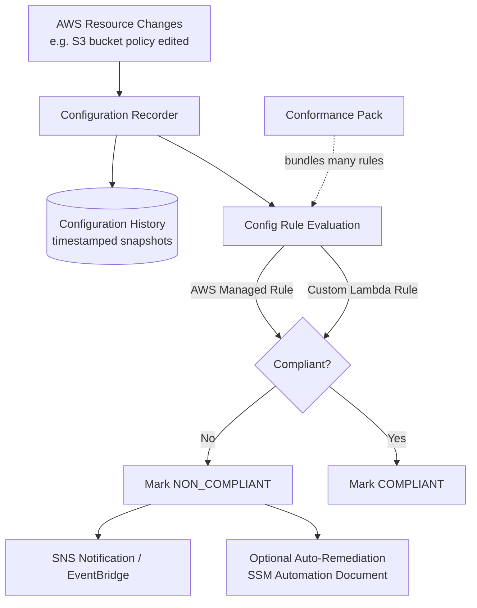

# AWS Config


## Definition

AWS Config continuously records the configuration of your AWS resources over time and checks
them against rules you define — "is this S3 bucket encrypted?", "does this security group allow
unrestricted SSH?" — flagging anything **non-compliant**. In one sentence: AWS Config answers
**"what does my infrastructure look like right now, and does it follow the rules?"**

## Purpose

Configuration drifts silently. A security group gets a "temporary" open rule during an
incident and nobody remembers to close it. An S3 bucket loses encryption during a migration.
Without something watching continuously, these violations sit undetected until an audit or a
breach surfaces them. AWS built Config to give every account a continuously-updated inventory of
every resource's configuration, plus a rules engine that evaluates compliance automatically and
keeps a full history, so "was this bucket ever unencrypted, and for how long" has a factual
answer instead of a guess.

## How It Works

The **Configuration Recorder** watches supported resource types in your account and records a
timestamped configuration snapshot every time something changes — this builds a full history
("configuration timeline") per resource, not just a current-state view. Independently, you
attach **Config Rules** — either AWS-managed (hundreds of pre-built rules like
`s3-bucket-public-read-prohibited`) or custom (your own Lambda function expressing the logic) —
which evaluate resources against a condition and mark each one `COMPLIANT` or `NON_COMPLIANT`.
Rules can run on a schedule or be triggered immediately by a configuration change. Multiple rules
bundle into a **Conformance Pack** — a portable, reusable compliance framework (e.g., "PCI-DSS
baseline") deployable across many accounts at once.



Walking through it: (1) a resource changes — here, a bucket policy being edited; (2) the
Configuration Recorder detects the change and stores a new timestamped snapshot in the
configuration history, so you can later ask "what did this bucket's policy look like on March
3rd?"; (3) any rule attached to that resource type re-evaluates immediately; (4) the rule marks
the resource compliant or non-compliant against the condition it encodes; (5) a non-compliant
result can notify a human (SNS/EventBridge) and, optionally, trigger **automatic remediation** —
an SSM Automation document that, for example, re-applies a private ACL to a bucket that became
public, closing the gap without waiting for a person to act.

## Key Features / Components

- **Configuration Recorder** — the always-running component that captures resource state changes
  across supported resource types.
- **Configuration History/Timeline** — a point-in-time, queryable record of exactly how a
  resource's configuration looked at any moment in the past.
- **Config Rules** — AWS-managed (hundreds, ready to use) or custom (Lambda-backed) compliance
  checks, evaluated on a schedule or on-change.
- **Conformance Packs** — a bundle of rules + remediation actions as one deployable template
  (e.g., CIS AWS Foundations Benchmark pack), deployable account-wide or org-wide.
- **Remediation Actions** — automatic (or manual, one-click) fixes tied to a non-compliant
  finding, powered by SSM Automation documents.
- **Aggregators** — a consolidated, multi-account/multi-region compliance view for central
  security/governance teams.
- **Advanced Queries** — a SQL-like query language (`SELECT resourceId, resourceType WHERE ...`)
  over the configuration data, for ad-hoc inventory and compliance questions.

## Use Cases — When to Use It

- Continuous compliance monitoring against a security baseline (CIS Benchmark, PCI-DSS, your
  own internal rules) with alerting when something drifts out of compliance.
- Answering "what changed on this resource and when?" for incident investigation (paired with
  CloudTrail's "who changed it").
- Auto-remediating common misconfigurations (public S3 buckets, unencrypted volumes, open
  security groups) without waiting on a human.
- Multi-account governance: an aggregator giving a central security team one compliance
  dashboard across an entire AWS Organization.
- Change management evidence for audits — proving a resource was compliant at every point in
  time, not just "right now."

## When NOT to Use It / Alternatives

- **"Who made this change?"** — that's **CloudTrail**. Config tells you *what* changed and
  *whether it's compliant*; it does not, by itself, surface the identity/API call that caused it
  (though you'll often cross-reference both together during an investigation).
- **Deploying infrastructure in the first place** — that's CloudFormation/CDK/Terraform. Config
  is a passive observer/evaluator of what already exists, not a provisioning tool.
- **Real-time performance monitoring** — CloudWatch, not Config.
- **A single, small account with a tiny, well-known resource footprint** — the overhead/cost of
  running continuous recording and rule evaluation may not be worth it versus a periodic manual
  review; Config earns its cost at scale (many accounts, many resources, regulatory requirements).

## Why It's Important

**Real-world**: Config is frequently the backbone of a company's compliance program — SOC 2 and
PCI-DSS auditors routinely ask for continuous monitoring evidence, and Config's conformance
packs plus history are the standard way to produce it without building custom tooling. Its
auto-remediation capability also closes the gap between "we noticed a misconfiguration" and
"it's fixed," which for public-facing security issues (an open security group, a public bucket)
can be the difference between a near-miss and a breach.

**Exam weight**:
- **SAA-C03 Domain 1 (Secure Architectures)** covers Config for continuous compliance monitoring;
  **Domain 4 (Cost-Optimized Architectures, 20%)** touches it for identifying unused/misconfigured
  resources driving unnecessary cost.
- **DVA-C03 Domain 4 (Troubleshooting and Optimization, 22%)** — Config complements CloudTrail and
  CloudWatch as a third root-cause-analysis data source: "what did this resource's configuration
  look like right before it broke?"
- **MLA-C02 Domain 4 (Operating, Monitoring, and Securing ML and AI Solutions, 24%)** — Config
  rules are a named mechanism for continuously verifying ML infrastructure (SageMaker endpoints,
  encryption settings, network isolation) stays compliant with security policy after deployment.
- Exam questions frequently present a three-way choice between CloudTrail, CloudWatch, and Config
  — recognizing which of "who," "how is it performing," or "is it configured correctly" the
  question is actually asking is the entire skill being tested.

## Pricing Model (summary)

AWS Config charges **per configuration item recorded** (a fee per resource state change
captured) and **per rule evaluation** (a fee each time a rule runs, whether scheduled or
on-change), both billed per account per region. Conformance packs and aggregators don't add a
separate base fee beyond the underlying rule evaluations/config items they comprise. There's no
meaningful free tier beyond AWS's general free-tier allotments for new accounts — cost scales
directly with how many resources you have and how often they change plus how many rules you
attach. See: https://aws.amazon.com/config/pricing/

## Hands-on Lab (Floci)

Floci emulates AWS Config in-process — config rules, evaluation-driven compliance
(`PutEvaluations`), configuration recorders, delivery channels, retention configuration,
conformance packs, and tagging — giving a genuinely representative local lab.

```bash
alias awslocal='aws --endpoint-url=http://localhost:4566 --profile floci'

# 1. Set up the configuration recorder + delivery channel (prerequisites)
awslocal s3 mb s3://lab-config-bucket
awslocal iam create-role --role-name config-role \
  --assume-role-policy-document '{"Version":"2012-10-17","Statement":[{"Effect":"Allow","Principal":{"Service":"config.amazonaws.com"},"Action":"sts:AssumeRole"}]}'

awslocal configservice put-configuration-recorder \
  --configuration-recorder name=lab-recorder,roleARN=arn:aws:iam::000000000000:role/config-role \
  --recording-group allSupported=true

awslocal configservice put-delivery-channel \
  --delivery-channel name=lab-channel,s3BucketName=lab-config-bucket

awslocal configservice start-configuration-recorder --configuration-recorder-name lab-recorder

# 2. Create a managed rule: flag any S3 bucket without versioning
awslocal configservice put-config-rule \
  --config-rule '{
    "ConfigRuleName": "s3-bucket-versioning-enabled",
    "Source": {"Owner": "AWS", "SourceIdentifier": "S3_BUCKET_VERSIONING_ENABLED"}
  }'

# 3. Create a resource to evaluate, then check compliance
awslocal s3 mb s3://lab-unversioned-bucket
awslocal configservice get-compliance-details-by-config-rule \
  --config-rule-name s3-bucket-versioning-enabled

# 4. Submit a manual evaluation (simulating a custom Lambda rule's result)
awslocal configservice put-evaluations \
  --evaluations '[{"ComplianceResourceType":"AWS::S3::Bucket","ComplianceResourceId":"lab-unversioned-bucket","ComplianceType":"NON_COMPLIANT","OrderingTimestamp":"2026-11-20T00:00:00Z"}]' \
  --result-token "lab-token"
```

Floci's conformance pack support lets you also try deploying a bundled set of rules at once with
`awslocal configservice put-conformance-pack` — a good way to practice the "compliance baseline
as a reusable template" pattern tested on the exam.

## Exam Tips

- **Config = "is it configured correctly, and has that ever changed?"** — distinct from
  CloudTrail's "who made the API call" and CloudWatch's "is it performing well."
- **Auto-remediation is a Config feature, not a CloudTrail or CloudWatch one** — questions about
  automatically fixing a public S3 bucket or unencrypted volume point to a Config rule with a
  remediation action, usually backed by an SSM Automation document.
- **Conformance Packs = deployable compliance baselines** — "apply the CIS Benchmark to every
  account in our Organization" is a conformance pack question.
- **Aggregators = multi-account/region compliance rollup** — central security team visibility
  questions point here.
- Config does **not** prevent a non-compliant resource from being created in the first place
  (that's a **Service Control Policy** or **IAM permissions boundary**); it detects and
  (optionally) remediates *after the fact* — a subtle distinction tested in "prevent vs. detect"
  style questions.

## Related Terms

- [AWS CloudTrail](cloudtrail.md) — the "who" to Config's "what/is it compliant"
- [Amazon CloudWatch](cloudwatch.md) — the "is it performing well" counterpart
- [AWS CloudFormation](cloudformation.md) — drift detection and Config rules solve overlapping
  but distinct problems (template mismatch vs. policy compliance)
- [Systems Manager](systems-manager.md) — Automation documents power Config's auto-remediation
- Glossary: Compliance, Conformance Pack, Configuration Item, Service Control Policy (SCP)
