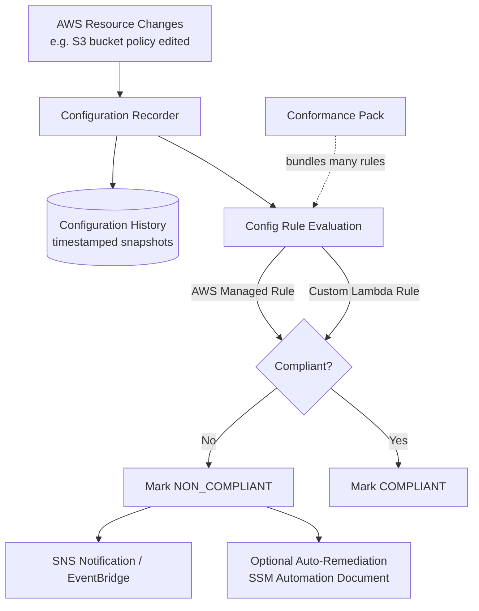
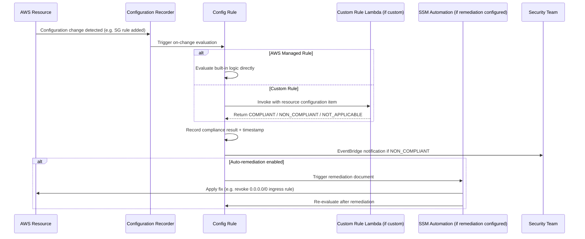
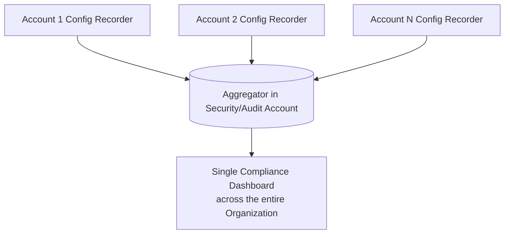

# AWS Config

> **Appears in:** [DVA-C03](../../certifications/dva-c03/README.md)


## Definition

AWS Config continuously records the configuration of your AWS resources over time and checks
them against rules you define — "is this S3 bucket encrypted?", "does this security group allow
unrestricted SSH?" — flagging anything **non-compliant**. In one sentence: AWS Config answers
**"what does my infrastructure look like right now, and does it follow the rules?"**

## Purpose

Configuration drifts silently. A security group gets a "temporary" open rule during an
incident and nobody remembers to close it. An S3 bucket loses encryption during a migration.
Without something watching continuously, these violations sit undetected until an audit or a
breach surfaces them. AWS built Config to give every account a continuously-updated inventory of
every resource's configuration, plus a rules engine that evaluates compliance automatically and
keeps a full history, so "was this bucket ever unencrypted, and for how long" has a factual
answer instead of a guess.

The deeper distinction worth internalizing: Config doesn't care *who* changed something (that's
CloudTrail) and it doesn't provision anything (that's CloudFormation/CDK). It's purely an
**observer and evaluator** — a continuously-running "is reality still matching policy" check that
exists independently of how a resource came to be in its current state, whether that was
CloudFormation, the console, a script, or another tool entirely.

## How It Works

The **Configuration Recorder** watches supported resource types in your account and records a
timestamped configuration snapshot every time something changes — this builds a full history
("configuration timeline") per resource, not just a current-state view. Independently, you
attach **Config Rules** — either AWS-managed (hundreds of pre-built rules like
`s3-bucket-public-read-prohibited`) or custom (your own Lambda function expressing the logic) —
which evaluate resources against a condition and mark each one `COMPLIANT` or `NON_COMPLIANT`.
Rules can run on a schedule or be triggered immediately by a configuration change. Multiple rules
bundle into a **Conformance Pack** — a portable, reusable compliance framework (e.g., "PCI-DSS
baseline") deployable across many accounts at once.



Walking through it: (1) a resource changes — here, a bucket policy being edited; (2) the
Configuration Recorder detects the change and stores a new timestamped snapshot in the
configuration history, so you can later ask "what did this bucket's policy look like on March
3rd?"; (3) any rule attached to that resource type re-evaluates immediately; (4) the rule marks
the resource compliant or non-compliant against the condition it encodes; (5) a non-compliant
result can notify a human (SNS/EventBridge) and, optionally, trigger **automatic remediation** —
an SSM Automation document that, for example, re-applies a private ACL to a bucket that became
public, closing the gap without waiting for a person to act.

### Config Rule evaluation flow, in detail



Walking through it: (1) a configuration change on a resource triggers the recorder; (2) any rule
scoped to that resource type re-evaluates — for an **AWS-managed rule**, the logic runs inside
the Config service itself; for a **custom rule**, Config invokes your own Lambda function, passing
it the resource's configuration item, and your function returns the compliance verdict; (3) the
result is timestamped and stored, building the compliance history alongside the configuration
history; (4) a non-compliant result can both notify a human *and*, if a remediation action is
attached, automatically invoke an SSM Automation document to fix the problem — importantly, the
remediation step itself is optional and separate from detection, meaning you can run Config in
detect-only mode broadly and add auto-fix only for the specific rules you trust to self-heal
safely.

## Worked Example: A Custom Config Rule (Lambda-Backed)

AWS-managed rules cover common cases, but company-specific policy ("every resource must have a
`CostCenter` tag matching our finance taxonomy") needs a custom rule:

```python
# Lambda function backing a custom AWS Config rule
import json
import boto3

config = boto3.client('config')

REQUIRED_TAG_KEY = "CostCenter"
VALID_COST_CENTERS = {"ENG-001", "ENG-002", "DATA-001", "ML-001"}

def lambda_handler(event, context):
    invoking_event = json.loads(event['invokingEvent'])
    configuration_item = invoking_event['configurationItem']
    result_token = event['resultToken']

    tags = configuration_item.get('tags', {})
    cost_center = tags.get(REQUIRED_TAG_KEY)

    if cost_center is None:
        compliance_type = 'NON_COMPLIANT'
        annotation = f"Missing required tag '{REQUIRED_TAG_KEY}'"
    elif cost_center not in VALID_COST_CENTERS:
        compliance_type = 'NON_COMPLIANT'
        annotation = f"'{cost_center}' is not a valid CostCenter value"
    else:
        compliance_type = 'COMPLIANT'
        annotation = f"Valid CostCenter: {cost_center}"

    config.put_evaluations(
        Evaluations=[{
            'ComplianceResourceType': configuration_item['resourceType'],
            'ComplianceResourceId': configuration_item['resourceId'],
            'ComplianceType': compliance_type,
            'Annotation': annotation,
            'OrderingTimestamp': configuration_item['configurationItemCaptureTime']
        }],
        ResultToken=result_token
    )
```

```bash
# Register the custom rule, pointing it at the Lambda above
aws configservice put-config-rule \
  --config-rule '{
    "ConfigRuleName": "require-valid-cost-center-tag",
    "Source": {
      "Owner": "CUSTOM_LAMBDA",
      "SourceIdentifier": "arn:aws:lambda:us-east-1:123456789012:function:cost-center-tag-rule",
      "SourceDetails": [{
        "EventSource": "aws.config",
        "MessageType": "ConfigurationItemChangeNotification"
      }]
    },
    "Scope": {
      "ComplianceResourceTypes": ["AWS::EC2::Instance", "AWS::S3::Bucket", "AWS::RDS::DBInstance"]
    }
  }'
```

This is the shape of nearly every real custom Config rule: parse the configuration item JSON,
apply your organization-specific logic, call `PutEvaluations` with the verdict. The rule evaluates
automatically every time a matching resource type changes, with no polling or scheduling logic
you have to write yourself.

## Worked Example: Auto-Remediation for a Public Security Group

```bash
# 1. The managed rule that detects unrestricted SSH access
aws configservice put-config-rule \
  --config-rule '{
    "ConfigRuleName": "restricted-ssh",
    "Source": {"Owner": "AWS", "SourceIdentifier": "INCOMING_SSH_DISABLED"}
  }'

# 2. Attach an automatic remediation action using a built-in SSM document
aws configservice put-remediation-configurations \
  --remediation-configurations '[{
    "ConfigRuleName": "restricted-ssh",
    "TargetType": "SSM_DOCUMENT",
    "TargetId": "AWS-DisablePublicAccessForSecurityGroup",
    "Automatic": true,
    "MaximumAutomaticAttempts": 3,
    "RetryAttemptSeconds": 60,
    "Parameters": {
      "GroupId": {"ResourceValue": {"Value": "RESOURCE_ID"}},
      "AutomationAssumeRole": {
        "StaticValue": {"Values": ["arn:aws:iam::123456789012:role/ConfigRemediationRole"]}
      }
    }
  }]'
```

With `"Automatic": true`, the moment a security group is found non-compliant (open SSH to
`0.0.0.0/0`), the SSM Automation document runs without waiting for a human — this is the fastest
realistic closure time for a textbook misconfiguration, often measured in minutes rather than
whatever gap would otherwise exist until someone notices in a dashboard.

## Key Features / Components

- **Configuration Recorder** — the always-running component that captures resource state changes
  across supported resource types.
- **Configuration History/Timeline** — a point-in-time, queryable record of exactly how a
  resource's configuration looked at any moment in the past.
- **Config Rules** — AWS-managed (hundreds, ready to use) or custom (Lambda-backed) compliance
  checks, evaluated on a schedule or on-change.
- **Conformance Packs** — a bundle of rules + remediation actions as one deployable template
  (e.g., CIS AWS Foundations Benchmark pack), deployable account-wide or org-wide.
- **Remediation Actions** — automatic (or manual, one-click) fixes tied to a non-compliant
  finding, powered by SSM Automation documents.
- **Aggregators** — a consolidated, multi-account/multi-region compliance view for central
  security/governance teams.
- **Advanced Queries** — a SQL-like query language (`SELECT resourceId, resourceType WHERE ...`)
  over the configuration data, for ad-hoc inventory and compliance questions.

## Logs Insights-Style Investigation: Correlating Config Findings with CloudTrail

Config tells you a resource is non-compliant; CloudTrail tells you who made the change that
caused it. A realistic investigation joins both data sources by timestamp and resource ID:

```bash
# 1. Find exactly when a resource became non-compliant
aws configservice get-compliance-details-by-resource \
  --resource-type AWS::EC2::SecurityGroup \
  --resource-id sg-0abc123456789def0

# 2. Using the timestamp from step 1, search CloudTrail for the API call that caused it
aws cloudtrail lookup-events \
  --lookup-attributes AttributeKey=ResourceName,AttributeValue=sg-0abc123456789def0 \
  --start-time "2026-11-18T13:00:00Z" \
  --end-time "2026-11-18T15:00:00Z"
```

If step 2 returns an `AuthorizeSecurityGroupIngress` call from a specific principal matching the
timestamp Config flagged, you now have both halves of the picture: *what* changed (Config) and
*who* changed it (CloudTrail) — neither tool alone answers the full question.

## Cost Worked Example: Scoping Recording to Control Bill Growth

Config bills per **configuration item recorded** and per **rule evaluation**. A large,
fast-changing fleet (e.g., frequently-replaced Auto Scaling instances) can generate a surprising
number of recorded items:

| Recording Scope | Configuration items/month (illustrative) | Relative Cost |
|---|---|---|
| All supported resource types, all regions, no exclusions | Very high — every EC2 launch/terminate, every tag change, every tiny modification | Highest |
| Resource type exclusions for noisy, low-value types (e.g., exclude `AWS::EC2::NetworkInterface` churn from ASG scaling) | Meaningfully reduced | Lower |
| Scoped to only security-relevant resource types (IAM, S3, security groups, KMS) | Much smaller | Lowest, often sufficient for a security-focused baseline |

```bash
# Scope the recorder to only the resource types that matter for a security baseline,
# instead of "allSupported" which records everything
aws configservice put-configuration-recorder \
  --configuration-recorder name=security-focused-recorder,roleARN=arn:aws:iam::123456789012:role/config-role \
  --recording-group '{
    "allSupported": false,
    "resourceTypes": [
      "AWS::IAM::Role", "AWS::IAM::Policy", "AWS::S3::Bucket",
      "AWS::EC2::SecurityGroup", "AWS::KMS::Key"
    ]
  }'
```

The exam-relevant and real-world-relevant lesson: Config's cost scales directly with *how much
you record and how often it changes* — teams that naively enable `allSupported: true` on an
account with a volatile, auto-scaled fleet often see a far larger bill than they expected, and
the fix is deliberately scoping the recording group, not disabling Config entirely.

## Common Architectures

**1. Organization-wide aggregator for a central security team**



A dedicated security/audit account runs an **aggregator** pulling compliance data from every
member account in the Organization, giving one team a single view of "which accounts/resources
are out of compliance right now" without needing console access into every individual account.

**2. Conformance Pack as a deployable compliance baseline via StackSets**

A conformance pack (itself expressible as a CloudFormation-like YAML template) bundling, say, the
CIS AWS Foundations Benchmark rules is deployed via a CloudFormation StackSet to every account in
an OU — meaning "compliance baseline" and "infrastructure baseline" use the exact same
deployment mechanism, reducing the number of distinct governance tools a platform team must
operate.

**3. Config + EventBridge + Security Hub for a unified findings pipeline**

Rather than routing Config's non-compliant findings only to SNS, many organizations route them to
**Security Hub**, which normalizes findings from Config, GuardDuty, Inspector, and Trusted
Advisor's security checks into one findings format — letting a SOC team triage everything from
one console instead of five.

**4. Pre-deployment guardrail via Config + CloudFormation Hooks**

While Config is fundamentally *detective* (after the fact), pairing it with **CloudFormation
Hooks** gives a *preventive* layer — the hook blocks a non-compliant resource from being created
in the first place, while Config continues to catch anything that slips through a different
provisioning path (console, CLI, another tool).

## Use Cases — When to Use It

- Continuous compliance monitoring against a security baseline (CIS Benchmark, PCI-DSS, your
  own internal rules) with alerting when something drifts out of compliance.
- Answering "what changed on this resource and when?" for incident investigation (paired with
  CloudTrail's "who changed it").
- Auto-remediating common misconfigurations (public S3 buckets, unencrypted volumes, open
  security groups) without waiting on a human.
- Multi-account governance: an aggregator giving a central security team one compliance
  dashboard across an entire AWS Organization.
- Change management evidence for audits — proving a resource was compliant at every point in
  time, not just "right now."

## When NOT to Use It / Alternatives

- **"Who made this change?"** — that's **CloudTrail**. Config tells you *what* changed and
  *whether it's compliant*; it does not, by itself, surface the identity/API call that caused it
  (though you'll often cross-reference both together during an investigation).
- **Deploying infrastructure in the first place** — that's CloudFormation/CDK/Terraform. Config
  is a passive observer/evaluator of what already exists, not a provisioning tool.
- **Real-time performance monitoring** — CloudWatch, not Config.
- **A single, small account with a tiny, well-known resource footprint** — the overhead/cost of
  running continuous recording and rule evaluation may not be worth it versus a periodic manual
  review; Config earns its cost at scale (many accounts, many resources, regulatory requirements).

## Why It's Important

**Real-world**: Config is frequently the backbone of a company's compliance program — SOC 2 and
PCI-DSS auditors routinely ask for continuous monitoring evidence, and Config's conformance
packs plus history are the standard way to produce it without building custom tooling. Its
auto-remediation capability also closes the gap between "we noticed a misconfiguration" and
"it's fixed," which for public-facing security issues (an open security group, a public bucket)
can be the difference between a near-miss and a breach.

**Exam weight**:
- **SAA-C03 Domain 1 (Secure Architectures)** covers Config for continuous compliance monitoring;
  **Domain 4 (Cost-Optimized Architectures, 20%)** touches it for identifying unused/misconfigured
  resources driving unnecessary cost.
- **DVA-C03 Domain 4 (Troubleshooting and Optimization, 22%)** — Config complements CloudTrail and
  CloudWatch as a third root-cause-analysis data source: "what did this resource's configuration
  look like right before it broke?"
- **MLA-C02 Domain 4 (Operating, Monitoring, and Securing ML and AI Solutions, 24%)** — Config
  rules are a named mechanism for continuously verifying ML infrastructure (SageMaker endpoints,
  encryption settings, network isolation) stays compliant with security policy after deployment.
- Exam questions frequently present a three-way choice between CloudTrail, CloudWatch, and Config
  — recognizing which of "who," "how is it performing," or "is it configured correctly" the
  question is actually asking is the entire skill being tested. Expect a scenario asking you to
  write or select the correct managed rule name, or to decide between manual vs. automatic
  remediation based on blast-radius risk described in the question.

## Pricing Model (summary)

AWS Config charges **per configuration item recorded** (a fee per resource state change
captured) and **per rule evaluation** (a fee each time a rule runs, whether scheduled or
on-change), both billed per account per region. Conformance packs and aggregators don't add a
separate base fee beyond the underlying rule evaluations/config items they comprise. There's no
meaningful free tier beyond AWS's general free-tier allotments for new accounts — cost scales
directly with how many resources you have and how often they change plus how many rules you
attach. See: https://aws.amazon.com/config/pricing/

## Limits & Quotas

| Limit | Default Value | Practical Impact |
|---|---|---|
| Config rules per account per region | 150 (soft, raisable) | Large conformance packs plus custom rules can approach this across many accounts |
| Conformance packs per account per region | 25 | Rarely hit outside very large, highly segmented compliance programs |
| Rules per conformance pack | 1,000 | Effectively no practical ceiling for most baselines |
| Custom rule Lambda evaluation timeout | Inherits standard Lambda limits (max 15 min) | A custom rule doing heavy cross-account lookups must stay within normal Lambda constraints |
| Aggregators per account | 1 | Only one aggregator can exist per aggregator account — design the aggregation hierarchy around this |
| Configuration item retention | 7 years in Config's own history | Long enough for most compliance regimes without needing external archival |

## Troubleshooting / Common Issues

- **"Evaluate your AWS resource configuration" banner never clears** — this usually means either
  no rules are attached yet, or Config is still mid-evaluation after a large recorder scope
  change; check `describe-compliance-by-config-rule` directly rather than waiting on the console.
- **A resource that's clearly non-compliant shows as `NOT_APPLICABLE`** — the rule's scope
  (`ComplianceResourceTypes`) may not include that resource type, or a custom rule's Lambda logic
  has a bug causing it to return the wrong verdict; test the Lambda directly with a sample
  configuration item payload.
- **Auto-remediation keeps retrying and failing** — check `MaximumAutomaticAttempts` and the
  `AutomationAssumeRole`'s permissions; a remediation document needs its *own* IAM role with
  rights to the target service, separate from Config's own recorder role.
- **Aggregator shows stale data from a member account** — confirm that account's own Config
  recorder is still running (`describe-configuration-recorder-status`) and that
  cross-account/cross-region data sharing permissions for the aggregator weren't revoked.
- **Unexpectedly high bill** — almost always driven by `allSupported: true` on a fast-churning
  resource fleet (see the Cost Worked Example); scope the recording group to the resource types
  that actually matter for your compliance/security goals.
- **Config and CloudFormation drift detection seem to disagree** — they check different things:
  drift detection only compares against *that specific template's* declared properties; Config
  rules can check *any* condition regardless of how the resource was created. A resource can be
  "not drifted" from its template and still be "non-compliant" against a Config rule checking a
  property the template never set.

## Further Reading

- AWS Config Developer Guide: https://docs.aws.amazon.com/config/latest/developerguide/
- List of AWS Managed Config Rules:
  https://docs.aws.amazon.com/config/latest/developerguide/managed-rules-by-aws-config.html
- Conformance Pack Sample Templates:
  https://docs.aws.amazon.com/config/latest/developerguide/conformancepack-sample-templates.html
- AWS Config pricing: https://aws.amazon.com/config/pricing/
- Viewing the AWS Config Dashboard:
  https://docs.aws.amazon.com/config/latest/developerguide/viewing-the-aws-config-dashboard.html


*The AWS Config console's compliance dashboard, showing compliant/non-compliant rules and
resource counts at a glance. Source: AWS Lambda Developer Guide, docs.aws.amazon.com (official
AWS documentation).*


*Drilling into a specific Config rule (here, `lambda-inside-vpc`) to see exactly which resources
are non-compliant. Source: AWS Lambda Developer Guide, docs.aws.amazon.com (official AWS
documentation).*

## Hands-on Lab (Floci)

Floci emulates AWS Config in-process — config rules, evaluation-driven compliance
(`PutEvaluations`), configuration recorders, delivery channels, retention configuration,
conformance packs, and tagging — giving a genuinely representative local lab.

```bash
alias awslocal='aws --endpoint-url=http://localhost:4566 --profile floci'

# 1. Set up the configuration recorder + delivery channel (prerequisites)
awslocal s3 mb s3://lab-config-bucket
awslocal iam create-role --role-name config-role \
  --assume-role-policy-document '{"Version":"2012-10-17","Statement":[{"Effect":"Allow","Principal":{"Service":"config.amazonaws.com"},"Action":"sts:AssumeRole"}]}'

awslocal configservice put-configuration-recorder \
  --configuration-recorder name=lab-recorder,roleARN=arn:aws:iam::000000000000:role/config-role \
  --recording-group allSupported=true

awslocal configservice put-delivery-channel \
  --delivery-channel name=lab-channel,s3BucketName=lab-config-bucket

awslocal configservice start-configuration-recorder --configuration-recorder-name lab-recorder

# 2. Create a managed rule: flag any S3 bucket without versioning
awslocal configservice put-config-rule \
  --config-rule '{
    "ConfigRuleName": "s3-bucket-versioning-enabled",
    "Source": {"Owner": "AWS", "SourceIdentifier": "S3_BUCKET_VERSIONING_ENABLED"}
  }'

# 3. Create a resource to evaluate, then check compliance
awslocal s3 mb s3://lab-unversioned-bucket
awslocal configservice get-compliance-details-by-config-rule \
  --config-rule-name s3-bucket-versioning-enabled

# 4. Submit a manual evaluation (simulating a custom Lambda rule's result)
awslocal configservice put-evaluations \
  --evaluations '[{"ComplianceResourceType":"AWS::S3::Bucket","ComplianceResourceId":"lab-unversioned-bucket","ComplianceType":"NON_COMPLIANT","OrderingTimestamp":"2026-11-20T00:00:00Z"}]' \
  --result-token "lab-token"
```

Floci's conformance pack support lets you also try deploying a bundled set of rules at once with
`awslocal configservice put-conformance-pack` — a good way to practice the "compliance baseline
as a reusable template" pattern tested on the exam.

## Exam Tips

- **Config = "is it configured correctly, and has that ever changed?"** — distinct from
  CloudTrail's "who made the API call" and CloudWatch's "is it performing well."
- **Auto-remediation is a Config feature, not a CloudTrail or CloudWatch one** — questions about
  automatically fixing a public S3 bucket or unencrypted volume point to a Config rule with a
  remediation action, usually backed by an SSM Automation document.
- **Conformance Packs = deployable compliance baselines** — "apply the CIS Benchmark to every
  account in our Organization" is a conformance pack question.
- **Aggregators = multi-account/region compliance rollup** — central security team visibility
  questions point here.
- Config does **not** prevent a non-compliant resource from being created in the first place
  (that's a **Service Control Policy** or **IAM permissions boundary**, or a **CloudFormation
  Hook**); it detects and (optionally) remediates *after the fact* — a subtle distinction tested
  in "prevent vs. detect" style questions.
- **Custom rules are Lambda-backed** — a question describing company-specific logic that no
  AWS-managed rule covers (e.g., "tags must match our internal taxonomy") points to a custom rule
  calling `PutEvaluations`, not an AWS-managed rule.
- **Cost scales with configuration items recorded and rule evaluations run** — a cost-optimization
  question about Config's bill growing unexpectedly points to scoping the recording group away
  from `allSupported: true` on noisy, fast-changing resource types.

## Exam Scenario Walkthroughs (SAA-C03 / DVA-C03 / MLA-C02)

**Scenario 1 (SAA-C03, Domain 1 — Secure Architectures).** A security team wants every S3 bucket
account-wide automatically re-secured (private ACL restored) the instant it's found publicly
accessible, with zero human involvement. What combination of services accomplishes this?
> **Answer: An AWS Config managed rule (`s3-bucket-public-read-prohibited` or similar) with an
> automatic remediation action attached, backed by an SSM Automation document.** The "zero human
> involvement" requirement is the key phrase pointing to *automatic* (not manual) remediation —
> Config alone detects; the SSM Automation attachment is what actually fixes it without a human
> clicking anything.

**Scenario 2 (SAA-C03, Domain 4 — Cost-Optimized Architectures).** An account's Config bill has
grown substantially month over month with no corresponding increase in actual infrastructure. The
team suspects over-broad recording. What should they check first?
> **Answer: Whether the Configuration Recorder is set to `allSupported: true` on a fast-churning
> resource fleet** (e.g., frequently replaced Auto Scaling instances, which generate a
> configuration item on every launch/terminate). The fix is scoping the recording group to only
> the resource types that matter for the account's actual compliance goals.

**Scenario 3 (DVA-C03, Domain 4 — Troubleshooting, Task 4.1).** A resource that was working fine
yesterday is broken today. CloudTrail shows no relevant API calls by any human or automation.
What should be checked next, and why might CloudTrail alone be insufficient here?
> **Answer: AWS Config's configuration history/timeline for that resource**, to see exactly what
> property changed and when — even without a clearly attributable CloudTrail event (e.g., a
> change made by an AWS-internal process, or a subtle interaction effect from a separate
> resource), Config's timeline still shows *what* the configuration looked like before and after,
> independent of whether CloudTrail cleanly attributes *who* caused it.

**Scenario 4 (MLA-C02, Domain 4 — Securing ML Solutions).** An ML platform team needs ongoing,
automatic verification that every SageMaker endpoint remains deployed inside the designated VPC
(never publicly accessible), without manual spot-checks.
> **Answer: A Config rule (such as `sagemaker-endpoint-configuration-vpc-is-set` or an equivalent
> custom rule) scoped to SageMaker endpoint resource types**, evaluated continuously on-change —
> this is exactly the "continuous, rule-based, no manual effort" shape Config exists to solve,
> versus a one-time manual audit that would go stale the moment a new endpoint is deployed.

**Scenario 5 (Cross-cert — Config vs. CloudFormation drift detection).** A question asks why a
resource shows as "not drifted" in CloudFormation drift detection but "non-compliant" in AWS
Config, for what seems like the same resource.
> **Answer: They check fundamentally different things.** Drift detection only compares a
> resource's live state against properties the *specific template* explicitly declared; Config
> rules can check *any* condition regardless of how or whether a template set it. A resource can
> be perfectly faithful to its template (no drift) while still violating an unrelated Config rule
> checking a property the template never mentioned — these are complementary, not redundant,
> checks, and the exam tests whether you recognize they're not interchangeable.

## Related Terms

- [AWS CloudTrail](cloudtrail.md) — the "who" to Config's "what/is it compliant"
- [Amazon CloudWatch](cloudwatch.md) — the "is it performing well" counterpart
- [AWS CloudFormation](cloudformation.md) — drift detection and Config rules solve overlapping
  but distinct problems (template mismatch vs. policy compliance)
- [Systems Manager](systems-manager.md) — Automation documents power Config's auto-remediation
- Glossary: Compliance, Conformance Pack, Configuration Item, Service Control Policy (SCP),
  Aggregator, Custom Config Rule
