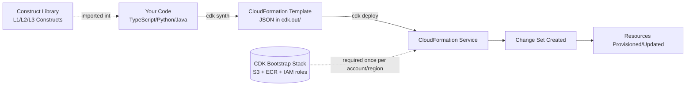
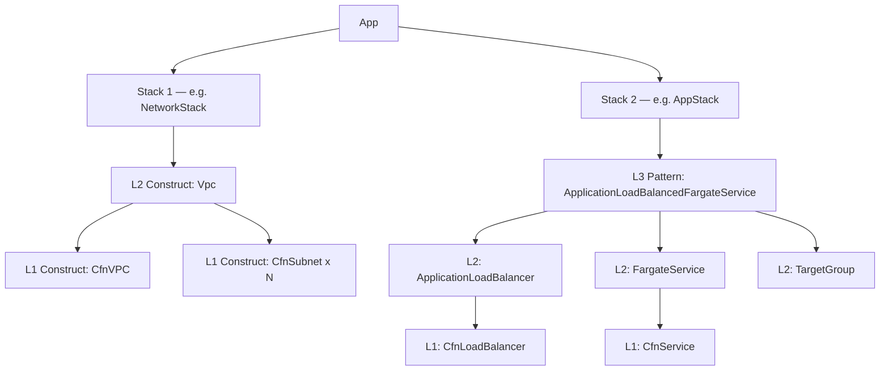
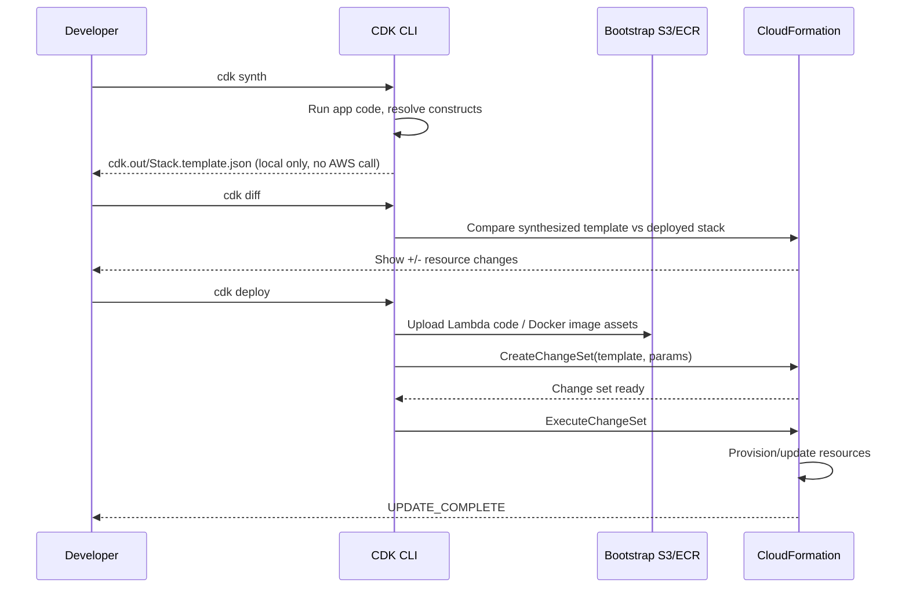
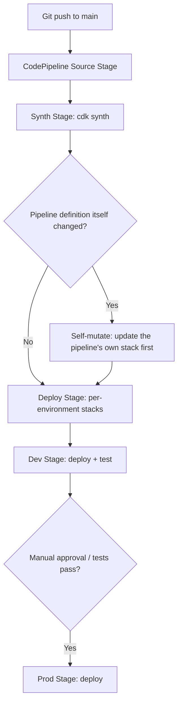

# AWS CDK (Cloud Development Kit)

> **Appears in:** [DVA-C03](../../certifications/dva-c03/README.md)


## Definition

The AWS Cloud Development Kit (CDK) lets you define cloud infrastructure using a real
programming language — TypeScript, Python, Java, C#, or Go — instead of writing YAML/JSON by
hand. You write code, the CDK "compiles" (synthesizes) it into a standard CloudFormation
template, and CloudFormation does the actual deployment.

## Purpose

CloudFormation templates are declarative text files with no loops, no functions, and no type
checking — writing "20 nearly-identical S3 buckets with slightly different names" means copying
and pasting 20 blocks of YAML by hand, with all the human-error risk that implies. AWS built the
CDK so infrastructure could be written with the same tools, abstractions, and discipline as
application code: loops, conditionals, classes, package imports, unit tests, IDE autocomplete,
and code review — while still producing a plain CloudFormation template underneath, so it
deploys through the exact same reliable, audited engine.

The deeper motivation is **abstraction with an escape hatch**. A hand-rolled abstraction layer on
top of CloudFormation (a company's internal YAML generator, a Jinja-templated YAML pipeline) is a
common DIY approach, but it inevitably needs an escape hatch down to raw CloudFormation for edge
cases that abstraction didn't anticipate — and building that escape hatch well is most of the
engineering effort. CDK ships that escape hatch (L1 constructs, `Fn::` support, `CfnResource`
override methods) as a first-class, AWS-maintained feature, so teams don't have to build and
maintain their own.

## How It Works

You write a **Stack** class in your chosen language, instantiate **Constructs** (reusable,
composable infrastructure building blocks — AWS publishes hundreds covering every service) inside
it, and run `cdk synth`. This compiles your code into a CloudFormation template (JSON) in the
`cdk.out/` folder. Running `cdk deploy` then calls CloudFormation's `CreateChangeSet` /
`ExecuteChangeSet` APIs under the hood — CDK never talks to individual service APIs directly; it
hands a template to CloudFormation and lets CloudFormation do the provisioning.



Walking through it: (1) you write infrastructure as code using Constructs from the CDK library
(or your own custom ones); (2) `cdk synth` runs your program locally and emits a plain
CloudFormation template — nothing has touched AWS yet, so you can diff/review it like any other
build artifact; (3) `cdk deploy` uploads any needed assets (Lambda code, Docker images) to a
bootstrap S3 bucket/ECR repo, then calls CloudFormation to create or update the change set from
that synthesized template; (4) CloudFormation takes over from there exactly as it would for a
hand-written template. The one extra step CDK requires that raw CloudFormation doesn't is
**bootstrapping** — a one-time `cdk bootstrap` per account/region that creates the S3 bucket,
ECR repo, and IAM roles CDK needs to stage deployment assets.

### The construct composition hierarchy



Walking through it: an `App` is the root of a CDK program and can contain multiple `Stack`s; each
`Stack` synthesizes to exactly one CloudFormation stack. Inside a stack, you compose
**Constructs** at whichever abstraction level fits: an **L3 pattern** like
`ApplicationLoadBalancedFargateService` internally wires together several **L2 constructs**
(load balancer, service, target group), each of which internally wraps one or more **L1
constructs** (`CfnLoadBalancer`, `CfnService`) that map 1:1 onto the actual CloudFormation
resource types. You can drop down to L1 at any point — even inside an L2 or L3 construct, via an
escape-hatch method — when you need a property the higher-level construct doesn't expose yet.

### Build/synth/deploy pipeline flow



Walking through it: `cdk synth` is 100% local — a pure code-to-template compilation step with no
network calls, which is why it's safe to run in any CI step including ones with no AWS
credentials at all. `cdk diff` is the first step that *does* talk to AWS, comparing your local
synthesized template against what's actually deployed — the CDK-native equivalent of reviewing a
raw CloudFormation change set, but expressed in terms of your code's resources. `cdk deploy`
combines asset publishing (anything CloudFormation alone can't do — uploading Lambda zips, Docker
images) with the underlying `CreateChangeSet`/`ExecuteChangeSet` calls, meaning the actual
resource provisioning is still 100% CloudFormation's job.

### How It Works — Step by Step: Tracing a Code Change Through Synth, Diff, and Deploy

As with raw CloudFormation, the mechanics click fastest by following one real change end to end —
here, a developer adds a new DynamoDB table to the `OrdersApiStack` from the worked example below
and needs it wired up to the existing Lambda with read/write access.

1. **The code change.** The developer adds four lines to the stack's Python: a new
   `dynamodb.Table` construct (`OrdersAuditTable`) and a call to
   `orders_audit_table.grant_read_write_data(orders_fn)`. Nothing has touched AWS yet — this is a
   local file edit, indistinguishable from any other code change until the next command runs.
2. **`cdk synth`.** Running this locally re-executes the Python program. The CDK framework walks
   every construct in the stack's tree, resolves all `Ref`/`Fn::GetAtt`-equivalent logical
   connections, and emits a complete CloudFormation JSON template to `cdk.out/OrdersApiDev.template.json`
   — including a brand-new `AWS::DynamoDB::Table` resource and an updated IAM policy statement
   granting the Lambda's execution role `dynamodb:PutItem`/`GetItem`/etc. scoped to the new
   table's ARN. No network call happens during this step.
3. **`cdk diff`.** This is the first step that talks to AWS: it calls CloudFormation's
   `GetTemplate`/`DescribeStacks` for the currently-deployed `OrdersApiDev` stack, compares that
   against the freshly synthesized template, and prints the human-readable diff shown in the
   worked example — a new `AWS::DynamoDB::Table` resource addition, plus a separate **IAM
   Statement Changes** table flagging the new `dynamodb:Put*` grant specifically, so a reviewer's
   eye is drawn to the permission expansion before approving.
4. **Review and approval.** A teammate reviews the diff in a pull request (since `cdk diff` can run
   in CI and post its output as a PR comment) — this is functionally the same review gate a raw
   CloudFormation change set provides, just expressed in terms of the code's own resources rather
   than a flat resource-by-resource diff.
5. **`cdk deploy`.** CDK first uploads any new/changed assets (none in this particular change,
   since no Lambda code changed) to the bootstrap S3 bucket, then calls CloudFormation's
   `CreateChangeSet` with the synthesized template, waits for the change set to compute, and calls
   `ExecuteChangeSet` automatically (CDK doesn't pause for a second manual review at this point
   unless `--require-approval` is configured to demand it for IAM changes specifically — which is
   the default for broad security-sensitive changes).
6. **CloudFormation takes over.** From here the mechanics are identical to the raw CloudFormation
   trace in [cloudformation.md](cloudformation.md): the stack moves `UPDATE_COMPLETE` →
   `UPDATE_IN_PROGRESS`, creates the new `AWS::DynamoDB::Table` resource, attaches the new IAM
   policy statement to the Lambda's execution role, and reports back per-resource status.
7. **Failure path.** If the new table's name collided with an existing table (a realistic mistake),
   CloudFormation's resource creation for that one resource fails, and — exactly as in the raw
   CloudFormation trace — the stack auto-rolls-back to `UPDATE_ROLLBACK_COMPLETE`. CDK itself has
   no separate rollback mechanism; it relies entirely on CloudFormation's.
8. **Confirmation.** `cdk deploy` streams the same stack events CloudFormation emits, printing
   `✅ OrdersApiDev` on success (or the rollback reason on failure) directly to the developer's
   terminal — the single pane of glass covering both the code-level change and the infrastructure
   outcome.

## Worked Example: An L2-Construct Stack in Python

```python
from aws_cdk import (
    Stack, Duration, RemovalPolicy,
    aws_s3 as s3,
    aws_lambda as _lambda,
    aws_apigateway as apigw,
    aws_dynamodb as dynamodb,
)
from constructs import Construct


class OrdersApiStack(Stack):
    def __init__(self, scope: Construct, construct_id: str, env_name: str, **kwargs) -> None:
        super().__init__(scope, construct_id, **kwargs)

        # L2 construct: secure-by-default bucket (blocks public access, SSE-S3 encryption
        # on by default — this is the kind of safe default a hand-written CFN template
        # has to remember to set explicitly, and often doesn't).
        orders_bucket = s3.Bucket(
            self, "OrdersArchiveBucket",
            removal_policy=RemovalPolicy.RETAIN if env_name == "prod" else RemovalPolicy.DESTROY,
            auto_delete_objects=(env_name != "prod"),
            versioned=True,
        )

        # L2 construct: a DynamoDB table with on-demand billing
        orders_table = dynamodb.Table(
            self, "OrdersTable",
            partition_key=dynamodb.Attribute(name="orderId", type=dynamodb.AttributeType.STRING),
            billing_mode=dynamodb.BillingMode.PAY_PER_REQUEST,
            removal_policy=RemovalPolicy.RETAIN if env_name == "prod" else RemovalPolicy.DESTROY,
        )

        # L2 construct: a Lambda function, with env vars wiring it to the table/bucket
        orders_fn = _lambda.Function(
            self, "OrdersHandler",
            runtime=_lambda.Runtime.PYTHON_3_12,
            handler="handler.main",
            code=_lambda.Code.from_asset("lambda/orders"),
            timeout=Duration.seconds(10),
            memory_size=256,
            environment={
                "TABLE_NAME": orders_table.table_name,
                "BUCKET_NAME": orders_bucket.bucket_name,
                "ENVIRONMENT": env_name,
            },
        )

        # CDK's grant_* methods write the *least-privilege* IAM policy automatically —
        # no hand-written JSON policy document required, and it scopes to this exact
        # table/bucket ARN, not a wildcard.
        orders_table.grant_read_write_data(orders_fn)
        orders_bucket.grant_read_write(orders_fn)

        # L3-ish pattern: wire a REST API directly to the Lambda with one call
        api = apigw.LambdaRestApi(
            self, "OrdersApi",
            handler=orders_fn,
            proxy=True,
        )
```

```python
# app.py — the App entry point, instantiating the same stack for two environments
from aws_cdk import App, Environment
from orders_api_stack import OrdersApiStack

app = App()

OrdersApiStack(
    app, "OrdersApiDev",
    env_name="dev",
    env=Environment(account="111111111111", region="us-east-1"),
)
OrdersApiStack(
    app, "OrdersApiProd",
    env_name="prod",
    env=Environment(account="222222222222", region="us-east-1"),
)

app.synth()
```

A few things this example demonstrates that are hard to express cleanly in raw CloudFormation:

- **A Python conditional (`if env_name == "prod"`) directly controls `RemovalPolicy`** —
  equivalent to a CloudFormation `Condition` + `Fn::If`, but far more readable and less
  error-prone at scale, and it's just an `if` statement, not a separate template section.
- **`grant_read_write_data`/`grant_read_write`** auto-generate a scoped IAM policy — in raw
  CloudFormation you'd hand-write the policy JSON, list every DynamoDB/S3 action needed, and get
  the resource ARN exactly right yourself, with all the risk of over- or under-scoping it.
  CDK computes the correct, minimal set of actions and the correct ARN for you.
- **One `OrdersApiStack` class, instantiated twice** with different parameters, produces two
  independent CloudFormation stacks in two different accounts — the loop/parameterization
  CloudFormation alone can't express cleanly.

### `cdk diff` output, read closely

```bash
$ cdk diff OrdersApiDev

Stack OrdersApiDev
Resources
[~] AWS::Lambda::Function OrdersHandler OrdersHandler8A3F21CE
 └─ [~] MemorySize
     ├─ [-] 256
     └─ [+] 512
[+] AWS::DynamoDB::Table OrdersAuditTable OrdersAuditTable4B2C19D0

IAM Statement Changes
┌───┬────────────────────────┬────────┬────────────────┬───────────────────────────┬───────────┐
│   │ Resource               │ Effect │ Action         │ Principal                 │ Condition │
├───┼────────────────────────┼────────┼────────────────┼───────────────────────────┼───────────┤
│ + │ ${OrdersAuditTable.Arn}│ Allow  │ dynamodb:Put*  │ AWS:${OrdersHandler/Role} │           │
└───┴────────────────────────┴────────┴────────────────┴───────────────────────────┴───────────┘
```

`cdk diff` separately flags **IAM Statement Changes** in their own table — a deliberate design
choice so a reviewer's eye is drawn specifically to permission expansions before approving a
deploy, which is exactly the kind of review raw `aws cloudformation deploy` doesn't surface as
clearly without opening the full change set JSON.

## CDK vs. CloudFormation vs. SAM — Comparison

| | **CloudFormation** | **AWS CDK** | **AWS SAM** |
|---|---|---|---|
| What you write | YAML/JSON template | Real code (TS/Python/Java/C#/Go) | YAML/JSON (CloudFormation superset) |
| Abstraction level | Low — every property explicit | High — Constructs provide secure defaults, loops, logic | Medium — shorthand for serverless resources only |
| Best for | Any resource type, full control | Complex apps, teams wanting programming discipline, reuse across projects | Lambda/API Gateway/DynamoDB-centric serverless apps |
| Local testing | None built-in | `cdk synth`, unit-test the construct code itself | `sam local invoke`, `sam local start-api` emulate Lambda/API GW locally |
| Underlying engine | IS the engine | Compiles to CloudFormation, which deploys | Transforms to CloudFormation via the `AWS::Serverless` macro, which deploys |
| Learning curve | Low to start, verbose at scale | Higher (need the language + CDK concepts) | Low, narrow scope |
| Multi-language | No — one template format | Yes — pick your language | No — YAML/JSON only |
| IAM policy authoring | Entirely manual | `grant_*` methods auto-scope policies | Mostly manual, some SAM policy templates |

The exam-relevant takeaway: **all three ultimately produce and deploy a CloudFormation
template.** They're different authoring experiences over the same deployment engine, not three
competing deployment engines. Pick CDK for complex, reusable, testable infrastructure in a real
language; pick SAM for a quick serverless app; pick raw CloudFormation when you want zero
abstraction or are integrating with tools that expect plain templates.

## CDK Pipelines — Self-Mutating CI/CD



A CDK Pipeline is itself a CDK construct — the pipeline infrastructure and the application
infrastructure live in the same codebase, versioned together. The "self-mutating" step is the
distinctive piece: if a commit changes the pipeline's *own* structure (adds a new stage, changes
an approval gate), the pipeline updates itself first, then continues through the newly-updated
stage list — meaning you never manually re-run `cdk deploy` on the pipeline stack itself after
changing its shape.

## Logs Insights Query for CDK-Deployed Lambda Errors

Since every CDK-deployed Lambda still just writes to CloudWatch Logs normally, the same
Logs Insights techniques apply regardless of how the function was deployed:

```
fields @timestamp, @message, @logStream
| filter @message like /ERROR/ or @message like /Task timed out/
| stats count() as errorCount by bin(15m)
| sort @timestamp desc
```

Combined with tagging every CDK stack consistently (`Tags.of(stack).add("cdk-app", "orders-api")`
in code), you can filter log groups by that tag in your log aggregation pipeline to isolate one
CDK app's logs from a shared account's noise — far easier than remembering physical log group
names, which CDK auto-generates with random suffixes unless you explicitly name resources.

## Common Architectures

**1. Multi-stage pipeline stack composed in code**

A single CDK app defines a `PipelineStack` whose stages are `DevStage`, `StagingStage`,
`ProdStage` — each stage itself a CDK `Stage` wrapping one or more application stacks. Promoting
a change from dev to prod is "merge to main and let the self-mutating pipeline run," not a
manual `cdk deploy --profile prod` from a laptop — removing the single biggest source of
"someone deployed the wrong thing to prod by hand" incidents.

**2. Shared "platform constructs" library published as an internal package**

A platform team publishes a versioned npm/PyPI package containing company-standard L2/L3
constructs (a "secure bucket," a "standard VPC," a "monitored Lambda" that auto-wires a CloudWatch
alarm and dashboard). Product teams `pip install`/`npm install` the package and consume the
constructs directly — centralizing security/ops best practice enforcement in one versioned
artifact instead of a wiki page nobody reads.

**3. CDK + existing CloudFormation stacks coexisting via `cdk import`**

Teams migrating from hand-written CloudFormation don't need a big-bang rewrite — `cdk import`
can adopt an *existing* CloudFormation-managed resource into a new CDK stack's state without
recreating it, letting migration happen construct by construct.

**4. Cross-stack references via `exportValue`/`Fn.importValue` wrapped in CDK**

Rather than hand-writing CloudFormation `Export`/`!ImportValue`, CDK constructs can directly
reference an L2 construct object from another stack in the same `App` (e.g.,
`app_stack.vpc = network_stack.vpc`), and CDK automatically wires the underlying
`Export`/`ImportValue` plumbing — a case where the code abstraction genuinely eliminates a class
of hand-written-template bugs (typo'd export names).

## Use Cases — When to Use It

1. **Platform team publishing a shared "secure defaults" construct library.** A central team
   wants every product team's S3 buckets encrypted and private by default without a wiki page
   anyone has to remember to follow. **Why this fits:** a versioned internal package (`pip install
   acme-cdk-constructs`) exposing an opinionated `SecureBucket` L2 construct puts the safe default
   directly in code every team imports. **Tradeoff:** the shared package becomes a dependency every
   consuming stack now has — a breaking change in the shared construct's major version requires
   coordinated upgrades across every team using it, which a copy-pasted YAML snippet never would
   have forced.

2. **Self-mutating CI/CD promoting dev → staging → prod.** A team wants merges to `main` to flow
   through environments automatically, with the pipeline's own structure versioned alongside the
   app it deploys. **Why this fits:** CDK Pipelines updates its own stage list the moment the
   pipeline definition changes, removing the "someone ran `cdk deploy --profile prod` from a
   laptop" failure mode entirely. **Tradeoff:** debugging a self-mutating pipeline failure is a
   layer deeper than a static pipeline — you're troubleshooting both the pipeline's own update and
   the application deploy it's performing, which can be confusing the first few times it happens.

3. **Looping over environments/regions to generate near-identical stacks.** A SaaS company needs
   the same application stack deployed to 12 customer-specific AWS accounts with slightly
   different parameters each. **Why this fits:** a Python `for` loop over a list of account/region
   pairs instantiating the same `Stack` class is trivial in CDK and has no clean equivalent in raw
   CloudFormation. **Tradeoff:** twelve real stacks still means twelve independent deploy/rollback
   surfaces to monitor — the loop reduces authoring effort, not operational surface area.

4. **Incrementally migrating legacy hand-written CloudFormation via `cdk import`.** A team wants
   to start managing an existing, business-critical S3 bucket through CDK without recreating it
   (which would mean data loss or at minimum a risky cutover). **Why this fits:** `cdk import`
   adopts the existing resource into a new CDK-managed stack's state, letting migration proceed
   construct by construct instead of a risky big-bang rewrite. **Tradeoff:** import requires the
   CDK-synthesized template's resource properties to match the live resource closely enough that
   CloudFormation accepts the adoption — a property mismatch blocks the import until reconciled.

5. **Unit-testing infrastructure logic before it ever touches AWS.** A team wants a CI check that
   fails the build if a construct would accidentally produce a publicly readable S3 bucket.
   **Why this fits:** CDK's assertions library (`Template.fromStack(stack).hasResourceProperties`)
   lets you write a real unit test against the synthesized template, catching the mistake in
   seconds, pre-merge. **Tradeoff:** these tests check the *synthesized template's shape*, not live
   AWS behavior — a test passing doesn't guarantee the deploy will succeed against real account
   quotas, IAM boundaries, or existing resource name collisions.

6. **Cross-stack references within one CDK `App` without hand-written exports.** An application
   stack needs the network stack's VPC object directly, in the same deploy. **Why this fits:**
   passing the L2 `Vpc` construct object itself (`app_stack.vpc = network_stack.vpc`) auto-wires
   the underlying `Export`/`ImportValue` CloudFormation plumbing, eliminating a class of
   typo'd-export-name bugs common in hand-written templates. **Tradeoff:** this convenience only
   works within the same account/region; cross-account or cross-region references still require
   manual SSM Parameter Store-based plumbing, same as raw CloudFormation.

7. **Generating near-identical SageMaker endpoint configurations per model variant (ML pipeline
   looping).** An ML platform team deploys five model variants that differ only in instance type
   and model artifact S3 path. **Why this fits:** looping over a Python list of variant configs to
   instantiate one endpoint construct per variant avoids duplicating five nearly-identical YAML
   blocks that would drift out of sync over time. **Tradeoff:** a bug in the shared loop logic now
   affects all five variants simultaneously on the next deploy, versus a hand-copied YAML mistake
   that would typically only affect the one block it was made in.

8. **Polyglot team keeping application and infrastructure code in the same language.** A Python
   shop wants infrastructure authored by the same engineers who write the application, in the same
   language, under the same code review process. **Why this fits:** CDK's Python bindings mean
   infra PRs go through identical review tooling (linting, type checking, CI) as application PRs —
   no separate YAML review culture to maintain. **Tradeoff:** this assumes the team's programming
   discipline (tests, review rigor) is actually applied to the infrastructure code too; CDK doesn't
   enforce that discipline, it just makes it possible.

9. **Encoding conditional environment-specific removal policies in real code.** Dev/staging
   resources should be destroyed on stack deletion; prod resources must be retained no matter
   what. **Why this fits:** `RemovalPolicy.RETAIN if env_name == "prod" else RemovalPolicy.DESTROY`
   is a plain Python conditional, more readable at a glance than a CloudFormation `Condition` +
   `Fn::If` block doing the same thing. **Tradeoff:** the logic is only as safe as the `env_name`
   value actually being correct at deploy time — a mistyped or misconfigured environment name
   silently applies the wrong policy with no template-level safeguard catching it.

10. **Auto-generating least-privilege IAM policies via `grant_*` methods.** A team wants to avoid
    hand-authoring IAM policy JSON that's either too permissive (wildcard resource ARNs) or
    accidentally too narrow (missing an action the app actually needs). **Why this fits:**
    `table.grant_read_write_data(fn)` computes the exact action list and the exact resource ARN
    automatically, scoped to that specific table and that specific function's role. **Tradeoff:**
    teams relying entirely on `grant_*` methods can lose the habit of reading IAM policies closely
    — reviewing the synthesized template (or `cdk diff`'s IAM Statement Changes table) is still
    necessary to catch a `grant_*` call added to the wrong resource.

11. **Standing up a construct that spans multiple AWS services as one reusable pattern (L3).** A
    team repeatedly needs "a Fargate service behind an ALB" and doesn't want to hand-wire the load
    balancer, target group, and service every time. **Why this fits:**
    `ApplicationLoadBalancedFargateService` is a single L3 construct call replacing dozens of lines
    of L1/L2 wiring, used identically across every team adopting the pattern. **Tradeoff:** L3
    patterns trade flexibility for convenience — a requirement the pattern didn't anticipate means
    dropping to L2/L1 via an escape hatch, partially giving back the simplicity that made L3
    attractive in the first place.

12. **Sharing infrastructure config via Parameter Store across CDK stacks and CloudFormation
    templates simultaneously.** A company is mid-migration from hand-written CloudFormation to
    CDK and needs both to read the same `/app/prod/db-host` value. **Why this fits:** both CDK
    constructs and raw CloudFormation's `{{resolve:ssm:...}}` syntax can read the identical
    Parameter Store value, letting the migration proceed incrementally without duplicating
    configuration in two places. **Tradeoff:** during the transition period, two different IaC
    tools are both authoritative for different parts of the same application, which requires clear
    team-level ownership boundaries to avoid both tools fighting over the same resource.

## When NOT to Use It / Alternatives

- **Small, static, rarely-changing infrastructure** — the overhead of a CDK project
  (bootstrapping, build toolchain, language runtime) isn't worth it for five resources that never
  change; a plain CloudFormation or even console setup is simpler.
- **Multi-cloud** — CDK (like CloudFormation) is AWS-only; **Terraform** (or CDK for Terraform,
  "CDKTF") is the choice if you also manage non-AWS resources.
- **Teams without programming experience in infra** — if your ops team is comfortable with YAML
  but not TypeScript/Python, forcing CDK adds friction without clear benefit; plain CloudFormation
  or SAM may fit better.
- **Pure serverless apps with no custom logic needs** — SAM's shorter, narrower syntax is less
  overhead than pulling in the full CDK toolchain for a single Lambda + API Gateway.

## Why It's Important

**Real-world**: CDK has become the default IaC choice for many AWS-native engineering teams
because it closes the gap between "how we write app code" and "how we write infra code" —
code review, static typing, unit tests, and reusable packages all transfer directly. It also
meaningfully reduces misconfiguration risk because L2 constructs ship with secure-by-default
settings (e.g., encrypted-by-default resources) that a hand-written template would need to
remember to set explicitly.

**Exam weight**:
- **SAA-C03 Domain 4 (Cost-Optimized Architectures, 20%)** — CDK is tested as one of the
  IaC/automation mechanisms for consistently deploying the cost-optimized patterns Domain 4
  focuses on, avoiding the cost of manual, inconsistent deployments.
- **DVA-C03** — CDK is explicitly named in **Domain 3 (Testing and Deployment, 22%), Task 3.3 —
  Deploy code via CI/CD** alongside SAM and CloudFormation as IaC template options, and resurfaces
  in **Domain 4 (Troubleshooting and Optimization, 22%)** when a deployment or synthesized
  template needs debugging (e.g., `cdk diff` showing an unexpected change, synth errors, a
  bootstrap-related deploy failure).
- **MLA-C02 Domain 4 (Operating, Monitoring, and Securing ML and AI Solutions, 24%)** —
  CDK is named alongside CloudFormation as the IaC approach for deploying and orchestrating ML
  pipelines reproducibly (Domain 3 build time, operated/monitored in Domain 4).
- A classic exam trap question gives you a scenario team wanting "infrastructure defined in
  Python with loops and conditionals" — the only correct answer among AWS native IaC options is
  CDK, not CloudFormation (which has no real loop construct) and not SAM (YAML-based).

## Pricing Model (summary)

**CDK itself is completely free** — it's an open-source toolkit (Apache 2.0 license) you run
locally or in CI. You pay only for: (1) the AWS resources your synthesized template creates,
at their normal rates, same as any CloudFormation deployment; (2) the small S3 storage and
possible ECR costs for the CDK bootstrap bucket/repo holding your deployment assets (typically
cents per month). See: https://aws.amazon.com/cdk/ and https://aws.amazon.com/cloudformation/pricing/

## Limits & Quotas

CDK itself imposes almost no limits of its own — nearly every ceiling you'll hit is inherited
from CloudFormation:

| Limit | Source | Practical Impact |
|---|---|---|
| 500 resources per synthesized stack | CloudFormation | Split into multiple CDK `Stack` instances within one `App` |
| 1 MB template size via S3 | CloudFormation | Very large CDK apps synthesize multiple smaller stacks automatically if structured well |
| 5 levels of nested stack depth | CloudFormation | `NestedStack` constructs in CDK inherit this same ceiling |
| One bootstrap stack per account/region | CDK | Forgetting to bootstrap a *new* target region is the most common "it worked in us-east-1 but fails in eu-west-1" CDK issue |
| CDK CLI context cache (`cdk.context.json`) | CDK | Stale cached lookups (e.g., an AZ list or AMI ID resolved once and cached) can cause `cdk diff` to miss real-world changes until the cache is cleared |

## Troubleshooting / Common Issues

- **"Need to perform AWS calls but no credentials configured" during `cdk deploy`** — CDK needs
  valid AWS credentials for both the deploy call and its own lookups (context providers querying
  AZs, VPCs, SSM parameters at synth time); confirm `aws sts get-caller-identity` works first.
- **"This stack uses assets, so the toolkit stack must be deployed" error** — the target
  account/region was never bootstrapped. Run `cdk bootstrap aws://ACCOUNT/REGION` once per target.
- **`cdk diff` shows unexpected changes on every run with no code changes** — often caused by a
  non-deterministic asset hash (e.g., a Lambda asset bundling step that embeds a timestamp) or a
  stale `cdk.context.json` holding an outdated AZ/AMI lookup; clear context with
  `cdk context --clear` and re-synth.
  context cache, re-run, lookup should resolve freshly.
- **Circular reference errors between two stacks in the same app** — CDK (like CloudFormation)
  can't resolve two stacks that each depend on the other's output; restructure so dependencies
  flow one direction, typically by extracting the shared resource into a third, lower-level stack.
- **IAM policy "diff noise" on every deploy from auto-generated role/policy logical IDs** — CDK
  generates deterministic but opaque logical IDs (hashes); this is expected and not a bug, but
  reviewers unfamiliar with it sometimes mistake a stable hash-suffixed ID for an actual accidental
  resource replacement — check the `cdk diff` resource type/semantic diff, not just the ID string.
- **Cross-account/cross-region references failing** — CDK can reference resources across stacks
  within the *same* account/region trivially; across accounts or regions requires exporting via
  SSM Parameter Store or similar, since CloudFormation's own `ImportValue` is account/region-scoped.

## Further Reading

- AWS CDK Developer Guide: https://docs.aws.amazon.com/cdk/v2/guide/home.html
- AWS CDK API Reference (construct library): https://docs.aws.amazon.com/cdk/api/v2/
- AWS CDK Patterns (community L3 pattern catalog): https://cdkpatterns.com/
- "Developing enterprise application patterns with the AWS CDK" (AWS DevOps Blog):
  https://aws.amazon.com/blogs/devops/developing-application-patterns-cdk/
- AWS CDK GitHub repository (source + issue tracker): https://github.com/aws/aws-cdk


*A reusable CDK L3 pattern construct for a traditional three-tier web application.
Source: "Developing enterprise application patterns with the AWS CDK," AWS DevOps & Developer
Productivity Blog, aws.amazon.com/blogs/devops (official AWS blog).*


*The serverless counterpart pattern construct from the same CDK post — API Gateway, Lambda, and
DynamoDB wired by one reusable construct. Source: AWS DevOps & Developer Productivity Blog,
aws.amazon.com/blogs/devops (official AWS blog).*

## Hands-on Lab (Floci)

CDK itself just emits a CloudFormation template — Floci doesn't need a CDK-specific emulator; you
deploy the synthesized output the same way you'd deploy a hand-written template.

```bash
# Prerequisite: Node.js + CDK CLI installed (npm install -g aws-cdk), and a CDK app scaffolded
# (cdk init app --language=typescript) with one construct, e.g. an S3 bucket.

# 1. Synthesize locally — no AWS/Floci call happens here
cdk synth > cdk.out/MyStack.template.json

# 2. Point the CLI at Floci and bootstrap once (creates the staging bucket/roles)
alias awslocal='aws --endpoint-url=http://localhost:4566 --profile floci'
export AWS_ENDPOINT_URL=http://localhost:4566   # lets `cdk` itself target Floci
cdk bootstrap --profile floci

# 3. Deploy the synthesized template directly via CloudFormation (the most reliable
#    path against a local emulator — bypasses some of cdk deploy's extra asset-publishing
#    orchestration that isn't guaranteed to work identically against a non-AWS endpoint)
awslocal cloudformation deploy \
  --template-file cdk.out/MyStack.template.json \
  --stack-name my-cdk-stack

# 4. Verify
awslocal cloudformation describe-stacks --stack-name my-cdk-stack
awslocal s3 ls
```

**Honest note**: `cdk deploy` run directly against Floci is not officially validated — CDK's
asset-publishing step calls several supporting APIs beyond plain CloudFormation. The reliable,
repeatable local lab is: `cdk synth` (100% local, no network calls) → hand the resulting template
to `awslocal cloudformation deploy` (which Floci fully supports: stacks, change sets, resource
provisioning). This still teaches the real CDK workflow end-to-end without depending on
unverified emulator behavior.

## Exam Tips

- **Keyword "written in Python/TypeScript/Java with loops/conditionals/classes" → CDK.**
  Keyword "a static YAML/JSON file" → CloudFormation. Keyword "shorthand just for
  Lambda/API Gateway/DynamoDB" → SAM.
- Remember **CDK still deploys through CloudFormation** — a question asking "what actually
  provisions the resources when you run `cdk deploy`?" has the answer "CloudFormation," not CDK.
- **`cdk bootstrap` is a one-time, per-account-per-region prerequisite** — exam questions testing
  "why did my first `cdk deploy` fail with a missing bucket error" point to a missing bootstrap.
- L2 constructs ship with **secure defaults** — this is tested indirectly in security-flavored
  questions ("which approach reduces the risk of an accidentally public S3 bucket" often favors
  CDK's opinionated constructs over a hand-written CloudFormation template).
- Don't confuse CDK (AWS-only, compiles to CloudFormation) with **Terraform** (multi-cloud, its
  own state file, HCL language) — if a question mentions managing non-AWS resources, it's
  pointing away from CDK/CloudFormation entirely.
- **`grant_*` methods auto-generate least-privilege IAM policies** — a question about reducing
  manual IAM policy authoring errors in IaC often has CDK (and its construct-level `grant`
  methods) as the intended answer versus a hand-written CloudFormation policy document.
- **CDK Pipelines are "self-mutating"** — a question about a CI/CD pipeline that updates its own
  structure automatically when the pipeline definition itself changes is describing CDK
  Pipelines specifically, not a generic CodePipeline setup.

## Exam Scenario Walkthroughs (SAA-C03 / DVA-C03 / MLA-C02)

**Scenario 1 (SAA-C03, Domain 4 — Cost-Optimized Architectures).** A platform team wants every
microservice team to deploy infrastructure that automatically includes secure, cost-aware
defaults (encrypted storage, right-sized default instance types) without each team re-deriving
those defaults from scratch in YAML. What's the recommended approach, and why not raw
CloudFormation?
> **Answer: AWS CDK, via a shared internal construct library exposing opinionated L2/L3
> constructs with those defaults baked in.** Raw CloudFormation has no mechanism for sharing
> "smart defaults" as reusable, versioned code the way a CDK construct package does — every team
> would need to copy-paste and manually keep a YAML snippet current instead.

**Scenario 2 (DVA-C03, Domain 3 — Testing and Deployment, Task 3.3).** A developer runs `cdk
deploy` for the first time against a brand-new AWS account/region and gets an error referencing a
missing S3 bucket for the CDK toolkit. What's the fix?
> **Answer: Run `cdk bootstrap` for that account/region first.** This is a one-time prerequisite
> per account/region combination, easy to forget when deploying to a new region for the first
> time — a very commonly tested "why did my first deploy fail" scenario.

**Scenario 3 (DVA-C03, Domain 4 — Troubleshooting, Task 4.1).** A `cdk diff` run shows unexpected
resource changes on every single run, even when no application code has changed. What's the most
likely cause?
> **Answer: A non-deterministic asset hash** (e.g., a Lambda bundling step embedding a build
> timestamp) **or a stale `cdk.context.json` cache holding an outdated lookup value** (an AZ list,
> an AMI ID resolved once and cached). Clearing the context cache and re-synthesizing is the
> standard fix, and recognizing "diff noise despite no real change" as a caching/determinism issue
> rather than a CDK bug is the tested skill.

**Scenario 4 (MLA-C02, Domain 4 — Operating ML Solutions).** An ML team wants their SageMaker
pipeline infrastructure defined with real programming constructs — looping over a list of model
variants to generate a near-identical endpoint configuration for each — rather than duplicating
YAML blocks. Which IaC tool, and what underlying service still performs the actual deployment?
> **Answer: AWS CDK for the authoring (loops/conditionals in Python/TypeScript), with
> CloudFormation still performing the actual resource provisioning underneath** — a frequently
> tested pairing, since CDK is often mistaken for an independent deployment engine rather than a
> code-to-template compiler sitting in front of CloudFormation.

**Scenario 5 (Cross-cert — CDK vs. CloudFormation vs. SAM, three-way).** A scenario describes
three teams: Team A wants a quick single-Lambda-plus-API-Gateway app with minimal tooling, Team B
wants full programming-language control with unit-testable infrastructure code, Team C just
wants to hand-author a precise, low-abstraction template with every property explicit. Match each
to SAM, CDK, or CloudFormation.
> **Answer: Team A → SAM** (narrow scope, shorthand serverless syntax); **Team B → CDK** (real
> language, loops, unit tests); **Team C → CloudFormation** (maximum explicitness, zero
> abstraction). All three ultimately deploy through CloudFormation — the differentiator being
> tested is authoring experience and abstraction level, not the underlying deployment mechanism,
> which is identical across all three.

## Related Terms

- [AWS CloudFormation](cloudformation.md) — the deployment engine CDK compiles to and relies on
- [Systems Manager](systems-manager.md) — Parameter Store often stores CDK-deployed app config
- Glossary: Infrastructure as Code, Construct, Synthesis, Bootstrap, SAM (AWS Serverless
  Application Model), L1/L2/L3 Construct, Self-Mutating Pipeline
