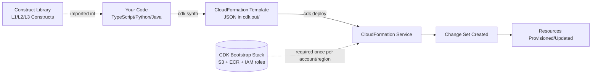

# AWS CDK (Cloud Development Kit)


## Definition

The AWS Cloud Development Kit (CDK) lets you define cloud infrastructure using a real
programming language — TypeScript, Python, Java, C#, or Go — instead of writing YAML/JSON by
hand. You write code, the CDK "compiles" (synthesizes) it into a standard CloudFormation
template, and CloudFormation does the actual deployment.

## Purpose

CloudFormation templates are declarative text files with no loops, no functions, and no type
checking — writing "20 nearly-identical S3 buckets with slightly different names" means copying
and pasting 20 blocks of YAML by hand, with all the human-error risk that implies. AWS built the
CDK so infrastructure could be written with the same tools, abstractions, and discipline as
application code: loops, conditionals, classes, package imports, unit tests, IDE autocomplete,
and code review — while still producing a plain CloudFormation template underneath, so it
deploys through the exact same reliable, audited engine.

## How It Works

You write a **Stack** class in your chosen language, instantiate **Constructs** (reusable,
composable infrastructure building blocks — AWS publishes hundreds covering every service) inside
it, and run `cdk synth`. This compiles your code into a CloudFormation template (JSON) in the
`cdk.out/` folder. Running `cdk deploy` then calls CloudFormation's `CreateChangeSet` /
`ExecuteChangeSet` APIs under the hood — CDK never talks to individual service APIs directly; it
hands a template to CloudFormation and lets CloudFormation do the provisioning.



Walking through it: (1) you write infrastructure as code using Constructs from the CDK library
(or your own custom ones); (2) `cdk synth` runs your program locally and emits a plain
CloudFormation template — nothing has touched AWS yet, so you can diff/review it like any other
build artifact; (3) `cdk deploy` uploads any needed assets (Lambda code, Docker images) to a
bootstrap S3 bucket/ECR repo, then calls CloudFormation to create or update the change set from
that synthesized template; (4) CloudFormation takes over from there exactly as it would for a
hand-written template. The one extra step CDK requires that raw CloudFormation doesn't is
**bootstrapping** — a one-time `cdk bootstrap` per account/region that creates the S3 bucket,
ECR repo, and IAM roles CDK needs to stage deployment assets.

## Key Features / Components

- **Constructs** — the building blocks, in three levels: **L1** (`Cfn*`, a 1:1 mirror of a raw
  CloudFormation resource), **L2** (a sensible, opinionated wrapper with secure defaults — e.g.,
  an S3 bucket construct that defaults to blocking public access), **L3/Patterns** (whole
  architectures in a few lines — e.g., `ApplicationLoadBalancedFargateService` wires up an ALB,
  Fargate service, target group, and security groups together).
- **Stacks & Apps** — a CDK `App` can contain multiple `Stack`s, each synthesizing to its own
  CloudFormation stack, letting you compose a multi-service system from one codebase.
- **Context & Environment** — account/region-aware code (`env: { account, region }`) so the same
  construct can be parameterized per deployment target.
- **CDK Pipelines** — a construct for self-mutating CI/CD pipelines defined in the same codebase
  as the infrastructure they deploy.
- **Assets** — CDK automatically packages and uploads local files (Lambda source, Docker images)
  as part of deployment, something raw CloudFormation leaves entirely to you.
- **`cdk diff`** — shows what would change against the currently deployed stack, the CDK
  equivalent of reviewing a CloudFormation change set, but in your code's terms.

## CDK vs. CloudFormation vs. SAM — Comparison

| | **CloudFormation** | **AWS CDK** | **AWS SAM** |
|---|---|---|---|
| What you write | YAML/JSON template | Real code (TS/Python/Java/C#/Go) | YAML/JSON (CloudFormation superset) |
| Abstraction level | Low — every property explicit | High — Constructs provide secure defaults, loops, logic | Medium — shorthand for serverless resources only |
| Best for | Any resource type, full control | Complex apps, teams wanting programming discipline, reuse across projects | Lambda/API Gateway/DynamoDB-centric serverless apps |
| Local testing | None built-in | `cdk synth`, unit-test the construct code itself | `sam local invoke`, `sam local start-api` emulate Lambda/API GW locally |
| Underlying engine | IS the engine | Compiles to CloudFormation, which deploys | Transforms to CloudFormation via the `AWS::Serverless` macro, which deploys |
| Learning curve | Low to start, verbose at scale | Higher (need the language + CDK concepts) | Low, narrow scope |
| Multi-language | No — one template format | Yes — pick your language | No — YAML/JSON only |

The exam-relevant takeaway: **all three ultimately produce and deploy a CloudFormation
template.** They're different authoring experiences over the same deployment engine, not three
competing deployment engines. Pick CDK for complex, reusable, testable infrastructure in a real
language; pick SAM for a quick serverless app; pick raw CloudFormation when you want zero
abstraction or are integrating with tools that expect plain templates.

## Use Cases — When to Use It

- A platform/infra team building reusable, parameterized constructs that product teams consume
  (e.g., a company-standard "secure S3 bucket" or "VPC with our network baseline" construct).
- Complex conditional infrastructure logic that's painful in YAML (loop over a list of
  environments and generate a stack per environment, with slightly different settings each time).
- Teams who want infrastructure to go through the same code review, linting, and unit-testing
  pipeline as application code.
- Polyglot teams who'd rather write infrastructure in the same language as the application
  (e.g., a Python shop keeping both app code and IaC in Python).

## When NOT to Use It / Alternatives

- **Small, static, rarely-changing infrastructure** — the overhead of a CDK project
  (bootstrapping, build toolchain, language runtime) isn't worth it for five resources that never
  change; a plain CloudFormation or even console setup is simpler.
- **Multi-cloud** — CDK (like CloudFormation) is AWS-only; **Terraform** (or CDK for Terraform,
  "CDKTF") is the choice if you also manage non-AWS resources.
- **Teams without programming experience in infra** — if your ops team is comfortable with YAML
  but not TypeScript/Python, forcing CDK adds friction without clear benefit; plain CloudFormation
  or SAM may fit better.
- **Pure serverless apps with no custom logic needs** — SAM's shorter, narrower syntax is less
  overhead than pulling in the full CDK toolchain for a single Lambda + API Gateway.

## Why It's Important

**Real-world**: CDK has become the default IaC choice for many AWS-native engineering teams
because it closes the gap between "how we write app code" and "how we write infra code" —
code review, static typing, unit tests, and reusable packages all transfer directly. It also
meaningfully reduces misconfiguration risk because L2 constructs ship with secure-by-default
settings (e.g., encrypted-by-default resources) that a hand-written template would need to
remember to set explicitly.

**Exam weight**:
- **SAA-C03 Domain 4 (Cost-Optimized Architectures, 20%)** — CDK is tested as one of the
  IaC/automation mechanisms for consistently deploying the cost-optimized patterns Domain 4
  focuses on, avoiding the cost of manual, inconsistent deployments.
- **DVA-C03** — CDK is explicitly named in **Domain 3 (Testing and Deployment, 22%), Task 3.3 —
  Deploy code via CI/CD** alongside SAM and CloudFormation as IaC template options, and resurfaces
  in **Domain 4 (Troubleshooting and Optimization, 22%)** when a deployment or synthesized
  template needs debugging (e.g., `cdk diff` showing an unexpected change, synth errors).
- **MLA-C02 Domain 4 (Operating, Monitoring, and Securing ML and AI Solutions, 24%)** —
  CDK is named alongside CloudFormation as the IaC approach for deploying and orchestrating ML
  pipelines reproducibly (Domain 3 build time, operated/monitored in Domain 4).
- A classic exam trap question gives you a scenario team wanting "infrastructure defined in
  Python with loops and conditionals" — the only correct answer among AWS native IaC options is
  CDK, not CloudFormation (which has no real loop construct) and not SAM (YAML-based).

## Pricing Model (summary)

**CDK itself is completely free** — it's an open-source toolkit (Apache 2.0 license) you run
locally or in CI. You pay only for: (1) the AWS resources your synthesized template creates,
at their normal rates, same as any CloudFormation deployment; (2) the small S3 storage and
possible ECR costs for the CDK bootstrap bucket/repo holding your deployment assets (typically
cents per month). See: https://aws.amazon.com/cdk/ and https://aws.amazon.com/cloudformation/pricing/

## Hands-on Lab (Floci)

CDK itself just emits a CloudFormation template — Floci doesn't need a CDK-specific emulator; you
deploy the synthesized output the same way you'd deploy a hand-written template.

```bash
# Prerequisite: Node.js + CDK CLI installed (npm install -g aws-cdk), and a CDK app scaffolded
# (cdk init app --language=typescript) with one construct, e.g. an S3 bucket.

# 1. Synthesize locally — no AWS/Floci call happens here
cdk synth > cdk.out/MyStack.template.json

# 2. Point the CLI at Floci and bootstrap once (creates the staging bucket/roles)
alias awslocal='aws --endpoint-url=http://localhost:4566 --profile floci'
export AWS_ENDPOINT_URL=http://localhost:4566   # lets `cdk` itself target Floci
cdk bootstrap --profile floci

# 3. Deploy the synthesized template directly via CloudFormation (the most reliable
#    path against a local emulator — bypasses some of cdk deploy's extra asset-publishing
#    orchestration that isn't guaranteed to work identically against a non-AWS endpoint)
awslocal cloudformation deploy \
  --template-file cdk.out/MyStack.template.json \
  --stack-name my-cdk-stack

# 4. Verify
awslocal cloudformation describe-stacks --stack-name my-cdk-stack
awslocal s3 ls
```

**Honest note**: `cdk deploy` run directly against Floci is not officially validated — CDK's
asset-publishing step calls several supporting APIs beyond plain CloudFormation. The reliable,
repeatable local lab is: `cdk synth` (100% local, no network calls) → hand the resulting template
to `awslocal cloudformation deploy` (which Floci fully supports: stacks, change sets, resource
provisioning). This still teaches the real CDK workflow end-to-end without depending on
unverified emulator behavior.

## Exam Tips

- **Keyword "written in Python/TypeScript/Java with loops/conditionals/classes" → CDK.**
  Keyword "a static YAML/JSON file" → CloudFormation. Keyword "shorthand just for
  Lambda/API Gateway/DynamoDB" → SAM.
- Remember **CDK still deploys through CloudFormation** — a question asking "what actually
  provisions the resources when you run `cdk deploy`?" has the answer "CloudFormation," not CDK.
- **`cdk bootstrap` is a one-time, per-account-per-region prerequisite** — exam questions testing
  "why did my first `cdk deploy` fail with a missing bucket error" point to a missing bootstrap.
- L2 constructs ship with **secure defaults** — this is tested indirectly in security-flavored
  questions ("which approach reduces the risk of an accidentally public S3 bucket" often favors
  CDK's opinionated constructs over a hand-written CloudFormation template).
- Don't confuse CDK (AWS-only, compiles to CloudFormation) with **Terraform** (multi-cloud, its
  own state file, HCL language) — if a question mentions managing non-AWS resources, it's
  pointing away from CDK/CloudFormation entirely.

## Related Terms

- [AWS CloudFormation](cloudformation.md) — the deployment engine CDK compiles to and relies on
- [Systems Manager](systems-manager.md) — Parameter Store often stores CDK-deployed app config
- Glossary: Infrastructure as Code, Construct, Synthesis, Bootstrap, SAM (AWS Serverless
  Application Model)
