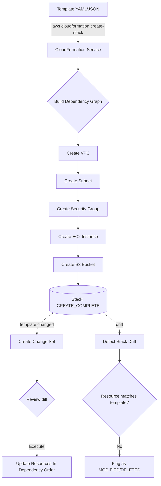

# AWS CloudFormation


## Definition

AWS CloudFormation is a service that lets you describe the AWS resources you want (an S3
bucket, an EC2 instance, a VPC, a whole multi-tier application) in a text file, and then AWS
builds, updates, and tears them down for you automatically, in the right order, every time
exactly the same way. This pattern — describing infrastructure as a file instead of clicking
through a console — is called **Infrastructure as Code (IaC)**.

## Purpose

Before CloudFormation, "building infrastructure" meant a human clicking buttons in the AWS
Console, or running a long sequence of CLI commands, hoping to remember every step in the right
order. That doesn't scale, isn't repeatable, and isn't reviewable — nobody can "diff" a sequence
of clicks. AWS built CloudFormation to turn infrastructure into a versioned, reviewable artifact:
a template file that lives in Git, gets peer-reviewed like code, and produces an identical
environment every single time it's deployed — dev, staging, prod, or a disaster-recovery region.

## How It Works

You write a **template** (JSON or YAML) describing *desired end state*: "I want one VPC, two
subnets, one security group, one EC2 instance, and an S3 bucket, wired together like this."
CloudFormation reads the template, works out the dependency graph (it must create the VPC
before the subnet, the subnet before the EC2 instance), and calls the underlying service APIs
in the correct order. The running collection of resources created from one template is called a
**stack**. Update the template and redeploy, and CloudFormation calculates a **change set** — a
diff of exactly what will be added, modified, or replaced — before touching anything.



Walking through it: (1) you submit a template; (2) CloudFormation parses every resource and
builds a dependency graph from `DependsOn` and implicit references (e.g., a security group ID
referenced inside an EC2 resource); (3) it provisions resources bottom-up through that graph —
network before compute, storage before the app that reads from it; (4) once every resource
reports success, the stack reaches `CREATE_COMPLETE`; (5) any future edit to the template
produces a **change set** you can review line-by-line before it touches production; (6) at any
time you can ask CloudFormation to run **drift detection**, which compares the live state of
each resource against what the template says it should be — catching the case where someone
manually edited a security group rule in the console instead of through the template, silently
breaking the "template is the source of truth" guarantee.

## Key Features / Components

- **Template** — the YAML/JSON file: `Parameters`, `Resources`, `Outputs`, `Conditions`,
  `Mappings`. `Resources` is the only mandatory section.
- **Stack** — a deployed instance of a template; the unit of create/update/delete.
- **Change Set** — a preview of what an update will do (add/modify/replace/delete) before you
  execute it — your safety net against surprise resource replacement.
- **StackSets** — deploy the *same* stack across many AWS accounts and regions at once (common
  in multi-account organizations for baseline security groups, logging buckets, etc.).
- **Nested Stacks** — a stack that includes other stacks as resources, for modularizing large
  templates (e.g., a "network" stack nested inside an "application" stack).
- **Drift Detection** — flags resources that were changed outside of CloudFormation (manual
  console edits, another tool, an API call) so the template stops being a lie.
- **Rollback** — if any resource in a stack fails to create/update, CloudFormation by default
  automatically rolls the *entire stack* back to its last known-good state.
- **Intrinsic Functions** — `!Ref`, `!GetAtt`, `!Sub`, `!Join`, `!ImportValue` — wire resources
  together and pull values across stacks without hardcoding.
- **Custom Resources** — invoke a Lambda function as part of stack creation for anything the
  native resource types don't cover.

## Use Cases — When to Use It

- Standing up a reproducible environment (dev/staging/prod parity) from the same template.
- Disaster recovery: redeploy an entire application stack into a new region in minutes.
- Enforcing a security baseline across every AWS account in an org via StackSets (mandatory
  CloudTrail trail, mandatory GuardDuty, mandatory IAM password policy).
- Any time "how was this built?" needs an answer better than "ask the person who clicked it."
- Underpinning higher-level tools — CDK, SAM, Amplify, and most third-party deployment
  frameworks compile down to CloudFormation templates under the hood.

## When NOT to Use It / Alternatives

- **Writing raw YAML/JSON by hand for complex logic is painful** — no loops, limited
  conditionals. If your team wants real programming constructs (loops, classes, unit tests),
  use **AWS CDK**, which compiles TypeScript/Python/Java down to a CloudFormation template.
- **Multi-cloud** — CloudFormation is AWS-only. If you also manage Azure/GCP resources with one
  tool, **Terraform** is the common choice (different state-management model, same IaC idea).
- **Simple, single-purpose serverless apps** — **AWS SAM** is a thinner wrapper purpose-built
  for Lambda/API Gateway/DynamoDB apps, with a much shorter template for that specific shape.
- **One-off manual resource** you'll delete in ten minutes for ad-hoc testing — console/CLI is
  faster than writing and validating a template for a single throwaway resource.

## Why It's Important

**Real-world**: IaC is the difference between "we think this is how prod is configured" and
"here is the exact file that proves how prod is configured, and here's the pull request that
changed it." It makes security audits, disaster recovery, and onboarding dramatically faster,
and removes "it worked when I clicked it but I can't remember the third checkbox I ticked" as
a failure mode. Drift detection specifically protects against configuration decay — the slow
accumulation of undocumented manual changes that eventually make environments impossible to
reproduce.

**Exam weight**:
- **SAA-C03 Domain 4 (Design Cost-Optimized Architectures, 20%)** — CloudFormation appears as
  the mechanism for consistently deploying cost-optimized patterns (e.g., auto-scaled, rightsized
  stacks) repeatably across environments without configuration drift inflating cost.
- **DVA-C03 Domain 4 (Troubleshooting and Optimization, 22%)**, specifically **Task 4.1 — Assist
  in root cause analysis**: when something in production doesn't match what was deployed,
  drift detection and the CloudFormation event log (visible in the console/CLI stack events) are
  often the first place a developer looks to find what changed and when.
- **MLA-C02 Domain 4 (Operating, Monitoring, and Securing ML and AI Solutions, 24%)** —
  CloudFormation (alongside CDK) is the named IaC mechanism for deploying and reproducing ML
  pipelines/endpoints consistently across environments, which this domain explicitly tests.
- It also shows up directly in SAA-C03/DVA-C03 Domain 1-3 material as the default way "deploy
  this architecture" is implemented in scenario questions.

## Pricing Model (summary)

**CloudFormation itself is free** — you are not charged for creating stacks, change sets, or
drift detection. You pay only for the underlying resources the template creates (the EC2
instance, the S3 bucket, etc.) at their normal rates. The one exception is **CloudFormation
StackSets with self-managed permissions across many accounts**, and **Hooks/Registry extensions**
published to the CloudFormation Public Registry, which can carry their own small fees. Always
check the current page: https://aws.amazon.com/cloudformation/pricing/

## Hands-on Lab (Floci)

Floci's CloudFormation emulator supports stacks, change sets, resource provisioning, and
StackSets, so the full lifecycle below works locally with no AWS account or cost.

```bash
# One-time setup (see labs-floci/README.md)
alias awslocal='aws --endpoint-url=http://localhost:4566 --profile floci'

# 1. A minimal template: one S3 bucket
cat > bucket.yaml <<'EOF'
Resources:
  MyBucket:
    Type: AWS::S3::Bucket
    Properties:
      BucketName: my-floci-lab-bucket
Outputs:
  BucketName:
    Value: !Ref MyBucket
EOF

# 2. Deploy it (create-or-update in one command)
awslocal cloudformation deploy \
  --template-file bucket.yaml \
  --stack-name lab-bucket-stack

# 3. Confirm it exists
awslocal cloudformation describe-stacks --stack-name lab-bucket-stack
awslocal s3 ls

# 4. Change the template (e.g. add versioning) and preview with a change set
awslocal cloudformation create-change-set \
  --stack-name lab-bucket-stack \
  --change-set-name add-versioning \
  --template-body file://bucket.yaml
awslocal cloudformation describe-change-set \
  --stack-name lab-bucket-stack --change-set-name add-versioning

# 5. Clean up
awslocal cloudformation delete-stack --stack-name lab-bucket-stack
```

**Note on drift detection in Floci**: `detect-stack-drift` / `describe-stack-resource-drifts`
compare live resource state against the template — since Floci's resources only exist because
CloudFormation created them, you won't see realistic drift unless you manually mutate a resource
out-of-band (e.g., `awslocal s3api put-bucket-tagging` directly on a bucket CloudFormation
created) and then re-run drift detection against that stack. On real AWS, drift shows up
constantly from manual console edits — the local lab mainly teaches the *command*, not the
organic drift scenario.

## Exam Tips

- **"How do we make deployments repeatable/version-controlled?"** → CloudFormation (or CDK, if
  the question mentions a programming language instead of a template file).
- **Change sets = preview before you commit.** If a question emphasizes "review changes before
  applying them in production," that's a change set, not a direct `update-stack`.
- **StackSets = CloudFormation across accounts/regions.** Multi-account governance questions
  ("deploy this security baseline to every account in our Organization") point here.
- **Drift detection = "someone changed something manually and we need to know."** This is the
  classic trap distinguishing CloudFormation from CloudTrail: CloudTrail tells you *who* made an
  API call; CloudFormation drift detection tells you *what resource no longer matches the
  template* — they're complementary, not interchangeable, and exam questions love conflating them.
- CloudFormation is **free**; you only pay for the resources it creates — a common "which is
  cheaper" cost question answer is "same cost, CloudFormation adds no overhead."
- Rollback-on-failure is the **default** behavior — know that a failed stack update doesn't
  leave half-built infrastructure sitting around unless you explicitly disable rollback.

## Related Terms

- [AWS CDK](cdk.md) — compiles higher-level code into CloudFormation templates
- [AWS Config](aws-config.md) — continuously tracks configuration state/compliance, complements
  drift detection with ongoing rule-based evaluation
- [CloudTrail](cloudtrail.md) — the audit log of *who* called *which* API, separate from
  CloudFormation's *what does the template vs. reality* comparison
- [Systems Manager](systems-manager.md) — often used alongside CloudFormation for
  post-provisioning configuration (Parameter Store values referenced by templates)
- Glossary: Infrastructure as Code, Stack, Change Set, Idempotency
