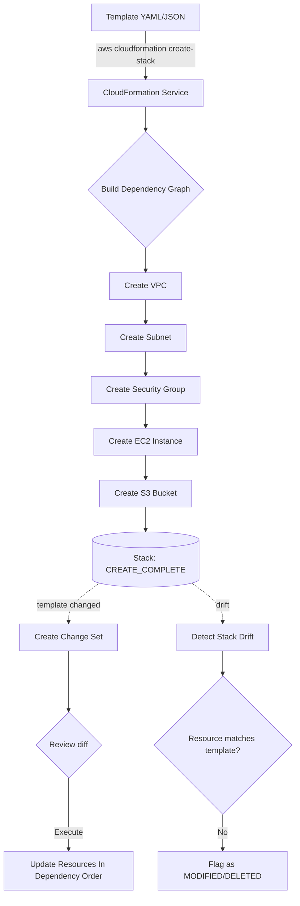
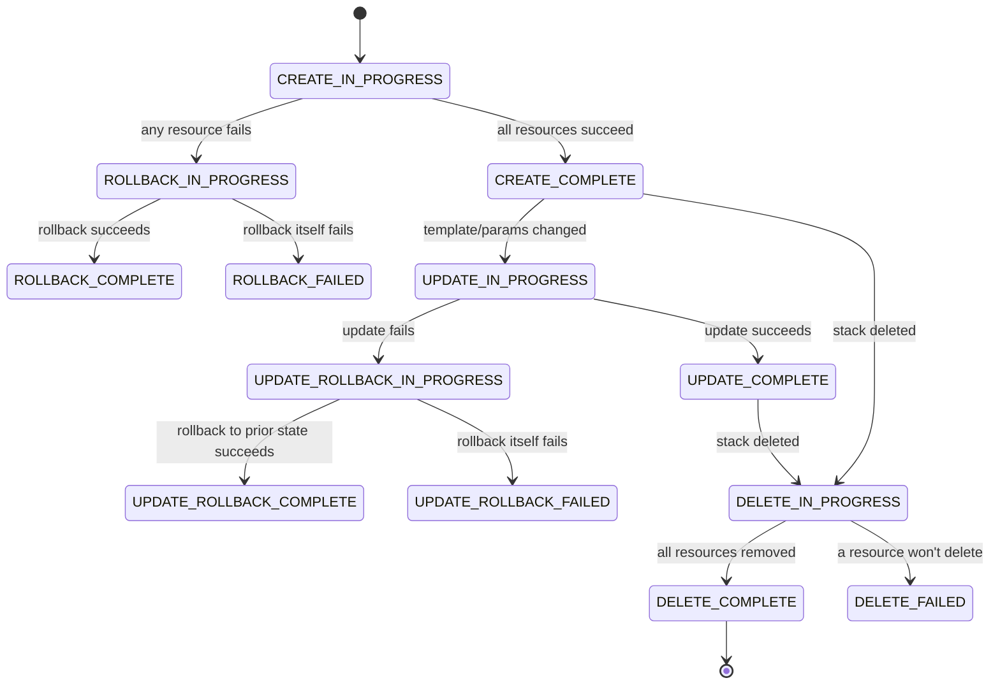
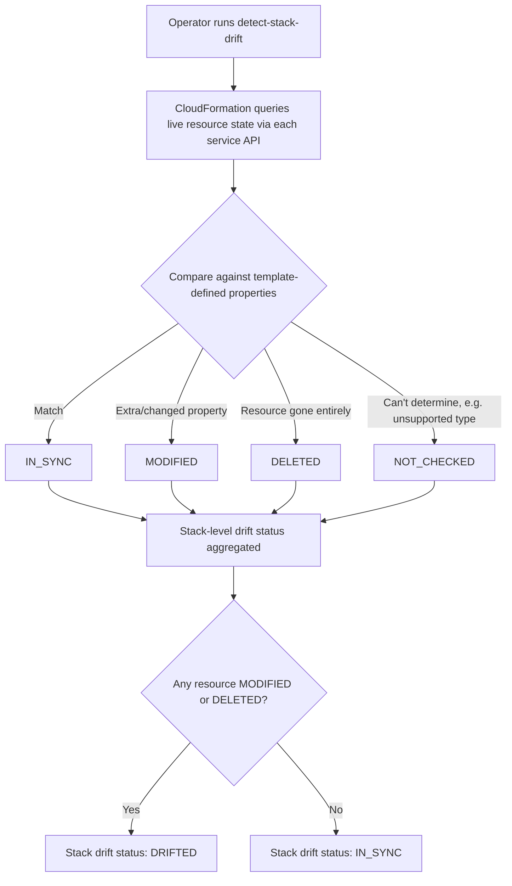
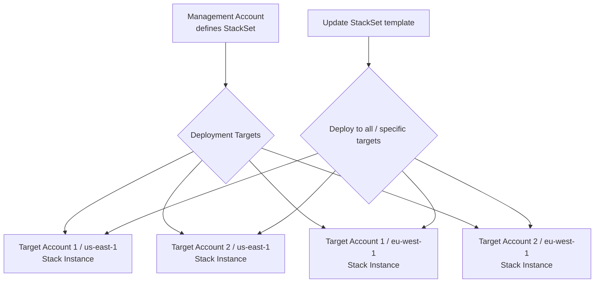
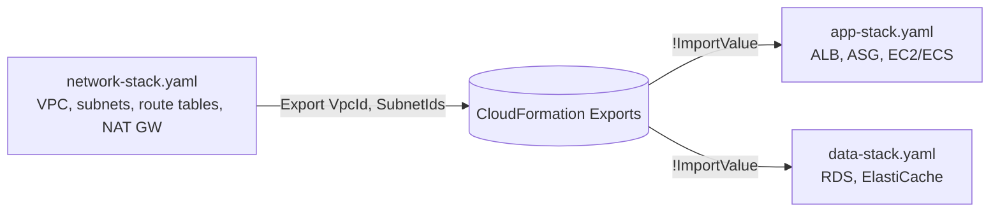

# AWS CloudFormation

> **Appears in:** [DVA-C03](../../certifications/dva-c03/README.md)


## Definition

AWS CloudFormation is a service that lets you describe the AWS resources you want (an S3
bucket, an EC2 instance, a VPC, a whole multi-tier application) in a text file, and then AWS
builds, updates, and tears them down for you automatically, in the right order, every time
exactly the same way. This pattern — describing infrastructure as a file instead of clicking
through a console — is called **Infrastructure as Code (IaC)**.

## Purpose

Before CloudFormation, "building infrastructure" meant a human clicking buttons in the AWS
Console, or running a long sequence of CLI commands, hoping to remember every step in the right
order. That doesn't scale, isn't repeatable, and isn't reviewable — nobody can "diff" a sequence
of clicks. AWS built CloudFormation to turn infrastructure into a versioned, reviewable artifact:
a template file that lives in Git, gets peer-reviewed like code, and produces an identical
environment every single time it's deployed — dev, staging, prod, or a disaster-recovery region.

The deeper problem CloudFormation solves is **idempotency with dependency awareness**. Anyone can
write a script that calls `create-vpc`, then `create-subnet`, then `run-instances`. The hard part
is doing that *safely*, repeatedly, for hundreds of interdependent resources, while also knowing
how to roll back cleanly when step 47 of 50 fails, and knowing exactly what will change before you
touch a resource that's currently serving production traffic. That orchestration engine — not the
YAML syntax — is the actual product.

## How It Works

You write a **template** (JSON or YAML) describing *desired end state*: "I want one VPC, two
subnets, one security group, one EC2 instance, and an S3 bucket, wired together like this."
CloudFormation reads the template, works out the dependency graph (it must create the VPC
before the subnet, the subnet before the EC2 instance), and calls the underlying service APIs
in the correct order. The running collection of resources created from one template is called a
**stack**. Update the template and redeploy, and CloudFormation calculates a **change set** — a
diff of exactly what will be added, modified, or replaced — before touching anything.



Walking through it: (1) you submit a template; (2) CloudFormation parses every resource and
builds a dependency graph from `DependsOn` and implicit references (e.g., a security group ID
referenced inside an EC2 resource); (3) it provisions resources bottom-up through that graph —
network before compute, storage before the app that reads from it; (4) once every resource
reports success, the stack reaches `CREATE_COMPLETE`; (5) any future edit to the template
produces a **change set** you can review line-by-line before it touches production; (6) at any
time you can ask CloudFormation to run **drift detection**, which compares the live state of
each resource against what the template says it should be — catching the case where someone
manually edited a security group rule in the console instead of through the template, silently
breaking the "template is the source of truth" guarantee.

### The stack lifecycle in full

A stack isn't just "created" — it moves through a well-defined state machine, and knowing these
states (and which ones are terminal vs. transient) is tested directly on DVA-C03.



A few states deserve special attention:

- **`ROLLBACK_COMPLETE`** is a trap for new CloudFormation users: it means the *initial create*
  failed and rolled back, and the stack is now effectively empty but still exists as an object.
  You **cannot update** a stack in `ROLLBACK_COMPLETE` — the only valid next action is to delete
  it and create a new one. A surprising number of "why won't my update work" support tickets are
  this exact state.
- **`UPDATE_ROLLBACK_FAILED`** means CloudFormation tried to undo a bad update and *that* also
  failed — usually because a resource was manually modified outside the stack in the interim.
  Recovery often requires `continue-update-rollback` with a list of resources to skip, or manual
  intervention on the broken resource first.
- **`DELETE_FAILED`** almost always means a resource has a dependency CloudFormation doesn't know
  about (e.g., an S3 bucket that isn't empty — CloudFormation refuses to force-delete a
  non-empty bucket by default) or an IAM role still attached to a running resource elsewhere.

### Drift detection flow, in detail



Walking through it: (1) an operator (or a scheduled EventBridge rule) triggers
`detect-stack-drift`; (2) CloudFormation calls the live-state read APIs for every resource in the
stack (e.g., `DescribeSecurityGroups` for an `AWS::EC2::SecurityGroup`); (3) it diffs each
property CloudFormation actually manages against what's live — note it only checks properties
*defined in the template*, so a property the template never set and someone else configured
later won't show as drift; (4) each resource gets a per-resource drift status; (5) the stack as a
whole is marked `DRIFTED` if even one resource diverged. Not every resource type supports drift
detection — check the current supported-resources list before assuming it'll catch everything.

## Worked Example: A Three-Tier Template With Change Sets

Below is a more realistic template than a single S3 bucket — a VPC, a security group, and an
EC2 instance behind it, parameterized so the same template deploys to dev or prod by changing
one input.

```yaml
AWSTemplateFormatVersion: '2010-09-09'
Description: Minimal web-tier stack — VPC, SG, EC2 instance, parameterized by environment

Parameters:
  EnvironmentName:
    Type: String
    AllowedValues: [dev, staging, prod]
    Default: dev
  InstanceType:
    Type: String
    Default: t3.micro
    AllowedValues: [t3.micro, t3.small, t3.medium]
  SSHAllowedCidr:
    Type: String
    Description: CIDR allowed to reach port 22 (restrict this in prod!)
    Default: 203.0.113.0/24

Mappings:
  RegionAMI:
    us-east-1:
      AMI: ami-0abcdef1234567890
    eu-west-1:
      AMI: ami-0fedcba9876543210

Conditions:
  IsProd: !Equals [!Ref EnvironmentName, prod]

Resources:
  AppVPC:
    Type: AWS::EC2::VPC
    Properties:
      CidrBlock: 10.0.0.0/16
      EnableDnsSupport: true
      EnableDnsHostnames: true
      Tags:
        - Key: Name
          Value: !Sub "${EnvironmentName}-app-vpc"

  PublicSubnet:
    Type: AWS::EC2::Subnet
    Properties:
      VpcId: !Ref AppVPC
      CidrBlock: 10.0.1.0/24
      AvailabilityZone: !Select [0, !GetAZs '']
      MapPublicIpOnLaunch: true

  AppSecurityGroup:
    Type: AWS::EC2::SecurityGroup
    Properties:
      GroupDescription: Allow HTTP and restricted SSH
      VpcId: !Ref AppVPC
      SecurityGroupIngress:
        - IpProtocol: tcp
          FromPort: 80
          ToPort: 80
          CidrIp: 0.0.0.0/0
        - IpProtocol: tcp
          FromPort: 22
          ToPort: 22
          CidrIp: !Ref SSHAllowedCidr

  AppInstance:
    Type: AWS::EC2::Instance
    DeletionPolicy: !If [IsProd, Retain, Delete]
    Properties:
      InstanceType: !Ref InstanceType
      ImageId: !FindInMap [RegionAMI, !Ref "AWS::Region", AMI]
      SubnetId: !Ref PublicSubnet
      SecurityGroupIds: [!Ref AppSecurityGroup]
      Tags:
        - Key: Name
          Value: !Sub "${EnvironmentName}-app-instance"
      UserData:
        Fn::Base64: !Sub |
          #!/bin/bash
          echo "Environment: ${EnvironmentName}" > /var/www/html/index.html

Outputs:
  InstancePublicIp:
    Value: !GetAtt AppInstance.PublicIp
    Export:
      Name: !Sub "${EnvironmentName}-app-public-ip"
  VpcId:
    Value: !Ref AppVPC
    Export:
      Name: !Sub "${EnvironmentName}-vpc-id"
```

Notable intrinsic-function usage worth internalizing for the exam:

- `!FindInMap` picks the right AMI per region without hardcoding a single AMI ID that would break
  in a different region — a very common exam trap (an AMI ID is region-specific, never portable).
- `!Select [0, !GetAZs '']` grabs the first AZ available in whatever region the stack deploys to,
  rather than hardcoding `us-east-1a`, which wouldn't exist if deployed elsewhere.
- `!If [IsProd, Retain, Delete]` on `DeletionPolicy` means deleting the *stack* in prod leaves the
  EC2 instance running (protecting against an accidental `delete-stack`), while dev/staging
  instances are cleanly removed — a realistic safety pattern tested in cost/governance questions.
- `Export` on an Output lets a *different* stack pull this value with `!ImportValue
  dev-vpc-id` — this is how teams split a monolithic template into a "network stack" and an
  "application stack" that reference each other without duplicating resource definitions.

### Reviewing and executing the change set (CLI)

```bash
# 1. Deploy the original template
aws cloudformation deploy \
  --template-file web-tier.yaml \
  --stack-name dev-web-tier \
  --parameter-overrides EnvironmentName=dev InstanceType=t3.micro \
  --capabilities CAPABILITY_IAM

# 2. Edit web-tier.yaml — say, bump InstanceType to t3.small — then preview the blast radius
aws cloudformation create-change-set \
  --stack-name dev-web-tier \
  --change-set-name resize-instance \
  --template-body file://web-tier.yaml \
  --parameters ParameterKey=EnvironmentName,ParameterValue=dev \
               ParameterKey=InstanceType,ParameterValue=t3.small

# 3. Inspect exactly what will happen before it happens
aws cloudformation describe-change-set \
  --stack-name dev-web-tier \
  --change-set-name resize-instance
# Look at the "ResourceChange" -> "Replacement" field per resource:
#   "Replacement": "False"       -> in-place update, no downtime risk from replacement
#   "Replacement": "True"        -> resource will be DESTROYED and recreated (e.g. changing
#                                    an EC2 instance's AvailabilityZone forces replacement)
#   "Replacement": "Conditional" -> depends on current state, CloudFormation isn't sure yet

# 4. Only now, having reviewed it, execute
aws cloudformation execute-change-set \
  --stack-name dev-web-tier \
  --change-set-name resize-instance
```

The **`Replacement` field is the single most important thing a change set tells you.** Many
properties (instance type) update in place with a brief interruption; others (changing a
DB instance's engine, or an EC2 instance's subnet) force a full replace — new resource created,
old one destroyed, a new physical ID issued. If that resource is a database holding your only
copy of production data and `DeletionPolicy` isn't set to `Retain` or `Snapshot`, a careless
change set execution is how people lose data. Always read the `Replacement` column before
clicking Execute.

## Key Features / Components

- **Template** — the YAML/JSON file: `Parameters`, `Resources`, `Outputs`, `Conditions`,
  `Mappings`. `Resources` is the only mandatory section.
- **Stack** — a deployed instance of a template; the unit of create/update/delete.
- **Change Set** — a preview of what an update will do (add/modify/replace/delete) before you
  execute it — your safety net against surprise resource replacement.
- **StackSets** — deploy the *same* stack across many AWS accounts and regions at once (common
  in multi-account organizations for baseline security groups, logging buckets, etc.).
- **Nested Stacks** — a stack that includes other stacks as resources, for modularizing large
  templates (e.g., a "network" stack nested inside an "application" stack).
- **Drift Detection** — flags resources that were changed outside of CloudFormation (manual
  console edits, another tool, an API call) so the template stops being a lie.
- **Rollback** — if any resource in a stack fails to create/update, CloudFormation by default
  automatically rolls the *entire stack* back to its last known-good state.
- **Intrinsic Functions** — `!Ref`, `!GetAtt`, `!Sub`, `!Join`, `!ImportValue`, `!FindInMap`,
  `!Select`, `!GetAZs` — wire resources together and pull values across stacks without
  hardcoding.
- **Custom Resources** — invoke a Lambda function as part of stack creation for anything the
  native resource types don't cover.
- **Stack Policies** — a JSON document attached to a stack that restricts which resources can be
  updated/replaced/deleted even by someone with `UpdateStack` permission, protecting a specific
  resource (e.g., "never let anyone delete this production RDS instance via a template update")
  independently of IAM.
- **Hooks** — code (via the CloudFormation Registry) that runs *before* a resource operation,
  able to block a provision/update/delete that violates a policy (e.g., block any S3 bucket
  created without encryption) — a proactive guardrail layered on top of reactive drift detection.

## CloudFormation StackSets Across Accounts



Walking through it: (1) a central/management account authors one template as a **StackSet**; (2)
it specifies target accounts and regions (often "every account in this Organizational Unit,"
auto-deploying to accounts as they're added); (3) CloudFormation creates one **Stack Instance**
per account/region combination, each an independent stack that can succeed or fail on its own;
(4) updating the StackSet's template rolls the change out to every targeted instance, with
configurable failure tolerance (e.g., "stop if more than 10% of targets fail") so one broken
account doesn't block the rollout everywhere else. This is the standard mechanism for enforcing
"every account gets a CloudTrail trail, a GuardDuty detector, and this IAM password policy" as
code rather than a manual per-account checklist.

## CloudWatch Logs Insights Query for CloudFormation Events

If you forward CloudFormation stack events to CloudWatch Logs (e.g., via an EventBridge rule
targeting a Logs log group), you can query failed resource events across many stacks at once:

```
fields @timestamp, @message
| filter @message like /CREATE_FAILED/ or @message like /UPDATE_FAILED/
| parse @message '"LogicalResourceId":"*"' as resourceId
| parse @message '"ResourceStatusReason":"*"' as reason
| stats count() as failures by resourceId, reason
| sort failures desc
```

This surfaces, across a fleet of stacks, which *logical resource IDs* fail most often and why —
useful when a shared module (e.g., a standard IAM role nested stack) starts failing across many
downstream stacks after an account-wide policy change, rather than debugging each stack event log
by hand one at a time.

## Cost Example: CloudFormation Overhead vs. Manual Provisioning

CloudFormation itself never appears as a line item on your bill — but it's worth walking through
*why* teams still treat it as a cost-optimization tool, not just a convenience:

| Scenario | Manual console provisioning | CloudFormation |
|---|---|---|
| Deploy dev/staging/prod copies of a 12-resource stack | 3× the manual click-time, drift risk between environments from human inconsistency | One template, 3 deploys, guaranteed-identical configuration |
| Decommission an unused environment fully | Someone must remember every resource that was created (a common source of "zombie" resources still being billed) | `delete-stack` removes everything the template created, nothing forgotten |
| Audit "what's running and why" | Tribal knowledge / outdated wiki page | The template *is* the current documentation |
| Scale a review of 50 similar microservice stacks for rightsizing | 50 manual console reviews | One Logs Insights query (above) or one StackSet update across all 50 |

The real financial risk CloudFormation mitigates is **forgotten resources** — an EC2 instance or
NAT Gateway spun up manually for a one-off test and never torn down is a disproportionately common
source of AWS bill surprises; `delete-stack` on a template-based environment removes the entire
footprint in one call, leaving nothing orphaned.

## Common Architectures

**1. Network/application stack split (most common pattern in real orgs)**



Splitting network infrastructure (changes rarely) from application infrastructure (changes
often) means an app deploy never risks touching the VPC, and the network team can own their
stack independently. The tradeoff: you can't delete the network stack while any importing stack
still references its exports — CloudFormation blocks that specifically to prevent breaking a
dependent stack.

**2. Nested stacks for a reusable "standard VPC" module**

A parent stack references a child template stored in S3:

```yaml
Resources:
  StandardNetwork:
    Type: AWS::CloudFormation::Stack
    Properties:
      TemplateURL: https://s3.amazonaws.com/my-templates/standard-vpc.yaml
      Parameters:
        CidrBlock: 10.1.0.0/16
```

This lets a platform team version and update "our standard VPC shape" once, and every consuming
team's parent stack picks up the fix on their next deploy — without copy-pasting the VPC
resources into every single template in the company.

**3. Organization-wide security baseline via StackSets with automatic deployment**

A StackSet targeting an Organizational Unit, configured with automatic deployment, ensures any
*new* AWS account created under that OU automatically receives the mandatory CloudTrail trail,
Config recorder, and IAM password policy — no manual onboarding step, no account left ungoverned.

**4. Blue/green via two parallel stacks + Route 53 weighting**

Two independent stacks (`app-blue`, `app-green`) each define a full environment; a separate thin
stack or manual Route 53 weighted routing change shifts traffic. CloudFormation doesn't natively
do blue/green traffic shifting itself (that's CodeDeploy's job) but this is a common pattern for
achieving zero-downtime infrastructure replacement when a resource would otherwise force
replacement and an outage.

## Use Cases — When to Use It

- Standing up a reproducible environment (dev/staging/prod parity) from the same template.
- Disaster recovery: redeploy an entire application stack into a new region in minutes.
- Enforcing a security baseline across every AWS account in an org via StackSets (mandatory
  CloudTrail trail, mandatory GuardDuty, mandatory IAM password policy).
- Any time "how was this built?" needs an answer better than "ask the person who clicked it."
- Underpinning higher-level tools — CDK, SAM, Amplify, and most third-party deployment
  frameworks compile down to CloudFormation templates under the hood.

## When NOT to Use It / Alternatives

- **Writing raw YAML/JSON by hand for complex logic is painful** — no loops, limited
  conditionals. If your team wants real programming constructs (loops, classes, unit tests),
  use **AWS CDK**, which compiles TypeScript/Python/Java down to a CloudFormation template.
- **Multi-cloud** — CloudFormation is AWS-only. If you also manage Azure/GCP resources with one
  tool, **Terraform** is the common choice (different state-management model, same IaC idea).
- **Simple, single-purpose serverless apps** — **AWS SAM** is a thinner wrapper purpose-built
  for Lambda/API Gateway/DynamoDB apps, with a much shorter template for that specific shape.
- **One-off manual resource** you'll delete in ten minutes for ad-hoc testing — console/CLI is
  faster than writing and validating a template for a single throwaway resource.

## Why It's Important

**Real-world**: IaC is the difference between "we think this is how prod is configured" and
"here is the exact file that proves how prod is configured, and here's the pull request that
changed it." It makes security audits, disaster recovery, and onboarding dramatically faster,
and removes "it worked when I clicked it but I can't remember the third checkbox I ticked" as
a failure mode. Drift detection specifically protects against configuration decay — the slow
accumulation of undocumented manual changes that eventually make environments impossible to
reproduce.

**Exam weight**:
- **SAA-C03 Domain 4 (Design Cost-Optimized Architectures, 20%)** — CloudFormation appears as
  the mechanism for consistently deploying cost-optimized patterns (e.g., auto-scaled, rightsized
  stacks) repeatably across environments without configuration drift inflating cost.
- **DVA-C03 Domain 4 (Troubleshooting and Optimization, 22%)**, specifically **Task 4.1 — Assist
  in root cause analysis**: when something in production doesn't match what was deployed,
  drift detection and the CloudFormation event log (visible in the console/CLI stack events) are
  often the first place a developer looks to find what changed and when. Expect a scenario
  question where a stack is stuck in `UPDATE_ROLLBACK_FAILED` and you must pick the recovery
  command (`continue-update-rollback`), or where a resource shows `Replacement: True` in a change
  set and you must predict the downtime/data-loss consequence.
- **MLA-C02 Domain 4 (Operating, Monitoring, and Securing ML and AI Solutions, 24%)** —
  CloudFormation (alongside CDK) is the named IaC mechanism for deploying and reproducing ML
  pipelines/endpoints consistently across environments, which this domain explicitly tests.
- It also shows up directly in SAA-C03/DVA-C03 Domain 1-3 material as the default way "deploy
  this architecture" is implemented in scenario questions.

## Pricing Model (summary)

**CloudFormation itself is free** — you are not charged for creating stacks, change sets, or
drift detection. You pay only for the underlying resources the template creates (the EC2
instance, the S3 bucket, etc.) at their normal rates. The one exception is **CloudFormation
StackSets with self-managed permissions across many accounts**, and **Hooks/Registry extensions**
published to the CloudFormation Public Registry, which can carry their own small fees. Always
check the current page: https://aws.amazon.com/cloudformation/pricing/

## Limits & Quotas

CloudFormation's quotas matter more than they might seem — large organizations routinely hit
these and need to split templates or request increases:

| Limit | Default Value | Practical Impact |
|---|---|---|
| Resources per stack | 500 | A single monolithic template for a large app will hit this — split into nested stacks |
| Template body size (direct upload) | 51,200 bytes | Large templates must be uploaded via S3 URL instead of inline |
| Template body size (via S3) | 1 MB (max) | Still a ceiling — very large templates need nesting even via S3 |
| Parameters per template | 200 | Rarely hit, but complex parameterized modules can approach it |
| Outputs per template | 200 | Same |
| Mappings per template | 200 | Same |
| Stacks per account per region | 2,000 (soft, raisable) | Large multi-team orgs with per-feature stacks can approach this |
| Nested stack depth | 5 levels | Deeply nested module hierarchies will eventually hit this ceiling |
| Change sets per stack | 2,500 | Mostly relevant to long-lived stacks updated extremely frequently via CI/CD |

A very common exam-adjacent real-world fix for "500 resources per stack" is **splitting into
nested stacks** — each nested stack has its own 500-resource budget, and the parent stack only
counts the `AWS::CloudFormation::Stack` resource itself, not everything inside the child.

## Troubleshooting / Common Issues

- **Stack stuck in `ROLLBACK_COMPLETE`** — this state means the *initial* create failed; you
  cannot update it. Delete the stack and recreate it. Check the stack **Events** tab for the
  first `CREATE_FAILED` reason, which is almost always the real root cause (later failures are
  usually cascading rollback noise).
- **`DELETE_FAILED` on an S3 bucket** — CloudFormation won't force-delete a non-empty bucket.
  Either empty the bucket manually first, or add a Lambda-backed custom resource that empties it
  on stack deletion, or set `DeletionPolicy: Retain` if the data should survive the stack anyway.
- **"No updates are to be performed"** when you expected a change — you likely modified something
  CloudFormation doesn't track as part of the template (e.g., changed a tag directly in the
  console) and then redeployed the *unchanged* template; CloudFormation correctly sees no diff
  between the template and itself. Check drift detection to see what actually changed live.
- **Circular dependency errors** — two resources each reference each other via `!GetAtt`/`!Ref`
  with no way to resolve creation order. Break the cycle by using a resource's ARN/name computed
  from a predictable pattern instead of a mutual reference, or restructure so one resource is
  created independently and the other just points at it.
- **`UPDATE_ROLLBACK_FAILED`** — the rollback itself failed, usually because a resource was
  manually changed outside the stack mid-update. Use `continue-update-rollback` with
  `--resources-to-skip` naming the stuck resource, fix that resource's state by hand, then retry.
- **IAM `AccessDenied` mid-stack-operation** — the role/user running CloudFormation needs
  permission not just for `cloudformation:*` but for *every underlying service action* the
  template performs (e.g., `ec2:RunInstances`, `s3:CreateBucket`). A classic exam and real-world
  gotcha: "CloudFormation is allowed but my resource still fails to create" is always an
  underlying-service IAM permission gap, not a CloudFormation permission gap.
- **Parameter value doesn't match `AllowedValues`** — the deploy fails validation before anything
  is touched; this is actually a *feature*, catching bad input before any API call is made.

## Further Reading

- AWS CloudFormation User Guide — How CloudFormation works:
  https://docs.aws.amazon.com/AWSCloudFormation/latest/UserGuide/cloudformation-overview.html
- AWS CloudFormation Best Practices:
  https://docs.aws.amazon.com/AWSCloudFormation/latest/UserGuide/best-practices.html
- StackSets concepts: https://docs.aws.amazon.com/AWSCloudFormation/latest/UserGuide/stacksets-concepts.html
- CloudFormation Resource and Property Types Reference:
  https://docs.aws.amazon.com/AWSCloudFormation/latest/UserGuide/aws-template-resource-type-ref.html
- AWS re:Post CloudFormation tag: https://repost.aws/tags/TAHgN08XysSNyFfIwxpvE-xg/aws-cloud-formation


*How a CloudFormation stack is created from a template, provisioning each described resource.
Source: AWS CloudFormation User Guide, docs.aws.amazon.com (official AWS documentation).*


*A StackSet deploying and managing stack instances across many accounts and Regions from one
template. Source: AWS CloudFormation User Guide, docs.aws.amazon.com (official AWS documentation).*

## Hands-on Lab (Floci)

Floci's CloudFormation emulator supports stacks, change sets, resource provisioning, and
StackSets, so the full lifecycle below works locally with no AWS account or cost.

```bash
# One-time setup (see labs-floci/README.md)
alias awslocal='aws --endpoint-url=http://localhost:4566 --profile floci'

# 1. A minimal template: one S3 bucket
cat > bucket.yaml <<'EOF'
Resources:
  MyBucket:
    Type: AWS::S3::Bucket
    Properties:
      BucketName: my-floci-lab-bucket
Outputs:
  BucketName:
    Value: !Ref MyBucket
EOF

# 2. Deploy it (create-or-update in one command)
awslocal cloudformation deploy \
  --template-file bucket.yaml \
  --stack-name lab-bucket-stack

# 3. Confirm it exists
awslocal cloudformation describe-stacks --stack-name lab-bucket-stack
awslocal s3 ls

# 4. Change the template (e.g. add versioning) and preview with a change set
awslocal cloudformation create-change-set \
  --stack-name lab-bucket-stack \
  --change-set-name add-versioning \
  --template-body file://bucket.yaml
awslocal cloudformation describe-change-set \
  --stack-name lab-bucket-stack --change-set-name add-versioning

# 5. Clean up
awslocal cloudformation delete-stack --stack-name lab-bucket-stack
```

**Note on drift detection in Floci**: `detect-stack-drift` / `describe-stack-resource-drifts`
compare live resource state against the template — since Floci's resources only exist because
CloudFormation created them, you won't see realistic drift unless you manually mutate a resource
out-of-band (e.g., `awslocal s3api put-bucket-tagging` directly on a bucket CloudFormation
created) and then re-run drift detection against that stack. On real AWS, drift shows up
constantly from manual console edits — the local lab mainly teaches the *command*, not the
organic drift scenario.

## Exam Tips

- **"How do we make deployments repeatable/version-controlled?"** → CloudFormation (or CDK, if
  the question mentions a programming language instead of a template file).
- **Change sets = preview before you commit.** If a question emphasizes "review changes before
  applying them in production," that's a change set, not a direct `update-stack`. Pay close
  attention to the `Replacement` field in the change set output — "will this cause downtime or
  data loss" questions hinge on whether a resource replaces in place or gets destroyed/recreated.
- **StackSets = CloudFormation across accounts/regions.** Multi-account governance questions
  ("deploy this security baseline to every account in our Organization") point here. Know that
  StackSets support automatic deployment to new accounts joining a targeted OU.
- **Drift detection = "someone changed something manually and we need to know."** This is the
  classic trap distinguishing CloudFormation from CloudTrail: CloudTrail tells you *who* made an
  API call; CloudFormation drift detection tells you *what resource no longer matches the
  template* — they're complementary, not interchangeable, and exam questions love conflating them.
- CloudFormation is **free**; you only pay for the resources it creates — a common "which is
  cheaper" cost question answer is "same cost, CloudFormation adds no overhead."
- Rollback-on-failure is the **default** behavior — know that a failed stack update doesn't
  leave half-built infrastructure sitting around unless you explicitly disable rollback.
- **`ROLLBACK_COMPLETE` cannot be updated** — only deleted and recreated. A question describing
  "my stack create failed and now I can't fix it with an update" is testing this exact fact.
- **500 resources per stack is a hard limit** — a question about a template that's "too large" or
  "hitting a resource limit" points to splitting into **nested stacks**, not raising a quota
  (there is no quota increase for this particular limit in the way there is for stacks-per-region).
- **`DeletionPolicy: Retain`/`Snapshot`** protects stateful resources (databases, buckets) from
  being destroyed when a stack or resource is deleted/replaced — a frequently tested safety
  mechanism for production data stores defined in CloudFormation.

## Related Terms

- [AWS CDK](cdk.md) — compiles higher-level code into CloudFormation templates
- [AWS Config](aws-config.md) — continuously tracks configuration state/compliance, complements
  drift detection with ongoing rule-based evaluation
- [CloudTrail](cloudtrail.md) — the audit log of *who* called *which* API, separate from
  CloudFormation's *what does the template vs. reality* comparison
- [Systems Manager](systems-manager.md) — often used alongside CloudFormation for
  post-provisioning configuration (Parameter Store values referenced by templates)
- Glossary: Infrastructure as Code, Stack, Change Set, Idempotency, Drift, Nested Stack, StackSet
