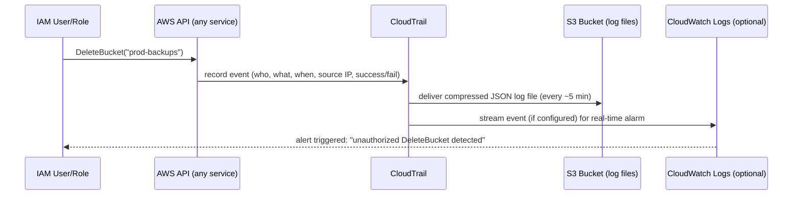
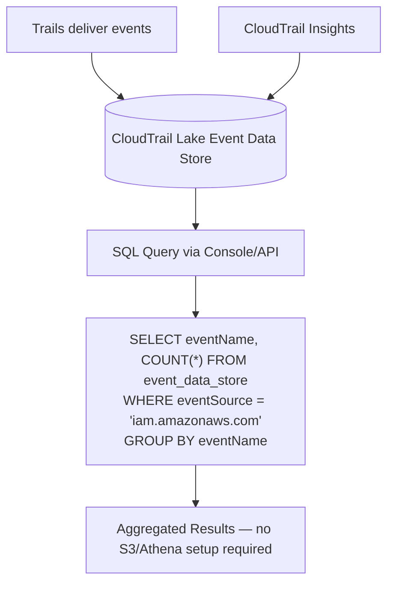
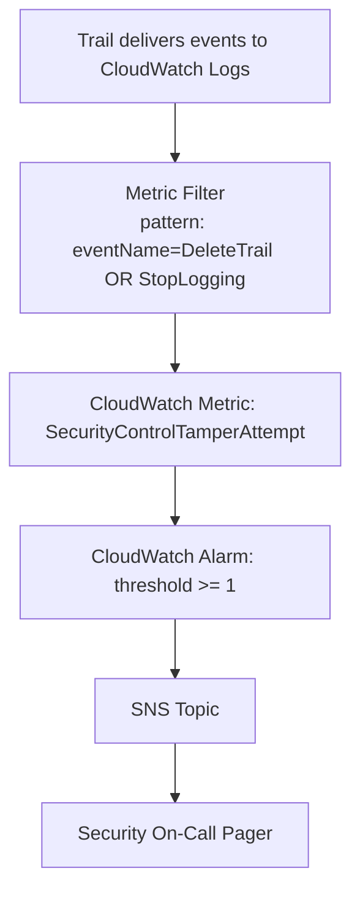
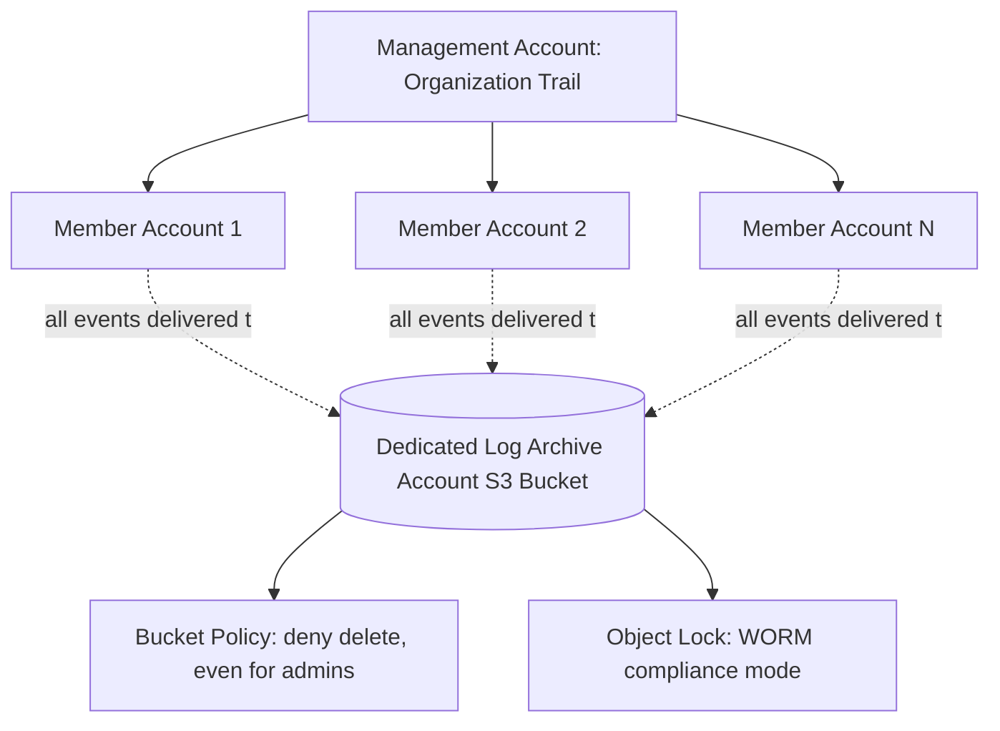

# AWS CloudTrail

> **Appears in:** [DVA-C03](../../certifications/dva-c03/README.md)


## Definition

AWS CloudTrail records every API call made in your AWS account — who made it, what they called,
when, from what IP address, and whether it succeeded — and stores that history as an immutable
audit log. In one sentence: CloudTrail answers **"who did what, and when?"**

## Purpose

Every single action in AWS — launching an EC2 instance, deleting an S3 bucket, changing an IAM
policy, even viewing something in the console — happens as an API call under the hood. Without a
record of those calls, after-the-fact questions like "who deleted that bucket on Tuesday?" or
"did anyone access this secret outside business hours?" are unanswerable. AWS built CloudTrail so
every account has a built-in, tamper-evident audit trail by default, satisfying both security
investigation needs and compliance requirements (SOC 2, PCI-DSS, HIPAA, and others all expect an
audit log of administrative activity).

The deeper reason CloudTrail exists as a *separate* service from CloudWatch is that audit data and
performance data have fundamentally different consumers and different integrity requirements. A
performance dashboard can tolerate a dropped data point; an audit log cannot plausibly be
described as trustworthy if events can silently vanish or be edited. CloudTrail's design choices —
immutable delivery, log file integrity validation, the "who disabled logging" being itself logged
— all follow from treating the audit trail as evidence, not telemetry.

## How It Works

CloudTrail is **on by default** for every AWS account, retaining the last 90 days of
**management events** (account-level actions like creating a resource, changing an IAM policy)
in the **Event History** view at no cost, with no setup required. To keep events longer, filter
them, or capture higher-volume **data events** (individual S3 object reads, DynamoDB item
operations), you create a **Trail** — a named configuration that continuously delivers events as
compressed JSON log files to an S3 bucket (and optionally CloudWatch Logs for real-time
alerting, or CloudTrail Lake for SQL-based querying).



Walking through it: (1) a user, role, or AWS service itself makes an API call — in this example,
deleting an S3 bucket; (2) every AWS service automatically reports that call to CloudTrail with
the identity that made it, the exact parameters, the source IP/user agent, and the result;
(3) CloudTrail batches events and delivers them as gzipped JSON files to an S3 bucket roughly
every five minutes for durable, long-term storage; (4) if you've also configured delivery to
CloudWatch Logs, the same event can trigger a **metric filter → alarm → SNS notification** in
near-real time, so "someone just deleted a production bucket" can page someone within minutes
instead of being discovered days later when a security review reads the S3 logs.

### Anatomy of a CloudTrail log record

Every event delivered to S3 is a JSON object inside a `Records` array. Understanding its fields is
what makes CloudTrail actually useful during an investigation, not just a checkbox:

```json
{
  "eventVersion": "1.08",
  "eventTime": "2026-11-18T14:32:07Z",
  "eventSource": "s3.amazonaws.com",
  "eventName": "DeleteBucket",
  "awsRegion": "us-east-1",
  "sourceIPAddress": "203.0.113.42",
  "userAgent": "aws-cli/2.15.0",
  "userIdentity": {
    "type": "AssumedRole",
    "principalId": "AROAEXAMPLE:jdoe",
    "arn": "arn:aws:sts::123456789012:assumed-role/DevOpsRole/jdoe",
    "accountId": "123456789012",
    "sessionContext": {
      "sessionIssuer": {
        "type": "Role",
        "arn": "arn:aws:iam::123456789012:role/DevOpsRole"
      },
      "attributes": { "mfaAuthenticated": "false" }
    }
  },
  "requestParameters": { "bucketName": "prod-backups" },
  "responseElements": null,
  "errorCode": "AccessDenied",
  "errorMessage": "User is not authorized to perform: s3:DeleteBucket"
}
```

The fields that matter most during an investigation: `userIdentity.arn` (exactly who/what made the
call — note it's the *assumed role session*, not just the role itself, so you can trace back to
the actual human via `sessionContext`), `sourceIPAddress` (where from), `errorCode`/`errorMessage`
(did it actually succeed — a failed `AccessDenied` attempt is itself a security signal worth
alerting on, distinct from a successful deletion), and `sessionContext.attributes.mfaAuthenticated`
(whether MFA was present — relevant to Conditions in IAM policies requiring MFA for destructive
actions).

### CloudTrail Lake query flow



CloudTrail Lake removes the need to stand up your own Athena table over raw S3 log files — events
land directly in a managed, SQL-queryable store with configurable retention up to 7 years, which
matters for compliance regimes requiring multi-year audit retention far beyond the free 90-day
Event History window.

## Worked Example: Finding Who Disabled a Security Control

A realistic investigation: GuardDuty findings stopped appearing three days ago. Did someone
disable it?

```bash
# 1. Look up any GuardDuty-related API calls in the last 7 days
aws cloudtrail lookup-events \
  --lookup-attributes AttributeKey=EventSource,AttributeValue=guardduty.amazonaws.com \
  --start-time "$(date -u -d '-7 days' +%Y-%m-%dT%H:%M:%S)" \
  --max-results 50

# 2. Narrow specifically to the dangerous actions
aws cloudtrail lookup-events \
  --lookup-attributes AttributeKey=EventName,AttributeValue=DeleteDetector \
  --start-time "$(date -u -d '-7 days' +%Y-%m-%dT%H:%M:%S)"

# 3. If using CloudTrail Lake, the same investigation as one SQL query across a much longer window
aws cloudtrail start-query --query-statement "
  SELECT eventTime, userIdentity.arn, eventName, sourceIPAddress
  FROM $EVENT_DATA_STORE_ID
  WHERE eventSource = 'guardduty.amazonaws.com'
    AND eventName IN ('DeleteDetector', 'UpdateDetector', 'DisassociateFromMasterAccount')
  ORDER BY eventTime DESC
"
```

If the result shows a `DeleteDetector` call from an unexpected principal at an unusual hour with
no corresponding change-ticket, that's a strong signal of either a compromised credential or
unauthorized internal action — and critically, **this entire investigation is only possible
because CloudTrail was already running before the incident**; you cannot retroactively audit
activity that happened before logging was enabled.

## Key Features / Components

- **Event History** — the free, always-on, 90-day rolling view of management events, searchable
  in the console/CLI with no trail configuration needed.
- **Trails** — a named, configurable, ongoing delivery of events to S3 (and optionally CloudWatch
  Logs), for retention beyond 90 days and for data event capture.
- **Management Events** — control-plane operations (create/modify/delete resources, IAM changes)
  — logged by default in Event History.
- **Data Events** — high-volume resource-level operations (S3 `GetObject`/`PutObject`, Lambda
  `Invoke`, DynamoDB item-level actions) — **not** captured unless explicitly enabled on a trail,
  because of the volume/cost involved.
- **Insights Events** — ML-powered anomaly detection on *unusual* API call volume/rate patterns
  (e.g., a sudden spike in `IAM:CreateUser` calls that doesn't match normal account behavior).
- **Organization Trails** — one trail configured at the AWS Organizations management account
  level that automatically covers every member account — a common governance baseline.
- **Log File Integrity Validation** — cryptographically hashes delivered log files so you can
  prove after the fact that nobody tampered with the audit trail itself.
- **CloudTrail Lake** — a managed data store for CloudTrail events queryable with SQL, useful for
  longer retention and complex investigations without standing up your own log pipeline.

## CloudTrail → CloudWatch → SNS Near-Real-Time Alerting Pipeline



```bash
aws logs put-metric-filter \
  --log-group-name CloudTrail/DefaultLogGroup \
  --filter-name TrailTamperAttempt \
  --filter-pattern '{ ($.eventName = StopLogging) || ($.eventName = DeleteTrail) || ($.eventName = UpdateTrail) }' \
  --metric-transformations \
      metricName=SecurityControlTamperAttempt,metricNamespace=SecurityOps,metricValue=1,defaultValue=0

aws cloudwatch put-metric-alarm \
  --alarm-name TrailTamperAlert \
  --namespace SecurityOps \
  --metric-name SecurityControlTamperAttempt \
  --statistic Sum --period 300 --threshold 1 \
  --comparison-operator GreaterThanOrEqualToThreshold \
  --evaluation-periods 1 \
  --alarm-actions arn:aws:sns:us-east-1:123456789012:security-pager
```

This is the canonical "detect tampering with the audit system itself" pattern, and it depends on
CloudTrail delivering to CloudWatch Logs *in addition to* S3 — S3-only delivery has no
equivalent real-time alerting path without additional tooling to poll/process the S3 objects.

## Cost Worked Example: Scoping Data Events to Control Spend

A trail logging **all S3 data events** (every `GetObject`/`PutObject`) across a bucket serving
millions of requests per day can dwarf every other CloudTrail cost line combined. A realistic
cost-scoping exercise:

| Approach | Data events captured | Relative cost |
|---|---|---|
| Data events on every S3 bucket, all operations | Every single object read/write, account-wide | Very high — often the dominant CloudTrail cost line |
| Data events on one sensitive bucket only (e.g., `prod-pii-bucket`) | Just that bucket's reads/writes | Moderate, scoped to what actually needs the audit trail |
| Data events on one bucket, write-only operations | Only `PutObject`/`DeleteObject`, not `GetObject` | Lower — if read-tracking isn't a compliance requirement |
| No data events, management events only | Account/resource-level changes only | Lowest — the free/near-free tier for most accounts |

```bash
# Scope a trail's data events to exactly one sensitive bucket, write operations only
aws cloudtrail put-event-selectors \
  --trail-name prod-trail \
  --advanced-event-selectors '[
    {
      "Name": "Log writes to the PII bucket only",
      "FieldSelectors": [
        {"Field": "eventCategory", "Equals": ["Data"]},
        {"Field": "resources.type", "Equals": ["AWS::S3::Object"]},
        {"Field": "resources.ARN", "StartsWith": ["arn:aws:s3:::prod-pii-bucket/"]},
        {"Field": "readOnly", "Equals": ["false"]}
      ]
    }
  ]'
```

The exam-relevant lesson mirrors the real-world one: **data events are opt-in and should be
scoped deliberately** — turning them on "everywhere, for everything" is the single most common
way a CloudTrail bill balloons unexpectedly, and the fix is almost always narrowing the event
selector to the specific resource/operations that actually need the audit trail.

## Common Architectures

**1. Organization Trail + centralized, immutable log archive account**



A dedicated, isolated "log archive" account receives every member account's CloudTrail (and
Config, VPC Flow Logs) data, with a bucket policy that denies delete even to that account's own
administrators, plus S3 Object Lock in compliance mode — ensuring that even a fully compromised
member account's attacker can't retroactively erase the evidence of what they did, because the
destination account and its delete permissions are entirely separate from the account under
attack.

**2. CloudTrail + Config + GuardDuty correlated investigation**

CloudTrail tells you *who* called *what*; AWS Config tells you *what changed and whether it's
compliant*; GuardDuty tells you if the activity pattern looks like a known attack technique.
A real incident response workflow queries all three for the same time window and principal,
rather than relying on any single source alone.

**3. CloudTrail Lake for compliance teams without a data engineering function**

Smaller compliance/security teams without the bandwidth to build and maintain an Athena/S3
pipeline use CloudTrail Lake directly — SQL query access to up to 7 years of retained events with
zero additional infrastructure to operate.

## Use Cases — When to Use It

- Security investigation: "who deleted this resource / changed this security group / disabled
  this trail?" — always start with CloudTrail.
- Compliance evidence: auditors asking for proof of who had administrative access and what they
  did with it.
- Detecting and alerting on suspicious activity in near-real-time (root account usage,
  unauthorized API calls, disabling of security controls like GuardDuty or the trail itself).
- Forensic reconstruction after an incident — exact sequence and timing of actions taken.
- Governance baseline: an Organization Trail that can't be disabled by member accounts, ensuring
  nobody can "go dark" and act without a record.

## When NOT to Use It / Alternatives

- **"Is my application running correctly / how much CPU is it using?"** — that's **CloudWatch**,
  not CloudTrail. CloudTrail has nothing to say about application performance.
- **Real-time resource configuration compliance** ("is every S3 bucket encrypted right now?") —
  that's **AWS Config**, which evaluates current/historical *state*, not the *API call history*
  that produced that state.
- **Network traffic inspection** (who connected to what, what data moved) — that's **VPC Flow
  Logs**, a different log type entirely, capturing IP traffic rather than AWS API calls.
- **Cost attribution** — CloudTrail doesn't tell you what anything cost; see
  [Cost Management Tools](cost-management-tools.md) for that.

## Why It's Important

**Real-world**: CloudTrail is frequently the deciding piece of evidence in both security incident
response and compliance audits — "prove nobody accessed this data outside the approved process"
is only answerable if the log exists, wasn't disabled, and wasn't tampered with (hence log file
integrity validation). Disabling CloudTrail (or a trail) is itself one of the first things a
security team watches for, because an attacker's first move after gaining access is often to
blind the audit trail.

**Exam weight**:
- **SAA-C03 Domain 1 (Secure Architectures)** and **Domain 4 (Cost-Optimized Architectures,
  20%)** both reference CloudTrail — Domain 1 for the audit/compliance angle, Domain 4 for
  understanding that Event History is free but trails with S3 storage and data events carry cost
  that should be scoped (not every account needs every data event logged forever).
- **DVA-C03 Domain 4 (Troubleshooting and Optimization, 22%), Task 4.1 — Assist in root cause
  analysis** explicitly names **CloudTrail** alongside CloudWatch Logs/Metrics and X-Ray as a
  named root-cause-analysis tool — but for the "who/what changed this" angle specifically, not
  performance. Expect scenario questions requiring you to read a CloudTrail record's
  `userIdentity` or `errorCode` field to determine whether an action succeeded and who performed it.
- **MLA-C02 Domain 4 (Operating, Monitoring, and Securing ML and AI Solutions, 24%)** covers
  security of ML/AI solutions, where CloudTrail is the mechanism for auditing who accessed
  training data, invoked a model endpoint, or changed a SageMaker/Bedrock configuration.
- This is one of the single most-tested distinctions across all three certs: **CloudWatch vs.
  CloudTrail**, see Exam Tips.

## Pricing Model (summary)

**Event History (management events, 90 days) is free**, with no trail required. Creating a trail
adds costs: you pay normal **S3 storage** rates for the delivered log files, plus, if enabled,
**per-event charges for data events and Insights events** beyond a free allotment of management
events in the first trail. The first copy of management events delivered to one trail is free;
additional trails/copies, all data events, and Insights events are billed per 100,000 events.
See: https://aws.amazon.com/cloudtrail/pricing/

## Limits & Quotas

| Limit | Default Value | Practical Impact |
|---|---|---|
| Event History retention | 90 days, fixed | Anything needed beyond 90 days requires a trail delivering to S3/Lake from the start — cannot be retroactively extended |
| Trails per region per account | 5 | Rarely hit, but large multi-team accounts with per-team trails can approach it |
| Event selectors per trail | 5 (basic) / varies (advanced) | Complex, finely-scoped data-event logging may need advanced event selectors to express multiple resource scopes |
| `lookup-events` max lookback | 90 days via API (Event History) | Older lookups require trail-delivered S3 logs or CloudTrail Lake, not the lookup API |
| CloudTrail Lake retention | Up to 7 years (configurable) | The standard mechanism for multi-year compliance retention beyond what Event History/trails alone provide |
| Log file delivery latency | ~5 minutes typical | Not instantaneous — a "logged within seconds" requirement needs the CloudWatch Logs real-time path, not S3 delivery alone |

## Troubleshooting / Common Issues

- **"I can't find an event older than 90 days"** — Event History is a fixed 90-day rolling window
  with no exceptions; if no trail was configured to deliver to S3/Lake before that window closed,
  the data is genuinely gone. This is why "configure a trail on day one" is standard governance
  advice, not an optional nice-to-have.
- **Data events not appearing despite enabling them** — confirm the event selector's resource ARN
  pattern actually matches the bucket/table/function in question; a typo'd ARN prefix in an
  advanced event selector silently captures nothing rather than erroring.
- **CloudTrail shows the event but the `userIdentity` is a generic service principal, not a
  human** — many events are legitimately initiated by an AWS service acting on your behalf (e.g.,
  Auto Scaling launching an instance); check `invokedBy` and `onBehalfOf` fields to trace back to
  the human/automation that configured the underlying policy, since the service itself is just
  executing it.
- **Trail suddenly stopped delivering logs** — check for `StopLogging` or trail deletion events
  in Event History itself (ironically, CloudTrail logs the disabling of other trails, though not
  always its own if it was deleted outright) — and confirm the destination S3 bucket's policy
  wasn't changed to deny CloudTrail's delivery role.
- **Log file integrity validation reports a gap** — could indicate tampering, but far more often
  indicates a legitimate S3 lifecycle rule moved/deleted log files out from under the validation
  chain; always rule out lifecycle policy changes before escalating as a security incident.
- **High, unexpected CloudTrail bill** — almost always unscoped data events (see the Cost Worked
  Example above); audit event selectors across every trail in the account/org.

## Further Reading

- AWS CloudTrail User Guide: https://docs.aws.amazon.com/awscloudtrail/latest/userguide/
- CloudTrail record contents reference:
  https://docs.aws.amazon.com/awscloudtrail/latest/userguide/cloudtrail-event-reference-record-contents.html
- Working with CloudTrail Lake:
  https://docs.aws.amazon.com/awscloudtrail/latest/userguide/cloudtrail-lake.html
- CloudTrail pricing: https://aws.amazon.com/cloudtrail/pricing/
- AWS Security Reference Architecture (log archive account pattern):
  https://docs.aws.amazon.com/prescriptive-guidance/latest/security-reference-architecture/welcome.html


*The CloudTrail console's free, always-on Event history view of the last 90 days of management
events. Source: AWS CloudTrail User Guide, docs.aws.amazon.com (official AWS documentation).*


*Filtering Event history on a specific attribute — here, `ConsoleLogin` events, a common first
step in a login-anomaly investigation. Source: AWS CloudTrail User Guide, docs.aws.amazon.com
(official AWS documentation).*

## Hands-on Lab (Floci)

Floci emulates CloudTrail in-process — trails, event selectors (including S3 data-event
matching), `StartLogging`/`StopLogging`, scheduled gzipped log delivery to a destination bucket,
and even IAM-deny events appearing as `AccessDenied` records — making this one of the more
faithful local labs for this category.

```bash
alias awslocal='aws --endpoint-url=http://localhost:4566 --profile floci'

# 1. Create a destination bucket for log files (CloudTrail requires one)
awslocal s3 mb s3://lab-cloudtrail-logs

# 2. Create and start a trail
awslocal cloudtrail create-trail \
  --name lab-trail \
  --s3-bucket-name lab-cloudtrail-logs
awslocal cloudtrail start-logging --name lab-trail

# 3. Generate some API activity to actually audit
awslocal s3 mb s3://some-other-bucket
awslocal s3 rb s3://some-other-bucket --force

# 4. Look up recent activity (equivalent to the free Event History view)
awslocal cloudtrail lookup-events \
  --lookup-attributes AttributeKey=EventName,AttributeValue=DeleteBucket

# 5. Confirm delivered log files landed in the destination bucket
awslocal s3 ls s3://lab-cloudtrail-logs/AWSLogs/ --recursive

# 6. Stop logging when done
awslocal cloudtrail stop-logging --name lab-trail
```

Try disabling IAM permissions on a test role and repeating step 3 — Floci will emit an
`AccessDenied` CloudTrail record instead of a successful one, exactly mirroring how real AWS
distinguishes authorized vs. denied API calls in the audit trail.

## Exam Tips

- **The single most common confusion on these exams: CloudTrail vs. CloudWatch.**
  - **CloudTrail = WHO did WHAT (API call audit log)** — "who deleted the bucket," "who changed
    the security group," "did anyone call `CreateUser` outside business hours."
  - **CloudWatch = performance/health (metrics, logs, alarms, dashboards)** — "is CPU high," "is
    the app throwing errors," "scale out when load increases."
  - If the question is about **accountability/audit/compliance/forensics**, it's CloudTrail.
    If it's about **performance, availability, or operational health**, it's CloudWatch. They
    are *not* substitutes for each other and a question will often offer both as tempting
    wrong/right pairs.
- **Data events are off by default** — if a question describes needing to track individual
  `GetObject` calls on a sensitive S3 bucket and nothing shows up, the fix is enabling **data
  events** on the trail, not assuming CloudTrail is broken.
- **Disabling or deleting a trail is itself a loggable, alertable event** — tested in security
  scenario questions about detecting tampering with the audit system itself.
- **CloudTrail Lake** = SQL-queryable long-term store; a question wanting "run a SQL query across
  a year of audit history" points here rather than parsing raw S3 log files by hand.
- **Log file integrity validation** proves logs weren't altered after delivery — relevant to
  "how do you prove these logs are trustworthy in court/to an auditor" questions.
- **90 days is a hard, fixed Event History window** — a question about needing more than 90 days
  of history and nothing was configured in advance has the honest answer "that data is gone,"
  reinforcing why trails should be set up proactively, not reactively.
- **Unscoped data events are the #1 CloudTrail cost trap** — a cost-optimization question about
  an unexpectedly large CloudTrail bill points to overly broad data event selectors.

## Exam Scenario Walkthroughs (SAA-C03 / DVA-C03 / MLA-C02)

**Scenario 1 (SAA-C03, Domain 1 — Secure Architectures).** A security team needs to know, after
the fact, which specific IAM principal deleted a production S3 bucket last Tuesday. CloudWatch
Logs show nothing relevant. Where should they look, and what would make the investigation
impossible if it hadn't been configured in advance?
> **Answer: CloudTrail Event History (or a trail, if retention beyond 90 days is needed).** If no
> trail was ever configured and more than 90 days have passed since the deletion, and Event
> History's free rolling window has since aged the event out, the investigation genuinely cannot
> be completed — reinforcing why trails should exist before an incident, not be created after one.

**Scenario 2 (SAA-C03, Domain 4 — Cost-Optimized Architectures).** An account's CloudTrail bill is
unexpectedly the largest line item on the invoice. What's the most likely cause, and what's the
fix?
> **Answer: Unscoped data events** (e.g., S3 data events enabled account-wide covering every
> `GetObject` call on a high-traffic bucket) are the single most common cause of CloudTrail cost
> surprises. The fix is scoping the event selector to only the specific resource(s)/operations
> that genuinely need data-event-level audit coverage, not disabling CloudTrail entirely.

**Scenario 3 (DVA-C03, Domain 4 — Troubleshooting, Task 4.1).** An application intermittently
throws errors in production. A developer wants to know both "is the app healthy right now" and
"did a configuration change cause this." Which combination of tools, and in what order, would a
developer typically check?
> **Answer: CloudWatch first** (metrics/logs to confirm current health and pinpoint the error
> pattern), **then CloudTrail** (to check whether a recent API call — a config change, a
> permission change, a resource modification — correlates with when the errors started). This
> ordering reflects the natural "what's broken, then why" investigative flow, and both tools
> answering genuinely different questions is the entire point of pairing them.

**Scenario 4 (MLA-C02, Domain 4 — Securing ML Solutions).** A compliance requirement mandates
proving exactly who invoked a specific SageMaker endpoint and when, for the last 6 months, for an
audit. Event History alone won't satisfy this. What's the correct long-term solution?
> **Answer: A trail (or CloudTrail Lake) configured to retain events well beyond the 90-day Event
> History window**, ideally set up from the SageMaker endpoint's creation, not retroactively.
> CloudTrail Lake's SQL querying is particularly well suited to a formal audit deliverable
> spanning a multi-month window.

**Scenario 5 (Cross-cert — CloudTrail vs. CloudWatch vs. Config, three-way).** A scenario asks you
to identify, for three different sub-requirements, which service applies: (a) alert when CPU
exceeds 90%, (b) prove which IAM user disabled GuardDuty, (c) continuously confirm every S3
bucket stays encrypted.
> **Answer: (a) CloudWatch (performance), (b) CloudTrail (audit/who), (c) AWS Config
> (configuration compliance).** This exact three-way split recurs constantly across all three
> certifications' Domain 4 content — correctly identifying which of "how is it performing,"
> "who did it," or "is it configured correctly" a sub-requirement is actually asking is the real
> skill being tested, far more than memorizing any single service's feature list.

## Quick Reference: Reading a CloudTrail Investigation End-to-End

A condensed checklist for the realistic shape of nearly every CloudTrail-driven investigation on
the exam and in practice:

1. **Identify the time window** — when did the symptom first appear (a resource disappeared, a
   permission changed, an alarm fired)?
2. **Search Event History first** (free, fast, covers the last 90 days) before reaching for a
   trail's S3-delivered logs or CloudTrail Lake, unless the window is older than 90 days.
3. **Filter by `EventName` or `ResourceName`** to narrow from "everything that happened" to "the
   specific action in question."
4. **Read `userIdentity.arn`** to identify the principal — remember this is the *assumed role
   session*, and `sessionContext.sessionIssuer` points back to the underlying role.
5. **Check `errorCode`** — a successful action and a denied attempt are both logged; don't assume
   an event in the log means the action actually succeeded.
6. **Cross-reference with CloudWatch** (what broke/changed in behavior) and **Config** (what the
   resource's configuration looked like before/after) to build the complete picture — CloudTrail
   alone answers "who," not "what effect" or "was it compliant."

## Note on CloudTrail and Shared Responsibility

A subtlety worth internalizing for security-flavored exam questions: CloudTrail logs **API calls
made against your account's resources**, which covers nearly everything you configure and manage.
It does **not** log the underlying AWS infrastructure's own internal operations (the physical
hardware, the hypervisor, AWS's own internal maintenance) — that boundary is exactly the AWS
side of the Shared Responsibility Model. A question asking "can CloudTrail show me what AWS
engineers did on the underlying hardware hosting my EC2 instance" has the answer "no, that's
outside the customer-visible boundary," distinct from "can CloudTrail show me every API call *I*
or *my resources* made," which is unambiguously yes.

## Related Terms

- [Amazon CloudWatch](cloudwatch.md) — performance/health monitoring, the service CloudTrail is
  constantly confused with; read both docs together
- [AWS Config](aws-config.md) — current/historical *configuration state* compliance, distinct
  from CloudTrail's *API call history*
- [AWS CloudFormation](cloudformation.md) — drift detection complements CloudTrail: drift shows
  *what* changed, CloudTrail shows *who* changed it
- Glossary: Management Event, Data Event, Audit Log, Trail, Immutability, CloudTrail Lake,
  Log File Integrity Validation
