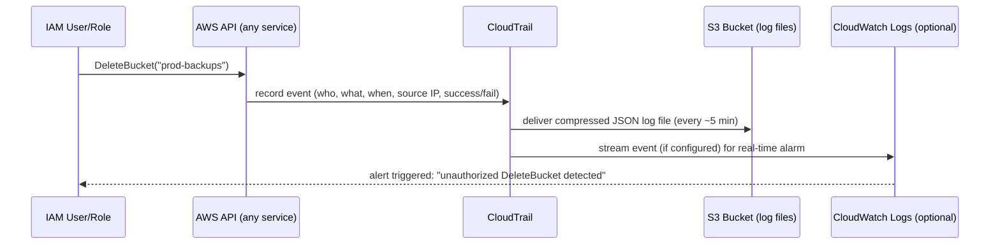

# AWS CloudTrail


## Definition

AWS CloudTrail records every API call made in your AWS account — who made it, what they called,
when, from what IP address, and whether it succeeded — and stores that history as an immutable
audit log. In one sentence: CloudTrail answers **"who did what, and when?"**

## Purpose

Every single action in AWS — launching an EC2 instance, deleting an S3 bucket, changing an IAM
policy, even viewing something in the console — happens as an API call under the hood. Without a
record of those calls, after-the-fact questions like "who deleted that bucket on Tuesday?" or
"did anyone access this secret outside business hours?" are unanswerable. AWS built CloudTrail so
every account has a built-in, tamper-evident audit trail by default, satisfying both security
investigation needs and compliance requirements (SOC 2, PCI-DSS, HIPAA, and others all expect an
audit log of administrative activity).

## How It Works

CloudTrail is **on by default** for every AWS account, retaining the last 90 days of
**management events** (account-level actions like creating a resource, changing an IAM policy)
in the **Event History** view at no cost, with no setup required. To keep events longer, filter
them, or capture higher-volume **data events** (individual S3 object reads, DynamoDB item
operations), you create a **Trail** — a named configuration that continuously delivers events as
compressed JSON log files to an S3 bucket (and optionally CloudWatch Logs for real-time
alerting, or CloudTrail Lake for SQL-based querying).



Walking through it: (1) a user, role, or AWS service itself makes an API call — in this example,
deleting an S3 bucket; (2) every AWS service automatically reports that call to CloudTrail with
the identity that made it, the exact parameters, the source IP/user agent, and the result;
(3) CloudTrail batches events and delivers them as gzipped JSON files to an S3 bucket roughly
every five minutes for durable, long-term storage; (4) if you've also configured delivery to
CloudWatch Logs, the same event can trigger a **metric filter → alarm → SNS notification** in
near-real time, so "someone just deleted a production bucket" can page someone within minutes
instead of being discovered days later when a security review reads the S3 logs.

## Key Features / Components

- **Event History** — the free, always-on, 90-day rolling view of management events, searchable
  in the console/CLI with no trail configuration needed.
- **Trails** — a named, configurable, ongoing delivery of events to S3 (and optionally CloudWatch
  Logs), for retention beyond 90 days and for data event capture.
- **Management Events** — control-plane operations (create/modify/delete resources, IAM changes)
  — logged by default in Event History.
- **Data Events** — high-volume resource-level operations (S3 `GetObject`/`PutObject`, Lambda
  `Invoke`, DynamoDB item-level actions) — **not** captured unless explicitly enabled on a trail,
  because of the volume/cost involved.
- **Insights Events** — ML-powered anomaly detection on *unusual* API call volume/rate patterns
  (e.g., a sudden spike in `IAM:CreateUser` calls that doesn't match normal account behavior).
- **Organization Trails** — one trail configured at the AWS Organizations management account
  level that automatically covers every member account — a common governance baseline.
- **Log File Integrity Validation** — cryptographically hashes delivered log files so you can
  prove after the fact that nobody tampered with the audit trail itself.
- **CloudTrail Lake** — a managed data store for CloudTrail events queryable with SQL, useful for
  longer retention and complex investigations without standing up your own log pipeline.

## Use Cases — When to Use It

- Security investigation: "who deleted this resource / changed this security group / disabled
  this trail?" — always start with CloudTrail.
- Compliance evidence: auditors asking for proof of who had administrative access and what they
  did with it.
- Detecting and alerting on suspicious activity in near-real-time (root account usage,
  unauthorized API calls, disabling of security controls like GuardDuty or the trail itself).
- Forensic reconstruction after an incident — exact sequence and timing of actions taken.
- Governance baseline: an Organization Trail that can't be disabled by member accounts, ensuring
  nobody can "go dark" and act without a record.

## When NOT to Use It / Alternatives

- **"Is my application running correctly / how much CPU is it using?"** — that's **CloudWatch**,
  not CloudTrail. CloudTrail has nothing to say about application performance.
- **Real-time resource configuration compliance** ("is every S3 bucket encrypted right now?") —
  that's **AWS Config**, which evaluates current/historical *state*, not the *API call history*
  that produced that state.
- **Network traffic inspection** (who connected to what, what data moved) — that's **VPC Flow
  Logs**, a different log type entirely, capturing IP traffic rather than AWS API calls.
- **Cost attribution** — CloudTrail doesn't tell you what anything cost; see
  [Cost Management Tools](cost-management-tools.md) for that.

## Why It's Important

**Real-world**: CloudTrail is frequently the deciding piece of evidence in both security incident
response and compliance audits — "prove nobody accessed this data outside the approved process"
is only answerable if the log exists, wasn't disabled, and wasn't tampered with (hence log file
integrity validation). Disabling CloudTrail (or a trail) is itself one of the first things a
security team watches for, because an attacker's first move after gaining access is often to
blind the audit trail.

**Exam weight**:
- **SAA-C03 Domain 1 (Secure Architectures)** and **Domain 4 (Cost-Optimized Architectures,
  20%)** both reference CloudTrail — Domain 1 for the audit/compliance angle, Domain 4 for
  understanding that Event History is free but trails with S3 storage and data events carry cost
  that should be scoped (not every account needs every data event logged forever).
- **DVA-C03 Domain 4 (Troubleshooting and Optimization, 22%), Task 4.1 — Assist in root cause
  analysis** explicitly names **CloudTrail** alongside CloudWatch Logs/Metrics and X-Ray as a
  named root-cause-analysis tool — but for the "who/what changed this" angle specifically, not
  performance.
- **MLA-C02 Domain 4 (Operating, Monitoring, and Securing ML and AI Solutions, 24%)** covers
  security of ML/AI solutions, where CloudTrail is the mechanism for auditing who accessed
  training data, invoked a model endpoint, or changed a SageMaker/Bedrock configuration.
- This is one of the single most-tested distinctions across all three certs: **CloudWatch vs.
  CloudTrail**, see Exam Tips.

## Pricing Model (summary)

**Event History (management events, 90 days) is free**, with no trail required. Creating a trail
adds costs: you pay normal **S3 storage** rates for the delivered log files, plus, if enabled,
**per-event charges for data events and Insights events** beyond a free allotment of management
events in the first trail. The first copy of management events delivered to one trail is free;
additional trails/copies, all data events, and Insights events are billed per 100,000 events.
See: https://aws.amazon.com/cloudtrail/pricing/

## Hands-on Lab (Floci)

Floci emulates CloudTrail in-process — trails, event selectors (including S3 data-event
matching), `StartLogging`/`StopLogging`, scheduled gzipped log delivery to a destination bucket,
and even IAM-deny events appearing as `AccessDenied` records — making this one of the more
faithful local labs for this category.

```bash
alias awslocal='aws --endpoint-url=http://localhost:4566 --profile floci'

# 1. Create a destination bucket for log files (CloudTrail requires one)
awslocal s3 mb s3://lab-cloudtrail-logs

# 2. Create and start a trail
awslocal cloudtrail create-trail \
  --name lab-trail \
  --s3-bucket-name lab-cloudtrail-logs
awslocal cloudtrail start-logging --name lab-trail

# 3. Generate some API activity to actually audit
awslocal s3 mb s3://some-other-bucket
awslocal s3 rb s3://some-other-bucket --force

# 4. Look up recent activity (equivalent to the free Event History view)
awslocal cloudtrail lookup-events \
  --lookup-attributes AttributeKey=EventName,AttributeValue=DeleteBucket

# 5. Confirm delivered log files landed in the destination bucket
awslocal s3 ls s3://lab-cloudtrail-logs/AWSLogs/ --recursive

# 6. Stop logging when done
awslocal cloudtrail stop-logging --name lab-trail
```

Try disabling IAM permissions on a test role and repeating step 3 — Floci will emit an
`AccessDenied` CloudTrail record instead of a successful one, exactly mirroring how real AWS
distinguishes authorized vs. denied API calls in the audit trail.

## Exam Tips

- **The single most common confusion on these exams: CloudTrail vs. CloudWatch.**
  - **CloudTrail = WHO did WHAT (API call audit log)** — "who deleted the bucket," "who changed
    the security group," "did anyone call `CreateUser` outside business hours."
  - **CloudWatch = performance/health (metrics, logs, alarms, dashboards)** — "is CPU high," "is
    the app throwing errors," "scale out when load increases."
  - If the question is about **accountability/audit/compliance/forensics**, it's CloudTrail.
    If it's about **performance, availability, or operational health**, it's CloudWatch. They
    are *not* substitutes for each other and a question will often offer both as tempting
    wrong/right pairs.
- **Data events are off by default** — if a question describes needing to track individual
  `GetObject` calls on a sensitive S3 bucket and nothing shows up, the fix is enabling **data
  events** on the trail, not assuming CloudTrail is broken.
- **Disabling or deleting a trail is itself a loggable, alertable event** — tested in security
  scenario questions about detecting tampering with the audit system itself.
- **CloudTrail Lake** = SQL-queryable long-term store; a question wanting "run a SQL query across
  a year of audit history" points here rather than parsing raw S3 log files by hand.
- **Log file integrity validation** proves logs weren't altered after delivery — relevant to
  "how do you prove these logs are trustworthy in court/to an auditor" questions.

## Related Terms

- [Amazon CloudWatch](cloudwatch.md) — performance/health monitoring, the service CloudTrail is
  constantly confused with; read both docs together
- [AWS Config](aws-config.md) — current/historical *configuration state* compliance, distinct
  from CloudTrail's *API call history*
- [AWS CloudFormation](cloudformation.md) — drift detection complements CloudTrail: drift shows
  *what* changed, CloudTrail shows *who* changed it
- Glossary: Management Event, Data Event, Audit Log, Trail, Immutability
