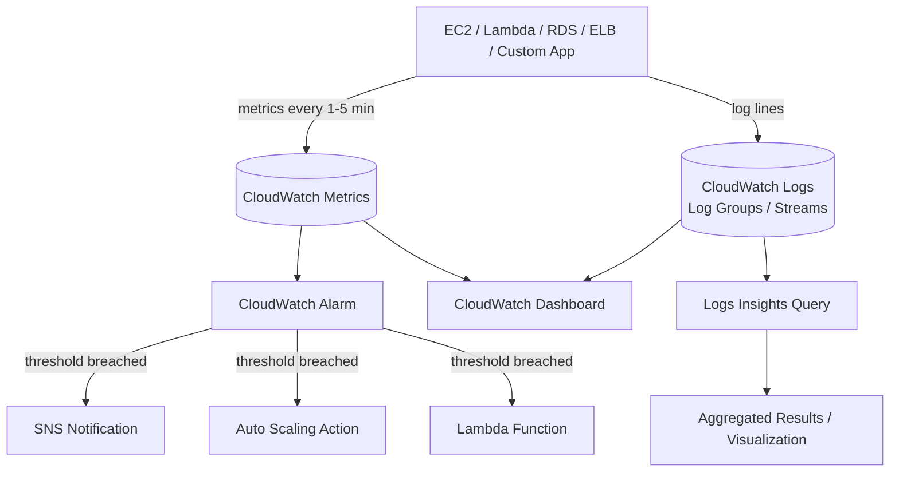

# Amazon CloudWatch


## Definition

Amazon CloudWatch is AWS's monitoring and observability service. It collects **metrics**
(numbers over time — CPU %, request count, error rate), **logs** (text output from your
applications and AWS services), and lets you visualize them on **dashboards**, trigger
**alarms** when something crosses a threshold, and search through logs with a query language
called **Logs Insights**.

## Purpose

Running infrastructure without monitoring is flying blind — you find out your application is
down when a customer complains, not when it actually broke. AWS built CloudWatch as the built-in,
always-on nervous system for everything running on AWS: every major service (EC2, Lambda, RDS,
DynamoDB, ELB, and dozens more) automatically reports metrics to CloudWatch with zero setup, and
you can add your own custom metrics and logs on top for application-specific visibility.

## How It Works

AWS services push metrics (like `CPUUtilization` or `Invocations`) into CloudWatch automatically
every one or five minutes, depending on the service and whether "detailed monitoring" is
enabled. Applications write log lines to **log groups**, organized into **log streams** (usually
one stream per instance/container/invocation). You set an **alarm** on a metric — "if average
CPU exceeds 80% for 3 consecutive 5-minute periods, do X" — and the alarm fires an action (SNS
notification, Auto Scaling action, Lambda invocation). **Dashboards** are customizable visual
boards combining multiple metrics/logs widgets. **CloudWatch Logs Insights** lets you run a
purpose-built query language directly against log data to find and aggregate specific events
without exporting logs anywhere else.



Walking through it: (1) a resource (an EC2 instance, a Lambda function, your own code via the
CloudWatch agent or SDK) emits metrics and/or log lines continuously; (2) metrics land in
**CloudWatch Metrics** as time-series data points, logs land in **CloudWatch Logs** as raw text
organized by log group/stream; (3) an **Alarm** watches one metric and compares it against a
threshold over a set evaluation period; (4) when the alarm trips, it can fan out to multiple
targets simultaneously — notify a human via SNS, trigger an Auto Scaling policy, or invoke a
Lambda for custom remediation; (5) a **Dashboard** pulls live metric and log data into one visual
view for humans to monitor at a glance; (6) **Logs Insights** lets you write a query (e.g.,
`fields @timestamp, @message | filter @message like /ERROR/ | stats count() by bin(5m)`) directly
against log data on demand, without pre-defining a metric for every possible question you might
ask later.

## Key Features / Components

- **Metrics** — numeric time-series data, either automatic (AWS service metrics) or custom
  (`PutMetricData` from your own code), with namespaces, dimensions, and statistics
  (Average, Sum, Max, Min, percentiles).
- **Logs** — centralized log storage with log groups (retention policy, encryption) and log
  streams; the CloudWatch Agent or Lambda's built-in integration ships logs here automatically.
- **Logs Insights** — a purpose-built query language for ad-hoc search/aggregation across huge
  volumes of log data, far faster than grepping raw log files.
- **Alarms** — threshold-based triggers with states OK / ALARM / INSUFFICIENT_DATA, supporting
  composite alarms (combine multiple alarms with AND/OR logic).
- **Dashboards** — customizable, shareable visual boards; can combine metrics from multiple
  accounts/regions via CloudWatch cross-account observability.
- **Events / EventBridge integration** — CloudWatch Events (now largely superseded by Amazon
  EventBridge) reacts to state changes across AWS services, not just metric thresholds.
- **Synthetics & RUM** — Canaries (scripted, scheduled checks of endpoints) and Real User
  Monitoring (actual browser-side user experience data).
- **Contributor Insights / Anomaly Detection** — surfaces top contributors to a metric and flags
  statistically abnormal patterns automatically, without a manually-set static threshold.

## Use Cases — When to Use It

- Auto Scaling triggers: scale an EC2 fleet or ECS service out when average CPU/request latency
  crosses a threshold, scale in when it drops.
- Centralizing application logs from many instances/containers into one searchable place instead
  of SSHing into each box.
- Alerting on-call engineers (via SNS → email/SMS/PagerDuty) when error rates spike.
- Building an operational dashboard a team watches during a deployment or incident.
- Debugging production issues with Logs Insights queries instead of downloading raw log files.
- Cost/performance tuning: Lambda duration and memory metrics inform right-sizing decisions.

## When NOT to Use It / Alternatives

- **Deep distributed tracing across microservices** (which service in a call chain added
  latency) — use **AWS X-Ray**, which CloudWatch complements but doesn't replace.
- **Auditing who did what (API call history)** — that's **CloudTrail**, not CloudWatch; this is
  the single most common exam and real-world confusion (see Exam Tips below).
- **Long-term, cheap archival of logs for compliance (years, rarely queried)** — exporting
  CloudWatch Logs to S3 (with lifecycle rules to Glacier) is cheaper than keeping everything in
  CloudWatch Logs' standard retention indefinitely.
- **Very high-cardinality custom metrics at massive scale** — teams sometimes pair CloudWatch
  with Amazon Managed Service for Prometheus/Grafana when they need PromQL and have
  Kubernetes-native tooling already in place.

## Why It's Important

**Real-world**: CloudWatch is usually the first and last place an engineer looks during an
incident — first to see what broke (metrics spiking, errors in logs), last to confirm the fix
worked (metrics back to normal). Alarms tied to Auto Scaling are what actually keeps a web
application responsive under variable load without a human watching dashboards 24/7.

**Exam weight**:
- **SAA-C03 Domain 4 (Cost-Optimized Architectures, 20%)** — CloudWatch metrics drive
  right-sizing decisions (is this instance over-provisioned?) and Auto Scaling policies that
  directly optimize cost against demand.
- **DVA-C03 Domain 4 (Troubleshooting and Optimization, 22%), Task 4.1 — Assist in root cause
  analysis**, explicitly lists **CloudWatch Logs/Metrics** as a named tool, and **Task 4.2 —
  Instrument code for observability** is almost entirely about CloudWatch (custom metrics,
  structured logging, embedded metric format).
- **MLA-C02 Domain 4 (Operating, Monitoring, and Securing ML and AI Solutions, 24%)** — monitoring
  model/data/infrastructure health is explicitly framed around CloudWatch alongside SageMaker
  Model Monitor and X-Ray.
- It recurs across every domain of every one of these three certs because "how do you know X is
  working / how do you get alerted when it isn't" is answered with CloudWatch constantly.

## Pricing Model (summary)

CloudWatch has a perpetual free tier (basic EC2 metrics at 5-minute intervals, 10 custom metrics,
some free alarms, 5GB log ingestion/storage) and then charges per-dimension: **custom metrics**
per metric per month, **alarms** per alarm per month, **log ingestion** per GB ingested plus
**log storage** per GB per month, **dashboard** per dashboard per month beyond the free tier, and
**Logs Insights queries** per GB of data scanned. Detailed (1-minute) monitoring on EC2 costs
more than the default 5-minute basic monitoring. See:
https://aws.amazon.com/cloudwatch/pricing/

## Hands-on Lab (Floci)

Floci emulates CloudWatch Metrics and CloudWatch Logs in-process (custom metrics, statistics,
alarms; log groups, streams, ingestion, filtering), so the core lifecycle works locally.

```bash
alias awslocal='aws --endpoint-url=http://localhost:4566 --profile floci'

# 1. Push a custom metric
awslocal cloudwatch put-metric-data \
  --namespace "LabApp/Orders" \
  --metric-name OrdersProcessed \
  --value 42 \
  --unit Count

# 2. Read it back
awslocal cloudwatch get-metric-statistics \
  --namespace "LabApp/Orders" \
  --metric-name OrdersProcessed \
  --start-time "$(date -u -d '-1 hour' +%Y-%m-%dT%H:%M:%S)" \
  --end-time "$(date -u +%Y-%m-%dT%H:%M:%S)" \
  --period 300 \
  --statistics Sum

# 3. Create an alarm on it
awslocal cloudwatch put-metric-alarm \
  --alarm-name HighOrderVolume \
  --namespace "LabApp/Orders" \
  --metric-name OrdersProcessed \
  --statistic Sum \
  --period 300 \
  --threshold 1000 \
  --comparison-operator GreaterThanThreshold \
  --evaluation-periods 1

# 4. Create a log group/stream and ingest a line
awslocal logs create-log-group --log-group-name /lab/app
awslocal logs create-log-stream --log-group-name /lab/app --log-stream-name run-1
awslocal logs put-log-events --log-group-name /lab/app --log-stream-name run-1 \
  --log-events timestamp=$(date +%s000),message="ERROR: payment timeout for order 42"

# 5. Filter it back out
awslocal logs filter-log-events --log-group-name /lab/app --filter-pattern "ERROR"
```

**Honest note**: Floci's CloudWatch Logs implementation covers ingestion/filtering, not the full
Logs Insights query engine or dashboard rendering (`PutDashboard`/`GetDashboard`) — treat
Logs Insights and Dashboards as concepts to understand against the official AWS docs/console,
and use the commands above for the metrics/alarms/log-ingestion mechanics that Floci does run
for real.

## Exam Tips

- **The classic trap: CloudWatch ≠ CloudTrail.** CloudWatch = *performance* (metrics, logs,
  alarms, dashboards — "is it healthy, is it fast, is it erroring?"). CloudTrail = *audit*
  ("who called which API, when, from where?"). A question about "detect unauthorized API
  activity" or "who deleted this S3 bucket" is CloudTrail, never CloudWatch, even though both
  names contain "Cloud" and both show up in monitoring/governance scenarios.
- **Alarms drive Auto Scaling.** If a question describes scaling in/out based on load, the metric
  source feeding that decision is CloudWatch.
- **Custom metrics require `PutMetricData`** — AWS service metrics are automatic; your
  application's own business metrics (orders processed, queue depth your code tracks) are not,
  and must be explicitly pushed.
- **Logs Insights is query-on-demand, not pre-aggregated** — if a question wants "ad-hoc search
  across historical logs without setting anything up in advance," that's Logs Insights, not a
  metric filter (which must be defined before the data you want to count arrives).
- Default EC2 monitoring is every **5 minutes**, free; **detailed monitoring is 1-minute**,
  costs extra — a subtle but testable distinction in cost-optimization questions.

## Related Terms

- [AWS CloudTrail](cloudtrail.md) — audit log of API activity, the service CloudWatch is most
  often confused with
- [AWS Config](aws-config.md) — configuration compliance tracking, complements CloudWatch's
  performance monitoring
- [Systems Manager](systems-manager.md) — often surfaces CloudWatch metrics/logs in its
  operational dashboards (OpsCenter, Explorer)
- Glossary: Metric, Namespace, Dimension, Alarm, Log Group, Observability, X-Ray
