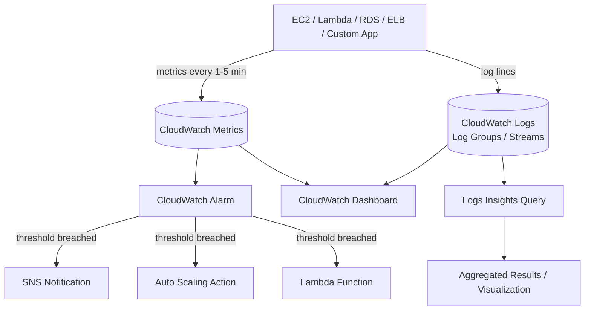
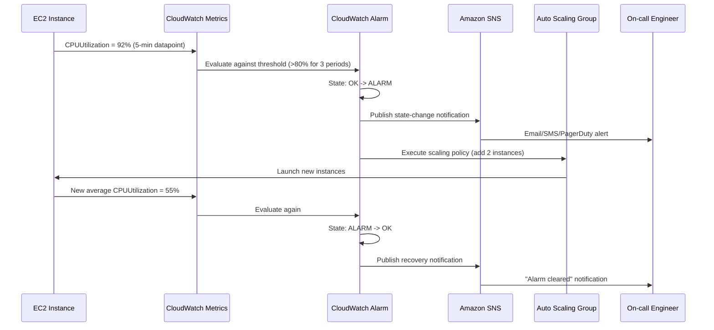
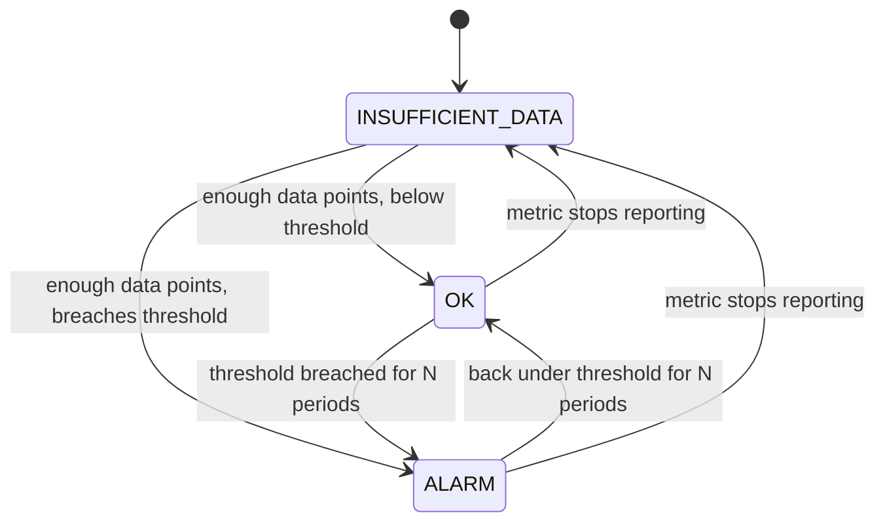
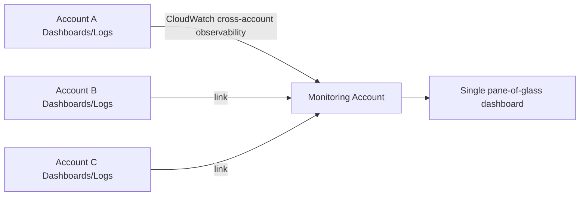

# Amazon CloudWatch


## Definition

Amazon CloudWatch is AWS's monitoring and observability service. It collects **metrics**
(numbers over time — CPU %, request count, error rate), **logs** (text output from your
applications and AWS services), and lets you visualize them on **dashboards**, trigger
**alarms** when something crosses a threshold, and search through logs with a query language
called **Logs Insights**.

## Purpose

Running infrastructure without monitoring is flying blind — you find out your application is
down when a customer complains, not when it actually broke. AWS built CloudWatch as the built-in,
always-on nervous system for everything running on AWS: every major service (EC2, Lambda, RDS,
DynamoDB, ELB, and dozens more) automatically reports metrics to CloudWatch with zero setup, and
you can add your own custom metrics and logs on top for application-specific visibility.

The underlying problem CloudWatch solves is **turning "it feels slow" into a number you can
alert on**. Human perception of system health doesn't scale past a handful of services and
doesn't work at 3 AM. CloudWatch exists so "is this healthy" is answered by a continuously
evaluated expression against real telemetry, not a gut feeling, and so the gap between "something
broke" and "someone finds out" shrinks from hours to seconds.

## How It Works

AWS services push metrics (like `CPUUtilization` or `Invocations`) into CloudWatch automatically
every one or five minutes, depending on the service and whether "detailed monitoring" is
enabled. Applications write log lines to **log groups**, organized into **log streams** (usually
one stream per instance/container/invocation). You set an **alarm** on a metric — "if average
CPU exceeds 80% for 3 consecutive 5-minute periods, do X" — and the alarm fires an action (SNS
notification, Auto Scaling action, Lambda invocation). **Dashboards** are customizable visual
boards combining multiple metrics/logs widgets. **CloudWatch Logs Insights** lets you run a
purpose-built query language directly against log data to find and aggregate specific events
without exporting logs anywhere else.



Walking through it: (1) a resource (an EC2 instance, a Lambda function, your own code via the
CloudWatch agent or SDK) emits metrics and/or log lines continuously; (2) metrics land in
**CloudWatch Metrics** as time-series data points, logs land in **CloudWatch Logs** as raw text
organized by log group/stream; (3) an **Alarm** watches one metric and compares it against a
threshold over a set evaluation period; (4) when the alarm trips, it can fan out to multiple
targets simultaneously — notify a human via SNS, trigger an Auto Scaling policy, or invoke a
Lambda for custom remediation; (5) a **Dashboard** pulls live metric and log data into one visual
view for humans to monitor at a glance; (6) **Logs Insights** lets you write a query (e.g.,
`fields @timestamp, @message | filter @message like /ERROR/ | stats count() by bin(5m)`) directly
against log data on demand, without pre-defining a metric for every possible question you might
ask later.

### Metric → alarm → action flow, in detail



Walking through it: (1) the resource keeps reporting a metric on its normal cadence; (2) the
alarm doesn't react to a single data point — it requires the threshold to hold for the configured
number of **evaluation periods**, which prevents a single brief spike from triggering unnecessary
action (a deliberate design against alert flapping); (3) once in `ALARM` state, every configured
action fires — both a human notification *and* an automated remediation (scaling) can happen from
the same alarm simultaneously; (4) once the underlying condition resolves (more capacity brings
CPU back down), the alarm re-evaluates and transitions back to `OK`, which itself can also notify
(so the team knows the incident self-resolved, not just that it started).

### Alarm states and composite alarms



A **composite alarm** combines multiple child alarms with AND/OR logic (e.g., "only page someone
if *both* high latency AND high error rate are true simultaneously") — this reduces noisy,
single-metric false positives, a pattern worth knowing because DVA-C03's "instrument for
observability" task statement explicitly expects you to design alerting that avoids alert fatigue.

## Worked Example: CloudWatch Logs Insights Queries

Assume an application log group `/app/orders-service` where each line is a JSON-structured log
entry like `{"level":"ERROR","orderId":"o-4471","latencyMs":812,"message":"payment timeout"}`.

**Query 1 — top error messages in the last hour, counted:**

```
fields @timestamp, @message
| filter level = "ERROR"
| stats count() as errorCount by message
| sort errorCount desc
| limit 20
```

**Query 2 — p50/p90/p99 latency over 5-minute buckets, to spot a creeping regression:**

```
fields @timestamp, latencyMs
| stats pct(latencyMs, 50) as p50, pct(latencyMs, 90) as p90, pct(latencyMs, 99) as p99 by bin(5m)
| sort @timestamp desc
```

**Query 3 — correlate errors to a specific order ID across multiple log streams (instances):**

```
fields @timestamp, @logStream, @message
| filter orderId = "o-4471"
| sort @timestamp asc
```

**Query 4 — detect a sudden spike in error rate vs. the prior hour (used as the basis for a
custom metric filter → alarm):**

```
filter level = "ERROR"
| stats count() as errors by bin(10m)
| sort @timestamp desc
```

**Query 5 — parse an unstructured (non-JSON) Apache-style access log for 5xx responses:**

```
fields @timestamp, @message
| parse @message '* * * [*] "* * *" * *' as host, ident, user, ts, method, path, protocol, status, bytes
| filter status >= 500
| stats count() as serverErrors by path
| sort serverErrors desc
```

Notice the difference between `fields`/`filter` (works on both JSON and raw text logs, with
JSON fields automatically available by dotted name) and `parse` (used when log lines are
unstructured text and you need to extract fields with a pattern) — a distinction that trips up
people used to only structured application logs.

### Turning a Logs Insights pattern into a real-time alarm: metric filters

Logs Insights queries are **on-demand** — they don't alert by themselves. To get proactive
alerting from log content, you define a **metric filter** on the log group, which converts a
matching log pattern into a CloudWatch metric that an alarm can then watch continuously:

```bash
aws logs put-metric-filter \
  --log-group-name /app/orders-service \
  --filter-name PaymentTimeoutErrors \
  --filter-pattern '{ $.level = "ERROR" && $.message = "*payment timeout*" }' \
  --metric-transformations \
      metricName=PaymentTimeoutCount,metricNamespace=OrdersService,metricValue=1,defaultValue=0

aws cloudwatch put-metric-alarm \
  --alarm-name HighPaymentTimeoutRate \
  --namespace OrdersService \
  --metric-name PaymentTimeoutCount \
  --statistic Sum \
  --period 300 \
  --threshold 10 \
  --comparison-operator GreaterThanThreshold \
  --evaluation-periods 1 \
  --alarm-actions arn:aws:sns:us-east-1:123456789012:ops-alerts
```

This is the exact mechanism behind "alert me when this specific error message appears more than
N times in M minutes" — a metric filter turns unstructured text into a first-class metric, and
everything downstream (alarms, dashboards, Auto Scaling) works on it exactly like any other
CloudWatch metric.

## Key Features / Components

- **Metrics** — numeric time-series data, either automatic (AWS service metrics) or custom
  (`PutMetricData` from your own code), with namespaces, dimensions, and statistics
  (Average, Sum, Max, Min, percentiles).
- **Logs** — centralized log storage with log groups (retention policy, encryption) and log
  streams; the CloudWatch Agent or Lambda's built-in integration ships logs here automatically.
- **Logs Insights** — a purpose-built query language for ad-hoc search/aggregation across huge
  volumes of log data, far faster than grepping raw log files.
- **Metric Filters** — convert a matching log pattern into a numeric metric, bridging unstructured
  log content into the alarm/dashboard ecosystem.
- **Alarms** — threshold-based triggers with states OK / ALARM / INSUFFICIENT_DATA, supporting
  composite alarms (combine multiple alarms with AND/OR logic).
- **Dashboards** — customizable, shareable visual boards; can combine metrics from multiple
  accounts/regions via CloudWatch cross-account observability.
- **Events / EventBridge integration** — CloudWatch Events (now largely superseded by Amazon
  EventBridge) reacts to state changes across AWS services, not just metric thresholds.
- **Synthetics & RUM** — Canaries (scripted, scheduled checks of endpoints) and Real User
  Monitoring (actual browser-side user experience data).
- **Contributor Insights / Anomaly Detection** — surfaces top contributors to a metric and flags
  statistically abnormal patterns automatically, without a manually-set static threshold.
- **Embedded Metric Format (EMF)** — a structured JSON log format that CloudWatch automatically
  extracts into real metrics from log lines, letting an application emit high-cardinality custom
  metrics cheaply without explicit `PutMetricData` calls per data point.

## Cost Explorer Worked Example: Finding What's Driving the CloudWatch Bill

CloudWatch bills often surprise teams that over-adopted detailed monitoring or very granular
custom metrics. A realistic Cost Explorer investigation looks like this:

1. Open Cost Explorer, filter **Service = CloudWatch**, group by **Usage Type**, over the last 6
   months.
2. The usage types that typically dominate a CloudWatch bill:
   - `CW:MetricMonitorUsage` — custom metrics beyond the free tier (10 free custom metrics).
   - `CW:Requests` — API calls (`GetMetricData`, `PutMetricData`) beyond the free tier.
   - `DataProcessing-Bytes` — Logs ingestion, billed per GB.
   - `TimedStorage-ByteHrs` — Logs storage, billed per GB-month, affected directly by retention
     settings (a log group set to "Never expire" silently accumulates storage cost forever).
   - `CW:GMD-Metrics` — Logs Insights queries, billed per GB scanned per query.
3. A common finding: a team enabled **detailed (1-minute) monitoring** on every EC2 instance in
   a large fleet "just in case," when only a handful of instances actually needed sub-5-minute
   granularity — switching the rest back to default 5-minute monitoring cuts that line item with
   zero operational downside for instances nobody watches that closely.
4. A second common finding: a log group ingesting debug-level logs in production with **no
   retention policy set**, silently growing the storage bill every month — setting retention to
   30 or 90 days (via `put-retention-policy`) caps it going forward (existing accumulated data
   still needs a one-time cleanup/export decision).

```bash
# Group CloudWatch costs by usage type for the last 6 months
aws ce get-cost-and-usage \
  --time-period Start=2026-05-01,End=2026-11-01 \
  --granularity MONTHLY \
  --filter '{"Dimensions":{"Key":"SERVICE","Values":["AmazonCloudWatch"]}}' \
  --group-by Type=DIMENSION,Key=USAGE_TYPE \
  --metrics "UnblendedCost"

# Find log groups with no retention policy set (unbounded storage growth risk)
aws logs describe-log-groups \
  --query 'logGroups[?!retentionInDays].[logGroupName]' \
  --output text
```

## Common Architectures

**1. Fleet auto-scaling driven by a custom application metric, not just CPU**

Rather than scaling purely on CPU (which can be a poor proxy for actual load on an I/O-bound
service), the application emits a custom metric (`QueueDepth`, `ActiveConnections`) via
`PutMetricData` or EMF, and an Auto Scaling target-tracking policy scales on that metric directly
— a pattern explicitly favored in SAA-C03 performance-efficiency scenarios over blind CPU-based
scaling.

**2. Centralized, cross-account observability for a multi-account organization**



A dedicated "monitoring account" is linked as an observability sink for every workload account in
an AWS Organization, giving a central SRE/platform team one dashboard spanning every account
without needing cross-account console-switching.

**3. Error-budget alerting via composite alarms**

Two child alarms — one on error rate, one on request volume — combine into a composite alarm that
only fires when error rate is high **and** traffic volume is high enough that it's a real signal,
not noise from a single stray request during a quiet period.

**4. Synthetic canaries guarding a public-facing endpoint independent of real traffic**

A CloudWatch Synthetics canary runs a scripted request against a login page or checkout flow
every few minutes from outside the VPC, so an outage is detected even during periods of genuinely
low real user traffic (e.g., 3 AM) when waiting for real-user error metrics to accumulate would
otherwise delay detection.

## Use Cases — When to Use It

- Auto Scaling triggers: scale an EC2 fleet or ECS service out when average CPU/request latency
  crosses a threshold, scale in when it drops.
- Centralizing application logs from many instances/containers into one searchable place instead
  of SSHing into each box.
- Alerting on-call engineers (via SNS → email/SMS/PagerDuty) when error rates spike.
- Building an operational dashboard a team watches during a deployment or incident.
- Debugging production issues with Logs Insights queries instead of downloading raw log files.
- Cost/performance tuning: Lambda duration and memory metrics inform right-sizing decisions.

## When NOT to Use It / Alternatives

- **Deep distributed tracing across microservices** (which service in a call chain added
  latency) — use **AWS X-Ray**, which CloudWatch complements but doesn't replace.
- **Auditing who did what (API call history)** — that's **CloudTrail**, not CloudWatch; this is
  the single most common exam and real-world confusion (see Exam Tips below).
- **Long-term, cheap archival of logs for compliance (years, rarely queried)** — exporting
  CloudWatch Logs to S3 (with lifecycle rules to Glacier) is cheaper than keeping everything in
  CloudWatch Logs' standard retention indefinitely.
- **Very high-cardinality custom metrics at massive scale** — teams sometimes pair CloudWatch
  with Amazon Managed Service for Prometheus/Grafana when they need PromQL and have
  Kubernetes-native tooling already in place.

## Why It's Important

**Real-world**: CloudWatch is usually the first and last place an engineer looks during an
incident — first to see what broke (metrics spiking, errors in logs), last to confirm the fix
worked (metrics back to normal). Alarms tied to Auto Scaling are what actually keeps a web
application responsive under variable load without a human watching dashboards 24/7.

**Exam weight**:
- **SAA-C03 Domain 4 (Cost-Optimized Architectures, 20%)** — CloudWatch metrics drive
  right-sizing decisions (is this instance over-provisioned?) and Auto Scaling policies that
  directly optimize cost against demand.
- **DVA-C03 Domain 4 (Troubleshooting and Optimization, 22%), Task 4.1 — Assist in root cause
  analysis**, explicitly lists **CloudWatch Logs/Metrics** as a named tool, and **Task 4.2 —
  Instrument code for observability** is almost entirely about CloudWatch (custom metrics,
  structured logging, embedded metric format). Expect a scenario needing a specific Logs Insights
  query or a metric filter to turn log text into an alertable metric.
- **MLA-C02 Domain 4 (Operating, Monitoring, and Securing ML and AI Solutions, 24%)** — monitoring
  model/data/infrastructure health is explicitly framed around CloudWatch alongside SageMaker
  Model Monitor and X-Ray.
- It recurs across every domain of every one of these three certs because "how do you know X is
  working / how do you get alerted when it isn't" is answered with CloudWatch constantly.

## Pricing Model (summary)

CloudWatch has a perpetual free tier (basic EC2 metrics at 5-minute intervals, 10 custom metrics,
some free alarms, 5GB log ingestion/storage) and then charges per-dimension: **custom metrics**
per metric per month, **alarms** per alarm per month, **log ingestion** per GB ingested plus
**log storage** per GB per month, **dashboard** per dashboard per month beyond the free tier, and
**Logs Insights queries** per GB of data scanned. Detailed (1-minute) monitoring on EC2 costs
more than the default 5-minute basic monitoring. See:
https://aws.amazon.com/cloudwatch/pricing/

## Limits & Quotas

| Limit | Default Value | Practical Impact |
|---|---|---|
| Custom metrics free tier | 10 per month | Beyond this, every additional custom metric is billed monthly |
| Metric data retention | 15 months (automatically, at decreasing resolution over time) | Old high-resolution data is automatically "rolled up" — exact 1-second data isn't kept forever |
| Alarms per account (soft) | 5,000 | Large fleets with per-instance alarms can approach this; consider composite/aggregate alarms |
| Log event size | 256 KB per event | A single oversized log line (e.g., a huge stack trace) gets truncated/rejected |
| Logs Insights query time range | 1 hour to 1 year depending on query | Longer ranges scan more data and cost more per query |
| PutMetricData batch size | 1,000 metrics per API call | High-throughput custom metric emitters must batch calls to avoid throttling |
| Dashboard widgets | 500 per dashboard (soft) | Extremely dense dashboards should be split for both this limit and human readability |

## Troubleshooting / Common Issues

- **Alarm stuck in `INSUFFICIENT_DATA`** — the metric isn't reporting at all (often because the
  resource doesn't exist, the namespace/dimension names don't exactly match what's being emitted,
  or `PutMetricData` is failing silently due to an IAM permission gap). Verify with
  `get-metric-statistics` directly before assuming the alarm configuration is wrong.
- **"My alarm never fires even though the metric clearly spiked"** — check `EvaluationPeriods`
  and `DatapointsToAlarm`; a spike lasting one period won't trigger an alarm requiring 3
  consecutive breaching periods — this is by design, not a bug, to avoid flapping on noise.
- **Logs Insights returns nothing for a query that should match** — confirm the time range picker
  actually covers when the events occurred (the single most common cause), and that `filter`
  field names match the actual JSON key casing exactly (CloudWatch Logs Insights field access is
  case-sensitive).
- **Custom metric never appears in the console** — namespaces/metrics can take up to a few
  minutes to first appear after the first `PutMetricData` call; also verify the IAM policy
  includes `cloudwatch:PutMetricData` with no resource-level restriction (CloudWatch metrics
  don't support resource-level IAM conditions the way some other services do).
- **Unexpectedly high bill from Logs Insights** — queries are billed per GB *scanned*, not per
  result returned; a broad, long-time-range query against a high-volume log group scans
  (and bills) the same whether it returns 2 rows or 2 million.
- **Dashboard shows "No data available" for a cross-account widget** — cross-account
  observability requires the monitoring account to be explicitly linked, and the source account
  must have opted in; a misconfigured link is the most common cause, not a metrics gap.

## Further Reading

- Amazon CloudWatch User Guide: https://docs.aws.amazon.com/AmazonCloudWatch/latest/monitoring/
- CloudWatch Logs Insights query syntax reference:
  https://docs.aws.amazon.com/AmazonCloudWatch/latest/logs/CWL_QuerySyntax.html
- Analyzing, optimizing, and reducing CloudWatch costs:
  https://docs.aws.amazon.com/AmazonCloudWatch/latest/monitoring/cloudwatch_billing.html
- CloudWatch pricing: https://aws.amazon.com/cloudwatch/pricing/
- Embedded Metric Format specification:
  https://docs.aws.amazon.com/AmazonCloudWatch/latest/monitoring/CloudWatch_Embedded_Metric_Format_Specification.html


*The CloudWatch automatic overview home page, showing alarms by AWS service and the default
custom dashboard. Source: Amazon CloudWatch User Guide, docs.aws.amazon.com (official AWS
documentation).*


*Using Cost Explorer, filtered to the CloudWatch service and grouped by usage type, to identify
which CloudWatch feature (metrics, logs, dashboards) is driving cost. Source: Amazon CloudWatch
User Guide, docs.aws.amazon.com (official AWS documentation).*

## Hands-on Lab (Floci)

Floci emulates CloudWatch Metrics and CloudWatch Logs in-process (custom metrics, statistics,
alarms; log groups, streams, ingestion, filtering), so the core lifecycle works locally.

```bash
alias awslocal='aws --endpoint-url=http://localhost:4566 --profile floci'

# 1. Push a custom metric
awslocal cloudwatch put-metric-data \
  --namespace "LabApp/Orders" \
  --metric-name OrdersProcessed \
  --value 42 \
  --unit Count

# 2. Read it back
awslocal cloudwatch get-metric-statistics \
  --namespace "LabApp/Orders" \
  --metric-name OrdersProcessed \
  --start-time "$(date -u -d '-1 hour' +%Y-%m-%dT%H:%M:%S)" \
  --end-time "$(date -u +%Y-%m-%dT%H:%M:%S)" \
  --period 300 \
  --statistics Sum

# 3. Create an alarm on it
awslocal cloudwatch put-metric-alarm \
  --alarm-name HighOrderVolume \
  --namespace "LabApp/Orders" \
  --metric-name OrdersProcessed \
  --statistic Sum \
  --period 300 \
  --threshold 1000 \
  --comparison-operator GreaterThanThreshold \
  --evaluation-periods 1

# 4. Create a log group/stream and ingest a line
awslocal logs create-log-group --log-group-name /lab/app
awslocal logs create-log-stream --log-group-name /lab/app --log-stream-name run-1
awslocal logs put-log-events --log-group-name /lab/app --log-stream-name run-1 \
  --log-events timestamp=$(date +%s000),message="ERROR: payment timeout for order 42"

# 5. Filter it back out
awslocal logs filter-log-events --log-group-name /lab/app --filter-pattern "ERROR"
```

**Honest note**: Floci's CloudWatch Logs implementation covers ingestion/filtering, not the full
Logs Insights query engine or dashboard rendering (`PutDashboard`/`GetDashboard`) — treat
Logs Insights and Dashboards as concepts to understand against the official AWS docs/console,
and use the commands above for the metrics/alarms/log-ingestion mechanics that Floci does run
for real.

## Exam Tips

- **The classic trap: CloudWatch ≠ CloudTrail.** CloudWatch = *performance* (metrics, logs,
  alarms, dashboards — "is it healthy, is it fast, is it erroring?"). CloudTrail = *audit*
  ("who called which API, when, from where?"). A question about "detect unauthorized API
  activity" or "who deleted this S3 bucket" is CloudTrail, never CloudWatch, even though both
  names contain "Cloud" and both show up in monitoring/governance scenarios.
- **Alarms drive Auto Scaling.** If a question describes scaling in/out based on load, the metric
  source feeding that decision is CloudWatch.
- **Custom metrics require `PutMetricData`** — AWS service metrics are automatic; your
  application's own business metrics (orders processed, queue depth your code tracks) are not,
  and must be explicitly pushed.
- **Logs Insights is query-on-demand, not pre-aggregated** — if a question wants "ad-hoc search
  across historical logs without setting anything up in advance," that's Logs Insights, not a
  metric filter (which must be defined before the data you want to count arrives).
- **Metric filters turn log text into a metric** — a question about alerting based on a specific
  string appearing in logs (not a pre-existing numeric metric) is a metric-filter-plus-alarm
  scenario, distinct from both a raw CloudWatch alarm and a Logs Insights query.
- **Composite alarms reduce false positives** — a question about avoiding alert fatigue from a
  single noisy metric points to combining multiple alarms with AND logic.
- Default EC2 monitoring is every **5 minutes**, free; **detailed monitoring is 1-minute**,
  costs extra — a subtle but testable distinction in cost-optimization questions.
- **Logs Insights bills per GB scanned, not per result** — a cost-optimization question about an
  unexpectedly expensive query usually points to an overly broad time range or filter.

## Exam Scenario Walkthroughs (SAA-C03 / DVA-C03 / MLA-C02)

**Scenario 1 (SAA-C03, Domain 4 — Cost-Optimized Architectures).** An Auto Scaling group scales
purely on CPU utilization, but the actual bottleneck for this I/O-bound service is queue depth,
not CPU — leading to either under- or over-scaling. What's the fix?
> **Answer: Emit a custom CloudWatch metric for queue depth via `PutMetricData` (or Embedded
> Metric Format) and scale on that metric instead of (or in addition to) CPU.** This is the
> standard "scale on the metric that actually reflects load" pattern tested across SAA-C03's
> performance and cost domains.

**Scenario 2 (DVA-C03, Domain 4, Task 4.2 — Instrument code for observability).** A team's
production logs contain the string "payment failed" scattered across unstructured text logs, and
they want to be paged the moment this occurs more than 5 times in 10 minutes — not just be able
to search for it after the fact. What CloudWatch feature bridges unstructured log text into an
alertable, real-time signal?
> **Answer: A metric filter**, converting the matching log pattern into a CloudWatch metric, with
> an alarm attached to that metric. Logs Insights alone would let them *search* for the pattern
> on demand, but it doesn't alert proactively — the metric filter is the mechanism that actually
> produces a page.

**Scenario 3 (DVA-C03, Domain 4, Task 4.1 — Root cause analysis).** After a production incident,
a team needs to correlate error spikes with application behavior at a specific point in time, and
they have structured JSON logs. What's the fastest way to find the top error messages without
downloading and grepping raw log files?
> **Answer: A CloudWatch Logs Insights query** using `stats count() by message`, directly against
> the log group for the relevant time window — Logs Insights exists specifically to make this
> kind of ad hoc investigative query fast without exporting anything.

**Scenario 4 (MLA-C02, Domain 4 — Operating and Monitoring ML Solutions).** A SageMaker inference
endpoint's latency has been creeping upward over several weeks, but no single alarm has fired
because no single data point crossed a static threshold. What CloudWatch capability is designed
specifically for this kind of gradual-drift pattern?
> **Answer: CloudWatch Anomaly Detection**, which models the metric's expected range
> statistically rather than relying on a fixed threshold, and can flag a gradual deviation from
> the expected band that a static alarm (e.g., ">500ms") would miss entirely if the creep never
> actually crosses that fixed line.

**Scenario 5 (Cross-cert — CloudWatch vs. CloudTrail, the perennial trap).** A question describes
a requirement to "detect and alert when an unauthorized user disables encryption on a storage
resource." Despite mentioning "alert," is the answer CloudWatch?
> **Answer: No — this is fundamentally a CloudTrail (or CloudTrail-plus-metric-filter) scenario**,
> because the core requirement is about *who took an action* (an API call), not about *resource
> performance*. CloudWatch can be the delivery mechanism for the alert itself (via a metric
> filter on CloudTrail events delivered to CloudWatch Logs), but the detection logic and
> underlying data source is CloudTrail. The presence of the word "alert" in a question does not
> automatically mean CloudWatch — always ask what's actually being detected first.

## Related Terms

- [AWS CloudTrail](cloudtrail.md) — audit log of API activity, the service CloudWatch is most
  often confused with
- [AWS Config](aws-config.md) — configuration compliance tracking, complements CloudWatch's
  performance monitoring
- [Systems Manager](systems-manager.md) — often surfaces CloudWatch metrics/logs in its
  operational dashboards (OpsCenter, Explorer)
- Glossary: Metric, Namespace, Dimension, Alarm, Log Group, Observability, X-Ray, Metric Filter,
  Embedded Metric Format, Composite Alarm
