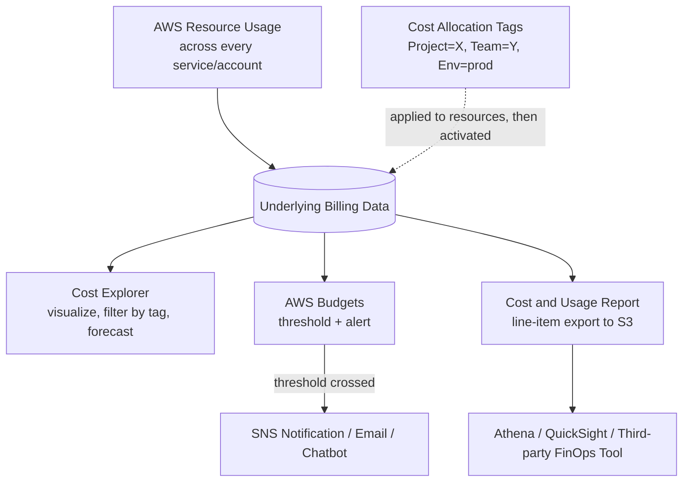

# AWS Cost Management Tools


## Definition

AWS Cost Management is a family of tools — **Cost Explorer**, **AWS Budgets**, the **Cost and
Usage Report (CUR)**, and **cost allocation tags** — that together let you see where your AWS
bill is going, get alerted before it goes over a limit you set, and break spending down by team,
project, or environment.

## Purpose

An AWS bill is one aggregate number covering potentially thousands of resources across every
service and account in an organization — without tools to break it down, "why did our bill jump
30% this month?" is nearly impossible to answer, and "which team's project is actually
expensive?" is unanswerable without manual, error-prone tracking. AWS built this toolset so cost
visibility, forecasting, alerting, and attribution are native capabilities, not something every
company has to build themselves from raw billing exports.

## How It Works

Every resource's usage generates a line item in AWS's underlying billing data. **Cost
allocation tags** (key-value pairs like `Project=Phoenix`, `Team=ML`, `Environment=prod`)
attached to resources get carried through into that billing data once activated, letting every
other tool slice costs by those dimensions. **Cost Explorer** visualizes historical spend with
filtering/grouping by service, tag, account, and provides forecasts. **AWS Budgets** lets you
define a spending (or usage) threshold and get notified — proactively, before you blow past it —
rather than discovering the overage after the invoice arrives. The **Cost and Usage Report** is
the rawest, most granular data source: a detailed, line-item-level export (one row per
resource/hour/usage-type) delivered to S3, suitable for your own analysis in Athena/QuickSight or
a third-party FinOps tool.



Walking through it: (1) every resource you run generates billing data continuously, down to the
hour and usage type; (2) if you've tagged resources and **activated** those tags as cost
allocation tags (a required extra step — tagging alone isn't enough), that tag data flows into
the billing pipeline too; (3) **Cost Explorer** reads that billing data and lets you interactively
group/filter by service, linked account, tag, or usage type, and projects a forecast based on
recent trend; (4) **Budgets** continuously compares actual (or forecasted) spend against a
threshold you define and fires a notification the moment it's crossed — proactive instead of
reactive; (5) the **CUR** delivers the same underlying data at full granularity as files in S3,
for teams that want to build custom dashboards or feed a dedicated cost-analysis tool rather than
relying on the console's built-in views.

## Key Features / Components

- **Cost Explorer** — interactive visualization with grouping/filtering by service, account, tag,
  region, instance type, plus a built-in forecasting model and Reserved Instance/Savings Plans
  recommendations.
- **AWS Budgets** — cost budgets, usage budgets, Reservation/Savings Plans utilization and
  coverage budgets, with configurable alert thresholds (e.g., alert at 80% of forecast) and
  optional automated actions (apply an IAM policy, stop instances) when breached.
- **Cost and Usage Report (CUR)** — the most granular billing export available, hourly/daily
  line items, delivered to S3, the standard input for custom FinOps tooling and Athena queries.
- **Cost Allocation Tags** — user-defined tags (applied by you) or AWS-generated tags (automatic,
  like `aws:createdBy`), which must be explicitly **activated** in the Billing console before
  they appear in cost breakdowns.
- **Cost Anomaly Detection** — ML-based alerting on unusual spending patterns that a static
  threshold budget wouldn't catch (a sudden unexpected spike within an otherwise normal budget).
- **Savings Plans / Reserved Instance recommendations** — Cost Explorer surfaces commitment-based
  discount opportunities based on your actual historical usage pattern.

## Use Cases — When to Use It

- Monthly/quarterly finance review: "what did we spend, by team/project, and why did it change?"
  — Cost Explorer with tag-based grouping.
- Preventing bill shock: setting a budget alert at 80% of a monthly cap so engineering gets
  warned before finance does, with time to react.
- Chargeback/showback to internal teams or external clients — tag-based cost allocation lets a
  shared AWS account still produce per-team or per-client cost breakdowns.
- Deep, custom cost analysis beyond what the console UI supports — exporting the CUR into
  Athena/QuickSight for a bespoke dashboard or feeding a third-party FinOps platform.
- Catching an unexpected cost spike quickly (a misconfigured auto-scaling policy, a forgotten
  large instance) via Cost Anomaly Detection rather than waiting for the monthly invoice.

## When NOT to Use It / Alternatives

- **Real-time per-second cost tracking during an active experiment** — Cost Explorer/CUR data has
  a reporting lag (typically up to 24 hours); if you need truly live cost feedback during a load
  test, instrument your own resource-count-based estimate rather than waiting on billing data.
- **General security/configuration best-practice checks** — that's **Trusted Advisor** (which
  does include a cost-optimization check category, but isn't primarily a cost tool) or
  **AWS Config**, not Cost Explorer.
- **Tiny personal/sandbox accounts with a handful of resources** — the AWS Billing console's basic
  dashboard may be enough; the full toolset earns its complexity at organizational scale with
  many teams/tags/accounts.
- **Third-party multi-cloud cost visibility** — if you also run Azure/GCP spend and want one pane
  of glass, a dedicated FinOps platform (ingesting AWS's CUR as one of several cloud inputs) fits
  better than AWS-native tools alone.

## Why It's Important

**Real-world**: cloud cost overruns are one of the most common operational surprises for
companies new to AWS — resources left running, auto-scaling misconfigured upward with no cap,
or a well-intentioned experiment left active for months. Budgets and Cost Anomaly Detection turn
that from "discovered at month-end" into "caught within hours," and cost allocation tags are what
makes a shared multi-team AWS bill actually explainable rather than a mystery lump sum.

**Exam weight**:
- **SAA-C03 Domain 4 (Design Cost-Optimized Architectures, 20%)** is built around these tools —
  Cost Explorer for identifying optimization opportunities, Budgets for proactive control, and
  cost allocation tags for attribution, across every task statement in that domain.
- **DVA-C03 Domain 4 (Troubleshooting and Optimization, 22%), Task 4.3 — Optimize applications on
  AWS** explicitly covers cost/performance tradeoffs, where Cost Explorer data informs whether an
  optimization (e.g., switching Lambda memory allocation) actually saved money.
- **MLA-C02 Domain 4 (Operating, Monitoring, and Securing ML and AI Solutions, 24%)** names
  **Cost Explorer/Budgets** directly for ML cost optimization (Spot/On-Demand/Reserved choices,
  SageMaker Savings Plans) — ML workloads (GPU training, large endpoints) are often the single
  largest line item, making this domain's cost content unusually practical.
- A recurring exam pattern: given a scenario needing proactive alerting before a spend threshold
  is hit, the answer is **Budgets**; given a scenario needing historical analysis/attribution,
  the answer is **Cost Explorer**; given a scenario needing raw, custom analysis at full
  granularity, the answer is the **CUR**.

## Pricing Model (summary)

**Cost Explorer's standard interface is free.** The **Cost Explorer API** (programmatic access
for custom tooling) is billed per API request beyond a modest free tier. **AWS Budgets**: the
first two budgets created per account are free; additional budgets are billed per budget per day.
**Cost Anomaly Detection is free.** **The Cost and Usage Report itself has no AWS Config/Budgets
style service fee** — you pay standard **S3 storage** for the delivered report files, and if you
query it via **Athena**, standard Athena per-query/per-TB-scanned pricing applies. See:
https://aws.amazon.com/aws-cost-management/pricing/

## Hands-on Lab (Floci)

Floci emulates **AWS Budgets, Cost Explorer (cost synthesized from Floci's own resource state and
pricing snapshots), and Cost and Usage Reports (CUR 2.0/FOCUS 1.2 columns, Parquet emission)** —
plus the **Resource Groups Tagging API** for cost allocation tags — making this category
unusually well-supported for a local lab.

```bash
alias awslocal='aws --endpoint-url=http://localhost:4566 --profile floci'

# 1. Tag a resource for cost allocation
awslocal s3 mb s3://lab-ml-training-data
awslocal resourcegroupstaggingapi tag-resources \
  --resource-arn-list "arn:aws:s3:::lab-ml-training-data" \
  --tags Project=Phoenix,Team=ML,Environment=dev

# 2. Create a monthly cost budget with an alert threshold
awslocal budgets create-budget \
  --account-id 000000000000 \
  --budget '{
      "BudgetName": "lab-monthly-cap",
      "BudgetLimit": {"Amount": "50", "Unit": "USD"},
      "TimeUnit": "MONTHLY",
      "BudgetType": "COST"
    }'

awslocal budgets describe-budgets --account-id 000000000000

# 3. Pull a cost-and-usage breakdown via Cost Explorer
awslocal ce get-cost-and-usage \
  --time-period Start=2026-11-01,End=2026-11-30 \
  --granularity MONTHLY \
  --metrics "UnblendedCost"

# 4. Request a Cost and Usage Report export
awslocal s3 mb s3://lab-cur-exports
awslocal cur put-report-definition --report-definition '{
    "ReportName": "lab-cur",
    "TimeUnit": "DAILY",
    "Format": "Parquet",
    "Compression": "Parquet",
    "S3Bucket": "lab-cur-exports",
    "S3Prefix": "cur",
    "S3Region": "us-east-1"
  }'
```

This is one of the few Management & Governance categories where the Floci lab closely mirrors
real AWS behavior, since cost data is synthesized directly from the resources you've actually
created in your local environment rather than being a disconnected stub.

## Exam Tips

- **Budgets = proactive, threshold-based alerting** ("tell me before/when I hit $X"). **Cost
  Explorer = retrospective/analytical visualization** ("show me where $X went"). Don't swap them.
- **Cost allocation tags must be activated**, not just applied — a classic trap question
  describes tagged resources not showing up in a cost breakdown, and the fix is activating the
  tags in the Billing console, not re-tagging the resources.
- **The CUR is the most granular source** — if a question needs custom analysis beyond the
  console (Athena queries, a BI tool, a custom chargeback system), the CUR is the correct answer
  over Cost Explorer.
- **Savings Plans / Reserved Instance recommendations surface inside Cost Explorer**, based on
  actual historical usage — a cost-optimization question about committing to a discount tier
  often expects you to know where that recommendation comes from.
- Don't confuse this category with **Trusted Advisor's cost-optimization checks** — Trusted
  Advisor flags specific best-practice violations (idle load balancers, underutilized instances)
  across five pillars including cost; the Cost Management tools here are about *spend visibility
  and control*, a related but distinct concern.

## Related Terms

- [Trusted Advisor](trusted-advisor.md) — includes cost-optimization checks as one of five
  categories, distinct from but complementary to this toolset
- [AWS Well-Architected Tool](well-architected-tool.md) — the Cost Optimization pillar references
  these same tools as evidence/practice
- [AWS Config](aws-config.md) — configuration compliance is a separate concern from cost, though
  both inform overall account hygiene
- Glossary: Cost Allocation Tag, Reserved Instance, Savings Plan, FinOps, Chargeback/Showback
