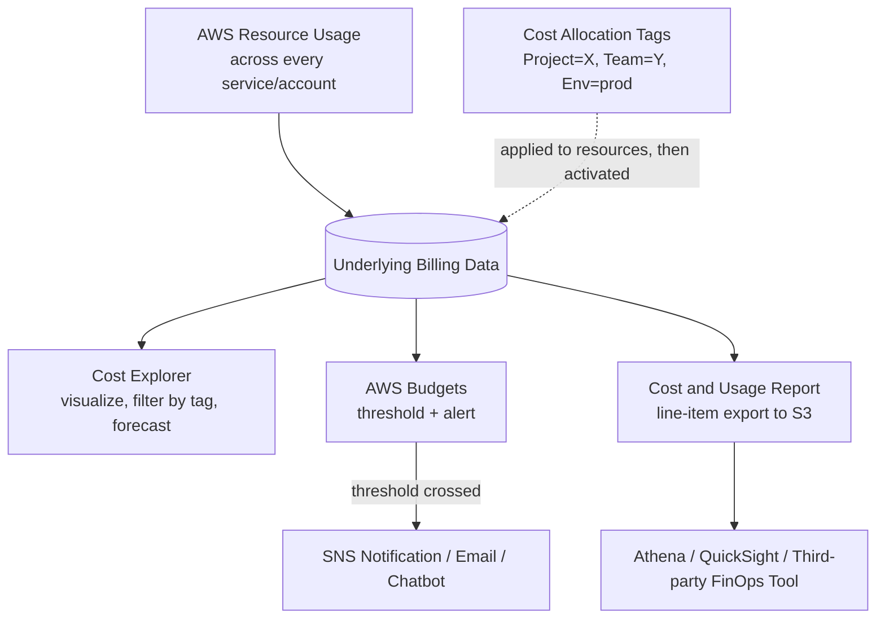
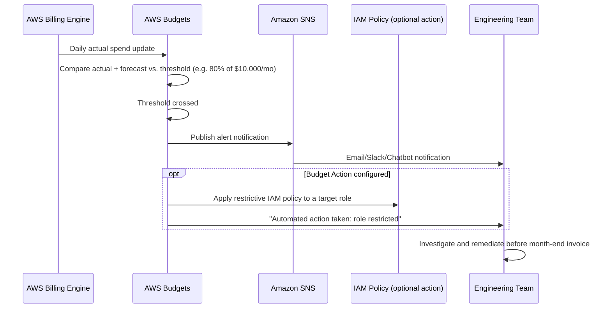
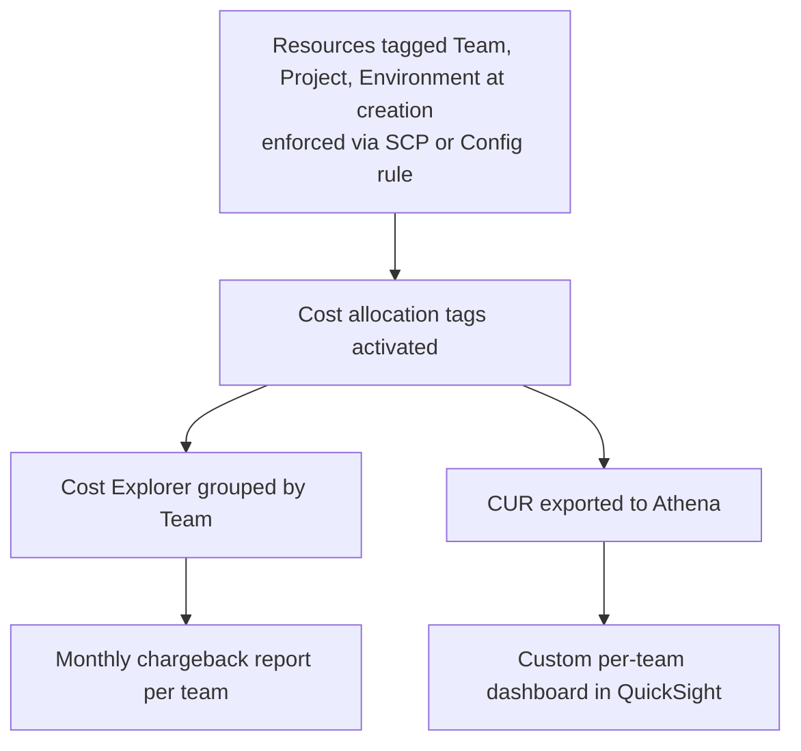

# AWS Cost Management Tools

> **Appears in:** [DVA-C03](../../certifications/dva-c03/README.md) · [MLA-C02](../../certifications/mla-c02/README.md) · [SAA-C03](../../certifications/saa-c03/README.md)


## Definition

AWS Cost Management is a family of tools — **Cost Explorer**, **AWS Budgets**, the **Cost and
Usage Report (CUR)**, and **cost allocation tags** — that together let you see where your AWS
bill is going, get alerted before it goes over a limit you set, and break spending down by team,
project, or environment.

## Purpose

An AWS bill is one aggregate number covering potentially thousands of resources across every
service and account in an organization — without tools to break it down, "why did our bill jump
30% this month?" is nearly impossible to answer, and "which team's project is actually
expensive?" is unanswerable without manual, error-prone tracking. AWS built this toolset so cost
visibility, forecasting, alerting, and attribution are native capabilities, not something every
company has to build themselves from raw billing exports.

The deeper reason this matters at scale: cloud cost is fundamentally different from traditional
IT spend because it's **variable and attributable at a granularity traditional finance tooling
was never built for** — a single shared account can have a thousand teams each spinning resources
up and down continuously. Without tag-based attribution and proactive budget alerting, "who
caused this cost and is it under control" becomes a forensic exercise instead of a routine
report, which is precisely the gap this toolset closes.

## How It Works

Every resource's usage generates a line item in AWS's underlying billing data. **Cost
allocation tags** (key-value pairs like `Project=Phoenix`, `Team=ML`, `Environment=prod`)
attached to resources get carried through into that billing data once activated, letting every
other tool slice costs by those dimensions. **Cost Explorer** visualizes historical spend with
filtering/grouping by service, tag, account, and provides forecasts. **AWS Budgets** lets you
define a spending (or usage) threshold and get notified — proactively, before you blow past it —
rather than discovering the overage after the invoice arrives. The **Cost and Usage Report** is
the rawest, most granular data source: a detailed, line-item-level export (one row per
resource/hour/usage-type) delivered to S3, suitable for your own analysis in Athena/QuickSight or
a third-party FinOps tool.



Walking through it: (1) every resource you run generates billing data continuously, down to the
hour and usage type; (2) if you've tagged resources and **activated** those tags as cost
allocation tags (a required extra step — tagging alone isn't enough), that tag data flows into
the billing pipeline too; (3) **Cost Explorer** reads that billing data and lets you interactively
group/filter by service, linked account, tag, or usage type, and projects a forecast based on
recent trend; (4) **Budgets** continuously compares actual (or forecasted) spend against a
threshold you define and fires a notification the moment it's crossed — proactive instead of
reactive; (5) the **CUR** delivers the same underlying data at full granularity as files in S3,
for teams that want to build custom dashboards or feed a dedicated cost-analysis tool rather than
relying on the console's built-in views.

### Budget alert and action flow, in detail



Walking through it: (1) AWS's billing engine updates actual and forecasted spend roughly daily;
(2) Budgets compares this against the threshold(s) you defined — note you can alert on **actual**
spend, **forecasted** spend, or both, and forecasted alerts give earlier warning since they
predict you'll breach before you actually have; (3) crossing a threshold fires a notification
immediately, not at month-end; (4) optionally, a **Budget Action** goes beyond notification into
automated enforcement — attaching a restrictive IAM policy to a role, or even stopping/stopping
further provisioning for certain resource types, when a budget is exceeded, turning a *warning*
into an actual *guardrail*.

### How It Works — Step by Step: Tracing a Cost Spike From Resource Usage to a Budget Alert

The sequence diagram above shows the general alert flow; here's the same mechanics traced against
one specific, realistic spike — a forgotten large training instance left running over a weekend.

1. **Friday 18:00 — the resource starts generating usage.** An ML engineer launches an
   `m5.4xlarge` instance for a training job and goes home for the weekend without an auto-shutdown
   configured. The instance begins accruing hourly compute charges immediately.
2. **Friday 18:00 → Monday 09:00 — usage accumulates in AWS's billing engine.** Every hour the
   instance runs generates a billing record attributing cost to that specific resource, instance
   type, and (if tags were applied and activated beforehand) the `Team=ML` cost allocation tag.
   This is happening continuously and automatically — no action is needed to "start" cost tracking.
3. **Saturday ~06:00 — Cost Anomaly Detection's model notices.** The anomaly monitor, which has
   learned this account's normal weekend spend pattern (usually near zero for EC2 given this
   team's typical schedule), flags the sustained, unusual `m5.4xlarge` usage as an anomaly roughly
   a day after it starts — anomaly detection needs some sustained deviation to distinguish a real
   anomaly from routine noise, so it isn't instantaneous.
4. **Saturday ~06:05 — an anomaly alert fires.** `get-anomalies` (or the configured SNS/email
   alert) surfaces the anomaly with its estimated dollar impact and affected service — but
   critically, it does **not** say who launched the instance; that requires a second tool.
5. **Monday 09:00 — the on-call engineer investigates.** Using the anomaly's time window and
   service, they query CloudTrail for `RunInstances` calls in that window (see the Logs
   Insights-style cross-reference below), identifying the specific principal and instance type —
   now the "what" (Cost Anomaly Detection) and the "who" (CloudTrail) are both answered.
6. **Monday 09:10 — AWS Budgets independently crosses its own threshold.** Separately, the
   account's `ML-Team-Monthly` budget, tracking forecasted spend, had already crossed its 80%
   warning threshold over the weekend (forecasts react faster than actuals, since they
   extrapolate the trend) and fired its own SNS notification to the team's Slack channel —
   arriving independently of, and often before, the anomaly detection alert, since the two systems
   use different detection logic (threshold vs. ML-based pattern).
7. **Monday 09:15 — remediation.** The engineer terminates the instance. Cost stops accruing
   immediately; the already-incurred weekend charges remain on the bill (there's no retroactive
   credit for "I didn't mean to leave this running" — AWS bills for actual usage).
8. **Following week — Cost Explorer confirms the full picture.** A `get-cost-and-usage` query
   grouped by tag for the affected billing period quantifies exactly how much the forgotten
   instance cost in total dollars, closing the loop with a concrete number for the team's monthly
   retro — distinct from the anomaly alert's *estimate*, which is directional, not the final
   billed amount.
9. **The preventive follow-up.** The team adds a CloudWatch alarm on EC2 instance age/idle time
   for this instance type going forward, and/or an SCP restricting large instance types to a
   shorter default TTL — Cost Anomaly Detection and Budgets both caught this *after* the fact;
   neither tool prevents it from happening again without an additional guardrail.

## Worked Example: A Full Cost Explorer Investigation (Monthly Spend Spike)

A realistic finance-review scenario: this month's bill is 35% higher than last month. Walk the
investigation step by step using the CLI equivalents of what you'd click through in the console:

```bash
# 1. Confirm the overall trend — total cost by month for the last 4 months
aws ce get-cost-and-usage \
  --time-period Start=2026-08-01,End=2026-12-01 \
  --granularity MONTHLY \
  --metrics "UnblendedCost"

# 2. Break the spike month down by service to find the driver
aws ce get-cost-and-usage \
  --time-period Start=2026-11-01,End=2026-12-01 \
  --granularity MONTHLY \
  --group-by Type=DIMENSION,Key=SERVICE \
  --metrics "UnblendedCost"
# Suppose this shows Amazon EC2 jumped from $4,200 to $7,100 — now drill further.

# 3. Break EC2 cost down by usage type to find exactly what changed
aws ce get-cost-and-usage \
  --time-period Start=2026-11-01,End=2026-12-01 \
  --granularity MONTHLY \
  --filter '{"Dimensions":{"Key":"SERVICE","Values":["Amazon Elastic Compute Cloud - Compute"]}}' \
  --group-by Type=DIMENSION,Key=USAGE_TYPE \
  --metrics "UnblendedCost"
# Suppose this shows "BoxUsage:m5.2xlarge" went from near-zero to $2,400 — a new instance type
# appeared that wasn't running last month.

# 4. Attribute that specific usage type by cost allocation tag to find the responsible team
aws ce get-cost-and-usage \
  --time-period Start=2026-11-01,End=2026-12-01 \
  --granularity MONTHLY \
  --filter '{
    "And": [
      {"Dimensions": {"Key": "SERVICE", "Values": ["Amazon Elastic Compute Cloud - Compute"]}},
      {"Dimensions": {"Key": "USAGE_TYPE", "Values": ["BoxUsage:m5.2xlarge"]}}
    ]
  }' \
  --group-by Type=TAG,Key=Team \
  --metrics "UnblendedCost"
# Result: Team=ML accounts for nearly all of it — a training job left running on a large
# instance type over a long weekend, as it turns out.
```

This exact drill-down pattern — **total → by service → by usage type → by tag** — is the standard
shape of a real cost investigation, and it's only possible because cost allocation tags were
activated *before* the spike occurred; tags applied after the fact don't retroactively populate
historical billing data.

### Forecasting a future spend trajectory

```bash
aws ce get-cost-forecast \
  --time-period Start=2026-12-01,End=2027-02-01 \
  --metric UNBLENDED_COST \
  --granularity MONTHLY
```

Cost Explorer's forecast uses recent historical trend (typically the preceding several months) to
project forward — useful for an early warning that a currently-fine budget trajectory is about to
breach before it actually does, which is exactly the signal a forecasted-spend Budget alert acts
on automatically rather than requiring someone to run this command manually every week.

## Key Features / Components

- **Cost Explorer** — interactive visualization with grouping/filtering by service, account, tag,
  region, instance type, plus a built-in forecasting model and Reserved Instance/Savings Plans
  recommendations.
- **AWS Budgets** — cost budgets, usage budgets, Reservation/Savings Plans utilization and
  coverage budgets, with configurable alert thresholds (e.g., alert at 80% of forecast) and
  optional automated actions (apply an IAM policy, stop instances) when breached.
- **Cost and Usage Report (CUR)** — the most granular billing export available, hourly/daily
  line items, delivered to S3, the standard input for custom FinOps tooling and Athena queries.
- **Cost Allocation Tags** — user-defined tags (applied by you) or AWS-generated tags (automatic,
  like `aws:createdBy`), which must be explicitly **activated** in the Billing console before
  they appear in cost breakdowns.
- **Cost Anomaly Detection** — ML-based alerting on unusual spending patterns that a static
  threshold budget wouldn't catch (a sudden unexpected spike within an otherwise normal budget).
- **Savings Plans / Reserved Instance recommendations** — Cost Explorer surfaces commitment-based
  discount opportunities based on your actual historical usage pattern.
- **Budget Actions** — the enforcement layer beyond notification: automatically attach a
  restrictive IAM/SCP policy, or target an EC2/RDS resource for a stop action, when a budget is
  breached, without requiring a human to act first.

## Logs Insights-Style Query: Cross-Referencing Cost Anomalies With CloudTrail

Cost Anomaly Detection flags *that* spend was unusual; it doesn't tell you *who* launched the
resource causing it. Pairing it with CloudTrail closes that gap:

```bash
# 1. Get the anomaly detail (resource/service/time window) from Cost Anomaly Detection
aws ce get-anomalies \
  --date-interval Start=2026-11-15,End=2026-11-22 \
  --monitor-arn arn:aws:ce::123456789012:anomalymonitor/abc-123

# 2. Using the time window and service from the anomaly, search CloudTrail for who launched
#    the matching resource
aws cloudtrail lookup-events \
  --lookup-attributes AttributeKey=EventName,AttributeValue=RunInstances \
  --start-time "2026-11-15T00:00:00Z" \
  --end-time "2026-11-16T00:00:00Z"
```

This combination — **Cost Anomaly Detection for "what and how much," CloudTrail for "who and
when"** — mirrors the exact same "detective tool + audit tool" pairing used throughout this
category (Config + CloudTrail, CloudWatch + CloudTrail), and is worth recognizing as a repeating
pattern across Domain 4 material.

## Common Architectures

**1. Tag-enforced chargeback across a multi-team shared account**



Tag enforcement is usually paired with a preventive control (an SCP or Config rule requiring the
tag at resource creation) — without enforcement, chargeback reporting silently degrades as
untagged resources accumulate in an "unattributed" bucket that nobody is accountable for.

**2. Tiered Budgets: team-level warning, org-level hard stop**

A per-team Budget alerts at 80%/100% of a small monthly allocation (early warning, no automated
action); a top-level organization Budget has a Budget Action attached that restricts further
provisioning if total org spend crosses a hard ceiling — giving teams room to self-correct before
an account-wide enforcement action ever triggers.

**3. CUR → Athena → QuickSight self-service cost dashboard**

For organizations needing dashboards the built-in Cost Explorer UI doesn't support (custom
groupings, blending CUR data with non-AWS spend, year-over-year comparisons with custom
calculated fields), the CUR delivered to S3, queried via Athena, visualized in QuickSight is the
standard DIY FinOps stack — all AWS-native, no third-party tool required.

**4. Savings Plans purchase informed directly by Cost Explorer's recommendation engine**

Rather than guessing at a commitment level, teams pull Cost Explorer's Savings Plans
recommendation (based on trailing 7/30/60-day actual usage) before purchasing a 1- or 3-year
commitment — reducing the risk of over- or under-committing relative to actual, sustained usage.

## Use Cases — When to Use It

1. **Monthly finance review attributed by team/project.** Finance asks "what did we spend, broken
   down by team, and why did it change from last month?" **Why this fits:** Cost Explorer grouped
   by an activated cost allocation tag turns one aggregate invoice number into an attributable
   breakdown by owner. **Tradeoff:** attribution is only as good as tagging discipline — an
   untagged resource silently lands in an "unattributed" bucket that distorts every team's
   reported number unless tagging is enforced (SCP or Config rule) at creation time.

2. **Cost anomaly investigation: a sudden, unexplained spike mid-month.** The bill is tracking 35%
   above the prior month and nobody knows why yet. **Why this fits:** the total → by-service →
   by-usage-type → by-tag drill-down pattern (shown in the worked example) systematically narrows
   an abstract "something got more expensive" into a specific, attributable root cause.
   **Tradeoff:** this drill-down only works if cost allocation tags were activated *before* the
   spike — tags applied after the fact don't retroactively populate historical billing data, so an
   investigation into a tag dimension that wasn't active yet simply returns nothing for that slice.

3. **Proactive bill-shock prevention via threshold alerting.** A team wants to know at 80% of a
   monthly cap, not at 100% on the invoice. **Why this fits:** AWS Budgets evaluates both actual
   and *forecasted* spend continuously and alerts the moment either crosses the configured
   threshold — forecasted alerts specifically give earlier warning than waiting for actual spend to
   catch up. **Tradeoff:** forecasts extrapolate from recent trend; a genuinely new, large,
   one-time cost (a planned migration) with no prior trend produces a forecast that's initially
   inaccurate until enough new history accumulates, which can either cry wolf or under-warn in the
   early days of a real, large change.

4. **Chargeback/showback to internal teams or external clients sharing one AWS account.** A
   managed services provider runs five clients' workloads in one shared account and needs an
   accurate per-client invoice. **Why this fits:** tag-based cost allocation (`Client=Acme`)
   produces a defensible, auditable per-client cost breakdown without needing five separate AWS
   accounts. **Tradeoff:** shared-resource costs (a shared load balancer, a shared NAT Gateway)
   don't naturally attribute to one tag — these need an explicit allocation methodology (even
   split, usage-proportional) agreed on up front, or the chargeback numbers will be disputed.

5. **Deep custom cost analysis beyond the console UI's native groupings.** A FinOps team wants to
   blend AWS spend with internal project metadata in a single BI dashboard, something Cost
   Explorer's UI doesn't support. **Why this fits:** the Cost and Usage Report delivered to S3,
   queried via Athena, joined with an internal project table, supports arbitrary custom analysis
   the built-in console can't. **Tradeoff:** this is a real data engineering effort (pipeline,
   schema management, Athena query cost) — it only pays off at a scale where the console's native
   views are genuinely insufficient, not for a small account where Cost Explorer already answers
   the question.

6. **Infra-as-code rollout cost comparison across environments.** A platform team wants to confirm
   a new, cost-optimized CloudFormation template actually reduces spend after rolling it out to
   staging before promoting to production. **Why this fits:** Cost Explorer filtered by the
   relevant tag/usage-type, compared before/after the rollout date, gives actual dollar evidence —
   not a theoretical pricing-calculator estimate. **Tradeoff:** billing data lags real-time by up
   to roughly 24 hours, so this comparison can't validate a change's cost impact the same day it
   ships; a team needing same-day confidence should instrument their own resource-count-based
   proxy metric instead.

7. **ML/GPU workload commitment sizing (Savings Plans decision).** An ML platform team runs
   bursty, variable GPU training jobs and wants to know whether a 1-year Savings Plan commitment
   would actually pay off given their specific usage pattern. **Why this fits:** Cost Explorer's
   Savings Plans recommendation is based on actual trailing historical usage, not a guess.
   **Tradeoff:** the recommendation is only as representative as the lookback window chosen (7,
   30, or 60 days) — a team whose usage pattern just had an atypical quiet or busy stretch gets a
   skewed recommendation until a longer, more representative window is used.

8. **Catching a cost-driving misconfiguration before month-end (compliance drift's cost cousin).**
   An Auto Scaling policy was misconfigured to never scale back in, quietly running far more
   instances than needed for weeks. **Why this fits:** Cost Anomaly Detection's ML-based alerting
   catches this kind of gradual, sustained deviation from normal spend even though no single static
   threshold was crossed on any single day. **Tradeoff:** anomaly detection needs some history to
   learn what "normal" looks like for this account — a brand-new account or workload with no
   established baseline yet won't benefit from anomaly detection until enough history accumulates.

9. **Multi-account governance: linked-account spend visibility for a central FinOps team.** A
   platform team managing an AWS Organization's billing needs to see every member account's spend
   from one place, not by logging into each account. **Why this fits:** the management account's
   Cost Explorer/Budgets view spans every linked account by default. **Tradeoff:** an individual
   member account's own users typically can't see sibling accounts' spend (by design, for
   least-privilege reasons) — a member-account user asking "why can't I see the whole
   organization's cost" isn't facing a bug, just restricted visibility that requires either
   elevated management-account access or a report generated and shared by the team that has it.

10. **Enforcing an automated hard stop when a cost ceiling is breached.** A sandbox/experimentation
    account must never exceed a strict monthly cap, with enforcement, not just a notification that
    might be missed. **Why this fits:** a Budget Action attaching a restrictive IAM policy (or
    stopping specific resource types) the moment a hard threshold is crossed turns the budget from
    a warning into an actual spend ceiling. **Tradeoff:** an automated restrictive action can also
    disrupt a legitimate, time-sensitive workload mid-task if the cap is crossed unexpectedly —
    Budget Actions need careful scoping (which roles/resources are restricted) to avoid the
    enforcement itself causing an outage.

11. **Post-incident cost reconciliation (incident post-mortem's financial counterpart).** After an
    incident involving unplanned auto-scaling (a traffic spike or a retry storm), the team wants
    to quantify the actual dollar cost of the incident itself, not just the operational impact.
    **Why this fits:** filtering Cost Explorer to the affected service and the specific incident
    window gives a precise, defensible dollar figure for the post-mortem report. **Tradeoff:**
    billing data's ~24-hour lag means this reconciliation can't happen the same day as the
    incident — it's a follow-up analysis, not a live-incident tool.

12. **Validating a performance optimization actually reduced cost, not just changed the shape of
    spend.** A developer increases a Lambda function's memory allocation to reduce duration,
    theoretically lowering cost, but isn't certain the net effect is actually cheaper.
    **Why this fits:** Cost Explorer filtered to the Lambda service and usage type, compared
    before/after the change, gives the actual billed answer rather than relying on the Lambda
    pricing calculator's theoretical estimate. **Tradeoff:** Lambda's cost/duration relationship
    isn't always linear — a memory increase can sometimes raise cost despite faster execution, or
    vice versa, so this validation step is necessary precisely because the theoretical direction
    isn't always obvious in advance.

## When NOT to Use It / Alternatives

- **Real-time per-second cost tracking during an active experiment** — Cost Explorer/CUR data has
  a reporting lag (typically up to 24 hours); if you need truly live cost feedback during a load
  test, instrument your own resource-count-based estimate rather than waiting on billing data.
- **General security/configuration best-practice checks** — that's **Trusted Advisor** (which
  does include a cost-optimization check category, but isn't primarily a cost tool) or
  **AWS Config**, not Cost Explorer.
- **Tiny personal/sandbox accounts with a handful of resources** — the AWS Billing console's basic
  dashboard may be enough; the full toolset earns its complexity at organizational scale with
  many teams/tags/accounts.
- **Third-party multi-cloud cost visibility** — if you also run Azure/GCP spend and want one pane
  of glass, a dedicated FinOps platform (ingesting AWS's CUR as one of several cloud inputs) fits
  better than AWS-native tools alone.

## Why It's Important

**Real-world**: cloud cost overruns are one of the most common operational surprises for
companies new to AWS — resources left running, auto-scaling misconfigured upward with no cap,
or a well-intentioned experiment left active for months. Budgets and Cost Anomaly Detection turn
that from "discovered at month-end" into "caught within hours," and cost allocation tags are what
makes a shared multi-team AWS bill actually explainable rather than a mystery lump sum.

**Exam weight**:
- **SAA-C03 Domain 4 (Design Cost-Optimized Architectures, 20%)** is built around these tools —
  Cost Explorer for identifying optimization opportunities, Budgets for proactive control, and
  cost allocation tags for attribution, across every task statement in that domain.
- **DVA-C03 Domain 4 (Troubleshooting and Optimization, 22%), Task 4.3 — Optimize applications on
  AWS** explicitly covers cost/performance tradeoffs, where Cost Explorer data informs whether an
  optimization (e.g., switching Lambda memory allocation) actually saved money.
- **MLA-C02 Domain 4 (Operating, Monitoring, and Securing ML and AI Solutions, 24%)** names
  **Cost Explorer/Budgets** directly for ML cost optimization (Spot/On-Demand/Reserved choices,
  SageMaker Savings Plans) — ML workloads (GPU training, large endpoints) are often the single
  largest line item, making this domain's cost content unusually practical.
- A recurring exam pattern: given a scenario needing proactive alerting before a spend threshold
  is hit, the answer is **Budgets**; given a scenario needing historical analysis/attribution,
  the answer is **Cost Explorer**; given a scenario needing raw, custom analysis at full
  granularity, the answer is the **CUR**. Expect a worked numeric scenario requiring you to
  identify which usage type or tag group is driving an unexpected cost increase.

## Pricing Model (summary)

**Cost Explorer's standard interface is free.** The **Cost Explorer API** (programmatic access
for custom tooling) is billed per API request beyond a modest free tier. **AWS Budgets**: the
first two budgets created per account are free; additional budgets are billed per budget per day.
**Cost Anomaly Detection is free.** **The Cost and Usage Report itself has no AWS Config/Budgets
style service fee** — you pay standard **S3 storage** for the delivered report files, and if you
query it via **Athena**, standard Athena per-query/per-TB-scanned pricing applies. See:
https://aws.amazon.com/aws-cost-management/pricing/

## Limits & Quotas

| Limit | Default Value | Practical Impact |
|---|---|---|
| Free budgets per account | 2 | Beyond this, each additional budget is billed per budget per day — worth consolidating granular per-project budgets where feasible |
| Cost Explorer historical data | 12 months by default in the console, longer via API with CUR | Multi-year trend analysis typically needs CUR + Athena, not the console UI alone |
| Cost allocation tag activation lag | Up to 24 hours after activation | Tags activated today won't retroactively populate historical cost breakdowns from before activation |
| CUR report delivery frequency | Hourly, daily, or monthly | Hourly granularity multiplies S3 storage and Athena scan costs — choose the coarsest granularity that still answers your actual questions |
| Cost Anomaly Detection monitors | Several per account (soft limit, raisable) | Large organizations monitoring many services/linked accounts separately can approach this |
| Budget Actions per budget | 5 | Rarely a practical constraint, but complex staged-enforcement budgets should plan within it |

## Troubleshooting / Common Issues

- **Tagged resources not appearing in cost breakdowns** — the single most common real-world
  support issue in this category: tags must be **activated** as cost allocation tags in the
  Billing and Cost Management console; applying a tag to a resource alone does not make it appear
  in Cost Explorer/CUR breakdowns.
- **Cost Explorer numbers don't match the actual invoice total** — check whether you're viewing
  **unblended** vs. **blended** vs. **amortized** cost; these are legitimately different metrics
  (unblended = actual charge as billed; blended = averaged across linked accounts sharing RI/
  Savings Plans discounts; amortized = upfront Reserved Instance/Savings Plans costs spread evenly
  over the commitment term) and comparing the wrong one against the invoice looks like a
  discrepancy but isn't.
- **A budget alert never fires despite clearly exceeding the threshold** — confirm the budget's
  **filters/scope** actually include the spend in question (a budget scoped to one linked account
  won't alert on spend in a different account) and that SNS/email notification subscriptions were
  actually confirmed (an unconfirmed SNS subscription silently receives nothing).
- **Forecasted-spend alerts seem wildly inaccurate** — forecasts are based on recent historical
  trend; a genuinely new, large one-time cost (e.g., a planned migration) with no prior trend to
  extrapolate from will produce a forecast that under- or overshoots until enough new history
  accumulates.
- **CUR data missing expected columns** — confirm the CUR version/format (Legacy CUR, CUR 2.0,
  FOCUS) actually includes the column you're querying; column availability differs meaningfully
  between report versions.
- **Savings Plans recommendation looks too aggressive/conservative** — the recommendation is based
  on a specific trailing lookback window (7/30/60 days); a recent, temporary spike or dip in usage
  skews the recommendation until you explicitly choose a longer, more representative lookback.

## Further Reading

- AWS Cost Management User Guide: https://docs.aws.amazon.com/cost-management/latest/userguide/
- Getting started with Cost Explorer:
  https://docs.aws.amazon.com/cost-management/latest/userguide/ce-getting-started.html
- AWS Budgets — Creating a budget:
  https://docs.aws.amazon.com/cost-management/latest/userguide/budgets-create.html
- AWS Cost Management pricing: https://aws.amazon.com/aws-cost-management/pricing/
- Cost and Usage Report User Guide: https://docs.aws.amazon.com/cur/latest/userguide/


*The Cost Explorer interface grouped by usage type — the standard drill-down view for
identifying exactly which usage type is driving a cost change. Source: Amazon CloudWatch User
Guide (Cost Explorer integration), docs.aws.amazon.com (official AWS documentation).*


*Creating an AWS Budget with a monthly cost threshold and email alert recipient. Source: AWS
Hands-On Tutorials, docs.aws.amazon.com (official AWS documentation).*

## Hands-on Lab (Floci)

Floci emulates **AWS Budgets, Cost Explorer (cost synthesized from Floci's own resource state and
pricing snapshots), and Cost and Usage Reports (CUR 2.0/FOCUS 1.2 columns, Parquet emission)** —
plus the **Resource Groups Tagging API** for cost allocation tags — making this category
unusually well-supported for a local lab.

```bash
alias awslocal='aws --endpoint-url=http://localhost:4566 --profile floci'

# 1. Tag a resource for cost allocation
awslocal s3 mb s3://lab-ml-training-data
awslocal resourcegroupstaggingapi tag-resources \
  --resource-arn-list "arn:aws:s3:::lab-ml-training-data" \
  --tags Project=Phoenix,Team=ML,Environment=dev

# 2. Create a monthly cost budget with an alert threshold
awslocal budgets create-budget \
  --account-id 000000000000 \
  --budget '{
      "BudgetName": "lab-monthly-cap",
      "BudgetLimit": {"Amount": "50", "Unit": "USD"},
      "TimeUnit": "MONTHLY",
      "BudgetType": "COST"
    }'

awslocal budgets describe-budgets --account-id 000000000000

# 3. Pull a cost-and-usage breakdown via Cost Explorer
awslocal ce get-cost-and-usage \
  --time-period Start=2026-11-01,End=2026-11-30 \
  --granularity MONTHLY \
  --metrics "UnblendedCost"

# 4. Request a Cost and Usage Report export
awslocal s3 mb s3://lab-cur-exports
awslocal cur put-report-definition --report-definition '{
    "ReportName": "lab-cur",
    "TimeUnit": "DAILY",
    "Format": "Parquet",
    "Compression": "Parquet",
    "S3Bucket": "lab-cur-exports",
    "S3Prefix": "cur",
    "S3Region": "us-east-1"
  }'
```

This is one of the few Management & Governance categories where the Floci lab closely mirrors
real AWS behavior, since cost data is synthesized directly from the resources you've actually
created in your local environment rather than being a disconnected stub.

## Exam Tips

- **Budgets = proactive, threshold-based alerting** ("tell me before/when I hit $X"). **Cost
  Explorer = retrospective/analytical visualization** ("show me where $X went"). Don't swap them.
- **Cost allocation tags must be activated**, not just applied — a classic trap question
  describes tagged resources not showing up in a cost breakdown, and the fix is activating the
  tags in the Billing console, not re-tagging the resources.
- **The CUR is the most granular source** — if a question needs custom analysis beyond the
  console (Athena queries, a BI tool, a custom chargeback system), the CUR is the correct answer
  over Cost Explorer.
- **Savings Plans / Reserved Instance recommendations surface inside Cost Explorer**, based on
  actual historical usage — a cost-optimization question about committing to a discount tier
  often expects you to know where that recommendation comes from.
- **Don't confuse unblended, blended, and amortized cost** — a question presenting slightly
  different numbers for "the same" spend is testing whether you know these are legitimately
  different cost metrics, not a bug.
- **Budget Actions can automatically enforce, not just notify** — a question about automatically
  restricting further spend when a threshold is breached (not just alerting a human) points to
  Budget Actions specifically.
- Don't confuse this category with **Trusted Advisor's cost-optimization checks** — Trusted
  Advisor flags specific best-practice violations (idle load balancers, underutilized instances)
  across five pillars including cost; the Cost Management tools here are about *spend visibility
  and control*, a related but distinct concern.

## Exam Scenario Walkthroughs (SAA-C03 / DVA-C03 / MLA-C02)

**Scenario 1 (SAA-C03, Domain 4).** A finance team wants to be notified *before* the month's
spend exceeds $10,000, not after the invoice arrives, and also wants a breakdown of which team is
responsible once a threshold is crossed. Which two tools, used together, satisfy this?
> **Answer: AWS Budgets for the proactive threshold alert, Cost Explorer (grouped by cost
> allocation tag) for the attribution.** Budgets alone tells you *that* you're approaching the
> limit; it doesn't inherently answer "whose spend is driving it" without being paired with
> tag-based Cost Explorer analysis — a two-tool combination the exam tests directly.

**Scenario 2 (SAA-C03, Domain 4).** A team tagged all their resources `Team=Analytics` three
months ago but the tag has never appeared in any Cost Explorer report. What's the fix?
> **Answer: Activate the tag as a cost allocation tag in the Billing and Cost Management
> console.** Tagging a resource and activating that tag key for cost allocation are two separate,
> required steps — this is the single most common trap in this exam topic.

**Scenario 3 (DVA-C03, Domain 4 — Task 4.3, Optimize applications on AWS).** After switching a
Lambda function's memory allocation from 128 MB to 1024 MB, a developer needs to confirm whether
the change actually reduced cost (faster execution can offset higher per-GB-second pricing). What
tool answers this with actual billing data, not an estimate?
> **Answer: Cost Explorer**, filtered to the Lambda service and grouped by usage type, comparing
> before/after billing periods — this is the authoritative, actual-dollars answer, distinct from
> a theoretical estimate based on the Lambda pricing calculator alone.

**Scenario 4 (MLA-C02, Domain 4).** An ML platform team runs GPU training jobs with highly
variable, bursty usage and wants to know whether committing to a 1-year Savings Plan would
actually save money given their specific usage pattern, without guessing.
> **Answer: Cost Explorer's Savings Plans recommendation**, based on trailing historical usage —
> this is the named, built-in mechanism for exactly this question, distinct from Trusted Advisor
> (which flags idle resources, not commitment-sizing recommendations) and distinct from manually
> estimating from the pricing page.

**Scenario 5 (Cross-cert — distinguishing the right granularity of tool).** A question lists
four needs: (a) alert before a monthly cap is hit, (b) understand historical spend trends by
service, (c) run a custom SQL query joining cost data with internal project metadata, (d) get an
automated flag for a specific idle resource. Match each to Budgets, Cost Explorer, CUR, or
Trusted Advisor.
> **Answer: (a) Budgets, (b) Cost Explorer, (c) CUR (via Athena), (d) Trusted Advisor.** This
> four-way split is the complete mental model for this entire tool category — each need maps to
> exactly one tool's core strength, and the exam frequently tests whether you can make this exact
> match under a disguised scenario description.

## Quick Reference: Which Tool Answers Which Question

A condensed lookup table worth memorizing, since so much of this domain's testing is about
correctly routing a described need to the right tool:

| Question Being Asked | Tool |
|---|---|
| "How much will we spend this month, and can we see it broken down by team?" | Cost Explorer + activated cost allocation tags |
| "Alert me before we blow past a spending cap" | AWS Budgets |
| "I need every line-item billing detail for a custom BI dashboard" | Cost and Usage Report (CUR) |
| "Flag unusual spending that doesn't fit a simple threshold" | Cost Anomaly Detection |
| "Should we commit to a 1-year Savings Plan, and how much?" | Cost Explorer's Savings Plans recommendations |
| "Automatically restrict spend once a hard cap is breached" | AWS Budgets with a Budget Action |
| "Is this specific EC2 instance idle and wasting money?" | Trusted Advisor (Cost Optimization category) — a different tool entirely |

## Further Note on Linked Accounts and Consolidated Billing

In an AWS Organizations setup with multiple linked accounts, cost allocation tags, Budgets, and
Cost Explorer all operate with an important nuance: the **management account** can see and filter
by every linked account's spend, while an individual **member account** typically only sees its
own spend unless explicitly granted broader visibility. This matters for a common exam scenario:
a question describing a member-account user who "can't see the whole organization's cost
breakdown" isn't necessarily facing a misconfiguration — restricted visibility into sibling
accounts' spend is the default, expected behavior for a non-management-account user, and the fix
is either granting appropriate IAM/Billing permissions at the management account level or having
the right person run the query from the management account itself.

## Related Terms

- [Trusted Advisor](trusted-advisor.md) — includes cost-optimization checks as one of five
  categories, distinct from but complementary to this toolset
- [AWS Well-Architected Tool](well-architected-tool.md) — the Cost Optimization pillar references
  these same tools as evidence/practice
- [AWS Config](aws-config.md) — configuration compliance is a separate concern from cost, though
  both inform overall account hygiene
- Glossary: Cost Allocation Tag, Reserved Instance, Savings Plan, FinOps, Chargeback/Showback,
  Unblended/Blended/Amortized Cost, Budget Action
